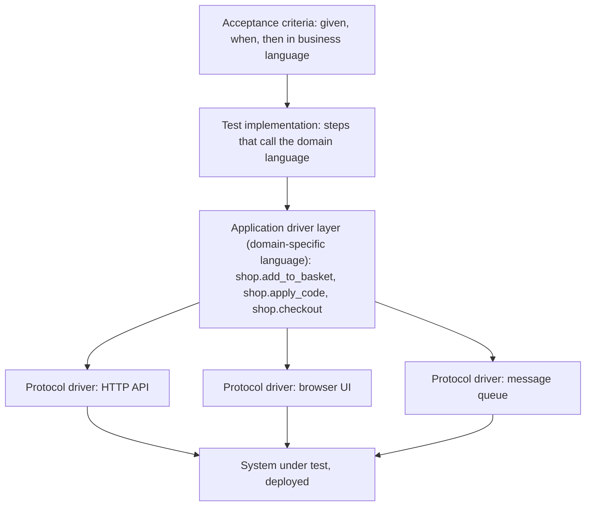
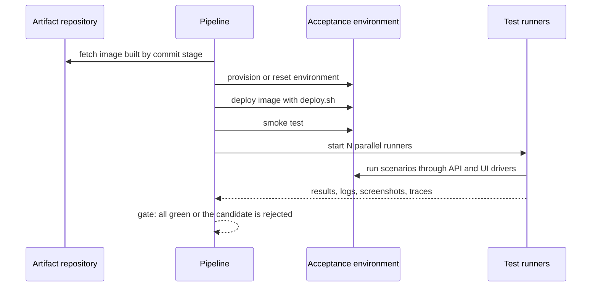

# Acceptance criteria and executable specifications

> **Before this lesson:** read [Testing quadrants and the test pyramid](#/lesson/cicd/quadrants-pyramid) and [Stages, gates and the flow of a change](#/lesson/cicd/pipeline-stages).

## In plain words

When you buy a house, a surveyor works through a checklist agreed in advance: every tap runs, every door locks, the heating comes on. The checklist is written in the buyer's terms — "the heating warms every room" — and not in the builder's terms about pipe diameters.

An **acceptance test** is a checklist item of that kind for software. It checks that the finished, running program does what the business asked for, described in everyday language. The agreed conditions are called **acceptance criteria**.

An **executable specification** is the clever part: the checklist is written so precisely that a computer can run it. The description of what the software should do and the test that proves it are then the same document, and can never drift apart.

Why this matters for a job: these tests decide, automatically, whether a version may go further towards customers. They are also famous for becoming slow and fragile when written badly. Interviewers ask how you keep end-to-end tests maintainable; the layered structure in this lesson is the answer.

## Motivation: all the unit tests pass and the feature does not work

A team ships a "saved baskets" feature. Coverage is 92%. Every class has tests. In the demo, the product owner saves a basket, logs in on another device, and the basket is empty. The serialiser works. The repository works. The controller works. Nobody ever checked that a user can *save a basket and get it back*.

Unit tests answer "does this piece do what its author intended?" An **acceptance test** answers a different question: "does the running system do what the business asked for?" It exercises a deployed application through a public interface, in the terms a user or analyst would use.

Automated acceptance tests are the pipeline's second gate. They are also the practice teams most often get wrong — slow, brittle, abandoned suites are everywhere — so this lesson concentrates on the structure that makes them maintainable. The next lesson covers their hardest operational problems: data, timing and flakiness.

## Why bother, given the cost?

Acceptance tests are more expensive to write and run than unit tests. The argument for paying is about what the alternative costs.

- **Manual regression does not scale.** The set of things that must still work grows with every release. A manual pass that takes two days today takes four next year, and each pass delays every change waiting behind it.
- **They catch what units cannot**: wiring, configuration, deployment, schema mismatches, interactions between components, and plain misunderstanding of the requirement.
- **They protect large refactorings.** Because they are written against behaviour, not structure, you can reorganise the internals and the tests still tell you whether users would notice.
- **They make "done" objective.** A story is finished when its scenarios pass against a deployed build.

They do not replace the other kinds. Exploratory testing finds what nobody specified; unit tests localise faults and run in seconds. Acceptance tests occupy the middle of the confidence-versus-cost range.

## From acceptance criteria to scenarios

Acceptance criteria are the conditions a story must satisfy. Good ones are written before coding, by developers, testers and the product owner together — a conversation sometimes called *three amigos* — and they are concrete examples, not abstractions.

Weak: *"The system should handle discount codes correctly."*

Strong:

```gherkin
Feature: Discount codes at checkout

  Rule: A code cannot reduce the total below zero

    Scenario: Fixed discount larger than the basket
      Given a basket worth 8.00 EUR
      And a valid code "TENOFF" worth 10.00 EUR
      When the customer applies "TENOFF"
      Then the total to pay is 0.00 EUR

  Rule: Expired codes are refused with an explanation

    Scenario: Code expired yesterday
      Given a basket worth 50.00 EUR
      And a code "SPRING" that expired yesterday
      When the customer applies "SPRING"
      Then the total to pay is 50.00 EUR
      And the customer sees "This code has expired"
```

The **given–when–then** shape is a discipline, whatever tool you use: *given* a starting state, *when* one action happens, *then* these outcomes are observable. It forces each scenario to state its preconditions, do one thing, and check something a user could see.

Properties of a good scenario:

- **Business language only.** No CSS selectors, HTTP verbs, table names or button labels. If the page is redesigned, the scenario text should not change.
- **One behaviour.** If it needs "and then… and then…", it is several scenarios.
- **Independent.** It creates what it needs and can run alone, in any order.
- **Declarative.** It says *what* happens ("the customer checks out"), not the clicks that achieve it.

> [!TIP]
> You do not need a Gherkin tool to get the benefit. Plain test functions named for the behaviour, calling a well-designed domain language, are equally "executable specifications" and often easier to maintain. Use Cucumber-style tools when non-programmers genuinely read or write the scenarios.

## The layered structure that keeps suites alive

Suites die when test code talks directly to the application's surface. Two hundred tests each containing `page.click("#btn-checkout-v2")` all break the day that button is renamed. The cure is to put layers between *what* is being specified and *how* the system is driven.



- The **criteria** layer is the specification.
- The **test implementation** layer translates each step into calls on a domain-specific language (DSL).
- The **application driver** layer is that DSL. It exposes operations such as `create_customer`, `add_to_basket`, `checkout`. It is the *only* code that knows how to talk to the system.
- **Protocol drivers** underneath do the actual HTTP calls, browser automation or message sending.

When the checkout button moves, exactly one method in one driver changes. This is the same idea as the *page object* pattern for UI tests, taken one step further so the tests do not know whether a page exists at all.

### Prefer the API to the UI

Driving a browser is the slowest and most fragile way to exercise behaviour. If the application has a service API beneath its UI (and it should), run most acceptance tests against that API. Keep a small number of true UI journeys to prove the front end is wired to the back end. Because of the driver layer, the same scenario can run through either channel:

```python-run
# --- system under test (stands in for a deployed service) --------------------
class ShopBackend:
    def __init__(self):
        self.customers, self.baskets, self.codes, self.next_id = {}, {}, {}, 1
    def post(self, path, body):
        if path == "/customers":
            cid = self.next_id; self.next_id += 1
            self.customers[cid] = body; self.baskets[cid] = {"items": [], "code": None}
            return 201, {"id": cid}
        if path.endswith("/items"):
            self.baskets[int(path.split("/")[2])]["items"].append(body); return 201, {}
        if path.endswith("/code"):
            cid = int(path.split("/")[2]); code = self.codes.get(body["code"])
            if not code or code["expired"]:
                return 422, {"error": "This code has expired"}
            self.baskets[cid]["code"] = code; return 200, {}
        return 404, {}
    def get(self, path):
        b = self.baskets[int(path.split("/")[2])]
        subtotal = sum(i["price_cents"] for i in b["items"])
        off = b["code"]["cents"] if b["code"] else 0
        return 200, {"total_cents": max(0, subtotal - off)}

# --- protocol driver: the only code that knows URLs and payload shapes -------
class ApiDriver:
    def __init__(self, backend): self.b = backend
    def new_customer(self, name): return self.b.post("/customers", {"name": name})[1]["id"]
    def add_item(self, cid, cents): self.b.post(f"/baskets/{cid}/items", {"price_cents": cents})
    def apply_code(self, cid, code):
        status, body = self.b.post(f"/baskets/{cid}/code", {"code": code})
        return body.get("error")
    def total(self, cid): return self.b.get(f"/baskets/{cid}/total")[1]["total_cents"]

# --- application driver: the domain language the tests are written in --------
class Shop:
    def __init__(self, driver, backend):
        self.d, self.backend, self.message = driver, backend, None
    def given_customer_with_basket_worth(self, euros):
        self.cid = self.d.new_customer("test-" + str(id(self)))      # unique per test
        self.d.add_item(self.cid, round(euros * 100)); return self
    def given_code(self, name, euros, expired=False):
        self.backend.codes[name] = {"cents": round(euros * 100), "expired": expired}; return self
    def when_customer_applies(self, name):
        self.message = self.d.apply_code(self.cid, name); return self
    def then_total_is(self, euros):
        got = self.d.total(self.cid) / 100
        assert got == euros, f"expected {euros}, got {got}"; return self
    def then_customer_sees(self, text):
        assert self.message == text, f"expected {text!r}, got {self.message!r}"; return self

# --- the executable specifications ------------------------------------------
def scenario_fixed_discount_never_goes_negative(shop):
    (shop.given_customer_with_basket_worth(8.00)
         .given_code("TENOFF", 10.00)
         .when_customer_applies("TENOFF")
         .then_total_is(0.00))

def scenario_expired_code_is_refused(shop):
    (shop.given_customer_with_basket_worth(50.00)
         .given_code("SPRING", 5.00, expired=True)
         .when_customer_applies("SPRING")
         .then_total_is(50.00)
         .then_customer_sees("This code has expired"))

backend = ShopBackend()
for scenario in (scenario_fixed_discount_never_goes_negative, scenario_expired_code_is_refused):
    scenario(Shop(ApiDriver(backend), backend))
    print("PASS", scenario.__name__.replace("scenario_", "").replace("_", " "))
```

Read the two `scenario_` functions on their own. They contain no URL, no JSON, no status code. If the API moves from REST to GraphQL, only `ApiDriver` changes. To run the same scenarios through a browser, write a `BrowserDriver` with the same four methods.

### A real UI journey, kept thin

For the handful of journeys that must go through the browser, keep selectors in one place and prefer selectors tied to meaning (roles, labels, test ids) over layout:

```python
# tests/acceptance/drivers/browser.py  (Playwright)
class CheckoutPage:
    def __init__(self, page):
        self.page = page

    def apply_code(self, code: str) -> None:
        self.page.get_by_label("Discount code").fill(code)
        self.page.get_by_role("button", name="Apply").click()

    def total(self) -> str:
        return self.page.get_by_test_id("order-total").inner_text()
```

## Who writes them, and when

Acceptance tests work best as a shared activity:

- The **product owner or analyst** supplies examples and decides which behaviour matters.
- **Testers** probe the examples for gaps — the sad paths, boundaries and odd combinations.
- **Developers** implement the driver layer and keep the tests running as part of their normal work.

The critical rule is ownership: **the developers who can break the tests are responsible for keeping them green.** When a separate test-automation team owns the suite, failures are discovered late, by people who did not make the change and cannot easily fix it, and the suite drifts out of date.

Write the scenarios at the start of a story, automate them alongside the code, and treat a story as done when they pass in the pipeline.

## The acceptance stage in the pipeline



```yaml
  acceptance:
    needs: commit-stage
    runs-on: ubuntu-latest
    environment: acceptance
    timeout-minutes: 45
    strategy:
      fail-fast: false
      matrix:
        shard: [1, 2, 3, 4, 5, 6]
    steps:
      - uses: actions/checkout@v4
      - run: make setup
      - run: uv run pytest tests/acceptance --base-url "${{ vars.ACCEPTANCE_URL }}" --splits 6 --group ${{ matrix.shard }} --junitxml=reports/acceptance-${{ matrix.shard }}.xml
      - if: failure()
        uses: actions/upload-artifact@v4
        with:
          name: acceptance-evidence-${{ matrix.shard }}
          path: |
            reports/
            test-results/        # screenshots, traces, videos
```

Rules for the stage:

- **A red acceptance stage stops the line**, exactly as a red commit stage does. If the team routinely merges on top of it, it is no longer a gate.
- **Failures must be diagnosable from the artefacts.** Capture application logs, screenshots, browser traces and the API calls made. A failure that can only be understood by re-running it locally is a suite that will rot.
- **Record a failing scenario's run** as evidence; many tools produce a trace that can be replayed step by step.
- **Deployment tests come first.** If the smoke test fails, do not run 400 scenarios against a dead environment.

## Keeping the suite fast enough

Acceptance suites often take longer than is comfortable. Options, cheapest first:

1. **Share expensive set-up carefully.** Start the application once per run, not once per test. But do not share *data* between tests.
2. **Go through the API** for set-up even in UI tests. Create the customer and basket with API calls; use the browser only for the behaviour under test.
3. **Run in parallel**, which requires tests to be independent (next lesson).
4. **Cut duplication with lower levels.** If thirty scenarios vary only in a calculation, keep two at this level and move the rest to unit tests.
5. **Scale out** across many runners or ephemeral environments.

## Pitfalls

- **Scenarios written as click scripts**: "Given I am on /login, when I type 'bob' into #user…". They specify the UI, not the behaviour, and break constantly.
- **Recording tools.** Record-and-playback output has no abstraction; it is unmaintainable beyond a demo.
- **Testing everything through the UI.** Slow, flaky, and usually redundant with API-level tests.
- **Asserting on incidental details** such as exact wording, pixel positions or internal ids, when the criterion does not mention them.
- **Tests that reach into the database** to check results. They couple the suite to the schema; assert through the public interface.
- **A suite owned by another team**, so developers neither run nor fix it.
- **Too many scenarios.** Exhaustive combinations belong lower in the pyramid.

> [!WARNING]
> Do not let acceptance tests bypass the system through "back doors" for verification unless there is no alternative. A test that inserts rows directly or reads private tables passes when the public behaviour is broken and fails when the schema is refactored. Set up state through the same interfaces users and integrations use, with dedicated test-support endpoints only where truly necessary and never deployed to production.

> [!INTERVIEW]
> "How do you stop end-to-end tests becoming a maintenance burden?" Structure and scope. Structure: write scenarios in business language, route all interaction through an application-driver layer so a UI change touches one place, prefer the API over the browser. Scope: a small number of high-value journeys at this level, with edge cases pushed down to unit tests. Operations: isolated test data, no sleeps, parallel execution, rich failure artefacts, and the delivery team owning the suite with zero tolerance for flaky tests.

## Summary

- Acceptance tests verify that a deployed system meets business-facing criteria; they catch integration, configuration and requirement errors that unit tests cannot.
- Write criteria as concrete given–when–then examples in business language, one behaviour each, independent of the others.
- Separate specification from mechanics with layers: scenarios, test implementation, an application-driver DSL, and protocol drivers. A change to the interface then touches one place.
- Drive most tests through the API; keep a few thin UI journeys.
- The delivery team owns the suite; a red acceptance stage stops the line; failures must come with enough evidence to diagnose.
- Keep the suite lean and parallel, and push detail down the pyramid.

## Glossary

- **Acceptance test** — a test that the running system meets a business requirement.
- **Acceptance criteria** — the agreed conditions a piece of work must satisfy.
- **Executable specification** — a description of required behaviour that a computer can run as a test.
- **Given-when-then** — a way of writing a scenario: a starting state, one action, the expected outcome.
- **Scenario** — one concrete example of behaviour, written as a test.
- **Gherkin** — a plain-language format for writing given-when-then scenarios.
- **Domain-specific language (DSL)** — a small vocabulary of operations in the terms of the business, used by tests.
- **Application driver** — the layer of test code that knows how to operate the system.
- **Protocol driver** — the code that performs the actual calls: web requests, browser clicks, messages.
- **API** — an interface through which programs, as opposed to people, use a system.
- **UI** — user interface: the screens a person uses.
- **Page object** — a class that hides the details of one screen behind readable operations.
- **Regression test** — a test that guards behaviour which already works.
- **Sharding** — splitting a test suite across several machines.

## Check yourself

```quiz
[
  {"q": "What question does an acceptance test answer that a unit test does not?",
   "options": ["Does this function return the right value?", "Does the deployed system deliver the behaviour the business specified?", "Is the code formatted correctly?", "How many lines are covered?"],
   "answer": 1,
   "explain": "Acceptance tests run against the running application and are expressed in terms of user-visible behaviour."},
  {"q": "Which scenario step is written at the right level of abstraction?",
   "options": ["When I click the element with id btn-pay-2", "When the customer pays by card", "When a POST is sent to /api/v3/payments", "When the payments table gets a new row"],
   "answer": 1,
   "explain": "Business language survives changes to the UI, API and schema. The other options tie the specification to an implementation detail."},
  {"q": "What is the role of the application driver layer?",
   "options": ["It stores test results", "It is the single place that knows how to interact with the system, exposing domain operations to the tests", "It replaces the CI server", "It generates test data randomly"],
   "answer": 1,
   "explain": "Concentrating interaction knowledge in one layer means an interface change is fixed once instead of in every test."},
  {"q": "Why run most acceptance tests against the service API instead of the browser UI?",
   "options": ["Browsers cannot be automated", "API-level tests are faster and less brittle, while still exercising the deployed system", "The UI is never important", "APIs do not need tests"],
   "answer": 1,
   "explain": "The UI is the most volatile and slowest surface. A few UI journeys prove the wiring; the bulk of behaviour is checked beneath it."},
  {"q": "Who should be responsible for keeping the acceptance suite green?",
   "options": ["A separate automation team", "The delivery team whose changes can break it", "The product owner alone", "Nobody; failures are expected"],
   "answer": 1,
   "explain": "When the people who break tests also fix them, failures are caught and repaired quickly and the suite stays current."},
  {"q": "The smoke test fails right after deploying to the acceptance environment. What should the stage do?",
   "options": ["Run the full suite anyway", "Fail immediately with the deployment error", "Retry the suite three times", "Mark the build as passed"],
   "answer": 1,
   "explain": "Running hundreds of scenarios against a broken deployment wastes time and buries the real cause in noise."},
  {"q": "Thirty acceptance scenarios differ only in the numbers fed to a tax calculation. What is the better design?",
   "options": ["Keep all thirty", "Keep a couple at acceptance level and cover the variations with unit tests of the calculation", "Delete them all", "Convert them to manual tests"],
   "answer": 1,
   "explain": "Pure logic variations are cheaper and clearer at unit level. Acceptance tests only need to show the calculation is wired in."},
  {"q": "Why is checking results by querying the application's database directly discouraged?",
   "options": ["Databases are slow", "It couples tests to the schema and can pass while the public behaviour is broken", "SQL cannot be used in tests", "It needs too much memory"],
   "answer": 1,
   "explain": "Assertions should go through the same interface users rely on, so tests verify behaviour and survive refactoring."}
]
```

> **Source:** Humble & Farley, *Continuous Delivery*, ch. 8 (automated acceptance testing: creating tests, the application driver layer, the acceptance test stage, performance). Gherkin reference: https://cucumber.io/docs/gherkin/reference/ — Playwright locators: https://playwright.dev/python/docs/locators
