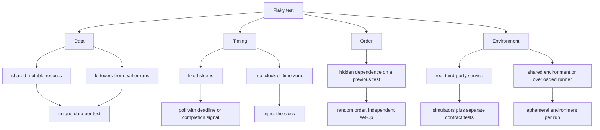

# Test data, asynchrony and flaky tests

> **Before this lesson:** read [Acceptance criteria and executable specifications](#/lesson/cicd/executable-specs). A **timeout**, used below, is a limit on how long to wait.

## In plain words

A smoke alarm that goes off whenever someone makes toast is soon ignored, and eventually has its battery taken out. Then there is a real fire, and nobody reacts.

A **flaky test** is that alarm. It is a test that sometimes passes and sometimes fails although the program has not changed. A team with flaky tests learns to answer every failure by clicking "run again", and then misses the failure that mattered.

There are a few common causes, and this lesson covers each with its cure:

- **Test data**: the records a test needs in order to run. Two tests that share the same records get in each other's way.
- **Asynchrony**: work that finishes "a little later", in the background. A test that waits a fixed two seconds is sometimes too impatient.
- **Order**: a test that only passes when another test has run first.

Why this matters for a job: flaky tests are one of the biggest practical frustrations in engineering teams, and "how do you deal with flaky tests?" is asked in a large share of interviews.

## Motivation: "just re-run it"

The acceptance stage fails. A developer looks at the red job, recognises the test — "oh, that one" — and clicks re-run. It passes. Nobody investigates. A month later there are a dozen "those ones", every pipeline run needs a retry or two, and when a real regression turns a test red, it gets re-run three times before anyone believes it.

A test that can pass and fail on the same code is called **flaky**. Flakiness is the main reason acceptance suites lose the team's trust, and a suite that is not trusted is not a gate. The causes are few and well understood: shared or leftover data, waiting on time instead of on events, dependence on order, and reliance on things outside the test's control. This lesson works through each cause and its cure, then shows how to detect, quarantine and manage flaky tests as an operational routine.

## Why a small flake rate is a large problem

Suppose each test fails spuriously once in two hundred runs — it sounds negligible. With $n$ such tests, the chance that a run of a *perfectly good* commit is green is $0.995^n$.

```python-run
print(f"{'tests':>6} {'P(clean run) at 0.5%':>22} {'at 0.1%':>10} {'at 0.01%':>10}")
for n in (10, 50, 200, 500, 2000):
    print(f"{n:>6} {0.995 ** n:>22.1%} {0.999 ** n:>10.1%} {0.9999 ** n:>10.1%}")

print()
import random
rng = random.Random(4)
def run_suite(n, flake, has_real_bug):
    failures = sum(rng.random() < flake for _ in range(n))
    return failures + (1 if has_real_bug else 0)

red_runs = bug_runs = 0
for _ in range(5000):
    bug = rng.random() < 0.03                 # 3% of commits contain a real regression
    if run_suite(500, 0.005, bug):
        red_runs += 1
        bug_runs += bug
print(f"500 tests at 0.5% flake: {red_runs / 5000:.0%} of runs are red;")
print(f"only {bug_runs / red_runs:.1%} of red runs contain a real regression")
```

At five hundred tests, nine runs in ten are red, and fewer than one red run in twenty-five signals a real problem. People respond rationally to that ratio: they stop reading failures. That is why the target for flakiness is not "low" but **effectively zero**, enforced by process.

## Cause 1: test data and shared state

### Isolation is the goal

Every test should be able to assume a known starting state and should not be able to affect any other test. Three ways to get there:

| strategy | how | trade-off |
|---|---|---|
| **Fresh state per test** | create a new database or schema, or roll back a transaction, for each test | perfectly isolated; can be slow at acceptance level |
| **Unique data per test** (functional partitioning) | each test creates its own customer, order, tenant with generated identifiers and only touches those | fast, parallel-friendly; requires discipline and an application that supports many independent entities |
| **Shared reset between runs** | restore a baseline snapshot before the whole suite | cheap; tests within a run can still interfere |

For acceptance suites the second strategy is usually the best: every test begins by creating the entities it needs through the application's public interface, with names nobody else will use.

```python
import uuid

def unique(prefix: str) -> str:
    return f"{prefix}-{uuid.uuid4().hex[:10]}"

def test_returning_customer_gets_free_shipping(shop):
    customer = shop.create_customer(email=f"{unique('ret')}@test.example")
    shop.place_order(customer, sku="BOOK-1")           # the previous order this test needs
    basket = shop.new_basket(customer, sku="BOOK-2")
    assert shop.quote(basket).shipping == 0
```

Because the test owns everything it touches, it can run at the same time as a thousand others against the same environment.

### Three categories of data

It helps to separate the data a test deals with:

- **Test-specific data** drives the behaviour being checked. The test creates it, and it is unique to that test.
- **Test reference data** must exist for the scenario to make sense but is not the point — a product catalogue, a currency list. It can be shared, provided no test modifies it.
- **Application reference data** is needed for the system to start at all — configuration rows, lookup tables. It is created by migrations or seed scripts as part of deployment.

Problems start when a test *changes* shared reference data ("set the VAT rate to 25% for this scenario"). Either make that data test-specific (a tenant or region created for the test) or run such tests serially in isolation.

### Build state through the front door

Tempting shortcut: load a database dump with everything pre-arranged. It breaks whenever the schema changes, hides what each test actually depends on, and lets tests rely on data that the application itself could never have produced. Prefer creating state through the application's API. The set-up then exercises real code paths, survives schema refactoring, and documents the preconditions in the test itself.

Where API set-up is too slow for volume (capacity tests need a million orders), generate data with scripts that use the application's own domain logic, and store the recipe rather than the dump.

> [!WARNING]
> Never use an unmodified copy of production data in test environments. It contains personal data, it is usually far too large to give fast feedback, and it changes underneath you. If realistic shape matters, generate synthetic data or use a properly anonymised and subsetted extract, produced by a repeatable, reviewed process.

## Cause 2: time and asynchrony

Modern systems are asynchronous: a request returns 202, a worker processes a queue, a UI updates when data arrives. A test must wait for the outcome — and how it waits decides whether it is reliable.

**The wrong way: sleep.**

```python
shop.place_order(basket)
time.sleep(5)                       # hope the confirmation email was sent by now
assert mailbox.count(customer) == 1
```

If processing takes six seconds on a busy runner, the test fails. If it takes fifty milliseconds, the test wastes almost five seconds, and a suite of four hundred such tests wastes half an hour.

**The right way: poll for the condition, with a deadline.**

```python-run
import random

class Clock:                                   # simulated time so the demo runs instantly
    def __init__(self): self.t = 0.0
    def sleep(self, s): self.t += s

def wait_until(condition, clock, timeout=10.0, interval=0.1):
    """Return as soon as condition() is true; fail clearly at the deadline."""
    deadline = clock.t + timeout
    while clock.t < deadline:
        if condition():
            return True
        clock.sleep(interval)
    return False

def trial(strategy, rng):
    clock = Clock()
    done_at = rng.lognormvariate(-0.3, 0.9)    # async job latency: usually < 1s, occasionally several
    if strategy == "sleep 2s":
        clock.sleep(2.0)
        ok = clock.t >= done_at
    else:
        ok = wait_until(lambda: clock.t >= done_at, clock)
    return ok, clock.t

rng = random.Random(21)
for strategy in ("sleep 2s", "poll, 10s deadline"):
    results = [trial(strategy, rng) for _ in range(20_000)]
    fails = sum(not ok for ok, _ in results)
    mean = sum(t for _, t in results) / len(results)
    print(f"{strategy:<20} false failures {fails / len(results):6.2%}   mean wait {mean:4.2f}s")
```

Polling is both faster on average and far more reliable, because it waits exactly as long as needed up to a generous limit. Every serious test tool has this built in: Playwright's locators auto-wait and its `expect(...)` assertions retry until a timeout; Testing Library has `findBy…`; libraries such as Awaitility and tenacity do the same for back-end checks.

```python
from playwright.sync_api import expect

page.get_by_role("button", name="Place order").click()
expect(page.get_by_test_id("order-status")).to_have_text("Confirmed", timeout=15_000)
```

**Better still: remove the need to wait.** Give the system a way to signal completion — a status endpoint, an event the test can subscribe to, a synchronous mode for the background worker in the test environment. And for anything involving calendar time (trial expiry, scheduled jobs, token lifetimes), inject the clock so tests can move time rather than wait for it (Lesson 13).

## Cause 3: order dependence

A test passes only when another test has run first (and left some data), or fails only when another has run first (and left some data). The suite appears stable for months because the order never changes, then breaks the day someone adds parallelism or renames a file.

Defences:

- every test creates its own preconditions and assumes nothing about predecessors,
- run the suite in **random order** routinely, printing the seed so a failing order can be reproduced,
- run in parallel from early in the project's life, when making tests independent is still cheap.

```bash
pytest -p randomly -p xdist -n 8          # random order, 8 workers
pytest -p randomly -p "randomly_seed=1234567"   # reproduce a specific order
```

## Cause 4: things outside your control

- **Real external services.** Rate limits, sandbox outages and network blips become your failures. Use a simulator (stub service) for acceptance tests, and keep a few dedicated contract or integration tests against the real thing in their own stage.
- **Shared environments.** Another team's deployment or test run changes the system mid-test. Give each pipeline run its own environment or namespace where possible.
- **Resource contention on runners.** A test that relies on something finishing "within 200 ms" fails on a loaded machine. Assert on outcomes, not on tight timings.
- **Leaking resources.** Ports, temp files, browser instances and containers left behind by one test break the next. Clean up in teardown that runs even on failure.
- **Non-determinism in the test itself**: unseeded randomness, iteration over unordered collections, dependence on the current date or locale.



## Managing flakiness as a process

Prevention is not enough; some flakiness always appears. What matters is a routine that removes it quickly.

### Detect it from history

A single red run cannot distinguish a flake from a regression. History can. A test that both passed and failed **on the same commit** is flaky by definition: the code did not change, so the difference came from somewhere else.

```python-run
from collections import defaultdict

runs = [  # (commit, test, passed)
    ("c1", "checkout_happy_path", True), ("c1", "refund_emits_event", True),  ("c1", "search_by_tag", True),
    ("c2", "checkout_happy_path", True), ("c2", "refund_emits_event", False), ("c2", "search_by_tag", True),
    ("c2", "checkout_happy_path", True), ("c2", "refund_emits_event", True),  ("c2", "search_by_tag", True),
    ("c3", "checkout_happy_path", False),("c3", "refund_emits_event", True),  ("c3", "search_by_tag", True),
    ("c3", "checkout_happy_path", False),("c3", "refund_emits_event", False), ("c3", "search_by_tag", True),
    ("c3", "checkout_happy_path", False),("c3", "refund_emits_event", True),  ("c3", "search_by_tag", True),
]

outcomes = defaultdict(lambda: defaultdict(set))
for commit, test, passed in runs:
    outcomes[test][commit].add(passed)

for test, by_commit in sorted(outcomes.items()):
    mixed = sorted(c for c, seen in by_commit.items() if seen == {True, False})
    always_red = sorted(c for c, seen in by_commit.items() if seen == {False})
    if mixed:
        verdict = f"FLAKY (mixed results on {mixed})"
    elif always_red:
        verdict = f"REAL FAILURE since {always_red[0]}"
    else:
        verdict = "healthy"
    print(f"{test:<22} {verdict}")
```

`checkout_happy_path` fails every time on `c3`: that is a regression, so revert or fix. `refund_emits_event` gives both results on the same commits: that is a flake. CI platforms and test-analytics tools compute exactly this; one of this module's problems asks you to implement it.

### Quarantine, with an owner and a deadline

Once identified, a flaky test should stop blocking the pipeline immediately — but not disappear.

1. Move it to a **quarantine** set that still runs on every build but does not gate.
2. Open a ticket with an **owner** and a **deadline**.
3. Fix the cause, or delete the test if it is not worth fixing. Quarantine is a waiting room, not storage.
4. Cap the quarantine size. If it is full, nothing new goes in until something comes out.

```python
# conftest.py -- quarantined tests run and report, but cannot fail the gate
import pytest

def pytest_collection_modifyitems(items):
    for item in items:
        if item.get_closest_marker("quarantine"):
            item.add_marker(pytest.mark.xfail(strict=False, reason="quarantined flaky test"))
```

```python
@pytest.mark.quarantine(ticket="FLAKY-312", owner="dana", until="2026-12-01")
def test_refund_emits_event(shop): ...
```

### Retries: a diagnostic tool, not a cure

Automatic retry-on-failure makes the pipeline green and hides the problem, including real intermittent bugs in the product — a race condition in production looks exactly like a flaky test. If you use retries at all:

- allow at most one retry, only in the acceptance stage, never for unit tests,
- record every test that needed a retry and feed it into the flaky-test report,
- treat "passed on retry" as a defect to be fixed.

> [!TIP]
> When investigating a flake, reproduce it by running the single test many times: `pytest tests/acceptance/test_refund.py --count=200 -x` (with pytest-repeat) or in a loop on a loaded machine. A test that fails 1 in 200 runs cannot be debugged by running it once.

## Worked example: repairing a flaky test

```python
def test_order_confirmation_email():
    shop.login("qa-user@example.com")                   # (1) shared account
    shop.add_to_basket("BOOK-1")
    shop.checkout()
    time.sleep(3)                                       # (2) fixed sleep
    emails = mailhog.messages()                         # (3) reads everyone's mail
    assert emails[0]["subject"] == "Order confirmed"    # (4) assumes ordering
```

Four defects: a shared account whose basket other tests also modify; a sleep; reading a global mailbox; and assuming the newest message is ours. The repaired version:

```python
def test_order_confirmation_email(shop, mailbox):
    customer = shop.create_customer(email=f"{unique('conf')}@test.example")
    shop.add_to_basket(customer, "BOOK-1")
    order = shop.checkout(customer)

    message = mailbox.wait_for(to=customer.email, subject="Order confirmed", timeout=15)
    assert order.reference in message.body
```

It owns its data, waits for a specific event with a deadline, and filters by its own unique recipient. It can now run in parallel, in any order, indefinitely.

## Pitfalls

- **Normalising the re-run button.** Every unexplained re-run is an uninvestigated defect.
- **Unbounded quarantine.** Tests go in and never come out; coverage silently erodes.
- **Raising timeouts globally** to hide slowness, turning a five-second failure into a five-minute one.
- **Cleaning up only on success.** Leftovers from failed tests poison later runs.
- **A shared "golden" database** hand-edited over years, which nobody can recreate.
- **Assuming a flake is the test's fault.** Sometimes the test is correctly reporting a race in the product.

> [!INTERVIEW]
> "How do you deal with flaky tests?" Give a system, not a wish. Detect: track pass/fail per test per commit and flag any test with mixed results on the same commit. Contain: quarantine immediately so the gate stays trustworthy, with an owner, a ticket and a deadline, and a cap on quarantine size. Cure: fix root causes — unique test data, condition-based waits, injected clocks, random order, simulators for third parties, isolated environments. Prevent: no sleeps in review, parallel and random order from day one, and no blanket retries.

## Summary

- Flaky tests destroy trust faster than their individual failure rates suggest; the goal is effectively zero.
- Isolate data: each test creates unique entities through the public interface and never mutates shared reference data.
- Wait for conditions with a deadline, or for an explicit completion signal; never use fixed sleeps; inject the clock.
- Make tests order-independent and prove it with random, parallel runs.
- Replace uncontrolled dependencies with simulators and give each run its own environment.
- Detect flakes from history (mixed outcomes on one commit), quarantine them with an owner and a deadline, and treat retries as evidence rather than a fix.

## Glossary

- **Flaky test** — a test that can pass and fail on the same code.
- **Test data** — the records a test needs in order to run.
- **Isolation** — arranging tests so that none can affect another.
- **Reference data** — data that must exist for the system or a scenario to make sense, such as a product list.
- **Asynchrony** — work that completes later, in the background, instead of straight away.
- **Polling** — checking repeatedly for a condition until it is true or a time limit passes.
- **Timeout** — a limit on how long to wait.
- **Order dependence** — a test whose result depends on which tests ran before it.
- **Random seed** — the starting number that makes a 'random' order repeatable.
- **Simulator (stub service)** — a stand-in for an external system, under the test's control.
- **Quarantine** — taking an unreliable test out of the blocking set while still tracking it.
- **Retry** — running a failed test again automatically.
- **Anonymise** — to remove or replace personal details in data.

## Check yourself

```quiz
[
  {"q": "A suite has 300 tests, each failing spuriously 0.5% of the time. Roughly what share of runs on a correct commit are green?",
   "options": ["About 99.5%", "About 78%", "About 22%", "About 1%"],
   "answer": 2,
   "explain": "0.995^300 is about 0.22. Small per-test flake rates compound into mostly-red runs."},
  {"q": "What is the most reliable signal that a test is flaky rather than exposing a regression?",
   "options": ["It failed once", "It both passed and failed on the same commit", "It is slow", "It was written recently"],
   "answer": 1,
   "explain": "With the code held constant, differing outcomes must come from the test or environment, which is the definition of flakiness."},
  {"q": "Which approach to test data best supports running acceptance tests in parallel against one environment?",
   "options": ["All tests share one well-known customer account", "Each test creates its own uniquely named entities and touches only those", "Restore a database dump before every test", "Tests run in a fixed order"],
   "answer": 1,
   "explain": "Functional partitioning with unique data lets tests coexist without interfering, at no cost per test."},
  {"q": "Why is `sleep(5)` after an asynchronous action a poor way to wait?",
   "options": ["Sleeping is not supported in tests", "It is too slow when the work is quick and still fails when the work is slow", "It consumes the CPU", "It breaks logging"],
   "answer": 1,
   "explain": "A fixed delay is a guess. Polling for the condition with a deadline is faster on average and tolerant of slow runs."},
  {"q": "What should happen to a test once it is identified as flaky?",
   "options": ["Leave it and re-run failures", "Delete it immediately without record", "Quarantine it so it no longer gates, with an owner and a deadline to fix or remove it", "Increase all timeouts"],
   "answer": 2,
   "explain": "Quarantine restores trust in the gate at once while keeping the problem visible and owned."},
  {"q": "Why can blanket automatic retries be dangerous?",
   "options": ["They make pipelines slower only", "They can hide genuine intermittent defects in the product, such as race conditions", "They are not supported by test frameworks", "They increase coverage"],
   "answer": 1,
   "explain": "A real race in production code looks exactly like a flaky test. Retrying until green conceals it."},
  {"q": "How do you discover hidden dependencies between tests?",
   "options": ["Run them in the same order every time", "Run the suite in random order and in parallel, recording the seed", "Add more assertions", "Use a larger database"],
   "answer": 1,
   "explain": "Shuffling and parallelism expose tests that rely on a predecessor's leftovers; the seed makes a failing order reproducible."},
  {"q": "Why prefer creating test state through the application's API over loading a database dump?",
   "options": ["Dumps are illegal", "API set-up survives schema changes, exercises real code paths and makes each test's preconditions explicit", "APIs are always faster", "Dumps cannot contain test data"],
   "answer": 1,
   "explain": "Dumps couple tests to the schema and can contain states the application could never produce."}
]
```

> **Source:** Humble & Farley, *Continuous Delivery*, ch. 8 (state in acceptance tests, asynchrony and timeouts, test doubles, keeping tests green) and ch. 12 (test data). Playwright auto-waiting and assertions: https://playwright.dev/python/docs/actionability and https://playwright.dev/python/docs/test-assertions
