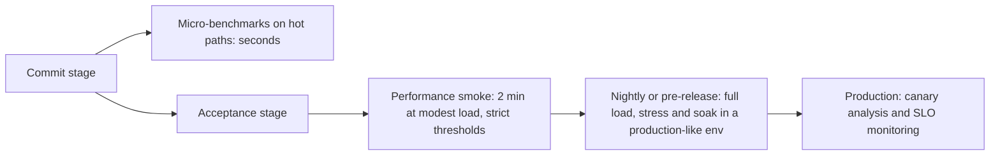

# Capacity and performance testing in the pipeline

> **Before this lesson:** read [Stages, gates and the flow of a change](#/lesson/cicd/pipeline-stages). A **request** is one message sent to a service, such as loading a page.

## In plain words

A bridge can be perfectly shaped and still collapse if nobody checked how much weight it carries. Engineers test bridges with loads before opening them to traffic.

Software has the same kind of requirement. A shop's website may work perfectly for one visitor and fall over when ten thousand arrive for a sale. Qualities like this — how fast, how much, how safe — are called **non-functional requirements**, to distinguish them from the *functions* the software performs.

Two words are central. **Performance** is how fast one request is answered. **Capacity** is how many requests the system can handle at once while still answering quickly enough. A **load test** is the equivalent of driving lorries over the bridge: a tool pretends to be thousands of users and measures what happens.

Why this matters for a job: slowness under load is among the most expensive kinds of failure, because it shows up on the busiest day. Interviewers ask how you would stop a slow change reaching production, and why averages mislead.

## Motivation: correct, and far too slow

A team ships a new recommendations panel. Every functional test passes. On launch day the product page, which used to render in 180 ms, takes 2.4 seconds under real traffic; the database connection pool saturates; checkout starts timing out. The feature works exactly as specified. It cannot do so for more than a few users at a time.

Qualities such as speed, capacity, availability and security are called **non-functional requirements** (NFRs) — an unhelpful name, since a system that fails them does not function. They share two awkward properties. They are *cross-cutting*: no single story "implements performance"; every story can damage it. And they are usually discovered late, when the fix is an architectural change.

The remedy is the same one this track applies to everything else: state the requirement precisely, automate a check for it, and run that check in the pipeline on every candidate, so a regression is traced to the commit that introduced it. This lesson covers capacity and performance; the next covers security.

## Vocabulary

People use these terms loosely. Precision helps.

| term | meaning | example |
|---|---|---|
| **Latency / response time** | time to serve one request | checkout takes 240 ms |
| **Throughput** | requests completed per unit time | 350 orders per second |
| **Performance** | how fast a single transaction is, in isolation or under a given load | p95 latency |
| **Capacity** | the maximum throughput the system sustains while still meeting its latency and error targets | 350 orders/s with p99 under 800 ms |
| **Scalability** | how capacity changes as resources are added | doubling nodes gives 1.8× capacity |
| **Load test** | apply expected load and verify targets hold | normal peak hour |
| **Stress test** | increase load until something breaks, to find the limit and the failure mode | where is the knee? |
| **Soak (endurance) test** | hold moderate load for hours | finds leaks and slow degradation |
| **Spike test** | sudden burst | sale opens at 09:00 |

### Why percentiles, never averages

Latency distributions have long tails. A mean hides them: if 98 requests take 100 ms and 2 take 5 seconds, the mean is 198 ms and looks fine, while one user in fifty waits five seconds. Requirements should therefore be stated as percentiles: *p95 under 300 ms, p99 under 800 ms*.

```python-run
import random, statistics

rng = random.Random(8)
# 97% of requests are fast; 3% hit a slow path (cold cache, lock wait, GC pause)
latencies = [rng.gauss(110, 15) if rng.random() > 0.03 else rng.uniform(1500, 4000) for _ in range(20_000)]

def pct(values, p):
    s = sorted(values)
    return s[min(len(s) - 1, int(p / 100 * len(s)))]

print(f"mean   {statistics.mean(latencies):7.0f} ms   <- looks acceptable")
print(f"median {pct(latencies, 50):7.0f} ms")
for p in (90, 95, 99, 99.9):
    print(f"p{p:<5} {pct(latencies, p):7.0f} ms")

# a page that makes 20 backend calls is slow if ANY of them hits the tail
p_slow_call = sum(l > 1000 for l in latencies) / len(latencies)
print(f"\nP(one call > 1s) = {p_slow_call:.1%};  P(page with 20 calls has a slow call) = {1 - (1 - p_slow_call) ** 20:.0%}")
```

The last line is why tails matter more as systems are decomposed: a user-facing request that fans out to many services experiences the tail latency of its dependencies, not their median.

## Stating requirements you can test

"The site should be fast" cannot fail a build. A testable capacity requirement names a workload, a load level, and thresholds:

> Under 300 checkout transactions per second with the standard scenario mix, sustained for 10 minutes, p95 latency is below 400 ms, p99 below 900 ms, and fewer than 0.1% of requests fail.

Where do the numbers come from? From the business: expected peak users and their behaviour, contractual service levels, and what slowness costs in abandoned sessions. Treat them like any other requirement — owned by the product side, prioritised, and changeable.

Modern teams often express the same thing as **service level objectives** (SLOs): a target for a measured indicator over a window, such as "99.9% of checkout requests complete in under 800 ms, measured over 30 days". An SLO is useful because the same definition serves both the pipeline's test thresholds and production alerting.

> [!WARNING]
> Two opposite mistakes are common. One is ignoring capacity until the end. The other is premature optimisation: complicating the design for performance problems that measurement has not shown to exist. The pipeline resolves the tension. Write clear code, measure every build, and optimise only the hotspots the measurements reveal.

## Designing so that capacity is achievable

A test can only reveal a problem; the design decides whether there is one. The recurring culprits are the same in almost every system:

- **Chatty communication.** A page that makes 200 database queries (the N+1 pattern) or a service that makes 40 sequential calls to another. Batch, join, or cache.
- **Unbounded work.** Loading a whole table, returning unpaginated lists, queues without limits.
- **Shared mutable state and locks**, which serialise work that could run in parallel.
- **Resource pools sized by guess.** Too few connections queue requests; too many overwhelm the database.
- **Missing timeouts and back-pressure**, so that one slow dependency ties up every thread and the failure spreads.
- **Synchronous work that could be deferred** to a queue.

None of these is exotic. A capacity test in the pipeline is how you learn which one you just introduced.

## Measuring: what a load test actually does

A load generator simulates many concurrent users running scripted scenarios and records each request's outcome. Widely used open-source tools are k6 (scripts in JavaScript), Locust (Python), Gatling (Scala/Java/Kotlin) and JMeter.

```javascript
// perf/checkout.js  (k6)
import http from "k6/http";
import { check, sleep } from "k6";

export const options = {
  scenarios: {
    steady_checkout: {
      executor: "constant-arrival-rate",   // open model: a fixed arrival rate, like real traffic
      rate: 300,                           // iterations per timeUnit
      timeUnit: "1s",
      duration: "10m",
      preAllocatedVUs: 200,
      maxVUs: 1000,
    },
  },
  thresholds: {
    http_req_duration: ["p(95)<400", "p(99)<900"],
    http_req_failed: ["rate<0.001"],
    checks: ["rate>0.999"],
  },
};

export default function () {
  const base = __ENV.BASE_URL;
  const basket = http.post(`${base}/baskets`, JSON.stringify({ sku: "BOOK-1", qty: 1 }), {
    headers: { "Content-Type": "application/json" },
  });
  check(basket, { "basket created": (r) => r.status === 201 });

  const order = http.post(`${base}/baskets/${basket.json("id")}/checkout`);
  check(order, { "order accepted": (r) => r.status === 200 || r.status === 202 });
  sleep(1);
}
```

Things to notice:

- **Thresholds are the gate.** If any threshold is breached, `k6 run` exits non-zero and the pipeline job fails. Without thresholds a load test only produces a chart for someone to look at.
- **Open versus closed workload.** A closed model has a fixed number of virtual users who each wait for a response before sending the next request; when the system slows down, the load automatically drops, hiding the problem. An open model (`constant-arrival-rate`) keeps requests arriving at the stated rate regardless, which is how the real internet behaves.
- **Scenarios reflect real behaviour.** Use a realistic mix of journeys and think time, not one endpoint hammered in a loop.
- **The script goes through the API.** Driving real browsers at scale is expensive; reserve a small browser-based run for front-end timing.

### Finding the knee

As offered load rises, throughput tracks it and latency stays flat — until some resource saturates. Past that point latency climbs steeply, and beyond it errors begin. The load at the bend is the system's capacity. A simple queueing model shows why the bend is so sharp:

```python-run
def mm_c_like(arrival, service_ms=40, workers=16):
    """Crude model: each worker handles 1000/service_ms req/s; waiting grows as utilisation -> 1."""
    capacity = workers * 1000 / service_ms
    rho = arrival / capacity
    if rho >= 1:
        return capacity, float("inf"), rho
    wait = service_ms * (rho ** workers) / (1 - rho) / workers * 4      # rough queueing delay
    queue_penalty = service_ms * rho / (1 - rho) * 0.15
    return arrival, service_ms + wait + queue_penalty, rho

print(f"{'offered rps':>12} {'served rps':>11} {'utilisation':>12} {'latency ms':>11}")
for rps in (50, 100, 200, 300, 350, 380, 395, 399, 410):
    served, latency, rho = mm_c_like(rps)
    lat = f"{latency:11.0f}" if latency != float("inf") else "  unbounded"
    print(f"{rps:>12} {served:>11.0f} {rho:>12.0%} {lat}")
print("\ncapacity is where latency leaves the flat region, well before 100% utilisation")
```

Latency barely moves up to roughly 75% utilisation and then explodes. That shape — flat, then a wall — is the reason capacity planning keeps headroom rather than running close to the limit.

## Putting capacity tests in the pipeline

Running a ten-minute load test on every commit against a full-size environment is rarely affordable. A layered approach gets most of the value.



1. **Micro-benchmarks** in the commit stage for a few critical functions, compared against a stored baseline. They catch accidental quadratic algorithms in seconds.
2. **A performance smoke test** after acceptance: a short run at moderate load. It will not tell you peak capacity, but it catches the common case — a change that made a hot endpoint three times slower.
3. **Full capacity, stress and soak runs** nightly or before a release, in an environment as close to production as you can afford.
4. **Production itself**, through canary analysis (Module 10) and SLO alerts, because no test environment reproduces real traffic exactly.

```yaml
  perf-smoke:
    needs: acceptance
    runs-on: ubuntu-latest
    steps:
      - uses: actions/checkout@v4
      - uses: grafana/setup-k6-action@v1
      - run: k6 run --summary-export=perf-summary.json perf/checkout-smoke.js
        env:
          BASE_URL: ${{ vars.PERF_URL }}
      - if: always()
        uses: actions/upload-artifact@v4
        with:
          name: perf-summary
          path: perf-summary.json
```

### Absolute thresholds and regression against a baseline

There are two kinds of gate, and you want both:

- **Absolute**: the requirement itself — p95 under 400 ms. Fails when the system is not good enough.
- **Relative**: compared with the previous good build — no more than, say, 10% slower. Fails when a change made things *worse*, even while still inside the absolute limit. This is how you avoid drifting to the edge one "harmless" 3% at a time.

Relative comparisons need care because measurements are noisy. Compare against the median of several recent runs rather than a single one, and use a tolerance wide enough that normal variation does not trip it.

```python-run
import statistics

def gate(history_p95, candidate_p95, absolute_ms=400, tolerance=0.10, window=5):
    baseline = statistics.median(history_p95[-window:])
    reasons = []
    if candidate_p95 > absolute_ms:
        reasons.append(f"absolute: {candidate_p95} ms > {absolute_ms} ms")
    if candidate_p95 > baseline * (1 + tolerance):
        reasons.append(f"regression: {candidate_p95} ms is {candidate_p95 / baseline - 1:+.0%} vs baseline {baseline} ms")
    return ("FAIL: " + "; ".join(reasons)) if reasons else f"pass (baseline {baseline} ms)"

history = [212, 208, 215, 240, 210, 211, 209]        # one noisy run (240) does not move the median
for build, p95 in (("b101", 214), ("b102", 229), ("b103", 251), ("b104", 430)):
    print(build, gate(history, p95))
    if p95 <= 400:
        history.append(p95)
```

Build `b103` is well inside the 400 ms requirement and is still rejected, because it is nearly 20% slower than recent builds. Catching that now, with one commit to examine, is much cheaper than discovering in three months that p95 has crept from 210 to 390.

## The test environment

Results are only as meaningful as the environment that produced them.

- **Ideal**: a replica of production. Expensive, but the only way to learn absolute capacity.
- **Scaled-down**: a fraction of production with the same shape. Useful for *regression* detection — the same test on the same environment should give the same numbers — but capacity does not scale linearly, so do not multiply results up and call it a forecast.
- **Shared or noisy environments** make results unrepeatable. A dedicated, quiesced environment matters more than a large one.

Other requirements: realistic data volume (a query that is instant on 1,000 rows may scan on 50 million), simulators for third-party services with realistic latency so their limits do not become yours, and the load generator on separate machines so it does not compete with the system under test.

## Reading results

A failed threshold tells you *that* something regressed. To find *why*, you need the system's own telemetry from the test window: CPU, memory, connection-pool usage, queue depth, garbage-collection pauses, slow-query logs, and distributed traces. This is a strong reason to deploy the same monitoring stack to the capacity environment as to production — and a load test is a good rehearsal for whether your dashboards answer real questions.

A capacity environment also earns its keep in other ways: reproducing production incidents under load, rehearsing failure scenarios (kill a node during the test), measuring how long a rolling deployment takes under traffic, and testing autoscaling rules.

## Pitfalls

- **No thresholds**, so the test never fails and nobody reads the report.
- **Averages** instead of percentiles.
- **Closed-model load** that politely slows down when the system does.
- **Coordinated omission**: a load tool that stops timing while it waits, under-reporting the worst latencies.
- **Testing with empty databases and warm caches only.**
- **One run, one conclusion.** Noise is real; repeat and compare distributions.
- **Unrealistic scripts** — every virtual user logging in as the same account, hitting the same cached product.
- **Treating the test environment's number as production's capacity.**
- **Load-testing shared or third-party systems without agreement.**

> [!TIP]
> Start small. One scripted journey, a two-minute run, two thresholds, in the pipeline this week, is worth far more than an ambitious performance-testing project scheduled for the quarter before launch.

> [!INTERVIEW]
> "How would you prevent performance regressions from reaching production?" Define SLO-style requirements with percentiles. Automate a load script with thresholds that fail the job. Layer the checks: micro-benchmarks at commit, a short performance smoke after acceptance on every build with both absolute and relative-to-baseline gates, full load, stress and soak runs nightly in a production-like environment, then canary analysis in production comparing the new version's latency and error rate with the old. Mention open-model load, realistic data, and using production telemetry in the test environment to diagnose failures.

## Summary

- Non-functional requirements are cross-cutting and expensive to fix late, so they are specified precisely and tested continuously.
- State capacity requirements as a workload, a load level and percentile thresholds; means hide the tail that users feel.
- Load tests apply expected load, stress tests find the limit, soak tests find slow degradation, spike tests check bursts.
- Thresholds turn a load test into a pipeline gate; use both absolute limits and regression against a baseline.
- Layer the checks by cost: micro-benchmarks, a short smoke on every build, full runs nightly, and production canaries.
- Use a dedicated, production-shaped environment with realistic data, and bring production monitoring to it.

## Glossary

- **Non-functional requirement** — a quality such as speed, capacity or security, as opposed to a function.
- **Latency (response time)** — the time taken to answer one request.
- **Throughput** — the number of requests completed per unit of time.
- **Capacity** — the highest throughput at which the system still meets its speed and error targets.
- **Percentile (p95, p99)** — the value below which 95% or 99% of measurements fall.
- **Load test** — applying the expected load and checking that targets hold.
- **Stress test** — raising the load until something breaks, to find the limit.
- **Soak test** — holding a moderate load for hours to find slow degradation.
- **Spike test** — applying a sudden burst of load.
- **Service-level objective (SLO)** — a target for a measured quality over a period of time.
- **Threshold** — a limit that makes a test fail when it is crossed.
- **Baseline** — an earlier good measurement to compare new results against.
- **Utilisation** — the share of a resource that is in use.
- **Virtual user** — a simulated user created by a load-testing tool.

## Check yourself

```quiz
[
  {"q": "Why are latency requirements stated as percentiles rather than averages?",
   "options": ["Percentiles are easier to compute", "Latency has a long tail, and an average can look fine while a meaningful share of users wait far longer", "Averages are always higher", "Load tools cannot report averages"],
   "answer": 1,
   "explain": "A few very slow requests barely move the mean but define the experience of the users who hit them."},
  {"q": "What does 'capacity' mean in this lesson's vocabulary?",
   "options": ["The time to serve one request", "The maximum throughput sustained while still meeting latency and error targets", "The size of the database", "The number of servers"],
   "answer": 1,
   "explain": "Capacity is a throughput figure qualified by the service levels that must still hold at that load."},
  {"q": "What turns a load test into a pipeline gate?",
   "options": ["A long duration", "Thresholds that make the tool exit non-zero when breached", "Running it at night", "A dashboard"],
   "answer": 1,
   "explain": "Without automated pass or fail criteria the test only produces data for someone to interpret manually."},
  {"q": "Why can a closed workload model (fixed virtual users waiting for responses) hide problems?",
   "options": ["It uses too many machines", "When the system slows, the generator sends fewer requests, so the offered load drops just when it should not", "It cannot measure errors", "It only works for databases"],
   "answer": 1,
   "explain": "Real users keep arriving regardless of server speed. An open, arrival-rate model reproduces that."},
  {"q": "A build's p95 is 251 ms against a 400 ms requirement, but recent builds were about 210 ms. What should a well-designed gate do?",
   "options": ["Pass, since it is under 400 ms", "Fail on regression relative to the baseline", "Ignore the measurement", "Increase the requirement"],
   "answer": 1,
   "explain": "A relative gate catches gradual erosion long before the absolute limit is reached, while the cause is one commit."},
  {"q": "Which test type is designed to reveal memory leaks and slow resource exhaustion?",
   "options": ["Spike test", "Soak test", "Unit test", "Smoke test"],
   "answer": 1,
   "explain": "Holding moderate load for hours exposes degradation that short runs cannot show."},
  {"q": "A scaled-down test environment handles 100 requests per second with one quarter of production's nodes. What can you conclude?",
   "options": ["Production handles exactly 400 per second", "The environment is useful for detecting regressions between builds, but capacity does not scale linearly so absolute production capacity is not established", "The test is useless", "Production handles 100 per second"],
   "answer": 1,
   "explain": "Shared bottlenecks such as the database rarely scale in proportion. Use scaled-down environments for comparison, not forecasting."},
  {"q": "Why does a request that fans out to 20 backend calls suffer from tail latency?",
   "options": ["Backends run slower when called together", "The chance that at least one of the 20 calls is slow is much higher than for a single call", "Networks drop every twentieth packet", "It does not"],
   "answer": 1,
   "explain": "If each call is slow 3% of the time, about 46% of fan-out requests include a slow call."}
]
```

> **Source:** Humble & Farley, *Continuous Delivery*, ch. 9 (testing non-functional requirements: managing NFRs, programming for and measuring capacity, the capacity test environment, automating capacity tests). k6 thresholds and executors: https://grafana.com/docs/k6/latest/using-k6/thresholds/ and https://grafana.com/docs/k6/latest/using-k6/scenarios/executors/constant-arrival-rate/
