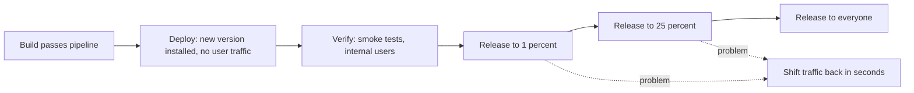
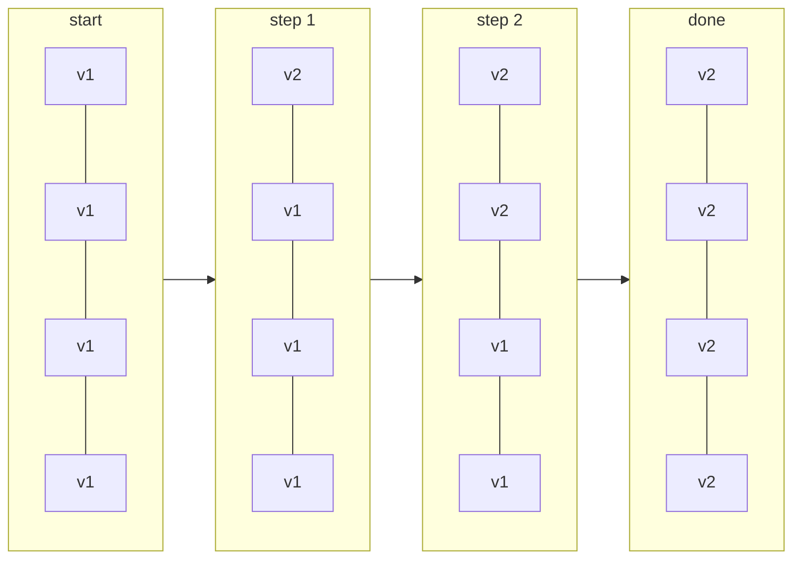
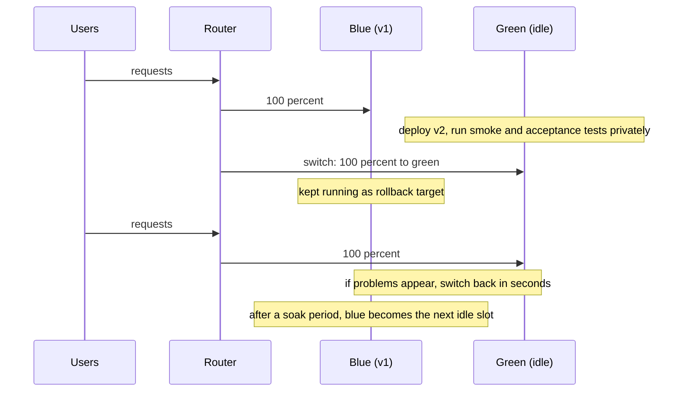
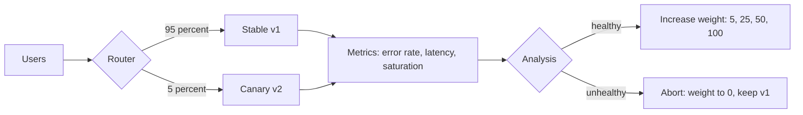

# Blue-green, canary and rolling deployments

> **Before this lesson:** read [Deployment scripting: idempotent, layered, verified](#/lesson/cicd/deploy-scripts) and [Build once, promote artifacts, pipeline as code](#/lesson/cicd/build-once).

## In plain words

A busy road bridge has to be replaced, and the traffic cannot stop. There are three ways to do it.

- Replace it one lane at a time, keeping the other lanes open. In software this is a **rolling** deployment.
- Build a complete new bridge next to the old one, then move all the traffic across in one go, keeping the old bridge standing in case of trouble. This is **blue-green** deployment.
- Open the new bridge to a few cars first, watch carefully, and send more only if all is well. This is a **canary** release (named after the birds miners once used as an early warning).

All three avoid **downtime** — time when users cannot use the service — and two of them limit how many users meet a faulty new version.

One distinction runs through the lesson. To **deploy** is to install a new version. To **release** is to let users reach it. They need not happen at the same moment.

Why this matters for a job: "compare blue-green and canary deployment" is one of the most frequently asked CI/CD interview questions.

## Motivation: the maintenance window

"The site will be unavailable on Sunday from 02:00 to 06:00 for scheduled maintenance." For years that sentence was the release strategy: stop everything, replace it, start it again, and hope. It has two obvious costs — downtime, and a team working at the worst hour of the week — and a less obvious one. Because the new version receives *all* traffic the moment it starts, any defect hits every user at once, and the only way back is to repeat the procedure in reverse.

Modern release strategies attack both problems. They replace a version without interrupting service, and they limit how many users are exposed to a new version before there is evidence that it works. This lesson covers the three workhorses — rolling, blue-green and canary — along with the distinction that makes them all more useful: **deployment is not release**.

## Deploy versus release

- **Deploying** is installing a version of the software into an environment.
- **Releasing** is making functionality available to users.

Traditionally these happen at the same instant. Separating them is one of the most valuable ideas in continuous delivery. If new code can sit in production without being exercised — dark, behind a flag, or receiving no traffic — then deployment becomes a low-risk technical event that can happen many times a day, and release becomes a business decision that can be gradual and instantly reversible.

The strategies in this lesson separate them at the **infrastructure** level, by controlling which instances receive traffic. Feature flags (Lesson 28) separate them at the **application** level. Mature teams use both.



## Strategy 0: recreate

Stop all old instances, then start the new ones. Simple, and the only option when two versions truly cannot coexist (an incompatible schema change with no transition path, a singleton that holds an exclusive lock). It causes downtime and has no gradual exposure. Know that it exists; avoid designing systems that need it.

```yaml
spec:
  strategy:
    type: Recreate
```

## Strategy 1: rolling update

Replace instances a few at a time. At every moment some mixture of old and new is serving, and total capacity stays close to normal.



In Kubernetes this is the default for a Deployment, tuned by two numbers:

```yaml
apiVersion: apps/v1
kind: Deployment
metadata:
  name: orders
spec:
  replicas: 10
  minReadySeconds: 10            # a new pod must stay ready this long before it counts
  progressDeadlineSeconds: 300   # declare the rollout failed if it stalls this long
  strategy:
    type: RollingUpdate
    rollingUpdate:
      maxSurge: 2                # up to 2 pods above the desired count during the rollout
      maxUnavailable: 1          # at most 1 pod below the desired count
  template:
    spec:
      terminationGracePeriodSeconds: 30
      containers:
        - name: orders
          image: registry.example.com/orders@sha256:9c1e4b7d0a52c5f1e2d3a4b5c6d7e8f9a0b1c2d3e4f5a6b7c8d9e0f1a2b3c4d5
          readinessProbe:
            httpGet: { path: /readyz, port: 8080 }
            periodSeconds: 5
          lifecycle:
            preStop:
              exec: { command: ["sleep", "5"] }   # let load balancers stop sending before shutdown
```

- **`maxSurge`** — how many extra pods may exist above `replicas`. Higher means faster rollouts and needs spare capacity.
- **`maxUnavailable`** — how many pods below `replicas` may be unavailable. Zero means capacity never dips; the rollout then depends entirely on surge.

Both accept an absolute number or a percentage. The invariants are: total pods ≤ replicas + maxSurge, and available pods ≥ replicas − maxUnavailable. The controller scales the new set up and the old set down as fast as those two limits allow, waiting for readiness at each step. This simulation of the idealised process makes the mechanics concrete:

```python-run
def rolling_update(replicas, max_surge, max_unavailable):
    """Each step: first remove old pods down to the availability floor, then add new pods up to
    the surge ceiling; new pods become ready at the end of the step."""
    old, new = replicas, 0
    steps = [(old, new)]
    while old > 0 or new < replicas:
        removable = min(old, old + new - (replicas - max_unavailable))   # keep available >= floor
        old -= max(0, removable)
        addable = min(replicas - new, replicas + max_surge - (old + new))
        new += max(0, addable)
        steps.append((old, new))
        if len(steps) > 100:
            raise RuntimeError("stuck: maxSurge and maxUnavailable cannot both be 0")
    return steps

for surge, unavailable in ((1, 0), (2, 1), (0, 3), (10, 0)):
    steps = rolling_update(10, surge, unavailable)
    print(f"maxSurge={surge:<2} maxUnavailable={unavailable}: {len(steps) - 1} steps")
    print("   " + "  ".join(f"{o}+{n}" for o, n in steps))
```

Each pair is *old + new* ready pods. With surge 1 and unavailable 0 the rollout takes eleven careful steps; with surge 10 it is a blue-green switch in all but name. A problem in this module asks you to produce this schedule.

**Strengths.** No extra environment, built into the platform, capacity preserved.

**Weaknesses.** Old and new versions serve side by side, so they must be compatible with each other and with the database. Rollback is another rolling update, taking as long as the rollout. And exposure is proportional to the *instance* count, not chosen: after the first step of ten, 10% of traffic hits the new version whether or not you wanted that.

**Requirements for a clean rolling update:** a truthful readiness probe; graceful shutdown (handle `SIGTERM`, finish in-flight requests); backward-compatible schema and API changes; and a `PodDisruptionBudget` so voluntary disruptions cannot remove too many pods at once.

## Strategy 2: blue-green

Run two complete, identical production environments. One — say **blue** — serves all traffic. Deploy the new version to the idle one, **green**, and test it there with no user impact. Then switch the router so green serves everything. Blue stays warm as the instant rollback target.



The switch can be implemented at whatever layer you control: a load balancer target group, a DNS record (slow to take effect because of caching), or in Kubernetes a Service selector.

```yaml
apiVersion: v1
kind: Service
metadata:
  name: orders
spec:
  selector:
    app: orders
    slot: green        # was: blue. Changing this one line moves all traffic.
  ports:
    - port: 80
      targetPort: 8080
```

```bash
kubectl patch service orders -p '{"spec":{"selector":{"app":"orders","slot":"green"}}}'
# rollback is the same command with "blue"
```

Because order matters and mistakes are costly, treat the procedure as a state machine: you cannot switch to a slot that has not been deployed and verified, and you cannot tear down the slot that is live.

```python-run
class BlueGreen:
    def __init__(self):
        self.live, self.versions, self.verified = "blue", {"blue": "v1", "green": None}, {"blue"}

    @property
    def idle(self): return "green" if self.live == "blue" else "blue"

    def deploy(self, version):
        self.versions[self.idle] = version
        self.verified.discard(self.idle)
        return f"deployed {version} to idle slot {self.idle}"

    def verify(self, ok=True):
        if self.versions[self.idle] is None:
            return "REFUSED: nothing deployed to idle slot"
        (self.verified.add if ok else self.verified.discard)(self.idle)
        return f"smoke test on {self.idle}: {'pass' if ok else 'FAIL'}"

    def switch(self):
        if self.idle not in self.verified:
            return f"REFUSED: {self.idle} is not verified"
        self.live = self.idle
        return f"traffic -> {self.live} ({self.versions[self.live]}); previous version kept warm"

    def rollback(self):
        return self.switch()          # the old slot is still verified, so this is instant

bg = BlueGreen()
for action in (lambda: bg.switch(), lambda: bg.deploy("v2"), lambda: bg.switch(),
               lambda: bg.verify(), lambda: bg.switch(), lambda: bg.rollback(),
               lambda: bg.deploy("v3"), lambda: bg.verify(ok=False), lambda: bg.switch()):
    print(action())
print("live:", bg.live, bg.versions[bg.live])
```

**Strengths.** Near-instant cut-over and rollback; the new version is tested in the real production environment before any user sees it; only one version serves at a time.

**Weaknesses.** Double the capacity during the transition (cheaper in a cloud, where the idle side can be scaled up only for the release). All users move at once, so there is no gradual exposure. And the hard part is **state**: both sides usually share one database, so the schema must work for both versions, and long-running sessions, in-flight jobs and message consumers need a hand-over plan. Module 12 addresses the data side.

## Strategy 3: canary release

Send a small fraction of real traffic to the new version, compare its behaviour with the current version, and increase the fraction only if it looks healthy. The name comes from the canaries miners carried to detect gas: a small exposure that reveals danger early.



What distinguishes a canary from "a rolling update that pauses" is **automated analysis**. The decision to proceed is made by comparing metrics, not by someone glancing at a dashboard.

```yaml
# Argo Rollouts: weights, pauses and an analysis gate
apiVersion: argoproj.io/v1alpha1
kind: Rollout
metadata:
  name: orders
spec:
  replicas: 10
  strategy:
    canary:
      steps:
        - setWeight: 5
        - pause: { duration: 5m }
        - analysis:
            templates:
              - templateName: error-rate-and-latency
        - setWeight: 25
        - pause: { duration: 10m }
        - setWeight: 50
        - pause: { duration: 10m }
  # (selector and pod template as in a Deployment)
---
apiVersion: argoproj.io/v1alpha1
kind: AnalysisTemplate
metadata:
  name: error-rate-and-latency
spec:
  metrics:
    - name: error-rate
      interval: 1m
      count: 5
      failureLimit: 1
      successCondition: result[0] < 0.01
      provider:
        prometheus:
          address: http://prometheus.monitoring:9090
          query: |
            sum(rate(http_requests_total{app="orders",track="canary",code=~"5.."}[2m]))
            /
            sum(rate(http_requests_total{app="orders",track="canary"}[2m]))
```

### Deciding with data

Three rules make canary analysis trustworthy:

1. **Compare against a baseline running at the same time**, not against yesterday or a fixed number alone. If a dependency is having a bad hour, both versions suffer and the canary should not be blamed.
2. **Require enough traffic.** Five requests with one error is a 20% error rate and proves nothing.
3. **Use both a relative and an absolute test**: the canary must not be meaningfully worse than the baseline, *and* must not exceed a hard ceiling.

```python-run
def canary_verdict(baseline, canary, min_requests=500, max_ratio=1.5, abs_ceiling=0.02, margin=0.002):
    b_req, b_err = baseline
    c_req, c_err = canary
    if c_req < min_requests:
        return "WAIT    (not enough canary traffic yet)"
    b_rate, c_rate = b_err / b_req, c_err / c_req
    if c_rate > abs_ceiling:
        return f"ROLLBACK (canary {c_rate:.2%} above hard ceiling {abs_ceiling:.0%})"
    if c_rate > b_rate * max_ratio + margin:
        return f"ROLLBACK (canary {c_rate:.2%} vs baseline {b_rate:.2%})"
    return f"PROMOTE  (canary {c_rate:.2%} vs baseline {b_rate:.2%})"

cases = {
    "too early":                     ((9500, 19),  (120, 3)),
    "healthy":                       ((9500, 19),  (500, 1)),
    "clearly worse":                 ((9500, 19),  (500, 7)),
    "both bad (dependency outage)":  ((9500, 760), (500, 41)),
    "bad day, canary no worse":      ((9500, 150), (500, 8)),
}
for name, (baseline, canary) in cases.items():
    print(f"{name:<30} {canary_verdict(baseline, canary)}")
```

Look at the last two cases. When the baseline itself is at 8% errors the canary is rolled back by the absolute ceiling — nothing should be promoted into an outage. When the baseline is mildly elevated and the canary matches it, promotion proceeds. You will implement a decision function like this in the problem set.

**Strengths.** Real traffic, real data, limited blast radius; problems that no test environment reproduces are caught while affecting a few percent of users; rollback is a weight change.

**Weaknesses.** Needs traffic-splitting infrastructure (a service mesh, a capable ingress, or a load balancer with weighted targets) and good metrics per version. Two versions coexist, with the same compatibility demands as rolling updates. Low-traffic services cannot gather a statistically meaningful sample quickly.

### Related techniques

- **Dark launch / traffic shadowing.** Copy live requests to the new version and discard its responses. It sees production load with zero user impact; useful for read paths and for testing capacity. Beware of side effects such as duplicate writes or emails.
- **Ring deployment.** Canary by audience rather than by percentage: internal staff first, then a beta group, then one region, then everyone.
- **A/B testing.** The same routing machinery used for a different purpose — comparing *business* outcomes of two variants, rather than checking technical health.

## Choosing

| | rolling | blue-green | canary |
|---|---|---|---|
| Downtime | none | none | none |
| Extra capacity | small (surge) | up to 2× during release | small |
| Exposure of a bad version | grows with rollout | everyone at switch | chosen, small first |
| Rollback speed | minutes | seconds | seconds |
| Versions coexist serving users | yes | no (only at switch) | yes |
| Needs traffic-weighting infrastructure | no | switchable router | yes, plus per-version metrics |
| Good default for | internal services, simple setups | releases needing a full pre-check; fast rollback | high-traffic user-facing services |

They also combine: deploy blue-green, then shift traffic to green progressively — a canary with an instant fallback.

## Pitfalls

- **A readiness probe that lies**, so every strategy sends traffic to instances that cannot serve.
- **No graceful shutdown**, dropping in-flight requests during every rollout.
- **Incompatible versions running together**, especially around the database and message formats.
- **Canary analysis on averages or tiny samples.**
- **Forgetting sticky sessions and caches.** A user bounced between versions mid-session can see inconsistent behaviour; decide whether routing should be sticky.
- **Blue-green with a schema that only green understands**, which silently removes the rollback option.
- **Long-lived connections** (WebSockets, gRPC streams) that never move off old instances unless drained deliberately.

> [!WARNING]
> Every strategy here relies on the previous version continuing to work after the new version has started writing data. If v2 writes rows or messages that v1 cannot read, "rollback in seconds" is fiction. Compatibility of data and interfaces across adjacent versions is the precondition for all zero-downtime releases.

> [!INTERVIEW]
> "Compare blue-green and canary deployments." Blue-green keeps two full environments and switches all traffic at once: simple mental model, instant rollback, pre-release verification in production, at the cost of double capacity and no gradual exposure. Canary shifts a small percentage first and uses metric analysis against a concurrent baseline to decide whether to continue: smallest blast radius and real-traffic evidence, at the cost of traffic-management infrastructure and version coexistence. Then show judgement: both require backward-compatible data changes, and they can be combined.

## Summary

- Deployment installs a version; release exposes it to users. Separating the two is what makes frequent, low-risk releases possible.
- Rolling updates replace instances gradually within `maxSurge` and `maxUnavailable` limits; simple and cheap, with slower rollback and mixed versions.
- Blue-green keeps two environments and flips a router; instant cut-over and rollback, extra capacity, all users move together.
- Canary releases expose a small share of real traffic and promote on automated comparison with a concurrent baseline; smallest blast radius, most infrastructure.
- All of them depend on truthful readiness checks, graceful shutdown and compatibility between adjacent versions.

## Glossary

- **Deploy** — to install a version of the software in an environment.
- **Release** — to make functionality available to users.
- **Downtime** — a period in which users cannot use the service.
- **Instance (pod, replica)** — one running copy of the application.
- **Rolling update** — replacing instances a few at a time.
- **maxSurge / maxUnavailable** — how many instances above / below the wanted number are allowed during a rolling update.
- **Readiness probe** — a check deciding whether an instance may receive traffic.
- **Graceful shutdown** — finishing the requests in progress before stopping.
- **Blue-green deployment** — two complete environments, with traffic switched from one to the other.
- **Canary release** — sending a small share of traffic to the new version first.
- **Baseline** — the current version, measured at the same time as the canary for comparison.
- **Router (load balancer)** — the component that decides which instance receives each request.
- **Traffic shadowing (dark launch)** — copying real requests to a new version and discarding its answers.
- **Blast radius** — how much is affected when something goes wrong.
- **Rollback** — returning to the previous version.

## Check yourself

```quiz
[
  {"q": "What is the difference between deploying and releasing?",
   "options": ["They are synonyms", "Deploying installs a version in an environment; releasing makes its functionality available to users", "Releasing happens before deploying", "Deploying is manual and releasing is automated"],
   "answer": 1,
   "explain": "Decoupling the two lets new code reach production without exposure, turning release into a controlled, reversible step."},
  {"q": "A Deployment has replicas: 10, maxSurge: 2, maxUnavailable: 1. What are the bounds during a rollout?",
   "options": ["At most 10 pods total, at least 10 available", "At most 12 pods total, at least 9 available", "At most 11 pods total, at least 8 available", "At most 20 pods total, at least 5 available"],
   "answer": 1,
   "explain": "Total pods may reach replicas plus maxSurge; available pods may fall to replicas minus maxUnavailable."},
  {"q": "What is the main advantage of blue-green deployment?",
   "options": ["It needs no extra capacity", "Cut-over and rollback are a near-instant router switch, and the new version can be verified in production before users see it", "It exposes only 1% of users", "It avoids the need for compatible database changes"],
   "answer": 1,
   "explain": "The idle environment is fully tested, then traffic is flipped; flipping back is equally quick. It still needs compatible data changes."},
  {"q": "Why should canary analysis compare the canary with a baseline running at the same time?",
   "options": ["It uses fewer metrics", "So that external factors such as a degraded dependency affect both and are not blamed on the new version", "Because historical data is unavailable", "To double the traffic"],
   "answer": 1,
   "explain": "A concurrent baseline controls for conditions that change over time, isolating the effect of the new version."},
  {"q": "A canary received 40 requests with 2 errors, while the baseline has a 0.3% error rate. What should the analysis do?",
   "options": ["Roll back immediately", "Promote immediately", "Wait for more traffic before deciding", "Ignore errors"],
   "answer": 2,
   "explain": "The sample is too small to distinguish a real problem from noise. A minimum request count prevents premature decisions."},
  {"q": "Which strategy causes downtime by design?",
   "options": ["Rolling", "Blue-green", "Canary", "Recreate"],
   "answer": 3,
   "explain": "Recreate stops all old instances before starting new ones. It is used only when versions cannot coexist."},
  {"q": "What must be true of the database for any of these zero-downtime strategies to allow rollback?",
   "options": ["It must be empty", "Schema and data written by the new version must still be usable by the previous version", "It must be replicated to three regions", "It must be restored from backup on each deploy"],
   "answer": 1,
   "explain": "If the old version cannot read what the new one wrote, switching back breaks the application."},
  {"q": "What is traffic shadowing (dark launch)?",
   "options": ["Hiding traffic from monitoring", "Copying live requests to the new version and discarding its responses to observe behaviour without user impact", "Routing all traffic at night", "Encrypting traffic between services"],
   "answer": 1,
   "explain": "The new version experiences production load and data while users continue to be served by the stable version."}
]
```

> **Source:** Humble & Farley, *Continuous Delivery*, ch. 10 (deploying and releasing: zero-downtime releases, blue-green deployments, canary releasing). Kubernetes Deployment strategy: https://kubernetes.io/docs/concepts/workloads/controllers/deployment/#strategy — Argo Rollouts canary and analysis: https://argo-rollouts.readthedocs.io/en/stable/features/canary/ and https://argo-rollouts.readthedocs.io/en/stable/features/analysis/
