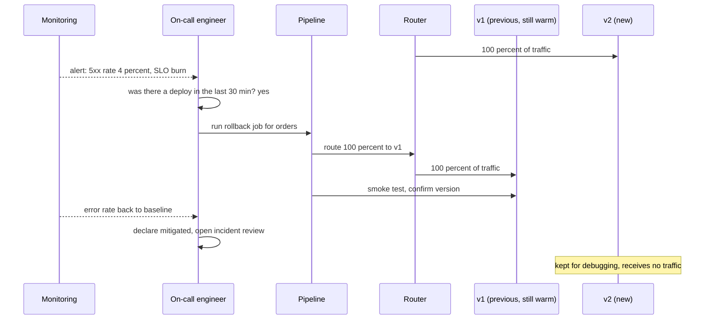
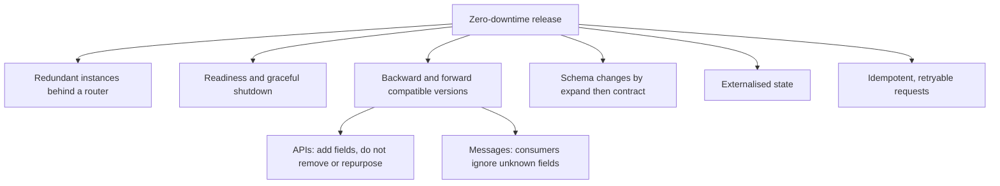

# Rollback, roll-forward, zero downtime and emergency fixes

> **Before this lesson:** read [Blue-green, canary and rolling deployments](#/lesson/cicd/release-strategies).

## In plain words

Every word processor has an undo button, and people rely on it constantly. It is there because someone built it in from the start. You cannot add undo to a document after the mistake.

Releases are the same. A **rollback** is the undo button: going back to the previous version of the software. It only works if you prepared for it — kept the old version, and made sure it can still run. This lesson is about that preparation.

Sometimes going back is impossible, like trying to un-send a letter. Then the answer is to **roll forward**: leave the new version in place and quickly release a further change that corrects the problem.

Two more terms. **Zero downtime** means users never see an interruption while a new version goes out. An **emergency fix** (or **hotfix**) is an urgent correction to the live system.

Why this matters for a job: "the release is failing — do you roll back or roll forward?" tests whether you stay orderly under pressure. Being able to explain when each applies is a mark of experience.

## Motivation: the release is out and the graphs are wrong

Ten minutes after a release, the error rate triples. There are two instincts. One engineer starts reading stack traces to find the bug. Another asks, "what was the last version that worked, and how fast can we be back on it?" The second question is the right one to ask first, and whether it has a good answer was decided weeks earlier — by how releases are built, what is kept around, and whether anyone has ever practised going backwards.

This lesson is about the unhappy path of releasing. It covers how to plan a release so that recovery is designed in, the difference between rolling back and rolling forward and when each applies, what zero-downtime really requires, and how to ship an urgent fix without abandoning the process that keeps you safe.

## A release strategy is written before the first release

A release plan is a short, living document agreed by developers, testers, operations and the business. It answers, in advance, the questions that are miserable to answer during an incident:

- Who can deploy to each environment, and who approves production?
- How is a release performed, step by step, and how long does it take?
- How is it verified — which smoke tests, which metrics, watched for how long?
- **How is it backed out**, and what is the plan when it cannot be?
- What are the service-level targets, and what counts as "bad enough to revert"?
- How is data migrated, and how is that migration undone or neutralised?
- How are configuration and secrets managed for the release?
- Where are the logs, dashboards and runbooks; who is on call?
- What needs archiving for audit and disaster recovery?

Two rules give the plan teeth. First, **the first deployment happens early** — in the first iteration, to a production-like environment, with a trivial application — so that the mechanics are debugged long before they matter. Second, **never release without a tested way back.** A back-out procedure that has not been exercised is a hypothesis.

## Rolling back

Rolling back means returning the live system to a previous known-good version. There are two ways to do it.

### Redeploy the previous good version

Run the normal deployment pipeline with the previous artifact's digest. This works for any deployment style and has a great virtue: it uses the same well-rehearsed mechanism as every other deploy.

```bash
# What has this service run recently?
kubectl -n shop rollout history deploy/orders
# REVISION  CHANGE-CAUSE
# 41        image=...@sha256:41ab...   (released 2026-06-01)
# 42        image=...@sha256:9c1e...   (released 2026-06-03)  <- current, misbehaving

# Platform-level undo: re-apply the previous pod template
kubectl -n shop rollout undo deploy/orders
kubectl -n shop rollout status deploy/orders --timeout=180s

# Helm equivalent
helm -n shop history orders
helm -n shop rollback orders 41 --wait --timeout 3m
```

With GitOps (Lesson 33), the desired state lives in Git, so the rollback is a commit:

```bash
git revert --no-edit <commit-that-bumped-the-image-digest>
git push            # the controller reconciles the cluster back to the previous digest
```

That form leaves the best audit trail and keeps Git and the cluster in agreement; an imperative `rollout undo` on a GitOps-managed cluster will be reverted by the controller.

### Switch traffic back

If the previous version is still running — the old side of a blue-green pair, or the stable set during a canary — rollback is a routing change that takes seconds and involves no start-up risk. This is the strongest argument for those strategies.



### Choosing the target

"The previous version" is not always the right answer. If the last three releases went out in an hour and the second one was itself rolled back, the target should be the most recent release that was **healthy** — completed successfully and was not subsequently reverted for cause. And the candidate must still be compatible with the current database schema.

```python-run
releases = [  # oldest first
    {"version": "v41", "status": "succeeded",   "schema": 17},
    {"version": "v42", "status": "succeeded",   "schema": 18},
    {"version": "v43", "status": "rolled_back", "schema": 18},   # was live, reverted for errors
    {"version": "v44", "status": "failed",      "schema": 18},   # never became healthy
    {"version": "v45", "status": "succeeded",   "schema": 19},   # current, misbehaving
]

def rollback_target(history, current_schema, compatible_back=1):
    """Most recent healthy release before the current one whose code can run on today's schema.
    A version built for schema s is assumed to tolerate schemas s .. s + compatible_back."""
    current = history[-1]
    for rel in reversed(history[:-1]):
        if rel["status"] != "succeeded":
            continue
        if current_schema - rel["schema"] > compatible_back:
            return None, f"{rel['version']} is healthy but too old for schema {current_schema}"
        return rel["version"], "ok"
    return None, "no healthy release in history"

print(rollback_target(releases, current_schema=19))
releases[1]["status"] = "rolled_back"
print(rollback_target(releases, current_schema=19))
```

The second call shows what happens when the only healthy candidate is two schema versions behind: there is no safe target, and the team must fix forward. A problem in this module asks you to implement target selection.

## Rolling forward

Rolling forward means leaving the new version in place and shipping a further change that fixes the problem — through the pipeline, as a normal (expedited) release.

It is the right choice when going back is impossible or more dangerous than going on:

- the release ran an **irreversible data change** — a dropped column, a destructive transformation, data written in a format the old version cannot read;
- other systems have already consumed the new behaviour (a published API field, emitted events);
- the fault is small, well understood, and the fix is a one-line, low-risk change;
- the previous version has a serious problem of its own, such as the vulnerability this release patched.

| | roll back | roll forward |
|---|---|---|
| Speed | fastest when the old version is warm or cached | limited by pipeline time plus time to write the fix |
| Requires diagnosis first | no | yes |
| Risk | low: known-good artifact | a new, hurriedly written change |
| Blocked by | incompatible data or schema; external consumers | a slow pipeline; an unclear cause |
| Default? | **yes** | when rollback is unsafe |

A third option increasingly makes the choice unnecessary: if the new behaviour is behind a **feature flag**, turn the flag off. The deployment stays, the release is withdrawn, and it takes effect in seconds without touching the artifact.

> [!TIP]
> Decide the default before the incident: "if a release degrades an SLO and a deploy happened in the last hour, we roll back first and investigate afterwards." Under stress people follow the prepared rule; without one, they debug in production while users wait.

## What zero downtime actually requires

Zero-downtime release is not a feature of a tool. It is a property of the whole system, and it holds only if every one of these does:

1. **More than one instance**, behind something that can route around instances being replaced.
2. **Truthful readiness checks**, so traffic reaches only instances that can serve.
3. **Graceful shutdown.** On `SIGTERM` an instance stops accepting new work, finishes in-flight requests, and exits within the grace period. A short `preStop` delay gives load balancers time to notice.
4. **Adjacent versions are compatible.** During any rollout, v1 and v2 run together. v2 must accept requests and data produced by v1 and — if rollback is to remain possible — v1 must tolerate what v2 produces.
5. **The database change is decoupled from the code change**, using the expand/contract pattern (Module 12).
6. **State is not held in the instance.** Sessions, uploads and caches live in shared stores, or are safely reconstructable.
7. **Clients retry safely.** Operations are idempotent, or carry an idempotency key, so a request repeated during a connection reset does not charge a card twice.



The compatibility rule deserves a concrete form. For APIs and message formats, changes must be **additive**: add optional fields; never remove, rename or change the meaning of an existing one in a single step; make consumers ignore fields they do not understand. Removal is a separate, later release after every consumer has moved.

## Emergency fixes

Production is broken, and the fix is known. The pressure to bypass the process — SSH in, edit the file, restart — is enormous. Resist it for a practical reason: the bypass is exactly the untested, unrecorded, manual change that causes the next incident.

The rule is simple to state:

> **An emergency fix goes through the same pipeline as any other change.**

That rule is only tolerable if the pipeline is fast. This is one of the strongest arguments for keeping cycle time short: a pipeline that takes twenty minutes end to end is its own emergency lane. A pipeline that takes six hours forces people around it at the worst possible time.

The procedure:

1. **Mitigate first.** Roll back, switch the flag off, or shift traffic. Buy time.
2. **Reproduce** the problem, ideally as a failing automated test.
3. **Fix on the main line** in the smallest possible change.
4. **Run the pipeline.** All automated stages run; long manual stages may be explicitly waived by a named approver, with the waiver recorded.
5. **Deploy with the normal mechanism**, watch the metrics, confirm.
6. **Review** afterwards, including why earlier stages did not catch the defect.

```bash
# The discipline, in commands
git switch main && git pull
git switch -c fix/null-shipping-address
# ... write the failing test, then the fix ...
git commit -am "fix(checkout): handle orders without a shipping address (INC-507)"
git push -u origin fix/null-shipping-address
gh pr create --fill --label emergency          # expedited review: one approver, same required checks
gh pr merge --squash --auto                    # merges as soon as the checks pass
```

### When the fix must go to an older release

If production runs a release branch that is behind main (Module 14), fix main first and then **cherry-pick** the commit to the release branch — never the other way round. Fixing only the release branch guarantees the bug reappears in the next version.

```bash
git switch release/2.14 && git pull
git cherry-pick -x 7d21f0a        # -x records the original commit in the message
git push                          # the release branch's pipeline builds 2.14.4
```

### Break-glass access

Sometimes direct intervention really is necessary — the pipeline itself is down, or the cluster's control plane is unhealthy. Prepare for that deliberately: a documented break-glass procedure that grants time-limited elevated access, requires a second person, logs everything, and ends with reconciling the definitions in version control to match what was done (or undoing the manual change).

> [!WARNING]
> Never make a change directly on production that is not afterwards reflected in version control. The next automated deployment will silently remove your fix, and the incident will recur at the moment everyone has stopped watching.

## Practise it

A rollback that has never been run will fail when needed. Ways to keep it real:

- **Exercise rollback in the pipeline.** In the staging stage, deploy the new version, roll back to the previous one, then deploy forward again. Any release that cannot be reversed fails before production.
- **Run game days**: scheduled exercises in which a team deliberately breaks something and practises the response.
- **Measure time to restore** (Module 15) and treat a rising number as a defect in the delivery system.
- **Keep previous artifacts** available: retention policies must never delete what production might need to return to.

```yaml
  staging-reversibility:
    needs: acceptance
    runs-on: ubuntu-latest
    environment: staging
    steps:
      - uses: actions/checkout@v4
      - run: ./scripts/deploy.sh staging "${{ needs.commit-stage.outputs.image }}"
      - run: ./scripts/deploy.sh staging "$(./scripts/current-production-image.sh)"   # go back
      - run: ./scripts/smoke.sh "${{ vars.STAGING_URL }}"                             # old code on new schema works
      - run: ./scripts/deploy.sh staging "${{ needs.commit-stage.outputs.image }}"   # and forward again
```

## Continuous deployment

Take all of this to its conclusion and every change that passes the pipeline is released to production automatically, with no human gate. This is **continuous deployment**. It sounds reckless and is in practice the lowest-risk way to release, for the reasons this track keeps returning to: each release is a single small change, the cause of any problem is obvious, and recovery is routine. It demands excellent automated tests, progressive delivery with automated analysis and rollback, comprehensive monitoring, and the cultural willingness to trust them. Not every organisation needs it — regulated approvals or app-store release cycles may forbid it — but the *capability* to do it is the mark of a healthy pipeline.

## Pitfalls

- **Deleting the old version at deploy time**, leaving nothing to return to.
- **Rollback procedures that differ from deploy procedures**, and are therefore untested.
- **A release that bundles a destructive migration with code that needs it**, making rollback impossible.
- **Debugging before mitigating.**
- **Hot-fixing the release branch and forgetting main.**
- **A slow pipeline with an informal "fast lane"** that skips tests.
- **Rolling back the application but not the configuration** that was changed with it, or the reverse.
- **No definition of "bad enough"**, so the decision to revert becomes an argument.

> [!INTERVIEW]
> "Rollback or roll forward — how do you decide?" Default to rollback because it restores service fastest and needs no diagnosis: switch traffic back, turn off the flag, or redeploy the last healthy artifact. Roll forward when rollback is unsafe — irreversible data changes, external consumers already depending on new behaviour, or a previous version with a worse problem — or when the fix is trivial and the pipeline is fast. Then explain how you keep rollback possible: additive, backward-compatible schema and API changes, old artifacts retained, and rollback rehearsed in a pre-production stage.

## Summary

- Recovery is designed in advance: a release plan names the verification steps, the back-out procedure and the threshold for using it.
- Roll back by switching traffic to a still-running previous version or by redeploying the last healthy artifact through the normal pipeline; choose the target carefully and check schema compatibility.
- Roll forward when going back is impossible or riskier; prefer a feature flag when one exists.
- Zero downtime depends on redundancy, truthful readiness, graceful shutdown, compatibility between adjacent versions, decoupled schema changes, externalised state and idempotent requests.
- Emergency fixes use the same pipeline; a fast pipeline is what makes that acceptable. Fix main first, then cherry-pick.
- Practise rollback continuously; continuous deployment is the logical end point of small, reversible, well-tested changes.

## Glossary

- **Rollback** — returning the live system to a previous known-good version.
- **Roll forward** — keeping the new version and releasing a further change that fixes the problem.
- **Release plan** — an agreed description of how a release is done, checked and undone.
- **Zero downtime** — releasing without any interruption that users can see.
- **Graceful shutdown** — finishing the requests in progress before stopping.
- **Backward-compatible** — a new version that still works with what older versions expect.
- **Idempotent request** — a request that can safely be repeated.
- **Emergency fix (hotfix)** — an urgent correction to the live system.
- **Cherry-pick** — copying one commit from one branch on to another.
- **Break-glass access** — specially logged, temporary elevated access for emergencies.
- **Game day** — a planned exercise in which a team practises responding to a failure.
- **Continuous deployment** — releasing every change that passes the pipeline, with no manual approval.
- **Feature flag** — a setting that turns behaviour on or off without a new deployment.
- **GitOps** — managing deployments by keeping the desired state in Git.

## Check yourself

```quiz
[
  {"q": "A release ten minutes ago tripled the error rate. What should the first response normally be?",
   "options": ["Debug the stack traces in production", "Mitigate by rolling back, switching traffic back or disabling the flag", "Write a fix and deploy it", "Wait to see whether it recovers"],
   "answer": 1,
   "explain": "Restoring service comes before diagnosis. Rollback needs no understanding of the cause and uses a known-good version."},
  {"q": "When is rolling forward preferable to rolling back?",
   "options": ["Always", "When the release made an irreversible data change that the previous version cannot work with", "When the pipeline is slow", "When nobody is on call"],
   "answer": 1,
   "explain": "If the old version cannot run against the new data, going back would cause more damage, so the fix must go forward."},
  {"q": "Why should an emergency fix still go through the deployment pipeline?",
   "options": ["Policy for its own sake", "Manual, untested, unrecorded changes are a leading cause of further incidents and are overwritten by the next deploy", "The pipeline is the only place with internet access", "Because auditors read every commit immediately"],
   "answer": 1,
   "explain": "The pipeline provides testing, repeatability and a record. Its speed is what makes this practical in an emergency."},
  {"q": "Production runs a release branch that is behind main. Where should the fix be made first?",
   "options": ["Only on the release branch", "On main, then cherry-picked to the release branch", "Directly on the server", "On a new long-lived branch"],
   "answer": 1,
   "explain": "Fixing main first guarantees the next release contains the fix; cherry-picking carries it back to the supported release."},
  {"q": "Which is NOT a requirement for zero-downtime releases?",
   "options": ["Graceful shutdown of old instances", "Adjacent versions that can run side by side", "A maintenance window", "Truthful readiness checks"],
   "answer": 2,
   "explain": "A maintenance window is what zero-downtime release removes. The others are preconditions."},
  {"q": "The last four releases are: v41 succeeded, v42 succeeded, v43 rolled back, v44 current and failing. What is the rollback target?",
   "options": ["v43", "v42", "v41", "There is none"],
   "answer": 1,
   "explain": "Pick the most recent release that was healthy. v43 was itself reverted for cause, so v42 is the target."},
  {"q": "On a cluster managed by GitOps, what is the correct way to roll back?",
   "options": ["kubectl rollout undo, and nothing else", "Revert the Git commit that changed the desired state so the controller reconciles to the previous version", "Delete the pods", "Restart the controller"],
   "answer": 1,
   "explain": "Git is the source of truth. An imperative change would be reverted by the controller and would leave Git and the cluster disagreeing."},
  {"q": "How can a team be confident that rollback will work when needed?",
   "options": ["Document it carefully", "Exercise it routinely, for example by deploying, rolling back and redeploying in a pre-production stage", "Assign a senior engineer", "Avoid releasing on Fridays"],
   "answer": 1,
   "explain": "Only a procedure that is run regularly is known to work. Rehearsing it in the pipeline catches irreversible releases early."}
]
```

> **Source:** Humble & Farley, *Continuous Delivery*, ch. 10 (creating a release strategy, rolling back deployments and zero-downtime releases, emergency fixes, continuous deployment, tips and tricks). `kubectl rollout undo`: https://kubernetes.io/docs/reference/kubectl/generated/kubectl_rollout/kubectl_rollout_undo/ — Helm rollback: https://helm.sh/docs/helm/helm_rollback/ — Kubernetes pod termination: https://kubernetes.io/docs/concepts/workloads/pods/pod-lifecycle/#pod-termination
