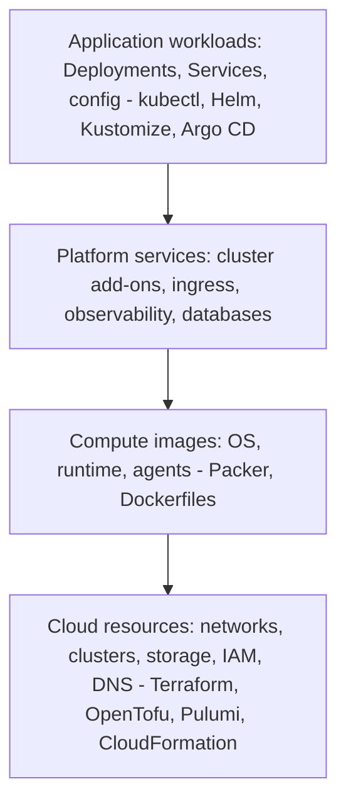
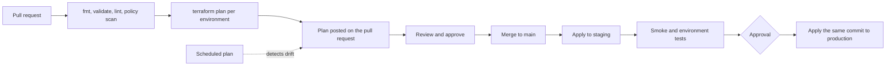
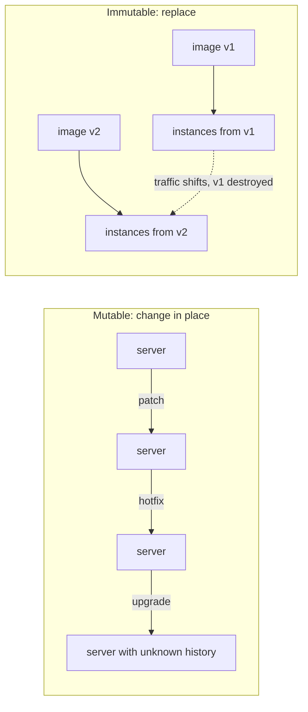

# Infrastructure as code and immutable infrastructure

> **Before this lesson:** read [Deployment scripting: idempotent, layered, verified](#/lesson/cicd/deploy-scripts), which introduces desired state and idempotence.

## In plain words

A builder who works from memory produces a different house each time, and cannot rebuild one that burns down. A builder who works from blueprints can build the same house again anywhere, show the plan to an inspector before starting, and see exactly what changed between two versions of the design.

**Infrastructure** is the equipment software runs on: computers (**servers**), networks, databases and storage. **Infrastructure as code** means describing all of it in text files — the blueprints — and letting a program build it from those files. Nobody sets a server up by hand.

**Immutable infrastructure** goes one step further, like a disposable razor blade. A server is never repaired or adjusted once it is running. When something must change, a new server is built from the blueprint and the old one is thrown away.

Why this matters for a job: nearly every company running software in the cloud works this way, and tools such as Terraform appear in a large share of job advertisements. "What is immutable infrastructure?" and "how do you handle drift?" are common interview questions.

## Motivation: the server nobody dares to reboot

Every long-lived organisation has one. It was set up years ago by someone who has since left. It has been patched, tuned and hot-fixed by hand ever since. Nobody knows exactly what is installed on it or why. It cannot be rebuilt, so it cannot be allowed to fail, so nobody touches it — and its test "twin" drifted away from it long ago, which means nothing tested there says much about production.

Such machines are sometimes called **snowflakes**: unique, fragile, and impossible to reproduce. They are the infrastructure form of the anti-patterns from Lesson 1, and they undermine everything a deployment pipeline promises. If environments cannot be created reliably, tests run in the wrong conditions; if they cannot be recreated, recovery depends on luck.

The answer is to treat infrastructure the way we treat application code: described in text files, kept in version control, reviewed, tested, and applied by automation. That is **infrastructure as code** (IaC). Taken one step further — never modifying a running server at all, only replacing it — it becomes **immutable infrastructure**.

## What operations actually needs

It is worth starting from the point of view of the people who run production, because their requirements are the design constraints.

- **Stability.** Changes should not cause outages. So every change must be testable somewhere realistic first.
- **Auditability.** Who changed what, when and why — for diagnosis as much as for compliance.
- **Recoverability.** After a failure, service is restored within an agreed time (recovery time objective) with at most an agreed loss of data (recovery point objective).
- **Visibility.** They know about abnormal conditions before users do.
- **Control.** Nothing changes in production without going through an agreed process.

IaC serves each of these: a reviewed pull request is the change-control record; a Git history is the audit trail; the code itself is the recovery procedure; and the same definitions build the test environment in which changes are rehearsed.

## Layers and the tools for each

"Infrastructure" covers several layers, and different tools suit different layers.



| concern | declarative tools | what they manage |
|---|---|---|
| Provisioning | Terraform / OpenTofu, Pulumi, CloudFormation, Bicep | cloud resources through provider APIs |
| Configuration | Ansible, Chef, Puppet | packages, files and services *inside* a machine |
| Images | Packer, Dockerfile | a pre-built machine or container image |
| Orchestration | Kubernetes manifests, Helm, Kustomize | what runs where, and how it is exposed |

The common thread is the **declarative** model from Lesson 12: you state what should exist; the tool works out the actions.

### A Terraform example, read closely

```hcl
# infra/modules/service_db/main.tf
terraform {
  required_version = ">= 1.9"
  required_providers {
    aws = { source = "hashicorp/aws", version = "~> 5.70" }
  }
}

variable "env"            { type = string }
variable "instance_class" { type = string }
variable "multi_az"       { type = bool }
variable "subnet_ids"     { type = list(string) }

resource "aws_db_subnet_group" "this" {
  name       = "orders-${var.env}"
  subnet_ids = var.subnet_ids
}

resource "aws_db_instance" "orders" {
  identifier                  = "orders-${var.env}"
  engine                      = "postgres"
  engine_version              = "16.4"
  instance_class              = var.instance_class
  allocated_storage           = 100
  multi_az                    = var.multi_az
  db_subnet_group_name        = aws_db_subnet_group.this.name
  storage_encrypted           = true
  manage_master_user_password = true          # the password lives in the secret manager, not in state
  backup_retention_period     = 14
  deletion_protection         = var.env == "production"

  lifecycle {
    prevent_destroy = true
  }
}

output "endpoint" { value = aws_db_instance.orders.address }
```

```hcl
# infra/envs/staging/main.tf           and           infra/envs/production/main.tf
module "db" {                                         module "db" {
  source         = "../../modules/service_db"           source         = "../../modules/service_db"
  env            = "staging"                            env            = "production"
  instance_class = "db.t4g.medium"                      instance_class = "db.m7g.xlarge"
  multi_az       = false                                multi_az       = true
  subnet_ids     = module.network.private_subnets       subnet_ids     = module.network.private_subnets
}                                                     }
```

What matters here:

- **One module, many environments.** Staging and production are the *same code* with different parameters. Their differences are four visible values, not an unknown number of hand-made choices. This is how "test in a copy of production" becomes affordable.
- **Versions are pinned** — the tool, the provider, the database engine.
- **The secret never enters the code or the state file.**
- **Guard rails** (`prevent_destroy`, `deletion_protection`) make the catastrophic mistake hard.

### State, plan and apply

A provisioning tool needs to know what it created last time. Terraform keeps that in a **state file**, which maps the resources in your code to real resource identifiers.

```hcl
terraform {
  backend "s3" {
    bucket       = "example-terraform-state"
    key          = "orders/production.tfstate"
    region       = "eu-central-1"
    encrypt      = true
    use_lockfile = true        # state locking, so two applies cannot run at once
  }
}
```

State must be stored remotely (never on a laptop), locked during changes, encrypted, and access-controlled, because it can contain sensitive values and because a corrupted state file is an outage.

The workflow has two phases, and the gap between them is where review happens:

```bash
terraform fmt -check && terraform validate      # cheap static checks
terraform plan -out=tfplan                      # compute the difference; change nothing
terraform show -no-color tfplan                 # human-readable plan for review
terraform apply tfplan                          # perform exactly the reviewed plan
```

Read plans with care for the symbol that matters most: `-/+` means **destroy and recreate**. For a stateless resource that is routine. For a database it is data loss.

## Infrastructure changes through a pipeline

Infrastructure code gets the same pipeline treatment as application code, with the plan as the reviewable artifact.



```yaml
# .github/workflows/infra.yml (core)
name: infra
on:
  pull_request:
    paths: ["infra/**"]
  push:
    branches: [main]
    paths: ["infra/**"]

permissions:
  contents: read
  id-token: write
  pull-requests: write

jobs:
  plan:
    runs-on: ubuntu-latest
    strategy:
      matrix:
        env: [staging, production]
    steps:
      - uses: actions/checkout@v4
      - uses: hashicorp/setup-terraform@v3
        with:
          terraform_version: 1.9.8
      - uses: aws-actions/configure-aws-credentials@v4
        with:
          role-to-assume: arn:aws:iam::123456789012:role/infra-plan-${{ matrix.env }}   # read-only role
          aws-region: eu-central-1
      - working-directory: infra/envs/${{ matrix.env }}
        run: |
          terraform init -input=false
          terraform validate
          terraform plan -input=false -no-color -out=tfplan | tee plan.txt
      - run: trivy config --exit-code 1 infra/
      - if: github.event_name == 'pull_request'
        run: gh pr comment "${{ github.event.pull_request.number }}" --body-file "infra/envs/${{ matrix.env }}/plan.txt"
        env:
          GH_TOKEN: ${{ github.token }}

  apply-production:
    if: github.ref == 'refs/heads/main'
    needs: plan
    runs-on: ubuntu-latest
    environment: production            # required reviewers; only main may deploy here
    steps:
      - uses: actions/checkout@v4
      - uses: hashicorp/setup-terraform@v3
        with:
          terraform_version: 1.9.8
      - uses: aws-actions/configure-aws-credentials@v4
        with:
          role-to-assume: arn:aws:iam::123456789012:role/infra-apply-production
          aws-region: eu-central-1
      - working-directory: infra/envs/production
        run: |
          terraform init -input=false
          terraform apply -input=false -auto-approve
```

Note the separation of privilege: the plan job, which runs on any pull request, assumes a read-only role; only the apply job on the protected branch and environment can change anything.

### Policy as code

Human review of plans does not scale and misses things. Encode the organisation's rules — no public buckets, encryption required, only approved regions, mandatory tags — as machine-checked policy that runs against the plan. Tools include Open Policy Agent (Conftest), Checkov, and tfsec/Trivy.

## Drift

**Configuration drift** is any difference between what the code says and what exists. It appears when someone makes a manual change, when an out-of-band process modifies a resource, or when an apply half-fails.

```python-run
desired = {  # from version control
    "sg-orders-db": {"ingress": ["10.0.0.0/16:5432"], "tags": {"owner": "payments"}},
    "bucket-invoices": {"public": False, "versioning": True, "encryption": "kms"},
    "asg-orders": {"min": 4, "max": 12, "image": "ami-0a1b"},
}
actual = {   # read from the cloud API
    "sg-orders-db": {"ingress": ["10.0.0.0/16:5432", "0.0.0.0/0:5432"], "tags": {"owner": "payments"}},
    "bucket-invoices": {"public": False, "versioning": False, "encryption": "kms"},
    "asg-orders": {"min": 4, "max": 12, "image": "ami-0a1b"},
    "vm-debug-tmp": {"size": "xlarge"},
}

def drift(desired, actual, path=""):
    out = []
    for key in sorted(set(desired) | set(actual)):
        here = f"{path}/{key}" if path else key
        if key not in actual:
            out.append(("missing", here, desired[key], None))
        elif key not in desired:
            out.append(("unmanaged", here, None, actual[key]))
        elif isinstance(desired[key], dict) and isinstance(actual[key], dict):
            out.extend(drift(desired[key], actual[key], here))
        elif desired[key] != actual[key]:
            out.append(("changed", here, desired[key], actual[key]))
    return out

for kind, where, want, got in drift(desired, actual):
    print(f"{kind:<10} {where}\n           code: {want}\n           real: {got}")
```

The output finds a database port opened to the internet, versioning switched off on a bucket, and a forgotten debug machine. Each is a plausible real incident. Handling drift takes three measures:

1. **Prevent**: humans get read-only access by default; changes flow through the pipeline.
2. **Detect**: run `terraform plan` on a schedule and alert on a non-empty result; or use a continuously reconciling controller (GitOps).
3. **Resolve deliberately**: either revert reality to match the code, or change the code to adopt the manual change. Never leave them disagreeing.

## Immutable infrastructure

Configuration-management tools were built to keep long-lived servers in line: log in (automatically), compare, fix. That works, but each server accumulates history — the order in which patches arrived, leftovers from removed packages — and two servers "configured the same" are never quite identical.

The immutable approach removes the question. **A server is never modified after it is created.** To change anything — an OS patch, a new runtime, a new application version — you build a new image, start new instances from it, shift traffic, and destroy the old ones.



The memorable shorthand is **cattle, not pets**: instances are numbered, interchangeable and replaceable, rather than named and nursed.

Consequences:

- **No drift**, because nothing changes in place.
- **Rollback is trivial**: start instances from the previous image.
- **What you test is what runs**: the image is an artifact built once and promoted, exactly like an application build.
- **Scaling and recovery are the same operation** as deploying.
- **Access can be removed.** If nobody needs to log in to fix things, nobody needs SSH.

Containers made this the default for applications: an image is immutable, and a pod is replaced, never patched. The same idea applies to virtual machines (bake a machine image with Packer, roll an auto-scaling group) and to Kubernetes nodes (replace node pools rather than upgrading nodes in place).

What it demands in return: **state must live elsewhere** — managed databases, object storage, external volumes — and logs must be shipped off the instance, because the instance will disappear.

```dockerfile
# An immutable runtime image: minimal, non-root, nothing to change at run time
FROM gcr.io/distroless/python3-debian12:nonroot
WORKDIR /app
COPY --from=build /app/.venv /app/.venv
COPY --from=build /app/src /app/src
ENV PATH="/app/.venv/bin:${PATH}"
USER nonroot
ENTRYPOINT ["python", "-m", "orders"]
```

```yaml
# and the platform enforces it
securityContext:
  runAsNonRoot: true
  readOnlyRootFilesystem: true
  allowPrivilegeEscalation: false
```

## Testing infrastructure code

- **Static**: format, validate, lint, and policy checks. Seconds, on every commit.
- **Plan review**: the diff of intended changes, on every pull request.
- **Ephemeral environments**: create the stack in a sandbox account, run environment tests, destroy it. This is the infrastructure equivalent of an integration test and proves that the code can build an environment from nothing.
- **Environment tests** after apply (Lesson 12): can the cluster reach the database; does DNS resolve; is the certificate valid.

A powerful habit: build production-like environments from scratch regularly, even daily. An environment that is created from code every night cannot become a snowflake, and "rebuild it" becomes a tested recovery procedure rather than a hope.

## Pitfalls

- **ClickOps with a Terraform veneer**: resources created in the console and never imported.
- **State on a laptop**, unlocked or unencrypted.
- **One giant state file** for everything, so every change risks everything and plans take twenty minutes. Split by blast radius and rate of change.
- **Copy-pasted environments** instead of one module with parameters; they diverge within weeks.
- **Applying from developer machines** with personal admin credentials.
- **Ignoring `-/+` in a plan** for a stateful resource.
- **Immutable servers holding state on local disk.**
- **Secrets in variables files or state.**

> [!WARNING]
> `terraform destroy`, and plans that replace stateful resources, can delete production data in seconds. Protect stateful resources with `prevent_destroy` and provider-level deletion protection, separate their state from frequently changed stacks, give the routine pipeline role no permission to delete them, and verify that backups can actually be restored.

> [!TIP]
> When adopting IaC on existing infrastructure, do not start with a rewrite. Import resources into state one service at a time, get to an empty plan (code matches reality), and only then begin making changes through code.

> [!INTERVIEW]
> "What is immutable infrastructure and why use it?" Servers or containers are never changed after creation; every change is a new image and a replacement. Benefits: no configuration drift, test and production run identical images, rollback means starting the previous image, scaling and recovery reuse the deploy path, and interactive access can be removed. Costs: state must be externalised, images must be rebuilt for every patch (so the image pipeline must be fast), and logs and diagnostics must be shipped off the instance.

## Summary

- Hand-maintained snowflake servers cannot be reproduced, tested or recovered; infrastructure as code describes environments in versioned, reviewed, automatically applied definitions.
- Use declarative tools appropriate to each layer; build every environment from the same modules with different parameters.
- Manage state remotely with locking; separate plan from apply and review the plan, especially replacements of stateful resources.
- Run infrastructure changes through a pipeline with least-privilege roles, policy as code and scheduled drift detection.
- Immutable infrastructure replaces rather than modifies: no drift, trivial rollback, identical test and production images, at the cost of externalising state.
- Test infrastructure code statically, through plans, and by building real ephemeral environments.

## Glossary

- **Infrastructure** — the computers, networks, databases and storage that software runs on.
- **Server** — a computer that runs software for others to use.
- **Infrastructure as code (IaC)** — describing infrastructure in versioned text files that a tool applies.
- **Snowflake server** — a hand-configured machine that is unique and cannot be reproduced.
- **Provisioning** — creating infrastructure resources.
- **Terraform** — a widely used tool for provisioning infrastructure from code.
- **Module** — a reusable block of infrastructure code with parameters.
- **State file** — the tool's record of which real resources its code created.
- **Plan / apply** — a preview of the changes / carrying them out.
- **Drift** — a difference between the code and what really exists.
- **Policy as code** — rules written as code and checked automatically.
- **Immutable infrastructure** — never changing a running server; replacing it instead.
- **Image** — a pre-built template from which servers or containers are started.
- **Recovery time objective (RTO)** — how quickly service must be restored after a failure.
- **Recovery point objective (RPO)** — how much recent data may be lost at most.

## Check yourself

```quiz
[
  {"q": "What is a 'snowflake' server?",
   "options": ["A server in a cold data centre", "A hand-configured machine whose exact state is unique and cannot be reproduced", "A server that auto-scales", "A read-only container"],
   "answer": 1,
   "explain": "Accumulated manual changes make it unique and fragile, so it cannot be rebuilt or faithfully copied for testing."},
  {"q": "Why build staging and production from the same Terraform module with different variables?",
   "options": ["It reduces cloud costs to zero", "Their differences are limited to a few visible parameters, so staging is a faithful, smaller copy of production", "Terraform requires it", "It removes the need for state"],
   "answer": 1,
   "explain": "Shared definitions keep environments the same in kind, which is what makes test results predictive."},
  {"q": "In a Terraform plan, what does the `-/+` marker on a database instance mean?",
   "options": ["A tag will be added", "The resource will be destroyed and recreated, risking data loss", "The resource is unchanged", "The plan failed"],
   "answer": 1,
   "explain": "Replacement of a stateful resource deletes it first. Such plans must be caught in review."},
  {"q": "Why must Terraform state be stored remotely with locking?",
   "options": ["To make plans faster", "So the team shares one source of truth and two applies cannot corrupt it by running concurrently", "Because local files are not supported", "To avoid using providers"],
   "answer": 1,
   "explain": "State maps code to real resources. Losing or corrupting it, or racing on it, can cause duplicate or destroyed infrastructure."},
  {"q": "What is configuration drift?",
   "options": ["Slow network traffic", "A difference between the infrastructure definition in version control and what actually exists", "A change in cloud pricing", "Gradual increase in build time"],
   "answer": 1,
   "explain": "Drift usually comes from manual or out-of-band changes and means the code no longer describes reality."},
  {"q": "How is a change made under the immutable infrastructure model?",
   "options": ["SSH to each server and apply the patch", "Run a configuration tool against running servers", "Build a new image, start new instances, shift traffic and destroy the old ones", "Reboot the servers"],
   "answer": 2,
   "explain": "Nothing is modified in place. Replacement removes drift and makes rollback a matter of starting the previous image."},
  {"q": "What does immutable infrastructure require of application state?",
   "options": ["It must be stored on the instance's local disk", "It must be externalised to managed stores or volumes, since instances are disposable", "It must be deleted daily", "It must be kept in environment variables"],
   "answer": 1,
   "explain": "Instances are replaced routinely, so anything that must survive has to live outside them."},
  {"q": "Why should the pull-request plan job use a read-only cloud role?",
   "options": ["Plans cannot run with write access", "The job runs for unreviewed changes, so it should be unable to modify anything", "Read-only roles are faster", "To hide the plan from reviewers"],
   "answer": 1,
   "explain": "Least privilege: only the apply job on the protected branch and environment should hold credentials that can change infrastructure."}
]
```

> **Source:** Humble & Farley, *Continuous Delivery*, ch. 11 (managing infrastructure and environments: operations needs, provisioning and configuration, virtualisation, cloud). Terraform language and backends: https://developer.hashicorp.com/terraform/language — S3 backend locking: https://developer.hashicorp.com/terraform/language/backend/s3 — Kubernetes security context: https://kubernetes.io/docs/tasks/configure-pod-container/security-context/
