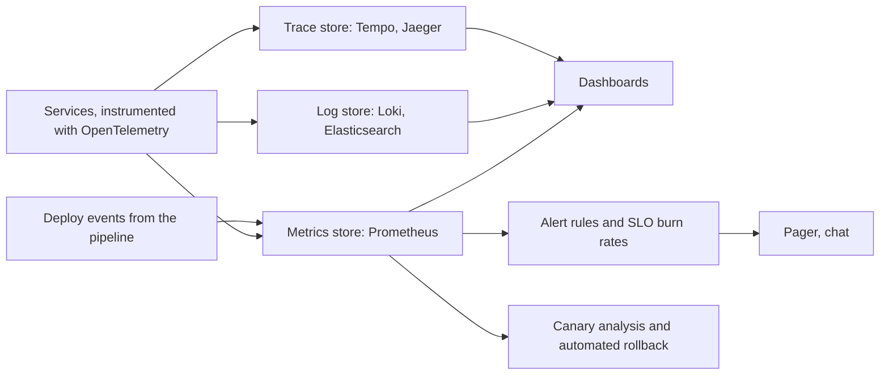
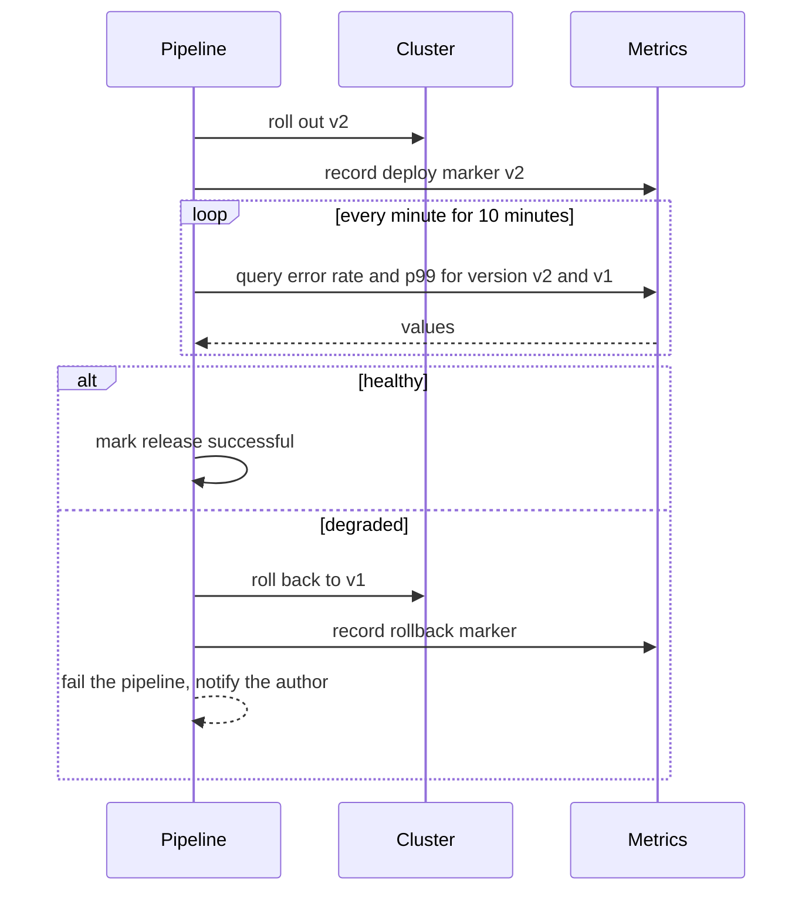

# Monitoring, observability and environment management

> **Before this lesson:** read [Infrastructure as code and immutable infrastructure](#/lesson/cicd/infrastructure-as-code) and [Blue-green, canary and rolling deployments](#/lesson/cicd/release-strategies).

## In plain words

A car's dashboard tells you speed, fuel and engine temperature, and a warning light comes on when something needs attention. Driving without one would mean finding out about problems when the car stops.

**Monitoring** is the dashboard for running software: continuous measurement of how the system is behaving, with **alerts** — automatic messages to a person — when something goes wrong. **Observability** is a little more: it means the system gives out enough information that you can work out *why* it is misbehaving, even for a problem nobody predicted.

The second half of the lesson is about **environments**: the separate places where the software runs, such as a test environment and the live one. Like rooms in a hotel, each has a purpose, each has to be kept in order, and unused ones cost money.

Why this matters for a job: a pipeline that says "deployed" has not shown that the software works for users; only monitoring can. "How do you know a deployment succeeded?" is a favourite interview question.

## Motivation: the pipeline does not end at "deployed"

A pipeline that turns green and stops has answered "did the deployment command succeed?" It has not answered the question that matters: "is the system now working for users?" Tests reduce the chance of shipping a defect; they never remove it, because production has traffic, data and failure modes no test environment reproduces. The last stage of any delivery system is therefore **feedback from production**.

That feedback does several jobs at once. It tells you a release went wrong while the blast radius is still small. It is the evidence that canary analysis and automatic rollback run on. It is how capacity is planned. And it is the only honest measurement of whether your delivery process is improving.

This lesson covers what to measure, how to turn measurements into alerts that people trust, how to connect deployments to what you observe, and how to manage the environments themselves — including the short-lived ones that modern platforms make cheap.

## Monitoring and observability

**Monitoring** answers questions you decided on in advance: is the error rate above 1%? Is the disk filling up? **Observability** is the property that lets you answer questions you did not anticipate — why are requests from one region slow only for customers with large baskets? — from the data the system emits, without shipping new code to find out.

Three kinds of telemetry provide the raw material:

| signal | what it is | good for | cost profile |
|---|---|---|---|
| **Metrics** | numeric time series, aggregated | dashboards, alerts, trends, SLOs | cheap; fixed cost per series |
| **Logs** | timestamped records of discrete events | detail about one event; audit | grows with traffic |
| **Traces** | the path of one request across services, as timed spans | finding *where* latency or errors arise | sampled |

They are most useful joined together: a metric shows *that* latency rose, a trace shows *which hop* is slow, logs carrying the same trace identifier show *why*.



### What to measure

You cannot watch everything. Two short checklists cover most services.

**The four golden signals** (for anything that serves requests):

1. **Latency** — how long requests take, as percentiles, with failed requests tracked separately.
2. **Traffic** — demand: requests per second.
3. **Errors** — the rate of failed requests.
4. **Saturation** — how full the most constrained resource is: CPU, memory, connection pool, queue depth.

**RED** (rate, errors, duration) is the same idea for request-driven services; **USE** (utilisation, saturation, errors) is the complement for resources such as hosts, disks and pools.

Above the technical signals sit **business metrics**: orders per minute, sign-ups, payment success rate. They are often the fastest indicator of a bad release. A deployment that returns HTTP 200 with an empty product list shows nothing on an error-rate graph and a cliff on orders per minute.

Instrumentation is application code, written and tested like any other:

```python
from prometheus_client import Counter, Histogram

REQUESTS = Counter("http_requests_total", "Requests served", ["route", "method", "code"])
LATENCY = Histogram("http_request_duration_seconds", "Request latency", ["route"],
                    buckets=(0.05, 0.1, 0.25, 0.5, 1, 2.5, 5))

def instrumented(route, method, handler):
    with LATENCY.labels(route).time():
        status = handler()
    REQUESTS.labels(route, method, str(status)).inc()
    return status
```

> [!WARNING]
> Keep label values bounded. A label such as `user_id` or a raw URL path creates a new time series for every distinct value, and the metrics store will fall over. Use route templates (`/orders/{id}`), status classes and a small set of known dimensions; put high-cardinality detail in logs and traces.

### Logs that machines can read

Emit structured logs — one JSON object per line, written to standard output, collected by the platform — with consistent fields: timestamp, level, service, version, trace identifier, and the event.

```json
{"ts":"2026-06-03T09:15:22.481Z","level":"error","service":"orders","version":"9f3c2e1",
 "trace_id":"4bf92f3577b34da6a3ce929d0e0e4736","route":"/checkout","event":"payment_declined",
 "gateway_code":"51","duration_ms":812}
```

Including the **version** in every log line and every metric is what lets you separate "new version" from "old version" during a rollout. Never log secrets, tokens or personal data.

## From measurements to alerts people trust

An alert is a claim on a human's attention, often at night. Each one should be **actionable** (there is something to do), **urgent** (it cannot wait until morning) and **about user impact** (symptoms, not internal causes). "CPU at 85%" is a cause that may or may not matter; "checkout error rate above its objective" is a symptom that always does.

### Service level objectives and error budgets

A **service level indicator** (SLI) is a measured ratio of good events to all events, for example the proportion of checkout requests that succeed within 800 ms. A **service level objective** (SLO) is a target for it over a window: 99.9% over 30 days. The complement is the **error budget**: 0.1% of requests may fail. With 10 million requests a month, that is 10,000 failures you are permitted to spend — on incidents, risky releases and experiments.

The budget turns the old argument between speed and stability into arithmetic. Budget remaining: release freely. Budget exhausted: slow down and invest in reliability.

Alerting on **burn rate** — how fast the budget is being consumed relative to plan — gives alerts that are both fast for severe problems and quiet for trivial ones.

```python-run
SLO = 0.999
budget = 1 - SLO                              # allowed failure ratio

def burn_rate(error_ratio):
    return error_ratio / budget               # 1.0 = spending exactly on plan for the whole window

def alert(short_window_ratio, long_window_ratio):
    """Multi-window rule: both a long and a short window must agree, to avoid flapping."""
    short, long = burn_rate(short_window_ratio), burn_rate(long_window_ratio)
    if long >= 14.4 and short >= 14.4:
        return f"PAGE now   (burn {long:.1f}x: 2% of the 30-day budget gone in 1 hour)"
    if long >= 6 and short >= 6:
        return f"PAGE       (burn {long:.1f}x: 5% of budget in 6 hours)"
    if long >= 1 and short >= 1:
        return f"ticket     (burn {long:.1f}x: slow leak, fix in working hours)"
    return f"ok         (burn {long:.2f}x)"

scenarios = {
    "normal day":                 (0.0002, 0.0003),
    "bad deploy, 2% errors":      (0.0200, 0.0180),
    "brief blip already over":    (0.0001, 0.0160),
    "slow degradation":           (0.0070, 0.0065),
    "minor leak":                 (0.0012, 0.0011),
}
for name, (short, long) in scenarios.items():
    print(f"{name:<26} {alert(short, long)}")

print(f"\nat 2% errors the monthly budget lasts {30 * 24 / burn_rate(0.02):.0f} hours")
```

The "brief blip already over" case does not page: the long window is still high but the short window has recovered, so there is nothing for a human to do right now. That two-window logic is what keeps pagers quiet without hiding real incidents.

```yaml
# Prometheus alert rule: fast burn of the checkout availability SLO
groups:
  - name: checkout-slo
    rules:
      - alert: CheckoutErrorBudgetFastBurn
        expr: |
          (sum(rate(http_requests_total{route="/checkout",code=~"5.."}[1h]))
             / sum(rate(http_requests_total{route="/checkout"}[1h]))) > (14.4 * 0.001)
          and
          (sum(rate(http_requests_total{route="/checkout",code=~"5.."}[5m]))
             / sum(rate(http_requests_total{route="/checkout"}[5m]))) > (14.4 * 0.001)
        for: 2m
        labels: { severity: page }
        annotations:
          summary: "Checkout is burning its error budget 14x too fast"
          runbook: "https://runbooks.example.com/checkout/error-budget"
```

Every paging alert links to a **runbook**: what the alert means, how to confirm it, the first mitigations to try (usually: check for a recent deploy and roll back), and whom to escalate to.

### Monitoring as executable specification

Operational requirements can be written the way acceptance criteria are: *given the service is running, when I request the health endpoint from outside the network, then it responds within two seconds.* A scheduled probe that runs a real user journey against production from several locations — **synthetic monitoring** — is exactly such a test, running forever. It detects problems when traffic is too low for metrics to show them, and it reuses the journeys you already automated as smoke tests.

## Connecting deployments to what you see

The single most useful question at the start of any incident is "what changed?" Make the answer visible without asking anyone.

- **Emit a deploy event** from the pipeline to the metrics or event system, and draw it as a vertical line on every dashboard.
- **Label telemetry with the version**, so new and old instances can be compared directly.
- **Gate the pipeline on production health**: after rollout, the pipeline watches key indicators for a bake period and rolls back automatically if they degrade.

```yaml
  verify-production:
    needs: deploy-production
    runs-on: ubuntu-latest
    steps:
      - uses: actions/checkout@v4
      - name: Annotate dashboards with this deployment
        run: ./scripts/annotate-deploy.sh "orders ${GITHUB_SHA::7} by ${GITHUB_ACTOR}"
      - name: Bake for 10 minutes, fail if the SLO burn rate is high
        run: ./scripts/watch-slo.sh --service orders --minutes 10 --max-burn-rate 6
      - name: Roll back on failure
        if: failure()
        run: ./scripts/rollback.sh production orders
```



## Managing environments

An environment is everything an application needs to run: compute, network, data stores, configuration and neighbouring services. The pipeline needs several, and each has a purpose.

| environment | purpose | lifetime | data |
|---|---|---|---|
| Local / dev container | fast inner loop | hours | tiny seed |
| Ephemeral preview | review one pull request in isolation | life of the pull request | seed |
| Acceptance / integration | automated acceptance stage | long-lived or per-run | generated per test |
| Capacity | load, stress, soak | long-lived, quiesced | large synthetic |
| Staging | final rehearsal; production-shaped | long-lived | anonymised or synthetic |
| Production | users | permanent | real |

Principles from earlier lessons apply to all of them: created from the same definitions, deployed to by the same script, differing only in recorded parameters, changed only through the pipeline.

### Ephemeral environments

When an environment is a namespace plus some manifests, you can afford one per pull request. A reviewer clicks a link and sees the change running; acceptance tests run against an environment nobody else is using; and the environment is destroyed on merge.

```yaml
# .github/workflows/preview.yml
name: preview
on:
  pull_request:
    types: [opened, synchronize, reopened, closed]

concurrency:
  group: preview-${{ github.event.pull_request.number }}

jobs:
  deploy:
    if: github.event.action != 'closed'
    runs-on: ubuntu-latest
    environment:
      name: pr-${{ github.event.pull_request.number }}
      url: https://pr-${{ github.event.pull_request.number }}.preview.example.com
    steps:
      - uses: actions/checkout@v4
      - run: ./scripts/build-and-push.sh
      - run: ./scripts/deploy.sh "pr-${{ github.event.pull_request.number }}" "$(cat image-digest.txt)"

  teardown:
    if: github.event.action == 'closed'
    runs-on: ubuntu-latest
    steps:
      - run: kubectl delete namespace "shop-pr-${{ github.event.pull_request.number }}" --ignore-not-found
```

Two cautions. **Cost**: environments that are never torn down accumulate; add a time-to-live and a scheduled reaper. **Fidelity**: a preview with stubbed neighbours and seed data proves less than staging; it supplements later stages, it does not replace them.

```python-run
from datetime import datetime, timedelta

now = datetime(2026, 6, 3, 12, 0)
environments = [  # name, kind, last_activity, pr_state
    ("pr-812", "preview", now - timedelta(hours=3),  "open"),
    ("pr-790", "preview", now - timedelta(days=9),   "open"),
    ("pr-801", "preview", now - timedelta(hours=20), "merged"),
    ("pr-777", "preview", now - timedelta(days=30),  "closed"),
    ("staging", "long-lived", now - timedelta(minutes=5), None),
]

def reap(envs, now, idle_limit=timedelta(days=7)):
    for name, kind, last, pr_state in envs:
        if kind != "preview":
            yield name, "keep (long-lived)"
        elif pr_state in ("merged", "closed"):
            yield name, f"DELETE (pull request {pr_state})"
        elif now - last > idle_limit:
            yield name, f"DELETE (idle {(now - last).days} days)"
        else:
            yield name, "keep"

for name, decision in reap(environments, now):
    print(f"{name:<8} {decision}")
```

### Environment hygiene

- **A single source of truth** for what is deployed where: the pipeline's environment view, or the GitOps repository.
- **Access control by environment**: broad in previews, narrow in production, with production changes only through the pipeline.
- **Parity in what causes bugs**: versions, topology shape, configuration mechanism. Scale may differ.
- **Regular rebuilds**: recreating staging from scratch on a schedule proves the definitions are complete.
- **Disaster recovery rehearsed**: restoring a backup into a fresh environment is the only proof the backup works. State your recovery time and recovery point objectives and test against them.

## Multihomed servers and IT service continuity

Two last topics belong to the same theme as the rest of the lesson: keeping the environments your pipeline delivers to safe and recoverable.

### Multihomed systems

A **multihomed** server has more than one **network interface card** (NIC), each connected to a different network. Instead of one road for everything, there are separate roads for separate traffic. A typical production layout uses three:

- a **production network** carrying customer traffic and traffic between application components;
- an **administration network** used for `ssh`, monitoring and deployments, physically separate so that people cannot reach the management services from the production side;
- a **backup network**, so that bulk copying at night does not slow customers down or clog the admin path.

The security gain is that a service such as `ssh` can be *bound* only to the administration interface and is then invisible from the production network. The performance gain is that heavy backup traffic has its own wire. There are traps to plan around:

1. **Applications must be told which interface to bind to.** If a program listens on every address, the separation is lost. Make the listen address configurable at deploy time instead of hard-coding it.
2. **Manage the network configuration centrally** as code, like any other environment definition. The book's authors tell the story of an engineer who took down the administration NIC of a production box while logged in through it, and so needed a trip to the data centre.
3. **Do not let traffic cross between interfaces.** If the server forwards packets from one network to another, it can quietly connect networks you meant to keep apart and expose data.

### IT service continuity planning

Monitoring tells you something is wrong. A **service continuity plan** says what you will do about a disaster: a lost data centre, a failed storage system or a ransomware attack. In IT service management (the ITIL framework) it is a deliberate process, owned by named people, that answers the following:

- Which services matter most, and what are their recovery targets (how long can each be down, and how much recent data may be lost)? These are the **recovery time objective** and **recovery point objective** from the backup lessons.
- What is the recovery arrangement for each: a standby site, replicated data, restoring from backups into new infrastructure?
- Who does what, in which order? Written **runbooks** beat memory during an emergency.
- How do we know it works? Plans that are never exercised fail. Rehearse failovers and restores on a schedule.

Continuous delivery helps here more than people expect. If every environment can be rebuilt from version control and the deployment pipeline is dependable, then "recover the service" reduces to "run the pipeline against the standby infrastructure". The corollary is that the pipeline, the artifact repository and the secrets they depend on are themselves critical services, and the continuity plan must cover them too.

## Pitfalls

- **Dashboards without alerts**, or alerts on causes rather than symptoms.
- **Alert fatigue**: pages that need no action teach people to ignore the pager.
- **Averages** on latency graphs.
- **No deploy markers**, so correlation with releases relies on memory.
- **Monitoring only production.** Test environments need the same telemetry, both to diagnose test failures and to test the monitoring itself.
- **Unbounded metric labels.**
- **Health checks that return 200 unconditionally.**
- **Preview environments that outlive their pull requests.**
- **Backups never restored.**

> [!TIP]
> Treat dashboards and alert rules as code: stored in the repository, reviewed, and deployed by the pipeline together with the service they describe. A new endpoint then arrives with its SLO and alerts in the same pull request.

> [!INTERVIEW]
> "How do you know a deployment was successful?" Not by the deploy command exiting zero. The rollout must complete with readiness passing; a smoke test must confirm the expected version and dependencies; then for a bake period the new version's golden signals and key business metrics are compared with the previous version's, with automated rollback on SLO burn. Deploy markers on dashboards and version labels on telemetry make the comparison possible. Only after the bake does the pipeline mark the release successful.

## Summary

- Production feedback is the final pipeline stage: it limits the damage of bad releases, powers automated rollback and measures improvement.
- Metrics, logs and traces together make a system observable; watch the golden signals and a few business metrics, labelled by version.
- Alert on user-visible symptoms using SLOs and error-budget burn rates, with a runbook for every page.
- Link deployments to telemetry with deploy markers, version labels and a post-deploy bake that can roll back automatically.
- Manage environments as code with clear purposes; use ephemeral previews for isolation and reap them; rehearse rebuilds and restores.

## Glossary

- **Monitoring** — continuously measuring a running system and alerting on problems.
- **Observability** — being able to work out why a system behaves as it does from the data it emits.
- **Metric** — a number measured repeatedly over time.
- **Log** — a timestamped record of an event.
- **Trace** — the path of one request through several services.
- **Golden signals** — latency, traffic, errors and saturation.
- **Saturation** — how full the most limited resource is.
- **Alert** — an automatic notification that something needs attention.
- **Service-level indicator (SLI)** — a measured ratio of good events to all events.
- **Service-level objective (SLO)** — a target for an indicator over a period of time.
- **Error budget** — the amount of failure an objective permits.
- **Burn rate** — how fast the error budget is being used up.
- **Runbook** — written instructions for responding to a particular alert.
- **Synthetic monitoring** — a scheduled probe that performs a user journey against the live system.
- **Ephemeral (preview) environment** — a short-lived environment created for one proposed change.
- **Deploy marker** — a line on a dashboard showing when a deployment happened.
- **Multihomed system** — A server with several network interfaces, each attached to a different network
- **Administration network** — A network separated from production traffic and used only for managing servers
- **IT service continuity plan** — A rehearsed plan for restoring important services after a disaster, with recovery targets and named responsibilities
- **Runbook** — A written, step-by-step procedure for a recurring or emergency operation

## Check yourself

```quiz
[
  {"q": "Which are the four golden signals?",
   "options": ["CPU, memory, disk, network", "Latency, traffic, errors, saturation", "Builds, tests, deploys, rollbacks", "Logs, metrics, traces, events"],
   "answer": 1,
   "explain": "They describe a request-serving system from the user's point of view plus how close it is to its limits."},
  {"q": "An SLO is 99.9% success over 30 days and the service handles 5 million requests in that period. What is the error budget?",
   "options": ["500 failed requests", "5,000 failed requests", "50,000 failed requests", "Zero"],
   "answer": 1,
   "explain": "0.1% of 5,000,000 is 5,000 requests that may fail before the objective is missed."},
  {"q": "Why alert on error-budget burn rate over two windows instead of a simple threshold?",
   "options": ["It is easier to configure", "It pages quickly for severe problems while staying quiet for short blips that have already ended", "It removes the need for dashboards", "It works without metrics"],
   "answer": 1,
   "explain": "The long window shows significance and the short window shows the problem is still happening, which cuts noise without hiding incidents."},
  {"q": "Why include the application version as a label on metrics and logs?",
   "options": ["For decoration", "So new and old versions can be compared directly during and after a rollout", "To increase cardinality deliberately", "Because Kubernetes requires it"],
   "answer": 1,
   "explain": "Per-version telemetry is what makes canary analysis and post-deploy verification possible."},
  {"q": "Which is a good paging alert?",
   "options": ["CPU above 80% on one node", "Checkout success rate is below its objective and burning budget quickly", "A pod restarted once", "Disk at 60%"],
   "answer": 1,
   "explain": "Pages should describe urgent, user-visible symptoms that need action. The others are causes that may not matter."},
  {"q": "A release returns HTTP 200 with an empty product list. Which signal is most likely to reveal it quickly?",
   "options": ["Error rate", "CPU utilisation", "A business metric such as orders per minute", "Pod restart count"],
   "answer": 2,
   "explain": "Technically successful responses hide functional failures. Business metrics and synthetic journeys catch them."},
  {"q": "What is the main operational risk of per-pull-request preview environments?",
   "options": ["They cannot run tests", "They accumulate and cost money unless torn down automatically", "They always share data with production", "They slow down Git"],
   "answer": 1,
   "explain": "Without teardown on close and a time-to-live reaper, abandoned environments pile up."},
  {"q": "What proves that backups are usable?",
   "options": ["The backup job reports success", "Regularly restoring them into a fresh environment and checking the result", "A large backup file", "A written policy"],
   "answer": 1,
   "explain": "Only a rehearsed restore demonstrates that recovery time and recovery point objectives can be met."},
  {"q": "Why do multihomed production servers usually bind ssh only to the administration interface?", "options": ["It makes ssh faster", "Management services then cannot be reached from the production network", "ssh cannot run on production NICs", "It reduces disk usage"], "answer": 1, "explain": "Binding to one interface keeps the service invisible on the others, reducing exposure."},
  {"q": "How does a reliable deployment pipeline help service continuity?", "options": ["It removes the need for backups", "Environments can be rebuilt from version control, so recovery means running the pipeline against standby infrastructure", "It makes disasters impossible", "It replaces runbooks"], "answer": 1, "explain": "Reproducible environments shorten recovery. Backups and runbooks are still needed, and the pipeline itself needs protection."}
]
```

> **Source:** Humble & Farley, *Continuous Delivery*, ch. 11 (monitoring infrastructure and applications: collecting data, logging, dashboards, behaviour-driven monitoring; managing environments). Golden signals and multi-window burn-rate alerting follow Google's SRE books: https://sre.google/sre-book/monitoring-distributed-systems/ and https://sre.google/workbook/alerting-on-slos/ — Prometheus alerting rules: https://prometheus.io/docs/prometheus/latest/configuration/alerting_rules/ — OpenTelemetry: https://opentelemetry.io/docs/
