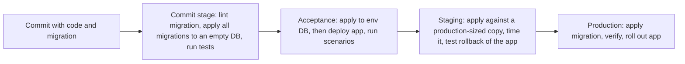
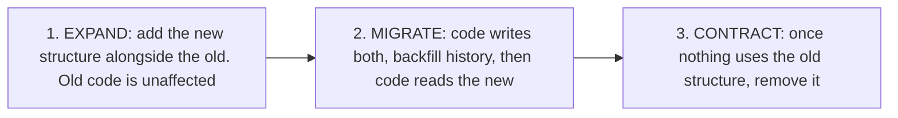

# Schema migrations and expand/contract

> **Before this lesson:** read [Blue-green, canary and rolling deployments](#/lesson/cicd/release-strategies). SQL statements appear below; each is explained.

## In plain words

A shop wants to move its shelves around, but it cannot close. Customers are inside and staff are restocking. The answer is to put the new shelf up first, move the goods across while people keep shopping, and only take the old shelf away once nobody uses it.

A **database** is where an application keeps the information it must remember: customers, orders, payments. Its **schema** is the layout — which tables exist and which columns each has. A **migration** is a small script that changes that layout.

Changing the layout is the delicate part of releasing software, because the database is always in use and, unlike the program, cannot be thrown away and restarted. The technique in this lesson is called **expand/contract**, and it is the shelf method: add the new structure (expand), move everything over, then remove the old structure (contract).

Why this matters for a job: "how would you rename a database column with no downtime?" is asked in a great many backend interviews, and a careless migration is one of the commonest causes of real outages.

## Motivation: the part of the system you cannot redeploy

Application instances are disposable. If a release is bad, start the old image and the mistake is gone. A database is different in kind: it holds *state that must survive every release*, and a change to it cannot be undone by starting an older binary. Drop a column, and the data in it is gone. Rename one, and every application version that used the old name breaks at the same instant.

That asymmetry makes the database the usual reason teams say "we cannot release without downtime" or "we cannot roll back". Both statements are almost always untrue, but making them untrue takes discipline. Two ideas carry nearly all of it:

1. **Schema changes are versioned, scripted, incremental artefacts** that travel through the pipeline like code.
2. **Schema changes are decoupled from code changes** by making every individual step compatible with the application version running before *and* after it — the **expand/contract** pattern.

## Versioned migrations

### The idea

Instead of one hand-edited "current schema" file, keep an ordered series of small scripts. Each moves the schema from version *n* to *n+1*. The database records which have been applied in a bookkeeping table, and a migration tool applies whichever are missing, in order.

```text
migrations/
├── 0001_create_customers.sql
├── 0002_create_orders.sql
├── 0003_add_orders_status.sql
├── 0004_index_orders_customer_id.sql
└── 0005_add_customers_full_name.sql
```

```sql
-- 0003_add_orders_status.sql
ALTER TABLE orders ADD COLUMN status text NOT NULL DEFAULT 'new';
```

Tools implementing this are available for every stack: Flyway and Liquibase (JVM and language-neutral), Alembic (Python), Rails and Django migrations, golang-migrate, Atlas, Prisma Migrate. The details differ; the model does not.

Properties to insist on:

- **One history for every environment.** A developer's empty database, the acceptance environment and production all reach the current schema by running the same scripts in the same order. Production's migration has therefore been rehearsed many times.
- **Applied migrations are immutable.** Once a script has run anywhere shared, it is never edited; a correction is a *new* migration. Tools enforce this with checksums.
- **Migrations live with the code that needs them**, in the same repository and commit.
- **Fresh install and upgrade are the same path.** Creating a database from nothing means running all migrations from zero, which is also a test that the history is complete.

A minimal runner shows there is no magic:

```python-run
import hashlib, sqlite3

MIGRATIONS = [
    ("0001_create_customers", "CREATE TABLE customers (id INTEGER PRIMARY KEY, name TEXT NOT NULL)"),
    ("0002_create_orders",    "CREATE TABLE orders (id INTEGER PRIMARY KEY, customer_id INTEGER, total_cents INTEGER)"),
    ("0003_add_orders_status","ALTER TABLE orders ADD COLUMN status TEXT NOT NULL DEFAULT 'new'"),
]

def checksum(sql): return hashlib.sha256(sql.encode()).hexdigest()[:12]

def migrate(db, migrations):
    db.execute("CREATE TABLE IF NOT EXISTS schema_migrations (version TEXT PRIMARY KEY, checksum TEXT)")
    applied = dict(db.execute("SELECT version, checksum FROM schema_migrations"))
    ran = []
    for version, sql in migrations:
        if version in applied:
            if applied[version] != checksum(sql):
                raise RuntimeError(f"{version} was edited after being applied")
            continue
        with db:                                   # one transaction per migration
            db.execute(sql)
            db.execute("INSERT INTO schema_migrations VALUES (?, ?)", (version, checksum(sql)))
        ran.append(version)
    return ran

db = sqlite3.connect(":memory:")
print("first run :", migrate(db, MIGRATIONS))
print("second run:", migrate(db, MIGRATIONS), "(idempotent)")

MIGRATIONS.append(("0004_index_orders_customer", "CREATE INDEX idx_orders_customer ON orders(customer_id)"))
print("after adding 0004:", migrate(db, MIGRATIONS))

MIGRATIONS[1] = ("0002_create_orders", "CREATE TABLE orders (id INTEGER PRIMARY KEY)")
try:
    migrate(db, MIGRATIONS)
except RuntimeError as e:
    print("guard:", e)
```

The second run does nothing; the fourth migration is applied alone; and tampering with history is detected.

### Migrations in the pipeline



- **Commit stage:** build a database from zero with every migration, then run the tests against it. Lint the new migration for dangerous operations (tools such as Squawk for PostgreSQL, Atlas lint, or `strong_migrations` for Rails flag table rewrites, missing `CONCURRENTLY`, non-nullable additions without defaults).
- **Staging:** run the migration against data of production *size*. A statement that takes 40 ms on a thousand rows may hold a lock for twenty minutes on two hundred million.
- **Production:** the migration is a distinct pipeline step with its own verification, applied before the application version that depends on it.

## Why "just change it" fails

Consider renaming `customers.name` to `customers.full_name`.

**The naive release**: one migration with `ALTER TABLE customers RENAME COLUMN name TO full_name`, shipped with new code that uses `full_name`.

During a rolling update, old and new application instances run together for several minutes. The moment the migration commits:

- every *old* instance still selecting `name` starts failing;
- if the new version misbehaves and you roll back, the *rolled-back* code fails too, because the column it expects no longer exists.

So the release causes an outage on the way out and removes the escape route. Any change that is not backward compatible has this shape: renames, drops, type changes, adding a `NOT NULL` column without a default, splitting or merging tables.

## Expand / contract

The pattern (also called *parallel change*) splits one incompatible change into a sequence of compatible ones. At every step, the schema works with the application version currently running and with the next one.



Applied to the rename:

| step | change | deployed as | old code works? | new code works? |
|---|---|---|---|---|
| 1 | Add nullable `full_name` | migration | yes (ignores it) | — |
| 2 | Write to **both** columns; read from `name` | app release A | yes | yes |
| 3 | Backfill `full_name` from `name` in batches | data migration job | yes | yes |
| 4 | Read from `full_name`; keep writing both | app release B | yes | yes |
| 5 | Stop writing `name` | app release C | A and B still fine | yes |
| 6 | Drop `name` | migration | only C and later | yes |

Each row is its own deployment, possibly days apart. Rollback remains possible at every point except after the final drop — which is why the contract step is delayed until you are sure.

```sql
-- step 1 (expand)
ALTER TABLE customers ADD COLUMN full_name text;

-- step 3 (backfill, in batches to avoid long locks and replication lag)
UPDATE customers SET full_name = name
WHERE id IN (SELECT id FROM customers WHERE full_name IS NULL ORDER BY id LIMIT 5000);
-- repeat until zero rows are updated

-- step 6 (contract), after release C has been stable for an agreed period
ALTER TABLE customers DROP COLUMN name;
```

```python
# release A: dual write, old read
def save_customer(db, customer):
    db.execute("UPDATE customers SET name = %s, full_name = %s WHERE id = %s",
               (customer.name, customer.name, customer.id))

# release B: dual write, new read with a safe fallback during the transition
def load_name(row):
    return row["full_name"] if row["full_name"] is not None else row["name"]
```

### A validator for migration plans

The rule "every step must be compatible with the code running before and after it" can be checked mechanically. Model each application version by the columns it reads and writes, and each step as either a schema change or an application deploy:

```python-run
def validate(plan, columns, app):
    """columns: set of existing columns. app: dict(reads=set, writes=set) for the running version.
    A step is safe if, after it, the running app only touches columns that exist."""
    columns, app = set(columns), dict(app)
    for i, step in enumerate(plan, 1):
        kind, arg = step
        if kind == "add":
            columns.add(arg)
        elif kind == "drop":
            columns.discard(arg)
        elif kind == "deploy":
            app = arg
        missing = (app["reads"] | app["writes"]) - columns
        status = "ok" if not missing else f"BREAKS running app (needs {sorted(missing)})"
        label = arg if kind != "deploy" else f"reads={sorted(arg['reads'])} writes={sorted(arg['writes'])}"
        print(f"  step {i}: {kind:<6} {label!s:<52} {status}")
        if missing:
            return False
    return True

v1 = {"reads": {"name"},      "writes": {"name"}}
vA = {"reads": {"name"},      "writes": {"name", "full_name"}}
vB = {"reads": {"full_name"}, "writes": {"name", "full_name"}}
vC = {"reads": {"full_name"}, "writes": {"full_name"}}

print("naive rename:")
validate([("add", "full_name"), ("drop", "name"), ("deploy", vC)], {"name"}, v1)

print("\nexpand / contract:")
ok = validate([("add", "full_name"), ("deploy", vA), ("deploy", vB), ("deploy", vC), ("drop", "name")],
              {"name"}, v1)
print("  plan is safe:", ok)

print("\ncontract too early:")
validate([("add", "full_name"), ("deploy", vA), ("drop", "name")], {"name"}, v1)
```

The problem set for this module extends this checker so that it also verifies the *previous* application version would still work after each step — the condition for rollback.

### Recipes for common changes

| change | safe sequence |
|---|---|
| Add a column | Add it nullable or with a default; deploy code that uses it. |
| Add a `NOT NULL` column | Add nullable → backfill → add the constraint (in PostgreSQL, add a `CHECK … NOT VALID`, then `VALIDATE`) → set `NOT NULL`. |
| Remove a column | Deploy code that no longer reads or writes it → wait → drop. |
| Rename a column or table | Add new → dual write → backfill → switch reads → stop old writes → drop old. |
| Change a column's type | Treat as rename: new column of the new type, then as above. |
| Split a table | Create new table → dual write → backfill → switch reads → remove old columns. |
| Add an index | Build without blocking writes (`CREATE INDEX CONCURRENTLY` in PostgreSQL; online DDL elsewhere). |
| Add a foreign key | Add as `NOT VALID`, then `VALIDATE CONSTRAINT` separately. |

## Locks: the hidden downtime

A migration can be perfectly compatible and still take the site down by holding a lock. In PostgreSQL most `ALTER TABLE` forms take an `ACCESS EXCLUSIVE` lock, which blocks all reads and writes on the table. If the statement is fast, nobody notices. Two things turn it into an outage:

- the statement is slow because it rewrites or scans the table;
- the statement *waits* for a long-running transaction to finish, and while it waits, every other query queues behind it.

Defences that belong in every migration against a busy database:

```sql
SET lock_timeout = '3s';             -- give up rather than queue behind a long transaction
SET statement_timeout = '60s';

-- build indexes without blocking writes (cannot run inside a transaction block)
CREATE INDEX CONCURRENTLY IF NOT EXISTS idx_orders_customer ON orders (customer_id);

-- add a foreign key without a long validating lock
ALTER TABLE orders ADD CONSTRAINT orders_customer_fk
  FOREIGN KEY (customer_id) REFERENCES customers (id) NOT VALID;
ALTER TABLE orders VALIDATE CONSTRAINT orders_customer_fk;
```

With a lock timeout the migration fails fast and can be retried; without one it can silently freeze the application. Other engines have their own rules and tooling (MySQL's online DDL, and external tools such as gh-ost and pt-online-schema-change that build a shadow table). Know your engine.

> [!WARNING]
> Never run a large backfill as one statement. A single `UPDATE` across a hundred million rows holds locks for its whole duration, bloats the table, and can leave replicas minutes behind. Update in small batches, commit each, pause when replication lag rises, and make the job resumable.

## Who runs the migration, and when

Three common arrangements:

- **A pipeline step before the rollout.** A job runs `migrate up` using the new image, the pipeline verifies it, then the application rolls out. Clear ordering, clear failure point. The usual choice.
- **A pre-deploy hook** of the deployment tool (a Helm pre-upgrade hook, an Argo CD PreSync hook). Same effect, managed by the tool.
- **At application start-up.** Simple for small systems, risky at scale: several replicas start together and race, a slow migration blocks start-up and trips health checks, and the application needs schema-changing privileges. If used, guard it with an advisory lock.

```yaml
# Argo CD: run migrations as a PreSync hook, before the new pods are applied
apiVersion: batch/v1
kind: Job
metadata:
  name: orders-migrate
  annotations:
    argocd.argoproj.io/hook: PreSync
    argocd.argoproj.io/hook-delete-policy: BeforeHookCreation
spec:
  backoffLimit: 0
  template:
    spec:
      restartPolicy: Never
      containers:
        - name: migrate
          image: registry.example.com/orders@sha256:9c1e4b7d0a52c5f1e2d3a4b5c6d7e8f9a0b1c2d3e4f5a6b7c8d9e0f1a2b3c4d5
          command: ["python", "-m", "orders.migrate", "up"]
          envFrom:
            - secretRef: { name: orders-db-migrator }    # a separate, more privileged credential
```

Separate the credentials: the migration job's role may alter schema; the application's runtime role may only read and write data.

## Pitfalls

- **Editing a migration that has already been applied.**
- **Shipping an incompatible schema change and the code that needs it together.**
- **Contracting too soon** — dropping the old column while an older application version, a batch job, a report or another team's service still reads it.
- **Forgetting other readers.** Analytics pipelines, replicas feeding a warehouse and ad-hoc scripts also depend on the schema.
- **Testing migrations only on small data.**
- **No lock timeout.**
- **Down migrations that silently lose data**, giving false confidence (next lesson).
- **Branching conflicts**: two developers both add migration 0006. Use timestamps or a tool that detects divergent heads, and resolve in review.

> [!TIP]
> Make the contract step a separate ticket with a date, created at the same time as the expand step. Unfinished contractions are how schemas fill up with dead columns and how dual-write code lingers for years.

> [!INTERVIEW]
> "How do you rename a column with zero downtime?" Expand/contract: add the new column; deploy code that writes both and reads the old; backfill in batches; deploy code that reads the new; deploy code that stops writing the old; after a safety period, drop the old column. Each step is a separate deployment compatible with the version before and after, so rolling deployments work and rollback stays possible until the final drop. Add that migrations are versioned scripts run by the pipeline, tested on production-sized data, with lock timeouts.

## Summary

- A database holds state that outlives every release, so its changes need more care than code changes.
- Keep schema changes as ordered, immutable, versioned migration scripts, applied by a tool in every environment through the pipeline.
- An incompatible change shipped in one step breaks running instances and removes rollback.
- Expand/contract splits it into compatible steps: add the new structure, migrate writes, data and reads, then remove the old structure later.
- Guard against lock-induced outages with timeouts, non-blocking index builds, split constraint validation and batched backfills.
- Run migrations as an explicit, verified pipeline step with a dedicated credential, ahead of the code that needs them.

## Glossary

- **Database** — the system in which an application stores information it must keep.
- **Table / column / row** — a set of records / one named field of each record / one record.
- **Schema** — the structure of a database: its tables and columns.
- **Migration** — a script that changes the schema.
- **Versioned migrations** — an ordered series of migration scripts, each applied exactly once.
- **Expand/contract** — adding new structure first and removing old structure later, in compatible steps.
- **Backward-compatible change** — a change that leaves the currently running application working.
- **Dual write** — writing the same information to both the old and the new place during a transition.
- **Backfill** — filling in the new structure for rows that already exist.
- **Nullable** — allowed to be empty.
- **Lock** — the database's way of stopping operations from interfering with each other.
- **Index** — a structure that speeds up searches on a table.
- **Constraint** — a rule the database enforces on the data.
- **Transaction** — a group of changes applied together or not at all.

## Check yourself

```quiz
[
  {"q": "Why is a database harder to roll back than an application instance?",
   "options": ["Databases are written in SQL", "It holds persistent state, so reverting code does not revert data or structure changes", "Databases cannot be versioned", "Application instances are slower"],
   "answer": 1,
   "explain": "Starting an older binary restores old behaviour but cannot bring back a dropped column or undo transformed data."},
  {"q": "A migration script has already been applied to staging and contains a mistake. What should you do?",
   "options": ["Edit the script and re-run it", "Write a new migration that corrects it", "Delete the bookkeeping table", "Restore staging from backup and edit the script"],
   "answer": 1,
   "explain": "Applied migrations are immutable so that every environment follows the same history. Corrections go in a new, later migration."},
  {"q": "What goes wrong when a column rename and the code using the new name are released together under a rolling update?",
   "options": ["Nothing", "Old instances still running fail immediately, and rolling back the code also fails because the old column is gone", "The migration tool refuses to run", "The new instances cannot start"],
   "answer": 1,
   "explain": "Two application versions coexist during the rollout. An incompatible change breaks the old one and removes the rollback path."},
  {"q": "In expand/contract, what happens in the 'expand' phase?",
   "options": ["The old column is dropped", "New structure is added alongside the old without affecting existing code", "All data is deleted", "The application is stopped"],
   "answer": 1,
   "explain": "Expansion is purely additive, so the currently running version is unaffected."},
  {"q": "When is it safe to perform the 'contract' step that drops the old column?",
   "options": ["Immediately after adding the new one", "Once no running or rollback-candidate version, job or downstream consumer uses it", "Before the backfill", "Never"],
   "answer": 1,
   "explain": "Contraction is the one irreversible step, so it waits until nothing depends on the old structure."},
  {"q": "Why set a lock timeout in a migration on a busy PostgreSQL table?",
   "options": ["To make the migration faster", "So the DDL fails quickly instead of waiting behind a long transaction while all other queries queue behind it", "Because indexes require it", "To disable replication"],
   "answer": 1,
   "explain": "A waiting ACCESS EXCLUSIVE request blocks subsequent queries. Failing fast and retrying avoids a self-inflicted outage."},
  {"q": "How should a large backfill be performed?",
   "options": ["One UPDATE statement for the whole table", "In small committed batches, resumable, watching replication lag", "By dropping and recreating the table", "During the application's start-up"],
   "answer": 1,
   "explain": "Batches keep locks short, limit bloat and let replicas keep up; a single huge statement can stall the database."},
  {"q": "Why give the migration job a different database credential from the application?",
   "options": ["It is required by SQL", "So the running application has no privilege to alter the schema, limiting the damage of a bug or compromise", "To make migrations slower", "Credentials cannot be shared"],
   "answer": 1,
   "explain": "Least privilege: only the short-lived migration step needs DDL rights."}
]
```

> **Source:** Humble & Farley, *Continuous Delivery*, ch. 12 (managing data: database scripting, incremental change, versioning the database, rolling back and zero-downtime releases). PostgreSQL explicit locking and `ALTER TABLE`: https://www.postgresql.org/docs/current/explicit-locking.html and https://www.postgresql.org/docs/current/sql-altertable.html — `CREATE INDEX CONCURRENTLY`: https://www.postgresql.org/docs/current/sql-createindex.html — Argo CD resource hooks: https://argo-cd.readthedocs.io/en/stable/user-guide/resource_hooks/ — Parallel change: https://martinfowler.com/bliki/ParallelChange.html
