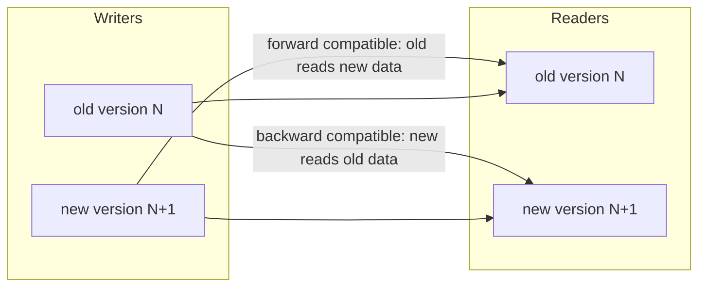
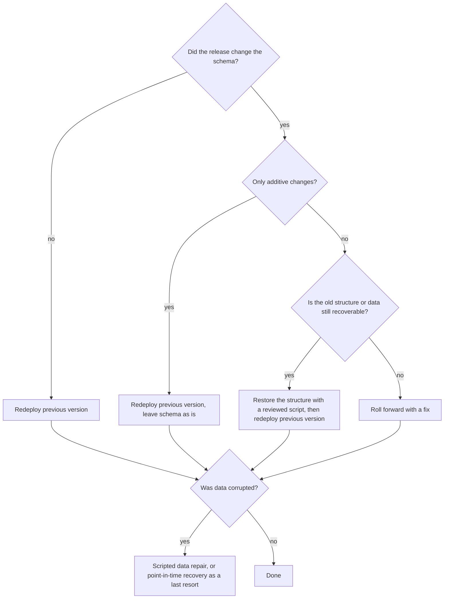

# Backward compatibility, data rollback and test data

> **Before this lesson:** read [Schema migrations and expand/contract](#/lesson/cicd/schema-migrations).

## In plain words

A hospital changes its patient form. For a while, nurses on some wards still use the old form and others use the new one, and the records office must be able to read both. If the new form drops a box that the old system needs, things go wrong on the wards that have not switched yet.

Software goes through exactly this whenever a new version is released, because the old and new versions run side by side for a time. **Backward compatibility** means the *new* version can read what the *old* one wrote. **Forward compatibility** means the *old* version can cope with what the *new* one wrote — which is what you need if you have to go back to the old version.

The lesson has three parts: the rules for changing data formats safely, what happens to data when a release has to be undone, and where the data used for testing should come from.

Why this matters for a job: "the release changed the database and now has to be rolled back — what do you do?" is a classic senior interview question, and mishandled test data containing real customers' details has caused serious breaches.

## Motivation: "we can roll the code back, but what about the orders placed since?"

The previous lesson showed how to change a schema in steps that never break the running application. That solves the *deployment*. It does not, on its own, answer three questions that come up in every serious discussion of releasing software that has data:

1. If we roll the application back, what happens to data written by the new version?
2. The database is not the only place where two versions meet. What about messages, events, caches and API payloads?
3. Every stage of the pipeline needs data to test with. Where does it come from, and how do we keep it from making tests slow, fragile or illegal?

This lesson takes them in order.

## Compatibility is a two-way street

When version *N+1* replaces version *N*, there is always an overlap: during a rolling update both run; after a rollback, *N* runs against data that *N+1* wrote. Two properties make that safe.

- **Backward compatibility**: new code can read data written by old code. Needed for the upgrade.
- **Forward compatibility**: old code can read data written by new code. Needed for coexistence and for rollback.



People remember backward compatibility and forget forward compatibility — and forward compatibility is exactly what a rollback tests.

### The rules, wherever data crosses a version boundary

The same small set of rules applies to database rows, JSON payloads, queue messages, cache entries and files:

| change | safe? | why |
|---|---|---|
| Add an optional field or nullable column | yes | old readers ignore it; new readers supply a default when it is absent |
| Remove a field that readers treat as optional | yes, in two steps | first stop reading, later stop writing |
| Add a *required* field | no | old writers do not send it; new readers reject their data |
| Rename a field | no | it is a remove plus an add; use expand/contract |
| Change a field's type or meaning | no | readers misinterpret silently — the worst failure |
| Add a new enum value | risky | old readers may crash on an unknown value; they must have a fallback |
| Tighten validation | risky | previously valid stored data becomes invalid |

Two habits make most of this automatic:

- **Tolerant readers.** Ignore fields you do not recognise; supply defaults for fields that are missing; treat unknown enum values as a defined "other". (This is the robustness principle: strict in what you produce, lenient in what you accept.)
- **Additive-only evolution** of anything shared, with removal as a separate, later change.

```python-run
import json

def read_v1(payload):
    """Old consumer: knows id, total_cents and status in {new, paid}."""
    d = json.loads(payload)
    status = d["status"] if d["status"] in ("new", "paid") else "unknown"   # tolerant of new enum values
    return {"id": d["id"], "total": d["total_cents"] / 100, "status": status}

def read_v2(payload):
    """New consumer: also understands currency (defaulting when absent) and status 'refunded'."""
    d = json.loads(payload)
    return {"id": d["id"], "total": d["total_cents"] / 100,
            "currency": d.get("currency", "EUR"), "status": d["status"]}

old_message = json.dumps({"id": 7, "total_cents": 4990, "status": "paid"})
new_message = json.dumps({"id": 8, "total_cents": 1200, "status": "refunded", "currency": "CHF", "gift": True})
breaking    = json.dumps({"id": 9, "amount": {"value": 1200, "currency": "CHF"}, "status": "paid"})

print("backward (new reads old):", read_v2(old_message))
print("forward  (old reads new):", read_v1(new_message))
for name, reader in (("old", read_v1), ("new", read_v2)):
    try:
        reader(breaking)
    except KeyError as e:
        print(f"breaking change, {name} reader fails: missing field {e}")
```

The additive message is handled by both versions. The third message restructured `total_cents` into a nested object — a rename in disguise — and breaks both.

### Messages and events deserve special care

A queue adds a time dimension. A message written by version *N* may be consumed days later by version *N+3*; a message written by *N+1* may be consumed by an instance of *N* that has not yet been replaced, or after a rollback. Practical consequences:

- **Deploy consumers before producers** when adding something new: readers learn to understand a field before any writer emits it.
- **Deploy producers before consumers** when removing something: writers stop emitting before readers stop expecting it. (Both are expand/contract with the roles reversed.)
- **Use a schema registry** with enforced compatibility rules for formats such as Avro or Protobuf, so an incompatible schema is rejected in the pipeline, not discovered by a crashing consumer.
- **Never reuse** a Protobuf field number or repurpose a field name.

```yaml
# commit stage: fail the build if the proposed event schema breaks existing consumers
  schema-compat:
    runs-on: ubuntu-latest
    steps:
      - uses: actions/checkout@v4
      - uses: bufbuild/buf-action@v1
        with:
          breaking_against: "https://github.com/${{ github.repository }}.git#branch=main"
```

Caches are the forgotten version boundary. An entry serialised by *N+1* and read by *N* fails in the same way as a database row would. Either keep cached formats compatible or include a format version in the cache key so each version reads only its own entries.

## Rolling back when data has changed

There are four situations, in increasing difficulty.

**1. The release changed no schema.** Redeploy the previous version. Check only that it tolerates any new *values* the newer version wrote.

**2. The release made only additive (expand) schema changes.** Redeploy the previous version and leave the schema alone. The old code ignores the new columns. This is the payoff of expand/contract: **application rollback without database rollback**. It is the normal case and should cover nearly every release.

**3. The release made a destructive change.** A column was dropped or data was transformed in place. The old code cannot run. Options are to roll forward with a fix, or to restore the lost structure from a copy you had the foresight to keep. This is why contraction is postponed and why destructive migrations get their own release, separate from any feature.

**4. Data itself was damaged** by a bug in the new version. Reverting the code stops the damage but does not repair it. You need a *data fix*: a reviewed, tested, scripted correction — run through the pipeline like any other change — or, in the worst case, point-in-time recovery, which loses every legitimate write made after the chosen moment.



### On "down" migrations

Many tools let each migration define an `up` and a `down`. Down scripts are useful in development for iterating on a migration. In production they are less useful than they look:

- A down migration for a destructive change cannot restore the data — the column comes back empty.
- Running it discards whatever was written into the new structure since the release.
- It is almost never tested against realistic data, so it is the least-rehearsed script you own.

The dependable production strategy is therefore **forward-only migrations with expand/contract**: never need to go down, because every schema state supports the previous application version.

### Keeping the transactions made in between

Suppose a new version has been live for an hour and must be withdrawn, but the orders taken in that hour must not be lost. Techniques, in order of preference:

1. **Stay compatible**, so nothing needs converting.
2. **Keep the old system current while the new one runs.** In a blue-green switch, replay or dual-write new transactions to the old side so it can take over without loss. Useful for high-risk cut-overs such as a database engine migration.
3. **Record incoming requests as events** and be able to replay them. Powerful, and a significant architectural commitment.
4. **Write a compensating script** that converts data created by the new version into the old shape.

```python-run
orders = [  # written by the old version: cents; and by the new version: a decimal string + currency
    {"id": 1, "total_cents": 4990},
    {"id": 2, "total_cents": 1200},
    {"id": 3, "amount": "25.50", "currency": "EUR"},
    {"id": 4, "amount": "8.00",  "currency": "CHF"},
]

def downgrade(row, fx_to_eur):
    """Compensating conversion so the previous version can read rows the new version wrote."""
    if "total_cents" in row:
        return row, None
    cents = round(float(row["amount"]) * fx_to_eur[row["currency"]] * 100)
    note = None if row["currency"] == "EUR" else f"order {row['id']}: converted from {row['currency']}, needs review"
    return {"id": row["id"], "total_cents": cents}, note

for row in orders:
    converted, note = downgrade(row, {"EUR": 1.0, "CHF": 1.04})
    print(converted, "" if note is None else "  <-- " + note)
```

Order 4 shows the catch: the old model cannot represent a currency, so the conversion loses information and flags the row for a human. That loss is the signal that this release should have used expand/contract, with the old representation kept alive until the new one was proven.

## Test data across the pipeline

Each stage has different needs, and one data strategy cannot serve them all.

| stage | what the data must be | how to get it |
|---|---|---|
| Commit (unit tests) | tiny, in memory, created by the test | builders and factories; no database at all where possible |
| Component tests | a real engine, empty schema plus what each test inserts | migrate an ephemeral containerised database; isolate by transaction rollback or per-test schema |
| Acceptance | a minimal coherent baseline plus per-test unique entities | reference data from seed migrations; test data through the application's API |
| Capacity | production-like *volume and distribution* | generated synthetic data, or a subset of production that has been anonymised |
| Staging | production-like *shape*, including awkward legacy rows | anonymised copy, refreshed by an automated job |
| Production | real | — |

### Builders keep tests readable

A test should mention only the facts it cares about. A builder supplies valid defaults for the rest:

```python-run
import itertools

_seq = itertools.count(1)

def an_order(**overrides):
    n = next(_seq)
    order = {
        "id": n,
        "customer_email": f"customer{n}@test.example",
        "lines": [{"sku": "BOOK-1", "qty": 1, "price_cents": 1500}],
        "country": "DE",
        "status": "new",
    }
    order.update(overrides)
    return order

def shipping_cents(order):
    subtotal = sum(l["qty"] * l["price_cents"] for l in order["lines"])
    if subtotal >= 5000:
        return 0
    return 490 if order["country"] == "DE" else 990

assert shipping_cents(an_order()) == 490
assert shipping_cents(an_order(country="FR")) == 990
assert shipping_cents(an_order(lines=[{"sku": "TV-9", "qty": 1, "price_cents": 49900}])) == 0
print("3 tests, each stating only the one fact that matters")
```

When the order model gains a required field, one builder changes instead of four hundred tests.

### Isolation techniques for database-backed tests

- **Transaction rollback.** Begin a transaction before each test, roll it back afterwards. Fast, but fails for code that commits or uses several connections.
- **Per-test or per-worker database or schema.** Create from a template; highly isolated and parallel-friendly.
- **Truncate between tests.** Simple; slower than rollback and incompatible with parallelism in a shared schema.
- **Unique data.** Tests never collide because they never touch the same rows (Lesson 16).

### Production data: handle with care

Real data is tempting because it contains the odd cases nobody would invent. It also contains personal information protected by law (GDPR, HIPAA, PCI DSS depending on the domain), and it is big enough to make every test slow. If you use it:

- **Anonymise irreversibly** with a reviewed, automated, repeatable process: replace names, emails, addresses, payment details and free-text fields; keep referential integrity and realistic distributions.
- **Subset** to a coherent slice (for example 1% of customers and everything belonging to them).
- **Run the process inside the production boundary** and export only the result.
- **Never** copy raw production data to laptops or lower environments.

```python-run
import hashlib

def pseudonymise(row, salt):
    token = hashlib.sha256((salt + row["email"]).encode()).hexdigest()[:10]
    return {
        "id": row["id"],                               # keys preserved so joins still work
        "email": f"user_{token}@example.invalid",      # stable: same input -> same output
        "name": f"Customer {token[:4].upper()}",
        "postcode": row["postcode"][:2] + "***",       # keep coarse geography for realistic distributions
        "lifetime_value_cents": row["lifetime_value_cents"],
    }

prod = [{"id": 1, "email": "ana@realmail.com", "name": "Ana Petrovic", "postcode": "10115", "lifetime_value_cents": 81200},
        {"id": 2, "email": "li@realmail.com",  "name": "Li Wei",       "postcode": "80331", "lifetime_value_cents": 4300}]
for row in prod:
    print(pseudonymise(row, salt="rotate-me-per-export"))
```

Note that salted hashing is *pseudonymisation*: anyone with the salt and a candidate email can recompute the token. Treat the salt as a secret, discard it after the export, and remember that rare combinations of remaining attributes can still identify a person. Fully synthetic data avoids the issue and is often good enough.

> [!WARNING]
> A test environment with production data is a production data store from a legal and security standpoint, usually with far weaker controls. Several large breaches began in exactly such an environment.

## Pitfalls

- **Checking only backward compatibility** and discovering at rollback that old code cannot read new data.
- **Strict deserialisers** that reject unknown fields, making every additive change a breaking one.
- **Relying on down migrations** in production.
- **Fixing data by hand** with an unreviewed `UPDATE` in a production console. Script it, test it on a copy, review it, run it through the pipeline, and make it idempotent.
- **A shared test database** that everyone mutates.
- **Giant fixtures** loaded by every test, so nobody knows which rows a test depends on.
- **Stale anonymised copies** refreshed by hand once a year.
- **Forgetting caches, search indexes and analytics pipelines** as consumers of your formats.

> [!TIP]
> Add a compatibility test to the pipeline: deploy the *previous* released application version against the *new* schema and run its smoke tests. If that passes, application rollback without database rollback is proven for this release rather than assumed.

> [!INTERVIEW]
> "A release changed the schema and now has to be rolled back. What do you do?" First establish what kind of change it was. If additive, redeploy the previous application and leave the schema — that is why we use expand/contract. If destructive, the old code cannot run: roll forward with a fix, or restore the dropped structure from a retained copy. Separately assess whether data was corrupted, and if so repair it with a reviewed, tested script rather than a restore that loses later writes. Then describe prevention: forward-only compatible migrations, contraction delayed and released on its own, and a pipeline test that runs the old version against the new schema.

## Summary

- Adjacent versions always overlap, so data and messages must be backward compatible (new reads old) and forward compatible (old reads new); rollback depends on the second.
- Evolve shared formats additively, write tolerant readers, order producer and consumer deployments deliberately, and enforce schema compatibility in the pipeline.
- With additive schema changes, roll back the application and leave the database alone; avoid depending on down migrations.
- Destructive changes force roll-forward; corrupted data needs a scripted repair.
- Give each pipeline stage the data it needs: builders for unit tests, ephemeral databases for component tests, API-created unique data for acceptance, synthetic or anonymised volume for capacity and staging.
- Treat production data as hazardous: anonymise, subset, automate, and keep raw copies out of lower environments.

## Glossary

- **Backward compatibility** — new code can read data written by old code.
- **Forward compatibility** — old code can read data written by new code.
- **Tolerant reader** — code that ignores fields it does not recognise and supplies defaults for missing ones.
- **Additive change** — a change that only adds, leaving existing data and fields valid.
- **Producer / consumer** — the program that writes a message / the program that reads it.
- **Schema registry** — a service that stores message formats and checks new ones for compatibility.
- **Down migration** — a script meant to reverse a migration.
- **Point-in-time recovery** — restoring a database to how it was at a chosen moment.
- **Compensating script** — a script that converts data into a shape an older version can read.
- **Test data** — the records tests need in order to run.
- **Builder (factory)** — a helper that creates valid test objects with sensible defaults.
- **Anonymisation** — irreversibly removing personal details from data.
- **Pseudonymisation** — replacing personal details with stand-in values that could, with extra information, be traced back.
- **Synthetic data** — made-up data with a realistic shape.

## Check yourself

```quiz
[
  {"q": "Which property is tested when an application is rolled back after the new version has been writing data?",
   "options": ["Backward compatibility", "Forward compatibility: old code reading data written by new code", "Idempotence", "Referential integrity"],
   "answer": 1,
   "explain": "After rollback, the previous version must cope with whatever the newer version stored or published."},
  {"q": "Which change to a shared message format is safe to make in a single step?",
   "options": ["Renaming a field", "Adding an optional field that old readers ignore", "Changing a field from integer cents to a decimal string", "Adding a required field"],
   "answer": 1,
   "explain": "Additive optional changes are compatible in both directions, provided readers ignore unknown fields."},
  {"q": "A release added two nullable columns and new code that uses them. The release must be rolled back. What is the right action?",
   "options": ["Run the down migration to drop the columns, then redeploy the old version", "Redeploy the previous application version and leave the schema unchanged", "Restore the database from last night's backup", "Nothing can be done"],
   "answer": 1,
   "explain": "Old code ignores the extra columns. Dropping them would discard data and add risk for no benefit."},
  {"q": "Why are down migrations unreliable as a production rollback strategy?",
   "options": ["They run too quickly", "They cannot restore destroyed data, discard writes made since the release, and are rarely tested on realistic data", "They are not supported by any tool", "They require downtime by law"],
   "answer": 1,
   "explain": "Forward-only compatible migrations avoid the need to go down at all."},
  {"q": "When adding a new field to an event, which should be deployed first?",
   "options": ["Producers, so the field starts flowing", "Consumers, so they can handle the field before any producer emits it", "It makes no difference", "Neither; change both at once"],
   "answer": 1,
   "explain": "Teaching readers first is the expand step. For removals the order reverses: producers stop first."},
  {"q": "What is the benefit of a test data builder?",
   "options": ["It speeds up the database", "Tests state only the facts they care about, and a model change is absorbed in one place", "It removes the need for assertions", "It generates production data"],
   "answer": 1,
   "explain": "Builders supply valid defaults, keeping tests short and resilient to changes in unrelated fields."},
  {"q": "What is the main objection to copying raw production data into a test environment?",
   "options": ["It is too small", "It exposes personal data in a less protected environment and is usually too large for fast feedback", "It contains no edge cases", "Test databases cannot store it"],
   "answer": 1,
   "explain": "Legal exposure and weak controls make this a common source of breaches. Use anonymised subsets or synthetic data."},
  {"q": "A bug in the new version wrote wrong totals to 300 orders. After reverting the code, what else is needed?",
   "options": ["Nothing; the revert fixed it", "A reviewed, tested, scripted data repair for the affected rows", "Dropping the orders table", "Restarting the database"],
   "answer": 1,
   "explain": "Reverting stops further damage but does not correct stored data. Repairs should be scripted and go through the pipeline."}
]
```

> **Source:** Humble & Farley, *Continuous Delivery*, ch. 12 (rolling back without losing data, decoupling application deployment from database migration, managing test data, data in each pipeline stage). Protobuf schema evolution: https://protobuf.dev/programming-guides/proto3/#updating — Buf breaking-change detection: https://buf.build/docs/breaking/overview/
