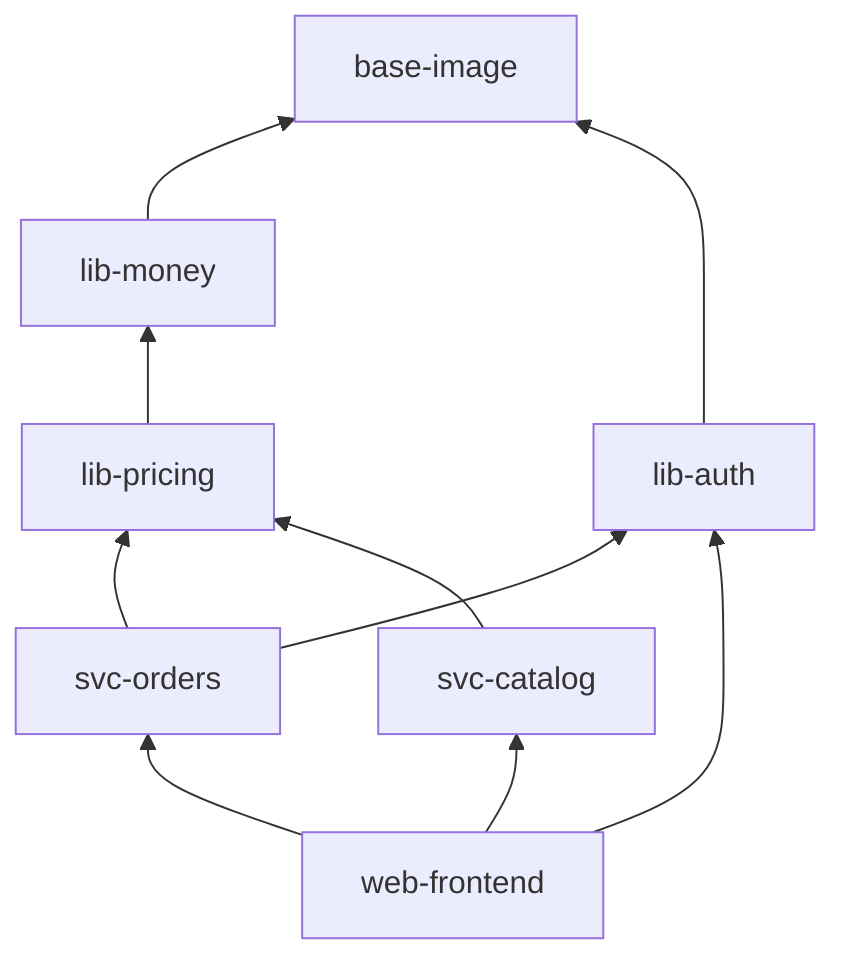
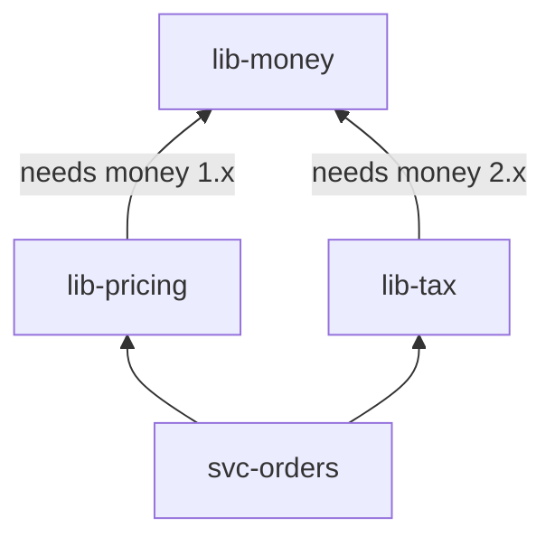
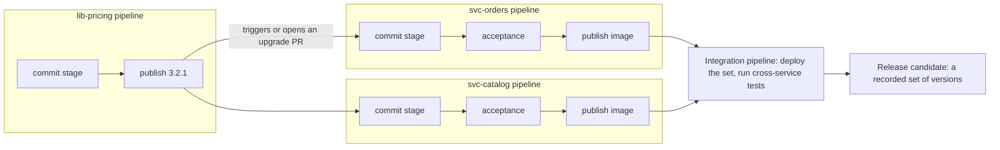

# Dependency graphs and pipelines for components

> **Before this lesson:** read [Stages, gates and the flow of a change](#/lesson/cicd/pipeline-stages) and [Version control everything and pin your dependencies](#/lesson/cicd/version-everything).

## In plain words

When you dress, order matters: socks before shoes, shirt before jacket. Some things do not depend on each other at all — you can put on your watch at any point. If you drew an arrow from each item to the items that must come first, you would have a small map of what depends on what.

Large software is built from parts called **components**: libraries, services and modules, often owned by different teams. One part often needs another; that need is a **dependency**. The map of all of them is a **dependency graph**.

The graph answers two practical questions. *In what order must things be built?* (Like dressing: each part after the parts it needs.) And *when one part changes, which other parts might break?* (Everything that depends on it, directly or through a chain.)

Why this matters for a job: any system bigger than one small application has this structure. "A shared library changed — how does your pipeline make sure everything that uses it still works?" is a common design question.

## Motivation: when one pipeline is no longer enough

A single application with a single pipeline is the easy case. Real systems grow: a shared pricing library used by three services, a design-system package used by two front ends, a platform base image under everything. Now a change in one place can break something in another, and several awkward questions appear. When the library changes, which services must be rebuilt and retested? In what order? If two libraries change at once and a service breaks, which one did it? Which combination of versions was actually tested together?

Those questions are about a **dependency graph**, and the pipeline has to understand that graph to give fast, correct feedback. This lesson covers how to split a system into components, how dependencies are expressed, how to compute what must be rebuilt and in what order, and how pipelines for libraries and for the integrated system fit together.

## Components, and why to have them

A **component** is a reasonably large unit of code with a well-defined interface that could, in principle, be swapped for another implementation. Libraries, services, plug-ins and modules all qualify.

Good reasons to split a codebase into components:

- part of it changes at a different rate, or has a different lifecycle, from the rest;
- part of it is used by more than one application;
- a clear boundary would let a team own it and reason about it independently;
- the build has become too slow to give fast feedback as one unit;
- part of it needs to be replaceable — a vendor integration, a storage back end.

A bad reason: "one component per team" imposed from an org chart regardless of the code's natural seams. The resulting interfaces tend to be chatty and to change constantly, which is the worst case for independent delivery.

The trade-off is unavoidable. Components give isolation and speed; every boundary adds a dependency that must be versioned, tested and coordinated. Do not split until one of the reasons above is real.

### Two kinds of dependency

- **Build-time**: needed to compile or package (a library, a code generator, a base image).
- **Run-time**: needed when the system runs (another service, a database, a queue).

And two ways to consume a build-time dependency:

- **Source dependency**: build it from source as part of your own build. Always up to date; slower; common in monorepos.
- **Binary dependency**: fetch a published, versioned artifact from a repository. Fast and stable; you choose when to upgrade; the risk is falling behind.

## The graph

Write each component as a node and draw an arrow from a component to each thing it depends on. Builds must happen in an order where every dependency is built before its dependants — a **topological order** — and the graph must have no cycles for such an order to exist.



Two questions drive everything a pipeline does with this graph.

**Downstream: who is affected?** If `lib-money` changes, everything that depends on it, directly or transitively, may be broken: `lib-pricing`, both services and the front end. That set is the **reverse transitive closure**.

**Upstream: what do I need?** To build `svc-orders` from nothing you need its transitive dependencies, built in order.

```python-run
from collections import defaultdict, deque

deps = {   # component -> things it depends on
    "base-image":   [],
    "lib-money":    ["base-image"],
    "lib-pricing":  ["lib-money"],
    "lib-auth":     ["base-image"],
    "svc-orders":   ["lib-pricing", "lib-auth"],
    "svc-catalog":  ["lib-pricing"],
    "web-frontend": ["svc-orders", "svc-catalog", "lib-auth"],
}

def dependants(deps):
    rev = defaultdict(set)
    for node, needs in deps.items():
        for n in needs:
            rev[n].add(node)
    return rev

def affected(deps, changed):
    """Everything that must be rebuilt: the changed components and all transitive dependants."""
    rev, seen, queue = dependants(deps), set(changed), deque(changed)
    while queue:
        for d in rev[queue.popleft()]:
            if d not in seen:
                seen.add(d); queue.append(d)
    return seen

def build_waves(deps, subset):
    """Kahn's algorithm restricted to `subset`; each wave can build in parallel."""
    indeg = {n: sum(1 for d in deps[n] if d in subset) for n in subset}
    waves, ready = [], sorted(n for n, k in indeg.items() if k == 0)
    rev = dependants(deps)
    while ready:
        waves.append(ready)
        nxt = []
        for n in ready:
            for d in rev[n]:
                if d in subset:
                    indeg[d] -= 1
                    if indeg[d] == 0:
                        nxt.append(d)
        ready = sorted(nxt)
    if sum(map(len, waves)) != len(subset):
        raise ValueError("dependency cycle")
    return waves

for changed in (["web-frontend"], ["lib-auth"], ["lib-money"]):
    todo = affected(deps, changed)
    print(f"change {changed[0]:<13} -> rebuild {len(todo)} of {len(deps)}")
    for i, wave in enumerate(build_waves(deps, todo), 1):
        print(f"     wave {i}: {', '.join(wave)}")
```

A change at a leaf rebuilds one thing. A change near the root rebuilds almost everything, in four waves. Two engineering lessons follow directly:

- **Keep widely shared components small and stable.** Their blast radius is the whole graph.
- **Depth costs time.** Components in the same wave build in parallel, but waves are sequential, so feedback time is roughly the sum along the longest chain.

The problem set asks you to implement both computations: a deterministic topological order, and the minimal rebuild set.

### Cycles

If `A` depends on `B` and `B` on `A`, neither can be built first. Cycles also signal muddled design: the two components are really one. Fixes: merge them; extract the shared part into a third component both depend on; or invert one direction with an interface. Have the pipeline fail on cycles so they are caught the day they are introduced.

### Diamonds and version conflicts



`svc-orders` needs two libraries that need incompatible versions of a third. Depending on the ecosystem, the result is a failed resolution, two copies loaded side by side, or — worst — one version silently chosen and a runtime error. This is **dependency hell**. Mitigations:

- keep shared libraries backward compatible and follow semantic versioning honestly;
- upgrade shared dependencies across all consumers together, as a routine;
- limit how many versions of an internal library may be in use at once;
- in a monorepo, enforce a **single version** of each third-party dependency for the whole repository.

## A pipeline per component, plus one for the whole

Each independently versioned component gets its own pipeline: commit stage, its own tests, and a published artifact. That gives the owning team fast, focused feedback.

But passing its own tests does not prove a library works *in its consumers*. So something must build and test the combination.



### Connecting the pipelines: push or pull

**Push (trigger downstream).** When the library's pipeline succeeds, it starts the pipelines of everything that depends on it, using the new version. Consumers learn immediately whether the change broke them — fast feedback, the same instinct as continuous integration. The cost is that a careless library change can turn every downstream pipeline red at once.

**Pull (consumers upgrade deliberately).** The library publishes a version; each consumer stays pinned until someone bumps the pin. Consumers are stable; the cost is drift — six months later, five different versions are in production and an urgent fix needs five upgrades.

**The practical middle** combines them: consumers pin exact versions, and a bot opens an upgrade pull request in each consumer as soon as a new version is published. The consumer's pipeline runs against the new version; if it is green, the upgrade merges automatically; if it is red, the failure is contained to a pull request and the library team hears about it the same day. You get early feedback without a broken main line.

```json
// renovate.json in each consumer repository
{
  "$schema": "https://docs.renovatebot.com/renovate-schema.json",
  "extends": ["config:recommended"],
  "packageRules": [
    {
      "matchPackageNames": ["@example/pricing", "@example/auth"],
      "matchUpdateTypes": ["minor", "patch"],
      "automerge": true
    },
    {
      "matchPackageNames": ["@example/pricing", "@example/auth"],
      "matchUpdateTypes": ["major"],
      "labels": ["breaking-upgrade"]
    }
  ]
}
```

A library team can add protection in its own pipeline by running its key consumers' test suites against the proposed change *before* publishing — sometimes called downstream or "canary consumer" testing.

### Which version combination was tested?

When several upstream components change close together, a downstream pipeline may be triggered more than once with different mixtures. Two rules keep results meaningful:

1. **Every pipeline run records the exact versions of all its inputs.** A release candidate for the system is a *set* of pinned versions — a manifest — not a vague "latest of everything".
2. **Only combinations that were tested together are promoted.** The integration pipeline takes a manifest, deploys precisely those versions, tests them, and that manifest is what moves to staging and production.

```yaml
# release-manifest.yaml  -- the unit that is promoted through environments
release: 2026.06.03-2
components:
  svc-orders:   registry.example.com/orders@sha256:9c1e4b7d0a52c5f1e2d3a4b5c6d7e8f9a0b1c2d3e4f5a6b7c8d9e0f1a2b3c4d5
  svc-catalog:  registry.example.com/catalog@sha256:77ab19c2d3e4f5a6b7c8d9e0f1a2b3c4d5e6f708192a3b4c5d6e7f8091a2b3c4
  web-frontend: registry.example.com/web@sha256:0d4e8f1a2b3c4d5e6f708192a3b4c5d6e7f8091a2b3c4d5e6f708192a3b4c5d6
tested:
  integration: passed
  capacity: passed
```

### Services: contracts instead of integration environments

For run-time dependencies between services, a big shared integration environment scales badly: with forty services, any one of them being broken blocks everybody. The alternative is to verify the *interfaces* in each service's own pipeline:

- **Consumer-driven contract tests** (Lesson 8) check that a provider still satisfies what each consumer relies on.
- **Compatibility gates** ("can I deploy?") ask a contract broker whether the version about to be deployed is compatible with the versions of its neighbours currently in production.
- A **small** end-to-end suite covers a few critical journeys across services, and production canaries catch the rest.

Services designed this way can be deployed independently — the property that makes a service architecture worth its cost.

## When should a build be triggered?

Three triggers are common, and they are complementary:

| trigger | catches | cost |
|---|---|---|
| A commit to the component itself | its own regressions | cheap |
| A new version of an upstream dependency | breakage caused by others | moderate; needs the graph |
| A schedule | drift in floating external inputs, environment decay | cheap; slow feedback |

Use the first always, the second for internal dependencies (via triggers or upgrade pull requests), and the third as a safety net.

## Worked example: a breaking change in a shared library

`lib-pricing` wants to change `price_for(sku)` to `price_for(sku, currency)`.

**Done badly.** The signature is changed and published as `3.3.0`. Auto-merge bumps every consumer; both services fail to compile; two teams lose a morning.

**Done well** — expand/contract again, applied to an API:

1. Publish `3.3.0` in which `price_for(sku, currency="EUR")` accepts the new argument with a default and the old call still works. A minor version: additive.
2. Upgrade pull requests flow to consumers and merge automatically, because nothing broke.
3. Mark calls without `currency` as deprecated, with a warning that names the removal version.
4. Each consumer passes `currency` explicitly, at its own pace.
5. A code search (or a metric on the deprecation warning) shows no callers of the old form.
6. Publish `4.0.0` with the default removed. A major version, flagged for manual upgrade — which is now trivial.

No pipeline was red, and no two teams had to release at the same moment.

## Pitfalls

- **Splitting too early or along team lines**, producing unstable interfaces.
- **Triggering every downstream pipeline on every upstream commit** without batching, creating a storm of builds.
- **Not recording input versions**, so nobody can say what was tested with what.
- **Floating to "latest"** for internal dependencies — invisible, unreviewed upgrades.
- **Letting consumers lag for months.**
- **A shared integration environment as the only cross-component test**: slow, flaky, a queue for everyone.
- **Breaking changes in minor or patch versions.**
- **A giant "common" library** that everything depends on and that changes weekly.

> [!WARNING]
> Be suspicious of a shared library whose every change requires coordinated releases of several services. It means the services are not independently deployable; they are one distributed application with extra failure modes. Either stabilise the interface or reconsider the boundary.

> [!TIP]
> Draw the real dependency graph from build metadata, not from an architecture diagram. Tools can export it (`go mod graph`, `pnpm why`, `cargo tree`, `bazel query`, `nx graph`). The graph that actually exists usually contains surprises.

> [!INTERVIEW]
> "A shared library changes. How does your CI/CD ensure dependants still work?" Describe the graph: compute the reverse transitive closure of the change to find affected components, build in topological order with independent ones in parallel. Then the mechanism: in a monorepo, affected-target builds on the same commit; across repositories, publish a version and have a bot open upgrade pull requests whose pipelines validate each consumer, auto-merging compatible ones. Record the exact version set in a manifest and promote only tested combinations. Add contract tests for service interfaces, and semantic versioning with deprecation for breaking changes.

## Summary

- Split a system into components when rate of change, reuse, ownership or build time justify it; every boundary adds a dependency to manage.
- The dependency graph must be acyclic; builds follow a topological order, and a change requires rebuilding its transitive dependants.
- Widely shared components have the largest blast radius and should be small and stable.
- Give each component its own pipeline and add an integration pipeline that tests a recorded set of versions and promotes only that set.
- Connect pipelines by triggering downstream or, better, by automated upgrade pull requests against pinned versions.
- Use contract tests and compatibility gates for service-to-service dependencies, and expand/contract with semantic versioning for breaking API changes.

## Glossary

- **Component** — a sizeable unit of code with a defined interface, such as a library or a service.
- **Dependency** — something a component needs in order to be built or to run.
- **Dependency graph** — the map of which components depend on which.
- **Transitive dependency** — a dependency reached through a chain of other dependencies.
- **Dependants (downstream)** — the components that depend on a given one.
- **Topological order** — an order in which every component comes after the ones it depends on.
- **Cycle (circular dependency)** — components that depend on each other in a loop.
- **Diamond dependency** — two components needing different versions of the same third component.
- **Source / binary dependency** — building a dependency from its code / fetching a published, built version.
- **Integration pipeline** — a pipeline that tests a set of components together.
- **Release manifest** — a file listing the exact version of each component that makes up a release.
- **Contract test** — a check that a service still meets what its consumers expect.
- **Deprecation** — marking something as due for removal while it still works.
- **Blast radius** — how much is affected when something changes or fails.

## Check yourself

```quiz
[
  {"q": "Component C depends on B, which depends on A. A changes. Which components must be rebuilt and retested?",
   "options": ["Only A", "A and B", "A, B and C", "Only C"],
   "answer": 2,
   "explain": "A change can affect everything that depends on it directly or transitively: the reverse transitive closure."},
  {"q": "What ordering constraint must a build of several components satisfy?",
   "options": ["Alphabetical", "A topological order, where each component is built after all its dependencies", "Largest first", "Most recently changed first"],
   "answer": 1,
   "explain": "A dependency must exist before its dependant can be built. Components with no ordering between them can build in parallel."},
  {"q": "Why is a dependency cycle a problem for the pipeline?",
   "options": ["It uses more disk", "No valid build order exists, and it usually indicates the components are not really separate", "It slows down tests only", "It makes versions too long"],
   "answer": 1,
   "explain": "A topological order requires an acyclic graph. Break the cycle by merging, extracting a shared part, or inverting a dependency."},
  {"q": "What is the advantage of pinned versions plus automated upgrade pull requests over floating to the latest version?",
   "options": ["Fewer builds overall", "Upgrades are visible, tested in the consumer's pipeline and contained to a pull request if they break", "Libraries never need to be published", "It removes the need for tests"],
   "answer": 1,
   "explain": "Consumers get early feedback on new versions without their main line being broken by an invisible change."},
  {"q": "Why should a system release candidate be a manifest of exact component versions?",
   "options": ["For aesthetics", "So that the combination deployed to production is exactly the combination that was tested together", "Because registries require manifests", "To avoid using digests"],
   "answer": 1,
   "explain": "Components that each passed alone may not work together. Promoting a recorded, tested set extends build-once to the whole system."},
  {"q": "Two libraries used by one service require incompatible major versions of a third library. What is this called?",
   "options": ["A circular dependency", "A diamond dependency conflict", "A flaky build", "A semantic merge"],
   "answer": 1,
   "explain": "The diamond shape forces a choice between versions. Backward-compatible shared libraries and coordinated upgrades prevent it."},
  {"q": "How should a breaking change to a shared library's API be introduced?",
   "options": ["Change it in a patch release", "Add the new form compatibly, deprecate the old, migrate consumers, then remove the old in a major version", "Force all teams to release at the same time", "Fork the library per consumer"],
   "answer": 1,
   "explain": "This is expand/contract applied to an API. No consumer breaks, and nobody has to coordinate a simultaneous release."},
  {"q": "What is the main weakness of relying on one shared integration environment for forty services?",
   "options": ["It is too cheap", "Any broken service blocks everyone, and failures are slow and hard to attribute", "It cannot run containers", "It makes contract tests impossible"],
   "answer": 1,
   "explain": "Contract tests in each pipeline plus a small end-to-end suite scale far better than a single shared bottleneck."}
]
```

> **Source:** Humble & Farley, *Continuous Delivery*, ch. 13 (managing components and dependencies: components, pipelining components, the integration pipeline, dependency graphs, when to trigger builds, circular dependencies). Renovate configuration: https://docs.renovatebot.com/configuration-options/ — Pact "can I deploy": https://docs.pact.io/pact_broker/can_i_deploy
