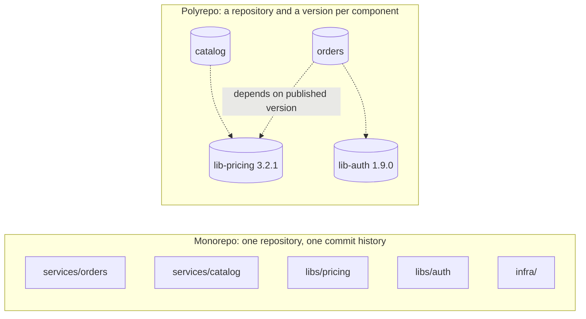

# Monorepo vs polyrepo and artifact versioning

> **Before this lesson:** read [Dependency graphs and pipelines for components](#/lesson/cicd/dependency-graphs) and [Version control everything and pin your dependencies](#/lesson/cicd/version-everything).

## In plain words

A family can keep all its paperwork in one big filing cabinet, or give each person a separate folder. One cabinet makes it easy to find anything and to update two related papers together, but it gets crowded. Separate folders are tidy and private, but a matter that involves three people means fetching three folders.

Teams face that choice for their code. A **repository** is the store that holds a project's files and history. A **monorepo** is one repository for many projects; a **polyrepo** set-up gives every project its own.

The second topic is how to label what you build. Think of the edition number of a textbook: "3rd edition" tells a teacher that page numbers may have changed, while a corrected reprint does not. A software **version** number makes the same kind of promise, and **semantic versioning** is the usual convention for what the numbers mean.

Why this matters for a job: "monorepo or polyrepo?" is a favourite interview discussion because it has no single right answer; what is being tested is whether you can weigh the trade-offs.

## Motivation: two questions every growing organisation argues about

Once a system has more than a handful of components, two decisions shape daily work more than almost any framework choice.

**Where does the code live?** In one repository containing everything, or in one repository per component? The answer changes how a cross-cutting change is made, how the pipeline decides what to build, how ownership is enforced and how long a clone takes.

**How are the things we build identified?** A version is a promise about compatibility and a handle for deployment, rollback and support. Chosen well, a version tells consumers what to expect and lets automation make decisions. Chosen badly, it is a number that someone remembers to bump.

Neither question has a universally right answer. This lesson gives you the trade-offs and the mechanics, so you can argue for a choice and build the pipeline that makes it work.

## Monorepo and polyrepo

A **monorepo** keeps many projects — services, libraries, infrastructure, sometimes the whole company — in a single repository. A **polyrepo** (multi-repo) arrangement gives each component its own repository and its own release cycle.



"Monorepo" does not mean "monolith". A monorepo can hold fifty independently deployed services; a polyrepo can hold one tightly coupled distributed monolith. Repository layout and deployment architecture are separate choices.

### The trade-offs

| concern | monorepo | polyrepo |
|---|---|---|
| A change spanning a library and its consumers | one atomic commit, one review, one pipeline run | several pull requests in order, with version bumps between |
| Internal dependency versions | none: everything builds at the same commit | explicit versions; consumers can lag |
| Refactoring across components | straightforward; tooling sees everything | hard; needs coordinated releases |
| Finding and reusing code | one search | discovery is harder |
| Build and test time | grows with the repo unless builds are selective | naturally scoped to one component |
| CI tooling required | affected-target detection, remote caching, sparse checkout | standard per-repo pipelines |
| Ownership and access control | by path (`CODEOWNERS`); everyone can read everything | by repository; fine-grained permissions are easy |
| Independent release cadence | possible, needs discipline | the default |
| Consistency of tooling and standards | easy to enforce centrally | drifts between repositories |
| Blast radius of a bad shared change | immediate, but visible and atomically revertible | delayed, discovered consumer by consumer |

The pattern underneath the table: a monorepo optimises for **changing things together**; a polyrepo optimises for **changing things independently**. Pick according to which you do more — and note that a team suffering from one model often blames the model for what is really a missing tool.

### What a monorepo demands from the pipeline

Building and testing everything on every commit stops scaling quickly. A monorepo pipeline must answer one question well: *given the files that changed, what is affected?*

**Level 1 — path filters.** Each project's workflow triggers only when files under its directory change. Simple, and wrong as soon as there are shared libraries, unless every dependant lists them by hand.

```yaml
# .github/workflows/orders.yml
on:
  pull_request:
    paths:
      - "services/orders/**"
      - "libs/pricing/**"
      - "libs/auth/**"
      - "pnpm-lock.yaml"
      - ".github/workflows/orders.yml"
```

**Level 2 — a dependency-aware build tool.** Tools such as Bazel, Pants, Nx and Turborepo know the project graph and compute the affected set from a diff.

```bash
# Nx: run tests only for projects affected by the change, in dependency order, with caching
npx nx affected -t lint test build --base=origin/main --head=HEAD

# Turborepo: the same idea
npx turbo run test --filter="...[origin/main]"

# Bazel: which test targets depend on the changed files?
bazel query "kind(test, rdeps(//..., set($(git diff --name-only origin/main | sed 's|^|//|'))))"
```

**Level 3 — content-addressed remote caching.** Every build step's result is stored under a hash of its inputs. If any developer or CI run has already built that exact input set, the result is downloaded rather than recomputed. A clean CI run on a small change then takes seconds.

The selection logic is worth being able to write by hand. Map changed files to owning projects, then expand to everything downstream:

```python-run
from collections import defaultdict, deque

projects = {   # project -> (root path, dependencies)
    "lib-money":    ("libs/money/",        []),
    "lib-pricing":  ("libs/pricing/",      ["lib-money"]),
    "lib-auth":     ("libs/auth/",         []),
    "svc-orders":   ("services/orders/",   ["lib-pricing", "lib-auth"]),
    "svc-catalog":  ("services/catalog/",  ["lib-pricing"]),
    "web":          ("apps/web/",          ["lib-auth"]),
}
GLOBAL = ("pnpm-lock.yaml", ".github/workflows/", "tools/build/")   # touching these affects everything

def affected(changed_files):
    if any(f == g or f.startswith(g) for f in changed_files for g in GLOBAL):
        return sorted(projects), "global file changed: rebuild everything"
    direct = set()
    for f in changed_files:
        owners = [p for p, (root, _) in projects.items() if f.startswith(root)]
        if owners:
            direct.add(max(owners, key=lambda p: len(projects[p][0])))   # longest matching root wins
    rev = defaultdict(set)
    for p, (_, deps) in projects.items():
        for d in deps:
            rev[d].add(p)
    seen, queue = set(direct), deque(direct)
    while queue:
        for nxt in rev[queue.popleft()]:
            if nxt not in seen:
                seen.add(nxt); queue.append(nxt)
    return sorted(seen), f"directly changed: {sorted(direct)}"

for files in (["apps/web/src/Cart.tsx"],
              ["libs/money/round.py", "README.md"],
              ["docs/adr/0007.md"],
              ["pnpm-lock.yaml"]):
    result, why = affected(files)
    print(f"{files}\n   -> {result}   ({why})")
```

Notice the two safety rules that hand-written filters often miss: files that affect everything (lockfiles, CI configuration, build tooling) trigger a full run, and a documentation-only change triggers nothing. One of this module's problems asks you to compute the minimal rebuild set.

Other monorepo necessities:

- **Path-based ownership.** A `CODEOWNERS` file routes reviews to the owning team.
- **Per-project required checks** that still report a status when skipped, so that a pull request touching only `apps/web` is not blocked waiting for an `orders` check that never ran (Lesson 34).
- **Partial clones and sparse checkouts** when history is large: `git clone --filter=blob:none` and `git sparse-checkout set services/orders libs/pricing`.
- **Independent deployment.** One commit may contain changes to five services; the pipeline builds and deploys only the affected ones, each on its own.

### What a polyrepo demands

- **Published, versioned artifacts** for every shared component, in a registry.
- **Automated upgrade pull requests** (Lesson 25) so consumers do not drift.
- **Shared pipeline templates** — reusable workflows, includes — so that forty repositories do not carry forty divergent copies of the same YAML.
- **Contract tests** and a way to test a combination before release.
- **A service catalogue**, because discovering who owns what becomes a problem of its own.

### Choosing

A defensible heuristic: components that are **frequently changed together** by the **same group of people** belong in one repository. Components with different owners, different release cadences, different compliance boundaries or different open-source status are good candidates for separate ones. Many organisations settle on several medium-sized repositories, each a small monorepo for one product area.

## Versioning artifacts

A version scheme has three jobs: **identify** exactly what was built, **order** builds in time, and — for anything other people consume — **communicate compatibility**.

### Identity: every build needs a unique, traceable name

For deployable services the natural identity is the source commit plus the content hash of the artifact:

```text
registry.example.com/orders:9f3c2e1a7b12                 <- tag: the Git commit
registry.example.com/orders@sha256:9c1e4b7d0a52...      <- digest: the content itself
```

Nobody has to *decide* this version; it falls out of the build. A sortable build identifier can be added for humans: `2026.06.03-142` (date plus pipeline run number). Services deployed continuously often need nothing more.

### Compatibility: semantic versioning

For libraries, APIs and anything else with consumers who choose when to upgrade, the version must say what an upgrade will cost. **Semantic versioning** (SemVer) uses `MAJOR.MINOR.PATCH`:

- **MAJOR** — incompatible changes; consumers may have to change code.
- **MINOR** — new functionality, backward compatible.
- **PATCH** — backward-compatible bug fixes.

Details that matter:

- A released version is **immutable**. Never republish different content under the same number.
- **Pre-release** identifiers come after a hyphen and sort *before* the release: `2.0.0-rc.1 < 2.0.0`.
- **Build metadata** comes after a plus sign and is ignored for precedence: `1.4.2+build.57`.
- In `0.y.z`, anything may change at any time; `1.0.0` is the first promise of stability.
- Compare numerically field by field: `1.10.0 > 1.9.0`.

Alternatives exist. **Calendar versioning** (`2026.06`) suits products where "how old is this?" matters more than API compatibility — operating systems, applications released on a schedule.

### Deriving the version from commits

If commit messages follow the Conventional Commits format, a machine can decide the next version:

| commit | example | bump |
|---|---|---|
| `fix:` | `fix(cart): correct rounding of VAT` | patch |
| `feat:` | `feat(cart): support gift cards` | minor |
| `!` after the type, or a `BREAKING CHANGE:` footer | `feat(api)!: remove v1 endpoints` | major |
| `docs:`, `chore:`, `refactor:`, `test:`, `ci:` | `chore(deps): bump httpx` | none |

The release takes the **largest** bump among the commits since the last tag.

```python-run
import re

HEADER = re.compile(r"^(?P<type>[a-z]+)(\([^)]*\))?(?P<bang>!)?: .+")

def bump_for(message):
    lines = message.strip().splitlines()
    m = HEADER.match(lines[0])
    if not m:
        return "none"
    if m["bang"] or any(l.startswith(("BREAKING CHANGE:", "BREAKING-CHANGE:")) for l in lines[1:]):
        return "major"
    return {"feat": "minor", "fix": "patch", "perf": "patch"}.get(m["type"], "none")

def next_version(current, messages):
    order = ["none", "patch", "minor", "major"]
    level = max((bump_for(m) for m in messages), key=order.index, default="none")
    major, minor, patch = map(int, current.split("."))
    if level == "major":
        return f"{major + 1}.0.0", level
    if level == "minor":
        return f"{major}.{minor + 1}.0", level
    if level == "patch":
        return f"{major}.{minor}.{patch + 1}", level
    return current, level

history = [
    ("1.4.2", ["docs: fix typo", "chore(deps): bump httpx"]),
    ("1.4.2", ["fix(cart): correct VAT rounding", "test: add edge cases"]),
    ("1.4.2", ["fix: handle empty basket", "feat(cart): support gift cards"]),
    ("1.4.2", ["feat(api)!: remove v1 endpoints", "fix: typo"]),
    ("1.4.2", ["refactor: tidy\n\nBREAKING CHANGE: Money now requires a currency"]),
]
for current, messages in history:
    new, level = next_version(current, messages)
    print(f"{current} + {len(messages)} commit(s) -> {new:<6} ({level})")
```

Tools such as semantic-release, release-please and Changesets implement this end to end: compute the version, write the changelog, tag the commit, publish the package. The benefit is not only saved typing; versions become a consequence of what changed rather than a judgement made under release pressure. You will implement the bump rule as a problem.

```yaml
# .github/workflows/release.yml -- release-please maintains a "release PR"; merging it tags and publishes
name: release
on:
  push:
    branches: [main]
permissions:
  contents: write
  pull-requests: write
jobs:
  release:
    runs-on: ubuntu-latest
    steps:
      - uses: googleapis/release-please-action@v4
        with:
          release-type: python
```

### Tags, mutability and promotion

Git tags and registry tags are both movable pointers unless you forbid it. Rules worth enforcing:

1. **Version tags are immutable.** Protect `v*` tags in Git; enable tag immutability in the registry.
2. **Deploy by digest**, even when humans talk in versions.
3. **Never deploy `latest`.** It names no particular thing, defeats rollback, and can differ between nodes.
4. **Moving tags are for convenience only** — `main`, `staging-approved` — never the deployment reference.

```bash
git tag -a v1.5.0 -m "Release 1.5.0" 9f3c2e1
git push origin v1.5.0

# attach the human version to the already-built, already-tested image; nothing is rebuilt
docker buildx imagetools create \
  --tag registry.example.com/orders:1.5.0 \
  registry.example.com/orders@sha256:9c1e4b7d0a52...
```

The last command is the important one. A release does not trigger a new build. It **names an existing artifact** that has already passed the pipeline.

### Versioning APIs between services

A service's HTTP or gRPC interface is versioned separately from its deployments. A service may deploy fifty times while its API stays at `v2`. Prefer evolving compatibly (additive changes, tolerant readers) to minting new versions; when a breaking change is unavoidable, run old and new side by side (`/v1`, `/v2`), measure usage of the old, and retire it on a published date.

## Pitfalls

- **Adopting a monorepo without affected-target builds or caching.** CI time grows until everyone hates it.
- **Adopting polyrepos without upgrade automation.** Versions drift and a security patch takes a quarter.
- **Hand-maintained path filters** that forget shared code.
- **Manual version bumps**, forgotten or argued over.
- **Mutable version tags.**
- **Rebuilding at release time** "to stamp the version in". Inject the version as a label or run-time value on the existing artifact.
- **SemVer theatre**: breaking changes in minor releases teach consumers to distrust every upgrade.
- **One version number for a whole monorepo** when components are consumed independently.

> [!WARNING]
> In a monorepo, a change to a root-level file — the lockfile, the toolchain version, a shared CI template — affects every project. Affected-detection that treats such files as belonging to no project will skip every test on precisely the changes with the widest blast radius.

> [!TIP]
> When you cannot decide between repository layouts, measure: how many of last quarter's changes needed coordinated pull requests across repositories? If the answer is "many", the boundary is in the wrong place — and a merge is cheaper than it sounds.

> [!INTERVIEW]
> "Monorepo or polyrepo?" Refuse to pick in the abstract. State the axis — atomic cross-cutting changes and uniform tooling versus independent lifecycles and simple scoped pipelines — then the price of each: a monorepo needs dependency-aware affected builds, remote caching and path-based ownership; polyrepos need versioned artifacts, automated upgrades, shared pipeline templates and contract tests. Finish with a heuristic: code that changes together and is owned together lives together.

## Summary

- A monorepo makes cross-component changes atomic and tooling uniform, at the price of needing affected-target detection, caching and path-based ownership; polyrepos make components independent, at the price of version management and coordination.
- Repository layout is independent of deployment architecture.
- Affected sets come from mapping changed files to projects and expanding to dependants; global files affect everything.
- Every build needs a unique, traceable identity: commit and digest for services; semantic versions for artifacts with consumers.
- Derive versions from structured commit messages rather than choosing them by hand.
- Releasing names an existing, tested artifact with an immutable tag; it does not rebuild. Deploy by digest and never by `latest`.

## Glossary

- **Repository** — the store that holds a project's files and their history.
- **Monorepo** — one repository containing many projects.
- **Polyrepo** — one repository per project.
- **Affected set** — the projects that could be changed in behaviour by a given commit.
- **Path filter** — a rule that runs a pipeline only when files under certain paths change.
- **Remote cache** — stored build results shared by developers and the pipeline.
- **Code owner** — the person or team that must approve changes to a given path.
- **Sparse checkout** — fetching only part of a repository.
- **Version** — an identifier for one particular build of a piece of software.
- **Semantic versioning** — MAJOR.MINOR.PATCH numbering in which each part signals the size of a change.
- **Breaking change** — a change that forces users of the software to change their own code.
- **Pre-release** — a version published for trial before the final one, such as `2.0.0-rc.1`.
- **Conventional Commits** — a format for commit messages that tools can read.
- **Tag** — a named pointer to a commit or an image.
- **Digest** — a fingerprint identifying an artifact's exact contents.

## Check yourself

```quiz
[
  {"q": "What is the defining advantage of a monorepo for a change that touches a shared library and three of its consumers?",
   "options": ["It needs no tests", "The change can be made, reviewed, tested and reverted as one atomic commit", "It deploys all services together automatically", "It removes the need for a dependency graph"],
   "answer": 1,
   "explain": "Everything is at one commit, so there are no intermediate version bumps or cross-repository sequencing."},
  {"q": "Which statement is true?",
   "options": ["A monorepo implies a monolithic deployment", "A monorepo can contain many independently deployed services", "A polyrepo guarantees loosely coupled services", "Monorepos cannot have code owners"],
   "answer": 1,
   "explain": "Repository layout and deployment architecture are separate decisions."},
  {"q": "In a monorepo, a pull request changes only the root lockfile. What should the affected-project calculation return?",
   "options": ["No projects, since no project directory changed", "All projects, because the lockfile is an input to every build", "Only the largest project", "Only projects with tests"],
   "answer": 1,
   "explain": "Global inputs affect everything. Treating them as unowned would skip tests on the widest-reaching changes."},
  {"q": "Under semantic versioning, which release may contain a backward-incompatible API change?",
   "options": ["Patch", "Minor", "Major", "Any release"],
   "answer": 2,
   "explain": "Only a major bump signals that consumers may need to change their code."},
  {"q": "Commits since version 2.3.1 are: 'fix: null check', 'feat: export CSV', 'docs: update README'. What is the next version?",
   "options": ["2.3.2", "2.4.0", "3.0.0", "2.3.1"],
   "answer": 1,
   "explain": "Take the largest bump: a feat commit means minor, which resets patch to zero."},
  {"q": "How does 2.0.0-rc.1 compare with 2.0.0?",
   "options": ["They are equal", "2.0.0-rc.1 is lower", "2.0.0-rc.1 is higher", "They cannot be compared"],
   "answer": 1,
   "explain": "A pre-release version has lower precedence than the corresponding normal version."},
  {"q": "What should happen technically when a tested build is 'released' as version 1.5.0?",
   "options": ["Rebuild the code with the version number compiled in", "Attach an immutable version tag to the artifact that already passed the pipeline", "Retag latest and deploy that", "Create a new branch and build from it"],
   "answer": 1,
   "explain": "Releasing names an existing artifact. Rebuilding would produce something that was never tested."},
  {"q": "Why is deploying the tag `latest` a bad practice?",
   "options": ["It is too short", "It does not identify a specific artifact, so rollbacks and audits are unreliable and nodes may run different content", "Registries delete it nightly", "It cannot be pulled"],
   "answer": 1,
   "explain": "A moving tag provides no traceability. Deploy by digest and use immutable version tags for humans."}
]
```

> **Source:** Humble & Farley, *Continuous Delivery*, ch. 13 (dividing a codebase into components, managing binaries, artifact repositories). Semantic Versioning 2.0.0: https://semver.org — Conventional Commits 1.0.0: https://www.conventionalcommits.org/en/v1.0.0/ — Nx affected: https://nx.dev/ci/features/affected — Git sparse checkout: https://git-scm.com/docs/git-sparse-checkout — release-please: https://github.com/googleapis/release-please
