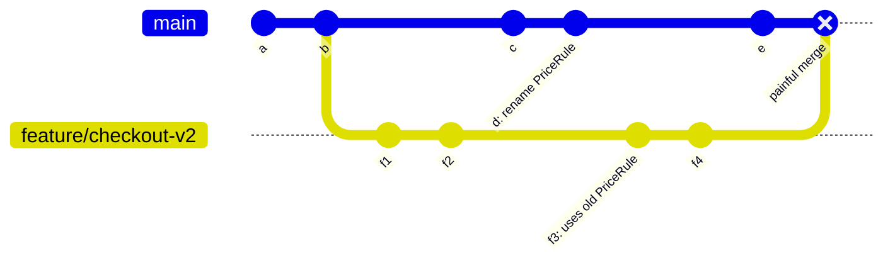
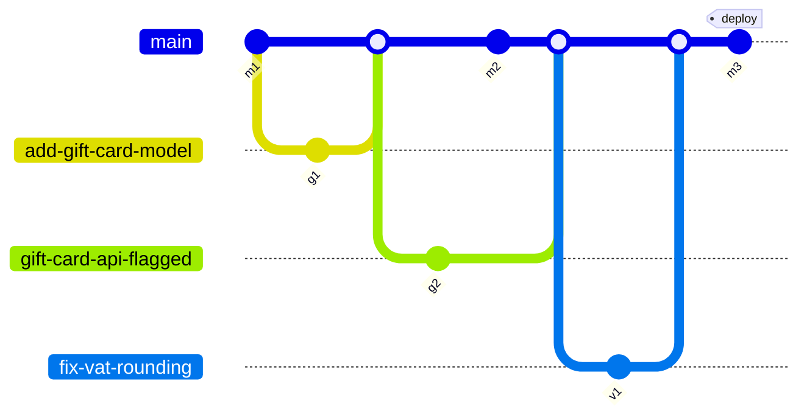
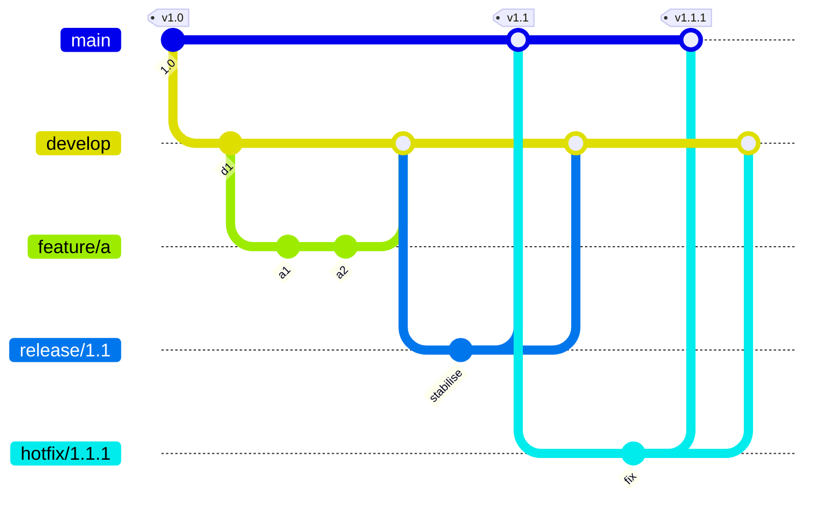
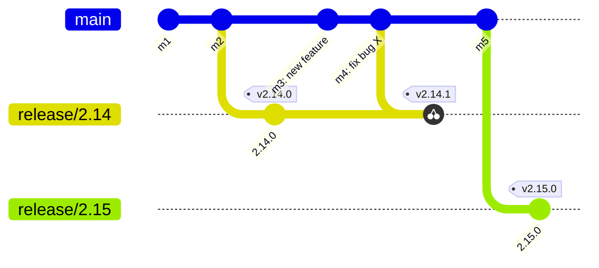

# Trunk-based development, feature branches and release branches

> **Before this lesson:** read [Continuous integration: the practice, not the server](#/lesson/cicd/ci-practices). Git commands are shown and explained; you do not need to know them already.

## In plain words

A river can split into side channels that later rejoin the main stream. A short side channel rejoins smoothly. One that wanders off for miles may meet the main river at a very different level, and the meeting is rough.

In version control, a **branch** is a side channel: a separate line of work where someone can make changes without affecting everybody else. To **merge** is to rejoin — to combine those changes with the main line, usually called **main** or **trunk**.

Every team has to decide how long work is allowed to stay on a side channel. That decision is its **branching model**. This lesson compares the common ones: **trunk-based development** (very short branches, merged daily), **feature branches** (one branch per piece of work, sometimes living for weeks) and **release branches** (a branch kept for a version that has shipped and still needs fixes).

Why this matters for a job: "which branching strategy would you choose, and why?" is asked in most engineering interviews, and your first week in any team involves learning its branching rules.

## Motivation: branching is how a team decides when to integrate

Every branching model is, underneath, a policy about one thing: **how long work is allowed to stay separate before it is combined with everyone else's**. Lesson 5 showed that integration problems grow with the time changes spend apart. A branching strategy is therefore not a matter of taste or Git fashion; it sets an upper bound on how continuous your integration can be.

Git makes branches almost free to create, which is both a gift and a trap. Cheap branching makes short experiments effortless. It also makes it effortless to work alone for three weeks and call it "a feature branch". This lesson looks at why teams branch, compares the common models, and explains why the delivery-performance research keeps pointing to the same answer: integrate into one main line at least daily.

## Why branch at all

There are only a few legitimate reasons:

- **Physical**: the structure of the system (separate components or products).
- **Functional**: a particular feature or fix.
- **Environmental**: supporting different platforms or customers.
- **Organisational**: different teams.
- **Procedural**: a release being stabilised or supported while development continues.

Each branch defers a merge. The question to ask of any proposed branch is: *when will it be merged, and what does it cost if that slips?*

### The cost of divergence

Two branches accumulate changes independently. The work needed to merge them grows with the product of what happened on each side, and, more subtly, automated tools only detect *textual* conflicts. **Semantic conflicts** — both sides compile, the merge is clean, the behaviour is wrong — are found only by building and testing the result.



There is a second, quieter cost: **long-lived branches discourage refactoring.** If a colleague's branch touches the checkout module, renaming a class there will give them a miserable merge, so nobody renames it. The code calcifies around whoever has work in flight.

## Model 1: trunk-based development

Everyone integrates into a single shared branch — `main`, the *trunk* — at least once a day. There are two flavours:

- **Commit directly to main** (small, co-located, high-trust teams, often with pair programming as the review).
- **Short-lived branches**: a branch per small change, opened as a pull request, reviewed, verified by CI and merged within hours — a day or two at most.



The second flavour is what most teams on GitHub or GitLab practise; some call it *GitHub flow*. What makes it trunk-based is not the absence of branches but their lifetime and the rule that `main` is always releasable.

**What makes it work:**

1. **Small changes.** A large feature is delivered as a sequence of small, safe steps.
2. **Hiding unfinished work.** Incomplete features are merged but switched off behind a feature flag, or built behind an abstraction (Lesson 28).
3. **A fast, trustworthy commit stage**, so merging many times a day is cheap.
4. **Fast review.** A pull request that waits two days for a reviewer has become a two-day branch.
5. **Discipline about a green main** (Module 17).

```bash
# A day in trunk-based development
git switch main && git pull --rebase
git switch -c gift-card-model

# ... small change, with tests ...
git commit -am "feat(cart): add GiftCard model (not yet wired in)"
git fetch origin && git rebase origin/main        # stay current; resolve tiny conflicts now
git push -u origin gift-card-model
gh pr create --fill
gh pr merge --squash --auto                       # merges when review and required checks pass
git switch main && git pull --rebase
```

**Benefits.** Integration problems surface within hours; `main` is always a release candidate; refactoring is safe because nobody is far away; the history is easy to bisect.

**Costs.** It requires engineering maturity: good tests, flags, the habit of decomposing work. Teams without those experience trunk-based development as "main is always broken" — which is a reason to build the capabilities, not to keep the branches.

## Model 2: long-lived feature branches

Each feature is developed on its own branch and merged when complete. The appeal is obvious: `main` contains only finished features, and a feature can be dropped by not merging it.

The costs are the ones this track keeps returning to:

- **Integration is deferred** to the end of the feature, when it is largest and the deadline is nearest.
- **CI on the branch verifies the feature in isolation**, not combined with other in-flight features. Two green branches can produce a red main.
- **Feedback from production is deferred** too: nothing reaches users until the whole feature is merged and released.
- **Refactoring is suppressed** across the team.

This simulation estimates the conflict work created by different branch lifetimes. It models files touched per day and counts overlaps between a branch and everything that landed on main meanwhile:

```python-run
import random

def merge_pain(lifetime_days, team=8, files=600, touches_per_dev_day=6, trials=400, seed=5):
    rng = random.Random(seed)
    overlaps = []
    for _ in range(trials):
        mine = {rng.randrange(files) for _ in range(lifetime_days * touches_per_dev_day)}
        theirs = {rng.randrange(files) for _ in range(lifetime_days * touches_per_dev_day * (team - 1))}
        overlaps.append(len(mine & theirs))
    overlaps.sort()
    return sum(overlaps) / trials, overlaps[int(trials * 0.95)]

print(f"{'branch lifetime':>16} {'mean overlapping files':>24} {'95th percentile':>16} {'per day of work':>16}")
for days in (1, 2, 5, 10, 20):
    mean, p95 = merge_pain(days)
    print(f"{days:>13} d   {mean:>24.1f} {p95:>16} {mean / days:>16.2f}")
```

The last column is the telling one: overlap *per day of work* rises as the branch lives longer. Twenty one-day branches cost far less in total than one twenty-day branch covering the same work.

Feature branches are not always wrong. They suit open-source projects with untrusted external contributors, where a maintainer must review before anything lands, and genuinely experimental spikes that may be thrown away. Within a product team, the useful rule is a **lifetime limit**: if a branch is more than a couple of days old, treat it as a problem to solve.

## Model 3: Git flow

A once-popular model with two permanent branches — `develop` for integration and `main` for released code — plus supporting branches for features, releases and hot fixes.



It was designed for software shipped in explicit, supported versions on a schedule. For continuously delivered services it adds ceremony without benefit: two long-lived branches that must be kept in step, features that wait for a release branch before anyone sees them, and merges in several directions. Its own author has noted that teams doing continuous delivery of web applications are better served by a simpler workflow. Use it only when you really maintain multiple released versions in the field — and even then, release branches off a single trunk usually do the job with less machinery.

## Release branches

Sometimes a version must be stabilised or supported while new development continues: installed software, mobile apps waiting for store review, an on-premises product with customers on last year's release. A **release branch** is the right tool, with strict rules.



The rules:

1. **Branch late**, from a main that is already releasable. A release branch is not a place to finish features.
2. **Never develop on the release branch.** Only critical fixes go there.
3. **Fix on main first, then cherry-pick to the release branch.** The reverse direction risks the fix being missing from the next release.
4. **Never merge the release branch back into main.** Cherry-picks only flow one way.
5. **Each release branch has its own pipeline** producing versioned, tagged artifacts.
6. **Retire branches on a published schedule.** Every supported release is a permanent tax.

```bash
git switch -c release/2.14 a1b2c3d        # branch from a known-good main commit
git push -u origin release/2.14

# later: a critical fix has been merged to main as 7d21f0a
git switch release/2.14 && git pull
git cherry-pick -x 7d21f0a                # -x records "(cherry picked from commit ...)"
git push                                  # the branch pipeline builds and tags v2.14.1
```

If you deploy a hosted service continuously from `main`, you probably do not need release branches at all: the "release" is whichever commit is in production, identified by a tag or a digest, and a fix is the next commit.

## Other patterns, briefly

- **Environment branches** (`dev`, `staging`, `production`, promoted by merging). Avoid them. Each merge creates a new commit, so what reaches production is not the artifact that was tested — a violation of build-once. Promote *artifacts* between environments, not branches. GitOps repositories that track desired state per environment use *directories*, not branches, for the same reason.
- **Team branches.** Each team integrates internally and merges to main periodically. Tolerable only if those merges are very frequent; otherwise it is long-lived branching at a larger scale.
- **Forks.** The open-source model: contributors cannot push, so they propose changes from a copy. Functionally a short-lived branch with an extra permission boundary.

## Merging mechanics that matter

**Merge commit, squash or rebase?**

| strategy | resulting history | good for | watch out for |
|---|---|---|---|
| Merge commit | preserves the branch and its commits | large changes where steps matter | cluttered graph; reverting needs `-m 1` |
| Squash merge | one commit per pull request on main | small pull requests; clean, bisectable, easily reverted history | loses intermediate commits |
| Rebase and merge | linear history, individual commits kept | curated commit series | each commit should build and pass on its own |

Squash merging pairs naturally with trunk-based development: one reviewed change equals one commit on main equals one unit to revert or bisect.

**Keeping a branch current.** Rebase a private branch onto main frequently (`git pull --rebase`), so conflicts are met while they are small. Never rewrite history on a shared branch.

**Useful settings:**

```bash
git config --global pull.rebase true          # avoid accidental merge commits when pulling
git config --global rebase.autoStash true
git config --global rerere.enabled true       # remember how you resolved a conflict and reuse it
git config --global fetch.prune true          # drop references to deleted remote branches
```

## Choosing a model

| situation | recommended model |
|---|---|
| Hosted service, continuous delivery | trunk-based with short-lived pull-request branches and flags |
| Mobile app or installed product with supported versions | trunk-based plus release branches (cherry-pick fixes from main) |
| Open-source project with outside contributors | forks and pull requests against a protected main |
| Team new to CI with weak tests | short-lived branches now; invest in tests and flags; shrink branch lifetime steadily |

A good metric to track on any model is **branch age at merge**. If the median is under a day, you are integrating continuously whatever the branches are called.

## Pitfalls

- **"Feature branch" used to mean "weeks".**
- **Building branches in CI and believing that is integration.**
- **Fixing on the release branch only.**
- **Merging release branches back to main**, dragging stabilisation hacks along.
- **Environment branches**, with their rebuild-per-environment consequence.
- **Giant pull requests** that reviewers approve unread because they cannot be reviewed.
- **Rewriting shared history** with force pushes.
- **Dozens of stale branches** nobody dares delete. Enable automatic deletion on merge.

> [!WARNING]
> A branch that lives for weeks is not made safe by "merging main into it every day". That keeps the branch up to date with main; it does nothing to let main, or other branches, see the work in the branch. Integration only happens when changes flow *into* the shared line.

> [!TIP]
> If a change feels too big to merge in a day, the skill to practise is slicing, not branching. Typical first slices: an unused data model, an interface with one implementation, a flagged endpoint that returns a fixed response, a migration that only adds columns.

> [!INTERVIEW]
> "Which branching strategy would you choose and why?" For a continuously delivered service: trunk-based development with short-lived branches merged within a day through pull requests and required checks, unfinished work hidden behind flags, and main always releasable. Justify it from first principles — integration cost grows with time apart, and delivery research correlates daily integration with higher throughput and stability. Then show range: release branches for supported versions, with fixes cherry-picked from main; forks for open source. Name the anti-patterns: long-lived feature branches, environment branches, Git flow for a web service.

## Summary

- A branching model is a decision about how long work stays unintegrated; integration cost grows faster than branch lifetime.
- Trunk-based development — direct commits or branches that live hours — keeps main releasable, surfaces conflicts early and keeps refactoring safe; it depends on small changes, flags, fast CI and fast review.
- Long-lived feature branches defer integration and feedback and hide semantic conflicts; Git flow adds overhead that continuous delivery does not need.
- Release branches are for stabilising and supporting shipped versions: branch late, fix on main first, cherry-pick, never merge back.
- Promote artifacts between environments, never branches.
- Track branch age at merge; under a day means you are integrating continuously.

## Glossary

- **Branch** — a separate line of work in a repository.
- **Main (trunk, mainline)** — the shared line everyone builds on.
- **Merge** — to combine one branch's changes into another.
- **Merge conflict** — two changes to the same lines that the tool cannot combine automatically.
- **Semantic conflict** — changes that merge cleanly but do not work together.
- **Branching model** — a team's rules for creating, naming and merging branches.
- **Trunk-based development** — everyone merging into one main line at least daily.
- **Feature branch** — a branch holding the work for one feature.
- **Release branch** — a branch kept for stabilising or supporting a shipped version.
- **Git flow** — a model with separate long-lived develop and main branches.
- **Cherry-pick** — copying one commit from one branch on to another.
- **Rebase** — replaying your commits on top of the latest main line.
- **Squash merge** — merging a branch as a single commit.
- **Pull request** — a proposed change, reviewed and checked before merging.
- **Feature flag** — a setting that hides unfinished work that has already been merged.

## Check yourself

```quiz
[
  {"q": "What does a branching strategy ultimately determine?",
   "options": ["The programming language", "How long changes stay separate before being integrated", "The number of developers", "Which CI vendor to use"],
   "answer": 1,
   "explain": "Every branch defers a merge. The model sets an upper limit on how continuous integration can be."},
  {"q": "Which statement best describes trunk-based development?",
   "options": ["No branches may ever be created", "All developers integrate into one main line at least daily, using direct commits or very short-lived branches", "Each team has its own trunk", "Features are developed on branches for a full sprint"],
   "answer": 1,
   "explain": "Short-lived pull-request branches are compatible with it. Lifetime and a releasable main are what matter."},
  {"q": "CI is green on two long-lived feature branches. What does that tell you about main after both merge?",
   "options": ["It will be green", "Nothing certain: each branch was verified in isolation, not in combination", "It will be red", "Only the second merge can fail"],
   "answer": 1,
   "explain": "Semantic conflicts appear only when the changes are combined and tested together."},
  {"q": "How do trunk-based teams merge work on a feature that will take three weeks?",
   "options": ["Keep it on a branch until done", "Merge small increments daily, with the unfinished feature hidden behind a flag or abstraction", "Commit it all on the last day", "Use an environment branch"],
   "answer": 1,
   "explain": "Decoupling integration from release lets incomplete work live on main without being visible to users."},
  {"q": "A critical bug must be fixed in supported release 2.14. What is the correct flow?",
   "options": ["Fix on release/2.14, then merge that branch into main", "Fix on main, then cherry-pick the commit to release/2.14", "Fix only on release/2.14", "Create a new long-lived hotfix branch"],
   "answer": 1,
   "explain": "Main-first guarantees the next release has the fix. Merging the release branch back would carry unwanted stabilisation changes."},
  {"q": "Why are environment branches (dev, staging, production) discouraged?",
   "options": ["Git cannot have three branches", "Promotion by merge creates new commits and rebuilds, so the artifact in production is not the one that was tested", "They are too fast", "They prevent code review"],
   "answer": 1,
   "explain": "Build once and promote the same artifact. Environments should differ by configuration and by which artifact is deployed, not by branch."},
  {"q": "A developer keeps a six-week branch 'safe' by merging main into it daily. What problem remains?",
   "options": ["None", "Their work is still invisible to main and to everyone else, so integration is still deferred", "Their branch will have too few commits", "Main cannot be built"],
   "answer": 1,
   "explain": "Pulling main in does not push the work out. Others cannot integrate with, review, or refactor around code that is not on the shared line."},
  {"q": "Why does squash merging suit trunk-based development?",
   "options": ["It hides who wrote the code", "Each reviewed change becomes exactly one commit on main, which is simple to revert and to bisect", "It skips CI", "It makes branches live longer"],
   "answer": 1,
   "explain": "One pull request, one commit: a clean unit of change for recovery tools."}
]
```

> **Source:** Humble & Farley, *Continuous Delivery*, ch. 14 (advanced version control: branching and merging, develop on mainline, branch for release, branch by feature, branch by team). Trunk-based development reference: https://trunkbaseddevelopment.com — `git cherry-pick`: https://git-scm.com/docs/git-cherry-pick — `git rerere`: https://git-scm.com/docs/git-rerere
