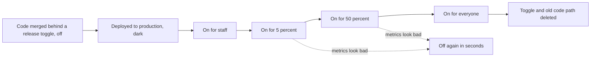
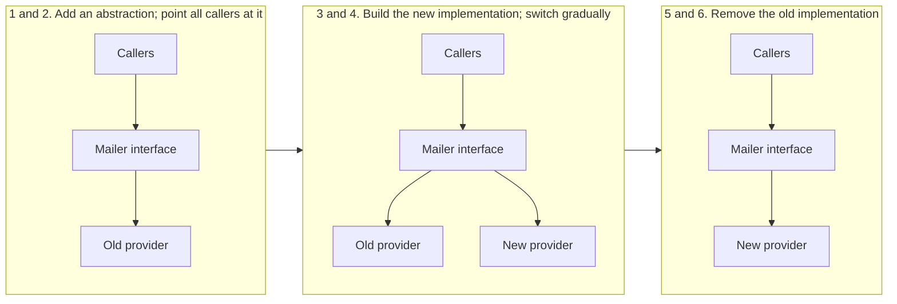

# Feature toggles and branch by abstraction

> **Before this lesson:** you should know what a branch and a merge are, and why long-lived branches are costly — see [Trunk-based development, feature branches and release branches](#/lesson/cicd/branching-models). It also helps to know the difference between deploying and releasing from [Blue-green, canary and rolling deployments](#/lesson/cicd/release-strategies).

## In plain words

Imagine a shop that is being refurbished while it stays open. The builders do not close the shop for a month. They put up a curtain, work behind it, and take the curtain down when the new section is ready. Customers keep shopping the whole time; some may not even notice the work.

Software teams have the same problem. A new feature can take weeks to build, but the previous lesson said everyone should merge their work into the shared main line every day. How can half-finished work be merged every day without customers seeing a half-finished feature?

The answer is the curtain. A **feature toggle** (also called a **feature flag**) is a switch in the code: when it is off, the new code is present but nobody reaches it; when it is on, they do. **Branch by abstraction** is a related technique for replacing a large internal part of a system, a piece at a time, while the old part keeps running.

Why this matters for a job: these two techniques are what make trunk-based development practical, and questions such as "how do you ship a three-week feature without a three-week branch?" and "how would you roll a feature out to 5% of users?" are standard in interviews for backend, platform and DevOps roles.

## The problem, stated precisely

Two goals pull against each other:

1. **Integrate continuously.** Everyone's changes go into `main` at least daily, and `main` must always be fit to release.
2. **Build big things.** Some work cannot be finished in a day.

Keeping the unfinished work on a separate branch satisfies neither goal: the work is not integrated, and when it finally merges, `main` receives three weeks of change at once.

The way out is to notice that "the code is in `main`" and "users can see the feature" are different facts. If we can control the second independently of the first, both goals are met. There are four techniques, from lightest to heaviest:

| technique | idea | use when |
|---|---|---|
| Hide it | the new code is merged but nothing links to it | a new page, endpoint or screen |
| Feature toggle | a switch decides at run time which path executes | behaviour changes inside existing code; gradual rollout |
| Small incremental steps | reorganise the change into steps that each leave the system working | most refactoring |
| Branch by abstraction | put an interface in front of the old part, build the new part behind it, switch over | replacing a library, framework or subsystem |

## Step 1: the simplest possible toggle

Start with the smallest example. A shop calculates shipping. We are building a new rule and do not want customers to get it yet.

```python-run
NEW_SHIPPING_RULES = False          # the toggle: one named switch

def shipping_cents(subtotal_cents):
    if NEW_SHIPPING_RULES:
        # new behaviour, still being built: free shipping from 40 EUR
        return 0 if subtotal_cents >= 4000 else 390
    # current behaviour, unchanged: free shipping from 50 EUR
    return 0 if subtotal_cents >= 5000 else 490

print("toggle off:", shipping_cents(4500))
NEW_SHIPPING_RULES = True
print("toggle on :", shipping_cents(4500))
```

Line by line:

- `NEW_SHIPPING_RULES = False` creates a variable that acts as the switch. Its name says what it controls.
- `if NEW_SHIPPING_RULES:` chooses between two paths. This `if` is called the **toggle point**: the place in the code where the decision is used.
- The two `return` lines under it are the new behaviour; the last line is the old behaviour, untouched.

The output is `490` with the toggle off (4,500 cents is below the old 5,000 threshold, so the customer pays shipping) and `0` with it on (4,500 is above the new 4,000 threshold). The same code produces both behaviours. With the toggle off, this code can be merged into `main` and deployed to production today, and no customer is affected.

A newcomer's natural worry: *is it not dangerous to have unfinished code in production?* It is far less dangerous than it sounds, for two reasons. The code is not executed while the toggle is off. And the alternative — merging everything at the end — is where the real danger lies, as the previous lesson showed.

## Step 2: move the switch out of the code

A switch written into the source can only be changed by editing the code and deploying again. That is fine while building. To *release* the feature without a new deployment, the value has to come from outside the program. There are three places it can come from, each more flexible than the last.

**From configuration at start-up.** An **environment variable** is a named value that the operating system hands to a program when it starts.

```python
import os

NEW_SHIPPING_RULES = os.environ.get("FEATURE_NEW_SHIPPING", "false") == "true"
```

`os.environ.get(name, default)` reads the variable and falls back to the default (`"false"`) when it is not set, so a missing setting means "off" — the safe choice. Changing the value needs a restart, but not a new build.

**From a flag service while running.** A **feature-flag service** is a small central system that stores every flag and lets people change one from a web page; applications ask it for the current value. Hosted examples are LaunchDarkly, Unleash, Flagsmith and GrowthBook. **OpenFeature** is an open standard that gives all of them the same programming interface, so the code does not depend on one vendor.

```python
from openfeature import api
from openfeature.evaluation_context import EvaluationContext

client = api.get_client()

def shipping_cents(subtotal_cents, user_id):
    context = EvaluationContext(targeting_key=user_id)
    if client.get_boolean_value("new-shipping-rules", False, context):
        return 0 if subtotal_cents >= 4000 else 390
    return 0 if subtotal_cents >= 5000 else 490
```

- `api.get_client()` obtains an object for asking flag questions.
- `EvaluationContext(targeting_key=user_id)` describes *who is asking*. The **targeting key** identifies the user, so the service can give different users different answers.
- `client.get_boolean_value("new-shipping-rules", False, context)` asks for the flag by name. The second argument, `False`, is the **default**: the answer to use if the flag service cannot be reached. Always pick the default that is safe when things go wrong.

Now turning the feature on is a click, takes effect in seconds, and turning it off again is the same click. That is a release that is separate from a deployment, and a rollback that needs no deployment at all.

## Step 3: turn it on for some users only

A switch with only two positions exposes everyone at once. Much safer is to enable a feature for 1% of users, watch, then 10%, then everyone — a **percentage rollout**.

How does the program decide which users are in the 1%? Picking at random on every request would be wrong: the same person would see the feature appear and disappear. The decision must be **stable** (the same user always gets the same answer) and **evenly spread**. The standard method is hashing.

A **hash function** turns any text into a large number that looks random but is always the same for the same input. The recipe:

1. Join the flag name and the user id into one string, for example `new-shipping-rules:user-42`.
2. Hash it with a fixed, published function. Here we use SHA-256 and take the first 8 hexadecimal digits as a number.
3. Take that number modulo 10,000. (Modulo means "the remainder after division", so the result is between 0 and 9,999.) Call this the user's **bucket**.
4. The user is in the rollout if their bucket is less than `percentage × 100`.

```python-run
import hashlib

def bucket(flag, user_id):
    """Stable bucket in 0..9999 for this user and this flag."""
    digest = hashlib.sha256(f"{flag}:{user_id}".encode("utf-8")).hexdigest()
    return int(digest[:8], 16) % 10_000

def is_enabled(flag, user_id, percent):
    return bucket(flag, user_id) < percent * 100

users = [f"user-{n}" for n in range(1, 20_001)]

print("user-42 bucket:", bucket("new-shipping-rules", "user-42"), "(same every time)")
for pct in (1, 10, 50, 100):
    on = sum(is_enabled("new-shipping-rules", u, pct) for u in users)
    print(f"{pct:>3}% rollout -> {on:>5} of {len(users)} users ({on / len(users):.1%})")

at_10 = {u for u in users if is_enabled("new-shipping-rules", u, 10)}
at_50 = {u for u in users if is_enabled("new-shipping-rules", u, 50)}
print("everyone enabled at 10% is still enabled at 50%:", at_10 <= at_50)

both = sum(is_enabled("new-shipping-rules", u, 10) and is_enabled("dark-mode", u, 10) for u in users)
print(f"in both 10% rollouts: {both / len(users):.1%} (independent flags give about 1%)")
```

What the output shows, and why:

- The bucket for `user-42` is a fixed number. Run the block again and it does not change, because a hash depends only on its input.
- The share of users enabled is close to the requested percentage. A good hash spreads inputs evenly across the buckets.
- Raising the percentage only *adds* users. Someone whose bucket is below 1,000 is also below 5,000, so nobody loses the feature as the rollout widens.
- Including the flag name in the hashed text makes different flags pick different groups. Without it, the same unlucky 10% of users would be the test group for every experiment.

Why not Python's built-in `hash()`? Because Python deliberately changes its result for text between program runs, so a user would land in a different bucket after every restart. A problem in this module asks you to implement exactly the recipe above.

Flag services add **targeting rules** on top: enable for staff, for one country, for a named list of beta customers, and a percentage of the rest. Rules are checked in order and the first match wins.

## The kinds of toggle

Toggles are used for different purposes, and the purposes differ in how long the toggle should live. Mixing them up is the commonest mistake.

| kind | purpose | who flips it | lifetime |
|---|---|---|---|
| **Release toggle** | hide unfinished work so it can be merged | developers | days to weeks, then **deleted** |
| **Experiment toggle** | show variants to compare outcomes (an A/B test) | product and data teams | the length of the experiment |
| **Ops toggle** ("kill switch") | turn off an expensive or risky function under load | on-call engineers | long-lived, few in number |
| **Permission toggle** | features for particular plans or customers | product and sales | permanent; really part of the product |



The last box in the top row is not optional. A release toggle that is never removed leaves two code paths to maintain and test for ever.

## The costs, and how to keep them small

Toggles are a loan. They buy early integration and safe release, and they charge interest.

**More paths to test.** Each independent on/off toggle doubles the number of possible combinations: 10 toggles give 1,024, and 20 give more than a million. Nobody can test them all. In practice, test the combination currently in production, the combination you intend to release next, and each toggle's fallback. Keeping the number of live toggles small is the real control.

**Stale toggles.** Old switches clutter the code and confuse readers. Defences: record an owner and an expiry date for each toggle when it is created; create the "remove this toggle" task in the same sitting; and have the pipeline fail when a toggle is past its date.

```python-run
from datetime import date

flags = [
    {"name": "new-shipping-rules", "kind": "release", "owner": "team-checkout", "expires": date(2026, 6, 30)},
    {"name": "gift-cards",         "kind": "release", "owner": "team-cart",     "expires": date(2026, 3, 1)},
    {"name": "disable-recommendations", "kind": "ops", "owner": "team-sre",     "expires": None},
    {"name": "old-search",         "kind": "release", "owner": None,            "expires": date(2026, 9, 1)},
]

def audit(flags, today, max_release_flags=3):
    problems = []
    for f in flags:
        if f["owner"] is None:
            problems.append(f"{f['name']}: no owner")
        if f["kind"] == "release" and f["expires"] is None:
            problems.append(f"{f['name']}: release toggle without an expiry date")
        if f["expires"] and f["expires"] < today:
            problems.append(f"{f['name']}: expired on {f['expires']}, remove it")
    if sum(f["kind"] == "release" for f in flags) > max_release_flags:
        problems.append("too many release toggles alive at once")
    return problems

for p in audit(flags, date(2026, 6, 3)):
    print("FAIL", p)
```

**Scattered toggle points.** If the same check appears in fifteen places, removing the toggle is a risky hunt. Decide once, near the edge of the system, and pass the decision inward — or choose between two implementations of one interface, so the toggle point is a single line.

**Toggle changes are production changes.** Flipping a flag alters what users experience exactly as a deployment does. Treat it accordingly: record who changed what and when, restrict who may change production flags, roll out gradually, and show flag changes on the same dashboards as deployments.

**The flag service can fail.** Applications should keep the last known values in memory and fall back to safe defaults, so that an outage of the flag service does not become an outage of the product.

> [!WARNING]
> Do not reuse an old flag name for a new purpose. In a widely reported 2012 incident, a trading firm reactivated a flag whose name had previously controlled long-dead code, and one server that had not received the new release ran the old code against live markets. The firm lost hundreds of millions of dollars in under an hour. Delete flags and the code behind them together, and never recycle a name.

## Branch by abstraction

Some changes cannot be hidden behind a single `if`. Suppose the application sends email through an old provider's library, used in forty places, and it must move to a new provider. Doing this on a branch would mean weeks of conflicts. **Branch by abstraction** does it on `main`, in steps that each leave the system working. Despite the name, no version-control branch is involved: the "branch" is two implementations living side by side.

An **abstraction** here means an interface: a description of *what* can be asked for ("send this message") that says nothing about *how*.



The steps:

1. **Create the abstraction** in front of the part to be replaced.
2. **Move callers to the abstraction**, a few at a time. Each move is a small, safe commit to `main`.
3. **Write the new implementation** behind the same abstraction. It is merged daily but unused in production.
4. **Switch over**, usually with a toggle and often gradually.
5. **Delete the old implementation** once the new one is proven.
6. **Remove the abstraction** too, if it no longer earns its keep.

```python-run
class Mailer:                                   # 1. the abstraction: what, not how
    def send(self, to, subject): raise NotImplementedError

class OldProviderMailer(Mailer):                # the existing behaviour, wrapped
    def send(self, to, subject): return f"old-provider sent '{subject}' to {to}"

class NewProviderMailer(Mailer):                # 3. the replacement, built on main in small commits
    def send(self, to, subject): return f"NEW-provider sent '{subject}' to {to}"

def make_mailer(use_new):                       # 4. the single toggle point
    return NewProviderMailer() if use_new else OldProviderMailer()

def send_receipt(mailer, order):                # 2. a caller: knows only the abstraction
    return mailer.send(order["email"], f"Receipt #{order['id']}")

order = {"id": 7, "email": "ana@example.com"}
for use_new in (False, True):
    print(send_receipt(make_mailer(use_new), order))
```

- `class Mailer` declares the one operation callers need. `raise NotImplementedError` means "a real implementation must replace this".
- `OldProviderMailer` and `NewProviderMailer` both *are* Mailers, so either can be handed to any caller.
- `make_mailer` is the only place that knows two implementations exist. That is the benefit: forty callers, one toggle point.
- `send_receipt` never changes when the provider does.

The two printed lines show the same caller producing output from either implementation.

Two refinements are worth knowing. In a **verify** (or *shadow*) mode, the system runs both implementations, returns the old one's result to the user and logs any difference — evidence that the new one behaves the same before any user depends on it. And the **strangler fig** pattern applies the same idea at the scale of whole systems: a routing layer sends a growing share of requests to a new service while the old system shrinks. It is named after a plant that grows around a tree until the tree is no longer needed.

## Small incremental steps

Many changes need neither a toggle nor an abstraction — only a better order. The expand/contract idea from [Schema migrations and expand/contract](#/lesson/cicd/schema-migrations) is the general pattern: **add the new thing, move users over, remove the old thing**, as three or more separate commits. To change a function's parameters, add a new function, convert callers one by one, then delete the old function. Every intermediate commit compiles, passes its tests and could be released.

## A worked example: a three-week feature on trunk

The team is building gift cards. The plan, one or two days per step, each merged to `main`:

| day | merged change | visible to customers? |
|---|---|---|
| 1 | Database migration adding an empty `gift_cards` table | no |
| 2 | `GiftCard` model and unit tests | no |
| 3–4 | Service to check and redeem a balance; nothing calls it yet | no |
| 5 | API endpoint that returns "not found" unless `gift-cards` is on | no |
| 6–9 | Checkout applies a gift card when the flag is on | no |
| 10 | Flag on in the test environment; acceptance tests run with it on *and* off | no |
| 11 | Flag on for staff in production | staff only |
| 12–14 | 5%, then 25%, then 100%, watching payment success rate at each step | gradually |
| 20 | Flag and old code path deleted | everyone |

Fourteen small merges replace one enormous one. Integration problems surfaced daily, each small. The deployment on day 9 carried no risk for customers; the release on days 12 to 14 was a sequence of reversible clicks.

## Pitfalls

- **Release toggles that live for ever.** Give every one an owner, an expiry date and a removal task.
- **Toggles nested inside toggles**, producing combinations nobody understands.
- **Testing only the "on" path**, when "off" is what production runs today.
- **Random assignment per request** instead of a stable hash, so users see a feature flicker.
- **Reusing flag names.**
- **A toggle wrapped around a database change that cannot be undone.** A flag can hide code; it cannot un-drop a column. Schema changes need expand/contract.
- **An abstraction that leaks** details of the old implementation, so that building the new one behind it is impossible.
- **Never finishing step 5**, leaving two implementations in service indefinitely.

> [!TIP]
> When you create a release toggle, write the pull request that deletes it straight away and leave that pull request open as a reminder. Removing a toggle is quick while you still remember how the code fits together, and slow six months later.

> [!INTERVIEW]
> "How do you deliver a large feature with trunk-based development?" Break it into small changes that each leave `main` releasable; merge them daily behind a release toggle that defaults to off; deploy continuously; release by turning the toggle on for staff, then a growing percentage chosen by a stable hash of the user id, watching error rates and business metrics; turn it off instantly if needed; delete the toggle afterwards. For replacing a subsystem, describe branch by abstraction. Be ready to name the costs: combinatorial testing, stale flags, and the need to treat flag changes as audited production changes.

## Summary

- "Merged and deployed" and "released to users" are separate facts; controlling the second independently is what lets large work be integrated daily.
- A feature toggle is a named switch read at a toggle point. Supplied from outside the code, it releases and withdraws a feature without a deployment.
- Percentage rollouts use a stable hash of flag name plus user id, so each user gets a consistent answer and widening a rollout only adds users.
- Toggles come in kinds with different lifetimes — release, experiment, ops and permission — and release toggles must be deleted.
- Toggles have costs: combinations to test, stale switches, scattered checks, and the risk of unreviewed production changes. Limit their number and give each an owner and an expiry.
- Branch by abstraction replaces a large component on `main` by placing an interface in front of it, building the replacement behind that interface and switching over.

## Glossary

- **Feature toggle / feature flag** — a switch in the code that turns a piece of behaviour on or off without changing the code.
- **Toggle point** — the place in the code where the switch's value is checked.
- **Feature-flag service** — a central system that stores flag values and lets them be changed while applications are running.
- **Environment variable** — a named value given to a program by the operating system when the program starts.
- **Default (fallback) value** — the answer used when the real flag value cannot be obtained.
- **Targeting key** — the identifier, usually a user id, used to decide which answer a particular user gets.
- **Hash function** — a function that turns any input into a number that looks random but is always the same for the same input.
- **Bucket** — the number, here 0 to 9,999, that a user's hash falls into; used to decide rollout membership.
- **Percentage rollout** — enabling a feature for a chosen share of users.
- **Kill switch** — a long-lived operational toggle for turning a function off in an emergency.
- **A/B test** — an experiment that shows different variants to different users and compares the results.
- **Abstraction** — an interface describing what can be asked for without saying how it is done.
- **Branch by abstraction** — replacing a component gradually on the main line, behind an interface, with old and new side by side.
- **Strangler fig pattern** — replacing a whole system gradually by routing more and more requests to its successor.

## Check yourself

```quiz
[
  {"q": "What problem do feature toggles solve for a team practising trunk-based development?",
   "options": ["They make the code run faster", "They let unfinished work be merged and deployed every day without users seeing it", "They remove the need for tests", "They replace version control"],
   "answer": 1,
   "explain": "A toggle separates having the code in production from exposing the behaviour, so integration can be continuous while release is controlled."},
  {"q": "Why is a stable hash of the user id used for a percentage rollout instead of a random number per request?",
   "options": ["Hashing is more secure", "The same user must get the same answer every time, or the feature would appear and disappear", "Random numbers are too slow", "Hashes are shorter"],
   "answer": 1,
   "explain": "A hash depends only on its input, so each user lands in the same bucket on every request."},
  {"q": "With the bucket method described (bucket in 0..9999, enabled when bucket < percent x 100), a user has bucket 730. At which rollout percentages is the feature on for them?",
   "options": ["Only at 100%", "At 5% and 7% but not higher", "At 8% and every higher percentage", "At 7% and every higher percentage"],
   "answer": 2,
   "explain": "At 7% the limit is 700 and 730 is not below it. At 8% the limit is 800, so the user is in, and stays in for all larger percentages."},
  {"q": "Why is the flag name included in the text that is hashed?",
   "options": ["To make the hash longer", "So that different flags select different groups of users rather than always the same people", "Because hash functions require two inputs", "To hide the user id"],
   "answer": 1,
   "explain": "Hashing only the user id would put the same users in the first 10% of every rollout."},
  {"q": "Which kind of toggle should be removed soon after the feature is fully released?",
   "options": ["Permission toggle", "Ops toggle (kill switch)", "Release toggle", "None; toggles are permanent"],
   "answer": 2,
   "explain": "A release toggle exists only to hide work in progress. Once the feature is on for everyone it is dead weight."},
  {"q": "An application has 12 independent on/off toggles. How many combinations of settings exist?",
   "options": ["12", "24", "144", "4,096"],
   "answer": 3,
   "explain": "Each toggle doubles the count: 2 to the power 12 is 4,096. This is why the number of live toggles must stay small."},
  {"q": "In branch by abstraction, what is the first step?",
   "options": ["Create a long-lived Git branch", "Delete the old implementation", "Introduce an interface in front of the component to be replaced", "Turn on a flag for all users"],
   "answer": 2,
   "explain": "The abstraction lets callers stop depending on the old implementation directly, which makes swapping it possible."},
  {"q": "The flag service is unreachable. What should a well-built application do?",
   "options": ["Crash", "Use the last known values or the safe default for each flag", "Turn every flag on", "Block until the service returns"],
   "answer": 1,
   "explain": "Flag evaluation must not become a single point of failure. Cached values and safe defaults keep the product working."}
]
```

> **Source:** Humble & Farley, *Continuous Delivery*, ch. 13 (keeping the application releasable: hiding new functionality, incremental changes, branch by abstraction) and ch. 14 (develop on mainline). Toggle categories follow Pete Hodgson's article: https://martinfowler.com/articles/feature-toggles.html — OpenFeature: https://openfeature.dev/docs/reference/intro — Branch by abstraction: https://martinfowler.com/bliki/BranchByAbstraction.html
