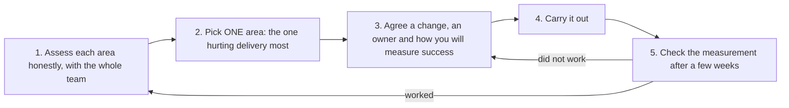

# Maturity, risk and compliance

> **Before this lesson:** you should know what a deployment pipeline is and what its stages do — see [Stages, gates and the flow of a change](#/lesson/cicd/pipeline-stages) — and why small, frequent releases carry less risk, from [Release anti-patterns and the cost of late feedback](#/lesson/cicd/release-antipatterns).

## In plain words

So far this track has been about techniques: tests, pipelines, deployment strategies. This lesson is about the people and rules around them. Three questions come up in every organisation that tries to deliver software continuously:

1. **Where are we, and what should we improve next?** A *maturity model* is a ladder that describes typical stages a team passes through, so you can see which rung you are on and what the next one looks like.
2. **What could go wrong, and what are we doing about it?** *Risk management* is the habit of listing the things that might hurt the project and deciding in advance how to handle each one.
3. **How do we prove we followed the rules?** *Compliance* means meeting obligations set by laws, regulators or company policy — for example, "nobody may put their own unreviewed change into production".

An everyday comparison: learning to drive. A beginner cannot be told "drive like an expert". They move through stages (car park, quiet streets, motorways). They think about hazards before they meet them. And they follow rules that exist because other people were hurt — while a good driving school proves, with a record of lessons and a test, that the rules were followed.

Why this matters for a job: anyone can add a tool. Senior engineers are hired to work out what a team should fix *first*, to argue for it with evidence, and to satisfy auditors without slowing delivery to a crawl. Interviewers probe exactly these judgement calls.

## Part 1: a maturity model

### What it is

A **maturity model** describes a capability at several levels, from chaotic to continuously improving. It is not a score to boast about. It is a map for answering "given where we are, what is the most useful next step?"

Delivery has several distinct areas, and a team is usually stronger in some than in others. A common breakdown uses six:

| area | what it covers |
|---|---|
| Build and continuous integration | how code is combined and built |
| Environments and deployment | how software reaches each environment |
| Release management and compliance | how release decisions and rules are handled |
| Testing | how quality is checked |
| Data management | how database changes and test data are handled |
| Configuration management | how code, settings and dependencies are versioned |

And five levels, lowest to highest:

| level | name | in one sentence |
|---|---|---|
| −1 | Regressive | Processes are unrepeatable, manual and poorly controlled. |
| 0 | Repeatable | The process is written down and partly automated. |
| 1 | Consistent | Automated processes are applied across the whole lifecycle. |
| 2 | Quantitatively managed | The process is measured and controlled using those measurements. |
| 3 | Optimising | The team improves the process continually, driven by data. |

Here is what the levels look like in two of the areas. Read down each column and you can usually recognise your own team.

| level | build and CI | environments and deployment |
|---|---|---|
| −1 | Builds done by hand on someone's machine; no record of what was built | Software deployed by hand; each environment set up differently by hand |
| 0 | Regular automated build; any build can be recreated from version control | Deployment to some environments automated; creating a new environment is cheap |
| 1 | Build and tests run on every commit; dependencies managed; scripts reused | One push-button process deploys to every environment, production included |
| 2 | Build metrics collected and acted on; broken builds do not stay broken | Deployments orchestrated; release and rollback tested |
| 3 | Teams meet regularly to remove integration problems with automation | Environments provisioned automatically and managed well; operations and development work as one team |

### How to use it

The process is a loop. A **retrospective** is a regular team meeting to ask what went well, what did not, and what to change.



Three rules keep it honest:

- **Assess with evidence, not opinion.** "We deploy automatically" is settled by counting how many of the last ten production deployments needed someone to type commands by hand.
- **Improve the weakest link.** A team at level 2 in testing and level −1 in deployment gains nothing from more tests. Software still reaches users through the slow manual step.
- **Change one thing at a time**, and measure it, or you will not know what helped.

The short program below turns an assessment into a recommendation. The scores are examples; edit them.

```python-run
scores = {                       # level per area, from -1 (regressive) to 3 (optimising)
    "build and CI": 1,
    "environments and deployment": -1,
    "release management": 0,
    "testing": 2,
    "data management": 0,
    "configuration management": 1,
}

names = {-1: "regressive", 0: "repeatable", 1: "consistent", 2: "measured", 3: "optimising"}

for area, level in scores.items():
    bar = "#" * (level + 2)                     # +2 so that level -1 still shows one mark
    print(f"{area:<30} {bar:<5} {level:>2}  {names[level]}")

weakest = min(scores, key=scores.get)
print()
print("improve first :", weakest)
print("because       : software cannot reach users faster than the slowest, riskiest step allows")
print("target        : level", scores[weakest] + 1, "-", names[scores[weakest] + 1])
```

Line by line:

- `scores` is a **dictionary**: a table that maps each name (the area) to a value (its level).
- The `for` loop prints one row per area. `"#" * (level + 2)` repeats the `#` character to draw a small bar chart in text.
- `min(scores, key=scores.get)` finds the area whose level is lowest. `key=scores.get` tells `min` to compare the *levels*, not the names.
- The last lines print the recommendation: raise the weakest area by one level — not to the top in one jump.

The output names "environments and deployment" as the place to start, with level 0 as the target. That is the lesson of the model in one line: the next step is a single rung on the lowest ladder.

> [!WARNING]
> A maturity model becomes harmful when it is used to rank teams or set bonuses. People then report the level their manager wants to hear, and the map stops matching the territory. Use it inside the team as a planning aid, and measure real outcomes (next lesson) to check whether a higher "level" actually delivered anything.

## Part 2: managing risk

### Risk in plain terms

A **risk** is something that might happen and would hurt if it did. Each risk has two properties:

- **Likelihood**: how probable it is.
- **Impact**: how bad the result would be.

Multiplying them gives **exposure**, a rough number for comparing risks. A problem that is unlikely but ruinous can deserve more attention than one that is frequent and trivial.

For each risk there are four possible responses:

| response | meaning | delivery example |
|---|---|---|
| **Avoid** | change the plan so the risk cannot occur | do not build the risky feature; keep to one database engine |
| **Reduce** (mitigate) | lower the likelihood or the impact | automated tests, canary releases, rehearsed rollback |
| **Transfer** | make it someone else's problem by contract | use a managed database with a service-level agreement |
| **Accept** | decide consciously to live with it, and say so | a cosmetic bug on a rarely used admin page |

A **risk register** is a list of the known risks with likelihood, impact, chosen response and owner. It does not need special software; a table in the repository is enough, provided it is reviewed regularly.

```python-run
risks = [  # name, likelihood 1-5, impact 1-5, response, owner
    ("Deployment script fails in production",        4, 4, "reduce: same script for every environment", "platform"),
    ("Database migration locks the orders table",    2, 5, "reduce: test on production-size data, lock timeout", "orders"),
    ("Key engineer is the only one who can release", 3, 4, "avoid: one-button release anyone can run", "lead"),
    ("Payment provider outage",                      2, 4, "transfer and reduce: SLA, plus retry queue", "payments"),
    ("Typo on the internal admin page",              4, 1, "accept", "nobody"),
    ("Secret leaked in a commit",                    2, 5, "reduce: push protection, rotation runbook", "security"),
]

print(f"{'risk':<46} {'L':>2} {'I':>2} {'exp':>4}  response")
for name, likelihood, impact, response, owner in sorted(risks, key=lambda r: -(r[1] * r[2])):
    exposure = likelihood * impact
    flag = "!!" if exposure >= 12 else "  "
    print(f"{name:<46} {likelihood:>2} {impact:>2} {exposure:>4} {flag} {response}  [{owner}]")
```

- Each entry in `risks` is a **tuple**: a fixed group of values kept together — here a name, two numbers, a response and an owner.
- `sorted(risks, key=lambda r: -(r[1] * r[2]))` orders the list by exposure, largest first. `r[1]` and `r[2]` are the likelihood and impact; the minus sign reverses the order.
- `flag` marks any risk whose exposure is 12 or more, so the important rows stand out.

In the output the failing deployment script comes first, with exposure 16, and the typo comes last with 4. Notice that most of the "reduce" responses are practices from earlier lessons. That is not a coincidence, and it is the central idea of this part.

### Continuous delivery as risk management

Seen through this lens, nearly everything in this track is a way of reducing likelihood or impact:

| risk | practice that lowers the **likelihood** | practice that lowers the **impact** |
|---|---|---|
| A defect reaches users | automated tests at every stage | canary release; feature toggle off |
| A deployment goes wrong | one deployment script, rehearsed in every environment | blue-green switch back; rollback |
| Environments differ | infrastructure as code | — |
| A large release hides a fault | small batches | each fault has one obvious suspect |
| Nobody knows what is running | build once; artifacts identified by digest | fast, exact rollback target |
| A change breaks the database | expand/contract migrations | application rollback without data rollback |

The traditional reaction to risk is to add approvals and slow down. The evidence, examined in the next lesson, shows that slowing down makes each release larger and therefore riskier. The reliable route to safety is to make changes small, automated, observable and reversible.

### Risk across the life of a project

- **At the start**, the largest risks are building the wrong thing and discovering late that it cannot be deployed. Reduce both by releasing a thin working slice to a production-like environment in the first weeks.
- **During development**, the largest risks are integration problems and slipping quality. Continuous integration and the pipeline address these daily.
- **In operation**, the largest risks are failed changes and slow recovery. Progressive delivery, monitoring and practised rollback address these.

Some warning signs, with their usual causes:

| symptom | likely cause |
|---|---|
| Deployments are rare and painful | manual deployment; environments built by hand |
| Many defects found late | tests not automated; testers involved only at the end |
| The build is often red and stays red | slow commit stage; no agreement to fix or revert first |
| "It worked in staging" | environments differ; a different artifact was deployed |
| Nobody knows what version is live | no artifact repository; rebuilding per environment |

## Part 3: compliance and audit

### What auditors actually want

**Compliance** means showing that you meet obligations imposed from outside: laws on personal data (such as the General Data Protection Regulation, GDPR), payment-card rules (PCI DSS), financial reporting law (the Sarbanes–Oxley Act, SOX), or assurance frameworks customers ask for (SOC 2, ISO 27001). An **audit** is an inspection that checks the evidence.

Stripped of jargon, the requirements for software change are usually four:

1. **Authorisation.** Changes to production are approved by someone entitled to approve them.
2. **Separation of duties.** No single person can write a change and put it into production alone, so that fraud or a serious mistake needs two people.
3. **Traceability.** For anything in production you can show what changed, who changed it, why, and that it was tested.
4. **Integrity.** What was approved is what is running; nothing was altered in between.

People often assume these demand slow manual gates and a weekly **change advisory board** (CAB) — a committee that reviews proposed changes. They do not. They demand *evidence*, and a well-built pipeline produces better evidence than any committee.

| requirement | how the pipeline satisfies it | where the evidence lives |
|---|---|---|
| Authorisation | protected branch; required review; protected production environment with named approvers | pull-request and deployment records |
| Separation of duties | the author cannot approve their own pull request; only the pipeline holds production credentials | branch-protection settings; access configuration |
| Traceability | every commit links to a ticket; every artifact records its commit; every deployment is logged | Git history; artifact metadata; deployment log |
| Integrity | build once; deploy by digest; signed artifacts verified on admission | registry; signature and provenance records |

```yaml
# .github/CODEOWNERS -- who must review changes to sensitive paths
/infra/                 @example/platform-team
/.github/workflows/     @example/platform-team
/services/payments/     @example/payments-team @example/security-team
```

Each line pairs a path with the people who must approve changes under it. With "require review from code owners" switched on for the branch, a change to the payments service cannot merge until someone from those teams approves it — and the author's own approval does not count. That one file, plus the platform's record of who approved what, answers the "authorisation" and "separation of duties" questions for every change, automatically.

### Standard changes: the key idea

Most change-management frameworks, including the widely used ITIL guidance, distinguish kinds of change:

- A **standard change** is low-risk, well understood and follows a procedure that was approved once in advance. It needs no fresh approval each time.
- A **normal change** needs individual assessment and approval.
- An **emergency change** follows an expedited path and is reviewed afterwards.

The move that reconciles compliance with continuous delivery is to get **deployments through the pipeline classified as standard changes**. The procedure — review, automated tests, security scans, progressive rollout, automatic rollback — is approved once. After that, every change that follows it is pre-authorised. The committee's time goes to the unusual, high-risk changes where human judgement adds something.

```python-run
def classify(change):
    """Decide the approval path for a change from facts the pipeline already knows."""
    reasons = []
    if not change["reviewed_by_other"]:
        reasons.append("no independent review")
    if not change["pipeline_green"]:
        reasons.append("automated checks did not pass")
    if change["touches"] & {"payments", "auth", "infra-network"}:
        reasons.append("touches a sensitive area")
    if change["has_destructive_migration"]:
        reasons.append("irreversible data change")
    if change["emergency"]:
        return "EMERGENCY: expedited approval, mandatory review afterwards", reasons
    if reasons:
        return "NORMAL: needs individual approval", reasons
    return "STANDARD: pre-approved, deploy automatically", reasons

changes = {
    "fix typo on help page": dict(reviewed_by_other=True, pipeline_green=True, touches={"web"},
                                  has_destructive_migration=False, emergency=False),
    "drop legacy column":    dict(reviewed_by_other=True, pipeline_green=True, touches={"orders"},
                                  has_destructive_migration=True, emergency=False),
    "change card retry rule": dict(reviewed_by_other=True, pipeline_green=True, touches={"payments"},
                                  has_destructive_migration=False, emergency=False),
    "self-merged hotfix":    dict(reviewed_by_other=False, pipeline_green=True, touches={"web"},
                                  has_destructive_migration=False, emergency=False),
}
for name, change in changes.items():
    path, reasons = classify(change)
    print(f"{name:<24} -> {path}" + (f"   ({'; '.join(reasons)})" if reasons else ""))
```

- `classify` receives a dictionary of facts about one change and builds a list of `reasons` why it might need extra scrutiny.
- `change["touches"] & {"payments", "auth", "infra-network"}` uses **set intersection** (`&`): it yields the items the two sets have in common. If the result is not empty, the change touches a sensitive area.
- The function returns one of three paths. Only a change with no reasons at all is treated as standard.

The typo fix deploys automatically. The other three are routed to a person, each with a stated reason. This is how policy becomes code: the rules are written down, applied to every change identically, and themselves kept under version control and review.

### Freeze windows

Many organisations forbid production changes during sensitive periods — the days around a major sales event, or year-end financial close. This is called a **change freeze**. Encode it in the pipeline rather than in an email:

```yaml
# deploy-policy.yaml
freeze_windows:
  - name: peak-sales
    start: "2026-11-25T00:00:00Z"
    end:   "2026-12-01T23:59:59Z"
    allow: [emergency]
weekly_restrictions:
  - days: [saturday, sunday]
    allow: [emergency]
```

A deployment job reads this file and refuses to proceed inside a window unless the change is marked as an emergency. One of this module's problems asks you to write that check. Two cautions: a long freeze makes the first release afterwards very large, which is risky; and a team that needs frequent freezes is being told that its releases are not safe enough yet.

### Evidence without effort

Because every step is automated and logged, the audit trail is a by-product. For any production deployment you can produce, in minutes:

```bash
# What is running, and which commit built it?
kubectl -n shop get deploy orders -o jsonpath='{.spec.template.spec.containers[0].image}'

# Who reviewed and approved the change?
gh pr list --state merged --search 9f3c2e1 --json number,author,reviews,mergedAt

# Which checks ran, and did they pass?
gh run list --commit 9f3c2e1 --json name,conclusion,createdAt

# Who approved the production deployment, and when?
gh api repos/example/orders/deployments --jq '.[0] | {sha, environment, creator: .creator.login, created_at}'
```

Each command asks a system of record a question; none relies on anyone's memory. Compare that with reconstructing the history of a manual release from emails.

## Pitfalls

- **Using the maturity model as a league table.**
- **Improving the area you enjoy** instead of the one that limits delivery.
- **Treating risk management as a document written once.** Review the register regularly; risks change.
- **Answering every incident with another approval step.** Each gate adds delay, enlarges batches and so raises risk.
- **Administrator overrides** of branch protection "in special cases". Auditors look for exactly these.
- **Shared accounts**, which make "who did it?" unanswerable.
- **Evidence that expires**: pipeline logs deleted after 30 days when the retention obligation is seven years.
- **Compliance by screenshot** instead of by queryable records.

> [!TIP]
> Involve auditors and security staff early and show them the pipeline. Most are pleased to exchange a sample of hand-filled forms for complete, tamper-evident, automatically generated records covering every change.

> [!INTERVIEW]
> "Our compliance team says every release needs change-board approval. How do you reconcile that with continuous delivery?" Start from the control objectives — authorisation, separation of duties, traceability, integrity — and show that the pipeline enforces each one with stronger evidence: mandatory peer review, the author unable to approve their own change, production credentials held only by the pipeline, artifacts built once and signed, and a full log of who approved what. Then propose classifying pipeline deployments as pre-approved standard changes, with the board keeping the high-risk exceptions. Add that research finds heavyweight external approval does not reduce failure rates and does slow delivery.

## Summary

- A maturity model describes levels of capability in several areas of delivery; use it with evidence to choose the next improvement in the weakest area, one step at a time.
- A risk has a likelihood and an impact; respond by avoiding, reducing, transferring or accepting, and keep a reviewed register with owners.
- Continuous delivery practices are risk controls: they lower the chance of a failed change and shrink its consequences.
- Compliance requires authorisation, separation of duties, traceability and integrity. A pipeline enforces all four and produces the evidence as a side effect.
- Treat routine pipeline deployments as pre-approved standard changes, route unusual ones to people, and encode policy such as freeze windows as code.

## Glossary

- **Maturity model** — a description of a capability at several levels, used to judge where a team is and what to improve next.
- **Retrospective** — a regular team meeting to review how work went and agree changes.
- **Risk** — something that may happen and would cause harm.
- **Likelihood / impact / exposure** — how probable a risk is; how bad it would be; the two multiplied.
- **Mitigation** — an action that lowers a risk's likelihood or impact.
- **Risk register** — the maintained list of known risks, responses and owners.
- **Compliance** — meeting obligations set by law, regulators or policy.
- **Audit** — an inspection of evidence that obligations were met.
- **Separation of duties** — the rule that one person alone cannot both make and release a change.
- **Traceability** — being able to follow anything in production back to its change, author, reason and tests.
- **Change advisory board (CAB)** — a committee that reviews proposed changes.
- **Standard change** — a low-risk change that follows a procedure approved once in advance.
- **Change freeze (freeze window)** — a period in which production changes are not allowed.
- **Policy as code** — rules written as files or programs so that they are applied automatically and versioned.
- **Service-level agreement (SLA)** — a contractual promise about the reliability of a service.

## Check yourself

```quiz
[
  {"q": "What is a maturity model for?",
   "options": ["Ranking teams against each other", "Seeing where a team stands in each area of delivery and choosing the next improvement", "Replacing automated tests", "Calculating salaries"],
   "answer": 1,
   "explain": "It is a planning aid. Used as a league table, it encourages people to misreport their level."},
  {"q": "A team scores high on testing and very low on deployment. Where should it invest first?",
   "options": ["More tests", "Deployment, because it is the weakest link limiting delivery", "Neither", "Both equally"],
   "answer": 1,
   "explain": "Software reaches users through the slowest, riskiest step. Strengthening an already strong area changes little."},
  {"q": "Risk A has likelihood 4 and impact 1. Risk B has likelihood 2 and impact 5. Which has the greater exposure?",
   "options": ["A, with 5", "A, with 4", "B, with 10", "They are equal"],
   "answer": 2,
   "explain": "Exposure is likelihood times impact: A is 4 and B is 10. A rarer but severe risk can deserve more attention."},
  {"q": "Using a managed database with a contractual uptime guarantee is an example of which risk response?",
   "options": ["Avoid", "Reduce", "Transfer", "Accept"],
   "answer": 2,
   "explain": "Responsibility for the risk is moved to a supplier by contract. You may still reduce the impact with retries."},
  {"q": "What does separation of duties require for a production change?",
   "options": ["Two servers", "That the person who wrote the change cannot alone approve and release it", "A weekly meeting", "Two programming languages"],
   "answer": 1,
   "explain": "It ensures that fraud or a serious error needs more than one person. Required review by someone else enforces it."},
  {"q": "What is a 'standard change'?",
   "options": ["Any change made on a weekday", "A low-risk change following a procedure approved once in advance, needing no new approval each time", "A change approved by the full board", "A change with no tests"],
   "answer": 1,
   "explain": "Classifying pipeline deployments this way reconciles change-management rules with frequent releases."},
  {"q": "Why is automatically generated pipeline evidence stronger than a manually completed change form?",
   "options": ["It is prettier", "It covers every change, is produced by the systems that performed the work, and is hard to alter afterwards", "Auditors cannot read forms", "It is shorter"],
   "answer": 1,
   "explain": "Complete, system-recorded, tamper-evident records beat sampled, hand-written ones."},
  {"q": "What is a hidden danger of long change freezes?",
   "options": ["Servers overheat", "Changes pile up, so the first release after the freeze is large and risky", "Tests stop running", "Git stops accepting commits"],
   "answer": 1,
   "explain": "Batch size grows during the freeze, and large batches are the main driver of release risk."}
]
```

> **Source:** Humble & Farley, *Continuous Delivery*, ch. 15 (managing continuous delivery: a maturity model for configuration and release management, a risk management process, common delivery problems, compliance and auditing). GitHub code owners: https://docs.github.com/en/repositories/managing-your-repositorys-settings-and-features/customizing-your-repository/about-code-owners — GitHub deployment protection rules: https://docs.github.com/en/actions/managing-workflow-runs-and-deployments/managing-deployments/managing-environments-for-deployment
