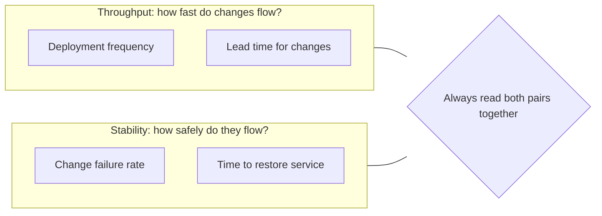

# DORA metrics: measuring delivery performance

> **Before this lesson:** you should know what a deployment is and why small, frequent releases reduce risk — see [Release anti-patterns and the cost of late feedback](#/lesson/cicd/release-antipatterns) — and how rollback restores service, from [Rollback, roll-forward, zero downtime and emergency fixes](#/lesson/cicd/rollback-emergency).

## In plain words

Suppose two delivery teams each claim to be "doing well". How would you check? You would not count how busy the kitchen looks in a restaurant. You would ask four plain questions: how often do meals go out, how long does a customer wait after ordering, how many plates are sent back, and when one is sent back, how quickly is it put right?

Software delivery has the same four questions. A long-running research programme called **DORA** (DevOps Research and Assessment, now part of Google Cloud) surveyed tens of thousands of professionals over many years and found that four measurements separate high-performing organisations from the rest:

| metric | plain question | measures |
|---|---|---|
| **Deployment frequency** | How often do we release to users? | speed (throughput) |
| **Lead time for changes** | How long from finishing a change to it being live? | speed (throughput) |
| **Change failure rate** | What share of releases cause a problem? | stability |
| **Time to restore service** | When a release causes a problem, how long until it is fixed? | stability |

The research's most important finding is easy to state and surprises many people: **speed and stability are not a trade-off.** The best teams are better at all four at once.

Why this matters for a job: these four numbers are the common language for discussing delivery performance. Interviewers ask you to define them, to say how you would measure them, and — the harder part — to say what you would change if one of them were poor.

## The four metrics, one at a time

To keep things concrete, picture a small online shop with one service, `orders`.

### 1. Deployment frequency

**How often the team successfully releases to production.** Count the deployments in a period and divide by its length.

If `orders` was deployed 12 times in a 4-week period, the frequency is 3 per week.

Why it matters: it is a stand-in for **batch size**. A team that releases once a quarter is shipping hundreds of changes at a time; a team that releases daily is shipping a handful. Small batches are easier to test, review, understand and undo.

What counts: a deployment to *production* that completed. Deployments to test environments do not count, and neither do attempts that failed and never served users.

### 2. Lead time for changes

**The time from a change being committed to that change running in production.**

If a developer commits a fix at 09:00 and it is live at 15:00, its lead time is 6 hours. Across many changes, report the **median**: the middle value when all are sorted, so that half are faster and half slower. The median is used instead of the average because a single change that waited three weeks would drag an average far away from what is typical.

Why it matters: it measures how quickly the organisation can respond — to a customer request, a bug, or a security hole. It also shows how much waiting is built into the path to production.

Be careful with the word "lead time". In other fields it can mean the time from a customer's *request* to delivery. Here the clock starts at the **commit**, because that part of the journey is under the delivery process's control and can be measured automatically.

### 3. Change failure rate

**The percentage of production deployments that cause a failure needing a remedy** — a rollback, a hotfix, a patch or an incident.

If 2 of those 12 deployments needed fixing, the rate is 2 ÷ 12 ≈ 17%.

Why it matters: it measures the quality of what the pipeline lets through. A high rate says the tests and reviews before production are not catching enough.

What counts as a failure needs a written definition, agreed in advance. A workable one: *a deployment is failed if it was rolled back, or needed a hotfix, or caused an incident affecting users.* Note that the bottom of the fraction is deployments, not time. That makes the rate fair to teams that deploy often.

### 4. Time to restore service

**How long it takes to recover when a deployment causes a failure**, from the start of the user-visible problem to its resolution. Recent DORA reports name this *failed deployment recovery time*; many people still say **MTTR**, for *mean time to restore*.

If one failure was fixed in 20 minutes and another in 40, the mean is 30 minutes.

Why it matters: failures cannot be prevented entirely, so how fast you recover decides how much they cost. Fast recovery comes from the practices in this track: good monitoring, one-step rollback, small changes whose cause is obvious.

### Two pairs



Never optimise one pair alone. Deploying fifty times a day with half of the deployments failing is not good performance; neither is a flawless release once a year.

## Computing them from an event log

The numbers come from records your tools already keep: the version-control system knows when each commit was made, the pipeline knows when each deployment finished, and the incident tracker knows when each failure began and ended.

Take the smallest possible log first: three deployments and one incident.

```python-run
from datetime import datetime as dt

deployments = [   # (deployment id, finished at, commit times of the changes it contained)
    ("d1", dt(2026, 6, 1, 15, 0), [dt(2026, 6, 1, 9, 0)]),
    ("d2", dt(2026, 6, 2, 11, 0), [dt(2026, 6, 1, 16, 0), dt(2026, 6, 2, 10, 0)]),
    ("d3", dt(2026, 6, 4, 10, 0), [dt(2026, 6, 3, 10, 0)]),
]
incidents = [     # (caused by deployment, started, resolved)
    ("d2", dt(2026, 6, 2, 11, 5), dt(2026, 6, 2, 11, 35)),
]

# 1. deployment frequency
days = 7
print("deployment frequency:", round(len(deployments) / days, 2), "per day")

# 2. lead time for changes: one value per change, then the median
lead_hours = sorted((finished - committed).total_seconds() / 3600
                    for _, finished, commits in deployments for committed in commits)
middle = len(lead_hours) // 2
median = lead_hours[middle] if len(lead_hours) % 2 else (lead_hours[middle - 1] + lead_hours[middle]) / 2
print("lead times (hours)  :", lead_hours, "-> median", median)

# 3. change failure rate
failed = {deployment for deployment, _, _ in incidents}
print("change failure rate :", f"{len(failed) / len(deployments):.0%}")

# 4. time to restore
minutes = [(end - start).total_seconds() / 60 for _, start, end in incidents]
print("time to restore     :", sum(minutes) / len(minutes), "minutes")
```

Line by line:

- `deployments` is a list. Each entry is a group of three values: an identifier, the time the deployment finished, and a list of the commit times of the changes inside it. `dt(2026, 6, 1, 15, 0)` means 1 June 2026 at 15:00.
- **Frequency**: `len(deployments)` counts the entries (3) and divides by the number of days observed (7), giving 0.43 per day.
- **Lead time**: for *every change in every deployment*, subtract its commit time from the deployment's finish time. `.total_seconds() / 3600` converts the difference to hours. The values are sorted so that the middle one can be picked.
- The line computing `median` handles both cases: with an odd number of values it takes the middle one; with an even number it averages the two in the middle. Here there are four values — 1, 6, 19 and 24 hours — so the median is (6 + 19) ÷ 2 = 12.5.
- **Failure rate**: `failed` is the set of deployments that have an incident. One of three is 33%.
- **Restore time**: the incident lasted from 11:05 to 11:35, which is 30 minutes.

A point beginners often miss: deployment `d2` contained two changes, committed at different times, so it contributes *two* lead times (19 hours and 1 hour). Lead time belongs to a change, not to a deployment.

### A more realistic log

Now a month of data for two teams. The function is the same idea, wrapped up so that it can be reused.

```python-run
import random
from datetime import datetime as dt, timedelta as td

def simulate(deploys_per_week, changes_per_deploy, wait_hours, p_fail_per_change, restore_minutes, seed):
    rng = random.Random(seed)
    start = dt(2026, 5, 4, 9, 0)
    deployments, incidents = [], []
    for i in range(int(deploys_per_week * 4)):
        finished = start + td(hours=i * (7 * 24 / deploys_per_week))
        commits = [finished - td(hours=rng.uniform(0.2, 1) * wait_hours) for _ in range(changes_per_deploy)]
        deployments.append((f"d{i}", finished, commits))
        if any(rng.random() < p_fail_per_change for _ in commits):       # any bad change breaks the release
            incidents.append((f"d{i}", finished, finished + td(minutes=rng.uniform(0.5, 1.5) * restore_minutes)))
    return deployments, incidents

def dora(deployments, incidents, days=28):
    leads = sorted((f - c).total_seconds() / 3600 for _, f, cs in deployments for c in cs)
    mid = len(leads) // 2
    median = leads[mid] if len(leads) % 2 else (leads[mid - 1] + leads[mid]) / 2
    restores = [(e - s).total_seconds() / 60 for _, s, e in incidents]
    return {
        "deploys/week": round(len(deployments) / days * 7, 1),
        "median lead time (h)": round(median, 1),
        "change failure rate": f"{len({d for d, _, _ in incidents}) / len(deployments):.0%}",
        "mean restore (min)": round(sum(restores) / len(restores)) if restores else 0,
    }

teams = {
    "Team Batch (fortnightly, 40 changes)": simulate(0.5, 40, 14 * 24, 0.02, 240, seed=3),
    "Team Flow  (daily x2, 2 changes)":     simulate(10, 2, 6, 0.02, 20, seed=3),
}
for name, (deployments, incidents) in teams.items():
    print(name)
    for metric, value in dora(deployments, incidents).items():
        print(f"   {metric:<22} {value}")
```

Both teams introduce a defect with the same 2% chance per change, so their developers are equally careful. Look at what the release pattern does to the numbers:

- Team Batch puts 40 changes into each release, so most releases contain at least one bad change, and its failure rate is high. When a release fails there are 40 suspects, so recovery takes hours.
- Team Flow puts 2 changes into each release. Most releases are clean, and when one fails the cause is one of two commits, so recovery takes minutes.

The same care, a different delivery process, and all four metrics move together. That is the DORA finding reproduced in a few lines.

## What "good" looks like

DORA publishes performance bands each year. The exact thresholds shift between reports, so treat these as rough orders of magnitude:

| metric | low performers | high / elite performers |
|---|---|---|
| Deployment frequency | fewer than once a month | on demand, several times a day |
| Lead time for changes | one to six months | less than a day, down to under an hour |
| Change failure rate | around a third or more | a few percent, up to about 15% |
| Time to restore | a week or more | under a day, down to under an hour |

Two cautions. Compare a team with **its own past**, not with another team: products, regulations and architectures differ. And these are measures of the *delivery system*, not of individuals.

## From numbers to action

A metric is useful only if it changes a decision. Each one points to particular practices from this track:

| if this is poor | look for | practices that help |
|---|---|---|
| Deployment frequency | manual release steps, release windows, big batches | automated deployment; trunk-based development; feature toggles |
| Lead time | long waits for review, slow tests, manual approval queues | small pull requests; fast commit stage; standard changes |
| Change failure rate | weak automated tests; environments unlike production; large changes | test pyramid; infrastructure as code; canary releases |
| Time to restore | slow detection; no practised rollback; unclear ownership | monitoring and alerts; one-step rollback; on-call and runbooks |

Break lead time down to see where the hours go. For one change:

```python-run
stages = [                      # (stage, hours spent)
    ("commit -> pull request opened",       0.5),
    ("waiting for first review",           19.0),
    ("review and rework",                   3.0),
    ("merge -> pipeline green",             0.4),
    ("waiting for release approval",       26.0),
    ("deploy and verify",                   0.6),
]
total = sum(hours for _, hours in stages)
print(f"lead time: {total:.1f} hours\n")
for stage, hours in stages:
    bar = "#" * round(hours / total * 50)
    print(f"{stage:<32} {hours:>5.1f} h {bar}")
waiting = sum(hours for stage, hours in stages if "waiting" in stage)
print(f"\n{waiting / total:.0%} of the lead time is waiting, not work")
```

The loop prints each stage with a bar whose length is proportional to its share of the total. The answer is typical: the automated parts take about an hour, and nine-tenths of the lead time is a change sitting in a queue. Buying faster build machines would change nothing here. Shortening the review and approval queues would.

### Things beyond the four

- **Reliability** is often added as a fifth measure: does the service meet its availability and performance targets (its service-level objectives)?
- **Rework rate**, in recent reports, counts unplanned deployments made to fix user-facing problems.
- **Team well-being** matters: the research links good delivery performance with less burnout, and pushing metrics by exhausting people undoes the gain.

## Misusing the metrics

When a measure becomes a target, people find ways to hit the target without improving the thing measured. This is known as **Goodhart's law**. Each DORA metric can be gamed:

| metric | how it gets gamed | what really happens |
|---|---|---|
| Deployment frequency | splitting one change into many trivial deployments | nothing reaches users faster |
| Lead time | committing only at the last moment | work is hidden outside the measurement |
| Change failure rate | not recording incidents; redefining "failure" | problems go unexamined |
| Time to restore | closing incidents early and reopening them | users are still affected |

Defences: look at all four together, since gaming one usually worsens another; give the numbers to the team as a tool for its own improvement, not to managers for ranking; and never tie them to pay.

> [!WARNING]
> Do not compare the DORA numbers of two different teams and conclude that one is "better". A team maintaining a regulated payments system and a team running an internal dashboard face different constraints. The valid comparison is one team against its own earlier numbers.

## Collecting the data automatically

Hand-filled spreadsheets drift from reality within weeks. Have the pipeline emit an event at the moments that matter:

```yaml
  record-deployment:
    needs: deploy-production
    if: always()                                   # record failures as well as successes
    runs-on: ubuntu-latest
    steps:
      - name: Send deployment event
        run: |
          curl -sS -X POST "$METRICS_URL/deployments" -H 'Content-Type: application/json' -d @- <<EOF
          {"service": "orders",
           "commit": "${GITHUB_SHA}",
           "result": "${{ needs.deploy-production.result }}",
           "finished_at": "$(date -u +%Y-%m-%dT%H:%M:%SZ)"}
          EOF
        env:
          METRICS_URL: ${{ vars.METRICS_URL }}
```

- `needs: deploy-production` makes this job run after the deployment job.
- `if: always()` makes it run whether the deployment succeeded or failed, because failed attempts are part of the picture.
- The `curl` command sends a small JSON document — the service, the commit, the result and the time — to a metrics store.

Commit times come from Git, and incident start and end times from the incident tool. Join the three sources on the commit identifier and all four metrics can be computed on a schedule and shown on a dashboard.

## Pitfalls

- **Counting test-environment deployments** as deployments.
- **Averages for lead time**, distorted by a few very old changes.
- **No agreed definition of a failed change**, so the failure rate is whatever people feel.
- **Starting the restore clock when someone noticed**, not when users were first affected, which hides slow detection.
- **Measuring without acting.**
- **Using the numbers to judge individuals.**
- **Watching throughput and ignoring stability**, or the reverse.

> [!TIP]
> Start with whatever you can measure this week, even roughly. A trend line of an imperfect metric, measured the same way every week, tells you whether you are improving. An unmeasured process tells you nothing.

> [!INTERVIEW]
> "What are the DORA metrics and how would you improve them?" Name the four in two pairs — deployment frequency and lead time for throughput, change failure rate and time to restore for stability — and state the key finding that high performers do well on all four together, because small batches improve both speed and safety. Explain how to compute each from commit, deployment and incident records. Then tie each metric to practices: automation and trunk-based development for throughput, test strategy and progressive delivery for failure rate, monitoring and rehearsed rollback for recovery. Finish with the cautions: compare a team with its own past, and never turn the metrics into individual targets.

## Summary

- Four measurements describe delivery performance: deployment frequency and lead time for changes (throughput), change failure rate and time to restore service (stability).
- Research across many organisations finds that throughput and stability rise together; small batches are the common cause.
- All four can be computed automatically from commit times, deployment records and incident records. Use the median for lead time and agree in writing what counts as a failed change.
- Each metric points to specific practices; break lead time into stages to find where changes wait.
- Use the metrics to improve a team against its own history. Turned into targets or rankings, they get gamed.

## Glossary

- **DORA** — DevOps Research and Assessment, the research programme behind the four metrics.
- **Deployment frequency** — how often a team successfully releases to production.
- **Lead time for changes** — the time from a commit to that commit running in production.
- **Change failure rate** — the share of production deployments that cause a failure needing a remedy.
- **Time to restore service (MTTR)** — how long recovery takes after a failed deployment.
- **Throughput** — how quickly changes flow to users.
- **Stability** — how safely changes flow to users.
- **Batch size** — how many changes are released together.
- **Median** — the middle value of a sorted list; half the values are below it.
- **Incident** — an unplanned event that degrades or interrupts the service.
- **Hotfix** — an urgent change made to repair a problem in production.
- **Goodhart's law** — the observation that a measure used as a target stops being a good measure.
- **Service-level objective (SLO)** — a target for how reliable a service should be.

## Check yourself

```quiz
[
  {"q": "Which two DORA metrics measure throughput?",
   "options": ["Change failure rate and time to restore", "Deployment frequency and lead time for changes", "Lead time and change failure rate", "Deployment frequency and time to restore"],
   "answer": 1,
   "explain": "Frequency and lead time describe how fast changes flow. The other two describe how safely."},
  {"q": "A team made 20 production deployments in a month; 3 were rolled back or hot-fixed. What is the change failure rate?",
   "options": ["3%", "15%", "20%", "85%"],
   "answer": 1,
   "explain": "3 divided by 20 is 0.15. The denominator is the number of deployments."},
  {"q": "For lead time for changes, when does the clock start?",
   "options": ["When the customer first asks for the feature", "When the change is committed", "When the deployment starts", "When the sprint begins"],
   "answer": 1,
   "explain": "DORA measures from commit to production, the part controlled by the delivery process and measurable automatically."},
  {"q": "Lead times for five changes are 1, 2, 3, 4 and 90 hours. Why is the median a better summary than the mean?",
   "options": ["The median is always smaller", "The median (3 hours) reflects a typical change, while the mean (20 hours) is distorted by one outlier", "The mean cannot be computed", "The median counts only the largest value"],
   "answer": 1,
   "explain": "One long-waiting change pulls the average far from what most changes experience."},
  {"q": "What did the DORA research find about speed and stability?",
   "options": ["Teams must choose one or the other", "High performers achieve both together", "Stability requires infrequent releases", "Speed always raises the failure rate"],
   "answer": 1,
   "explain": "Small, frequent changes are both faster to deliver and easier to test and undo, so the metrics improve together."},
  {"q": "A deployment contained three commits. How many lead-time values does it contribute?",
   "options": ["One", "Three", "None", "It depends on the day"],
   "answer": 1,
   "explain": "Lead time is measured per change, from each commit's time to the time the deployment finished."},
  {"q": "A team's lead time is 50 hours, of which 45 are waiting for review and approval. What should be improved first?",
   "options": ["Faster build servers", "The review and approval queues", "More unit tests", "A larger database"],
   "answer": 1,
   "explain": "Most of the time is waiting. Speeding up the automated steps would change the total by a tiny amount."},
  {"q": "Management announces a bonus for the team with the highest deployment frequency. What is the likely result?",
   "options": ["Better software for users", "Teams split changes into trivial deployments to raise the number without delivering faster", "Lower failure rates", "Nothing changes"],
   "answer": 1,
   "explain": "A measure used as a target gets gamed. The metrics are for a team's own improvement, read together."}
]
```

> **Source:** Humble & Farley, *Continuous Delivery*, ch. 15 (managing continuous delivery; cycle time as the key measure). The four key metrics come from the DORA research programme and Forsgren, Humble and Kim, *Accelerate* (2018): https://dora.dev/guides/dora-metrics-four-keys/ and https://dora.dev/research/
