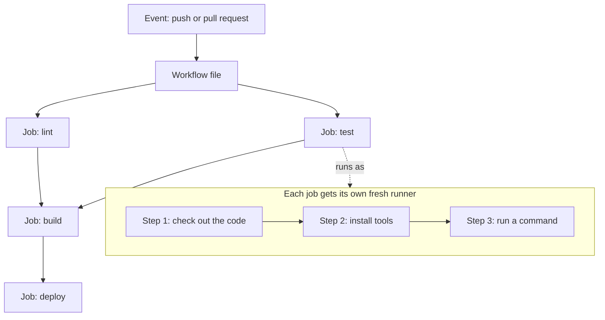
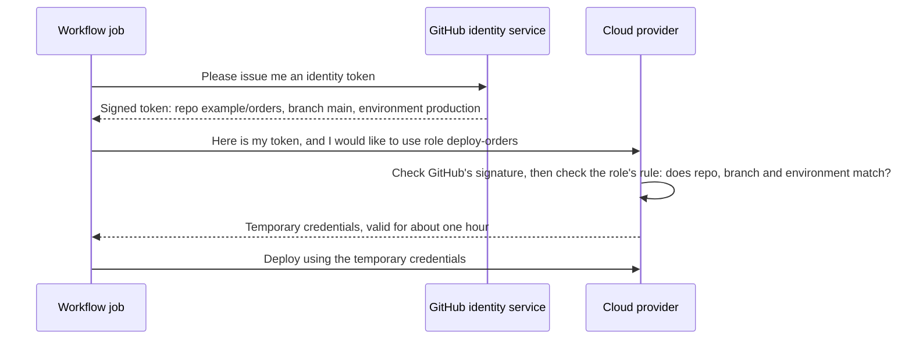
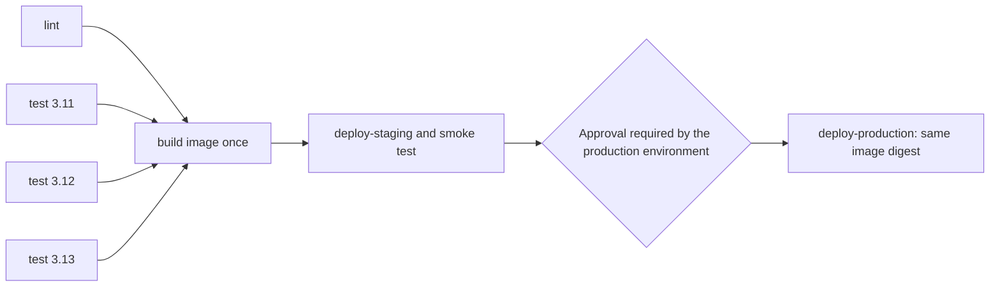

# A complete GitHub Actions pipeline, line by line

> **Before this lesson:** you should know what a deployment pipeline and its stages are — see [Stages, gates and the flow of a change](#/lesson/cicd/pipeline-stages) — and why an artifact is built once and promoted, from [Build once, promote artifacts, pipeline as code](#/lesson/cicd/build-once). You do not need to have used GitHub Actions before.

## In plain words

Think of a restaurant kitchen. An order comes in (a **trigger**). The head chef does not cook everything personally; the order goes to stations — salad, grill, dessert — which work at the same time (**jobs**). Each station follows its recipe one instruction after another (**steps**). The plate may not leave until every station has finished and someone has checked it (**gates**).

**GitHub Actions** is the kitchen that comes built into GitHub, the website where a great deal of code is stored. You describe the kitchen in a text file kept with your code. Whenever something happens — code is pushed, a pull request is opened — GitHub reads the file, borrows some temporary computers, and runs the recipe on them.

Why this matters for a job: writing and debugging these files is everyday work for most developers, not only for specialists. "Walk me through your CI pipeline" and "how does your pipeline log in to the cloud without a stored password?" are common interview questions, and you can answer both by the end of this lesson.

We will build the file up in five small steps and then read the finished pipeline top to bottom.

## The vocabulary

| term | meaning |
|---|---|
| **Repository** | the folder of code and its history stored on GitHub |
| **Workflow** | one automated process, described by one file in `.github/workflows/` |
| **Event** | something that happens in the repository and can start a workflow |
| **Job** | a group of steps that run together on one machine |
| **Runner** | the temporary computer that runs a job; it starts clean and is thrown away afterwards |
| **Step** | a single instruction: either a shell command or an action |
| **Action** | a reusable, packaged step published by GitHub or someone else |
| **YAML** | the text format the file is written in; indentation with spaces shows what belongs to what |



## Step 1: the smallest workflow

Create a file at `.github/workflows/ci.yml`:

```yaml
name: ci

on: push

jobs:
  hello:
    runs-on: ubuntu-latest
    steps:
      - run: echo "Hello from the pipeline"
```

Every line:

- `name: ci` — the label shown in GitHub's web pages. It can be anything.
- `on: push` — the trigger. `push` means "whenever someone uploads commits to any branch".
- `jobs:` — begins the list of jobs. Everything indented under it belongs to it.
- `hello:` — an identifier you choose for the job.
- `runs-on: ubuntu-latest` — which kind of runner to use: a fresh virtual machine running Ubuntu Linux, provided by GitHub.
- `steps:` — begins the list of steps. Each step starts with a dash.
- `- run: echo "Hello from the pipeline"` — a step that runs a shell command. `echo` prints text.

Push this file and the workflow appears under the repository's **Actions** tab with a log containing `Hello from the pipeline`. A green tick means every step finished with **exit code** 0. An exit code is the number a program hands back when it ends: 0 means success and anything else means failure. That number is how the pipeline knows whether a step passed.

## Step 2: do real work — check out, install, test

The runner starts empty. It does not even contain your code, so the first step is nearly always to fetch it.

```yaml
name: ci

on:
  pull_request:
  push:
    branches: [main]

jobs:
  test:
    runs-on: ubuntu-latest
    steps:
      - uses: actions/checkout@v4

      - uses: actions/setup-python@v5
        with:
          python-version: "3.12"

      - name: Install dependencies
        run: |
          python -m pip install --upgrade pip
          pip install -r requirements.txt

      - name: Run unit tests
        run: pytest -q
```

What is new:

- `on:` now lists two events. `pull_request:` runs the workflow for every proposed change. `push:` with `branches: [main]` runs it when commits land on `main`. Without that filter, pushing to a branch that also has a pull request would run everything twice.
- `uses: actions/checkout@v4` — `uses` runs an **action** instead of a command. `actions/checkout` copies your repository on to the runner. The part after `@` selects a version of the action.
- `uses: actions/setup-python@v5` installs Python. The `with:` block passes it settings, here the version. The quotes matter: unquoted, `3.10` would be read as the number 3.1.
- `name:` gives a step a readable title in the log.
- `run: |` — the vertical bar means "the following indented lines are one multi-line script".
- `pytest -q` runs the tests. If any test fails, `pytest` ends with a non-zero exit code, the step fails, later steps are skipped and the job goes red.

## Step 3: several jobs, a matrix, and a cache

Three ideas speed the pipeline up.

**Separate jobs run in parallel.** Linting (checking code style) and testing do not depend on each other, so each can have its own runner.

**A matrix** runs the same job several times with different settings — for instance on three versions of Python — without copying the job three times.

**A cache** saves downloaded dependencies between runs, so they are not fetched from the internet every time.

```yaml
jobs:
  lint:
    runs-on: ubuntu-latest
    steps:
      - uses: actions/checkout@v4
      - uses: actions/setup-python@v5
        with:
          python-version: "3.12"
          cache: pip
      - run: pip install ruff
      - run: ruff check .
      - run: ruff format --check .

  test:
    runs-on: ${{ matrix.os }}
    strategy:
      fail-fast: false
      matrix:
        os: [ubuntu-latest, windows-latest]
        python: ["3.11", "3.12", "3.13"]
    steps:
      - uses: actions/checkout@v4
      - uses: actions/setup-python@v5
        with:
          python-version: ${{ matrix.python }}
          cache: pip
      - run: pip install -r requirements.txt
      - run: pytest -q --junitxml=report.xml
      - if: always()
        uses: actions/upload-artifact@v4
        with:
          name: test-report-${{ matrix.os }}-${{ matrix.python }}
          path: report.xml
```

- `strategy.matrix` lists two values for `os` and three for `python`. GitHub runs every combination: 2 × 3 = 6 copies of the job, at the same time.
- `${{ ... }}` is an **expression**: GitHub replaces it with a value before the job runs. `${{ matrix.python }}` becomes `3.11` in one copy, `3.12` in the next, and so on.
- `fail-fast: false` — by default, when one copy fails GitHub cancels the others. Turning that off lets you see *all* the failing combinations in one run.
- `cache: pip` tells the set-up action to save and restore pip's download folder.
- `--junitxml=report.xml` makes pytest write its results to a file.
- `actions/upload-artifact` stores a file from the runner so it can be downloaded after the runner is destroyed. In GitHub Actions, an **artifact** is any file a workflow saves.
- `if: always()` runs that step even when an earlier step failed. A report from a failed run is the one you most want to read.

### How a cache key works

A cache needs a name, called its **key**. A good key changes exactly when the cached content *should* change. For dependencies, the content is determined by the lockfile (the file listing exact versions) and by the operating system. So the key is built from both:

```yaml
      - uses: actions/cache@v4
        with:
          path: ~/.cache/pip
          key: pip-${{ runner.os }}-${{ hashFiles('requirements.txt') }}
          restore-keys: |
            pip-${{ runner.os }}-
```

- `path` is the folder to save.
- `key` combines a fixed prefix, the operating system and `hashFiles(...)`. A **hash** is a short fingerprint of a file's contents: change one character in the file and the fingerprint changes completely.
- `restore-keys` lists fallback prefixes. If no cache matches the full key, the newest cache whose key begins with `pip-Linux-` is restored instead — out of date, but most downloads are still saved.

```python-run
import hashlib

def cache_key(prefix, os_name, lockfile_text):
    fingerprint = hashlib.sha256(lockfile_text.encode()).hexdigest()[:16]
    return f"{prefix}-{os_name}-{fingerprint}"

def restore(saved_keys, key, restore_prefixes):
    """Exact match first; otherwise the most recently saved key starting with a fallback prefix."""
    if key in saved_keys:
        return key, "exact hit"
    for prefix in restore_prefixes:
        matches = [k for k in saved_keys if k.startswith(prefix)]
        if matches:
            return matches[-1], "partial hit (stale cache, still saves most downloads)"
    return None, "miss (download everything)"

lock_v1 = "requests==2.32.3\npytest==8.3.3\n"
lock_v2 = "requests==2.32.3\npytest==8.3.4\n"          # one version bumped

saved = [cache_key("pip", "Linux", lock_v1)]            # caches saved so far, oldest first
for label, os_name, lock in (("same lockfile", "Linux", lock_v1),
                             ("lockfile changed", "Linux", lock_v2),
                             ("other OS", "Windows", lock_v1)):
    key = cache_key("pip", os_name, lock)
    found, outcome = restore(saved, key, [f"pip-{os_name}-"])
    print(f"{label:<17} key={key}\n{'':<17} -> {outcome}")
```

The function `cache_key` joins the three parts. `hashlib.sha256(...).hexdigest()[:16]` computes the fingerprint and keeps its first 16 characters. In the output, an unchanged lockfile gives an identical key and an exact hit. Changing one version produces a different key, so the fallback finds the older Linux cache. Windows has nothing saved at all, because a cache built on Linux is no use there. A problem in this module asks you to compute keys like these.

## Step 4: build once and pass the artifact on

Once the checks pass, build the thing you will deploy — here a container image, a packaged application that runs the same anywhere — and push it to a **registry**, which is a storage service for images.

```yaml
  build:
    needs: [lint, test]
    runs-on: ubuntu-latest
    permissions:
      contents: read
      packages: write
    outputs:
      image: ${{ steps.ref.outputs.image }}
    steps:
      - uses: actions/checkout@v4
      - uses: docker/setup-buildx-action@v3
      - uses: docker/login-action@v3
        with:
          registry: ghcr.io
          username: ${{ github.actor }}
          password: ${{ secrets.GITHUB_TOKEN }}
      - id: push
        uses: docker/build-push-action@v6
        with:
          context: .
          push: true
          tags: ghcr.io/${{ github.repository }}:${{ github.sha }}
          cache-from: type=gha
          cache-to: type=gha,mode=max
      - id: ref
        run: echo "image=ghcr.io/${{ github.repository }}@${{ steps.push.outputs.digest }}" >> "$GITHUB_OUTPUT"
```

- `needs: [lint, test]` — this job waits for both to succeed. If either fails, `build` is skipped. `needs` is how jobs are arranged into stages.
- `permissions:` controls what the workflow's automatic token may do. `packages: write` allows pushing an image; everything not listed is denied. Granting the minimum is called **least privilege**.
- `secrets.GITHUB_TOKEN` is a temporary password GitHub creates for each run. A **secret** is a value GitHub stores encrypted and hides in logs.
- `github.actor`, `github.repository` and `github.sha` are facts about the run: who started it, the repository's name, and the commit's unique identifier.
- `id: push` names a step so that later steps can read its results.
- `cache-from` and `cache-to` with `type=gha` reuse image layers from earlier builds.
- `steps.push.outputs.digest` is the image's **digest**: a fingerprint of its exact contents.
- The last step writes `image=...` to the special file `$GITHUB_OUTPUT`; that is how a step publishes a value. `outputs:` at the top of the job then offers it to other jobs.

Later jobs will deploy exactly this digest. Nothing is rebuilt.

## Step 5: environments, approvals and logging in to a cloud without a password

### Environments and approvals

In GitHub, an **environment** is a named deployment target such as `staging` or `production`. In the repository's settings you can attach **protection rules** to one: named people who must approve, a waiting period, and a restriction on which branches may deploy. A job that names a protected environment pauses until the rules are met.

### OIDC: proving who you are instead of storing a key

To deploy, the pipeline has to log in to a cloud provider. The old way was to create a permanent access key and paste it into GitHub's secrets. If that key ever leaked, it would work for anyone, anywhere, until somebody noticed.

**OIDC** (OpenID Connect) replaces the stored key with a short-lived proof of identity. Think of a conference badge printed at the door, valid for today, stating exactly who you are — compared with a master key that opens the building for ever.



The cloud role's rule is the important part. It says, in effect, "only tokens from repository `example/orders`, running for the `production` environment, may use me." A copy of the workflow in someone else's repository would be refused.

```yaml
  deploy-staging:
    needs: build
    runs-on: ubuntu-latest
    environment:
      name: staging
      url: https://staging.shop.example.com
    permissions:
      id-token: write
      contents: read
    steps:
      - uses: actions/checkout@v4
      - uses: aws-actions/configure-aws-credentials@v4
        with:
          role-to-assume: arn:aws:iam::123456789012:role/deploy-orders-staging
          aws-region: eu-central-1
      - run: ./scripts/deploy.sh staging "${{ needs.build.outputs.image }}"
      - run: ./scripts/smoke.sh https://staging.shop.example.com
```

- `environment.name` ties the job to the `staging` environment and its rules; `url` puts a link in GitHub's pages.
- `id-token: write` permits the job to request an identity token. Without this line, the login step fails.
- `aws-actions/configure-aws-credentials` performs the exchange shown in the diagram. `role-to-assume` names the cloud role. No password appears anywhere in the file or in the repository's secrets.
- `needs.build.outputs.image` reads the digest published by the build job.
- The final step is a **smoke test**: a quick check that the deployed service responds.

## The complete pipeline

Here is everything together, with a few finishing touches explained afterwards.

```yaml
name: pipeline

on:
  pull_request:
  push:
    branches: [main]

concurrency:
  group: pipeline-${{ github.ref }}
  cancel-in-progress: ${{ github.event_name == 'pull_request' }}

permissions:
  contents: read

jobs:
  lint:
    runs-on: ubuntu-latest
    timeout-minutes: 5
    steps:
      - uses: actions/checkout@v4
      - uses: actions/setup-python@v5
        with: { python-version: "3.12", cache: pip }
      - run: pip install ruff
      - run: ruff check . && ruff format --check .

  test:
    runs-on: ubuntu-latest
    timeout-minutes: 10
    strategy:
      fail-fast: false
      matrix:
        python: ["3.11", "3.12", "3.13"]
    steps:
      - uses: actions/checkout@v4
      - uses: actions/setup-python@v5
        with: { python-version: "${{ matrix.python }}", cache: pip }
      - run: pip install -r requirements.txt
      - run: pytest -q --junitxml=report.xml
      - if: always()
        uses: actions/upload-artifact@v4
        with:
          name: test-report-${{ matrix.python }}
          path: report.xml

  build:
    needs: [lint, test]
    if: github.event_name == 'push'
    uses: ./.github/workflows/build-image.yml
    permissions:
      contents: read
      packages: write

  deploy-staging:
    needs: build
    uses: ./.github/workflows/deploy.yml
    with:
      environment: staging
      image: ${{ needs.build.outputs.image }}
    permissions:
      id-token: write
      contents: read

  deploy-production:
    needs: [build, deploy-staging]
    uses: ./.github/workflows/deploy.yml
    with:
      environment: production
      image: ${{ needs.build.outputs.image }}
    permissions:
      id-token: write
      contents: read
```

The finishing touches:

- **`concurrency`** puts runs with the same `group` in a queue. `github.ref` is the branch or pull request, so each has its own group. `cancel-in-progress` is true only for pull requests: when you push a newer commit, the older run is stopped, since its result no longer matters. Runs on `main` are never cancelled, because every commit there needs a verdict.
- **`permissions: contents: read`** at the top sets a restrictive default for every job; individual jobs add what they need.
- **`timeout-minutes`** stops a stuck job, and acts as a budget that fails loudly if the stage slows down.
- **`if: github.event_name == 'push'`** on `build` means images are built only for commits on `main`, not for every pull request.
- `with: { python-version: "3.12", cache: pip }` is the same as the indented form, written on one line.

### Reusable workflows

The two deploy jobs differ only in which environment they target. Rather than copying the steps, they *call* another workflow file — a **reusable workflow** — and pass it inputs, much as a program calls a function.

```yaml
# .github/workflows/deploy.yml
name: deploy

on:
  workflow_call:
    inputs:
      environment:
        required: true
        type: string
      image:
        required: true
        type: string

jobs:
  deploy:
    runs-on: ubuntu-latest
    environment: ${{ inputs.environment }}
    concurrency: deploy-${{ inputs.environment }}
    steps:
      - uses: actions/checkout@v4
      - uses: aws-actions/configure-aws-credentials@v4
        with:
          role-to-assume: ${{ vars.DEPLOY_ROLE_ARN }}
          aws-region: eu-central-1
      - run: ./scripts/deploy.sh "${{ inputs.environment }}" "${{ inputs.image }}"
      - run: ./scripts/smoke.sh "${{ vars.BASE_URL }}"
```

- `on: workflow_call` marks the file as callable by other workflows, and `inputs` declares its parameters.
- `environment: ${{ inputs.environment }}` applies the chosen environment's protection rules. When the caller passes `production`, the job waits for approval.
- `vars.DEPLOY_ROLE_ARN` and `vars.BASE_URL` are **variables**: non-secret settings stored per environment, so the same file picks up different values for staging and production.
- `concurrency: deploy-${{ inputs.environment }}` ensures two deployments to the same environment never run at the same moment.

A platform team can keep reusable workflows like this one in a shared repository and let dozens of projects call them, so that an improvement or security fix reaches every pipeline at once.

### The shape of the result



## Pitfalls

- **Indentation errors.** YAML uses spaces to show structure, and one misplaced space changes the meaning. Use an editor that understands YAML, and a checker such as `actionlint`.
- **Missing `id-token: write`**, so the cloud login fails with an unhelpful message.
- **Building in each deploy job** instead of passing the digest along.
- **Printing secrets.** GitHub masks known secret values in logs, but not altered forms of them. Never `echo` a secret.
- **Putting untrusted text directly into a `run` script**, such as a pull-request title (see [Security scanning and supply-chain checks](#/lesson/cicd/security-scanning)).
- **Expecting secrets in pull requests from forks.** GitHub withholds them deliberately, because the code is not trusted.
- **Third-party actions pinned to a movable tag.** For actions from outside your organisation, use the full commit identifier.
- **A cache key that never changes**, which serves stale dependencies for ever.
- **Hundreds of lines of shell inside the YAML.** Put the logic in scripts in the repository, so it can be run and tested on a developer's machine.

> [!WARNING]
> Anyone who can change a workflow file can make it do anything its permissions allow, including deploying. Protect `.github/workflows/` with required review, keep the default token read-only, and restrict production deployments to the `main` branch through environment rules.

> [!TIP]
> To debug a failing workflow without pushing dozens of commits, add `workflow_dispatch:` under `on:`. It adds a "Run workflow" button, and you can start the workflow by hand from any branch.

> [!INTERVIEW]
> "Walk me through a CI/CD pipeline you would build on GitHub Actions." Triggers on pull requests and pushes to main, with `concurrency` cancelling superseded pull-request runs. Lint and a test matrix in parallel, dependencies cached by lockfile hash, reports uploaded even on failure. One build job that pushes an image and publishes its digest as an output. Deployment through a reusable workflow, called once per environment with that same digest, authenticating to the cloud through OIDC, with a smoke test after each deployment and required reviewers on production. Finish with least-privilege `permissions` and pinned actions.

## Summary

- A workflow is a YAML file in `.github/workflows/`. Events trigger it, jobs run on fresh runners, and steps run commands or actions.
- A step passes when its command exits with code 0; a failing step stops its job.
- Jobs run in parallel unless `needs` orders them. A matrix runs one job across many configurations.
- Cache dependencies under a key built from the lockfile's hash and the operating system.
- Build the image once, publish its digest as a job output, and deploy that digest everywhere.
- Environments add approvals and per-environment settings. OIDC gives the job short-lived cloud credentials with no stored key.
- Reusable workflows remove duplication; `concurrency`, `permissions` and `timeout-minutes` make the pipeline safe and predictable.

## Glossary

- **Workflow** — an automated process defined by one YAML file.
- **Event / trigger** — something that happens in the repository and starts a workflow.
- **Job** — a set of steps that run on one runner.
- **Runner** — the temporary machine that executes a job.
- **Step** — one command or action inside a job.
- **Action** — a reusable packaged step, referenced with `uses`.
- **YAML** — a text format in which indentation shows structure.
- **Exit code** — the number a program returns when it ends; 0 means success.
- **Expression** — text inside `${{ }}` that GitHub replaces with a value.
- **Matrix** — a way to run one job in several configurations.
- **Cache** — files saved between runs to avoid repeating slow work.
- **Cache key** — the name under which a cache is saved and found.
- **Hash** — a short fingerprint computed from content.
- **Artifact** — a file saved by a workflow so it can be used later.
- **Registry** — a storage service for container images.
- **Digest** — the fingerprint that identifies an image's exact contents.
- **Secret** — an encrypted value hidden from logs.
- **Environment** — a named deployment target with its own rules and settings.
- **OIDC (OpenID Connect)** — a standard that lets the job prove its identity and receive short-lived credentials.
- **Least privilege** — granting only the permissions that are needed.
- **Reusable workflow** — a workflow that other workflows call with inputs.
- **Smoke test** — a quick check that a deployed service is working.

## Check yourself

```quiz
[
  {"q": "Where must a workflow file be stored for GitHub Actions to find it?",
   "options": ["In the repository root, named pipeline.txt", "In the .github/workflows/ folder, as a YAML file", "In GitHub's settings page", "On the developer's laptop"],
   "answer": 1,
   "explain": "GitHub reads every .yml or .yaml file in .github/workflows/ of the repository."},
  {"q": "How does a step signal failure to the pipeline?",
   "options": ["By printing the word ERROR", "By its command ending with a non-zero exit code", "By taking too long", "By writing to a file"],
   "answer": 1,
   "explain": "Exit code 0 means success. Any other value fails the step and, by default, stops the job."},
  {"q": "A matrix has os: [ubuntu-latest, windows-latest] and python: ['3.11', '3.12', '3.13']. How many copies of the job run?",
   "options": ["2", "3", "5", "6"],
   "answer": 3,
   "explain": "Every combination runs: 2 times 3 equals 6."},
  {"q": "What does `needs: [lint, test]` on the build job mean?",
   "options": ["Build runs first", "Build waits for both lint and test to succeed, and is skipped if either fails", "Lint and test are optional", "Build runs three times"],
   "answer": 1,
   "explain": "needs defines the order of jobs and makes a job depend on the success of others."},
  {"q": "Why is the cache key built from a hash of the lockfile?",
   "options": ["To make the key hard to guess", "So the key changes exactly when the dependency versions change, and a stale cache is never used as an exact match", "Because GitHub requires hashes", "To make the cache larger"],
   "answer": 1,
   "explain": "The lockfile determines what is installed, so its fingerprint is the right identity for the cached downloads."},
  {"q": "What is the main advantage of OIDC over storing a cloud access key as a secret?",
   "options": ["It is faster to type", "The job receives short-lived credentials tied to a specific repository and environment, so there is no permanent key to leak", "It needs no permissions", "It works without the internet"],
   "answer": 1,
   "explain": "The cloud checks GitHub's signed identity token against the role's rule and issues temporary credentials."},
  {"q": "Which permission must a job have to request an OIDC identity token?",
   "options": ["contents: write", "packages: write", "id-token: write", "actions: read"],
   "answer": 2,
   "explain": "Without id-token: write the job cannot obtain the token and the cloud login step fails."},
  {"q": "In the full pipeline, why is cancel-in-progress true only for pull requests?",
   "options": ["Pull requests are less important", "An older run on a pull request is obsolete once a newer commit arrives, but every commit on main needs its own result", "Main cannot be cancelled by GitHub", "To save artifacts"],
   "answer": 1,
   "explain": "If main breaks you need to know which commit broke it, so none of its runs are cancelled."},
  {"q": "What does a reusable workflow give you?",
   "options": ["Faster runners", "One definition of a process, such as deployment, that many jobs or repositories call with different inputs", "Automatic approvals", "Free storage"],
   "answer": 1,
   "explain": "It removes duplication. Here staging and production call the same deploy workflow with a different environment."}
]
```

> **Source:** Humble & Farley, *Continuous Delivery*, ch. 5 and ch. 7 (pipeline stages and the commit stage, applied here with current tooling). Workflow syntax: https://docs.github.com/en/actions/writing-workflows/workflow-syntax-for-github-actions — Caching: https://docs.github.com/en/actions/writing-workflows/choosing-what-your-workflow-does/caching-dependencies-to-speed-up-workflows — OIDC: https://docs.github.com/en/actions/security-for-github-actions/security-hardening-your-deployments/about-security-hardening-with-openid-connect — Reusable workflows: https://docs.github.com/en/actions/sharing-automations/reusing-workflows — Environments: https://docs.github.com/en/actions/managing-workflow-runs-and-deployments/managing-deployments/managing-environments-for-deployment
