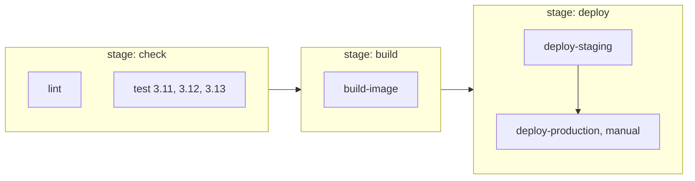
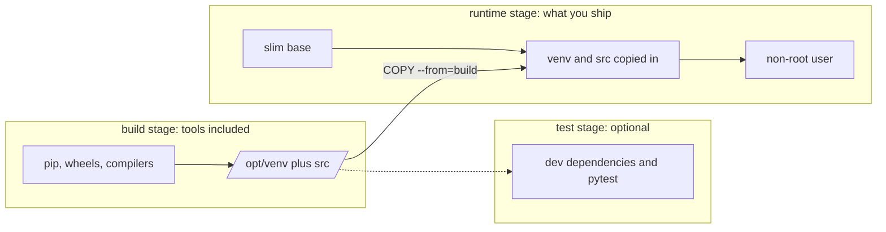

# GitLab CI and Docker multi-stage builds

> **Before this lesson:** read [A complete GitHub Actions pipeline, line by line](#/lesson/cicd/github-actions-workflow), which introduces jobs, runners, caches and artifacts. This lesson shows the same ideas in a second tool and then explains how the container image itself is built. You should also know why an artifact is built once, from [Build once, promote artifacts, pipeline as code](#/lesson/cicd/build-once).

## In plain words

This lesson has two halves.

**First half: GitLab CI.** If you have learned to drive one make of car, you can drive another; the pedals are in the same place even if the dashboard looks different. GitHub Actions and GitLab CI are like that. Both read a text file from your repository and run jobs on temporary machines. Seeing the same pipeline in two tools shows which parts are *ideas* (worth remembering for life) and which are *spelling* (worth looking up).

**Second half: Docker multi-stage builds.** A **container image** is a sealed box holding your program together with everything it needs to run. Think of moving house. While packing you need tape, scissors and a marker pen. You do not put those tools inside the boxes you ship. A **multi-stage build** does the same for software: one stage contains the compilers and build tools; the final image receives only the finished program. The result is smaller, starts faster and gives an attacker less to work with.

Why this matters for a job: many companies use GitLab, and nearly all of them ship containers. "Why is your image 1.2 GB, and how would you shrink it?" and "why does your Docker build re-install every dependency on each commit?" are practical questions that show at once whether someone has done this work.

## Part 1: GitLab CI

### The same ideas, different words

| idea | GitHub Actions | GitLab CI/CD |
|---|---|---|
| Where the definition lives | `.github/workflows/*.yml` (many files) | `.gitlab-ci.yml` (one file, which can include others) |
| One run of the whole thing | workflow run | **pipeline** |
| Ordering | `needs` between jobs | **stages**, run in order; optionally `needs` |
| A unit of work | job, made of steps | **job**, with one `script` list |
| The machine | runner | **runner** |
| Where a job's commands run | on the virtual machine | usually inside a container named by `image` |
| Reusable pieces | actions; reusable workflows | `include`, `extends`, CI/CD components |
| Conditions | `if:` | `rules:` |
| Saving files | upload and download artifact actions | `artifacts:` |
| Deployment targets | environments | **environments** |
| Built-in facts | `${{ github.sha }}` | `$CI_COMMIT_SHA` |

The biggest difference is how order is expressed. GitLab's basic model is the **stage**: a named phase. All jobs in one stage run at the same time; the next stage starts when every job in the previous one has succeeded.



### Step 1: the smallest pipeline

Create a file named `.gitlab-ci.yml` in the top folder of the repository:

```yaml
hello:
  script:
    - echo "Hello from GitLab"
```

- `hello:` is the job's name, chosen by you.
- `script:` is the list of shell commands the job runs, in order. Each begins with a dash.

That is a complete pipeline. Push it and GitLab runs the job. As before, a command that ends with a non-zero **exit code** (the number a program returns; 0 means success) fails the job.

### Step 2: stages, an image and real commands

```yaml
stages:
  - check
  - build

default:
  image: python:3.12-slim

lint:
  stage: check
  script:
    - pip install ruff
    - ruff check .

test:
  stage: check
  script:
    - pip install -r requirements.txt
    - pytest -q

package:
  stage: build
  script:
    - python -m build
```

- `stages:` declares the phases and their order.
- `default:` holds settings applied to every job unless a job overrides them.
- `image: python:3.12-slim` means each job runs *inside a container* started from that image. Python is therefore already installed, and there is no separate set-up step. This is a real difference from GitHub Actions, where jobs run directly on a virtual machine by default.
- `stage: check` assigns a job to a stage. `lint` and `test` share a stage and so run in parallel. `package` runs only if both succeed.

### Step 3: the full pipeline

```yaml
stages: [check, build, deploy]

default:
  image: python:3.12-slim
  interruptible: true

workflow:
  rules:
    - if: $CI_PIPELINE_SOURCE == "merge_request_event"
    - if: $CI_COMMIT_BRANCH == $CI_DEFAULT_BRANCH

variables:
  PIP_CACHE_DIR: "$CI_PROJECT_DIR/.cache/pip"
  IMAGE: "$CI_REGISTRY_IMAGE:$CI_COMMIT_SHA"

lint:
  stage: check
  script:
    - pip install ruff
    - ruff check .
    - ruff format --check .

test:
  stage: check
  parallel:
    matrix:
      - PYTHON: ["3.11", "3.12", "3.13"]
  image: python:$PYTHON-slim
  cache:
    key:
      files: [requirements.txt]
      prefix: pip-$PYTHON
    paths: [.cache/pip]
  script:
    - pip install -r requirements.txt
    - pytest -q --junitxml=report.xml
  artifacts:
    when: always
    reports:
      junit: report.xml

build-image:
  stage: build
  image: docker:27
  services: [docker:27-dind]
  rules:
    - if: $CI_COMMIT_BRANCH == $CI_DEFAULT_BRANCH
  script:
    - echo "$CI_REGISTRY_PASSWORD" | docker login -u "$CI_REGISTRY_USER" --password-stdin "$CI_REGISTRY"
    - docker build --pull -t "$IMAGE" .
    - docker push "$IMAGE"
    - echo "IMAGE_REF=$(docker inspect --format='{{index .RepoDigests 0}}' "$IMAGE")" > build.env
  artifacts:
    reports:
      dotenv: build.env

.deploy:
  stage: deploy
  image: alpine/k8s:1.31.2
  interruptible: false
  rules:
    - if: $CI_COMMIT_BRANCH == $CI_DEFAULT_BRANCH
  script:
    - ./scripts/deploy.sh "$CI_ENVIRONMENT_NAME" "$IMAGE_REF"
    - ./scripts/smoke.sh "$CI_ENVIRONMENT_URL"

deploy-staging:
  extends: .deploy
  environment:
    name: staging
    url: https://staging.shop.example.com
  resource_group: staging

deploy-production:
  extends: .deploy
  needs: [build-image, deploy-staging]
  environment:
    name: production
    url: https://shop.example.com
  resource_group: production
  rules:
    - if: $CI_COMMIT_BRANCH == $CI_DEFAULT_BRANCH
      when: manual
```

Reading it from the top:

- **`interruptible: true`** allows GitLab to cancel a job when a newer commit makes it pointless. (A project setting must also be on.) The deploy jobs switch this off: a deployment must never be stopped halfway.
- **`workflow: rules:`** decides whether a pipeline is created at all. The two lines say: run for merge requests, and run for commits on the default branch. A **merge request** is GitLab's name for what GitHub calls a pull request. Without this block, one push can create two duplicate pipelines.
- **`variables:`** defines values available to every job as environment variables. Names starting with `CI_` are **predefined variables** supplied by GitLab: `$CI_COMMIT_SHA` is the commit's identifier, `$CI_REGISTRY_IMAGE` is the address of the project's own image registry, `$CI_DEFAULT_BRANCH` is usually `main`.
- **`parallel: matrix:`** runs the `test` job once per listed value, like a matrix in GitHub Actions. `image: python:$PYTHON-slim` picks the matching Python image.
- **`cache:`** keeps downloaded packages between pipelines. `key: files: [requirements.txt]` builds the cache key from that file's contents, so the cache is renewed exactly when the dependencies change. `prefix` keeps a separate cache for each Python version.
- **`artifacts: reports: junit:`** hands the test results to GitLab, which shows failed tests directly on the merge request. `when: always` uploads the report even when tests fail.
- **`build-image`** runs only on the default branch. `services: [docker:27-dind]` starts a helper container that provides a Docker engine ("dind" stands for Docker-in-Docker), so that the job can run `docker build`. GitLab supplies `$CI_REGISTRY_USER` and `$CI_REGISTRY_PASSWORD` for its built-in registry. `--password-stdin` passes the password through a pipe so that it never appears in the command line or the log.
- **The `dotenv` report.** The job writes a line of the form `IMAGE_REF=...@sha256:...` to a file and declares it as a `dotenv` report. GitLab then offers `$IMAGE_REF` as a variable to later jobs. This is how the image **digest** — the fingerprint of its exact contents — travels to the deploy jobs. It is the build-once principle again.
- **`.deploy`** begins with a dot. That makes it a **hidden job**: a template that never runs by itself. `extends: .deploy` copies the template into a real job, so the two deploy jobs share one definition and add only what differs.
- **`environment:`** records deployments to a named target and supplies `$CI_ENVIRONMENT_NAME` and `$CI_ENVIRONMENT_URL` to the script.
- **`resource_group:`** allows only one job in the group to run at a time, preventing two deployments to the same environment from overlapping.
- **`when: manual`** makes the production job wait for someone to press a "play" button. Combined with *protected environments* in the project's settings, only approved people can press it.

### Logging in to a cloud without a stored key

GitLab supports the same OIDC idea as GitHub. The job asks GitLab for a signed identity token and exchanges it for short-lived cloud credentials:

```yaml
deploy-staging:
  id_tokens:
    AWS_TOKEN:
      aud: https://gitlab.example.com
  script:
    - >
      export $(printf "AWS_ACCESS_KEY_ID=%s AWS_SECRET_ACCESS_KEY=%s AWS_SESSION_TOKEN=%s"
      $(aws sts assume-role-with-web-identity
      --role-arn "$DEPLOY_ROLE_ARN" --role-session-name "gitlab-$CI_JOB_ID"
      --web-identity-token "$AWS_TOKEN" --duration-seconds 3600
      --query "Credentials.[AccessKeyId,SecretAccessKey,SessionToken]" --output text))
    - ./scripts/deploy.sh staging "$IMAGE_REF"
```

`id_tokens:` requests a token and places it in the variable `AWS_TOKEN`; `aud` (audience) states who the token is intended for. The `aws sts assume-role-with-web-identity` command exchanges it for credentials valid for one hour. No permanent key is stored anywhere.

### Sharing configuration

`include:` pulls in YAML from another file, another project, or a ready-made template, so that a platform team can maintain one standard pipeline that many projects reuse:

```yaml
include:
  - project: platform/ci-templates
    ref: v3.2.0
    file: /python/pipeline.yml
  - template: Jobs/Secret-Detection.gitlab-ci.yml
```

`ref: v3.2.0` pins the shared file to a released version, so a change to the template reaches a project only when the project chooses to upgrade.

## Part 2: Docker multi-stage builds

### What an image is made of

A **Dockerfile** is a text recipe for building an image. Each instruction adds a **layer**: a saved set of file changes placed on top of the previous one. Docker remembers layers. When you rebuild, it reuses every layer whose instruction *and inputs* are unchanged, and re-runs everything from the first change downward. That memory is the **build cache**.

### Step 1: the naive Dockerfile

```dockerfile
FROM python:3.12
WORKDIR /app
COPY . .
RUN pip install -r requirements.txt
CMD ["python", "-m", "orders"]
```

- `FROM python:3.12` starts from an existing image containing an operating system and Python. This is the **base image**.
- `WORKDIR /app` sets the folder in which later instructions run.
- `COPY . .` copies everything from your project folder into the image.
- `RUN pip install -r requirements.txt` runs a command while building, here installing dependencies.
- `CMD [...]` records the command to run when a container starts from the image.

It works, and it has three problems:

1. **It is slow to rebuild.** `COPY . .` comes before the install. Editing any source file changes that layer's input, so Docker re-runs the install on *every* build.
2. **It is big.** The full `python:3.12` image is roughly a gigabyte, most of it tools that are useful for building and never used when running.
3. **It is less safe.** It includes compilers and a shell, runs as the all-powerful `root` user, and copies in whatever happens to be in the folder — possibly including a `.env` file full of passwords.

### Step 2: order the layers for the cache

Copy the file that *lists* the dependencies first, install, and only then copy the source code:

```dockerfile
FROM python:3.12-slim
WORKDIR /app
COPY requirements.txt .
RUN pip install --no-cache-dir -r requirements.txt
COPY src/ ./src/
CMD ["python", "-m", "orders"]
```

Now the expensive install layer depends only on `requirements.txt`. Editing a source file invalidates only the last `COPY`, and the build takes seconds. The rule: **put what changes least at the top, and what changes most at the bottom.**

The simulation below counts the time each ordering costs when only a source file changes.

```python-run
def build(layers, changed_inputs, cached):
    """A layer is rebuilt if its own input changed OR any layer above it was rebuilt."""
    total, invalidated, report = 0, False, []
    for name, depends_on, seconds in layers:
        if invalidated or depends_on in changed_inputs or not cached:
            invalidated = True
            total += seconds
            report.append(f"   RUN    {name:<34} {seconds:>3}s")
        else:
            report.append(f"   cached {name}")
    return total, report

naive = [("FROM python", "base", 20), ("COPY . .", "source", 1),
         ("RUN pip install", "requirements", 90), ("CMD", "none", 0)]
ordered = [("FROM python", "base", 20), ("COPY requirements.txt", "requirements", 1),
           ("RUN pip install", "requirements", 90), ("COPY src/", "source", 1), ("CMD", "none", 0)]

for title, layers in (("naive ordering", naive), ("dependencies first", ordered)):
    seconds, report = build(layers, changed_inputs={"source"}, cached=True)
    print(f"{title}: rebuild after editing one source file takes {seconds}s")
    print("\n".join(report))
```

The function walks down the layers. Once one layer must be rebuilt, the flag `invalidated` forces every layer beneath it to be rebuilt as well — exactly how Docker behaves. The naive order re-runs the 90-second install; the better order reuses it and rebuilds one second of work.

### Step 3: separate building from running

A multi-stage Dockerfile contains more than one `FROM`. Each begins a new **stage** with a clean file system. A later stage can copy chosen files out of an earlier one, and only the *last* stage becomes the image you ship.

```dockerfile
# syntax=docker/dockerfile:1

# ---------- stage 1: build ----------
FROM python:3.12-slim AS build
WORKDIR /app
RUN python -m venv /opt/venv
ENV PATH="/opt/venv/bin:$PATH"
COPY requirements.txt .
RUN --mount=type=cache,target=/root/.cache/pip \
    pip install -r requirements.txt
COPY src/ ./src/

# ---------- stage 2: test (built on demand) ----------
FROM build AS test
COPY requirements-dev.txt tests/ ./
RUN pip install -r requirements-dev.txt && pytest -q

# ---------- stage 3: runtime ----------
FROM python:3.12-slim AS runtime
ARG GIT_SHA=unknown
LABEL org.opencontainers.image.revision="${GIT_SHA}"
ENV PATH="/opt/venv/bin:$PATH" \
    PYTHONUNBUFFERED=1 \
    APP_COMMIT="${GIT_SHA}"
RUN useradd --system --uid 10001 --no-create-home app
WORKDIR /app
COPY --from=build /opt/venv /opt/venv
COPY --from=build /app/src ./src
USER 10001
EXPOSE 8080
HEALTHCHECK --interval=30s --timeout=3s CMD python -c "import urllib.request,sys; sys.exit(0 if urllib.request.urlopen('http://localhost:8080/healthz').status==200 else 1)"
ENTRYPOINT ["python", "-m", "orders"]
```

Line by line:

- `# syntax=docker/dockerfile:1` selects the current Dockerfile language so that newer features, such as cache mounts, are available.
- `FROM python:3.12-slim AS build` starts a stage and names it `build`. The `slim` variant leaves out most extras.
- `python -m venv /opt/venv` creates a **virtual environment**: a self-contained folder holding the installed packages. Keeping everything in one folder makes it easy to copy into the final image.
- `ENV PATH=...` puts that folder first on the search path, so `pip` and `python` use it.
- `RUN --mount=type=cache,...` gives the command a folder that persists *between builds* and is not stored in any layer. pip reuses downloads kept there, so even a changed `requirements.txt` re-downloads only what is new.
- `FROM build AS test` begins a stage that continues from `build`, adds test tools and runs the tests. It is built only on request: `docker build --target test .`. The final image never contains test tools.
- `FROM python:3.12-slim AS runtime` starts again from a clean base. Nothing from earlier stages is present unless copied in.
- `ARG GIT_SHA=unknown` declares a value supplied at build time (`--build-arg GIT_SHA=...`). `LABEL` stores it as searchable information on the image, and `ENV APP_COMMIT` lets the running program report which commit it was built from.
- `PYTHONUNBUFFERED=1` makes Python write log lines immediately instead of holding them back.
- `RUN useradd ...` creates an ordinary user, and `USER 10001` makes the container run as that user rather than `root`. If the program is ever compromised, the attacker has few privileges.
- `COPY --from=build ...` copies the finished environment and the source out of the build stage. This is the heart of the technique.
- `EXPOSE 8080` documents the port on which the program listens.
- `HEALTHCHECK` tells Docker how to test whether the program is working.
- `ENTRYPOINT [...]` sets the program to start. Writing it as a list (the "exec form") runs the program directly, so it receives stop signals and can shut down cleanly.



### How much smaller?

```python-run
images = {                              # megabytes, approximate and for illustration
    "single stage on python:3.12":        {"base": 1010, "build tools": 0,   "dependencies": 180, "app": 4},
    "single stage on python:3.12-slim":   {"base": 125,  "build tools": 210, "dependencies": 180, "app": 4},
    "multi-stage, slim runtime":          {"base": 125,  "build tools": 0,   "dependencies": 180, "app": 4},
    "multi-stage, distroless runtime":    {"base": 52,   "build tools": 0,   "dependencies": 180, "app": 4},
}
biggest = max(sum(parts.values()) for parts in images.values())
for name, parts in images.items():
    size = sum(parts.values())
    print(f"{name:<36} {size:>5} MB  {'#' * round(size / biggest * 40)}")
```

`sum(parts.values())` adds up the parts of each image, and the bar length is proportional to its size. The exact numbers depend on the project; the pattern holds everywhere. A **distroless** image goes one step further: it contains the language runtime and almost nothing else — no shell and no package manager.

Why size matters: smaller images are pulled faster, so deployments and scale-ups are quicker; and fewer installed packages mean fewer known vulnerabilities for scanners to report and for you to patch.

### Keep unwanted files out of the build

Before building, Docker sends the project folder (the **build context**) to the build engine. A `.dockerignore` file lists what to leave out, in the same style as `.gitignore`:

```gitignore
.git
.venv
__pycache__/
*.pyc
.env
.env.*
tests/
docs/
node_modules/
```

This speeds up builds and, more importantly, prevents secrets and junk from being copied into an image by a broad `COPY`.

### Building in the pipeline

```bash
docker buildx build \
  --target runtime \
  --build-arg GIT_SHA="$CI_COMMIT_SHA" \
  --cache-from type=registry,ref="$CI_REGISTRY_IMAGE:buildcache" \
  --cache-to   type=registry,ref="$CI_REGISTRY_IMAGE:buildcache",mode=max \
  --tag "$CI_REGISTRY_IMAGE:$CI_COMMIT_SHA" \
  --push .
```

- `--target runtime` chooses which stage becomes the result.
- `--build-arg` supplies the commit identifier for the label.
- `--cache-from` and `--cache-to` store the build cache in the registry. Pipeline runners start empty, so without this every build would start from nothing. `mode=max` also saves the layers of intermediate stages.
- `--push` uploads the finished image.

## Pitfalls

**GitLab CI**

- **Duplicate pipelines** for one push, from a missing `workflow: rules:` block.
- **A cache used as if it were an artifact.** A cache is a best-effort speed-up and may be absent. Files that a later job *must* have belong in `artifacts`.
- **Rebuilding the image in the deploy job** instead of passing the digest.
- **Deploy jobs left `interruptible`**, so that a newer commit can cancel a deployment halfway.
- **Unprotected variables** holding production credentials, readable by jobs on any branch. Mark them *protected* and *masked*.

**Docker**

- **`COPY . .` before installing dependencies**, which defeats the cache.
- **Secrets passed with `ARG` or `ENV`**, which remain readable in the image's history. Use `RUN --mount=type=secret`.
- **`latest` as the base image tag**, so that the build changes without warning. Pin a version, ideally by digest.
- **Running as `root`.**
- **One huge layer** that installs everything and so is never reused.
- **No `.dockerignore`.**
- **The shell form of `ENTRYPOINT`** (`ENTRYPOINT python -m orders`), which wraps the program in a shell that does not pass stop signals along. Rolling deployments then wait for the timeout and kill the container.

> [!WARNING]
> Never put a password or token into a Dockerfile with `ARG`, `ENV` or `COPY`. Deleting the file in a later instruction does not help, because earlier layers stay inside the image and anyone who can pull it can read them. A secret mount exists only while one `RUN` instruction executes and is never saved.

> [!TIP]
> Run `docker history <image>` to see each layer and its size, and `docker build --progress=plain` to see which steps were cached. Between them, these two commands explain most questions of the form "why is my image so big?" and "why is my build so slow?".

> [!INTERVIEW]
> "How would you make this Docker build faster and the image smaller?" For speed: copy the dependency manifest and install before copying source code, so the install layer is cached; use cache mounts for package managers; export the build cache to the registry so that fresh runners can reuse it; add a `.dockerignore`. For size and safety: a multi-stage build that keeps compilers in the build stage and copies only the result into a slim or distroless runtime; run as a non-root user; pin the base image by digest; pass secrets through secret mounts. Mention the exec form of `ENTRYPOINT`, so that the process receives stop signals.

## Summary

- GitLab CI and GitHub Actions share the same concepts: a pipeline definition in the repository, jobs on runners, caches, artifacts, environments and short-lived cloud credentials.
- GitLab orders work with stages; jobs within a stage run in parallel. `rules` decides when a job or pipeline runs, `extends` and `include` remove duplication, and a `dotenv` report passes values such as an image digest between jobs.
- A Dockerfile builds an image out of cached layers; a layer is rebuilt when its inputs change, and so is everything beneath it. Put rarely changing steps first.
- A multi-stage build keeps build tools in an early stage and copies only the result into a small final image that runs as a non-root user.
- Use `.dockerignore`, cache mounts, registry caches and pinned base images; never bake secrets into layers.

## Glossary

- **Pipeline (GitLab)** — one complete run of the jobs defined in `.gitlab-ci.yml`.
- **Stage** — a named phase of a pipeline; its jobs run in parallel and stages run in order.
- **Merge request** — GitLab's term for a proposed change (a pull request on GitHub).
- **Predefined variable** — a value GitLab supplies automatically, such as `$CI_COMMIT_SHA`.
- **Hidden job** — a job whose name starts with a dot; a template used through `extends`.
- **dotenv report** — a file of `NAME=value` lines that GitLab turns into variables for later jobs.
- **Resource group** — a lock that lets only one job of a group run at a time.
- **Container image** — a packaged program together with everything it needs to run.
- **Dockerfile** — the text recipe from which an image is built.
- **Base image** — the existing image named in `FROM`, on which a build starts.
- **Layer** — the saved set of file changes produced by one instruction.
- **Build cache** — stored layers reused when an instruction and its inputs are unchanged.
- **Build context** — the files sent to Docker for a build.
- **Multi-stage build** — a Dockerfile with several stages, where the final image copies only what it needs from earlier ones.
- **Virtual environment** — a self-contained folder of installed Python packages.
- **Distroless image** — a minimal image with a language runtime and no shell or package manager.
- **Digest** — the fingerprint that identifies an image's exact contents.

## Check yourself

```quiz
[
  {"q": "In GitLab CI, two jobs are assigned to the same stage. How do they run?",
   "options": ["One after the other, alphabetically", "In parallel; the next stage starts when both succeed", "Only the first runs", "They are merged into one job"],
   "answer": 1,
   "explain": "Jobs in a stage run at the same time. Stages themselves run in the declared order."},
  {"q": "What is the purpose of a job whose name begins with a dot, such as .deploy?",
   "options": ["It runs first", "It is a hidden template that never runs alone and is reused through extends", "It is a comment", "It deploys to a hidden environment"],
   "answer": 1,
   "explain": "Hidden jobs hold shared configuration. Real jobs copy it with extends and add what differs."},
  {"q": "How does the image digest reach the deploy jobs in the example pipeline?",
   "options": ["Each deploy job rebuilds the image", "The build job writes it to a file declared as a dotenv report, which GitLab exposes as a variable", "It is typed by hand", "Through the pip cache"],
   "answer": 1,
   "explain": "The dotenv report turns NAME=value lines into variables for later jobs, so the same image is deployed everywhere."},
  {"q": "In GitLab CI, which should hold a file that a later job cannot work without?",
   "options": ["cache", "artifacts", "variables", "services"],
   "answer": 1,
   "explain": "A cache is a best-effort optimisation and may be missing. Artifacts are passed reliably to later jobs."},
  {"q": "A Dockerfile has COPY . . followed by RUN pip install -r requirements.txt. You edit one source file. What happens on rebuild?",
   "options": ["Nothing is rebuilt", "The COPY layer and the install layer below it are both rebuilt", "Only the base image is rebuilt", "Only CMD is rebuilt"],
   "answer": 1,
   "explain": "Changing any copied file invalidates that layer, and every later layer is rebuilt, including the slow install."},
  {"q": "What ends up in the final image of a multi-stage build?",
   "options": ["Everything from every stage", "Only the last stage, including whatever it copied from earlier stages", "Only the first stage", "Only the test stage"],
   "answer": 1,
   "explain": "Earlier stages are discarded. Compilers and build tools stay behind unless copied explicitly."},
  {"q": "Why should a container run as a non-root user?",
   "options": ["It starts faster", "If the program is compromised, the attacker has limited privileges", "Root cannot open network ports", "Images become smaller"],
   "answer": 1,
   "explain": "Reducing privileges limits the damage of a successful attack."},
  {"q": "Why is passing a token with ARG in a Dockerfile unsafe?",
   "options": ["ARG is slow", "The value is stored in the image's layers and history, where anyone with the image can read it", "ARG values are public on the internet", "It makes the build fail"],
   "answer": 1,
   "explain": "Build arguments are recorded in image metadata. Use a secret mount, which is never written to a layer."},
  {"q": "Why export the build cache to a registry in a CI pipeline?",
   "options": ["Registries are faster than disks", "Pipeline runners start empty, so a local cache would be lost between runs", "It is required by Docker", "To make images public"],
   "answer": 1,
   "explain": "A remote cache lets a fresh runner reuse layers built by earlier pipeline runs."}
]
```

> **Source:** Humble & Farley, *Continuous Delivery*, ch. 5–7 (pipeline structure, build scripting and the commit stage, applied here with current tooling). GitLab CI/CD YAML reference: https://docs.gitlab.com/ci/yaml/ — GitLab predefined variables: https://docs.gitlab.com/ci/variables/predefined_variables/ — GitLab ID tokens: https://docs.gitlab.com/ci/secrets/id_token_authentication/ — Docker multi-stage builds: https://docs.docker.com/build/building/multi-stage/ — Docker build cache: https://docs.docker.com/build/cache/ — Dockerfile reference: https://docs.docker.com/reference/dockerfile/
