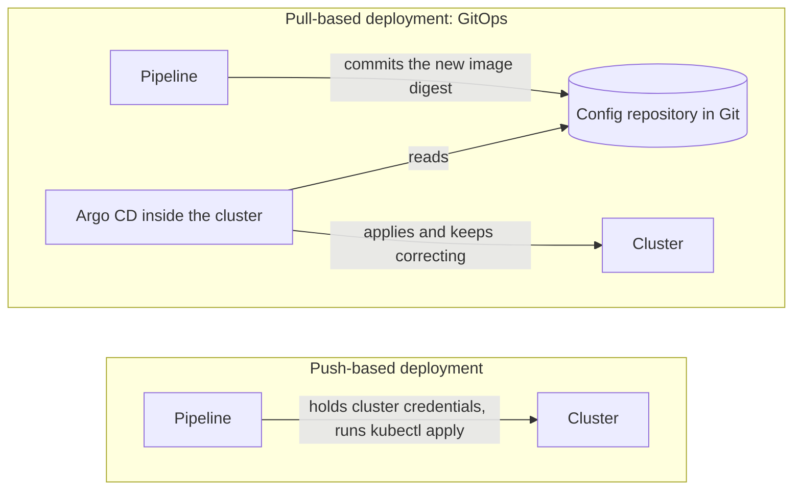
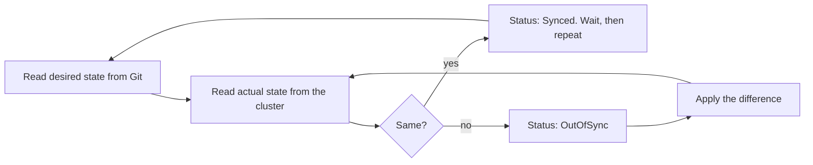
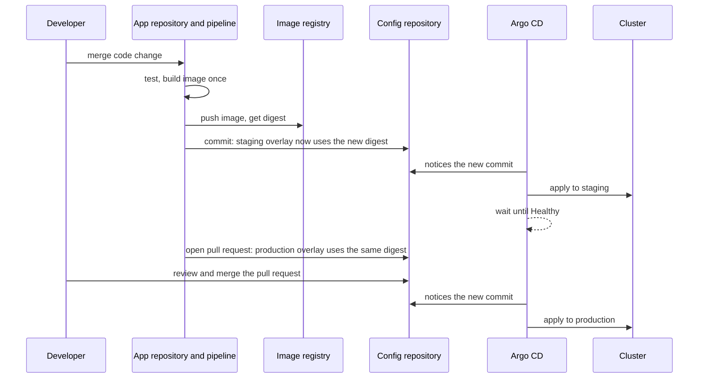

# GitOps with Argo CD

> **Before this lesson:** you should know what a declarative, desired-state deployment is — see [Deployment scripting: idempotent, layered, verified](#/lesson/cicd/deploy-scripts) — and what configuration drift is, from [Infrastructure as code and immutable infrastructure](#/lesson/cicd/infrastructure-as-code). Familiarity with images and digests from [Build once, promote artifacts, pipeline as code](#/lesson/cicd/build-once) helps.

## In plain words

A thermostat is a small machine with one job. You tell it the temperature you *want*. It keeps checking the temperature the room *has*, and it switches the heating on or off to close the gap. You never operate the boiler by hand, and if someone opens a window the thermostat notices and corrects.

**GitOps** runs software deployments the same way. The "temperature you want" is a set of files in a Git repository describing exactly what should be running: which version of each application, how many copies, with which settings. A program inside the cluster — a **controller** — keeps comparing those files with what is really running, and corrects any difference. To deploy a new version, you do not run a deploy command. You change a file in Git, and the controller does the rest.

**Argo CD** is the most widely used such controller for **Kubernetes**, the system many companies use to run containers on a group of machines (a **cluster**).

Why this matters for a job: GitOps has become a standard way to deploy to Kubernetes. "How do you roll back in a GitOps setup?" and "what is the difference between push-based and pull-based deployment?" are routine interview questions for platform, DevOps and backend roles.

## A minimum of Kubernetes

GitOps is easier to follow with five Kubernetes terms. None needs more than a sentence.

| term | meaning |
|---|---|
| **Cluster** | a group of machines managed together as one place to run containers |
| **Pod** | one running copy of your application (one or more containers) |
| **Deployment** | a rule such as "keep 4 pods of this image running"; Kubernetes replaces pods that die |
| **Manifest** | a YAML file describing an object, such as a Deployment, that you want to exist |
| **Namespace** | a named section of a cluster, used to keep applications or environments apart |

Kubernetes itself already works by desired state. You hand it a manifest, and its own controllers work to make reality match. GitOps adds one layer above: *where the manifests come from, and who is allowed to apply them.*

## Push versus pull

There are two ways for a change to reach a cluster.

**Push.** The pipeline holds credentials for the cluster and runs a command against it (`kubectl apply`, `helm upgrade`). This is what the pipelines in the previous two lessons did.

**Pull.** A controller *inside* the cluster watches a Git repository and applies whatever it finds there. The pipeline never touches the cluster. Its last step is a commit.



The pull model has consequences worth spelling out:

- **The pipeline needs no cluster credentials.** A compromised pipeline cannot deploy directly. It can only propose a change in Git, where review rules apply.
- **Git is the single source of truth.** What should be running is whatever the repository says. There is no second place to look.
- **Drift is detected and corrected.** If someone edits the cluster by hand, the controller sees the difference.
- **History and rollback come from Git.** Every change is a commit with an author and a message; undoing a release means reverting a commit.
- **Recovering a lost cluster** means pointing a new one at the same repository.

## The four principles

GitOps is usually summarised in four statements:

1. **Declarative.** The system's desired state is described, not scripted.
2. **Versioned and immutable.** The description is stored in a way that keeps full history — in practice, Git.
3. **Pulled automatically.** Software agents fetch the desired state themselves.
4. **Continuously reconciled.** The agents keep comparing actual with desired and act on differences.

**Reconciliation** is the important word: the repeated act of comparing the two states and fixing the difference. It is the thermostat loop.



## Step 1: reconciliation in a few lines

Before any real tool, here is the loop in miniature. The "cluster" is a dictionary (a table mapping names to values), and "Git" is another.

```python-run
def reconcile(desired, actual, self_heal=True, prune=True):
    """Compare desired (Git) with actual (cluster); return what was done."""
    actions = []
    for name, spec in desired.items():
        if name not in actual:
            actions.append(f"create {name}")
            actual[name] = dict(spec)
        elif actual[name] != spec:
            if self_heal:
                actions.append(f"update {name}: {actual[name]} -> {spec}")
                actual[name] = dict(spec)
            else:
                actions.append(f"OutOfSync {name} (not corrected: self-heal is off)")
    for name in list(actual):
        if name not in desired and prune:
            actions.append(f"delete {name} (no longer in Git)")
            del actual[name]
    return actions or ["Synced: nothing to do"]

git = {"orders": {"image": "sha256:41ab", "replicas": 4}}
cluster = {}

print("1. first sync          :", reconcile(git, cluster))
print("2. nothing changed     :", reconcile(git, cluster))

git["orders"]["image"] = "sha256:9c1e"                 # a commit bumps the image
print("3. after a Git commit  :", reconcile(git, cluster))

cluster["orders"]["replicas"] = 1                      # someone edits the cluster by hand
print("4. after a manual edit :", reconcile(git, cluster))

cluster["debug-pod"] = {"image": "busybox"}            # something created outside Git
print("5. stray object        :", reconcile(git, cluster))
```

Follow the function from the top:

- The first `for` loop visits every object Git says should exist. If the cluster lacks it, it is created. If it exists but differs, it is updated — provided `self_heal` is on.
- The second loop visits what the cluster has. Anything Git does not mention is deleted, provided `prune` is on.
- If no action was needed, the function reports `Synced`.

The five printed lines tell a complete story: the first run creates the application; the second finds nothing to do; a commit that changes the image triggers an update; a manual change to the replica count is undone; and an object nobody declared is removed. Runs 4 and 5 are what "Git is the source of truth" means in practice. Changes made anywhere else do not survive.

## Step 2: two repositories

A common arrangement separates *application code* from *deployment configuration*:

- The **application repository** holds source code, tests and the Dockerfile. Its pipeline builds and tests an image.
- The **config repository** (also called the environment or GitOps repository) holds the manifests describing what runs in each environment.

Why separate them? A code commit and "deploy this to production" are different decisions with different reviewers. If one repository held both, the pipeline's own commit bumping a version would trigger the pipeline again. And one config repository can describe a whole environment made of many applications.

```text
shop-config/
├── apps/
│   └── orders/
│       ├── base/
│       │   ├── deployment.yaml
│       │   ├── service.yaml
│       │   └── kustomization.yaml
│       └── overlays/
│           ├── staging/
│           │   └── kustomization.yaml
│           └── production/
│               └── kustomization.yaml
└── argocd/
    ├── orders-staging.yaml
    └── orders-production.yaml
```

Environments are **directories, not branches**. A file in `overlays/staging/` and one in `overlays/production/` can be compared directly, and promoting a version means changing one line in one file. (Branches per environment lead to merges that create new commits, and to drift between the branches.)

**Kustomize** is a tool, built into `kubectl`, that takes a `base` set of manifests and applies small per-environment changes called **overlays**.

```yaml
# apps/orders/overlays/production/kustomization.yaml
apiVersion: kustomize.config.k8s.io/v1beta1
kind: Kustomization
namespace: shop-production
resources:
  - ../../base
replicas:
  - name: orders
    count: 6
images:
  - name: orders
    newName: ghcr.io/example/orders
    digest: sha256:41ab7d0c2e9f5a61b3d4c8e7f0a1b2c3d4e5f60718293a4b5c6d7e8f9a0b1c2d
```

- `resources: - ../../base` starts from the shared manifests.
- `namespace` places everything in the production namespace.
- `replicas` overrides the number of copies for this environment.
- `images` states exactly which image to run, by **digest** — the fingerprint of the image's contents. This single line *is* the answer to "what version is in production?"

## Step 3: telling Argo CD what to watch

Argo CD is configured with objects of its own, the central one being an **Application**: a pairing of "this folder in this repository" with "that namespace in that cluster".

```yaml
# argocd/orders-production.yaml
apiVersion: argoproj.io/v1alpha1
kind: Application
metadata:
  name: orders-production
  namespace: argocd
spec:
  project: shop
  source:
    repoURL: https://github.com/example/shop-config.git
    targetRevision: main
    path: apps/orders/overlays/production
  destination:
    server: https://kubernetes.default.svc
    namespace: shop-production
  syncPolicy:
    automated:
      prune: true
      selfHeal: true
    syncOptions:
      - CreateNamespace=true
```

- `metadata.name` is the Application's name; `namespace: argocd` is where Argo CD itself is installed.
- `project` groups applications and limits which repositories and clusters they may use.
- `source` says where the desired state lives: the repository address, the branch to follow (`targetRevision`) and the folder (`path`).
- `destination` says where to apply it. `https://kubernetes.default.svc` means "the cluster Argo CD is running in".
- `syncPolicy.automated` makes Argo CD apply changes without being asked. Leave this block out and Argo CD only *reports* differences until a person presses **Sync**.
- `prune: true` deletes objects that have been removed from Git.
- `selfHeal: true` reverts manual changes made in the cluster.
- `CreateNamespace=true` creates the namespace if it does not exist.

Argo CD reports two separate things for every Application, and newcomers often mix them up:

| status | question it answers | values |
|---|---|---|
| **Sync status** | Does the cluster match Git? | `Synced`, `OutOfSync` |
| **Health status** | Is what is running actually working? | `Healthy`, `Progressing`, `Degraded`, `Missing` |

An application can be `Synced` and `Degraded` at once: the cluster matches Git exactly, and the new version is crashing. Synced means "applied", not "working".

```bash
argocd app list                                   # every Application with both statuses
argocd app get orders-production                  # details, including each object's state
argocd app diff orders-production                 # what differs between Git and the cluster
argocd app sync orders-production                 # apply now (for Applications without automated sync)
argocd app history orders-production              # which Git commit was deployed, and when
```

## Step 4: the whole flow, from commit to production



The pipeline's deployment step is now a small Git change:

```yaml
  bump-staging:
    needs: build
    runs-on: ubuntu-latest
    steps:
      - uses: actions/checkout@v4
        with:
          repository: example/shop-config
          token: ${{ secrets.CONFIG_REPO_TOKEN }}
      - name: Point staging at the new image
        working-directory: apps/orders/overlays/staging
        run: kustomize edit set image "orders=ghcr.io/example/orders@${{ needs.build.outputs.digest }}"
      - name: Commit and push
        run: |
          git config user.name "release-bot"
          git config user.email "release-bot@example.com"
          git commit -am "orders: deploy ${GITHUB_SHA::7} to staging"
          git push
```

- The checkout step fetches the *config* repository, using a token that may write to that repository and nothing else.
- `kustomize edit set image` rewrites the `images` entry in the overlay with the new digest.
- The last step commits and pushes. Argo CD picks up the commit and deploys.

Promotion to production is a pull request changing the production overlay to the same digest. Review and merge of that pull request *is* the production approval, recorded permanently in Git.

## Step 5: rolling back

In a GitOps setup, the dependable way to roll back is to change Git.

```bash
git log --oneline -- apps/orders/overlays/production
# 7c2d9aa orders: deploy 9f3c2e1 to production      <- the bad release
# 3b1e440 orders: deploy 41ab7d0 to production

git revert --no-edit 7c2d9aa
git push
```

- `git log --oneline -- <path>` lists the commits that changed that folder, newest first.
- `git revert` creates a *new* commit that undoes the chosen one; `--no-edit` accepts the default message.
- After the push, Argo CD sees that Git now names the previous digest and applies it.

Why not run `kubectl rollout undo`, which reverts a Deployment directly in the cluster? Because Git would still say "run the new version". With self-heal on, Argo CD would re-apply the bad release within minutes. Even with it off, Git and the cluster would disagree, which is the very thing GitOps exists to prevent.

Argo CD does have its own `argocd app rollback` command, which re-applies an earlier recorded state. It works only when automated sync is disabled for the Application, and it leaves Git out of date until someone corrects it. Treat it as an emergency tool; the Git revert is the normal path.

## Beyond the basics

**Many applications at once.** Writing one Application file per service per environment becomes repetitive. Two patterns generate them: *app of apps*, where one Application points at a folder full of Application files, and the **ApplicationSet**, a template that produces an Application for every item in a list — every folder, every cluster, or every open pull request (which gives preview environments).

**Ordering.** **Sync waves** apply objects in numbered groups (namespaces before the applications that need them), and **hooks** run a job at a set moment, for example a database migration before the new version starts:

```yaml
metadata:
  annotations:
    argocd.argoproj.io/hook: PreSync
    argocd.argoproj.io/sync-wave: "-1"
```

An **annotation** is a labelled note attached to an object, which tools such as Argo CD read for instructions.

**Secrets.** Git must not contain readable passwords, yet GitOps wants everything in Git. The two usual answers are to store a *reference* that an in-cluster operator resolves from a secret manager (External Secrets Operator), or to store the secret *encrypted* so that only the cluster can decrypt it (Sealed Secrets, SOPS).

**Progressive delivery.** Argo CD decides *what* should run. A companion project, **Argo Rollouts**, controls *how* a new version takes over — canary steps, analysis and automatic abort, as in [Blue-green, canary and rolling deployments](#/lesson/cicd/release-strategies).

**Other tools.** Flux is the main alternative controller and follows the same principles. The ideas in this lesson transfer directly.

## Pitfalls

- **Manual `kubectl` changes** to a GitOps-managed application. They are reverted, or they leave the application permanently `OutOfSync`.
- **Reading `Synced` as "working".** Always check health too, and make the pipeline wait for `Healthy` before promoting.
- **Deploying by tag** such as `latest`. Nothing changes in Git when the tag moves, so Argo CD sees no difference and nothing happens — or different machines end up running different content. Use digests.
- **Branches per environment.**
- **Automatic pruning switched on without care.** An accidental deletion or rename in Git deletes the running objects.
- **Readable secrets committed to the config repository.**
- **The pipeline writing straight to the production folder** without review, which removes the approval that GitOps was supposed to provide.
- **Two controllers fighting.** If an autoscaler changes the replica count and Git also sets it, each keeps undoing the other. Leave such fields out of Git, or tell Argo CD to ignore them.

> [!WARNING]
> With `prune: true`, deleting a file from the config repository deletes the corresponding objects from the cluster. A careless folder rename can remove a running service. Protect the config repository's main branch with required review, and consider leaving pruning off for objects that hold data.

> [!TIP]
> Run `argocd app diff` (or render the manifests with `kustomize build` and compare) in the pull-request pipeline of the config repository and post the result as a comment. Reviewers then see exactly what will change in the cluster, not merely which YAML lines moved.

> [!INTERVIEW]
> "Explain GitOps and how you would roll back a bad release." GitOps keeps the desired state of the system declaratively in Git; a controller in the cluster pulls it and continuously reconciles the cluster towards it. The pipeline builds and tests an image once, then commits the new digest to a config repository; it never holds cluster credentials. Benefits: an audited history, review as the approval mechanism, drift detection, and recovery by re-pointing a cluster at Git. To roll back, revert the commit that changed the digest and let the controller apply it; an imperative undo in the cluster would be overwritten or would leave Git and the cluster disagreeing. Mention that Synced is not the same as Healthy.

## Summary

- GitOps describes the desired state of a system in Git and lets a controller inside the cluster pull it and keep reality matching it.
- In the pull model the pipeline ends with a commit and holds no cluster credentials; Git supplies history, review, approval and rollback.
- Reconciliation is a loop: read desired, read actual, apply the difference. Self-heal reverts manual edits; prune removes what Git no longer declares.
- Keep deployment configuration in its own repository, with one directory per environment, and pin images by digest.
- An Argo CD Application links a repository path to a cluster namespace. Sync status says whether the cluster matches Git; health status says whether it works.
- Promote by changing the digest in the next environment's folder through a pull request; roll back by reverting that commit.

## Glossary

- **GitOps** — managing deployments by keeping the desired state in Git and letting software apply it.
- **Kubernetes** — a system for running containers across a group of machines.
- **Cluster** — the group of machines Kubernetes manages.
- **Pod** — one running copy of an application.
- **Deployment (Kubernetes object)** — a rule keeping a given number of pods of an image running.
- **Manifest** — a YAML file describing an object that should exist in the cluster.
- **Namespace** — a named section of a cluster.
- **Controller** — a program that keeps comparing desired and actual state and acts on differences.
- **Reconciliation** — one pass of that comparing and correcting.
- **Desired state / actual state** — what Git says should run; what is really running.
- **Drift** — a difference between desired and actual state.
- **Argo CD** — a GitOps controller for Kubernetes.
- **Application (Argo CD)** — the link between a repository path and a destination in a cluster.
- **Sync status** — whether the cluster matches Git.
- **Health status** — whether the running objects are working.
- **Self-heal** — automatically reverting changes made outside Git.
- **Prune** — deleting cluster objects that are no longer declared in Git.
- **Kustomize** — a tool that applies per-environment overlays to a base set of manifests.
- **Overlay** — the small set of changes that distinguishes one environment from the base.
- **Sync wave / hook** — ways to control the order of a sync and to run jobs at set points in it.
- **Annotation** — a labelled note on an object that tools read.

## Check yourself

```quiz
[
  {"q": "In GitOps, how is a new version deployed?",
   "options": ["An engineer runs kubectl apply from a laptop", "A commit changes the desired state in Git and a controller in the cluster applies it", "The pipeline connects to each server over SSH", "The cluster polls the image registry for the tag latest"],
   "answer": 1,
   "explain": "Git holds the desired state. The controller pulls it and reconciles the cluster towards it."},
  {"q": "What is a security advantage of the pull model?",
   "options": ["Images are encrypted", "The pipeline does not need credentials for the cluster", "Git cannot be hacked", "Pods run faster"],
   "answer": 1,
   "explain": "Only the in-cluster controller applies changes. A compromised pipeline can at most propose a change in Git, where review applies."},
  {"q": "An Argo CD Application shows Synced and Degraded. What does that mean?",
   "options": ["Git and the cluster differ", "The cluster matches Git, but what is running is not working properly", "Argo CD is offline", "The image is being built"],
   "answer": 1,
   "explain": "Sync status compares the cluster with Git. Health status reports whether the running objects work. They are independent."},
  {"q": "With selfHeal enabled, someone scales a Deployment by hand from 4 pods to 1. What happens?",
   "options": ["Nothing", "Argo CD restores 4 pods, because Git says 4", "Git is updated to say 1", "The Application is deleted"],
   "answer": 1,
   "explain": "Self-heal reverts drift. Lasting changes have to be made in Git."},
  {"q": "What does prune: true do?",
   "options": ["Deletes old Git commits", "Deletes cluster objects that are no longer declared in Git", "Removes unused images from the registry", "Shrinks log files"],
   "answer": 1,
   "explain": "It keeps the cluster free of leftovers, and it means an accidental deletion in Git removes running objects."},
  {"q": "Why should environments be directories rather than branches in a config repository?",
   "options": ["Git allows only one branch", "Directories can be compared directly and promotion is a one-line change, while branches drift apart and need merges", "Branches are slower", "Argo CD cannot read branches"],
   "answer": 1,
   "explain": "Per-environment branches accumulate differences and merge commits. Folders keep every environment visible in one place."},
  {"q": "What is the correct way to roll back a release managed by Argo CD with automated sync?",
   "options": ["kubectl rollout undo", "Revert the Git commit that changed the image digest", "Delete the pods", "Restart Argo CD"],
   "answer": 1,
   "explain": "Git is the source of truth. A change made only in the cluster would be overwritten or leave the two disagreeing."},
  {"q": "Why does deploying the tag latest work badly with GitOps?",
   "options": ["Tags are not supported by Kubernetes", "When the tag moves nothing changes in Git, so the controller sees no difference to apply", "latest is always old", "It is too long to type"],
   "answer": 1,
   "explain": "GitOps reacts to changes in Git. A digest changes the file; a moving tag does not."}
]
```

> **Source:** Humble & Farley, *Continuous Delivery*, ch. 2 and ch. 11 (version control for everything, managing environments from versioned definitions), applied with current tooling. OpenGitOps principles: https://opengitops.dev — Argo CD documentation: https://argo-cd.readthedocs.io/en/stable/ — Automated sync, prune and self-heal: https://argo-cd.readthedocs.io/en/stable/user-guide/auto_sync/ — Sync waves and hooks: https://argo-cd.readthedocs.io/en/stable/user-guide/sync-waves/ — Kustomize: https://kubectl.docs.kubernetes.io/references/kustomize/
