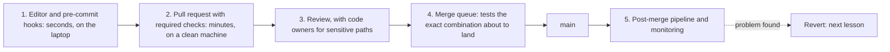
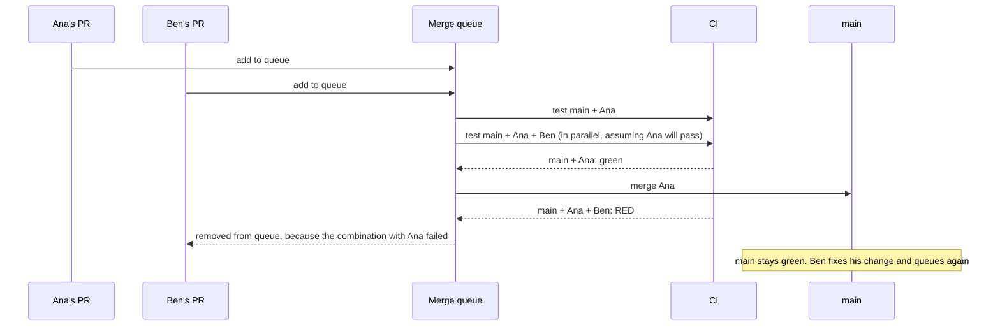

# Guardrails: branch protection, required checks and merge queues

> **Before this lesson:** you should know what continuous integration is and why a broken main line is costly — see [Continuous integration: the practice, not the server](#/lesson/cicd/ci-practices) and [Broken builds, team discipline and distributed teams](#/lesson/cicd/build-discipline). Knowing what a pull request is, from [Trunk-based development, feature branches and release branches](#/lesson/cicd/branching-models), is assumed.

## In plain words

A mountain road has guardrails. They do not drive the car, and a careful driver rarely touches them. They exist because, sooner or later, somebody is tired or distracted, and the rail turns a fatal mistake into a scrape.

A team's shared branch — usually called `main` — is that road. Everyone builds on it, and releases are cut from it. When `main` is broken (the code does not build, or its tests fail), every person who starts work from it inherits the breakage. People say `main` is **green** when its automated checks pass and **red** when they fail.

This lesson is about the guardrails that keep `main` green: rules, enforced by the hosting platform, that a change must satisfy *before* it is allowed in. The next lesson covers what to do when something gets through anyway.

Why this matters for a job: "someone pushed broken code to main — how do you stop that happening?" is among the most common CI/CD interview questions. The answer is a layered set of guardrails, and you need to be able to explain each layer and the gap it leaves for the next.

## The layers

No single check catches everything, so checks are stacked. Each one is cheaper and earlier than the next.



We will build these up one at a time.

## Layer 1: pre-commit hooks

A **Git hook** is a script that Git runs automatically at a certain moment. A **pre-commit hook** runs when you type `git commit`, before the commit is created. If the script fails, the commit is refused.

Hooks are for checks that take a second or two: formatting, obvious mistakes, accidentally added passwords, oversized files. The **pre-commit** framework (a tool named after the hook) manages them from one configuration file kept in the repository:

```yaml
# .pre-commit-config.yaml
repos:
  - repo: https://github.com/pre-commit/pre-commit-hooks
    rev: v5.0.0
    hooks:
      - id: check-yaml
      - id: check-merge-conflict
      - id: check-added-large-files
        args: [--maxkb=500]
      - id: end-of-file-fixer
  - repo: https://github.com/astral-sh/ruff-pre-commit
    rev: v0.6.9
    hooks:
      - id: ruff
        args: [--fix]
      - id: ruff-format
  - repo: https://github.com/gitleaks/gitleaks
    rev: v8.21.0
    hooks:
      - id: gitleaks
```

- Each `repo:` names a published collection of hooks, and `rev:` pins it to a version so that every developer runs the same thing.
- `check-yaml` rejects YAML files with syntax errors. `check-merge-conflict` rejects files that still contain conflict markers such as `<<<<<<<`.
- `check-added-large-files` stops a 200 MB file being committed by accident.
- `ruff` is a **linter**: a tool that reads code and reports likely mistakes. With `--fix` it repairs what it safely can. `ruff-format` rewrites the code into a standard layout.
- `gitleaks` scans for things that look like passwords or access keys.

```bash
pip install pre-commit
pre-commit install            # sets up the Git hook in this clone
pre-commit run --all-files    # run every hook on every file once
```

One limitation shapes everything that follows: **hooks run on the developer's machine and can be skipped** (`git commit --no-verify`), and a new team member may never have installed them. Hooks are a courtesy that gives fast feedback. They are not enforcement. So the same checks must also run on the server:

```yaml
  pre-commit:
    runs-on: ubuntu-latest
    steps:
      - uses: actions/checkout@v4
      - uses: actions/setup-python@v5
        with: { python-version: "3.12" }
      - uses: pre-commit/action@v3.0.1
```

## Layer 2: branch protection and required checks

**Branch protection** is a set of rules, configured on the hosting platform, that restrict what can happen to a branch. (GitHub's newer, more flexible form is called a **ruleset**; GitLab calls the idea **protected branches**. The concepts are the same.) The essential rules for `main`:

| rule | what it prevents |
|---|---|
| Require a pull request before merging | pushing commits straight to `main` |
| Require approvals (one or more) | merging a change nobody else has read |
| Dismiss stale approvals when new commits are pushed | approving version A, then merging a different version B |
| Require status checks to pass | merging a change whose tests are red |
| Require branches to be up to date before merging | merging a change tested against an old `main` |
| Require conversation resolution | merging with unanswered review comments |
| Block force pushes and deletions | rewriting or destroying shared history |
| Do not allow bypassing these settings | administrators quietly skipping the rules |

A **status check** is a pass-or-fail result that an automated job attaches to a commit. A **required check** is one that the branch rules insist must pass before merging is permitted.

### The decision as code

The platform's decision is logic you can write down. Doing so makes the edge cases visible.

```python-run
def can_merge(pr, rules):
    """Return (allowed, reasons). A missing or pending required check blocks, as a failure does."""
    reasons = []
    approvals = {r for r in pr["approved_by"] if r != pr["author"]}     # authors cannot approve themselves
    if len(approvals) < rules["min_approvals"]:
        reasons.append(f"needs {rules['min_approvals']} approval(s), has {len(approvals)}")
    for check in rules["required_checks"]:
        state = pr["checks"].get(check, "missing")
        if state not in ("success", "skipped"):
            reasons.append(f"required check '{check}' is {state}")
    if rules["require_up_to_date"] and pr["base_sha"] != rules["main_head"]:
        reasons.append("branch is behind main")
    if pr["unresolved_threads"]:
        reasons.append(f"{pr['unresolved_threads']} unresolved conversation(s)")
    return (not reasons), reasons

rules = {"min_approvals": 1, "required_checks": ["lint", "unit-tests", "build"],
         "require_up_to_date": True, "main_head": "c0ffee"}

examples = {
    "ready": dict(author="ana", approved_by=["ben"], base_sha="c0ffee", unresolved_threads=0,
                  checks={"lint": "success", "unit-tests": "success", "build": "success"}),
    "self-approved": dict(author="ana", approved_by=["ana"], base_sha="c0ffee", unresolved_threads=0,
                  checks={"lint": "success", "unit-tests": "success", "build": "success"}),
    "check never ran": dict(author="ana", approved_by=["ben"], base_sha="c0ffee", unresolved_threads=0,
                  checks={"lint": "success", "build": "success"}),
    "stale branch, red test": dict(author="ana", approved_by=["ben"], base_sha="0ldba5e", unresolved_threads=1,
                  checks={"lint": "success", "unit-tests": "failure", "build": "success", "docs-preview": "failure"}),
}
for name, pr in examples.items():
    allowed, reasons = can_merge(pr, rules)
    print(f"{name:<24} {'MERGE' if allowed else 'BLOCKED'}" + ("" if allowed else ": " + "; ".join(reasons)))
```

Walking through the function:

- `approvals` is built as a **set** — a collection with no duplicates — leaving out the author. An author's own approval does not count.
- The `for` loop looks up each required check. `pr["checks"].get(check, "missing")` returns the recorded state, or the word `missing` when there is no record at all.
- Only `success` or `skipped` is acceptable. `failure`, `pending` and `missing` all block.
- The up-to-date rule compares the commit the branch was built on (`base_sha`) with the current tip of `main`.

Two details in the output are worth dwelling on:

- **"check never ran" is blocked.** A required check with no result is not a pass. This matters because a workflow that does not start — skipped by a path filter, say — leaves its check missing for ever, and the pull request can never be merged. The repair is given below.
- **In the last example, the failing `docs-preview` check does not appear among the reasons.** It is not in the required list. Only required checks gate the merge; the others are advisory.

A problem in this module asks you to implement this gate.

### The "required check that never reports" trap

Suppose the `orders` tests run only when files under `services/orders/` change, and `orders-tests` is a required check. A pull request that edits only the README never starts that workflow, so the check never reports, and the pull request waits for ever.

A common solution is one small **gate job** that always runs, depends on all the others, and is the *only* required check:

```yaml
  ci-ok:
    if: always()
    needs: [lint, unit-tests, build, orders-tests]
    runs-on: ubuntu-latest
    steps:
      - name: Fail unless every needed job succeeded or was skipped
        run: |
          results='${{ join(needs.*.result, " ") }}'
          echo "results: $results"
          for r in $results; do
            if [ "$r" != "success" ] && [ "$r" != "skipped" ]; then exit 1; fi
          done
```

- `if: always()` makes the job run even when a job it depends on failed or was skipped.
- `needs.*.result` collects the outcome of every job listed in `needs`; `join(..., " ")` turns them into one line of text.
- The loop exits with code 1 (failure) if any result is something other than `success` or `skipped`.

Mark only `ci-ok` as required. New jobs can then be added or removed without touching the branch rules.

## Layer 3: review and code owners

A **code review** is another person reading a change before it merges. It catches what machines cannot: a misunderstood requirement, a risky design, a missing test.

Some parts of a repository need a *particular* reviewer: payment logic, infrastructure, the pipeline definitions themselves. A `CODEOWNERS` file maps paths to the people or teams responsible:

```text
# .github/CODEOWNERS  -- when several patterns match a file, the LAST one wins
*                         @example/developers
/docs/                    @example/tech-writers
/services/payments/       @example/payments-team
/infra/                   @example/platform-team
/.github/                 @example/platform-team
*.sql                     @example/data-team
```

- Each line is a path pattern followed by one or more owners.
- The first line, `*`, is the fallback for everything.
- Later lines override earlier ones. A file under `/infra/` belongs to the platform team, not to all developers.

With the rule "require review from code owners" enabled, a pull request that touches `/services/payments/` cannot merge until someone from the payments team approves. Protecting `/.github/` matters especially: whoever can change the workflow files can change what the pipeline does with its credentials.

Review only works when changes are small. A 60-line pull request gets read. A 3,000-line one gets a tired "looks good". Keeping changes small is the most effective review practice there is.

## Layer 4: the merge queue

### The gap that remains

Even with everything above, `main` can still break. Here is how.

`main` is at commit `M`. Ana opens a pull request that renames the function `get_price` to `price_for` and updates every caller. Ben opens one that adds a new call to `get_price`. Each is tested against `M`, each is green, and each is approved. Ana merges. Ben merges. `main` now contains a call to a function that no longer exists.

Nothing was skipped. Both changes were green *separately*. The combination was never tested. This is a **semantic conflict**: the text merges cleanly and the meaning is broken.

The "require branches to be up to date" rule does close the gap: Ben would have to update his branch and re-run the checks after Ana merged. But on a busy repository it turns merging into a race. Every merge makes every other open pull request out of date again, and people spend the day pressing "update branch".

### How a merge queue works

A **merge queue** does the updating for you. Instead of merging, you click "add to queue". For each entry the queue builds a temporary commit containing: current `main`, plus every change ahead of it in the queue, plus this change. The checks run on *that* combination. A change reaches `main` only if its combination passed.



Ben's change was tested together with Ana's before either reached `main`, so the conflict surfaced in the queue and `main` never broke. The combinations are tested *speculatively*, in parallel, on the assumption that the earlier entries will pass, so a full queue is not slow.

On GitHub the workflow must respond to the queue's event, or its required checks will never report for queued changes:

```yaml
on:
  pull_request:
  merge_group:        # run the same checks on the temporary commits the merge queue creates
```

### Batching and ejecting a failure

If each run of the checks takes ten minutes and twenty changes are waiting, testing them strictly one after another takes over three hours. Queues therefore test **batches**. When a batch fails, the queue has to find the culprit and remove it — to **eject** it. A simple strategy is to split the failing batch in half and try again:

```python-run
def run_queue(queue, bad, batch_size):
    """Simulate a batching merge queue. `bad` is the set of changes that break the build.
    A batch passes only if it contains no bad change. A failing batch is split in half."""
    merged, ejected, ci_runs = [], [], 0
    pending = list(queue)
    while pending:
        batch, pending = pending[:batch_size], pending[batch_size:]
        stack = [batch]
        while stack:
            group = stack.pop(0)
            ci_runs += 1
            if not (set(group) & bad):
                merged.extend(group)                 # the whole group lands
            elif len(group) == 1:
                ejected.extend(group)                # found the culprit
            else:
                half = len(group) // 2
                stack = [group[:half], group[half:]] + stack
    return merged, ejected, ci_runs

queue = [f"pr{n}" for n in range(1, 13)]
for size in (1, 4, 12):
    merged, ejected, runs = run_queue(queue, bad={"pr7"}, batch_size=size)
    print(f"batch size {size:>2}: {runs:>2} CI runs, merged {len(merged)}, ejected {ejected}")

merged, ejected, runs = run_queue(queue, bad=set(), batch_size=12)
print(f"all good, one batch of 12: {runs} CI run")
```

How the simulation works:

- `pending` holds the changes still waiting. Each pass of the outer loop takes the next `batch_size` of them.
- `stack` holds the groups still to be tested. For each group, `set(group) & bad` finds any bad changes in it (`&` gives the items two sets have in common).
- A clean group is merged whole. A failing group of one is the culprit and is ejected. A larger failing group is split into two halves, which are tested next.

The output shows the trade-off. Testing one at a time uses 12 runs. Batches of four use fewer runs and still eject only `pr7`. One batch of twelve needs a single run when everything is good, and several when something is bad, because of the splitting. Bigger batches are quicker when failures are rare and slower when they are common. Real queues tune this for you; one of this module's problems asks you to simulate a queue.

A caution: a merge queue amplifies **flaky tests** (tests that fail at random). One random failure ejects an innocent change, or forces a whole batch to be split. A team needs a reliable suite before a queue is pleasant to use.

## Layer 5: after the merge

Guardrails before merging reduce failures. They do not remove them. Slower stages — acceptance, capacity, security scans — run after the merge, and production may reveal what no test did. So two more things are needed:

- **A fast, visible signal when `main` goes red**, naming the commit and its author.
- **An agreed first response** — revert — which is the subject of the next lesson.

## Putting it together

A reasonable configuration for a team of about twenty:

| setting | value |
|---|---|
| Direct pushes to `main` | blocked for everyone, administrators included |
| Approvals | 1; code-owner review required on sensitive paths; stale approvals dismissed |
| Required check | one gate job (`ci-ok`) that summarises lint, tests and build |
| Merge method | squash, one commit per pull request; linear history |
| Merge queue | on; checks also triggered by `merge_group` |
| Branches | deleted automatically after merging |
| Force pushes and deletion of `main` | blocked |
| Pre-commit hooks | provided for speed; the same checks also run in CI |

## Pitfalls

- **Relying on hooks alone.** They can be skipped; the server must enforce.
- **Required checks that sometimes do not run**, leaving pull requests stuck. Use a gate job.
- **Administrators allowed to bypass.** The rule that is skipped "only in emergencies" is skipped exactly when risk is highest.
- **Too many required approvals**, so changes wait days and branches grow long-lived.
- **Rubber-stamp reviews** of enormous pull requests.
- **Adopting a merge queue on top of a flaky suite.**
- **Protecting `main` but not the workflow files** that define what the checks do.
- **Slow required checks.** If the gate takes forty minutes, people batch their work and look for ways around it.

> [!WARNING]
> A workflow triggered by `pull_request` from a fork must not be given secrets, because it runs code written by a stranger. Be very careful with the `pull_request_target` event: it runs in the trusted context of the base repository, and checking out and executing the contributor's code under it has led to real credential thefts.

> [!TIP]
> Guardrails should make the right thing the easy thing. If people regularly try to get round a rule, treat that as information: the check is too slow, too flaky or too strict. Fix the check; do not only tighten the lock.

> [!INTERVIEW]
> "How do you keep main green?" Describe the layers and the gap each leaves. Pre-commit hooks give fast feedback but can be skipped. Branch protection forces every change through a pull request with required checks on a clean machine and an independent approval, with code owners for sensitive paths. That still allows a semantic conflict between two individually green changes, so require up-to-date branches or — better at scale — use a merge queue that tests the exact combination that will land, ejecting failures. After merging, a post-merge pipeline, alerts and a revert-first policy cover what slipped through. Mention keeping the gate fast and the tests reliable, or people will work around it.

## Summary

- `main` stays green through stacked guardrails, each catching what earlier ones miss.
- Pre-commit hooks give feedback in seconds on the developer's machine; they are optional, so the server repeats the checks.
- Branch protection makes a pull request, independent approval and passing required checks mandatory, and blocks force pushes and bypasses. A missing required check blocks a merge exactly as a failing one does; a single always-run gate job avoids stuck pull requests.
- Code owners route changes in sensitive paths to the right reviewers, including changes to the pipeline definition.
- Two individually green changes can break `main` together. A merge queue tests each change combined with everything ahead of it, in batches, and ejects failures.
- Guardrails only work when they are fast and reliable.

## Glossary

- **Main (trunk)** — the shared branch everyone builds on and releases come from.
- **Green / red** — the automated checks are passing / failing.
- **Pull request** — a proposed change, shown for review and automated checks before merging.
- **Git hook** — a script Git runs automatically at a certain moment.
- **Pre-commit hook** — a hook that runs before a commit is created and can refuse it.
- **Linter** — a tool that reads code and reports likely mistakes.
- **Branch protection / ruleset** — platform rules restricting what may be done to a branch.
- **Status check** — a pass-or-fail result attached to a commit by an automated job.
- **Required check** — a status check that must pass before merging is allowed.
- **Gate job** — one always-run job that summarises the others and serves as the single required check.
- **Code review** — another person reading a change before it merges.
- **Code owner** — the person or team that must approve changes to a given path.
- **Force push** — overwriting a branch's history on the server.
- **Semantic conflict** — two changes that merge without textual conflict but do not work together.
- **Merge queue** — a system that tests each change together with those ahead of it before merging.
- **Batch** — a group of queued changes tested together.
- **Eject** — to remove a failing change from the merge queue.
- **Flaky test** — a test that can pass and fail on the same code.

## Check yourself

```quiz
[
  {"q": "Why can pre-commit hooks not be the only protection for main?",
   "options": ["They are too slow", "They run on the developer's machine and can be skipped or never installed", "They cannot run linters", "They only work on Windows"],
   "answer": 1,
   "explain": "Hooks are a convenience for fast feedback. Enforcement must happen on the server, where it cannot be bypassed."},
  {"q": "A required status check has no result for a pull request because its workflow was skipped by a path filter. What happens?",
   "options": ["The pull request can merge", "The pull request stays blocked, because a missing required check is not a pass", "The check is treated as failed and the branch is deleted", "The rule is ignored"],
   "answer": 1,
   "explain": "Missing and pending both block. A single always-run gate job that reports for all the others avoids this."},
  {"q": "Why does a pull request author's own approval not count?",
   "options": ["Authors are not trusted with Git", "The purpose of review is an independent second look, which also provides separation of duties", "Platforms cannot record it", "Approvals must come from managers"],
   "answer": 1,
   "explain": "Self-approval would defeat the reason for requiring a review."},
  {"q": "Two pull requests each pass all checks against the same commit of main, and merging both breaks main. What is this called?",
   "options": ["A flaky test", "A semantic conflict", "A force push", "A stale approval"],
   "answer": 1,
   "explain": "The text merges cleanly but the combined code does not work. Only testing the combination reveals it."},
  {"q": "What does a merge queue test for each queued change?",
   "options": ["The change alone", "The change combined with current main and every change ahead of it in the queue", "Only the files that changed", "Nothing; it only orders merges"],
   "answer": 1,
   "explain": "Testing the exact combination that will land is what keeps main green."},
  {"q": "In a CODEOWNERS file, two patterns match the same file. Which applies?",
   "options": ["The first one", "The last matching pattern", "Both, always", "Neither"],
   "answer": 1,
   "explain": "Later lines take precedence, so general rules go first and specific ones after."},
  {"q": "Why should the .github/workflows/ directory have code owners?",
   "options": ["YAML is hard to read", "Whoever can change the workflows controls what the pipeline does with its credentials", "Workflows are large files", "It speeds up CI"],
   "answer": 1,
   "explain": "The pipeline definition is privileged code and deserves the same protection as production configuration."},
  {"q": "A batch of 8 queued changes fails. What does a batching merge queue typically do next?",
   "options": ["Reject all eight permanently", "Split the batch and retest to find and eject the failing change", "Merge them anyway", "Wait for a human"],
   "answer": 1,
   "explain": "Bisecting the batch isolates the culprit so that the innocent changes can still merge."},
  {"q": "Why is a flaky test suite especially harmful with a merge queue?",
   "options": ["Queues cannot run tests", "A random failure ejects an innocent change or forces a batch to be re-tested, slowing everyone", "Flaky tests run faster", "It has no effect"],
   "answer": 1,
   "explain": "The queue treats every failure as real. Unreliable tests turn it into a source of delay."}
]
```

> **Source:** Humble & Farley, *Continuous Delivery*, ch. 3 (essential practices: running commit tests before check-in, pre-tested commits) and ch. 7 (commit stage ownership), applied with current tooling. GitHub protected branches: https://docs.github.com/en/repositories/configuring-branches-and-merges-in-your-repository/managing-protected-branches/about-protected-branches — Rulesets: https://docs.github.com/en/repositories/configuring-branches-and-merges-in-your-repository/managing-rulesets/about-rulesets — Merge queue: https://docs.github.com/en/repositories/configuring-branches-and-merges-in-your-repository/configuring-pull-request-merges/managing-a-merge-queue — Code owners: https://docs.github.com/en/repositories/managing-your-repositorys-settings-and-features/customizing-your-repository/about-code-owners — pre-commit: https://pre-commit.com
