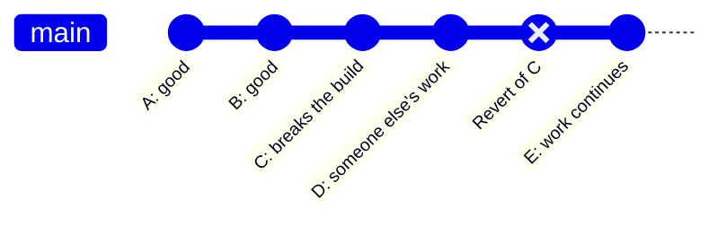
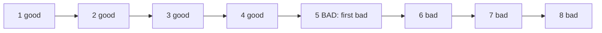
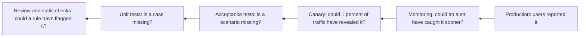

# Recovery: revert first, bisect, quarantine and learn

> **Before this lesson:** read [Guardrails: branch protection, required checks and merge queues](#/lesson/cicd/guardrails), which covers preventing breakage. This lesson covers what to do when prevention fails. Knowing what a flaky test is, from [Test data, asynchrony and flaky tests](#/lesson/cicd/test-data-flakiness), is helpful.

## In plain words

Every kitchen eventually has a small fire. A good kitchen is not one where nothing ever catches; it is one where everybody knows the order of actions. First cover the pan. Then turn off the gas. Only afterwards work out what went wrong, and change something so that it is less likely next time.

Software teams need the same order of actions when the shared branch, `main`, breaks or a release misbehaves:

1. **Restore** — get back to a working state by undoing the change.
2. **Locate** — find exactly which change caused the problem.
3. **Contain** — stop unreliable tests from blocking everybody.
4. **Learn** — improve the system so that this kind of failure is caught earlier.

The classic mistake is to do step 2 first: to start investigating while everybody else waits.

Why this matters for a job: handling a broken build or a bad release is a daily reality, and interviewers ask about it directly. A candidate who says "revert first, then investigate" and can explain `git bisect` stands out at once.

## Part 1: revert first

### What a revert is

To **revert** a commit is to create a *new* commit that applies the exact opposite of the original change. The original stays in history, and the new commit cancels its effect.



Compare this with *deleting* the bad commit by rewriting history (`git reset` followed by a force push). On a shared branch that is dangerous: other people already have commit C on their machines, and their copies would no longer match the server. A revert only adds, so it is always safe.

```bash
git switch main
git pull
git log --oneline -5
# 5f0a1c2 D: add gift-card banner
# 4c1d2aa C: bulk discount rules        <- the breaking commit
# 9b7e310 B: fix VAT rounding
# 1a2b3c4 A: update README

git revert --no-edit 4c1d2aa
git push
```

- `git switch main` and `git pull` make sure you hold the latest `main`.
- `git log --oneline -5` shows the last five commits, one per line, newest first, each with its short identifier.
- `git revert --no-edit 4c1d2aa` creates the undo commit. `--no-edit` accepts the automatic message ("Revert ...") instead of opening an editor.
- `git push` publishes it. The pipeline then runs on the revert like any other change.

Note that commit D, made *after* the bad one, is untouched. A revert removes one change and leaves everything else in place.

When the breaking change arrived as a **merge commit** (a commit that joins two lines of history, as a non-squashed pull request does), Git needs to be told which side is the main line:

```bash
git revert -m 1 <merge-commit-id>      # -m 1 means "keep the first parent", which is main
```

On GitHub and GitLab a merged pull request has a **Revert** button. It opens a new pull request containing the revert, which then goes through the normal checks.

### Why revert before investigating

A **revert-first policy** is a team agreement: *when a change breaks `main` or production, the default response is to revert it immediately, without first working out why.*

The reasoning is about cost. While `main` is broken, everyone who updates their copy receives broken code, new failures hide behind the existing one, and nothing can be released. A revert takes a couple of minutes and needs no understanding of the bug. A fix needs diagnosis, a code change, review and a pipeline run — typically half an hour or more, often much more.

```python-run
def cost_person_minutes(minutes_red, developers, share_blocked=0.4):
    """Rough cost: a share of the team loses the time that main is red."""
    return minutes_red * developers * share_blocked

developers = 25
options = {
    "revert first (5 min red)":           5,
    "quick fix forward (40 min red)":    40,
    "fix forward, went badly (3 h red)": 180,
}
for name, minutes in options.items():
    print(f"{name:<36} {cost_person_minutes(minutes, developers):>6.0f} person-minutes lost")
```

The function multiplies the minutes that `main` is red by the number of developers and by the share of them who are blocked. The figures are illustrative, but the gap is not: five minutes of red costs the team under an hour in total, while a three-hour fix-forward costs thirty person-hours. And the revert loses nothing, because the author can re-submit the change with a fix.

What makes the policy work in practice:

- **It is the default and needs no permission.** Anybody may revert a change that broke `main`. Waiting for the author, who may be asleep in another time zone, defeats the purpose.
- **It carries no blame.** A revert says "this change needs more work". It is not a verdict on the person who wrote it.
- **It is time-boxed.** A common rule: if you cannot fix the problem within ten minutes, revert.
- **The author re-lands the change.** They revert the revert on a branch, add the fix and a test that would have caught the problem, and open a new pull request.

```bash
git switch -c reland-bulk-discounts
git revert --no-edit <id-of-the-revert-commit>     # brings the original change back
# ... fix the bug, add the missing test ...
git commit -am "fix: handle empty basket in bulk discount rules"
git push -u origin reland-bulk-discounts
```

When is reverting *not* right? When the change cannot be undone safely — for example, it ran a database migration that removed data — or when other merged work already depends on it. Then you must fix forward. Those cases are the reason for keeping changes small and database changes backward-compatible.

### The build cop

On a larger team a red `main` can sit for an hour because each person assumes someone else is dealing with it. A **build cop** (or build sheriff) is a rotating role: for a day or a week, one named person is responsible for noticing a red `main` within minutes, identifying the suspect change, and reverting it if the author does not respond quickly.

The role is a rotation, so everyone takes a turn. It is not a punishment, and the build cop is not expected to fix other people's bugs — only to get `main` green again and to hand the problem back to its owner.

## Part 2: finding the culprit with bisect

### The problem

Sometimes the cause is not obvious. A test passed last Tuesday and fails today, and forty commits landed in between. Which one did it?

Checking every commit in order could take forty test runs. There is a much faster way, and it is the idea behind looking up a word in a paper dictionary. You do not start at page one. You open the book in the middle, see whether your word comes before or after that page, and throw away half the book. Repeating this finds any word in a handful of steps. The technique is called **binary search**.

For commits it works because of one assumption: once the bug has been introduced, every later commit also has it. The history therefore looks like a run of good commits followed by a run of bad ones, and we are searching for the boundary — the **first bad commit**.



### By hand, on eight commits

Commit 1 is known good and commit 8 is known bad.

1. Test the middle of 1..8, commit 4. **Good.** The first bad commit must be after 4, so it lies in 5..8.
2. Test the middle of 5..8, commit 6. **Bad.** The first bad commit is 6 or earlier, so it is 5 or 6.
3. Test commit 5. **Bad.** Commit 4 is good and commit 5 is bad, so commit 5 is the first bad one.

Three tests instead of up to seven. Each test halves the remaining candidates, so about $\log_2 n$ tests are needed for $n$ commits: around 6 for 40 commits and 10 for 1,000.

### In code

```python-run
def first_bad(n, is_bad):
    """Commits are numbered 1..n. Commit 1 is known good, commit n is known bad.
    Returns (index of the first bad commit, list of commits tested)."""
    good, bad = 1, n                 # invariant: `good` is good, `bad` is bad
    tested = []
    while bad - good > 1:
        mid = (good + bad) // 2
        tested.append(mid)
        if is_bad(mid):
            bad = mid                # the boundary is at mid or earlier
        else:
            good = mid               # the boundary is after mid
    return bad, tested

culprit = 5
answer, tested = first_bad(8, lambda c: c >= culprit)
print("8 commits   -> first bad:", answer, "| tested:", tested)

for n, culprit in ((40, 27), (1000, 618), (100_000, 4)):
    answer, tested = first_bad(n, lambda c: c >= culprit)
    print(f"{n:>7} commits -> first bad: {answer:>6} | tests needed: {len(tested)}")
```

Reading the function:

- `good` and `bad` are two markers. The code maintains one promise at all times, called an **invariant**: the commit at `good` is good, and the commit at `bad` is bad.
- `while bad - good > 1` keeps going as long as there are untested commits between the markers.
- `mid = (good + bad) // 2` picks the middle; `//` is division that rounds down.
- `is_bad(mid)` stands for "check out that commit and run the test". If it is bad, the `bad` marker moves to it; otherwise the `good` marker does.
- When the markers are next to each other, `bad` is the first bad commit.

The first printed line reproduces the hand-worked example: commits 4, 6 and 5 were tested. The others show the growth: 40 commits need about 5 tests, a thousand need 10, a hundred thousand need 17. A problem in this module asks you to implement this search.

### With Git

Git has this search built in as `git bisect`.

```bash
git bisect start
git bisect bad                      # the commit checked out now is broken
git bisect good v2.14.0             # this older tag was fine
# Bisecting: 20 revisions left to test after this (roughly 4 steps)

# Git has checked out a commit in the middle. Test it, then tell Git the result:
pytest tests/test_checkout.py::test_discount -q
git bisect good                     # or: git bisect bad
# ...repeat until Git prints:
# 4c1d2aa is the first bad commit

git bisect reset                    # return to where you started
```

- `git bisect start` begins a session.
- `git bisect bad` and `git bisect good <commit>` give Git the two ends of the range.
- Git checks out the middle commit. You test it and answer `good` or `bad`. Git halves the range and checks out the next one.
- `git bisect reset` ends the session and restores your original state.

Better still, hand Git a command and let it do the whole search unattended:

```bash
git bisect start HEAD v2.14.0
git bisect run pytest tests/test_checkout.py::test_discount -q
git bisect reset
```

`git bisect run` uses the command's **exit code** (the number a program returns when it ends): 0 means this commit is good, 1 to 127 means bad, and the special value 125 means "this commit cannot be tested, skip it" — useful when a commit in the middle does not even compile.

Two habits make bisecting effective. **Small commits**: bisect leads you to one commit, and if that commit is 2,000 lines long you have learned little. **A `main` where every commit builds**: squash merging, one commit per pull request, gives exactly that.

One limitation: bisect needs a test that fails *reliably* on bad commits. If the test is flaky, a random pass sends the search in the wrong direction.

## Part 3: containing flaky tests

A **flaky test** is one that can pass and fail on the same code. Flaky tests damage recovery in two ways: they turn `main` red when nothing is wrong, and they teach people to respond to a red build by clicking "re-run", so that real failures get ignored too.

### Telling a flake from a real failure

One failing run cannot tell you which it is. History can. If a test has both passed and failed **on the same commit**, the code did not change between those runs, so the difference came from the test or its surroundings. That is a flake.

```python-run
from collections import defaultdict

history = [   # (commit, test, passed?)
    ("c1", "test_login", True),  ("c1", "test_refund", True),  ("c1", "test_search", True),
    ("c2", "test_login", True),  ("c2", "test_refund", False), ("c2", "test_search", True),
    ("c2", "test_login", True),  ("c2", "test_refund", True),  ("c2", "test_search", True),
    ("c3", "test_login", False), ("c3", "test_refund", True),  ("c3", "test_search", True),
    ("c3", "test_login", False), ("c3", "test_refund", True),  ("c3", "test_search", True),
]

results = defaultdict(lambda: defaultdict(set))
for commit, test, passed in history:
    results[test][commit].add(passed)

for test in sorted(results):
    flaky_on = sorted(c for c, seen in results[test].items() if seen == {True, False})
    broken_on = sorted(c for c, seen in results[test].items() if seen == {False})
    if flaky_on:
        print(f"{test:<12} FLAKY: both passed and failed on {flaky_on} -> quarantine")
    elif broken_on:
        print(f"{test:<12} BROKEN since {broken_on[0]} -> revert or fix the code")
    else:
        print(f"{test:<12} healthy")
```

- `results` is a table of tables: for each test, for each commit, the *set* of outcomes seen. A set holds each value once, so it ends up as `{True}`, `{False}` or `{True, False}`.
- The first loop fills the table from the history.
- For each test, `flaky_on` lists the commits where both outcomes were seen, and `broken_on` lists those where it only ever failed.

In the output `test_refund` is flaky (two different results on commit `c2`), `test_login` is broken (it failed every time on `c3`, a real regression), and `test_search` is healthy. The two unhealthy tests call for opposite responses, which is why telling them apart matters.

### Quarantine

To **quarantine** a flaky test is to move it out of the set that can block merging, while still running it and tracking its results. This restores trust in the gate at once. It must not become a place where tests are forgotten, so each quarantined test gets:

- a ticket,
- a named owner,
- a deadline, after which it is fixed or deleted,
- a place in a quarantine list with a fixed maximum size.

```python
import pytest

@pytest.mark.quarantine(ticket="FLAKY-312", owner="dana", until="2026-12-01")
def test_refund_emits_event():
    ...
```

The line beginning with `@` is a **decorator**: a label attached to the function below it. Here it marks the test as quarantined and records the ticket, owner and date. The pipeline runs quarantined tests in a separate, non-blocking job, and another small job fails the build if any quarantine entry is past its date.

Avoid the tempting shortcut of **automatic retries**, where a failed test is re-run until it passes. Retries hide flakiness instead of removing it, and they also hide real intermittent bugs in the product, which look exactly like flaky tests.

## Part 4: learning from failure

When a failure reached users or cost the team significant time, hold a **post-incident review** (also called a post-mortem or retrospective): a short, structured look at what happened and what to change.

The essential property is that it is **blameless**. The working assumption is that people acted reasonably given what they knew and the tools they had. The question is never "who made the mistake?" It is "what about our system made this mistake easy to make and hard to catch?" If people are punished for errors, they stop reporting them, and the organisation stops learning.

A useful review answers five questions:

| question | example answer |
|---|---|
| What happened, in order? | 14:02 merge; 14:10 deployed; 14:12 error rate rose; 14:19 alert; 14:24 rolled back |
| What was the impact? | 12 minutes of failed checkouts for about 4% of users |
| How was it detected, and how long did that take? | An alert, 7 minutes after it began |
| Why did the guardrails not stop it? | No test for baskets containing only gift cards; staging had no such data |
| What will we change? | Add the test; add gift-card data to staging; make the canary step automatic |

From the timeline, measure three gaps. Each points to a different kind of improvement.

```python-run
from datetime import datetime as dt

timeline = {
    "bad change deployed":   dt(2026, 6, 3, 14, 10),
    "users first affected":  dt(2026, 6, 3, 14, 12),
    "alert fired":           dt(2026, 6, 3, 14, 19),
    "rollback started":      dt(2026, 6, 3, 14, 22),
    "service restored":      dt(2026, 6, 3, 14, 24),
}
def minutes(a, b):
    return int((timeline[b] - timeline[a]).total_seconds() // 60)

print("time to detect  :", minutes("users first affected", "alert fired"), "min   -> improve monitoring and alerts")
print("time to decide  :", minutes("alert fired", "rollback started"), "min   -> clearer runbook, revert-first rule")
print("time to recover :", minutes("rollback started", "service restored"), "min   -> faster rollback mechanism")
print("total impact    :", minutes("users first affected", "service restored"), "min")
```

`minutes(a, b)` subtracts two timestamps and converts the result to whole minutes. In this incident the rollback itself took two minutes, but seven minutes passed before anyone knew there was a problem. Detection was the largest part, so the most valuable action is better alerting — something that is far from obvious until the gaps are written down.

Every action from a review needs an owner and a date, and should be something that changes the *system*: a new test, a new alert, an automated step. "Be more careful" is not an action. It changes nothing, and the same thing will happen to the next person.

A handy way to choose actions is to ask where the problem could have been caught earlier, moving back along the pipeline:



## Pitfalls

- **Investigating before restoring**, so that the whole team waits.
- **Rewriting history** on `main` with a force push instead of reverting.
- **Treating a revert as an insult**, so that people avoid doing it.
- **Forgetting the re-land**: the change is reverted and never comes back.
- **Reverting something irreversible**, such as code whose database migration already removed data.
- **Bisecting with a flaky test**, which points at an innocent commit.
- **Huge commits**, which make the result of a bisect useless.
- **A quarantine with no deadlines**, where tests go to be forgotten.
- **Reviews that end in "be more careful"**, or that look for someone to blame.
- **Action items with no owner.**

> [!WARNING]
> Never use `git push --force` to remove a bad commit from a shared branch. Colleagues who already pulled it will have histories that no longer match, and work can be lost. `git revert` is the safe tool, because it only adds a commit.

> [!TIP]
> Practise reverting when nothing is on fire. Many teams discover during a real incident that the revert of a large merge conflicts with later changes. Small pull requests, squash-merged, revert cleanly almost every time.

> [!INTERVIEW]
> "Main is broken and you do not know which commit did it. What do you do?" Restore first: if the last few merges are suspects, revert the most likely one, or go back to the last green commit, so that the team is unblocked. Then locate: `git bisect` between the last known good commit and the bad one, automated with `git bisect run` and a reliable failing test, which finds the first bad commit in about log2(n) steps. Contain: if the failure turns out to be a flaky test — it passes and fails on the same commit — quarantine it with an owner and a deadline. Learn: a blameless review asking why the guardrails missed it, with owned actions such as a new test or alert.

## Summary

- When something breaks, act in this order: restore, locate, contain, learn.
- A revert is a new commit that undoes an earlier one. It is safe on shared branches, quick, and needs no diagnosis. Make it the blameless default, open to anyone, and re-land the change afterwards with a fix and a test.
- A rotating build cop makes sure that a red `main` is noticed and dealt with within minutes.
- `git bisect` finds the first bad commit by binary search in about log2(n) tests. It needs a reliable test and benefits from small commits.
- A test that passes and fails on the same commit is flaky: quarantine it with a ticket, an owner and a deadline, and do not hide it with retries.
- Blameless post-incident reviews turn failures into improvements to the system; measure the time to detect, decide and recover, and give every action an owner.

## Glossary

- **Revert** — a new commit that undoes the changes of an earlier commit.
- **Merge commit** — a commit that joins two lines of history.
- **Revert-first policy** — the agreement to undo a breaking change immediately, before investigating.
- **Fix forward** — repairing a problem with a new change instead of undoing the old one.
- **Re-land** — to submit a reverted change again, with its problem fixed.
- **Build cop (build sheriff)** — the person currently responsible for keeping `main` green.
- **Binary search** — finding something in an ordered list by repeatedly halving the range.
- **Invariant** — a statement that stays true at every step of an algorithm.
- **First bad commit** — the earliest commit at which a problem appears.
- **`git bisect`** — Git's built-in binary search through commit history.
- **Exit code** — the number a program returns when it ends; 0 means success.
- **Flaky test** — a test that can pass and fail on the same code.
- **Quarantine** — taking a flaky test out of the blocking set while still running and tracking it.
- **Decorator** — in Python, a label starting with `@` that is attached to a function.
- **Post-incident review** — a structured discussion of a failure and what to change.
- **Blameless** — focused on improving the system, not on finding someone at fault.
- **Time to detect** — the time from the start of a problem until somebody knows about it.

## Check yourself

```quiz
[
  {"q": "What does `git revert <commit>` do?",
   "options": ["Deletes the commit from history", "Creates a new commit that undoes the changes of the given commit", "Resets the whole branch to that commit", "Renames the commit"],
   "answer": 1,
   "explain": "History is kept. A new commit cancels the effect of the old one, which is safe on a shared branch."},
  {"q": "Main broke five minutes ago. The author says they can probably fix it in half an hour. What does a revert-first policy say?",
   "options": ["Wait for the fix", "Revert now; the author re-lands the change with the fix later", "Skip the failing test", "Lock the repository"],
   "answer": 1,
   "explain": "Restoring a working main for everyone takes minutes and loses nothing, since the change can be re-submitted."},
  {"q": "Commits 1 to 16 are in order; 1 is good and 16 is bad. Using bisection, which commit is tested first?",
   "options": ["Commit 2", "Commit 8", "Commit 15", "Commit 16"],
   "answer": 1,
   "explain": "The midpoint of 1 and 16, rounded down, is 8. Each test halves the range that remains."},
  {"q": "Roughly how many tests does bisection need to find the first bad commit among 1,000 commits?",
   "options": ["About 10", "About 100", "About 500", "1,000"],
   "answer": 0,
   "explain": "Each test halves the candidates, and 2 to the power 10 is 1,024, so about 10 tests are enough."},
  {"q": "What assumption makes bisecting commits valid?",
   "options": ["Commits are sorted alphabetically", "Once the bug is introduced, every later commit also has it", "Every commit has the same author", "The bug is in the newest commit"],
   "answer": 1,
   "explain": "The history must be a run of good commits followed by a run of bad ones, so that there is a single boundary to find."},
  {"q": "A test passed and failed on the very same commit. What does that show?",
   "options": ["A regression in the code", "The test is flaky, since the code did not change between runs", "The commit is too large", "The CI server is down"],
   "answer": 1,
   "explain": "With the code held constant, different outcomes must come from the test or its environment."},
  {"q": "What should accompany every quarantined test?",
   "options": ["Nothing; it is forgotten", "A ticket, an owner and a deadline to fix or delete it", "An automatic retry", "A longer timeout"],
   "answer": 1,
   "explain": "Quarantine restores trust in the gate, but without ownership and a deadline it becomes a way of silently losing coverage."},
  {"q": "What is the central question of a blameless post-incident review?",
   "options": ["Who made the mistake?", "What in our system made this mistake easy to make and hard to catch?", "How can we punish this?", "Who approved the pull request?"],
   "answer": 1,
   "explain": "Looking for system causes produces real improvements and keeps people willing to report problems."},
  {"q": "An incident timeline shows 2 minutes to roll back but 15 minutes before anyone noticed. Where should the main improvement go?",
   "options": ["A faster rollback", "Detection: monitoring and alerting", "More code review", "Longer tests"],
   "answer": 1,
   "explain": "Most of the impact came from the time to detect, so better alerting gives the largest gain."}
]
```

> **Source:** Humble & Farley, *Continuous Delivery*, ch. 3 (time-box fixing before reverting; never go home on a broken build; do not comment out failing tests) and ch. 15 (continuous improvement), applied with current tooling. `git revert`: https://git-scm.com/docs/git-revert — `git bisect`: https://git-scm.com/docs/git-bisect — Blameless post-mortem culture: https://sre.google/sre-book/postmortem-culture/
