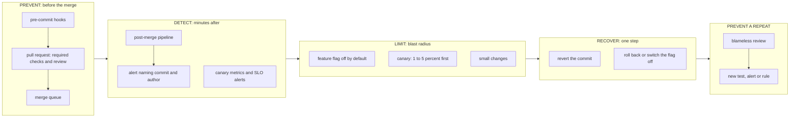

# Scenario: bad code on main, and a deploy taking the site down

> **Before this lesson:** this is the first of three worked interview scenarios. It draws on [Guardrails: branch protection, required checks and merge queues](#/lesson/cicd/guardrails), [Recovery: revert first, bisect, quarantine and learn](#/lesson/cicd/recovery-practices), [Blue-green, canary and rolling deployments](#/lesson/cicd/release-strategies) and [Rollback, roll-forward, zero downtime and emergency fixes](#/lesson/cicd/rollback-emergency). Read those first if a term here is unfamiliar.

## In plain words

Earlier lessons each taught one tool. An interview asks you to use them together, on a problem described in a sentence or two, while explaining your reasoning aloud. It is the difference between knowing what each instrument in a first-aid kit does and treating a patient in front of you.

This lesson works through two of the most frequently asked scenarios:

1. *"Someone pushed buggy code to main. Design the process and pipeline that detects it, limits the damage, recovers quickly and prevents a repeat."*
2. *"A deployment is taking the site down right now. What do you do in the first five minutes?"*

For each one you will see how to structure an answer, the full answer itself, and the follow-up questions interviewers tend to ask.

Why this matters for a job: these questions test judgement more than memory. A candidate who lists tools scores lower than one who says what to do first, what to do next and why, and who names the trade-offs.

## How to answer a design scenario

Scenario questions are open-ended on purpose. A dependable structure keeps you from rambling:

1. **Clarify.** Ask two or three questions that change the answer: how big is the team, how often do you deploy, what does an hour of downtime cost?
2. **State the goal in one sentence**, including what you are optimising for.
3. **Walk a timeline** — before, during and after — and avoid listing tools in a random order.
4. **Name the trade-offs.** Every guardrail costs speed; say where you would draw the line.
5. **Say how you would measure success.**

A term used throughout: **blast radius** is how much is affected when something goes wrong — how many users, how many services, for how long. The phrase comes from explosives, where it means the area a blast reaches. Much of delivery engineering is about making the blast radius of any single mistake small.

## Scenario 1: someone pushed buggy code to main

> "A developer merged a change that broke main. Design the process and the pipeline so that this is detected, the blast radius is limited, recovery is quick, and it does not happen again."

### Clarify

Good opening questions, with the reason each matters:

- *Did it break the build and tests, or did it pass them and misbehave in production?* These are different failures with different defences.
- *Could anybody push straight to main, or did it go through a pull request?* This tells you which guardrail was missing.
- *How many people commit to this repository, and how often does it deploy?* The number of people sets how costly a red main is; deployment frequency sets how far the bug travelled.

Suppose the answers are: forty engineers, one service with several libraries, deployed several times a day; the change went through a pull request whose checks were green, and the bug appeared only afterwards.

### The goal

"A bad change will reach main sooner or later. I want the system to **catch most bad changes before they merge**, **notice the rest within minutes**, **keep the number of affected users small**, **return to a good state in one step**, and **learn from every escape**."

The four verbs in the question — detect, limit, recover, prevent — map on to a timeline.



### Prevent: make it hard for bad code to reach main

Layered, cheapest first. A **pull request** is a proposed change shown for review and automated checks before it is merged.

1. **Nobody pushes directly to main.** Branch protection requires a pull request, at least one approval from someone other than the author, and passing required checks. Force pushes are blocked and administrators cannot bypass the rules.
2. **A fast commit stage** — under ten minutes — runs on every pull request: formatting and linting, type checks, unit tests, a secret scan and a dependency audit.
3. **Code owners** must approve changes to sensitive paths: payments, infrastructure and the pipeline definitions.
4. **A merge queue** tests each change combined with current main and everything queued ahead of it. This closes the gap in which two individually green changes break main together.
5. **Small changes.** A sixty-line pull request is really read; a three-thousand-line one is approved unread.

Then be honest about the limit: "These reduce escapes. They cannot remove them. Tests only cover what somebody thought of, and review is done by people. So the rest of the design assumes a bad change will get through."

### Detect: know within minutes

There are two different detectors, because there are two different failures.

**The build or tests break after merging** (the slower stages, or a missed combination). The post-merge pipeline on main must send a message to the team's channel naming the commit and its author the moment it goes red. A rotating **build cop** — the person on duty for keeping main green — owns the response.

**Everything is green and the behaviour is wrong in production.** Only production can detect this:

- **Health and readiness checks** stop instances that are crashing from receiving traffic.
- **Golden-signal alerts** on error rate and latency, tied to a **service-level objective** (SLO, a target such as "99.9% of checkouts succeed").
- **Business metrics**, such as orders per minute, for failures that return a success code with wrong content.
- **Deploy markers** on every dashboard, so that the question "what changed?" answers itself.

The measure of this stage is **time to detect**: from the first affected user to the first alert.

### Limit: keep the blast radius small

This is the part candidates most often leave out, and the part that most distinguishes a senior answer.

- **Merging is not releasing.** New behaviour ships behind a **feature flag** (a switch that turns behaviour on or off without a new deployment) that defaults to off. A bad change that is merged and deployed but switched off affects nobody.
- **Progressive delivery.** A **canary release** sends a small share of real traffic — say 5% — to the new version, compares its error rate and latency with the old version running at the same time, and continues only if they look healthy. A bad release then touches 5% of users for a few minutes, instead of everybody.
- **Small batches.** If each deployment carries one or two changes, the cause of any problem is obvious.
- **Build once.** The artifact that was tested is the one deployed, identified by its digest, so "what is running?" always has an exact answer.

```python-run
def impact(users, share_exposed, minutes_exposed, error_rate):
    """Failed requests, assuming each exposed user makes one request per minute."""
    return int(users * share_exposed * minutes_exposed * error_rate)

users = 200_000
print(f"{'strategy':<50} {'failed requests':>16}")
plans = {
    "all at once, noticed after 20 min":                (1.00, 20, 0.30),
    "all at once, good alerts, rolled back in 6 min":   (1.00, 6,  0.30),
    "canary 5%, auto-abort after 4 min":                (0.05, 4,  0.30),
    "behind a flag, on for staff only (0.1%), 10 min":  (0.001, 10, 0.30),
}
for name, (share, minutes, rate) in plans.items():
    print(f"{name:<50} {impact(users, share, minutes, rate):>16,}")
```

The function multiplies four numbers: how many users, what share of them saw the bad version, for how many minutes, and how often their requests failed. The same bug costs over a million failed requests in the first plan and about twelve thousand with a canary — a hundred times fewer. With a staff-only flag it costs a few hundred. The bug was identical each time. Only the blast radius differed.

### Recover: one step back to good

State the order clearly: **restore first, investigate second.**

| situation | fastest recovery |
|---|---|
| Main is red after a merge | `git revert` the commit, or use the pull request's Revert button; anybody may do it |
| The canary looks bad | automatic abort: traffic returns to the stable version |
| The feature is misbehaving | switch the flag off; this takes effect in seconds and needs no deployment |
| A full rollout is bad | redeploy the previous image digest, or switch back in a blue-green set-up |

Two conditions make these possible, and both must be arranged in advance: the previous artifact is still stored, and database changes were backward-compatible, so the old version still works against today's database.

Afterwards the author brings the change back on a branch, adds a fix and the test that would have caught the problem, and submits it again.

### Prevent a repeat: learn

Hold a **blameless** review — one that asks what in the system allowed the failure, not who is at fault — and trace the failure backwards through the layers:

- Why did review miss it? Perhaps the change was too large.
- Why did the tests miss it? Add the missing case, at the lowest level that can catch it.
- Why did staging miss it? Perhaps staging lacked the data that triggered the bug.
- How long did detection take, and can an alert shorten it?

Every action gets an owner and a date, and each one changes the system. "Be more careful" is not an action.

### Measure

"I would track how often main is red and for how long, plus the four DORA metrics. Success means the change failure rate and the time to restore service go down while deployment frequency does not."

### The answer in sixty seconds

> "I'd assume bad code will reach main eventually and design for four things. **Prevent**: no direct pushes; pull requests with a fast required commit stage, an independent review and code owners; and a merge queue so that the exact combination is tested. **Detect**: a post-merge pipeline that alerts the build cop with the commit and author, and in production, health checks, SLO alerts and business metrics with deploy markers. **Limit**: merge is not release — new behaviour is behind a flag that defaults to off, and every deployment is a canary with automated analysis, so a bad change reaches a few percent of users for a few minutes. **Recover**: revert first, without waiting for diagnosis; switch the flag off, or redeploy the previous digest, which works because artifacts are kept and schema changes are backward-compatible. Then a blameless review turns the escape into a new test or alert. I'd measure change failure rate and time to restore."

### Follow-up questions

**"The developer pushed directly to main, bypassing the pull request. How?"** Either branch protection was absent, or an administrator bypass was allowed. Turn on "do not allow bypassing", including for administrators, and audit the rules as code.

**"Your checks take 45 minutes. Developers want to skip them."** That is a real cost, and the answer is to make the gate fast, not optional: split the checks into a commit stage under ten minutes and later stages, cache dependencies, run tests in parallel, and move slow suites to after the merge with a revert-first rule.

**"The author is on holiday, and the revert conflicts with later commits."** Then others have built on the change. Choose between reverting those commits too and fixing forward. Usually it is safer to disable the feature with its flag and fix forward. This is one more argument for small changes behind flags.

**"What if the bad change included a database migration?"** If it only added things (a new column, a new table), revert the code and leave the schema alone. If it destroyed something, a rollback is not possible; fix forward, and restore data from a backup if needed. Prevention is to release destructive migrations separately, and late.

**"How do you find the culprit if you do not know which commit it was?"** `git bisect` between the last good commit and the first bad one, automated with a reliable test. It takes about log2(n) steps.

## Scenario 2: a deploy is taking the site down

> "You deployed ten minutes ago. Error rates are climbing and customers are complaining. What do you do in the first five minutes?"

This question tests whether you stay orderly under pressure. The interviewer wants a *sequence*, and wants to hear that restoring service comes before understanding the cause.

### The principle: mitigate before you diagnose

To **mitigate** is to reduce the harm without necessarily fixing the cause. The human instinct is to open the logs and start reading. Resist it. Every minute spent diagnosing is a minute during which users are affected, and the fastest mitigation — going back to the previous version — needs no diagnosis at all.

```mermaid
sequenceDiagram
  participant M as Monitoring
  participant Y as You (on call)
  participant T as Team channel
  participant P as Pipeline
  participant S as Service
  M-->>Y: 0:00 alert: 5xx errors at 12 percent
  Y->>M: 0:30 confirm it is real; was there a recent deploy? yes, 10 minutes ago
  Y->>T: 1:00 "Incident: checkout errors after deploy 9f3c2e1. I am rolling back."
  Y->>P: 1:30 start rollback to the previous version
  P->>S: 2:00 traffic and instances return to the previous version
  Y->>M: 3:30 watch error rate fall
  M-->>Y: 4:30 error rate back to normal
  Y->>T: 5:00 "Mitigated. Rollback complete. Freezing deploys while we investigate."
```

### Minute by minute

**Minute 0 to 1 — confirm and correlate.**

- Is the alert real? Look at the main dashboard for thirty seconds: error rate, latency, traffic. One glance is enough; do not study it.
- *What changed?* The deploy marker on the dashboard shows a deployment ten minutes ago, and the errors begin at that line. That is the working assumption.
- Tell people. One line in the team's incident channel: what you see, what you believe caused it, what you are about to do. This prevents three people from taking three conflicting actions.

**Minute 1 to 2 — mitigate.** Choose the fastest safe option that is available:

| option | time to take effect | available when |
|---|---|---|
| Switch the feature flag off | seconds | the change is behind a flag |
| Shift traffic back (blue-green or canary abort) | seconds | the previous version is still running |
| Roll back the deployment | a minute or two | the previous artifact is stored and the schema is compatible |

```bash
# Rolling back a Kubernetes Deployment to its previous version
kubectl -n shop rollout undo deployment/orders
kubectl -n shop rollout status deployment/orders --timeout=120s

# Or, with GitOps, revert the commit that changed the image digest
git revert --no-edit 7c2d9aa && git push
```

- `kubectl rollout undo` tells Kubernetes to return the Deployment to its previous settings, which means the previous image.
- `kubectl rollout status` waits until the change is complete, or reports failure after the time limit.
- On a cluster managed by GitOps, use the Git revert instead, because Git is the source of truth there.

One check before you roll back: **did this release include a database change that the old version cannot work with?** If so, rolling back could make matters worse, and the flag or a fix-forward is the safer mitigation. This is the only question worth pausing for.

**Minute 2 to 4 — verify.** Do not assume it worked. Watch the same graph that showed the problem: the error rate should be falling. Confirm that the running version is the old one. If the errors do *not* fall, the deployment was not the cause — look at dependencies, traffic and infrastructure, and escalate.

**Minute 4 to 5 — stabilise and communicate.**

- Announce "mitigated", with the time.
- **Freeze further deployments** of this service, so that nobody re-deploys the bad change or buries the evidence under new ones.
- Preserve the evidence: the bad version's logs, the dashboards, the deployment identifier.
- If customers were affected, update the status page or tell whoever owns it.

**After five minutes — now diagnose.** With users safe, investigate calmly: reproduce the fault in a test environment, find the cause, write the failing test, fix it, and release again through the normal pipeline with a canary.

### Who does what

During a larger incident, one person cannot both fix the problem and keep everyone informed. Many teams use a light version of the **incident commander** model: one person coordinates and communicates (the commander), others act. In the first five minutes of a small incident you may hold both roles. Saying aloud "I am coordinating; Sam, please run the rollback" shows that you know the pattern.

### What not to do

- **Do not debug in production while users suffer.**
- **Do not push a quick fix straight to production** around the pipeline. An untested change under pressure is how one incident turns into two.
- **Do not make several changes at once.** If you roll back, restart the database and change a setting together, you will never learn which action helped.
- **Do not stay silent.** Unannounced actions collide with each other.
- **Do not restart things at random.** A restart can destroy the evidence and seldom fixes a bad release.
- **Do not skip the verification.**

### The answer in sixty seconds

> "My first priority is restoring service, not finding the cause. In the first minute I confirm the alert is real and check what changed — a deploy ten minutes ago that lines up with the errors — and I post one line in the incident channel saying what I see and that I'm rolling back. Then I take the fastest safe mitigation: turn the feature flag off, shift traffic back to the previous version if it's still running, or roll the deployment back to the previous image. The one thing I check first is whether the release included a database change the old version can't handle. I verify on the same dashboard that errors are falling, announce that it's mitigated, and freeze deployments of that service. Only then do I diagnose, fix through the normal pipeline with a test that reproduces the bug, and hold a blameless review afterwards."

### Follow-up questions

**"The rollback did not help. Now what?"** Then the deployment was a coincidence, or the damage persists — bad data written, a cache poisoned, a downstream system overloaded. Widen the search: dependencies, traffic changes, infrastructure events, expiring certificates. Escalate and bring in help early.

**"You cannot roll back, because the migration dropped a column."** Fix forward: turn the feature off with a flag if there is one, or ship a minimal patch through the pipeline, expedited. Restore the column from a backup if data was lost. In the review, the action is to adopt expand/contract, so that destructive changes ship separately and late.

**"There is no previous image; it was cleaned up."** Rebuild from the previous commit, which is slower and riskier, and then fix the retention policy so that released artifacts are never deleted.

**"How would you make this never need a human?"** Automated canary analysis with automatic abort; a pipeline that watches SLO burn rate after a deployment and rolls back by itself; health checks that stop a rolling update when new instances fail.

**"How do you know when to declare an incident?"** Decide beforehand: for example, any breach of an SLO affecting users for more than a few minutes. Declaring early is cheap. Declaring late is expensive.

## What both scenarios teach

1. **Assume failure.** Design for the bad change arriving, not for a world in which it never does.
2. **Separate merging, deploying and releasing**, so that each can be undone independently.
3. **Restore first.** Reverting needs no diagnosis.
4. **Make the blast radius small**: small changes, flags and canaries.
5. **Recovery must be prepared**: previous artifacts kept, schema changes compatible, rollback practised.
6. **Learn without blame**, and change the system.

## Pitfalls in the interview itself

- **Listing tools without an order.** Give a timeline.
- **Describing only prevention**, and none of detection, limitation or recovery.
- **Diagnosing before mitigating** in the incident scenario.
- **Forgetting the database** when you say "roll back".
- **No communication step.**
- **Blaming the developer.** Interviewers listen for this.
- **Claiming it could never happen** under your process.

> [!WARNING]
> In a real incident, check before rolling back whether the release changed the database in a way the previous version cannot tolerate. Rolling back code on to an incompatible schema can turn a partial outage into a total one.

> [!TIP]
> Practise both answers aloud with a timer. The sixty-second versions above are a good target; in an interview you give the short version first and expand where the interviewer shows interest.

> [!INTERVIEW]
> When you are given a scenario, say your structure before your content: "I'll cover prevention, detection, limiting the impact, recovery, and then what we'd learn." It shows the interviewer how you organise a problem, and it gives them an easy way to steer you towards the part they care about.

## Summary

- Structure scenario answers: clarify, state the goal, walk a timeline, name the trade-offs, say how you would measure.
- For bad code on main: prevent with protected branches, fast required checks, review and a merge queue; detect with a post-merge pipeline and production alerts; limit with flags, canaries and small batches; recover by reverting or rolling back; learn with a blameless review.
- Limiting the blast radius is the part most often forgotten, and it changes the cost of the same bug by orders of magnitude.
- For a deployment that is taking the site down: confirm and correlate, tell people, mitigate with the fastest safe option, verify, stabilise — and only then diagnose.
- Check database compatibility before rolling back.
- Both answers rest on preparation: stored artifacts, compatible schema changes, flags and a rehearsed rollback.

## Glossary

- **Blast radius** — how much is affected when something goes wrong.
- **Pull request** — a proposed change, reviewed and checked before merging.
- **Build cop** — the person on duty for keeping main green.
- **Feature flag** — a switch that turns behaviour on or off without a new deployment.
- **Canary release** — sending a small share of traffic to a new version before everyone gets it.
- **Service-level objective (SLO)** — a target for how reliable a service should be.
- **Deploy marker** — a line on a dashboard showing when a deployment happened.
- **Mitigate** — to reduce harm without necessarily fixing the cause.
- **Roll back** — to return to the previous version.
- **Fix forward** — to repair a problem with a new change instead of going back.
- **Incident** — an unplanned event that degrades or interrupts a service.
- **Incident commander** — the person coordinating the response to an incident.
- **Deploy freeze** — a temporary stop on further deployments.
- **Time to detect** — the time from the start of a problem until somebody knows about it.
- **Blameless review** — a review that looks for system causes and not for someone at fault.

## Check yourself

```quiz
[
  {"q": "In the 'bad code on main' scenario, which part of the answer do candidates most often omit?",
   "options": ["Prevention with branch protection", "Limiting the blast radius with flags and canaries", "Mentioning Git", "Code review"],
   "answer": 1,
   "explain": "Most answers stop at prevention. Assuming a bad change will arrive, and keeping its impact small, marks a stronger answer."},
  {"q": "A release with a 30% error rate goes to a 5% canary and is aborted after 4 minutes, instead of going to everyone for 20 minutes. Roughly how much smaller is the impact?",
   "options": ["About 2 times", "About 10 times", "About 100 times", "The same"],
   "answer": 2,
   "explain": "Exposure is 5% of users for 4 minutes against 100% for 20 minutes: 0.05 x 4 = 0.2 compared with 20, a factor of 100."},
  {"q": "A deployment ten minutes ago coincides with rising errors. What is the first action after confirming that the alert is real?",
   "options": ["Read the logs to find the root cause", "Announce the incident and mitigate by rolling back or switching the flag off", "Write a fix and push it", "Restart the database"],
   "answer": 1,
   "explain": "Mitigate before diagnosing. Returning to the previous version needs no understanding of the cause."},
  {"q": "What is the one check worth making before rolling back?",
   "options": ["Whether the author is online", "Whether the release included a database change the previous version cannot work with", "Whether it is a weekday", "Whether the logs are full"],
   "answer": 1,
   "explain": "Rolling code back on to an incompatible schema can make the outage worse; then a flag or fix-forward is safer."},
  {"q": "After the rollback, why should further deployments of the service be frozen?",
   "options": ["To punish the team", "To avoid re-deploying the bad change and to keep the evidence intact while investigating", "Because the pipeline is broken", "To save money"],
   "answer": 1,
   "explain": "A freeze keeps the system stable and the situation understandable until the cause is known."},
  {"q": "The rollback completes and the error rate does not fall. What does that suggest?",
   "options": ["The rollback is still in progress for ever", "The deployment was not the cause, or its damage persists, so the search must widen", "The monitoring is always wrong", "Nothing; wait an hour"],
   "answer": 1,
   "explain": "Verification can disprove the assumption. Check dependencies, traffic, infrastructure and persisted data, and escalate."},
  {"q": "Why is pushing a quick fix directly to production during an incident a bad idea?",
   "options": ["It is too slow", "An untested, unreviewed change made under pressure often causes a second incident", "Production does not accept pushes", "It needs a meeting first"],
   "answer": 1,
   "explain": "The pipeline is what makes a change safe. Mitigate with a rollback, then fix through the normal path."},
  {"q": "Which statement best reflects a blameless review?",
   "options": ["The developer should have been more careful", "Our tests had no case for this input and staging lacked the data; we will add both", "The reviewer is at fault", "Nobody should deploy on Fridays"],
   "answer": 1,
   "explain": "It identifies gaps in the system and produces concrete, owned changes."}
]
```

> **Source:** Humble & Farley, *Continuous Delivery*, ch. 3 (keeping the build green), ch. 10 (rolling back, emergency fixes, tips for releasing) and ch. 15 (risk management). Incident response roles follow the practice described in Google's SRE book: https://sre.google/sre-book/managing-incidents/ — `kubectl rollout undo`: https://kubernetes.io/docs/reference/kubectl/generated/kubectl_rollout/kubectl_rollout_undo/
