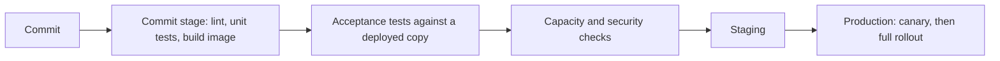
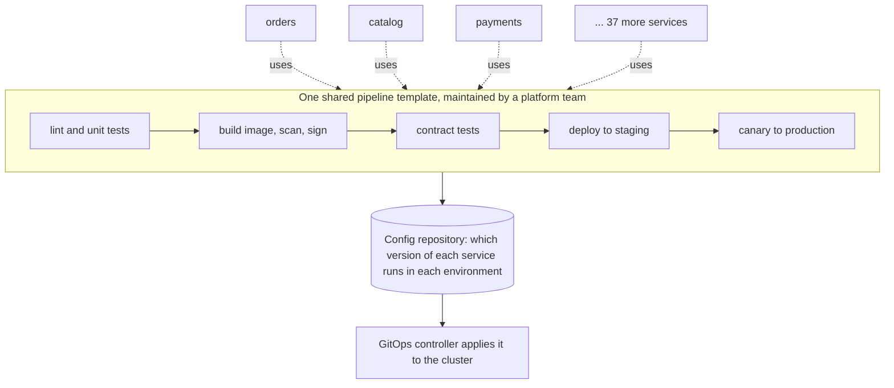
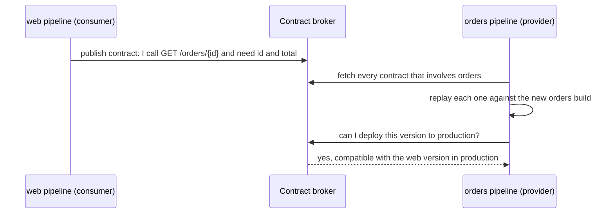
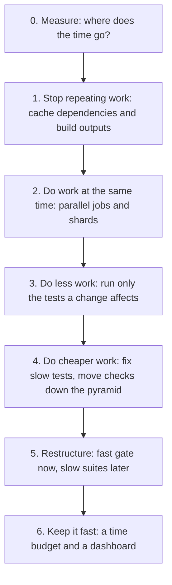

# Scenario: monolith vs 40 microservices, and a 50-minute test suite

> **Before this lesson:** this is the second worked interview scenario. It draws on [Stages, gates and the flow of a change](#/lesson/cicd/pipeline-stages), [Dependency graphs and pipelines for components](#/lesson/cicd/dependency-graphs), [Monorepo vs polyrepo and artifact versioning](#/lesson/cicd/monorepo-versioning), [Designing a fast commit stage](#/lesson/cicd/commit-stage-feedback) and [Testing quadrants and the test pyramid](#/lesson/cicd/quadrants-pyramid). For the answer structure, see [Scenario: bad code on main, and a deploy taking the site down](#/lesson/cicd/scenario-bad-push).

## In plain words

Two more questions that interviewers like, both about **scale**:

1. *"Design a delivery pipeline for a monolith. Now design one for forty microservices. What changes?"*
2. *"The test suite takes fifty minutes. Speed it up."*

A **monolith** is an application built and deployed as one unit: one codebase, one artifact, one deployment. **Microservices** split the same functionality into many small applications (services) that are built and deployed independently and talk to each other over the network.

An everyday picture: a monolith is one large restaurant kitchen producing every dish. Microservices are a food court: forty small stalls, each with its own cook, menu and opening hours. The single kitchen is easier to run and to inspect, but changing the dessert menu means working around everyone else. The food court lets each stall change its menu whenever it likes, but somebody now has to make sure that forty stalls keep the same hygiene standards, and a customer's meal may depend on three stalls being open at once.

Why this matters for a job: these questions separate people who have memorised one pipeline from people who understand *why* a pipeline has its shape. The honest answer to the first is "the principles stay, the problems move", and the honest answer to the second begins with "first I would measure".

## Scenario 3: a pipeline for a monolith, then for 40 microservices

### Clarify

- *One team or many? How many engineers?* The number of people committing decides how much contention there is.
- *One repository or forty?* This changes how the pipeline decides what to build.
- *Do the services really deploy independently, or do they have to be released together?* If together, it is a monolith distributed over a network, and the answer changes.
- *How often does each need to deploy?*

### What stays the same

Say this first, because it shows you understand the principles underneath:

- every change goes through version control and an automated pipeline,
- cheap checks run first, expensive ones later,
- the artifact is built once and the same one is promoted through every environment,
- deployment is the same automated procedure everywhere,
- releases are gradual and reversible.

### The monolith pipeline

One repository, one artifact, one pipeline.



**What is easy.** There is one version of the whole system, so "what is running?" has a single answer. A change that touches three modules is one commit, tested together. End-to-end tests are straightforward, because everything is in one process.

**What is hard, and the defences.**

| problem | why it happens | defence |
|---|---|---|
| The pipeline gets slow | every change builds and tests everything | split tests across parallel machines; cache; build only the modules that changed; push detail down the test pyramid |
| People queue to merge | forty engineers, one main branch | a merge queue; small pull requests |
| One bug blocks every release | all changes travel in one artifact | feature flags, so unfinished or faulty work can be switched off; revert first |
| Each release is risky | many changes go out together | deploy more often, so each release is small; canary releases |
| Teams step on each other | no clear boundaries in the code | a **modular monolith**: enforced internal modules, each with an owning team (code owners), with rules about which module may use which |

A well-run monolith with a ten-minute commit stage, flags and canaries can deploy many times a day. It is a legitimate choice, and saying so is a sign of experience.

### The 40-microservices pipeline

Now there are forty artifacts, forty versions, and a network between them. The principles hold. The problems that appear are new.



Go through the new problems one at a time.

**1. Forty pipelines must not mean forty different pipelines.** If each team writes its own, they drift apart, and a security fix has to be made forty times. The answer is a **golden path** (also called a paved road): one well-maintained pipeline template — a reusable workflow or an included file — owned by a platform team, which every service calls with a few parameters. A new service gets a complete pipeline on its first day, and an improvement to the template reaches all forty.

**2. Build only what changed.** In one repository holding all the services (a monorepo), the pipeline computes which services a commit affects — the changed ones plus everything that depends on them — and builds only those. With forty separate repositories this comes for free, but shared libraries now need versions, and automated upgrade pull requests are needed to stop the services drifting on to different versions.

```python-run
from collections import defaultdict, deque

depends_on = {                         # service or library -> what it depends on
    "lib-auth": [], "lib-money": [],
    "orders": ["lib-auth", "lib-money"],
    "catalog": ["lib-money"],
    "payments": ["lib-auth", "lib-money"],
    "search": [],
    "web": ["lib-auth"],
}

def to_rebuild(changed):
    dependants = defaultdict(set)
    for name, needs in depends_on.items():
        for n in needs:
            dependants[n].add(name)
    seen, queue = set(changed), deque(changed)
    while queue:
        for d in dependants[queue.popleft()]:
            if d not in seen:
                seen.add(d)
                queue.append(d)
    return sorted(seen)

for changed in (["search"], ["catalog"], ["lib-auth"], ["lib-money"]):
    rebuild = to_rebuild(changed)
    print(f"change {changed[0]:<10} -> rebuild {len(rebuild)} of {len(depends_on)}: {rebuild}")
```

- `depends_on` records, for each component, what it needs.
- The first loop turns that around into `dependants`: for each component, who needs *it*.
- The `while` loop starts from the changed components and repeatedly adds everything that depends on something already collected. A **queue** (here a `deque`) holds the components still to be processed.

A change to `search` rebuilds one component. A change to `lib-money` rebuilds four. Shared libraries have the largest blast radius, which is why they must stay small and stable.

**3. Testing how the services fit together.** In a monolith an end-to-end test runs inside one process. With forty services, a full end-to-end environment needs all forty deployed and healthy, so it is slow, and any one broken service blocks everybody.

The scalable answer is **contract testing**. A **contract** is a record of what one service expects from another: "when I request order 7, I receive a response with an `id` and a `total`". The consuming service publishes its contracts, and the providing service's pipeline checks that it still satisfies all of them. If the provider is about to break a consumer, the *provider's* build fails, before anything is deployed.



So the test portfolio becomes: many unit tests per service; contract tests at every boundary; a *small* end-to-end suite for the few journeys that matter most; and canary releases in production as the final check.

**4. Independent deployment requires compatibility.** If `orders` version 12 only works with `web` version 30, the two have to be released together, and the main benefit of microservices is gone. Every interface change must therefore be backward-compatible, following expand/contract: add the new field, move the consumers over, remove the old field later.

**5. Knowing what is running.** Forty services, each with its own version, in three environments, give 120 answers to "what is deployed?". A GitOps **config repository** makes that a file: each environment's folder lists the exact image digest of each service. Promotion is a change to that file, and rollback is a revert.

**6. Shared concerns.** Each service needs logs, metrics, traces, security scanning, secrets and alerts. Those belong in the golden path and the platform, so that they are not reinvented forty times. **Distributed tracing** — following one request across services — becomes essential, because a slow page may now involve six services.

**7. Database changes.** Each service should own its data. A database shared by several services ties their releases back together.

### The comparison

| | monolith | 40 microservices |
|---|---|---|
| Pipelines | one | one template, forty instances |
| What to build | everything (or affected modules) | only the changed service and its dependants |
| Integration testing | in-process end-to-end tests | contract tests plus a small end-to-end suite |
| Versions in production | one | forty, recorded in a config repository |
| Deployment unit | whole application | one service |
| Blast radius of a bad release | the whole application | one service — if failures are contained |
| Main bottleneck | pipeline time and merge contention | coordination, consistency and observability |
| Who owns the pipeline | the team | a platform team owns the template; each team owns its configuration |

### The answer in sixty seconds

> "The principles are identical: build once, automated stages from cheap to expensive, the same deployment everywhere, progressive and reversible releases. For a monolith there's one pipeline and one artifact; the problems are pipeline time and contention, which I'd handle with parallel and selective testing, a merge queue, feature flags and enforced internal modules. For forty services the problems move. I'd provide one shared pipeline template as a golden path so the pipelines don't diverge; build only affected services; replace most end-to-end testing with consumer-driven contract tests and a compatibility check before deployment; require backward-compatible interfaces so that each service deploys independently; track what runs where in a GitOps config repository; and put observability and security into the platform. I'd also ask whether forty services are justified — a modular monolith is often the better trade."

### Follow-up questions

**"Would you put the 40 services in one repository or forty?"** It depends on how often changes span services. One repository makes cross-service changes atomic, but needs tooling to build only what is affected. Forty repositories give independence, and need versioned shared libraries and automated upgrades. Code that changes together and is owned together should live together.

**"A shared library changes. How do the forty services pick it up?"** Publish a new version; a bot opens an upgrade pull request in each consuming service; each service's own pipeline validates it; compatible upgrades merge automatically.

**"How do you stop one team's broken service blocking the others?"** Do not share one integration environment as the gate. Verify boundaries with contract tests in each service's own pipeline, deploy independently, and design each service to keep working, perhaps with reduced function, when a neighbour is down.

**"When is a monolith the better choice?"** A small team, an unclear domain, or no real need for independent scaling or release. Microservices exchange code complexity for operational complexity, and that trade pays only with enough teams and a mature platform.

## Scenario 4: the test suite takes 50 minutes

> "Our test suite takes fifty minutes to run. How would you speed it up?"

### Why fifty minutes is a real problem

It is tempting to treat this as an inconvenience. It is more than that. With a fifty-minute wait, developers stop running the tests before they push, bundle several changes together to avoid waiting twice, and start other work in the meantime — so a failure interrupts something else. Feedback gets slower, batches get larger, and both make defects more expensive.

### First, measure

The most important sentence in the answer: **"Before changing anything, I would find out where the fifty minutes go."** Guessing leads to optimising the wrong thing.

Collect, for one typical run:

- the time for each *phase*: waiting for a machine, checking out, installing dependencies, building, running tests, uploading results;
- the time for each *test file*, sorted from slowest;
- how many tests exist at each level — unit, integration, end-to-end.

```python-run
phases = {"wait for a runner": 4, "install dependencies": 7, "build": 5,
          "unit tests": 6, "integration tests": 14, "end-to-end tests": 13, "upload reports": 1}
total = sum(phases.values())
print(f"total: {total} minutes\n")
for name, minutes in sorted(phases.items(), key=lambda p: -p[1]):
    print(f"{name:<22} {minutes:>3} min {'#' * minutes}  {minutes / total:.0%}")

setup = phases["wait for a runner"] + phases["install dependencies"] + phases["build"]
print(f"\nBefore a single test runs, {setup} minutes ({setup / total:.0%}) have passed.")
```

`sorted(phases.items(), key=lambda p: -p[1])` orders the phases by time, longest first, and each is printed with a bar. In this example the tests account for only two-thirds of the wait; sixteen minutes pass before any test starts. That is a common surprise, and nobody would have found it by staring at the test code.

### The levers, in order

Work from the cheapest and safest lever to the most invasive. Say the order aloud; it shows judgement.



**1. Stop repeating work — caching.** Dependencies are the same from one commit to the next. Save them under a key built from the lockfile's fingerprint, so that they are downloaded only when they change. Cache build outputs and container image layers in the same way. Typical gain: several minutes, at almost no risk.

**2. Do work at the same time — parallelism.** Run independent jobs (lint, unit tests, integration tests) on separate machines at once. Then split a long suite across several machines. This is called **sharding**, and each part is a **shard**. The suite then takes as long as the *slowest* shard, so the shards need to be balanced by recorded duration, not by number of files.

```python-run
import random

rng = random.Random(2)
files = sorted((round(rng.lognormvariate(2.2, 1.0)) + 1 for _ in range(120)), reverse=True)   # seconds per test file
total = sum(files)

def balance(durations, shards):
    """Greedy: give the next-longest file to the shard that is lightest so far."""
    loads = [0] * shards
    for seconds in sorted(durations, reverse=True):
        loads[loads.index(min(loads))] += seconds
    return loads

print(f"{len(files)} test files, {total / 60:.1f} minutes on one machine, slowest file {files[0]} s\n")
for shards in (1, 2, 4, 8, 16):
    loads = balance(files, shards)
    print(f"{shards:>2} shards: wall-clock {max(loads) / 60:5.1f} min   (ideal {total / shards / 60:5.1f})")
```

- `files` is a list of invented durations, one per test file, with a few very slow ones — as in real suites.
- `balance` sorts the durations from longest to shortest and hands each one to whichever shard currently has the least work. `loads.index(min(loads))` finds that shard.
- The wall-clock time is `max(loads)`, the heaviest shard.

With eight shards the time falls to roughly one-eighth. Look at sixteen, though: the gain levels off, because no arrangement can finish faster than the single slowest file. That is the signal to break up the largest test files. Parallelism also requires tests that do not interfere with one another — tests sharing a database row or a file will start failing at random.

**3. Do less work — test selection.** A change to the documentation does not need the payment tests. Map changed files to the tests that could be affected and run only those, with the complete suite still running on main or nightly as a safety net. This lever has a correctness risk: an incomplete map skips a test that would have failed.

**4. Do cheaper work — fix the tests themselves.** Look at the slowest twenty tests. The usual causes:

| cause | fix |
|---|---|
| `sleep(5)` waiting for something to happen | wait for the condition with a time limit, or use a fake clock |
| Each test creates a fresh database | create it once per run; isolate tests with transactions or unique data |
| Logic tested through a browser | test the logic directly; keep a few browser journeys |
| Real calls to external services | replace them with a local stand-in; test the real service separately |
| Thirty end-to-end tests that differ only in input values | keep two; move the variations to unit tests |

That last row is the test pyramid at work. A check moved from an end-to-end test (seconds or minutes) to a unit test (milliseconds) becomes thousands of times cheaper and more reliable as well.

**5. Restructure the pipeline.** Not everything has to block merging. Split the suite:

- a **commit stage** of under ten minutes — lint, unit tests, the fastest integration tests — that gates every pull request;
- **later stages** — the full integration, end-to-end and capacity suites — that run after merging, in parallel, with a revert-first rule if they fail.

Developers get an answer in minutes; the thorough checks still run on every change.

**6. Keep it fast.** Suites slow down a few seconds at a time. Set a time budget that fails the pipeline when it is exceeded, show the trend on a dashboard, and print the slowest tests in every run.

### Do not forget flakiness

A suite that fails at random one run in five is slow in a hidden way: each failure costs a complete re-run. Measure the flake rate and fix or quarantine the unreliable tests, or the other gains will be eaten by retries.

### What the levers add up to

```python-run
steps = [
    ("starting point",                                       50.0),
    ("cache dependencies and image layers",                  43.0),
    ("faster runner start (autoscaled pool)",                40.0),
    ("run unit, integration and e2e as parallel jobs",       26.0),
    ("shard integration x4 and e2e x4",                      14.0),
    ("fix the 20 slowest tests (sleeps, per-test set-up)",   10.5),
    ("move e2e to a post-merge stage",                        7.5),
]
previous = None
for name, minutes in steps:
    saved = "" if previous is None else f"  (-{previous - minutes:.1f})"
    print(f"{minutes:>5.1f} min  {name}{saved}")
    previous = minutes
print(f"\nmerge gate: {steps[0][1]:.0f} -> {steps[-1][1]:.1f} minutes, with every test still run on every change")
```

Each line is a step and the time after applying it. The numbers are illustrative; the shape is typical. No single lever does it all, the early ones are cheap, and the final result is a gate of under ten minutes without deleting a single check.

### The answer in sixty seconds

> "First I'd measure where the fifty minutes go — by phase and by test — because it's often not the tests themselves. Then I'd work from cheapest to most invasive. Cache dependencies and build outputs keyed on the lockfile. Run lint, unit and integration jobs in parallel, and shard the long suites across machines, balanced by recorded duration. Run only the tests a change affects, with the full suite on main as a backstop. Fix the slowest tests: replace sleeps with condition waits, share expensive set-up, and push detail down the pyramid from end-to-end to unit level. Split the pipeline so that a commit stage under ten minutes gates merging and slow suites run afterwards, with revert-first. Finally, set a time budget and track it, and deal with flaky tests, since each flake costs a full re-run."

### Follow-up questions

**"You may add machines but not change tests. What do you do?"** Caching, parallel jobs and sharding by duration. Mention the floor set by the slowest file and the need for tests to be independent.

**"You cannot add machines."** Then do less and cheaper work: selection of affected tests, fixing the slowest tests, moving detail down the pyramid, and restructuring into a fast gate with deferred stages.

**"After sharding, tests fail at random."** They share state — the same database rows, files or ports. Give each test its own data or each shard its own database, and run in random order to find the dependencies.

**"How do you decide which tests gate merging?"** By speed and value: the fast checks that catch most failures go in the gate; if a slow stage keeps catching the same kind of bug, write a fast test for that bug and add it to the gate.

**"Is deleting tests ever right?"** Yes — tests that duplicate lower-level tests, that never fail for a real reason, or that verify nothing. But "delete slow tests" must not be the first move.

## Pitfalls in these answers

- **Starting with tools** and not with the principles that stay constant.
- **Treating microservices as automatically better.**
- **Proposing a full end-to-end environment** as the gate for forty services.
- **Forgetting that someone must own the shared template.**
- **Optimising before measuring.**
- **Offering "buy more machines" as the whole answer.**
- **Suggesting that slow tests be deleted or skipped.**
- **Ignoring flakiness and test independence** when proposing parallelism.

> [!WARNING]
> Running only the tests a change "affects" is a bet that the skipped tests could not have failed. Changes to shared files — the lockfile, build configuration, pipeline definitions — must count as affecting everything, and the complete suite must still run regularly on main.

> [!TIP]
> In both scenarios it helps to state a number early: "My target is a merge gate under ten minutes" or "each service should go from commit to production in under an hour." A concrete target turns a vague design discussion into an engineering problem.

> [!INTERVIEW]
> Interviewers often change a constraint halfway through ("now assume you cannot add machines"). They are checking whether you understand the levers separately. Keep a mental list — repeat less, parallelise, do less, do cheaper, restructure — and choose from whatever the new constraint still allows.

## Summary

- The principles of delivery do not change with architecture; the problems move.
- A monolith has one pipeline and one artifact. Its problems are pipeline time and contention, answered by parallel and selective testing, merge queues, flags and enforced modules.
- Forty microservices need one shared pipeline template, selective builds, contract tests in place of most end-to-end tests, backward-compatible interfaces, a config repository recording what runs where, and platform-level observability.
- A slow suite is a delivery problem. Measure first, then cache, parallelise and shard by duration, select affected tests, fix the slowest tests and push detail down the pyramid, split into a fast gate and later stages, and guard the result with a time budget.
- Parallelism requires independent tests, and flakiness cancels speed gains.

## Glossary

- **Monolith** — an application built and deployed as a single unit.
- **Microservice** — a small, independently deployed application that is one part of a larger system.
- **Modular monolith** — a monolith with enforced internal boundaries between modules.
- **Golden path (paved road)** — a supported, standard way of doing something, such as a shared pipeline template.
- **Platform team** — the team that builds shared tooling for other teams.
- **Contract** — a record of what one service expects from another.
- **Contract test** — a check that a service still satisfies the contracts of its consumers.
- **Consumer / provider** — the service that calls another / the service being called.
- **End-to-end test** — a test that exercises the whole system through its outside interface.
- **Config repository** — a Git repository recording which version of each service runs in each environment.
- **Distributed tracing** — following one request as it passes through several services.
- **Sharding / shard** — splitting a test suite across machines / one of the parts.
- **Wall-clock time** — the real elapsed time, as opposed to the total machine time used.
- **Test selection** — running only the tests a change could affect.
- **Time budget** — a limit on how long a pipeline stage may take.

## Check yourself

```quiz
[
  {"q": "When moving from a monolith to forty microservices, what happens to the principles of delivery?",
   "options": ["They are replaced by new ones", "They stay the same; the problems to solve move", "Testing is no longer needed", "Build-once no longer applies"],
   "answer": 1,
   "explain": "Build once, staged checks, uniform deployment and reversible releases still hold. The difficulty shifts to coordination and consistency."},
  {"q": "What is a 'golden path' pipeline?",
   "options": ["The fastest pipeline in the company", "A shared, maintained pipeline template that every service uses with a few parameters", "A pipeline that skips tests", "A pipeline only for production"],
   "answer": 1,
   "explain": "It prevents forty divergent pipelines and lets improvements and security fixes reach every service at once."},
  {"q": "Why do contract tests scale better than a shared end-to-end environment for many services?",
   "options": ["They need no code", "Each boundary is verified in a service's own pipeline, so one broken service does not block all the others", "They run in production", "They replace unit tests"],
   "answer": 1,
   "explain": "A shared environment needs every service healthy at once. Contract tests check each interface independently."},
  {"q": "What must be true of service interfaces for services to deploy independently?",
   "options": ["They never change", "Changes are backward-compatible, so new and old versions can work together", "All services share one database", "All services release on the same day"],
   "answer": 1,
   "explain": "If a new version of one service requires a new version of another, the two are no longer independent."},
  {"q": "A test suite takes 50 minutes. What is the first step?",
   "options": ["Buy faster machines", "Delete the slowest tests", "Measure where the time goes, by phase and by test", "Rewrite the tests in another language"],
   "answer": 2,
   "explain": "Without measurement you may optimise the wrong part. Often a large share of the time is waiting, installing and building."},
  {"q": "A suite is split into 4 shards taking 3, 4, 5 and 12 minutes. What is the wall-clock time?",
   "options": ["6 minutes", "24 minutes", "12 minutes", "3 minutes"],
   "answer": 2,
   "explain": "Shards run at the same time, so the suite finishes when the slowest one does. Balance shards by duration."},
  {"q": "Why does adding more shards eventually stop helping?",
   "options": ["Machines get tired", "No arrangement can be faster than the single slowest test file", "Tests cannot run in parallel", "Caches expire"],
   "answer": 1,
   "explain": "The longest indivisible unit sets a floor. Break up very large test files to lower it."},
  {"q": "Thirty end-to-end tests differ only in the numbers given to a price calculation. What is the better design?",
   "options": ["Keep all thirty", "Keep a couple at end-to-end level and move the variations to unit tests", "Delete all of them", "Run them once a year"],
   "answer": 1,
   "explain": "Pure logic variations are far faster and more reliable as unit tests; the end-to-end tests only need to show that the calculation is wired in."},
  {"q": "After sharding, tests start failing at random. What is the most likely cause?",
   "options": ["The machines are too fast", "Tests share state such as database rows or files and now interfere with each other", "The cache key is wrong", "There are too few tests"],
   "answer": 1,
   "explain": "Parallel execution exposes hidden dependencies. Each test needs its own data, or each shard its own database."}
]
```

> **Source:** Humble & Farley, *Continuous Delivery*, ch. 5 (pipeline anatomy), ch. 7 (commit stage speed), ch. 8 (acceptance test performance: parallel testing, compute grids) and ch. 13 (components and dependency graphs), applied to current architectures. Pact contract testing: https://docs.pact.io — GitHub Actions matrix jobs: https://docs.github.com/en/actions/writing-workflows/choosing-what-your-workflow-does/running-variations-of-jobs-in-a-workflow
