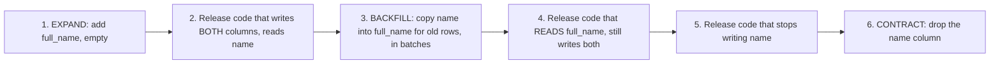
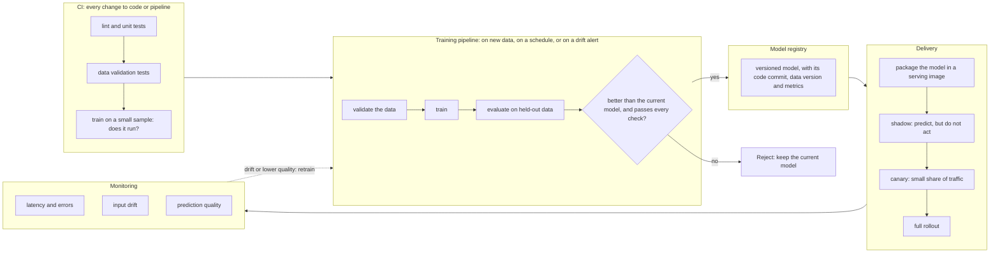

# Scenario: zero-downtime migration, and CI/CD for ML models

> **Before this lesson:** this is the third worked interview scenario. It draws on [Schema migrations and expand/contract](#/lesson/cicd/schema-migrations), [Backward compatibility, data rollback and test data](#/lesson/cicd/data-compat-testdata) and [Blue-green, canary and rolling deployments](#/lesson/cicd/release-strategies). For the answer structure, see [Scenario: bad code on main, and a deploy taking the site down](#/lesson/cicd/scenario-bad-push).

## In plain words

The last two scenarios are about delivering things that are *not* ordinary code.

1. *"A database migration must ship with zero downtime. How?"* A database keeps its contents from one release to the next, so changing its structure is like renovating a shop while customers are still inside. You cannot close for the day, and you cannot knock down a wall that people are leaning on.
2. *"How would you do CI/CD for machine-learning models?"* A machine-learning model is a program whose behaviour was *learned from data* instead of being written by hand. So there are three things that can change — the code, the data and the model — and a pipeline has to keep track of all three.

Why this matters for a job: the first is asked of nearly every backend candidate, because it shows whether you understand that old and new versions of an application run side by side during a release. The second is increasingly common, because companies want engineers who can put models into production as carefully as code.

## Scenario 5: a database migration with zero downtime

> "We need to rename the column `customers.name` to `customers.full_name`. The service runs on many instances with rolling deployments, and we cannot have downtime. Walk me through it."

### Some terms

- A **schema** is the structure of a database: its tables and their columns.
- A **migration** is a script that changes the schema, for example by adding a column.
- **Downtime** is any period in which users cannot use the service.
- A **rolling deployment** replaces the running copies of an application a few at a time, so that for several minutes some copies are the old version and some are the new one.

### Clarify

- *How big is the table, and how busy?* A change that is instant on a thousand rows can hold a lock for minutes on a hundred million.
- *Which database engine?* The rules about locking differ.
- *Does anything else read this column?* Reports, other services and data exports all count.
- *Must we be able to roll back the application at every step?* Almost always, yes.

### Why the direct approach fails

The tempting plan is one migration — `ALTER TABLE customers RENAME COLUMN name TO full_name` — released together with new code that uses `full_name`.

During a rolling deployment both versions are running. At the instant the rename takes effect:

- every *old* copy, still asking for `name`, starts to fail;
- if the new version has a bug and you roll back, the *rolled-back* code fails too, because the column it expects is gone.

So the direct plan produces errors on the way out and removes the way back. The underlying rule: **during a release, the old and new versions of the application must both work against the database as it is at that moment.**

### The method: expand, migrate, contract

Split the single incompatible change into a series of steps, each of which is compatible with the application version running before it *and* after it.



| step | what changes | how it is released | old code still works? | can we roll back? |
|---|---|---|---|---|
| 1 | add a nullable column `full_name` | migration | yes; it ignores the new column | yes |
| 2 | application writes both, reads `name` | deployment | yes | yes |
| 3 | copy existing values across, in batches | background job | yes | yes |
| 4 | application reads `full_name`, writes both | deployment | yes | yes |
| 5 | application stops writing `name` | deployment | versions from steps 2 to 4 still work | yes, to step 4 |
| 6 | drop `name` | migration | only code from step 5 onwards | **no — the one irreversible step** |

**Nullable** means that a column is allowed to be empty. That matters in step 1: the existing application does not know about `full_name` and will insert rows without it.

The SQL for the three database steps:

```sql
-- Step 1: expand. Adding a nullable column changes only the table's description, so it is quick.
ALTER TABLE customers ADD COLUMN full_name text;

-- Step 3: backfill in small batches. Run repeatedly until it reports 0 rows updated.
UPDATE customers
SET    full_name = name
WHERE  id IN (SELECT id FROM customers
              WHERE full_name IS NULL AND name IS NOT NULL
              ORDER BY id
              LIMIT 5000);

-- Step 6: contract. Only after step 5 has been stable for an agreed time.
ALTER TABLE customers DROP COLUMN name;
```

- `ALTER TABLE ... ADD COLUMN` adds the column.
- The `UPDATE` copies the value for at most 5,000 rows at a time. The inner `SELECT ... LIMIT 5000` picks the next rows that still need copying. Small batches keep each transaction short.
- `DROP COLUMN` removes the old column, and its data, permanently.

And the application code for the two transitional releases:

```python
# Step 2: write both columns, read the old one
def save_customer(db, customer_id, name):
    db.execute("UPDATE customers SET name = %s, full_name = %s WHERE id = %s",
               (name, name, customer_id))

# Step 4: read the new column, falling back for any row not yet backfilled
def display_name(row):
    return row["full_name"] if row["full_name"] is not None else row["name"]
```

`save_customer` puts the same value in both columns, so whichever column a given version reads is up to date. `display_name` prefers the new column and falls back to the old one when it is empty, which makes step 4 safe even if the backfill has not quite finished.

### Checking a plan by machine

The compatibility rule can be checked mechanically. Describe each application version by the columns it uses, and walk through the plan.

```python-run
def check_plan(start_columns, start_app, steps):
    """After every step, the app version that is running must find all the columns it uses.
    Rollback is safe if the previously running version would still find its columns too."""
    columns, app, previous = set(start_columns), start_app, start_app
    for number, (kind, value) in enumerate(steps, 1):
        if kind == "add":
            columns.add(value)
        elif kind == "drop":
            columns.discard(value)
        elif kind == "deploy":
            previous, app = app, value
        missing = app["uses"] - columns
        rollback_ok = previous["uses"] <= columns
        label = value if kind != "deploy" else value["name"]
        verdict = "ok" if not missing else f"BREAKS {app['name']}: missing {sorted(missing)}"
        print(f"  {number}. {kind:<6} {label:<20} {verdict:<34} rollback possible: {'yes' if rollback_ok else 'NO'}")
        if missing:
            return False
    return True

v1 = {"name": "v1 (old)",         "uses": {"name"}}
v2 = {"name": "v2 (writes both)", "uses": {"name", "full_name"}}
v3 = {"name": "v3 (reads new)",   "uses": {"name", "full_name"}}
v4 = {"name": "v4 (new only)",    "uses": {"full_name"}}

print("Direct rename:")
check_plan({"name"}, v1, [("add", "full_name"), ("drop", "name"), ("deploy", v4)])

print("\nExpand / contract:")
check_plan({"name"}, v1, [("add", "full_name"), ("deploy", v2), ("deploy", v3), ("deploy", v4), ("drop", "name")])
```

How to read the function:

- `columns` is the set of columns that currently exist; `app` is the version now running; `previous` is the one before it.
- Each step adds a column, drops a column or deploys a version.
- `app["uses"] - columns` gives the columns the running version needs that do not exist. If the result is not empty, the step breaks the application.
- `previous["uses"] <= columns` asks whether everything the previous version needs still exists (`<=` between sets means "is contained in"). If it does, rolling back is safe.

The direct rename breaks at its second step: the old version is still running when its column disappears. The expand/contract plan is fine at every step, and "rollback possible" turns to `NO` only at the last step — the drop. A problem in the data module asks you to write a validator of this kind.

### The hidden danger: locks

A plan can be perfectly compatible and still cause downtime, because of **locks**. A lock is the database's way of preventing two operations from changing the same thing at once. Most changes to a table's structure need an *exclusive* lock: while it is held, nothing else can read from or write to that table.

Two situations turn a harmless migration into an outage:

1. **The statement is slow**, because it rewrites or scans a very large table while holding the lock.
2. **The statement waits.** If a long-running query is using the table, the migration waits for it — and every *new* query queues up behind the waiting migration. The application freezes even though the migration has not started yet.

Defences (the examples are for PostgreSQL):

```sql
SET lock_timeout = '3s';
SET statement_timeout = '60s';

CREATE INDEX CONCURRENTLY idx_customers_full_name ON customers (full_name);

ALTER TABLE customers ADD CONSTRAINT full_name_present
  CHECK (full_name IS NOT NULL) NOT VALID;
ALTER TABLE customers VALIDATE CONSTRAINT full_name_present;
```

- `lock_timeout` makes the migration give up after three seconds of waiting, instead of blocking everyone. It can then be retried.
- `statement_timeout` stops a statement that runs longer than expected.
- `CREATE INDEX CONCURRENTLY` builds an **index** (a structure that speeds up searches) without blocking writes to the table.
- Adding the rule that `full_name` must be filled in is split in two: `NOT VALID` adds it for new rows instantly, and `VALIDATE CONSTRAINT` checks the existing rows afterwards under a much lighter lock.

For the backfill: work in small batches, commit each one, pause between batches, slow down if the database's replicas fall behind, and write the job so that it can be stopped and resumed.

### In the pipeline

- Migrations are files in version control, applied by a tool that records which ones have already run.
- The commit stage builds an empty database from every migration and runs the tests against it. A linter flags dangerous statements, such as an index created without `CONCURRENTLY`.
- A staging stage runs the migration against data of production *size* and times it.
- **A compatibility test deploys the previous application version against the new schema** and runs its smoke tests. That proves, for this release, that the application can be rolled back without touching the database.
- In production the migration is its own pipeline step, run and verified *before* the application version that needs it.
- The contract step (dropping the column) is a separate release, days or weeks later.

### The answer in sixty seconds

> "A rename can't be done in one step, because during a rolling deployment old and new code run together, and both must work against the current schema. I'd use expand/contract. First add the new column as nullable. Then release code that writes both columns and still reads the old one. Backfill existing rows in small batches. Release code that reads the new column, with a fallback. Release code that stops writing the old one. Finally, as a separate, later release, drop the old column — the only irreversible step. Each step is its own deployment and can be rolled back. I'd guard against locking with a lock timeout and non-blocking index builds, rehearse the migration on production-sized data, and add a pipeline test that runs the previous application version against the new schema."

### Follow-up questions

**"That's six releases for one rename. Is it worth it?"** For a busy production table, yes: each step is small, safe and reversible. For a small internal tool that can tolerate a short pause, a simpler plan may be acceptable. Naming that trade-off is part of a good answer.

**"How do you know it is safe to drop the old column?"** Search the code and every other consumer — reports, exports, other services. Look at the database's statistics for reads of the column, or rename it temporarily and watch for errors. Wait for an agreed period, and take a backup first.

**"The backfill is slowing production down."** Use smaller batches, pause between them, run at quiet times, and slow down when replicas fall behind. It is a background job and has no deadline.

**"What about adding a NOT NULL column?"** Add it nullable, deploy code that always fills it in, backfill, and then add the constraint in the two-step way shown above.

**"Would blue-green deployment avoid all this?"** No. Blue and green usually share one database, so the schema must still work for both versions; and switching back requires that the old version can read what the new one wrote.

## Scenario 6: CI/CD for machine-learning models

> "How would you set up CI/CD for a team that trains and deploys machine-learning models?"

### Some terms

- A **model** is a program whose behaviour was learned from examples. A spam filter learns from emails labelled "spam" or "not spam".
- **Training** is the process of learning from data. Its output is a file of numbers, the model **artifact**.
- **Features** are the pieces of information given to the model, such as "number of links in the email".
- **Inference** (or **serving**) is using the trained model to make predictions on new inputs.
- A **metric** here is a score for how good the predictions are; **accuracy**, for instance, is the share of predictions that were correct.
- **MLOps** is the name for applying delivery practices to machine learning.

### What is different from ordinary software

| ordinary software | machine learning |
|---|---|
| behaviour comes from code | behaviour comes from code **and data** |
| a test passes or fails | quality is a score, judged against a threshold |
| the same input gives the same output | training involves randomness; results vary slightly |
| it breaks when someone changes it | it can degrade with no change at all, because the world changes |
| one artifact to version | three: code, data and model |

The fourth row surprises people most. A model trained on last year's shopping behaviour slowly becomes wrong as habits change. This is called **drift**. So a pipeline for models needs an extra loop that ordinary software does not have: **continuous training**, meaning retraining when the data or the model's performance calls for it.

### Clarify

- *Do the predictions happen in real time* (a request arrives and an answer is needed within milliseconds) *or in batches* (score every customer once a night)?
- *How often does the data change, and how costly is a wrong prediction?*
- *Are there regulations* requiring you to explain or audit predictions?

### The pipeline



Take the boxes in turn.

**1. Continuous integration, extended.** Everything from ordinary CI applies to the code: linting, unit tests of the feature calculations, a build. Added to that:

- **Data validation tests**: checks that the data has the expected columns, types and ranges, and no sudden jump in missing values. Bad data is the commonest cause of a bad model.
- **A smoke training run**: train on a tiny sample for a minute, to prove that the pipeline works end to end before any expensive hours are spent.

**2. A reproducible training pipeline.** Training is itself an automated, versioned pipeline, not something done by hand in a notebook. For any model you must be able to state **which code, which data and which settings produced it**:

- code: a Git commit;
- data: a version identifier or a fingerprint of the data (tools such as DVC or lakeFS provide these);
- settings (called **hyperparameters**) and the random **seed** (the starting number that makes random choices repeatable);
- the software environment: a container image digest.

**3. Evaluation gates.** A candidate model has to earn promotion. The tests are comparisons with thresholds:

- it must score at least as well as the model now in production, on data it has never seen (a **held-out** set);
- it must not be noticeably worse on important subgroups of users, even if its average is better;
- it must answer quickly enough and fit within its memory limit;
- it must still handle a fixed set of known tricky examples correctly.

```python-run
def promotion_gate(candidate, production, limits):
    """A candidate model must beat production overall, not regress on any segment, and stay fast."""
    reasons = []
    if candidate["accuracy"] < production["accuracy"] + limits["min_gain"]:
        reasons.append(f"overall accuracy {candidate['accuracy']:.3f} is not at least "
                       f"{limits['min_gain']:.3f} above production {production['accuracy']:.3f}")
    for segment, score in candidate["segments"].items():
        drop = production["segments"][segment] - score
        if drop > limits["max_segment_drop"]:
            reasons.append(f"segment '{segment}' fell by {drop:.3f}")
    if candidate["p95_latency_ms"] > limits["max_latency_ms"]:
        reasons.append(f"p95 latency {candidate['p95_latency_ms']} ms is over {limits['max_latency_ms']} ms")
    return ("PROMOTE to registry", []) if not reasons else ("REJECT", reasons)

limits = {"min_gain": 0.002, "max_segment_drop": 0.010, "max_latency_ms": 80}
production = {"accuracy": 0.912, "segments": {"new users": 0.880, "mobile": 0.905}, "p95_latency_ms": 45}

candidates = {
    "A: better everywhere":      {"accuracy": 0.921, "segments": {"new users": 0.889, "mobile": 0.915}, "p95_latency_ms": 48},
    "B: better on average only": {"accuracy": 0.925, "segments": {"new users": 0.842, "mobile": 0.931}, "p95_latency_ms": 47},
    "C: accurate but slow":      {"accuracy": 0.930, "segments": {"new users": 0.895, "mobile": 0.921}, "p95_latency_ms": 140},
    "D: no real gain":           {"accuracy": 0.9125, "segments": {"new users": 0.881, "mobile": 0.905}, "p95_latency_ms": 44},
}
for name, model in candidates.items():
    decision, reasons = promotion_gate(model, production, limits)
    print(f"{name:<28} {decision}")
    for reason in reasons:
        print(f"{'':<30}- {reason}")
```

The function runs three checks and collects reasons for rejection:

- the first compares overall accuracy with production's, plus a small required improvement (`min_gain`), so that noise is not mistaken for progress;
- the loop compares each **segment** — a subgroup of users — and rejects the model if any has fallen by more than the allowed amount;
- the last checks **p95 latency**: the response time that 95% of requests are faster than.

Model B is the instructive case. It has the best average after C, and it is rejected, because it became much worse for new users. An average can hide harm to a group, which is why segment checks are part of the gate.

**4. The model registry.** A **model registry** is to models what an artifact repository is to builds: a store in which every model has a version, its **lineage** (the code commit, data version and settings that produced it), its evaluation results and a stage — for example *candidate*, *staging*, *production*, *archived*. MLflow, cloud platforms' registries and similar tools provide this.

The registry is what makes "build once, promote" work for models. The model file that passed evaluation is the same file that is served. To promote it is to change its stage in the registry. To roll back is to point serving at the previous version.

**5. Delivery: shadow, then canary.** Offline scores do not guarantee real-world results, so a model is released progressively, with one step that ordinary software seldom needs.

- **Shadow deployment.** The new model receives a copy of real requests and makes predictions, but *its answers are not used*. They are only recorded, and compared with the current model's answers and, later, with what really happened. This tests the model on live data at no risk to users.
- **Canary.** The new model then serves a small share of real traffic — say 5% — while its technical health (errors, latency) and its business results are compared with the current model's.
- **Full rollout**, with the previous version kept ready.

```python-run
import random

rng = random.Random(9)

def simulate_shadow(requests, disagreement_rate, new_model_accuracy, old_model_accuracy):
    """Both models score every request; only the old model's answer is used."""
    agree = old_right = new_right = 0
    for _ in range(requests):
        old_correct = rng.random() < old_model_accuracy
        same = rng.random() > disagreement_rate
        new_correct = old_correct if same else (rng.random() < new_model_accuracy)
        agree += same
        old_right += old_correct
        new_right += new_correct
    return agree / requests, old_right / requests, new_right / requests

agreement, old_score, new_score = simulate_shadow(20_000, 0.12, 0.95, 0.91)
print(f"agreement with the current model : {agreement:.1%}")
print(f"current model correct            : {old_score:.1%}")
print(f"shadow model correct             : {new_score:.1%}")
print("users affected during shadow     : 0 (its predictions were only logged)")
print("decision:", "proceed to a 5% canary" if new_score >= old_score and agreement > 0.8 else "investigate first")
```

Each pass through the loop is one request, scored by both models. `agree` counts how often the two gave the same answer, and the other two counters record how often each was right. The shadow model agrees with the current one on most requests and does a little better where they differ — and no user was exposed while that evidence was collected. A very low agreement rate would be a warning, even with good scores: something in the data or the code probably differs between training and serving.

One limit of shadow testing: it cannot show how people *react* to the new model's answers, since they never see them. That is what the canary, or a controlled experiment (an A/B test), is for.

**6. Monitoring, and the loop back.** In addition to ordinary service monitoring:

- **Input drift**: are the incoming features distributed differently from the training data?
- **Prediction drift**: has the mix of predictions shifted?
- **Quality**, once the true outcomes are known, which may be days later.
- **Training–serving skew**: are features computed in the same way at serving time as they were during training?

When these cross a threshold they trigger the training pipeline again. That closes the loop — and it is still gated: an automatically retrained model has to pass the same evaluation, shadow and canary steps.

### What triggers what

| event | what runs |
|---|---|
| a change to code | CI, then the training pipeline, evaluation, the registry and delivery |
| new data arrives, or the schedule fires | the training pipeline, evaluation, the registry and delivery |
| a drift or quality alert | the same, as a retraining |
| a change to serving code only | ordinary CI/CD for the serving image, with the same model version |

### The answer in sixty seconds

> "ML has three things to version — code, data and the model — and quality is a score, not a pass or fail. I'd keep ordinary CI for the code and add data-validation tests and a short smoke training run. Training itself is an automated, reproducible pipeline that records the code commit, data version, hyperparameters and environment. A candidate model must pass evaluation gates: beat the production model on held-out data, show no regression on key segments, and meet latency limits. Passing models go into a model registry with their lineage; serving loads a specific version, so promotion and rollback are registry operations. Release is progressive: shadow first, where the model scores real traffic without affecting users, then a canary on a small share of traffic comparing technical and business metrics, then a full rollout. In production I'd monitor drift and quality as well as latency, and let those alerts trigger retraining through the same gates."

### Follow-up questions

**"How is this different from regular CI/CD?"** Data is an input that can change the result without any change to the code; tests are thresholds on scores; models decay over time; and there is a retraining loop.

**"How do you roll back a model?"** Point serving at the previous version in the registry. It works because model versions are immutable and the previous one is kept. Check that the features it expects are still being produced.

**"The new model has better offline metrics but worse business results in the canary. What do you do?"** Abort the canary; the business result is what counts. Then investigate: the offline measure may not reflect the real goal, the evaluation data may not be representative, or there may be training–serving skew.

**"Training takes eight hours. How does that fit in CI?"** It does not belong in the fast loop. CI runs a short smoke training on a sample; full training runs as a separate, scheduled or triggered pipeline, with caching of unchanged steps.

**"How do you make training reproducible?"** Pin the code, the data version, the settings, the random seed and the environment image, and store them all with the model. Exact bit-for-bit equality is hard on some hardware, so aim for results that are statistically equivalent, and keep the lineage.

## What these two scenarios share

Both are about delivering something with **state or history**: a database that remembers every write, and a model that embodies its training data. Both use the same ideas as the rest of this track — version everything, make changes in small compatible steps, test before promoting, release gradually, keep the previous version ready — applied to something other than code.

## Pitfalls in these answers

**Migrations**

- Proposing a single `ALTER TABLE ... RENAME` together with a code release.
- Forgetting that old and new versions overlap during a rolling deployment.
- Dropping the old column in the same release that stops using it.
- Not mentioning locks or the size of the table.
- Relying on "down" migrations to roll back; they cannot restore dropped data.

**Machine learning**

- Treating the model as ordinary code and ignoring data versioning.
- Promoting a model on its average score alone.
- Releasing a new model to all users at once.
- No monitoring for drift, so the model decays unnoticed.
- Retraining automatically *without* gates.

> [!WARNING]
> In both scenarios the dangerous step is the one that cannot be undone: dropping a column, or deleting the previous model version. Release it separately, release it late, and take a backup first.

> [!TIP]
> For the migration question, draw a table with one row per step and two columns — "old code works?" and "can roll back?" — as above. Filling it in aloud demonstrates the reasoning and catches mistakes as you go.

> [!INTERVIEW]
> For the ML question, interviewers listen for three phrases that show real experience: *lineage* (which code and data produced this model), *shadow deployment* (testing on live traffic without affecting users) and *drift* (the model degrading with no change on your side). Use each one with a sentence explaining it.

## Summary

- During a rolling deployment old and new application versions run together, so every database change must be compatible with both.
- An incompatible change, such as a rename, is done by expand/contract: add the new structure, write both, backfill, switch reads, stop writing the old, and drop it later in a separate release.
- Guard against lock-induced downtime with a lock timeout, non-blocking index builds, two-step constraints and batched backfills; rehearse on production-sized data; test the previous application version against the new schema.
- Machine learning adds data and models to the things that must be versioned, and its tests are thresholds on quality scores.
- A model pipeline has extended CI, a reproducible training pipeline, evaluation gates including per-segment checks, a model registry with lineage, shadow and then canary release, and monitoring for drift that triggers gated retraining.

## Glossary

- **Schema** — the structure of a database: its tables and columns.
- **Migration** — a script that changes the schema.
- **Rolling deployment** — replacing running copies of an application a few at a time.
- **Expand/contract** — adding new structure first and removing old structure later, in compatible steps.
- **Nullable** — allowed to be empty.
- **Backfill** — filling in a new column for rows that already exist.
- **Lock** — the database's mechanism for stopping operations from interfering with each other.
- **Index** — a structure that speeds up searches on a table.
- **Model** — a program whose behaviour was learned from data.
- **Training** — the process of learning from data.
- **Features** — the pieces of information given to a model.
- **Inference (serving)** — using a trained model to make predictions.
- **Hyperparameters** — the settings chosen before training.
- **Seed** — a starting number that makes random choices repeatable.
- **Held-out set** — data kept aside from training and used to judge the model.
- **Segment** — a subgroup of users or cases.
- **Model registry** — a versioned store of models with their lineage, metrics and stage.
- **Lineage** — the record of which code, data and settings produced a model.
- **Shadow deployment** — running a new model on real requests without using its answers.
- **Drift** — a change in data or behaviour over time that makes a model less accurate.
- **Training–serving skew** — a difference between how features are computed in training and in production.
- **Continuous training** — retraining models automatically when data or performance requires it.

## Check yourself

```quiz
[
  {"q": "Why does a single-step column rename cause errors during a rolling deployment?",
   "options": ["Renames are slow", "Old and new application versions run at the same time, and the old one still asks for the old column name", "Databases do not support renames", "The pipeline cannot run SQL"],
   "answer": 1,
   "explain": "For several minutes both versions serve traffic. The moment the column is renamed, every old instance fails."},
  {"q": "In expand/contract, what is the first step of renaming a column?",
   "options": ["Drop the old column", "Add the new column alongside the old one", "Stop the application", "Rename the table"],
   "answer": 1,
   "explain": "Expansion is additive: existing code ignores the new column, so nothing breaks."},
  {"q": "Which step of the expand/contract plan cannot be rolled back?",
   "options": ["Adding the new column", "The backfill", "Switching reads to the new column", "Dropping the old column"],
   "answer": 3,
   "explain": "Once the old column and its data are gone, earlier application versions cannot run. That is why it is released separately and late."},
  {"q": "Why set a lock timeout before altering a busy table?",
   "options": ["To make the statement faster", "So that the migration gives up quickly instead of waiting while every other query queues behind it", "To skip validation", "To disable backups"],
   "answer": 1,
   "explain": "A waiting schema change blocks later queries. Failing fast and retrying avoids freezing the application."},
  {"q": "What does a pipeline test that runs the previous application version against the new schema prove?",
   "options": ["That the new feature works", "That the application can be rolled back without rolling back the database", "That the database is fast", "That the backfill has finished"],
   "answer": 1,
   "explain": "If the old code passes its smoke tests on the new schema, an application-only rollback is safe for this release."},
  {"q": "Which three things must be versioned to reproduce a machine-learning model?",
   "options": ["Code, tests and documentation", "Code, data and the model (with its settings and environment)", "Images, logs and metrics", "Branches, tags and commits"],
   "answer": 1,
   "explain": "A model's behaviour depends on the code and on the data it was trained with. All of them, plus settings, make up its lineage."},
  {"q": "A candidate model has a higher overall accuracy than production but is much worse for new users. What should the gate do?",
   "options": ["Promote it; the average is better", "Reject it, because an important segment regressed", "Promote it to half the users", "Ignore segments"],
   "answer": 1,
   "explain": "An average can hide harm to a group. Per-segment checks are part of the promotion gate."},
  {"q": "What is a shadow deployment of a model?",
   "options": ["Deploying at night", "The new model scores real requests but its answers are only logged, not used", "Hiding the model from monitoring", "Deploying to a test cluster with fake data"],
   "answer": 1,
   "explain": "It tests the model on live traffic with no effect on users, before a canary exposes a small share of them."},
  {"q": "A model's accuracy falls over six months although nobody changed the code or the model. What is the likely cause?",
   "options": ["A compiler bug", "Drift: the real-world data has moved away from what the model was trained on", "The registry deleted the model", "The cache expired"],
   "answer": 1,
   "explain": "Models decay as the world changes. Monitoring for drift and gated retraining address it."},
  {"q": "How is a model rolled back?",
   "options": ["Retrain from scratch", "Point serving at the previous version in the model registry", "Delete the registry", "Revert the training data"],
   "answer": 1,
   "explain": "Model versions are immutable and kept, so rollback is a change of which version is served."}
]
```

> **Source:** Humble & Farley, *Continuous Delivery*, ch. 12 (managing data: incremental change, rolling back databases and zero-downtime releases) and ch. 10 (canary releasing), extended to machine-learning delivery. PostgreSQL `ALTER TABLE` and locking: https://www.postgresql.org/docs/current/sql-altertable.html and https://www.postgresql.org/docs/current/explicit-locking.html — MLflow Model Registry: https://mlflow.org/docs/latest/model-registry.html — Google Cloud, "MLOps: continuous delivery and automation pipelines in machine learning": https://cloud.google.com/architecture/mlops-continuous-delivery-and-automation-pipelines-in-machine-learning
