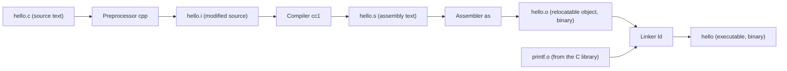
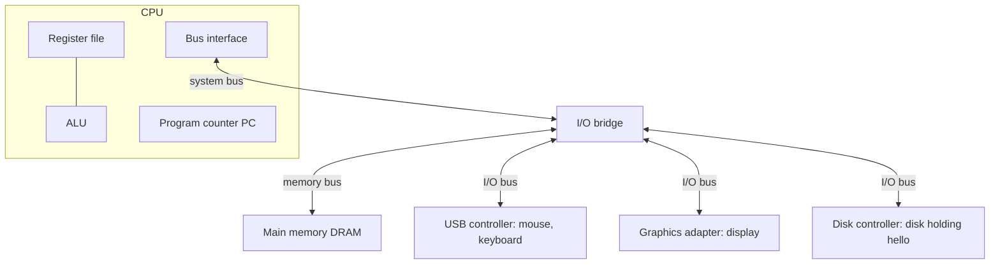
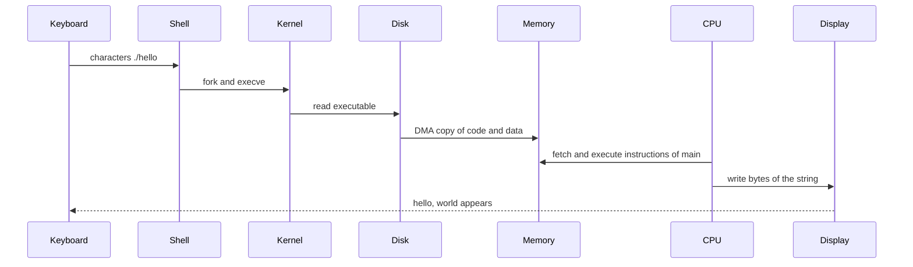

# From source text to a running program

> **Before this lesson:** Nothing. This is the first lesson of the track. It helps to have typed a command into a terminal once and to have seen a few lines of code in any language, but neither is required.

## In plain words

A computer program begins life as ordinary text that a person types, and ends as a long list of numbers that the machine's main chip, the **processor**, can act on. This lesson follows one tiny program on that journey. Think of a recipe written in English that must be used by a cook who reads only a very terse shorthand. Someone has to translate the recipe (that translator is a program called the **compiler**), the translated sheet has to be carried into the kitchen (the program is copied from the disk, the long-term storage, into **memory**, the working storage), and then the cook follows it one step at a time.

Why this matters at work: nearly every confusing problem in software (a program that is slow for no visible reason, a number that comes out wrong, a build that fails at the last step) is explained by something on this journey. Having the whole path in your head tells you where to look, and it is the map for every later lesson in this track.

## Why look closer

Every programmer has typed some version of this program:

```c
#include <stdio.h>

int main()
{
    printf("hello, world\n");
    return 0;
}
```

<!-- walkthrough:c -->
**Reading this C line by line**

- `#include <stdio.h>` asks for the declarations of the standard input/output functions to be pasted in before translation. Without it the compiler would not know what `printf` is.
- `int main()` starts the definition of a function named `main`. Every C program begins running at `main`. The word `int` in front says the function hands back a whole number when it finishes.
- `{` and `}` mark where the body of the function begins and ends.
- `printf("hello, world\n");` calls the library function `printf`, which writes text to the screen. The text is in double quotes. `\n` is not two characters to be printed; it is the notation for one "new line" character. The semicolon ends the statement.
- `return 0;` ends `main` and hands the number 0 back to whoever started the program. By convention 0 means "finished without problems".
- Output: the single line `hello, world`.

It looks trivial, but to make those twelve characters appear on your screen, nearly every major part of a computer system has to cooperate: the compiler toolchain, the linker, the operating system's loader, the processor, main memory, the disk, the display, and several layers of abstraction the operating system builds on top of the hardware. CS:APP opens by following `hello` through its whole life, and so will we. Treat this lesson as a map: every heading below becomes a full module later in the track.

> [!NOTE]
> The book's thesis is that you become a much stronger programmer when you understand what happens *underneath* your code: why an `int` sum can come out negative, why one loop order runs ten times faster than another, why a program crashes with a "segmentation fault", or why a server deadlocks. None of these are visible at the level of the source language.

## 1. Information is bits plus context

The file `hello.c` is stored on disk as a sequence of **bytes**, each an 8-bit chunk. Most systems use ASCII (or its UTF-8 superset) to encode text, so each character is represented by one byte holding a small integer: `#` is 35, `i` is 105, the newline character `\n` is 10, and so on. A file made of nothing but such characters is called a **text file**; everything else is a **binary file**.

Here is the crucial lesson the book draws from this: *the same bytes mean entirely different things depending on context*. The byte sequence `0x68 0x65 0x6c 0x6c` could be the start of the text "hell", the little-endian 32-bit integer 1,819,043,176, part of a floating-point number, or part of a machine instruction. Nothing in the bytes says which. Only the program reading them supplies the interpretation.

```python-run
# The same four bytes, four interpretations.
import struct
raw = bytes([0x68, 0x65, 0x6c, 0x6c])
print("as ASCII text      :", raw.decode("ascii"))
print("as little-endian u32:", struct.unpack("<I", raw)[0])
print("as big-endian u32  :", struct.unpack(">I", raw)[0])
print("as little-endian float:", struct.unpack("<f", raw)[0])
```

<!-- walkthrough:python-run -->
**Reading this Python line by line**

- A line beginning with `#` is a comment: a note for the reader that Python ignores.
- `import struct` makes a standard helper module available; `struct` converts between raw bytes and numbers.
- `raw = bytes([0x68, 0x65, 0x6c, 0x6c])` builds a sequence of four bytes and names it `raw`. `0x` introduces a hexadecimal number.
- `raw.decode("ascii")` reads those bytes as letters using the ASCII table, giving `hell`.
- `struct.unpack("<I", raw)[0]` reads the same four bytes as one unsigned 32-bit whole number, lowest byte first (`<`). With `>` the highest byte comes first, and the number is different. With `<f` they are read as a number with a fractional part.
- The four printed results differ although the bytes never changed. That is the point of the demo: meaning comes from how bytes are interpreted.

This is why so many bugs live at the boundaries between representations: you wrote the bytes as one thing and read them back as another.

## 2. Programs are translated by other programs

The processor cannot run C. It runs **machine-language instructions**, packaged into an **executable object file**. On a Unix system the command

```
linux> gcc -o hello hello.c
```

runs the **compilation system**, a pipeline of four programs:



1. **Preprocessing.** The preprocessor (`cpp`) handles directives that begin with `#`. `#include <stdio.h>` is replaced by the entire text of that header. Macros are expanded. The output, `hello.i`, is still C.
2. **Compilation.** The compiler proper (`cc1`) translates C into **assembly language**, a human-readable text form of machine instructions. For `main` you would see something like:

   ```
   main:
       subq    $8, %rsp
       movl    $.LC0, %edi
       call    puts
       movl    $0, %eax
       addq    $8, %rsp
       ret
   ```

   (Notice the compiler replaced `printf` of a constant string ending in a newline by the cheaper `puts`.) Assembly is useful because it is a common output language for compilers of *different* high-level languages.
3. **Assembly.** The assembler (`as`) turns `hello.s` into binary machine code and packages it as a **relocatable object file**, `hello.o`. If you opened it in a text editor you would see gibberish: it is now binary.
4. **Linking.** `printf` lives in a separate, precompiled object file that is part of the standard C library. The linker (`ld`) merges `hello.o` with the code it needs and produces the **executable object file** `hello`, ready to be loaded into memory and run.

Module 7 is devoted entirely to linking, and Module 3 to reading the assembly the compiler emits.

### Why should you care how compilation works?

The book gives three concrete reasons, and they make a good interview answer:

- **Optimizing performance.** Modern compilers are good, but you still need to know, say, whether a `switch` is faster than an `if-else` chain (it can compile into a jump table), whether a function call is expensive, or why a pointer reference inside a loop may defeat an optimization (Module 5).
- **Understanding link-time errors.** "Undefined reference", the difference between static and global variables, what happens when two files define the same global name, and why the order of libraries on the command line matters: these are some of the most baffling errors programmers meet, and they come from the linker.
- **Avoiding security holes.** Buffer-overflow vulnerabilities, for decades the leading cause of network security breaches, come from how data and control information are stored on the program stack (Module 3).

## 3. The hardware organization of a typical system

To understand what happens when we run `hello`, we need a model of the machine. The book's picture looks like this:



**Buses.** Electrical conduits that carry bytes between components. They move fixed-size chunks called **words**. The **word size** is a fundamental system parameter: 4 bytes (32 bits) on older machines, 8 bytes (64 bits) on most machines today.

**I/O devices.** The system's connection to the outside world: keyboard, mouse, display, disk, network. Each attaches to the I/O bus through a **controller** (chips on the motherboard) or an **adapter** (a card in a slot). Either way, their job is to shuttle data between the bus and the device.

**Main memory.** A temporary storage device that holds both the program and the data it manipulates while the processor runs it. Physically it is made of **DRAM** (dynamic random access memory) chips. Logically it is a linear array of bytes, each with a unique **address** starting at 0.

**Processor (CPU).** The engine that interprets instructions stored in memory. At its heart is a word-size register called the **program counter (PC)**, which at any moment holds the address of some machine instruction. From power-on to power-off the processor does the same thing over and over: read the instruction the PC points at, interpret its bits, perform the simple operation it specifies, and update the PC to point to the next instruction (which may or may not be the next one in memory).

The operations are few and simple, revolving around main memory, the **register file** (a small storage device of word-size registers, each with a unique name), and the **arithmetic/logic unit (ALU)**:

| Operation | What it does |
|---|---|
| Load | Copy a byte or word from main memory into a register, overwriting its contents |
| Store | Copy a byte or word from a register to a location in main memory |
| Operate | Copy two registers to the ALU, do arithmetic on them, store the result in a register |
| Jump | Extract a word from the instruction itself and copy it into the PC |

> [!TIP]
> Keep the distinction between the **instruction set architecture (ISA)** and the **microarchitecture** clear. The ISA is the *contract*: what each instruction appears to do, as if they ran one at a time in order. The microarchitecture is *how* a given chip implements that contract, which in a modern processor involves pipelining, out-of-order execution and much more (Modules 4 and 5). Programs only depend on the ISA.

## 4. Running the hello program

With that model in hand, here is what happens when you type `./hello` into a shell:

1. **The shell reads your command.** The shell is itself a program, waiting at a prompt. As you type characters, each one goes from the keyboard through the USB controller into a register, and the shell stores it in memory.
2. **The shell asks the OS to load the program.** When you hit Enter, the shell knows the command is finished. Through a series of instructions (the `fork` and `execve` system calls you will meet in Module 8), the executable's code and data are copied from disk into main memory. Using **direct memory access (DMA)**, this copy travels from disk to memory *without passing through the processor*.
3. **The processor executes main.** Once code and the string `"hello, world\n"` are in memory, the processor starts executing `main`'s instructions. They copy the bytes of the string from memory into the register file and from there to the display device.
4. **The text appears**, the program returns 0, and the shell prints its prompt again.



### What this walk-through teaches

Look at how much time the system spends **copying**. The program was on disk; it was copied to memory. The string was in memory; it was copied to the processor, then to the display. From the programmer's viewpoint all this copying is overhead that slows down the "real work". That observation motivates the next big idea, caches, which we cover in the next lesson.

## 5. A first look at the layers

Before moving on, notice that `hello` never touched the keyboard, disk, display or memory *directly*. It relied on the **operating system** for every one of those things. The OS is a layer of software between the application and the hardware, with two purposes:

1. Protect the hardware from misuse by runaway applications.
2. Provide applications with simple, uniform mechanisms for manipulating complicated and often wildly different low-level hardware devices.

It achieves both through three fundamental abstractions:

| Abstraction | Abstracts | Covered in |
|---|---|---|
| **Files** | I/O devices | Module 10 |
| **Virtual memory** | Main memory and disks | Module 9 |
| **Processes** | Processor, main memory and I/O devices | Module 8 |

The next lesson explains each one, together with caches, networking, and the book's recurring themes of concurrency and Amdahl's law.

## 6. Worked example: counting bytes and instructions

Let us make the abstractions tangible. Suppose `hello.c` is exactly the seven-line program above. How many bytes is the file?

```python-run
src = '''#include <stdio.h>

int main()
{
    printf("hello, world\\n");
    return 0;
}
'''
data = src.encode("ascii")
print(len(data), "bytes")
print("first 16 bytes:", list(data[:16]))
print("newlines are byte", ord("\n"), "and appear", data.count(10), "times")
```

Each line ends with byte 10, and the file is nothing but small integers. The compiler reads these integers, the C grammar supplies the context that `#include` is a directive, and out comes a binary file whose bytes are interpreted by the CPU's instruction decoder instead. Same machine, same kind of bytes, different context.

## 7. Common misconceptions

> [!WARNING]
> **"The compiler produces the executable."** Strictly, `gcc` is a **driver** that runs the preprocessor, compiler, assembler and linker in turn. Many errors you think are "compile errors" (undefined reference to `foo`) come from the *linker*, after compilation succeeded.

> [!WARNING]
> **"The CPU reads the program from disk."** It never does. The loader copies the program into main memory first; the processor only fetches instructions from memory (through its caches). Disk is an I/O device.

> [!WARNING]
> **"Instructions execute one at a time."** That is the *model* the ISA promises. Real processors overlap dozens of instructions at once while preserving the illusion of sequential execution.

> [!INTERVIEW]
> **"What happens when you compile and run a C program?"** A strong answer names the four stages (preprocess → compile → assemble → link), what each produces (`.i`, `.s`, `.o`, executable), and then the run-time path: the shell `fork`s a child, the child calls `execve`, the loader maps the executable's segments into a fresh virtual address space, the kernel jumps to the entry point `_start`, which calls `__libc_start_main` and then `main`. Mentioning that pages are actually loaded lazily on demand by page faults shows real depth.

## 8. Summary

- A computer system is hardware plus systems software working together to run application programs.
- All information is bits; *context* determines meaning.
- Programs are translated by a toolchain (preprocessor, compiler, assembler, linker) into executable object files.
- The processor repeatedly fetches the instruction at the PC, executes a simple load, store, operate or jump, and updates the PC.
- Running even `hello` involves lots of copying between disk, memory, registers and devices, which motivates caching.
- The OS mediates all hardware access through files, virtual memory and processes.

## Glossary

- **Source file**: the text file a programmer writes, such as `hello.c`.
- **Bit / byte**: a single 0 or 1 / a group of eight bits.
- **ASCII**: a standard table that gives each letter, digit and punctuation mark a number from 0 to 127.
- **Compiler**: the program that translates source code into instructions for the processor.
- **Preprocessor, assembler, linker**: the other tools in the translation chain: one prepares the text, one produces machine code, one joins the pieces.
- **Object file**: the machine-code output of translating one source file, not yet a complete program.
- **Executable**: a complete program file that the operating system can run.
- **Processor (CPU)**: the chip that carries out instructions.
- **Main memory**: fast working storage that holds a program while it runs.
- **Register**: one of a handful of very small, very fast storage slots inside the processor.
- **Program counter**: the register that holds the location of the next instruction.
- **Bus**: the wiring that carries data between the parts of a computer.
- **Shell**: the program that reads the commands you type and runs other programs.

## Check yourself

```quiz
[
  {"q": "Which program turns hello.s into hello.o?", "options": ["The preprocessor cpp", "The compiler cc1", "The assembler as", "The linker ld"], "answer": 2,
   "explain": "The assembler translates assembly text into binary machine code packaged as a relocatable object file."},
  {"q": "The bytes 0x68 0x65 0x6c 0x6c are stored in a file. What are they?", "options": ["Definitely the text 'hell'", "Definitely an integer", "Whatever the reading program interprets them as", "An x86-64 instruction"], "answer": 2,
   "explain": "Information is bits plus context: the same bytes can be text, an integer, a float or code depending on how a program reads them."},
  {"q": "An 'undefined reference to foo' error is reported by which stage?", "options": ["Preprocessor", "Compiler", "Assembler", "Linker"], "answer": 3,
   "explain": "Compilation of each file succeeds; only the linker discovers that no object file or library defines foo."},
  {"q": "Which register holds the address of the next instruction to execute?", "options": ["The stack pointer", "The program counter", "The ALU", "The instruction register in DRAM"], "answer": 1,
   "explain": "The PC is the word-size register pointing at the instruction the processor will fetch next."},
  {"q": "How does the executable's code get from disk into main memory when you run it?", "options": ["The CPU reads each byte through its registers", "By direct memory access, without passing through the processor", "It runs directly from disk", "The shell copies it with printf"], "answer": 1,
   "explain": "DMA lets the disk controller move data straight into memory while the CPU does other work."},
  {"q": "Which OS abstraction represents the processor, memory and I/O devices together?", "options": ["Files", "Virtual memory", "Processes", "Sockets"], "answer": 2,
   "explain": "A process gives each program the illusion of exclusive use of the CPU, memory and devices. Files abstract I/O devices and virtual memory abstracts memory and disk."},
  {"q": "What does the ISA specify?", "options": ["The number of pipeline stages", "The effect of each instruction as if executed sequentially", "The cache sizes", "The clock frequency"], "answer": 1,
   "explain": "The ISA is the programmer-visible contract; pipelining, caches and clock rate belong to the microarchitecture."}
]
```

> **Source:** CS:APP 3e, §1.1–1.4 (Information is bits + context; Programs are translated by other programs; Understanding compilation systems; Processors read and interpret instructions).
