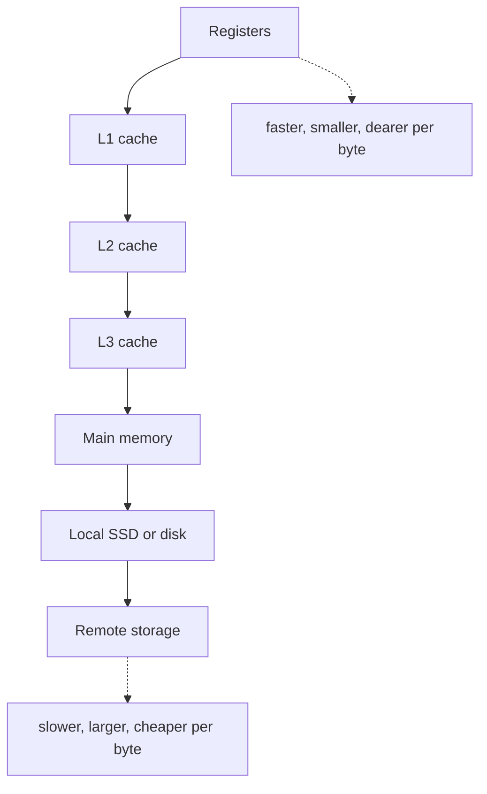
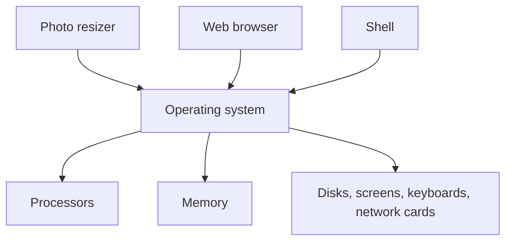
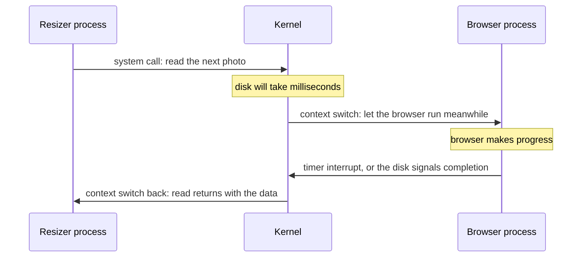

# Caches, the OS, and the big themes

> **Before this lesson:** You should have read [From source text to a running program](#/lesson/csapp/tour-hello), which follows one small program from a text file to running machine code. No other background is assumed.

## In plain words

A computer is a team of parts with very different speeds, managed by one piece of software, the **operating system** (the program, such as Linux, Windows or macOS, that starts when the machine is switched on and runs every other program). Think of a busy restaurant kitchen. The chef (the processor, the chip that carries out instructions) works fastest with the ingredients already on the counter. Fetching from the fridge takes longer, and sending someone to the warehouse takes far longer still. A sensible kitchen keeps the things it uses most within arm's reach. Computers do the same with data, and the small, close storage areas are called **caches**. The head waiter who decides which order the chef works on next, and who stops cooks from grabbing each other's pans, plays the part of the operating system.

Why this matters at work: when a program is slow, the cause is very often not the calculation itself but where its data sits, or how many other tasks share the machine. Engineers who can picture the whole kitchen can explain a slowdown, estimate what an upgrade will buy, and answer the systems questions that technical interviews routinely ask.

## Why look closer

Imagine you are handed a slow program and told to make it fast. It resizes photographs: read a file, shrink the image, write the result, repeat ten thousand times. Where do you even start? You could buy a faster processor, but will that help if the program mostly waits for the disk? You could use all sixteen cores, but what if only part of the job can be split up? You could tune the inner loop, but what if the loop's real cost is not its arithmetic at all, and is instead the way it wanders through memory?

Answering questions like these needs a mental model of the whole machine, hardware and operating system together. The first lesson built half of that model by following one program from text file to running code. This lesson builds the other half. It covers three things: why *where* data lives matters as much as what you do with it, what the operating system quietly provides to every program, and a few ideas (Amdahl's law, the kinds of parallelism, abstraction) that you will reuse in every later lesson. Treat it as the map; the remaining lessons are the territory.

## 1. Not all storage is equal

### The uncomfortable trade-off

Engineers who build storage face a stubborn rule: they can make it fast, or big and cheap, but not all three. So a real computer contains a whole family of storage technologies:

| Where | Roughly how much | Roughly how long to reach |
|---|---|---|
| processor registers | a few hundred bytes | a fraction of a nanosecond |
| first-level cache | tens of kilobytes | about a nanosecond |
| second-level cache | hundreds of kilobytes | a few nanoseconds |
| third-level cache | several megabytes | ten to twenty nanoseconds |
| main memory | gigabytes | around a hundred nanoseconds |
| solid state drive | hundreds of gigabytes | around a hundred microseconds |
| spinning disk | terabytes | several milliseconds |
| another machine over a network | no practical limit | tens of milliseconds or more |

From the top of that table to the bottom, the delay grows by a factor of roughly a hundred million. Numbers that large are hard to feel, so rescale them.

```python-run
# Rescale: pretend a first-level cache hit takes one second of human time.
levels = [("first-level cache", 1e-9), ("second-level cache", 4e-9), ("third-level cache", 15e-9),
          ("main memory", 100e-9), ("solid state drive", 100e-6), ("spinning disk", 8e-3),
          ("server on another continent", 150e-3)]
def human(seconds):
    for unit, size in (("years", 31_557_600), ("days", 86_400), ("hours", 3600), ("minutes", 60)):
        if seconds >= size:
            return f"{seconds / size:.1f} {unit}"
    return f"{seconds:.0f} seconds"
for name, t in levels:
    print(f"{name:28} {t * 1e9:>14,.0f} ns   on a human scale: {human(t / 1e-9)}")
```

If fetching a number from the nearest cache is like glancing at a note on your desk, then fetching it from a spinning disk is like waiting three months for a letter.

### Caches: keeping the useful stuff close

A program's instructions and data begin on disk. To run, they are copied to main memory; to execute, pieces are copied again into the processor. If every one of those trips went the full distance, a fast processor would spend nearly all its time waiting.

The fix is a **cache**: a small, quick store placed in front of a large, slow one, holding copies of whatever is likely to be wanted next. Processors carry several, conventionally numbered L1, L2 and L3 from nearest and smallest to furthest and largest. They are made of static RAM, a faster and costlier circuit than the dynamic RAM used for main memory.

Why should a tiny store be able to stand in for a huge one? Because of how programs behave. They loop, so the same instructions run again and again. They walk through arrays, so after touching one element they usually touch its neighbour. This habit of reusing the same things and their neighbours is called **locality**, and it is what makes a few kilobytes of cache satisfy the vast majority of requests.

### One idea, repeated at every level

Step back and the same pattern shows up everywhere. The caches hold a slice of main memory. Main memory holds a slice of the disk: recently used files and the active parts of running programs. A laptop's disk holds a slice of what lives on servers elsewhere, as when a browser keeps pages it has already downloaded. Stack these up and you get the **memory hierarchy**: a ladder of storage in which every rung is a cache for the slower, roomier rung beneath it.



The upshot for you: you cannot rearrange the hierarchy, but you decide how your code moves through memory. Two loops that perform identical arithmetic can differ in speed by ten times purely because one sweeps through an array in storage order and the other hops about. For the photo resizer, that is the difference between processing an image row by row and processing it column by column. A later module is devoted to exactly this.

## 2. What the operating system gives every program

### A referee and a translator

The resizing program never talks to a disk controller. It never sets up the screen, never decides which core it runs on, never checks whether another program is using the same memory chip. Something does all that for it.

That something is the **operating system**. Think of it as playing two roles at once. As a *referee*, it stops any one program, whether buggy or hostile, from wrecking the hardware or trampling on other programs. As a *translator*, it turns the bewildering variety of real devices into a few simple, consistent services, so that a program written once works on thousands of different machines.



The services come in three bundles. Each hides more hardware than the one before:

| The OS offers | which stands in for |
|---|---|
| a **file** | any input/output device |
| **virtual memory** | main memory plus the disk space that backs it |
| a **process** | the whole machine: processor, memory and devices together |

### Processes: the private-computer illusion

Start the resizer and, as far as it can tell, it owns the computer. Its instructions seem to run back to back with no gaps. Memory seems to contain only its own data. In truth, dozens of other programs are running too. The **process** is the mechanism that maintains this pleasant fiction: it is one running instance of a program, together with everything the system must remember about it.

How do sixty processes share eight cores? By taking turns very quickly. The operating system lets one run for a few milliseconds, then freezes it and lets another go. To freeze a process it records that process's **context**: where it was in its code, what its registers held, which memory belongs to it. To thaw it, it puts all of that back. This swap is a **context switch**. Because it happens many times a second, every program appears to make steady progress, and the word for this overlapping of activities is **concurrency**.

The part of the operating system that does the swapping, and that stays loaded in memory at all times, is the **kernel**. A program reaches it through a **system call**: a special instruction that hands control to the kernel with a request such as "read from this file" or "start that program". The kernel does the work and hands control back. One point often misunderstood: the kernel is not itself a process running off to the side. It is shared code and data that springs into action on behalf of whichever process needs it.



### Threads: several workers in one process

A process is not limited to one line of execution. It can contain several **threads**, each working through the code independently while all of them share the same memory and open files. The resizer could use eight threads to shrink eight photos at once, all drawing from one shared list of work.

Threads are popular for three reasons. Sharing data between them is trivial, since they already see the same variables. They are lighter than processes to create and to switch between. And they are the natural way to put a multi-core processor to work on a single job. The price, which later lessons examine closely, is that shared data can be corrupted when two threads change it at once.

### Virtual memory: a private address space

Each process is given its own **virtual address space**, a numbered range of memory locations that appears to belong to it alone. Two processes can both store something at address `0x601040` and never interfere, because the hardware and the kernel translate each process's addresses to different places in the physical chips, or to disk when memory runs short.

Every process's space is organised the same way. Reading from low addresses to high:

```python-run
# One process's address space on 64-bit Linux, lowest addresses first (addresses are illustrative).
regions = [
    (0x0000_0040_0000, "machine code of the program, loaded from its executable file"),
    (0x0000_0060_0000, "global variables"),
    (0x0000_01A0_0000, "heap: memory requested while running, grows upward"),
    (0x7F2B_4000_0000, "shared libraries, such as the standard C library"),
    (0x7FFD_8000_0000, "stack: one frame per active function call, grows downward"),
    (0xFFFF_8000_0000_0000, "kernel memory: present but not accessible to the program"),
]
for addr, what in regions:
    print(f"{addr:#020x}  {what}")
```

- The **code and global data** have a fixed size, known when the program was built.
- The **heap** changes size while the program runs, as it requests and releases memory (in C, through `malloc` and `free`). The resizer's image buffers live here.
- **Shared libraries** occupy a region in the middle. One copy of a library in physical memory can appear in many processes at once.
- The **stack** holds the local variables and bookkeeping of functions that have been called and have not yet returned. It lengthens with each call and shortens with each return.
- The **kernel's region** sits at the top. A program that tries to read or write there is stopped immediately.

Underneath, virtual memory is itself an application of the hierarchy idea: the full contents of a process's address space conceptually live on disk, and main memory caches the parts in current use.

### Files: one interface for every device

To the operating system, a **file** is a numbered run of bytes. The remarkable design decision in Unix-like systems is to present *every* device this way. A document on disk is a file. So is the keyboard (bytes arrive when keys are pressed), the terminal window (bytes written appear as text), and a network connection.

The benefit is uniformity. A program needs only one small set of operations, open, read, write and close, to deal with all of them. The resizer's author never had to know whether the photos sat on a spinning disk, an SSD, a USB stick or a network share. And a program written to read "a file" can be fed from the keyboard, or from another program's output, without modification.

## 3. The network is one more device

Follow that thought one step further. A network card moves bytes in and out of main memory in the same way as a disk controller does. From one computer's point of view, then, a network is another place bytes can be read from and written to; the difference is that the far end is a different computer.

That is why remote work feels like local work. Suppose the resizer is started on a distant server from a laptop using a remote terminal:

1. keystrokes on the laptop are sent as bytes across the network;
2. a program on the server receives them and feeds them to a shell there;
3. the shell starts the resizer, whose progress messages are bytes written to what it believes is a terminal;
4. those bytes travel back across the network and are drawn in the laptop's window.

Every step is a read or a write. The pattern of one side asking and the other side answering, known as the client–server model, underlies essentially every networked application and gets its own module later.

## 4. Three ideas you will keep using

### Amdahl's law: the limits of fixing one thing

Back to the opening question. Measurement shows the resizer spends 70% of its time shrinking pixels and 30% reading and writing files. You find a way to make the pixel work five times faster. Is the program now five times faster?

No. Work it out on a run that used to take 100 seconds. The file handling still takes 30. The pixel work drops from 70 to 14. The new total is 44 seconds, so the speedup is $100/44 \approx 2.27$.

In general, if a portion that takes a fraction $\alpha$ of the original time is made $k$ times faster, the new time is the untouched part plus the shrunken part,

$$T_{\text{new}} = T_{\text{old}}\left[(1-\alpha) + \frac{\alpha}{k}\right]$$

and the overall speedup is

$$S = \frac{T_{\text{old}}}{T_{\text{new}}} = \frac{1}{(1-\alpha) + \alpha/k}.$$

Now push it to the extreme. Suppose the pixel work became *infinitely* fast, taking no time whatever. The program would still need its 30 seconds of file handling. The best possible speedup is therefore

$$S_{\max} = \frac{1}{1-\alpha} = \frac{1}{0.3} \approx 3.3.$$

This is **Amdahl's law**, and its message is sobering: the part you do not improve sets a hard ceiling on what improving the rest can achieve. Two working rules follow. Measure first, because effort poured into something that takes 5% of the time can never buy more than about 5%. And for large gains, there is no alternative to speeding up nearly everything.

```python-run
def speedup(alpha, k):
    return 1 / ((1 - alpha) + alpha / k)

print("resizer: 70% of the time made 5x faster ->", round(speedup(0.7, 5), 2))
print("resizer: ceiling if that 70% took no time ->", round(1 / (1 - 0.7), 2))
print()
print("share improved | 2x      4x      16x     1000x  | ceiling")
for alpha in (0.25, 0.50, 0.90, 0.99):
    row = "".join(f"{speedup(alpha, k):8.2f}" for k in (2, 4, 16, 1000))
    print(f"     {alpha:4.0%}     |{row}  | {1 / (1 - alpha):6.1f}")

# Turning the formula around: to double the resizer's speed, how much faster must the pixel code get?
alpha, target = 0.7, 2.0
k = alpha / (1 / target - (1 - alpha))
print(f"\nfor a {target}x overall gain with a 70% share: the pixel code must be {k:.1f}x faster")
```

Look at the last row of the table: even when 99% of the work is made a thousand times faster, the whole improves about ninety-fold, because the stubborn 1% now dominates.

> [!INTERVIEW]
> **"We moved the job to a 64-core machine and it only got about 9 times faster. What happened?"** Amdahl's law with cores as the improvement factor. If a fraction $p$ of the work can be spread across $n$ cores, the speedup is $1/((1-p)+p/n)$ and can never exceed $1/(1-p)$. A job that is 90% parallel is capped at 10 times, and on 64 cores it reaches about 8.8. The serial remainder (reading input, merging results, waiting on locks) is the bottleneck. Shrink that remainder; adding cores will not help.

### Three flavours of doing several things at once

Performance has long been pursued by overlapping work. It helps to separate two words. **Concurrency** means several activities are under way during the same stretch of time. **Parallelism** means using that overlap to finish sooner by truly running things simultaneously. A single core juggling tasks is concurrent only; several cores working together are parallel too.

Hardware offers parallelism at three scales.

**Across threads.** A **multi-core** chip contains several independent processors. Usually each has private first- and second-level caches, and all share the third. Some designs add **hyperthreading**, in which one core keeps two sets of registers and two program counters so that it can interleave two threads at the granularity of single clock cycles, sharing the rest of its circuitry between them. More cores let a system run more programs at once without juggling. They speed up one program only if that program was written as cooperating threads.

**Across instructions.** Inside one core, many instructions are in flight together even when the program is a single thread. The processor splits each instruction into steps and overlaps the steps of successive instructions, like a factory assembly line (pipelining). It also looks ahead and starts later instructions early when they do not depend on earlier ones. A core that completes more than one instruction per clock cycle on average is called **superscalar**. This happens automatically, though how you write a loop affects how much the processor can overlap.

**Across data.** Some instructions operate on a whole row of numbers at once: for instance, adding eight pairs of values in one step. This is **SIMD**, single instruction, multiple data. It suits exactly the kind of work the resizer does, where the same arithmetic is applied to millions of pixels.

```python-run
# The resizer on more and more cores, if 95% of its work can be divided among them.
p = 0.95
for cores in (1, 2, 4, 8, 16, 64, 1024):
    s = 1 / ((1 - p) + p / cores)
    print(f"{cores:5} cores -> {s:6.2f}x faster   ({100 * s / cores:5.1f}% of ideal)")
print("ceiling:", round(1 / (1 - p)), "x however many cores are added")
```

### Abstraction: simple faces on complicated things

Every layer described in this track presents a tidy model to the layer above and conceals a messy reality below.

- The **instruction set** is the processor's public face. Software sees a machine that carries out instructions strictly one after another. The silicon actually runs many at once and out of order, yet takes great care to produce the results the simple model promises. That promise is why one compiled program runs on chips from different manufacturers and different decades.
- **Files**, **virtual memory** and **processes** are the operating system's public face, hiding devices, physical memory and the sharing of processors.
- A **virtual machine** goes further and imitates an entire computer, so that a complete operating system can run as a guest inside another.

Abstractions are what let a person hold a system in their head. But each one leaks under pressure, and those leaks are where bugs and slowdowns hide. An integer type wraps around at a certain size. A decimal fraction is stored only approximately. A memory access takes one nanosecond or a hundred. A write to a file may still be sitting in a buffer when the power fails. Much of this track is about learning both sides: how to lean on each abstraction, and what lies underneath for the day it gives way.

> [!INTERVIEW]
> **"Concurrency versus parallelism?"** Concurrency is about structure: several tasks are in progress over the same period, possibly by interleaving on one processor. Parallelism is about execution: several tasks are running at literally the same moment on separate hardware. One core switching between two tasks gives concurrency without parallelism; two cores each running a task gives both. Concurrency organises a program; parallelism speeds it up.

## 5. Pitfalls

- **Picturing the kernel as a separate program.** It is code that runs within whichever process invoked it or was interrupted.
- **Mixing up the time bases in Amdahl's law.** The fraction $\alpha$ is measured on the *original* run, before any improvement.
- **Quoting the speedup of a part as if it applied to the whole.**
- **Expecting speed to scale with core count.** The portion that cannot be divided caps the gain.
- **Assuming every memory access costs the same.** It depends on which rung of the hierarchy holds the data at that moment.
- **Thinking an address identifies a physical location.** Program addresses are virtual; the same number in two processes points to different memory.
- **Trusting abstractions blindly.** Know where each one leaks.

## Summary

- Storage ranges from tiny, very fast registers to vast, slow disks and remote servers. A cache keeps likely-needed data in a faster store; applied at every level this forms the memory hierarchy, and locality is what makes it effective.
- The operating system protects hardware and offers uniform services through three abstractions: files (devices), virtual memory (memory and disk), and processes (the whole machine).
- Processes take turns on the processors through context switches carried out by the kernel, which programs enter via system calls. Threads are multiple flows inside one process sharing its memory.
- A virtual address space contains code, global data, heap, shared libraries and stack, with the kernel's region above.
- A network is, to one machine, another device to read from and write to.
- Amdahl's law: speeding up a fraction $\alpha$ by a factor $k$ yields $1/((1-\alpha)+\alpha/k)$ overall, at most $1/(1-\alpha)$.
- Parallelism exists across threads, across instructions and across data. Abstractions make systems manageable, and knowing their limits makes you effective.

## Glossary

- **Processor (CPU)**: the chip that carries out a program's instructions one small step at a time.
- **Main memory (RAM)**: the fast working storage that holds running programs and their data; it is emptied when the power goes off.
- **Cache**: a small, fast store that keeps copies of data likely to be needed soon, so the slow store behind it is consulted less often.
- **Locality**: the habit of programs to reuse the same data, and data stored next to it, within a short time.
- **Operating system**: the software that manages the hardware and runs all other programs.
- **Kernel**: the core part of the operating system that is always loaded in memory.
- **Process**: one running copy of a program, together with everything the system remembers about it.
- **Thread**: one line of execution inside a process; a process may have several that share its memory.
- **Context switch**: the act of pausing one process and resuming another on the same processor.
- **Virtual memory**: the arrangement that gives each process what looks like its own private memory.
- **Amdahl's law**: the formula showing that the part of a job you do not speed up limits the total gain.
- **Concurrency / parallelism**: several tasks in progress over the same period / several tasks truly running at the same instant.

```quiz
[
  {"q": "Which statement best describes the memory hierarchy?",
   "options": ["Every level has the same speed but different capacity", "Each level serves as a cache for the slower, larger level below it", "Data is stored at exactly one level at a time", "Lower levels are faster but more expensive"],
   "answer": 1, "explain": "The organising principle is caching: a smaller, faster store holds a subset of what the next level contains."},
  {"q": "Virtual memory is the operating system's abstraction of which hardware?",
   "options": ["The processor only", "I/O devices only", "Main memory together with disk storage", "The network adapter"],
   "answer": 2, "explain": "Files stand in for I/O devices; virtual memory for main memory plus disk; processes for the processor, memory and devices together."},
  {"q": "A part of a program that takes 60% of the run time is made 3 times faster. What is the overall speedup?",
   "options": ["3.00", "1.80", "1.67", "2.50"],
   "answer": 2, "explain": "1 / (0.4 + 0.6/3) = 1 / 0.6, which is about 1.67."},
  {"q": "A component accounts for 80% of execution time. What is the maximum possible overall speedup from improving only that component?",
   "options": ["1.25", "5", "8", "Unlimited"],
   "answer": 1, "explain": "Even if that component took no time at all, the remaining 20% would still run, so the limit is 1/(1 - 0.8) = 5."},
  {"q": "What does the kernel do during a context switch?",
   "options": ["Recompiles the program", "Saves the state of the running process, restores the saved state of another, and lets that one continue", "Erases the process's memory", "Creates a new thread"],
   "answer": 1, "explain": "The saved state (position in the code, register contents, memory mappings) lets a process later resume exactly where it stopped."},
  {"q": "Which region of a process's address space grows and shrinks as functions are called and return?",
   "options": ["The heap", "The stack", "The shared library region", "The program code"],
   "answer": 1, "explain": "The stack holds a frame for each active call. The heap changes size in response to explicit allocation requests instead."},
  {"q": "Which statement about concurrency and parallelism is correct?",
   "options": ["They are synonyms", "A single core interleaving two tasks is concurrent but not parallel", "Parallelism is possible on one ordinary core", "Concurrency requires multiple processors"],
   "answer": 1, "explain": "Interleaving gives overlapping lifetimes, which is concurrency. Parallelism needs tasks executing at the same instant on separate hardware."},
  {"q": "What does SIMD refer to?",
   "options": ["Several threads sharing one core", "One instruction applying the same operation to several data values at once", "A cache shared by all cores", "The system call mechanism"],
   "answer": 1, "explain": "Single-instruction, multiple-data hardware processes a short vector of values in one step, which benefits image, audio and numeric code."}
]
```

> **Source:** CS:APP 3e, §1.5–1.9
