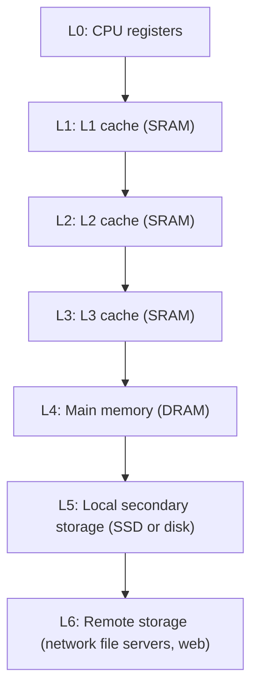
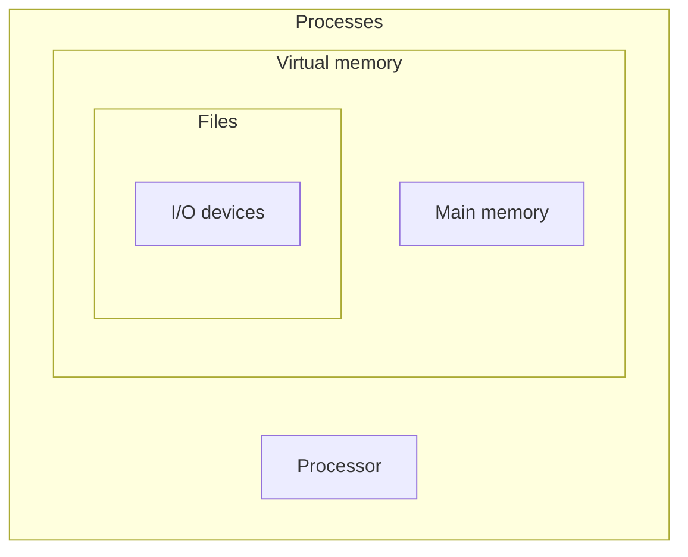
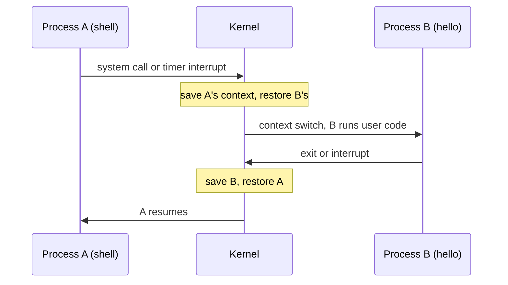
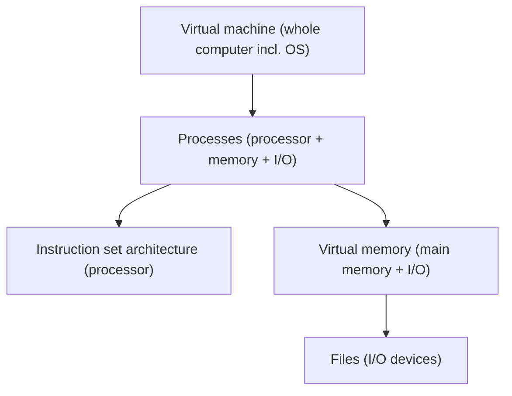

# Caches, the OS, and the big themes

The previous lesson ended with an observation: running `hello` is mostly *copying*. Bytes travel from disk to memory, from memory to the processor, from the processor to the display. This lesson explains how systems make that copying fast (caches and the memory hierarchy), how the operating system hides hardware behind clean abstractions (processes, threads, virtual memory, files), how machines talk to each other (networks), and the two big quantitative themes that recur throughout the book: **Amdahl's law** and **concurrency/parallelism**.

## 1. Caches matter

Physics imposes a harsh trade-off: larger storage devices are slower, and faster devices cost more per byte. The book gives some striking ratios for a typical system:

- A disk may be about **1,000×** larger than main memory, yet reading a word from disk can take about **10,000,000×** longer than from memory.
- The register file holds only a few hundred bytes, but the processor reads it nearly **100×** faster than main memory.

Worse, the **processor–memory gap** keeps widening, because it is easier and cheaper to make processors faster than to make main memory faster.

The fix is **cache memories**: small, fast staging areas holding information the processor is likely to need soon. An L1 cache on the processor chip holds tens of thousands of bytes and is nearly as fast as the registers. A larger L2 cache (hundreds of thousands to millions of bytes) might take about 5× longer than L1 but is still 5–10× faster than main memory. Modern chips add an L3. Caches are built from **SRAM** (static RAM), a faster and more expensive technology than the DRAM of main memory.

Caching works because of **locality**: programs tend to access data and code in localized regions, and to re-access what they used recently. With the likely-to-be-used data in fast caches, most memory operations complete at cache speed.

> [!TIP]
> One of the book's headline claims: programmers who understand caches can often speed up their programs by an **order of magnitude**, with no change to the algorithm, just by changing access order. Module 6 proves it with the "memory mountain".

## 2. Storage devices form a hierarchy

Inserting caches between the CPU and memory is one instance of a general idea: organize storage as a **memory hierarchy**, where each level acts as a cache for the level below.



Moving down the hierarchy, devices become larger, slower and cheaper per byte. Registers cache words from L1; L1 caches lines from L2; L2 from L3; L3 from main memory; main memory caches disk blocks (this is exactly what virtual memory does, Module 9); and the local disk can cache files fetched from remote servers (a browser cache, for example).

## 3. The operating system manages the hardware

When `hello` printed its message it never touched the display directly. It asked the operating system. The OS has two jobs: protect the hardware from misuse by runaway programs, and give programs simple uniform mechanisms over messy, diverse devices. It achieves both through a few abstractions.



Files abstract I/O devices; virtual memory abstracts main memory *and* I/O devices (disks); processes abstract the processor, main memory and I/O devices together.

### 3.1 Processes

A **process** is the OS's abstraction for a running program. Each process gets the illusion that it alone uses the processor, main memory and I/O devices, and that its instructions run one after another without interruption. Many processes run **concurrently**: their instructions are interleaved. A single core gives this illusion by switching among processes, a mechanism called **context switching**.

The **context** is all the state the OS must save to resume a process later: the PC, the register file, the contents of main memory belonging to it, and so on. When the OS decides to move control from process A to process B, it:

1. Saves A's context.
2. Restores B's context.
3. Passes control to B, which resumes exactly where it left off.

The switch is managed by the **kernel**, the part of the OS that is always resident in memory. The kernel is *not* a separate process; it is a collection of code and data structures the system uses to manage all processes. When a program needs an OS service (reading a file, say), it executes a special **system call** instruction that transfers control into the kernel, which performs the operation and returns.



### 3.2 Threads

A process can consist of multiple **threads** (execution units), each running in the *context of the process* and sharing its code and global data. Threads are an increasingly important programming model because they share data more easily than processes do, they are generally cheaper to create and switch than processes, and multithreading is one way to make a program run faster on multicore hardware (Module 12).

### 3.3 Virtual memory

**Virtual memory** gives each process the illusion that it has exclusive use of main memory. Each process sees the same uniform **virtual address space**. On Linux the layout, from low addresses to high, is:

| Region | Contents |
|---|---|
| Program code and data | Code starts at the same fixed address for all processes, followed by global C variables. Initialized directly from the executable file. |
| Heap | Run-time heap, which grows and shrinks dynamically through `malloc` and `free`. |
| Shared libraries | Code and data for shared libraries such as the C standard library and the math library, near the middle of the address space. |
| User stack | Used by the compiler to implement function calls. Grows and shrinks with each call and return; on x86-64 it grows toward *lower* addresses. |
| Kernel virtual memory | The top of the space, reserved for the kernel. Application code may not read or write it or call kernel functions directly. |

Making virtual memory work requires sophisticated hardware–software cooperation: the hardware translates *every* address the processor generates. The basic idea is to store the contents of a process's virtual memory on disk and use main memory as a cache for it. Module 9 is entirely about this.

### 3.4 Files

A **file** is just a sequence of bytes. Every I/O device (disks, keyboards, displays, even networks) is modeled as a file, and all input and output is done by reading and writing files with a small set of system calls known as **Unix I/O**. This simple, elegant notion means the same program can read from a disk file, a terminal or a network connection without knowing which (Module 10).

## 4. Systems communicate with other systems using networks

From the viewpoint of an individual system, a network is just another I/O device. When the system copies a sequence of bytes from main memory to the network adapter, the data flow across the network to another machine. Running `hello` on a remote machine via `telnet` or `ssh` is a nice example: your keystrokes are sent to a server, the server's shell runs `hello`, and the output string is sent back over the network to your terminal. Module 11 builds a working web server from these pieces.

## 5. Amdahl's law

Gene Amdahl observed that when you speed up one part of a system, the overall effect depends on *how significant that part was* and *how much it sped up*. Suppose a fraction $\alpha$ of the running time is improved by a factor of $k$. Then

$$T_{new} = (1-\alpha)T_{old} + \frac{\alpha T_{old}}{k} = T_{old}\left[(1-\alpha) + \frac{\alpha}{k}\right]$$

so the speedup is

$$S = \frac{T_{old}}{T_{new}} = \frac{1}{(1-\alpha) + \alpha/k}.$$

**Worked example (from the book).** A part consuming 60% of the time ($\alpha = 0.6$) is sped up by 3×. Then $S = 1/(0.4 + 0.6/3) = 1/0.6 \approx 1.67\times$. A substantial improvement to a major component bought much less overall.

**The limit.** Even if $k \to \infty$ (the part takes no time at all), $S \to 1/(1-\alpha)$. With $\alpha = 0.6$, you can never exceed 2.5×. The lesson: to significantly speed up a whole system, you must improve a very large fraction of it.

```python-run
def amdahl(alpha, k):
    return 1.0 / ((1 - alpha) + alpha / k)

for alpha in (0.5, 0.6, 0.9, 0.99):
    row = [f"{amdahl(alpha, k):6.2f}" for k in (2, 4, 10, 100, 1e12)]
    print(f"alpha={alpha:4}: k=2,4,10,100,inf ->", " ".join(row))

# Inverting the law: what k does a 90%-improvable engine need for 4x overall?
alpha, S = 0.9, 4.0
k = alpha / (1/S - (1 - alpha))
print(f"needed k = {k:.2f}")
```

The last line answers one of the book's practice problems: with 90% of the system improvable and a 4× target, the improvable part needs about a 6× speedup.

> [!INTERVIEW]
> Amdahl's law is the standard answer to "we parallelized the hot loop across 64 cores, why is it only 5× faster?" If 20% of the work is serial, the speedup can never exceed $1/0.2 = 5\times$ regardless of core count. Always profile first and attack the largest fraction.

> [!NOTE]
> Expressing speedup as a ratio $T_{old}/T_{new}$ ("2.2×") is clearer than a percentage, because "improved by 120%" is ambiguous about the denominator.

## 6. Concurrency and parallelism

Two demands have driven computing forward: we want computers to *do more*, and to *run faster*. Both improve when the processor does more things at once. The book uses **concurrency** for the general concept of a system with multiple simultaneous activities, and **parallelism** for the use of concurrency to make a system run faster. Parallelism appears at three levels of abstraction, from highest to lowest:

### 6.1 Thread-level concurrency

With processes and threads, multiple control flows execute within one system. Originally this was *simulated*: a **uniprocessor** rapidly switched between flows. **Multiprocessor** systems have multiple CPUs under one OS. **Multi-core** processors put several CPUs ("cores") on one chip; in the book's Core i7 example, each core has its own L1 and L2 caches and the cores share a higher-level cache and the memory interface.

**Hyperthreading** (simultaneous multithreading) lets a single core execute multiple flows. Some hardware is duplicated per thread (PCs, register files) while other hardware, such as the floating-point units, is shared. A conventional core needs about 20,000 cycles to switch threads; a hyperthreaded core decides cycle by cycle which thread to run, so when one thread waits for data from memory it can immediately execute another. The book's Core i7 runs two threads per core, so a four-core chip runs eight threads in parallel.

### 6.2 Instruction-level parallelism

At a lower level, modern processors execute multiple *instructions* at once. Early microprocessors needed 3–10 cycles per instruction. With **pipelining** (Module 4), the actions of an instruction are split into stages and many instructions are in flight simultaneously. Processors that sustain execution rates faster than one instruction per cycle are called **superscalar**; Module 5 shows how to write code that exposes this parallelism.

### 6.3 SIMD parallelism

At the lowest level, special instructions perform a **single instruction on multiple data**. Intel and AMD processors have instructions that add, for example, 8 pairs of single-precision floats in parallel, mainly for image, sound and video processing. Compilers can sometimes vectorize automatically; more reliably, programmers use vector data types supported by GCC.

## 7. The importance of abstractions

Abstraction is the thread tying the whole subject together:



On the processor side, the **ISA** abstracts the actual hardware so that the same machine code runs on very different implementations. On the OS side, files, virtual memory and processes abstract devices, memory, and running programs. A **virtual machine** abstracts the entire computer, OS included, so different OSes can run on the same hardware. Each abstraction lets programmers ignore the details below it, and this track teaches you when you *can't* afford to ignore them.

## 8. Pitfalls and misconceptions

> [!WARNING]
> **Concurrency is not parallelism.** Two processes on a single core run *concurrently* (interleaved) but not in *parallel*. Parallelism requires multiple execution units actually working simultaneously.

> [!WARNING]
> **The kernel is not a process.** It is code and data that runs on behalf of processes, entered through system calls, exceptions and interrupts (Module 8).

> [!WARNING]
> **Amdahl's law is about time fractions, not code fractions.** A 10-line function that consumes 90% of runtime is $\alpha = 0.9$.

## 9. Summary

- A memory hierarchy of registers, SRAM caches, DRAM, disk and remote storage gives the illusion of a memory that is both large and fast, thanks to locality.
- The OS provides processes (with context switches and system calls), threads, virtual memory (a uniform per-process address space) and files.
- Networks are just I/O devices from one machine's point of view.
- Amdahl's law: $S = 1/((1-\alpha)+\alpha/k)$, bounded by $1/(1-\alpha)$.
- Parallelism exists at the thread, instruction and SIMD levels.

## Check yourself

```quiz
[
  {"q": "A part taking 60% of runtime is made 3x faster. What is the overall speedup?", "options": ["3.0x", "1.8x", "1.67x", "1.25x"], "answer": 2,
   "explain": "S = 1 / (0.4 + 0.6/3) = 1 / 0.6 = 1.67x."},
  {"q": "With alpha = 0.75, what is the maximum possible speedup as k goes to infinity?", "options": ["1.33x", "4x", "7.5x", "Unbounded"], "answer": 1,
   "explain": "The limit is 1/(1-alpha) = 1/0.25 = 4x; the unimproved 25% still takes time."},
  {"q": "In the Linux virtual address space, which region grows toward lower addresses on x86-64?", "options": ["Heap", "User stack", "Program code", "Shared libraries"], "answer": 1,
   "explain": "The stack starts near the top of user space and grows down as functions are called; the heap grows up."},
  {"q": "What technology are L1 and L2 caches built from?", "options": ["DRAM", "SRAM", "Flash", "Magnetic disk"], "answer": 1,
   "explain": "Caches use static RAM, which is faster and more expensive per bit than the DRAM used for main memory."},
  {"q": "Which statement about context switching is correct?", "options": ["It is performed by the user program", "It saves the current process's state and restores another's, under kernel control", "It only happens on multicore machines", "It copies the process's code to disk"], "answer": 1,
   "explain": "The kernel saves the context (PC, registers, memory state) of one process and restores another's, giving the illusion of exclusive CPU use."},
  {"q": "Hyperthreading lets a single core...", "options": ["Run at twice the clock rate", "Execute multiple threads by duplicating some state such as PCs and register files", "Avoid caches", "Run two operating systems"], "answer": 1,
   "explain": "Per-thread state is duplicated while functional units are shared, so the core can switch threads cycle by cycle, e.g. while one waits on memory."},
  {"q": "Which is the best example of SIMD parallelism?", "options": ["Two processes on two cores", "A pipeline with five stages", "One instruction adding eight pairs of floats", "A server handling many clients"], "answer": 2,
   "explain": "Single instruction, multiple data: one instruction operates on a vector of values."}
]
```

> **Source:** CS:APP 3e, §1.5–1.10 (Caches matter; Storage devices form a hierarchy; The OS manages the hardware; Networks; Important themes: Amdahl's law, concurrency and parallelism, abstractions).
