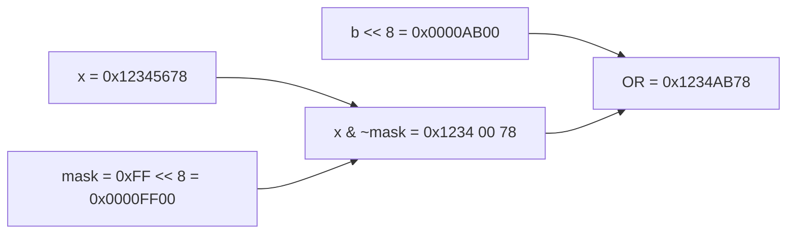

# Bits, bytes, words and bit-level operations

> **Before this lesson:** Read [From source text to a running program](#/lesson/csapp/tour-hello) first. You need no mathematics beyond ordinary arithmetic; the lesson introduces counting in base 2 and base 16 from the beginning.

## In plain words

Everything a computer stores is built from **bits**. A bit is a single yes-or-no value, written 0 or 1, like one light switch that is either off or on. One switch cannot say much, but a row of eight switches can be set in 256 different ways, and a row of that length is called a **byte**. Numbers, letters, photographs and programs are all long rows of switches. The computer does not know which is which; the program reading the row decides what the pattern means, in the same way that the marks "1/2" can mean a date, a fraction or a score depending on where you see them.

Why this matters at work: bugs caused by misreading a row of bits are common and confusing, for example data that looks scrambled after travelling between two different machines. People who write network software, file formats, device controllers or graphics code set and test individual bits every day, and interviewers like bit puzzles because they show whether a candidate understands what the machine really stores.

## Why look closer

Open any file in a hex viewer and you see the same thing: rows of two-character codes such as `7f 45 4c 46`. A photograph, a spreadsheet, a compiled program and a love letter are indistinguishable at this level. All of them are sequences of bits, and what a given sequence *means* depends entirely on who is reading it and what they expect. That single idea, that information is bits plus a context for interpreting them, underlies everything else in this track. It explains why a program can print a negative number where you expected a large positive one, why data written on one machine can come out scrambled on another, and why a file sent over a network needs an agreed layout.

This lesson builds fluency with the raw material. You will learn to read and write hexadecimal without effort, to know how many bytes each C type occupies, to predict the order in which those bytes sit in memory, and to manipulate individual bits with the operators `&`, `|`, `^`, `~`, `<<` and `>>`. The last skill is not a curiosity. Device drivers, network protocols, graphics code, compression, cryptography and hash functions are all written in it, and bit puzzles are a fixture of technical interviews.

## 1. Why bits, and why groups of eight

A digital circuit can reliably tell apart two conditions: a high voltage and a low one, a magnetised spot and its opposite, a charged capacitor and an empty one. Building hardware to distinguish ten levels would be far more delicate, so computers store and compute with two-valued signals: **bits**.

One bit says very little. The power comes from grouping bits and agreeing on what each pattern stands for. With *k* bits there are $2^k$ distinct patterns, which could represent $2^k$ different numbers, characters, colours or instructions.

The smallest group a program can address directly is the **byte**: eight bits, and therefore 256 patterns. A program views memory as an enormous array of bytes, each identified by a number called its **address**.

## 2. Hexadecimal: a shorthand for bit patterns

Writing a byte in binary takes eight digits (`10110101`), which is tedious and hard to read. Decimal (181) is compact but conceals the bits. **Hexadecimal**, base 16, is the compromise everyone uses. It has sixteen digits, `0`–`9` and then `A`–`F` for the values ten to fifteen, and its great virtue is that **one hex digit corresponds to exactly four bits**. A byte is therefore two hex digits, from `00` to `FF`. In C, hex constants begin with `0x`, and letter case does not matter: `0xfa1d`, `0xFA1D` and `0xFa1D` are the same number.

Only six correspondences need real memorising; the rest are the decimal digits you already know:

| Hex | A | B | C | D | E | F |
|---|---|---|---|---|---|---|
| Decimal | 10 | 11 | 12 | 13 | 14 | 15 |
| Binary | 1010 | 1011 | 1100 | 1101 | 1110 | 1111 |

**Hex to binary**: replace each digit by its four bits. `0x2D7` → `0010 1101 0111`.

**Binary to hex**: split the bits into groups of four *starting from the right*, padding the leftmost group with zeros if needed, and translate each group. `1100101101` → `11 0010 1101` → `0011 0010 1101` → `0x32D`.

**Powers of two** are especially easy. $2^n$ in binary is a 1 followed by *n* zeros. Write *n* as $4q + r$. The hex form is a leading digit of 1, 2, 4 or 8 (for *r* = 0, 1, 2, 3) followed by *q* zeros. So $2^{11}$, with $11 = 4 \cdot 2 + 3$, is `0x800`; and $2^{20}$ is `0x100000`.

**Decimal to hex** takes arithmetic: divide by 16 repeatedly and collect the remainders, last one first. For 2,026: 2026 ÷ 16 = 126 remainder 10 (`A`); 126 ÷ 16 = 7 remainder 14 (`E`); 7 ÷ 16 = 0 remainder 7. Reading upward: `0x7EA`. To go back, multiply out: $7 \cdot 256 + 14 \cdot 16 + 10 = 2026$.

```python-run
def to_hex_by_groups(bits):
    bits = bits.replace(" ", "")
    bits = bits.zfill((len(bits) + 3) // 4 * 4)                 # pad on the LEFT to a multiple of 4
    groups = [bits[i:i + 4] for i in range(0, len(bits), 4)]
    return " ".join(groups), "0x" + "".join("0123456789ABCDEF"[int(g, 2)] for g in groups)

print(to_hex_by_groups("1100101101"))
print("0x2D7 in binary:", " ".join(f"{int(d, 16):04b}" for d in "2D7"))

n, digits = 2026, []
while n:
    n, r = divmod(n, 16)
    digits.append("0123456789ABCDEF"[r])
print("2026 in hex by repeated division: 0x" + "".join(reversed(digits)), "| check:", hex(2026))
for n in (11, 20, 30):
    print(f"2^{n} = {2 ** n:#x}")
```

## 3. Words and the sizes of data

Every machine has a **word size**: the natural size of a pointer. Since an address must fit in a word, the word size sets the largest possible virtual address space. A machine with *w*-bit words can address $2^w$ bytes. For 32 bits that is 4 gigabytes, a limit that became a real obstacle in the 2000s. For 64 bits it is 16 exabytes, more than anyone can install. Most machines are now 64-bit, and they can still run programs compiled for 32 bits.

C's types have sizes that depend partly on the kind of program being compiled:

| Bytes on a 64-bit system | Types |
|---|---|
| 1 | `char`, `int8_t` |
| 2 | `short`, `int16_t` |
| 4 | `int`, `int32_t`, `float` |
| 8 | `long`, `int64_t`, `double`, every pointer |

In a 32-bit program, `long` and pointers shrink to 4 bytes while everything else stays the same. That variability is a classic portability trap. Decades of code assumed that a pointer fits in an `int`, which was true on 32-bit systems and silently truncates addresses on 64-bit ones. The C standard only guarantees *minimum* ranges for the basic types. When the exact width matters, as in file formats and network messages, use the fixed-width types from `<stdint.h>`: `int32_t` is 32 bits everywhere.

```python-run
import struct
print("type      bytes   distinct values")
for name, code in (("char", "b"), ("short", "h"), ("int", "i"), ("long long", "q"), ("float", "f"), ("double", "d")):
    size = struct.calcsize("=" + code)
    print(f"{name:10}{size:4}   2^{8 * size}")
print("\na 32-bit pointer reaches", 2**32 // 2**30, "GiB; a 64-bit pointer reaches", 2**64 // 2**60, "EiB")
```

## 4. Byte order

A 4-byte `int` occupies four consecutive addresses, and its own address is the lowest of the four. That leaves a question with no naturally right answer: which end of the number goes at the lowest address?

Take the value `0x1A2B3C4D` stored at address `0x200`:

| Address | `0x200` | `0x201` | `0x202` | `0x203` |
|---|---|---|---|---|
| **Little-endian** | `4D` | `3C` | `2B` | `1A` |
| **Big-endian** | `1A` | `2B` | `3C` | `4D` |

- **Little-endian** machines put the *least* significant byte first. x86-64 does this, and so does ARM as configured in phones and nearly all current laptops.
- **Big-endian** machines put the *most* significant byte first, matching how we write numbers. Some older processor families did this, and so do the Internet's protocols.

Neither is better. The names come from *Gulliver's Travels*, where two nations go to war over which end of a boiled egg to crack, a pointed comment on the argument. For most programming the order is invisible: you store an `int`, you load an `int`, and the machine is consistent with itself. It becomes visible in three situations.

1. **Exchanging binary data between machines.** If a little-endian sender writes an integer's bytes straight onto a network and a big-endian receiver reads them straight into an integer, the receiver sees a different number. The Internet's rule is that multi-byte header fields travel in big-endian order, called network byte order, and every host converts to and from its own format.
2. **Reading raw bytes in a debugger or disassembly.** On x86-64, the instruction bytes `48 8b 05 78 56 34 12` load a register from memory at an offset of `0x12345678`; the four offset bytes appear reversed in the listing. Reading memory dumps on a little-endian machine means mentally flipping every multi-byte value.
3. **Programs that look at an object through a different type.** Casting an `int *` to `unsigned char *` and reading the bytes one at a time exposes the storage order directly.

```c
void show_bytes(const void *obj, size_t len) {
    const unsigned char *p = obj;
    for (size_t i = 0; i < len; i++)
        printf(" %.2x", p[i]);
    printf("\n");
}
```

That function prints the bytes of any object in increasing address order. The same experiment in Python:

```python-run
import struct, sys
value = 0x1A2B3C4D
print("this machine is", sys.byteorder, "-endian")
print("native layout :", struct.pack("=I", value).hex(" "))
print("little-endian :", struct.pack("<I", value).hex(" "))
print("big-endian    :", struct.pack(">I", value).hex(" "))

# A big-endian reader misinterpreting little-endian bytes:
misread = struct.unpack(">I", struct.pack("<I", value))[0]
print(f"sent {value:#x} little-endian, read as big-endian: {misread:#x}")

# The same integer and float values have unrelated bit patterns.
print("int 2026  :", struct.pack(">i", 2026).hex(" "))
print("float 2026:", struct.pack(">f", 2026.0).hex(" "))
```

The last two lines make the "bits plus context" point again. The integer 2026 and the floating-point 2026.0 are stored as completely different bit patterns, because the two types use different encodings.

### Text and code

A **string** in C is an array of characters ending with a byte of zero. Each character is stored as its numeric code, most commonly ASCII, in which the digit characters `'0'` to `'9'` are `0x30` to `0x39` and the letters `'a'` to `'z'` are `0x61` to `0x7A`. So `"2026"` is the five bytes `32 30 32 36 00`. Because every character is a single byte, there is no byte-order question, and text is the most portable form of data. That is one reason so many protocols and file formats are textual.

Machine code is the opposite. The same C function compiles to entirely different byte sequences for different processors, and even for the same processor under different operating systems, since conventions differ. Binary programs are rarely portable.

## 5. Boolean algebra on bit vectors

In the 1850s George Boole showed that logical reasoning could be treated as algebra over two values, true and false. In 1937 Claude Shannon noticed that the same algebra describes switching circuits. With 1 for true and 0 for false, there are four basic operations:

| a | b | NOT a (`~`) | a AND b (`&`) | a OR b (`\|`) | a XOR b (`^`) |
|---|---|---|---|---|---|
| 0 | 0 | 1 | 0 | 0 | 0 |
| 0 | 1 | 1 | 0 | 1 | 1 |
| 1 | 0 | 0 | 0 | 1 | 1 |
| 1 | 1 | 0 | 1 | 1 | 0 |

XOR, exclusive or, is true when exactly one input is true: "one or the other but not both". It is equally well described as "are the two bits different?".

These extend to **bit vectors**, strings of bits of some fixed length, by applying the operation to each position independently. With `a = 0110` and `b = 1100`: `a & b = 0100`, `a | b = 1110`, `a ^ b = 1010`, `~a = 1001`.

### Bit vectors as sets

A bit vector of width *w* can represent any subset of the numbers 0 to *w* − 1: bit *i* is 1 when *i* belongs to the set. Counting positions from the right, `01101001` stands for {0, 3, 5, 6}. Under this reading the Boolean operations are exactly the set operations: `|` is union, `&` is intersection, `~` is complement, and `^` is symmetric difference.

This is no mere analogy. Operating systems represent sets of signals, sets of file descriptors and sets of permission flags as bit masks precisely because a whole set fits in a word and the set operations each cost one instruction.

```python-run
def as_set(bits):
    return {i for i in range(bits.bit_length()) if bits >> i & 1}

a, b = 0b01101001, 0b01010101
print("a           =", sorted(as_set(a)))
print("b           =", sorted(as_set(b)))
print("a & b  (intersection)        :", sorted(as_set(a & b)))
print("a | b  (union)               :", sorted(as_set(a | b)))
print("a ^ b  (in exactly one)      :", sorted(as_set(a ^ b)))
print("a & ~b (in a but not in b)   :", sorted(as_set(a & ~b & 0xFF)))

READ, WRITE, EXEC = 0b100, 0b010, 0b001            # permission flags as a tiny set
mode = READ | WRITE
print("may write?", bool(mode & WRITE), "| may execute?", bool(mode & EXEC), "| after adding EXEC:", bin(mode | EXEC))
```

## 6. Bit-level operations in C

C applies `&`, `|`, `^` and `~` to any integer type, bit by bit. The surest way to evaluate such an expression by hand is to expand the hex to binary, operate on the columns, and convert back.

| Expression | In binary | Result |
|---|---|---|
| `~0x5A` | `~0101 1010` = `1010 0101` | `0xA5` |
| `0x5A & 0x3C` | `0101 1010 & 0011 1100` = `0001 1000` | `0x18` |
| `0x5A \| 0x3C` | `0101 1010 \| 0011 1100` = `0111 1110` | `0x7E` |
| `0x5A ^ 0x3C` | `0101 1010 ^ 0011 1100` = `0110 0110` | `0x66` |

### Masking

The everyday use is **masking**: using a constant pattern, the mask, to select, set, clear or flip chosen bits of a word `x`.

| Goal | Idiom | Why it works |
|---|---|---|
| keep only the low byte | `x & 0xFF` | AND with 1 keeps a bit, AND with 0 clears it |
| clear the low byte | `x & ~0xFF` | the complemented mask has zeros exactly where we want to clear |
| set bit *k* | `x \| (1 << k)` | OR with 1 forces a bit on |
| clear bit *k* | `x & ~(1 << k)` | |
| flip bit *k* | `x ^ (1 << k)` | XOR with 1 inverts, XOR with 0 leaves alone |
| test bit *k* | `(x >> k) & 1` | move the bit to position 0 and isolate it |

Writing `~0xFF` instead of `0xFFFFFF00` is deliberate: the complement adapts to the width of the type, so the same code is correct for 32-bit and 64-bit values. Likewise `~0` is a word of all ones at any width.

### Properties of XOR

XOR has an unusual property: every value is its own inverse. `a ^ a` is 0, and `a ^ 0` is `a`, so `(a ^ b) ^ b` gives back `a`. Several famous tricks come from that:

- **Swapping without a temporary**: `x ^= y; y ^= x; x ^= y;` exchanges two variables. (It breaks if both names refer to the same storage, because the first step zeroes it. Treat it as a puzzle, not a technique.)
- **Finding the odd one out**: XOR together a list in which every value appears twice except one; the pairs cancel and the lone value remains.
- **Simple reversible scrambling and parity checks**: XOR with a key, then XOR with the same key to undo it.

Experiment with individual bits here: toggle them and watch the hex, unsigned and signed interpretations change together.

<div class="widget" data-widget="bits"></div>

```python-run
x = 0x89ABCDEF
print(f"x                 = {x:#010x}")
print(f"low byte          = {x & 0xFF:#04x}")
print(f"all but low byte  = {x & ~0xFF & 0xFFFFFFFF:#010x}")
print(f"set bit 4         = {x | (1 << 4):#010x}")
print(f"clear bit 0       = {x & ~(1 << 0) & 0xFFFFFFFF:#010x}")
print(f"flip top bit      = {x ^ (1 << 31):#010x}")
print(f"is bit 3 set?       {(x >> 3) & 1}")

a, b = 23, 42
a ^= b; b ^= a; a ^= b
print("after XOR swap:", a, b)

from functools import reduce
print("the unpaired value in [7, 3, 9, 3, 7] is", reduce(lambda p, q: p ^ q, [7, 3, 9, 3, 7]))
```

## 7. Logical operators are a different thing

C also has `&&`, `||` and `!`. They look related and behave quite differently:

- They treat **any non-zero value as true** and zero as false.
- They always **produce exactly 0 or 1**.
- `&&` and `||` **short-circuit**: if the left operand already decides the answer, the right operand is not evaluated at all.

Compare:

| Expression | Value | Reason |
|---|---|---|
| `0x5A & 0x24` | `0x00` | no bit position has a 1 in both |
| `0x5A && 0x24` | `0x01` | both are non-zero, so both are true |
| `~0x5A` | `0xA5` (as a byte) | every bit inverted |
| `!0x5A` | `0x00` | a true value negated |
| `!!0x5A` | `0x01` | the idiom for collapsing any non-zero value to 1 |

Short-circuiting is relied on all the time for safety: in `p && *p` the pointer is dereferenced only if it is non-null, and in `n != 0 && total / n > limit` the division is skipped when `n` is zero.

Writing `&` where `&&` was meant is a classic bug, made worse because it often passes tests. `if (flags & ready)` and `if (flags && ready)` agree for many inputs and disagree when both are non-zero but share no bits.

```python-run
def c_and(a, b): return int(bool(a) and bool(b))        # C's &&
def c_not(a):    return int(not a)                      # C's !

a, b = 0x5A, 0x24
print(f"a & b  = {a & b:#04x}     a && b = {c_and(a, b)}")
print(f"~a     = {~a & 0xFF:#04x}     !a     = {c_not(a)}     !!a = {c_not(c_not(a))}")
print("equality without ==  :  !(x ^ y) is", c_not(9 ^ 9), "for equal values and", c_not(9 ^ 8), "for different ones")
```

## 8. Shifts

`x << k` moves the bits of `x` to the left by *k* places. The *k* highest bits fall off and zeros enter on the right. Arithmetically it multiplies by $2^k$, as long as nothing important is lost off the top.

`x >> k` moves bits to the right, and there are two versions:

- A **logical** right shift fills the vacated high positions with zeros.
- An **arithmetic** right shift fills them with copies of the original top bit. For a two's-complement number that preserves the sign, so the operation divides by $2^k$, rounding toward minus infinity.

| 8-bit value | `x << 3` | `x >> 2` logical | `x >> 2` arithmetic |
|---|---|---|---|
| `0010 1101` | `0110 1000` | `0000 1011` | `0000 1011` |
| `1010 1101` | `0110 1000` | `0010 1011` | `1110 1011` |

The two differ only when the top bit is 1. Which one does C use? For **unsigned** types, the standard requires a logical shift. For **signed** types it leaves the choice to the implementation, but practically every compiler uses an arithmetic shift, and programmers rely on that. Java removes the ambiguity with two operators: `>>` is arithmetic and `>>>` is logical.

Two more rules prevent grief:

- **Shifting by the full width or more is undefined in C.** On a 32-bit value, `x << 32` is not guaranteed to be zero. Many processors use only the low 5 bits of the shift count, so it behaves like a shift by 0. Keep shift amounts strictly below the word size.
- **Shifts bind more loosely than addition.** `1 << 2 + 3` means `1 << 5`, which is 32, not 7. When in doubt, add parentheses.

```python-run
def shl(x, k, w=8):  return (x << k) & ((1 << w) - 1)
def shr_logical(x, k, w=8):  return (x & ((1 << w) - 1)) >> k
def shr_arith(x, k, w=8):
    x &= (1 << w) - 1
    if x >> (w - 1):
        x -= 1 << w                                    # reinterpret as negative
    return (x >> k) & ((1 << w) - 1)                   # Python's >> on negatives is arithmetic

for x in (0b00101101, 0b10101101):
    print(f"x = {x:08b}   x<<3 = {shl(x, 3):08b}   logical x>>2 = {shr_logical(x, 2):08b}   arithmetic x>>2 = {shr_arith(x, 2):08b}")

print("-20 >> 2 arithmetic =", -20 >> 2, "(floor of -5.0)   |   -21 >> 2 =", -21 >> 2, "(floor of -5.25, not -5)")
print("precedence: 1 << 2 + 3 =", 1 << 2 + 3, "  but (1 << 2) + 3 =", (1 << 2) + 3)
```

## 9. Putting it together: working with bytes inside a word

Two small functions combine everything in the lesson. Number the bytes of a word from 0 at the least significant end.

**Extract byte *i*.** Shift it down to the bottom, then mask off everything else. Converting a byte index to a bit count is a multiplication by 8, which is a left shift by 3.

```c
unsigned get_byte(unsigned x, int i) {
    return (x >> (i << 3)) & 0xFF;
}
```

**Replace byte *i* with `b`.** Build a mask covering that byte, clear the byte with the complemented mask, and OR in the new value shifted into place.

```c
unsigned put_byte(unsigned x, int i, unsigned char b) {
    unsigned mask = 0xFFu << (i << 3);
    return (x & ~mask) | ((unsigned)b << (i << 3));
}
```



```python-run
def get_byte(x, i):
    return (x >> (i << 3)) & 0xFF

def put_byte(x, i, b):
    mask = 0xFF << (i << 3)
    return (x & ~mask & 0xFFFFFFFF) | (b << (i << 3))

x = 0x12345678
print("bytes, least significant first:", [f"{get_byte(x, i):#04x}" for i in range(4)])
print(f"put_byte(x, 1, 0xAB) = {put_byte(x, 1, 0xAB):#010x}")
print(f"put_byte(x, 3, 0x00) = {put_byte(x, 3, 0x00):#010x}")

# Reversing byte order, as needed when converting between little- and big-endian:
swapped = sum(get_byte(x, i) << (8 * (3 - i)) for i in range(4))
print(f"byte-swapped x       = {swapped:#010x}")
```

> [!INTERVIEW]
> **"How do you test whether a number is a power of two?"** `x != 0 && (x & (x - 1)) == 0`. Subtracting one from a number turns its lowest 1 bit into 0 and all the zeros below it into ones, so `x & (x - 1)` erases the lowest 1 bit. A power of two has exactly one such bit, so the result is zero. The same step, repeated until the value reaches zero, counts the 1 bits in a word in as many iterations as there are ones.

> [!INTERVIEW]
> **"What is endianness, and when does it matter?"** It is the order in which the bytes of a multi-byte value are laid out in memory: least significant byte at the lowest address (little-endian, as on x86-64 and typical ARM) or most significant first (big-endian, as in network protocols). It is invisible inside one machine and matters whenever raw bytes cross a boundary: network packets, binary file formats, memory dumps, or code that reinterprets an object's bytes through a different pointer type. The remedy is an agreed external order with explicit conversion.

## 10. Pitfalls

- **Grouping bits from the left** when converting binary to hex. Always group from the right.
- **Assuming the size of `long` or of a pointer.** Use `sizeof` and the `<stdint.h>` types.
- **Sending raw structs between machines.** Byte order, and padding too, may differ.
- **Using `&` or `|` where `&&` or `||` was intended**, losing both the 0-or-1 result and the short-circuit protection.
- **Comparing a masked value to 1.** `x & 0x08` yields `0x08` when the bit is set, not 1. Compare with zero, or shift first.
- **Right-shifting a negative signed value and expecting zeros** in the high bits.
- **Shifting by the type's width or more.**
- **Forgetting that shifts have lower precedence than `+` and `-`,** and that `&` has lower precedence than `==`: `x & mask == 0` parses as `x & (mask == 0)`.
- **Writing a wide mask as a literal** such as `0xFFFFFF00` when `~0xFF` would be correct at every width.

## Summary

- All data is bits; meaning comes from the context in which they are interpreted. Memory is an array of bytes, each with an address.
- Hexadecimal maps one digit to four bits, so conversion to and from binary is by substitution.
- The word size is the size of a pointer and bounds the address space. C type sizes vary between 32-bit and 64-bit programs; fixed-width types remove the guesswork.
- Multi-byte values are stored little-endian or big-endian. The difference matters when bytes leave the machine or are inspected directly.
- `&`, `|`, `^` and `~` act on each bit position and correspond to set intersection, union, symmetric difference and complement. Masks select, set, clear and flip bits.
- `&&`, `||` and `!` work on truth values, return 0 or 1 and short-circuit.
- Left shifts fill with zeros. Right shifts are logical for unsigned values and, in practice, arithmetic for signed ones.

## Glossary

- **Bit**: one binary digit, 0 or 1.
- **Byte**: a group of eight bits; the smallest unit of memory a program can address.
- **Address**: the number that identifies one byte's position in memory.
- **Binary**: the base-2 number system, which uses only the digits 0 and 1.
- **Hexadecimal (hex)**: the base-16 number system, with digits 0 to 9 and A to F; one hex digit stands for four bits.
- **Word size**: the number of bits in a pointer on a given machine, 64 on most current computers.
- **Pointer**: a value that holds the address of some other piece of data.
- **Endianness**: the order in which the bytes of a multi-byte value are stored: least significant byte first (little-endian) or most significant first (big-endian).
- **Bitwise operator**: an operator such as `&`, `|`, `^` or `~` that works on each bit position separately.
- **Mask**: a constant bit pattern used to pick out, set, clear or flip particular bits.
- **Shift**: moving all the bits of a value left or right by some number of positions.
- **Short-circuit evaluation**: the rule that `&&` and `||` skip their right-hand side when the left-hand side already decides the answer.

```quiz
[
  {"q": "What is the hexadecimal form of the binary number 1011110011?",
   "options": ["0xBCC", "0x2F3", "0xBC3", "0x5E6"],
   "answer": 1, "explain": "Group from the right: 10 1111 0011, pad to 0010 1111 0011, giving 2, F, 3."},
  {"q": "What is 2 to the power 14 in hexadecimal?",
   "options": ["0x1000", "0x2000", "0x4000", "0x8000"],
   "answer": 2, "explain": "14 = 4*3 + 2. A remainder of 2 gives a leading digit of 4, followed by three zeros."},
  {"q": "The 4-byte value 0xCAFE1234 is stored at address 0x500 on a little-endian machine. Which byte is at address 0x501?",
   "options": ["0xCA", "0xFE", "0x12", "0x34"],
   "answer": 2, "explain": "Little-endian stores the least significant byte first: 34 at 0x500, 12 at 0x501, FE at 0x502, CA at 0x503."},
  {"q": "What is the value of 0x6C & 0x39?",
   "options": ["0x28", "0x7D", "0x55", "0x01"],
   "answer": 0, "explain": "0110 1100 AND 0011 1001 = 0010 1000, which is 0x28."},
  {"q": "For x = 0x30 and y = 0x0C, what are x & y and x && y?",
   "options": ["0x00 and 0", "0x00 and 1", "0x3C and 1", "0x0C and 0"],
   "answer": 1, "explain": "The two values share no 1 bits, so the bitwise AND is zero. Both are non-zero, so the logical AND is 1."},
  {"q": "Which expression clears bit 5 of x and leaves the other bits unchanged?",
   "options": ["x | (1 << 5)", "x ^ (1 << 5)", "x & ~(1 << 5)", "x & (1 << 5)"],
   "answer": 2, "explain": "The complemented mask has a 0 only at position 5, so ANDing with it forces that bit to 0 and preserves the rest."},
  {"q": "The 8-bit pattern 1001 0110 is shifted right by 3 arithmetically. What is the result?",
   "options": ["0001 0010", "1111 0010", "1011 0000", "0111 0010"],
   "answer": 1, "explain": "An arithmetic shift replicates the original top bit, which is 1, into the three vacated positions: 111 followed by 10010."},
  {"q": "Why does the expression x & (x - 1) equal zero for a power of two?",
   "options": ["Subtraction always clears the top bit", "It removes the lowest 1 bit of x, and a power of two has only one", "Powers of two are even", "The AND of any two consecutive numbers is zero"],
   "answer": 1, "explain": "x - 1 flips the lowest 1 bit and the zeros below it, so the AND erases that bit. If it was the only 1 bit, nothing remains."}
]
```

> **Source:** CS:APP 3e, §2.1
