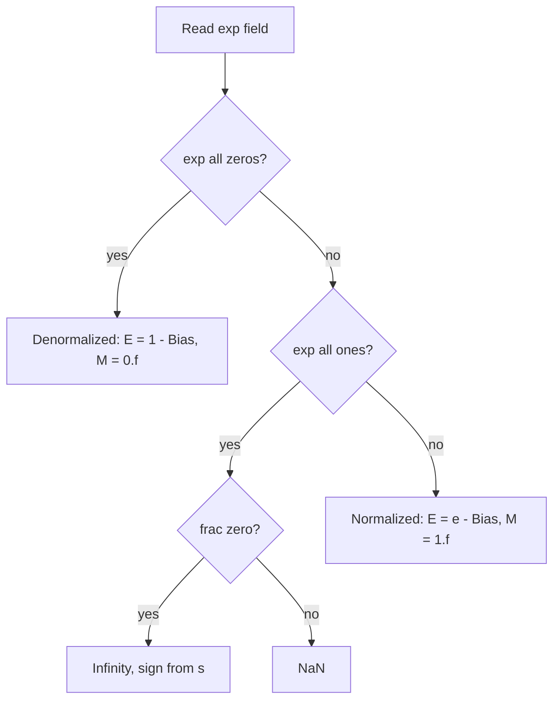

# IEEE-754 floating point

A floating-point representation encodes rational numbers of the form $V = x \times 2^y$. It lets a program work with very large numbers ($1.8 \times 10^{308}$), numbers very close to zero ($4.9 \times 10^{-324}$ as a `double`), and everything in between, approximately. Before 1985 every manufacturer had its own format, with its own rounding quirks. **IEEE Standard 754**, driven largely by William Kahan, fixed that, and today virtually every computer implements it. This lesson explains how the format works, why it is designed the way it is, how rounding works, and which mathematical laws it breaks.

## 1. Fractional binary numbers

Decimal notation $d_m \dots d_1 d_0 . d_{-1} d_{-2} \dots d_{-n}$ means $\sum d_i 10^i$. Binary works the same way with powers of 2: bits right of the **binary point** weigh $1/2, 1/4, 1/8, \dots$

$$b = \sum_{i=-n}^{m} 2^i \, b_i$$

So $101.11_2 = 4 + 0 + 1 + \tfrac12 + \tfrac14 = 5\tfrac34$. Shifting the binary point left divides by 2; shifting right multiplies by 2. A number of the form $0.11\dots1_2$ is just below 1, written $1.0 - \epsilon$.

**The catch:** only numbers of the form $x \times 2^y$ can be represented exactly. $1/5$ in binary is $0.0011\,0011\,0011\dots_2$, repeating forever, just as $1/3$ repeats in decimal. So `0.1` in a program is always an approximation.

```python-run
from fractions import Fraction
print(Fraction(0.1))                 # the exact value stored for 0.1 (a double)
print(f"{0.1:.25f}")
print(0.1 + 0.2 == 0.3, 0.1 + 0.2)
```

> [!NOTE]
> The book's Patriot-missile aside: during the 1991 Gulf War, a Patriot battery counted time in tenths of a second and converted ticks to seconds by multiplying by 0.1 truncated to 23 bits after the binary point. The per-tick error is about $9.5 \times 10^{-8}$ s; after roughly 100 hours (3.6 million ticks) it accumulated to about 0.34 s, enough for a Scud traveling ~2,000 m/s to be ~690 m from where the system predicted (Practice Problem 2.46 has you derive these numbers). An incoming Scud was not intercepted, and 28 soldiers were killed.

## 2. The IEEE representation

IEEE represents a number as

$$V = (-1)^s \times M \times 2^E$$

- **Sign** $s$: 1 for negative, 0 for positive (sign-magnitude!).
- **Significand** $M$: a fractional binary number, in $[1, 2)$ or $[0, 1)$.
- **Exponent** $E$: weights by a (possibly negative) power of 2.

The bits are split into three fields:

| Format | sign $s$ | exponent field `exp` ($k$ bits) | fraction field `frac` ($n$ bits) | Bias $2^{k-1}-1$ |
|---|---|---|---|---|
| Single (`float`, 32 bits) | 1 | 8 | 23 | 127 |
| Double (`double`, 64 bits) | 1 | 11 | 52 | 1023 |

The value encoded depends on `exp`, giving **three cases**:

### Case 1: Normalized values (`exp` neither all 0s nor all 1s)

- $E = e - \text{Bias}$, where $e$ is the unsigned value of `exp`. So for float, $E \in [-126, 127]$.
- $M = 1 + f$, where $f = 0.f_{n-1}\dots f_0$. The leading 1 is **implied**, not stored: a free extra bit of precision.

### Case 2: Denormalized values (`exp` all zeros)

- $E = 1 - \text{Bias}$ (not $-\text{Bias}$!), and $M = f$ with **no** implied leading 1.
- Purposes: (a) represent **zero**: all-zero bits is $+0.0$; sign bit 1 with the rest zero is $-0.0$. (b) represent numbers very close to 0, providing **gradual underflow**: the gaps between representable values near zero are evenly spaced.
- Setting $E = 1 - \text{Bias}$ makes the transition from the largest denormal to the smallest normal perfectly smooth.

### Case 3: Special values (`exp` all ones)

- `frac` all zeros: $+\infty$ or $-\infty$ (e.g., overflow, or $1/0$).
- `frac` nonzero: **NaN** ("not a number"), the result of things like $\sqrt{-1}$ or $\infty - \infty$.



<div class="widget" data-widget="float"></div>

Use the explorer: flip the exponent bits to all zeros to see denormals, and to all ones to see infinity and NaN.

## 3. A tiny 8-bit format, end to end

The book studies a toy format with $k = 4$ exponent bits and $n = 3$ fraction bits, so Bias $= 7$. It is small enough to enumerate every value, and every property of real floats shows up.

| Description | Bits | $e$ | $E$ | $f$ | $M$ | $V$ |
|---|---|---|---|---|---|---|
| Zero | 0 0000 000 | 0 | −6 | 0 | 0 | 0 |
| Smallest positive (denorm) | 0 0000 001 | 0 | −6 | 1/8 | 1/8 | 1/512 |
| Largest denormalized | 0 0000 111 | 0 | −6 | 7/8 | 7/8 | 7/512 |
| Smallest normalized | 0 0001 000 | 1 | −6 | 0 | 8/8 | 8/512 |
| One | 0 0111 000 | 7 | 0 | 0 | 8/8 | 1 |
| Largest normalized | 0 1110 111 | 14 | 7 | 7/8 | 15/8 | 240 |
| Infinity | 0 1111 000 | | | | | $\infty$ |

See the smooth step: largest denorm $7/512$, smallest normal $8/512$. Had denormals used $E = -\text{Bias} = -7$, there would be a jump. Also note a neat property: **if you interpret the bit patterns as unsigned integers, they are in the same order as the values they represent** (for positive numbers). That is why the exponent is placed above the fraction and uses a biased rather than two's-complement encoding: floats can be sorted with integer comparisons (handling the sign bit separately).

```python-run
def decode_tiny(bits, k=4, n=3):
    s = bits >> (k + n)
    e = (bits >> n) & ((1 << k) - 1)
    f = bits & ((1 << n) - 1)
    bias = (1 << (k - 1)) - 1
    if e == (1 << k) - 1:
        return "NaN" if f else ("-inf" if s else "inf")
    if e == 0:
        E, M = 1 - bias, f / (1 << n)
    else:
        E, M = e - bias, 1 + f / (1 << n)
    return (-1) ** s * M * 2.0 ** E

for b in (0b00000000, 0b00000001, 0b00000111, 0b00001000, 0b00111000, 0b01110111, 0b01111000, 0b01111001):
    print(f"{b:08b} -> {decode_tiny(b)}")
```

### General formulas

| Value | Single | Double |
|---|---|---|
| Smallest positive denorm $2^{-n-2^{k-1}+2}$ | $2^{-149} \approx 1.4\times10^{-45}$ | $2^{-1074} \approx 4.9\times10^{-324}$ |
| Smallest positive normal $2^{-2^{k-1}+2}$ | $2^{-126} \approx 1.2\times10^{-38}$ | $2^{-1022} \approx 2.2\times10^{-308}$ |
| Largest normal $(2 - 2^{-n})2^{2^{k-1}-1}$ | $\approx 3.4\times10^{38}$ | $\approx 1.8\times10^{308}$ |
| One | `0x3F800000` | `0x3FF0000000000000` |

## 4. Worked example: encoding 12345.0

$12345 = 11000000111001_2 = 1.1000000111001_2 \times 2^{13}$.

1. Drop the implied leading 1; the fraction is `1000000111001` padded with 10 zeros to 23 bits: `10000001110010000000000`.
2. Exponent: $E = 13$, so $e = 13 + 127 = 140 = 10001100_2$.
3. Sign 0. Assemble: `0 10001100 10000001110010000000000` = `0x4640E400`.

Now you can see why the integer `0x00003039` and the float `0x4640E400` share 13 bits: the float's fraction field holds the integer's bits below its leading 1.

```python-run
import struct
def float_bits(x):
    return struct.unpack(">I", struct.pack(">f", x))[0]
def decode32(u):
    s, e, f = u >> 31, (u >> 23) & 0xFF, u & 0x7FFFFF
    if e == 0xFF: return "NaN" if f else ("-inf" if s else "inf")
    if e == 0:    return (-1)**s * (f / 2**23) * 2.0**(-126)
    return (-1)**s * (1 + f / 2**23) * 2.0**(e - 127)

u = float_bits(12345.0)
print(hex(u), f"{u:032b}")
for pattern in (0x4640E400, 0x3F800000, 0xBF400000, 0x00000001, 0x7F7FFFFF, 0x7F800000, 0x7FC00000):
    print(hex(pattern), "->", decode32(pattern))
```

## 5. Rounding

Because representations have limited range and precision, arithmetic results must be **rounded** to a representable value. IEEE defines four rounding modes:

| Mode | 1.40 | 1.60 | 1.50 | 2.50 | −1.50 |
|---|---|---|---|---|---|
| **Round-to-even** (default) | 1 | 2 | 2 | 2 | −2 |
| Round-toward-zero | 1 | 1 | 1 | 2 | −1 |
| Round-down ($-\infty$) | 1 | 1 | 1 | 2 | −2 |
| Round-up ($+\infty$) | 2 | 2 | 2 | 3 | −1 |

**Round-to-even** (also called round-to-nearest) rounds to the nearest value; on an exact tie (halfway), it picks the one whose least significant digit is **even**. Why not always round halves up? Because over a large data set that introduces a statistical **bias**: averages would drift upward. Rounding to even goes up half the time and down half the time.

In binary, "even" means the least significant kept bit is 0, and "halfway" means the bits beyond the rounding position are exactly `100...`. Rounding to the nearest quarter (2 bits after the point):

| Value | Binary | Rounded | Why |
|---|---|---|---|
| $2\tfrac{3}{32}$ | 10.00011 | 10.00 | less than halfway, round down |
| $2\tfrac{3}{16}$ | 10.00110 | 10.01 | more than halfway, round up |
| $2\tfrac{7}{8}$ | 10.11100 | 11.00 | exactly halfway, round up to even |
| $2\tfrac{5}{8}$ | 10.10100 | 10.10 | exactly halfway, round down to even |

The coding problem `csapp-float-round-even` asks you to implement exactly this.

```python-run
# Python's round() also uses round-half-to-even on exact ties:
print([round(x) for x in (0.5, 1.5, 2.5, 3.5, -1.5)])
```

## 6. Floating-point operations

IEEE specifies a simple rule: compute the **exact** result of the operation on the real values, then **round** it. So $x +^f y = \text{Round}(x + y)$.

Consequences:

- Addition is **commutative** but **not associative**. In single precision, `(3.14 + 1e10) - 1e10` evaluates to `0.0` because 3.14 is lost to rounding, while `3.14 + (1e10 - 1e10)` gives `3.14`.
- Multiplication is commutative, not associative, and does not distribute over addition: `(1e20 * 1e20) * 1e-20` is $+\infty$ while `1e20 * (1e20 * 1e-20)` is `1e20`.
- Most values have additive inverses, but $\infty$ and NaN do not: $+\infty - \infty = $ NaN, and $\text{NaN} + x = $ NaN.
- **Monotonicity** does hold (except with NaN): if $a \ge b$ then $x + a \ge x + b$. Integer arithmetic does *not* have this property, because of overflow.

The lack of associativity matters to compilers: they generally **cannot** reorder floating-point operations as they would integer ones, since `x = a + b + c; y = b + c + d;` cannot safely become `t = b + c; x = a + t; y = t + d;`. Module 5 shows that this is exactly what limits loop performance, and that programmers can choose to reassociate manually.

```python-run
import numpy as np
f = np.float32
print((f(3.14) + f(1e10)) - f(1e10), f(3.14) + (f(1e10) - f(1e10)))
print((1e300 * 1e300) * 1e-300, 1e300 * (1e300 * 1e-300))
print(float("inf") - float("inf"))
```

## 7. Floating point in C

C provides `float` and `double`. On x86-64 with SSE/AVX they are IEEE single and double with round-to-even. Conversions between `int`, `float` and `double` (32-bit `int`):

| Conversion | Behavior |
|---|---|
| `int` → `float` | Cannot overflow, but **may round** (float has only 24 significant bits) |
| `int` or `float` → `double` | **Exact** (53 significant bits suffice) |
| `double` → `float` | May overflow to $\pm\infty$, may round |
| `float`/`double` → `int` | **Truncates toward zero** (1.999 → 1, −1.999 → −1). May overflow: C does not define the result; on Intel it is the "integer indefinite" value $TMin$ (`0x80000000`) |

So `(int) 1e10` gives −2147483648 on x86-64.

> [!WARNING]
> **The Ariane 5 disaster (1996).** The rocket's software converted a 64-bit floating-point horizontal-velocity value into a 16-bit signed integer. Ariane 5 flew faster than Ariane 4, the value overflowed, the guidance system shut down, and the rocket self-destructed 37 seconds after launch, destroying about \$500 million of satellites.

> [!INTERVIEW]
> **"Why shouldn't you compare floats with `==`?"** Most decimal fractions are not representable, and each operation rounds, so mathematically equal expressions can differ in the last bit. Compare with a tolerance scaled to magnitude, e.g. `abs(a-b) <= 1e-9 * max(abs(a), abs(b))`. Also know: NaN is not equal to anything, including itself (`x != x` is the NaN test); there are two zeros that compare equal; and money should be stored in integer cents or a decimal type.

> [!INTERVIEW]
> **"What is the largest integer a double holds exactly?"** $2^{53}$: beyond that, the 52-bit fraction (53 with the implied 1) cannot represent every integer, so $2^{53}+1$ rounds to $2^{53}$. For `float` the limit is $2^{24} = 16{,}777{,}216$.

## 8. Summary

- $V = (-1)^s M 2^E$ with fields `s`, `exp` ($k$ bits), `frac` ($n$ bits). Float: 1/8/23, bias 127. Double: 1/11/52, bias 1023.
- Normalized: $E = e - \text{Bias}$, $M = 1.f$. Denormalized (`exp` = 0): $E = 1 - \text{Bias}$, $M = 0.f$, giving zero, $-0$, and gradual underflow. `exp` all ones: infinity or NaN.
- Default rounding is round-to-nearest-even; it avoids statistical bias.
- Float operations = exact result then round. Commutative and monotonic, but not associative or distributive.
- Float→int truncates toward zero; out-of-range conversions are undefined in C (TMin on x86).

## Check yourself

```quiz
[
  {"q": "What is the bias for IEEE single precision?", "options": ["128", "127", "1023", "255"], "answer": 1,
   "explain": "Bias = 2^(k-1) - 1 with k = 8 exponent bits, so 127."},
  {"q": "For a denormalized value, what are E and M?", "options": ["E = e - Bias, M = 1 + f", "E = 1 - Bias, M = f", "E = -Bias, M = f", "E = 0, M = f"], "answer": 1,
   "explain": "Denormals use E = 1 - Bias (for a smooth transition to normals) and no implied leading 1."},
  {"q": "The 32-bit pattern 0x3F800000 encodes:", "options": ["0.5", "1.0", "2.0", "-1.0"], "answer": 1,
   "explain": "Sign 0, exp = 0x7F = 127 so E = 0, frac = 0 so M = 1: value 1.0."},
  {"q": "Round 10.10100 (binary) to two bits after the point using round-to-even.", "options": ["10.10", "10.11", "11.00", "10.01"], "answer": 0,
   "explain": "It is exactly halfway between 10.10 and 10.11; round to the one ending in 0, which is 10.10."},
  {"q": "In single precision, (3.14 + 1e10) - 1e10 evaluates to:", "options": ["3.14", "0.0", "1e10", "NaN"], "answer": 1,
   "explain": "3.14 is lost when rounding 1e10 + 3.14 to 24 significant bits; associativity fails."},
  {"q": "Which conversion is always exact?", "options": ["int to float", "double to float", "int to double", "double to int"], "answer": 2,
   "explain": "A double's 53-bit significand can hold any 32-bit int exactly."},
  {"q": "What does (int) -1.999 give in C?", "options": ["-2", "-1", "0", "Undefined"], "answer": 1,
   "explain": "Float-to-int conversion truncates toward zero."},
  {"q": "Why does round-to-even exist instead of always rounding halves up?", "options": ["It is faster in hardware", "To avoid a statistical upward bias over many roundings", "Because binary has no halves", "To make addition associative"], "answer": 1,
   "explain": "Ties go up half the time and down half the time, so averages are not skewed."}
]
```

> **Source:** CS:APP 3e, §2.4 (Floating point: fractional binary numbers, IEEE representation, example numbers, rounding, floating-point operations, floating point in C).
