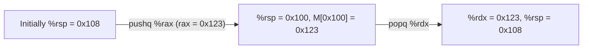

# x86-64 basics: registers, operands, mov

Computers execute **machine code**: sequences of bytes encoding low-level operations that manipulate data, manage memory, read and write storage, and communicate over networks. A compiler generates machine code through a series of stages, guided by the language rules, the target machine's instruction set, and the operating system's conventions. Why learn to *read* the assembly the compiler emits, if you will rarely write it? Because reading it lets you understand the optimizations the compiler made, the inefficiencies in your code, the run-time behavior that is otherwise hidden (where values are stored, how procedure calls work), and the anatomy of security vulnerabilities. The goal of this module is reading fluency, not writing fluency.

## 1. A little history and the programmer-visible state

x86-64 descends from the Intel 8086 (1978, 16 bits). Each generation added features while staying backward compatible: the i386 (1985) went to 32 bits (IA32), the Pentium 4E (2004) adopted AMD's 64-bit extension (the name *x86-64* comes from AMD64), and the Core i7 added multiple cores and hyperthreading. Much of the instruction set's oddness is this accumulated history.

Machine code exposes state that C hides:

- **Program counter** (`%rip` on x86-64): address of the next instruction.
- **Integer register file**: 16 named locations holding 64-bit values: addresses (C pointers) or integer data.
- **Condition code registers**: status about the most recent arithmetic or logical instruction, used for conditional behavior (`if`, `while`).
- **Vector registers**: hold one or more integer or floating-point values.
- **Memory**: a large byte-addressable array (virtual memory, Module 9). x86-64 virtual addresses are 64-bit words, but current implementations use only the low 48 bits.

Machine code has **no notion of data types** beyond integers of 1, 2, 4 or 8 bytes and floating-point values. Arrays and structures are just contiguous bytes; a pointer is just an integer address.

## 2. Getting and reading assembly

```c
/* mstore.c */
long mult2(long, long);
void multstore(long x, long y, long *dest) {
    long t = mult2(x, y);
    *dest = t;
}
```

`gcc -Og -S mstore.c` produces `mstore.s`. (`-Og` asks for optimizations that keep the code close to the source; production code uses `-O1`/`-O2`.)

```
multstore:
    pushq   %rbx            # save callee-saved %rbx
    movq    %rdx, %rbx      # keep dest in %rbx across the call
    call    mult2           # t = mult2(x, y), arguments already in %rdi, %rsi
    movq    %rax, (%rbx)    # *dest = t
    popq    %rbx            # restore %rbx
    ret
```

`gcc -Og -c mstore.c` produces the binary object file, and `objdump -d mstore.o` disassembles it:

```
0000000000000000 <multstore>:
   0:   53                      push   %rbx
   1:   48 89 d3                mov    %rdx,%rbx
   4:   e8 00 00 00 00          callq  9 <multstore+0x9>
   9:   48 89 03                mov    %rax,(%rbx)
   c:   5b                      pop    %rbx
   d:   c3                      retq
```

Observations from the book: x86-64 instructions range from **1 to 15 bytes** (common ones are shorter); the encoding is designed so that a byte sequence decodes into instructions **uniquely** from a starting position; the disassembler works purely from the bytes; and its naming differs slightly from gcc's (it adds `q` suffixes to `call` and `ret`). The `00 00 00 00` call target is filled in by the linker (Module 7).

> [!NOTE]
> **AT&T vs. Intel syntax.** We use AT&T syntax (gcc, objdump default): `movq %rdx, %rbx` means "copy `%rdx` *into* `%rbx`" (source first). Intel syntax (Microsoft tools, Intel docs, `objdump -M intel`) writes `mov rbx, rdx`: destination first, no `%`, no size suffixes, and memory as `QWORD PTR [rbx]`. Always check which you are reading!

## 3. Data formats

Intel uses "word" for 16 bits (an 8086 legacy), so 32-bit values are "double words" and 64-bit "quad words":

| C declaration | Intel data type | Suffix | Size (bytes) |
|---|---|---|---|
| `char` | Byte | `b` | 1 |
| `short` | Word | `w` | 2 |
| `int` | Double word | `l` | 4 |
| `long` | Quad word | `q` | 8 |
| `char *` | Quad word | `q` | 8 |
| `float` | Single precision | `s` | 4 |
| `double` | Double precision | `l` | 8 |

So `movb`, `movw`, `movl`, `movq` move 1, 2, 4, 8 bytes.

## 4. The integer registers

x86-64 has 16 general-purpose 64-bit registers. Their low-order parts can be accessed under separate names:

| 64-bit | 32-bit | 16-bit | 8-bit | Conventional use |
|---|---|---|---|---|
| `%rax` | `%eax` | `%ax` | `%al` | Return value |
| `%rbx` | `%ebx` | `%bx` | `%bl` | Callee saved |
| `%rcx` | `%ecx` | `%cx` | `%cl` | 4th argument |
| `%rdx` | `%edx` | `%dx` | `%dl` | 3rd argument |
| `%rsi` | `%esi` | `%si` | `%sil` | 2nd argument |
| `%rdi` | `%edi` | `%di` | `%dil` | 1st argument |
| `%rbp` | `%ebp` | `%bp` | `%bpl` | Callee saved |
| `%rsp` | `%esp` | `%sp` | `%spl` | **Stack pointer** |
| `%r8` | `%r8d` | `%r8w` | `%r8b` | 5th argument |
| `%r9` | `%r9d` | `%r9w` | `%r9b` | 6th argument |
| `%r10` | `%r10d` | `%r10w` | `%r10b` | Caller saved |
| `%r11` | `%r11d` | `%r11w` | `%r11b` | Caller saved |
| `%r12`–`%r15` | `%r12d`… | `%r12w`… | `%r12b`… | Callee saved |

The first eight names come from the 8086's eight 16-bit registers (`%ax` … `%sp`), extended to 32 bits (`%e..`) and then 64 (`%r..`); `%r8`–`%r15` are new in x86-64.

**Partial-register writes** follow two rules, which matter when you read compiler output:

1. Instructions producing 1- or 2-byte results **leave the remaining bytes unchanged**.
2. Instructions producing **4-byte** results **zero the upper 4 bytes** of the 64-bit register. (This is why compilers happily use `movl $0, %eax` to clear `%rax`.)

`%rsp` is special: it points to the top of the run-time stack. The rest are mostly interchangeable, but a set of **conventions** (Lesson 3 of this module) governs how they are used for arguments, return values and saving across calls.

## 5. Operand specifiers

Most instructions take operands: sources (constants, or values in registers or memory) and a destination (register or memory). Three kinds:

1. **Immediate**: a constant, `$-577` or `$0x1F`.
2. **Register**: the contents of a register, written $R[r_a]$ in notation, e.g. `%rax`.
3. **Memory reference**: the contents at a computed **effective address**, $M[\text{Addr}]$.

The general memory form is $\text{Imm}(r_b, r_i, s)$: base register $r_b$, index register $r_i$, scale $s \in \{1,2,4,8\}$, displacement Imm. Its effective address is

$$\text{Imm} + R[r_b] + R[r_i] \cdot s$$

| Form | Effective address | Name |
|---|---|---|
| `Imm` | Imm | Absolute |
| `(ra)` | R[ra] | Indirect |
| `Imm(rb)` | Imm + R[rb] | Base + displacement |
| `(rb,ri)` | R[rb] + R[ri] | Indexed |
| `Imm(rb,ri)` | Imm + R[rb] + R[ri] | Indexed |
| `(,ri,s)` | R[ri]·s | Scaled indexed |
| `Imm(,ri,s)` | Imm + R[ri]·s | Scaled indexed |
| `(rb,ri,s)` | R[rb] + R[ri]·s | Scaled indexed |
| `Imm(rb,ri,s)` | Imm + R[rb] + R[ri]·s | Scaled indexed |

The scaled forms exist for **array indexing**: element `i` of an `long` array at `%rdx` is `(%rdx,%rcx,8)` with `i` in `%rcx`.

**Worked example** (the book's Practice Problem 3.1 setup). Memory: `0x100`→`0xFF`, `0x104`→`0xAB`, `0x108`→`0x13`, `0x10C`→`0x11`. Registers: `%rax = 0x100`, `%rcx = 0x1`, `%rdx = 0x3`.

| Operand | Value | Reasoning |
|---|---|---|
| `%rax` | 0x100 | register |
| `0x104` | 0xAB | absolute address |
| `$0x108` | 0x108 | immediate |
| `(%rax)` | 0xFF | M[0x100] |
| `4(%rax)` | 0xAB | M[0x104] |
| `9(%rax,%rdx)` | 0x11 | M[9 + 0x100 + 3] = M[0x10C] |
| `260(%rcx,%rdx)` | 0x13 | 260 = 0x104; M[0x104 + 1 + 3] = M[0x108] |
| `0xFC(,%rcx,4)` | 0xFF | M[0xFC + 4] = M[0x100] |
| `(%rax,%rdx,4)` | 0x11 | M[0x100 + 12] = M[0x10C] |

```python-run
mem = {0x100: 0xFF, 0x104: 0xAB, 0x108: 0x13, 0x10C: 0x11}
R = {"rax": 0x100, "rcx": 0x1, "rdx": 0x3}
def ea(imm=0, rb=None, ri=None, s=1):
    return imm + (R[rb] if rb else 0) + (R[ri] * s if ri else 0)
for desc, addr in [("9(%rax,%rdx)", ea(9, "rax", "rdx")),
                   ("260(%rcx,%rdx)", ea(260, "rcx", "rdx")),
                   ("0xFC(,%rcx,4)", ea(0xFC, None, "rcx", 4)),
                   ("(%rax,%rdx,4)", ea(0, "rax", "rdx", 4))]:
    print(f"{desc:16} EA=0x{addr:X}  value=0x{mem[addr]:X}")
```

## 6. Data movement instructions

The `mov` class copies a source to a destination:

| Instruction | Effect | Description |
|---|---|---|
| `movb/movw/movl/movq S, D` | D ← S | Move byte / word / double word / quad word |
| `movabsq I, R` | R ← I | Move a full 64-bit immediate into a register |

Rules:

- **x86-64 forbids memory-to-memory moves.** Copying between memory locations takes two instructions: load into a register, then store.
- The size suffix must match register operands: `movl %eax, %rdx` is an error.
- `movq` with an immediate can only take a 32-bit signed immediate, sign-extended to 64 bits. For an arbitrary 64-bit constant you need `movabsq`.
- `movl` into a register zeroes its upper 32 bits (rule 2 above).

```
movl $0x4050, %eax        # Immediate -> Register, 4 bytes
movw %bp, %sp             # Register  -> Register, 2 bytes
movb (%rdi,%rcx), %al     # Memory    -> Register, 1 byte
movb $-17, (%rsp)         # Immediate -> Memory,   1 byte
movq %rax, -12(%rbp)      # Register  -> Memory,   8 bytes
```

### Zero- and sign-extending moves

When copying a smaller source to a larger register destination:

- `movz` (zero extend): `movzbw`, `movzbl`, `movzwl`, `movzbq`, `movzwq`.
- `movs` (sign extend): `movsbw`, `movsbl`, `movswl`, `movsbq`, `movswq`, `movslq`.
- `cltq`: sign-extend `%eax` into `%rax` (no operands; same as `movslq %eax, %rax`).

There is no `movzlq`: a plain `movl` to a register already zero-extends to 64 bits.

This is where the C conversion rules from Module 2 become concrete. For `char *sp; int *dp; *dp = (int) *sp;` the compiler emits `movsbl (%rdi), %eax; movl %eax, (%rsi)` because `char` is signed. With `unsigned char` it would emit `movzbl`.

### Example: pointers in C, exchange in assembly

```c
long exchange(long *xp, long y)
{
    long x = *xp;
    *xp = y;
    return x;
}
```

```
# xp in %rdi, y in %rsi
exchange:
    movq    (%rdi), %rax    # get x at xp; set as return value
    movq    %rsi, (%rdi)    # store y at xp
    ret
```

Two lessons: (1) **pointers are simply addresses**: dereferencing copies the pointer into a register and uses it in a memory reference; (2) **local variables such as `x` often live in registers**, not memory, because registers are much faster.

## 7. Pushing and popping

The **program stack** is memory managed by `%rsp`. On x86-64 it grows toward **lower** addresses, and `%rsp` holds the address of the top element.

| Instruction | Effect |
|---|---|
| `pushq S` | `R[%rsp] ← R[%rsp] - 8; M[R[%rsp]] ← S` |
| `popq D` | `D ← M[R[%rsp]]; R[%rsp] ← R[%rsp] + 8` |

`pushq %rbp` is equivalent to `subq $8, %rsp; movq %rbp, (%rsp)` but encodes in a single byte instead of eight. Popping does not erase the old value; it is still in memory until overwritten, it just is no longer "on" the stack. Because the stack lives in ordinary memory, a program can also access any position within it with normal memory references: `movq 8(%rsp), %rdx` reads the second quad word from the top.



## 8. Pitfalls

> [!WARNING]
> **Confusing an address with its contents.** `movq %rax, %rbx` copies the value; `movq (%rax), %rbx` loads from memory at address `%rax`; `leaq (%rax), %rbx` (next lesson) copies the address itself without touching memory.

> [!WARNING]
> **Missing that `movl` clears the top half.** `movl %eax, %eax` is a real idiom: it zero-extends a 32-bit value to 64 bits.

> [!INTERVIEW]
> Knowing the System V calling convention cold is worth it: integer/pointer **arguments in `%rdi, %rsi, %rdx, %rcx, %r8, %r9`** (mnemonic: "Diane's Silk Dress Costs \$89"), return value in **`%rax`**, callee-saved **`%rbx, %rbp, %r12–%r15`**, stack pointer `%rsp`. With that, most `objdump` output in a debugging session becomes readable.

## 9. Summary

- Machine code sees PC, 16 integer registers, condition codes, vector registers and a byte array; no types beyond sizes.
- Suffixes `b w l q` = 1, 2, 4, 8 bytes. 4-byte register writes zero the upper half; 1- and 2-byte writes don't.
- Memory operand `Imm(rb,ri,s)` → address `Imm + R[rb] + R[ri]*s`, with $s \in \{1,2,4,8\}$.
- `mov` copies; no memory-to-memory moves; `movz`/`movs` widen; `movabsq` loads 64-bit immediates.
- The stack grows down; `push` decrements `%rsp` by 8 then stores; `pop` loads then increments.

## Check yourself

```quiz
[
  {"q": "With %rax = 0x100 and %rdx = 0x3, what effective address does 9(%rax,%rdx) compute?", "options": ["0x109", "0x10C", "0x112", "0x10B"], "answer": 1,
   "explain": "9 + 0x100 + 3 = 0x10C."},
  {"q": "Which instruction is illegal in x86-64?", "options": ["movq %rax, (%rsp)", "movl $5, %eax", "movq (%rax), (%rbx)", "movb (%rdi), %al"], "answer": 2,
   "explain": "Both operands cannot be memory references; you must go through a register."},
  {"q": "After movl $-1, %eax, what is in %rax?", "options": ["0xFFFFFFFFFFFFFFFF", "0x00000000FFFFFFFF", "Upper half unchanged, lower half all ones", "0x1"], "answer": 1,
   "explain": "Instructions writing 32-bit registers zero the upper 32 bits."},
  {"q": "Which register holds the first integer argument on x86-64 Linux?", "options": ["%rax", "%rsi", "%rdi", "%rcx"], "answer": 2,
   "explain": "Arguments go in %rdi, %rsi, %rdx, %rcx, %r8, %r9 in that order."},
  {"q": "What does pushq %rbp do?", "options": ["Increment %rsp by 8, then store", "Decrement %rsp by 8, then store %rbp at the new top", "Store, then decrement", "Copy %rsp into %rbp"], "answer": 1,
   "explain": "The stack grows down: subtract 8 from %rsp, then write the value at M[%rsp]."},
  {"q": "To convert a signed char loaded from memory into a 32-bit int, the compiler uses:", "options": ["movzbl", "movsbl", "movl", "movabsq"], "answer": 1,
   "explain": "Signed widening uses sign extension: movs with b->l."},
  {"q": "In AT&T syntax, movq %rdx, %rbx copies...", "options": ["%rbx into %rdx", "%rdx into %rbx", "the address of %rdx", "memory at %rdx into %rbx"], "answer": 1,
   "explain": "AT&T is source, destination."}
]
```

> **Source:** CS:APP 3e, §3.1–3.4 (Historical perspective, program encodings, data formats, accessing information: registers, operand specifiers, data movement, push and pop).
