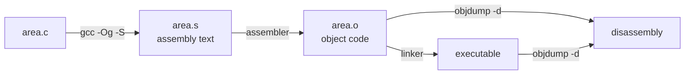
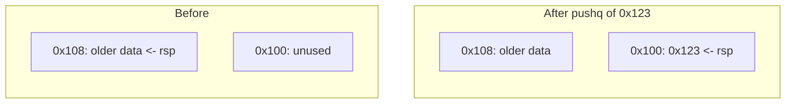

# x86-64 basics: registers, operands, mov

> **Before this lesson:** You should be comfortable with hexadecimal and byte sizes from [Bits, bytes, words and bit-level operations](#/lesson/csapp/bits-bytes) and with signed numbers from [Unsigned and two's-complement integers](#/lesson/csapp/integers). Being able to read a short C function helps; no assembly experience is needed.

## In plain words

A processor does not understand C, Python or any other language people write. It understands a short list of very small commands, such as "copy this number from here to there" or "add these two numbers". The written form of those commands is called **assembly language**, and a program called a **compiler** translates your source code into them. Picture a recipe written for a robot that owns sixteen small labelled cups (the **registers**, tiny storage slots inside the processor) and a very long shelf of numbered boxes (the **memory**). Every step of the recipe says which cup or box to take a value from and where to put it. This lesson teaches you to read those steps.

Why this matters at work: you will rarely write assembly, but you will meet it. A crash report points at a machine instruction. A performance tool highlights one. A security review asks what a few bytes of code do. Being able to read the compiler's output lets you answer those questions instead of guessing, and it is a standard topic in systems interviews.

## Why look closer

You will probably never be paid to write assembly by hand. You will, however, be paid to answer questions that only assembly can settle. Why is this loop three times slower than that one? What is the program doing at the address in this crash report? Did the compiler really remove my bounds check? How does an attacker turn a string copy into control of a process? In each case the source code is a description of intent and the machine code is what actually happens. Reading the compiler's output is a core systems skill, and it rests on a small foundation: knowing where data can live (registers and memory), how an instruction names a location (operand forms), and how data gets moved (the `mov` family). This lesson builds that foundation for x86-64, the instruction set of nearly every laptop and server.

## 1. What the machine exposes that C hides

C presents a tidy abstraction: typed variables, structured control flow, function calls. Machine code is much plainer. A machine-level program sees:

- The **program counter**, named `%rip` on x86-64, holding the address of the next instruction.
- Sixteen **integer registers**, each 64 bits wide, holding integers and pointers. Some keep track of critical state such as the stack; the rest hold temporary values, arguments and results.
- **Condition codes**: single-bit flags that record facts about the most recent arithmetic operation, used to implement `if` and loops.
- **Vector registers** for floating-point data.
- **Memory**: one huge array of bytes, addressed by number.

What is absent matters as much. There are no types: nothing distinguishes a signed integer from an unsigned one, from a pointer, from eight characters. There are no arrays or structs, only contiguous runs of bytes. There are no variable names. The *instruction* chosen determines how a pattern of bits is interpreted.

A single machine instruction does something very small: add two numbers, copy a value between a register and memory, jump to a new address. The compiler's job is to express every C construct as a sequence of such steps.

### Getting from C to something readable



`gcc -Og -S area.c` stops after compilation and leaves human-readable assembly in `area.s`. The `-Og` flag asks for optimisation that keeps the code's structure close to the source, which is ideal for study; higher levels (`-O1`, `-O2`) rearrange code so aggressively that the correspondence is hard to follow. Going the other way, a **disassembler** such as `objdump -d` reconstructs assembly from the bytes of an object file or executable.

A few things to notice when you look at disassembly:

- x86-64 instructions vary in length from 1 to 15 bytes. Common ones with few operands are short.
- The encoding is designed so that from a given starting byte there is exactly one way to decode the instruction.
- The disassembler works purely from bytes. It needs no source.

### Two syntaxes

There are two ways of writing x86 assembly. GCC and `objdump` default to **AT&T syntax**, which this track uses. Intel's documentation and Microsoft's tools use **Intel syntax**. The differences trip up everyone at first:

| | AT&T | Intel |
|---|---|---|
| Operand order | source, destination | destination, source |
| Registers | `%rax` | `rax` |
| Constants | `$42` | `42` |
| Size | suffix on the mnemonic: `movq` | keywords on operands: `QWORD PTR` |
| Memory | `8(%rbx,%rcx,4)` | `[rbx+rcx*4+8]` |

So `movq %rbx, %rax` in AT&T and `mov rax, rbx` in Intel both copy `rbx` into `rax`.

## 2. Sizes and suffixes

Intel's terminology dates from the 16-bit era: a **word** is 16 bits, a **double word** 32, and a **quad word** 64. Instructions carry a one-letter suffix giving the size of their operands:

| Bytes | Suffix | Intel calls it | Typical C type |
|---|---|---|---|
| 1 | `b` | byte | `char` |
| 2 | `w` | word | `short` |
| 4 | `l` | double word | `int` |
| 8 | `q` | quad word | `long`, and every pointer |
| 4 | `s` | single precision | `float` |
| 8 | `l` | double precision | `double` |

So there are four data-movement mnemonics for integers: `movb`, `movw`, `movl`, `movq`. The suffix `l` serves for both 4-byte integers and 8-byte doubles without confusion because floating-point code uses a different set of instructions and registers.

## 3. The sixteen registers

Each 64-bit register has names for its low 32, 16 and 8 bits, a legacy of the architecture's growth from 16 to 32 to 64 bits.

| Conventional role | Full 64 bits | Low 8 | Low 16 | Low 32 |
|---|---|---|---|---|
| 1st argument | `%rdi` | `%dil` | `%di` | `%edi` |
| 2nd argument | `%rsi` | `%sil` | `%si` | `%esi` |
| 3rd argument | `%rdx` | `%dl` | `%dx` | `%edx` |
| 4th argument | `%rcx` | `%cl` | `%cx` | `%ecx` |
| 5th argument | `%r8` | `%r8b` | `%r8w` | `%r8d` |
| 6th argument | `%r9` | `%r9b` | `%r9w` | `%r9d` |
| return value | `%rax` | `%al` | `%ax` | `%eax` |
| stack pointer | `%rsp` | `%spl` | `%sp` | `%esp` |
| scratch, caller-saved | `%r10`, `%r11` | `%r10b`, `%r11b` | `%r10w`, `%r11w` | `%r10d`, `%r11d` |
| preserved, callee-saved | `%rbx`, `%rbp` | `%bl`, `%bpl` | `%bx`, `%bp` | `%ebx`, `%ebp` |
| preserved, callee-saved | `%r12` to `%r15` | `%r12b` etc. | `%r12w` etc. | `%r12d` etc. |

The roles are conventions that compilers follow so that separately compiled functions can call each other; the procedures lesson treats them fully. For now, memorise two things: the argument order **`%rdi`, `%rsi`, `%rdx`, `%rcx`, `%r8`, `%r9`**, and that results come back in **`%rax`**. Only `%rsp` has a role built into the instruction set itself.

### What a partial write does to the rest of the register

When an instruction writes to one of the smaller names, what happens to the other bits of the 64-bit register?

- Writing **1 or 2 bytes** (`%al`, `%ax`) leaves the remaining bytes **unchanged**.
- Writing **4 bytes** (`%eax`) sets the upper 4 bytes to **zero**.

The second rule was introduced with the 64-bit extension and is a perennial exam and interview trap. It also explains a common compiler idiom: `movl $0, %eax` or `xorl %eax, %eax` clears all 64 bits of `%rax` with a shorter encoding than the 64-bit form.

```python-run
MASK64 = (1 << 64) - 1
def write(reg, value, size):
    """Model the update rule for writing `size` bytes into a 64-bit register."""
    if size == 8: return value & MASK64
    if size == 4: return value & 0xFFFFFFFF                      # upper half is zeroed
    keep = MASK64 ^ ((1 << (8 * size)) - 1)                      # sizes 1 and 2 preserve the rest
    return (reg & keep) | (value & ((1 << (8 * size)) - 1))

rax = 0x1122334455667788
print(f"start                 rax = {rax:#018x}")
print(f"movb $0xAA, %al   ->  rax = {write(rax, 0xAA, 1):#018x}")
print(f"movw $0xBBBB, %ax ->  rax = {write(rax, 0xBBBB, 2):#018x}")
print(f"movl $0xCCCCCCCC, %eax -> {write(rax, 0xCCCCCCCC, 4):#018x}   <- upper 32 bits cleared")
print(f"movq $-1, %rax    ->  rax = {write(rax, -1, 8):#018x}")
```

## 4. Operand forms

Most instructions take one or more **operands** naming the source values to use and the destination for the result. There are three kinds.

**Immediate**: a constant, written with a dollar sign: `$-577`, `$0x1F`.

**Register**: the contents of a register, written with a percent sign: `%rax`, `%r8d`.

**Memory**: the contents of memory at a computed address, called the **effective address**. The most general form is

$$\text{Imm}(r_b, r_i, s) \quad\Longrightarrow\quad \text{address} = \text{Imm} + R[r_b] + R[r_i]\cdot s$$

where $r_b$ is a **base** register, $r_i$ an **index** register, $s$ a **scale factor** that must be 1, 2, 4 or 8, and Imm a constant **displacement**. Any of the parts may be left out, giving the simpler forms:

| Form | Address | Typical use |
|---|---|---|
| `0x601040` | the constant | a global variable |
| `(%rax)` | R[rax] | dereferencing a pointer |
| `16(%rax)` | 16 + R[rax] | a struct field, or a stack slot |
| `(%rax,%rcx)` | R[rax] + R[rcx] | a byte array element |
| `(%rax,%rcx,8)` | R[rax] + 8·R[rcx] | an element of an array of longs |
| `24(%rax,%rcx,4)` | 24 + R[rax] + 4·R[rcx] | an int array inside a struct |
| `(,%rcx,8)` | 8·R[rcx] | index with no base |

The scale factors correspond to the sizes of the primitive C types, which is no coincidence: the general form exists to make `a[i]` a single operand.

One spelling hazard: `$0x10` is the *number* 16, while `0x10` without the dollar sign is the *contents of memory* at address 16.

Work through these by hand, given `%rdx = 0x2000` and `%rcx = 0x5`:

- `(%rdx)` → `0x2000`
- `0x18(%rdx)` → `0x2018`
- `(%rdx,%rcx)` → `0x2005`
- `(%rdx,%rcx,8)` → `0x2000 + 0x28` = `0x2028`
- `0x40(,%rcx,4)` → `0x40 + 0x14` = `0x54`
- `-8(%rdx,%rcx,2)` → `0x2000 + 0xA - 8` = `0x2002`

```python-run
import re
regs = {"rdx": 0x2000, "rcx": 0x5, "rax": 0x100}

def effective_address(operand):
    m = re.fullmatch(r"(-?(?:0x)?[0-9a-fA-F]*)\((%\w+)?(?:,(%\w+))?(?:,(\d))?\)", operand)
    disp = int(m.group(1), 0) if m.group(1) else 0
    base = regs[m.group(2)[1:]] if m.group(2) else 0
    index = regs[m.group(3)[1:]] if m.group(3) else 0
    scale = int(m.group(4)) if m.group(4) else 1
    assert scale in (1, 2, 4, 8), "scale must be 1, 2, 4 or 8"
    return disp + base + index * scale

for op in ("(%rdx)", "0x18(%rdx)", "(%rdx,%rcx)", "(%rdx,%rcx,8)", "0x40(,%rcx,4)", "-8(%rdx,%rcx,2)"):
    print(f"{op:18} -> {effective_address(op):#x}")
```

## 5. Moving data

The most frequently executed instructions copy data. The basic form is `mov S, D`: copy the source to the destination.

It comes in one flavour per size: `movq` for 8 bytes, `movl` for 4, `movw` for 2 and `movb` for 1. A fifth, `movabsq`, exists only to load an arbitrary 64-bit constant.

The source can be an immediate, a register or a memory location. The destination can be a register or a memory location. There is one firm restriction: **source and destination cannot both be memory**. Copying from one memory location to another takes two instructions, a load into a register followed by a store.

The five legal combinations, with their C-like meaning:

```asm
movl  $0x4050, %eax        # immediate -> register     eax = 0x4050
movw  %bp, %sp             # register  -> register
movb  (%rdi,%rcx), %al     # memory    -> register     al = *(rdi + rcx)
movb  $-17, (%rsp)         # immediate -> memory       *rsp = -17
movq  %rax, -12(%rbp)      # register  -> memory       *(rbp - 12) = rax
```

A subtlety about constants: `movq` can take only a 32-bit immediate, which it sign-extends to 64 bits. To load a full 64-bit constant, the compiler uses `movabsq`, whose destination must be a register.

### Moving a small value into a bigger destination

Two families copy a smaller source into a larger register and fill in the upper bits. The source may be a register or memory; the destination is always a register.

- **`movz`** fills the upper bits with zeros, which suits unsigned values. Byte sources: `movzbq`, `movzbl`, `movzbw`. Word sources: `movzwq`, `movzwl`.
- **`movs`** fills them with copies of the source's sign bit, which suits signed values. It has the same five shapes (`movsbq`, `movsbl`, `movsbw`, `movswq`, `movswl`) plus `movslq` for a 4-byte source.

The two size letters name the source and destination sizes. Note the missing `movzlq`: it is unnecessary, because a plain `movl` into a register already zeroes the upper half. There is also `cltq`, a compact instruction with no operands that sign-extends `%eax` into `%rax`, exactly like `movslq %eax, %rax`.

```python-run
def sign_extend(value, from_bits, to_bits):
    value &= (1 << from_bits) - 1
    if value >> (from_bits - 1):
        value -= 1 << from_bits
    return value & ((1 << to_bits) - 1)

byte = 0xC4                                   # -60 as a signed char, 196 as unsigned
print(f"source byte           : {byte:#04x}")
print(f"movzbl -> 32 bits     : {byte:#010x}                (zero-extended = {byte})")
print(f"movsbl -> 32 bits     : {sign_extend(byte, 8, 32):#010x}                (sign-extended = -60)")
print(f"movsbq -> 64 bits     : {sign_extend(byte, 8, 64):#018x}")
word = 0x7FFF
print(f"movswq of {word:#06x}    : {sign_extend(word, 16, 64):#018x}  (positive: both extensions agree)")
```

That is how C conversions are compiled. Converting a `char` to an `int` uses `movsbl`; converting an `unsigned char` to an `int` uses `movzbl`. When a conversion changes both the size and the signedness, C changes the size first. So `(unsigned long)` of a `signed char` sign-extends.

## 6. Reading a function: pointers in action

```c
long replace(long *slot, long fresh) {
    long old = *slot;
    *slot = fresh;
    return old;
}
```

compiles to

```asm
replace:
    movq  (%rdi), %rax      # old = *slot
    movq  %rsi, (%rdi)      # *slot = fresh
    ret                     # return value already in %rax
```

Three lessons are packed into those lines:

1. **Arguments arrive in registers.** `slot` is in `%rdi` and `fresh` in `%rsi`, per the convention.
2. **A pointer is an address held in a register.** Dereferencing means using that register inside parentheses as a memory operand. Reading `*slot` is a load; assigning to `*slot` is a store.
3. **Local variables often never touch memory.** `old` lives in `%rax` for its whole life, conveniently the register in which the result must be returned.

```python-run
# Execute the two instructions on a tiny model of registers and memory.
memory = {0x7ff0: 365}                        # the long that slot points at
reg = {"rdi": 0x7ff0, "rsi": 2026, "rax": 0}

reg["rax"] = memory[reg["rdi"]]               # movq (%rdi), %rax
memory[reg["rdi"]] = reg["rsi"]               # movq %rsi, (%rdi)

print("returned in %rax   :", reg["rax"])
print("memory at 0x7ff0 is:", memory[0x7ff0])
```

A typical exercise gives you assembly and asks for the C types. If you see `movsbq (%rdi), %rax` followed by `movq %rax, (%rsi)`, the source is a one-byte signed value and the destination is eight bytes: the function reads through a `signed char *` and writes through a `long *`.

## 7. The stack: push and pop

The program stack is a region of memory used for procedure calls. On x86-64 it **grows toward lower addresses**, and `%rsp` always holds the address of the element currently on top.

| Instruction | Effect |
|---|---|
| `pushq S` | `%rsp` ← `%rsp` − 8, then store S at the address in `%rsp` |
| `popq D` | read the value at the address in `%rsp` into D, then `%rsp` ← `%rsp` + 8 |

Each is equivalent to a pair of simpler instructions. `pushq %rbp` behaves like `subq $8, %rsp` followed by `movq %rbp, (%rsp)`, but encodes in one byte instead of eight. Popping does not erase anything: the old value remains in memory below the new top until something overwrites it; it is no longer considered part of the stack.

Because the stack is ordinary memory, code can reach elements other than the top using displacement addressing, for example `movq 8(%rsp), %rdx` to copy the second quad word from the top.



```python-run
class Machine:
    def __init__(self):
        self.rsp, self.mem, self.reg = 0x108, {}, {"rax": 0x123, "rdx": 0}
    def push(self, r):
        self.rsp -= 8
        self.mem[self.rsp] = self.reg[r]
    def pop(self, r):
        self.reg[r] = self.mem[self.rsp]
        self.rsp += 8
    def show(self, what):
        print(f"{what:12} rsp={self.rsp:#x} rax={self.reg['rax']:#x} rdx={self.reg['rdx']:#x} "
              f"memory[0x100]={self.mem.get(0x100, 0):#x}")

m = Machine()
m.show("start")
m.push("rax"); m.show("pushq %rax")
m.pop("rdx");  m.show("popq %rdx")
print("the popped value is still physically in memory, but it is no longer part of the stack")
```

> [!INTERVIEW]
> **"What does `movl %edi, %eax` do to the upper half of `%rax`?"** It zeroes it. Any instruction that writes a 32-bit register clears bits 32 to 63 of the full register, whereas 8-bit and 16-bit writes leave the other bits alone. That is why compilers freely use 32-bit operations for `int` and `unsigned` values and why `xorl %eax, %eax` is the standard way to zero `%rax`.

> [!INTERVIEW]
> **"Why would you ever read the assembly?"** To see what the compiler actually did: whether a function was inlined, a loop vectorised, a check elided because of undefined behaviour; to make sense of a crash dump or a profiler's hot spot when no source-level explanation fits; and to understand vulnerabilities, which are defined at the level of stack layout and addresses. You rarely write it, but you need to read it.

## 8. Pitfalls

- **Operand order.** AT&T puts the destination last. Reading an Intel-syntax listing with AT&T habits reverses every instruction.
- **Dropping the `$`.** `movq 8, %rax` reads memory at address 8 (and crashes); `movq $8, %rax` loads the number 8.
- **Memory to memory.** `movq (%rdi), (%rsi)` is not a legal instruction.
- **Mismatched suffix and register.** `movl %rax, %ebx` is rejected; the suffix must agree with the register sizes.
- **Invalid scale.** Only 1, 2, 4 and 8 are allowed. Multiplying an index by 3 or 12 needs extra arithmetic.
- **Assuming the upper bits survive a 32-bit write,** or assuming they are cleared by a 16-bit write.
- **Choosing the wrong extension.** Using `movz` on a negative signed value yields a large positive number.
- **Expecting a faithful line-by-line translation.** Optimisers reorder, merge and delete code. Start with `-Og`.

## Summary

- Machine code exposes the program counter, sixteen 64-bit integer registers, condition codes and flat byte-addressed memory. Types and names are gone; the instruction determines interpretation.
- AT&T syntax writes source before destination, prefixes registers with `%` and constants with `$`, and marks size with the suffixes `b`, `w`, `l`, `q`.
- Each register has 32-, 16- and 8-bit sub-names. Four-byte writes zero the upper half; one- and two-byte writes preserve the rest.
- Operands are immediates, registers or memory references of the form `Imm(base,index,scale)` with scale 1, 2, 4 or 8.
- `mov` copies data between registers and memory but never memory to memory. `movz` and `movs` widen with zero or sign extension; `movabsq` loads 64-bit constants.
- The stack grows downward. `pushq` decrements `%rsp` by 8 and stores; `popq` loads and increments.

## Glossary

- **Assembly language**: the human-readable form of the instructions a processor executes.
- **Compiler**: a program that translates source code into machine instructions.
- **Register**: one of sixteen 64-bit storage slots inside the processor, named `%rax`, `%rdi` and so on.
- **Program counter (`%rip`)**: the register holding the address of the next instruction to run.
- **Operand**: a value an instruction works on: a constant, a register, or a memory location.
- **Immediate**: a constant written directly in an instruction, marked with `$`.
- **Effective address**: the memory address an operand such as `8(%rax,%rcx,4)` works out to.
- **Suffix (`b`, `w`, `l`, `q`)**: the letter on an instruction name that gives the operand size: 1, 2, 4 or 8 bytes.
- **Sign extension / zero extension**: widening a value by copying its top bit, or by adding zeros, into the new upper bits.
- **Stack**: a region of memory used for function calls that grows toward lower addresses.
- **Stack pointer (`%rsp`)**: the register holding the address of the top item on the stack.
- **AT&T syntax**: the assembly notation used by GCC, in which the source operand is written before the destination.

```quiz
[
  {"q": "With %rbx = 0x400 and %rsi = 0x3, what is the effective address of 0x10(%rbx,%rsi,8)?",
   "options": ["0x413", "0x428", "0x418", "0x2018"],
   "answer": 1, "explain": "Displacement + base + index times scale = 0x10 + 0x400 + 3*8 = 0x10 + 0x400 + 0x18 = 0x428."},
  {"q": "%rax holds 0xFFFFFFFFFFFFFFFF. After movl $1, %eax, what does %rax hold?",
   "options": ["0xFFFFFFFF00000001", "0x0000000000000001", "0xFFFFFFFFFFFFFF01", "0x00000001FFFFFFFF"],
   "answer": 1, "explain": "Writing a 32-bit register zeroes the upper 32 bits of the corresponding 64-bit register."},
  {"q": "%rax holds 0xFFFFFFFFFFFFFFFF. After movb $1, %al, what does %rax hold?",
   "options": ["0x0000000000000001", "0xFFFFFFFFFFFFFF01", "0xFFFFFFFF00000001", "0x00000000000000FF"],
   "answer": 1, "explain": "A one-byte write changes only the low byte and leaves the other seven bytes untouched."},
  {"q": "Which instruction is illegal?",
   "options": ["movq %rax, (%rdx)", "movq (%rax), %rdx", "movq (%rax), (%rdx)", "movq $5, (%rdx)"],
   "answer": 2, "explain": "A mov instruction cannot have memory as both source and destination. The copy needs a load followed by a store."},
  {"q": "In AT&T syntax, what does movq %rsi, %rdi do?",
   "options": ["Copies %rdi into %rsi", "Copies %rsi into %rdi", "Swaps the two registers", "Compares them"],
   "answer": 1, "explain": "AT&T syntax lists the source first and the destination second."},
  {"q": "A C function converts a signed char read from memory into a long. Which instruction would the compiler use?",
   "options": ["movzbq", "movsbq", "movb", "movabsq"],
   "answer": 1, "explain": "The source is signed, so the upper bits must be filled with copies of its sign bit: sign extension from byte to quad word."},
  {"q": "%rsp is 0x7000. What is %rsp after pushq %rax followed by pushq %rbx?",
   "options": ["0x7010", "0x7008", "0x6ff0", "0x6ff8"],
   "answer": 2, "explain": "The stack grows toward lower addresses and each push subtracts 8: 0x7000 - 16 = 0x6ff0."},
  {"q": "What is the difference between movq $0x20, %rax and movq 0x20, %rax?",
   "options": ["None", "The first loads the constant 0x20; the second loads the 8 bytes stored in memory at address 0x20", "The first is a load from memory; the second is a constant", "The second is a syntax error"],
   "answer": 1, "explain": "The dollar sign marks an immediate. Without it, a bare number is an absolute memory address."}
]
```

> **Source:** CS:APP 3e, §3.1–3.4
