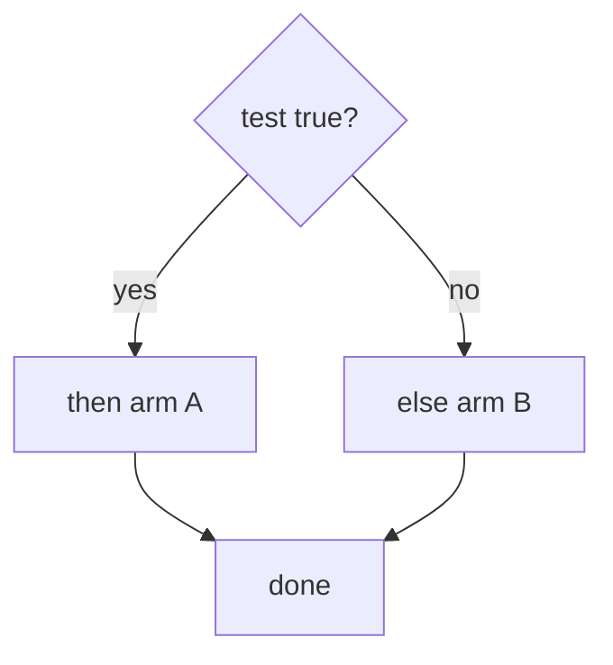

# Arithmetic, condition codes and control flow

> **Before this lesson:** This lesson continues directly from [x86-64 basics: registers, operands, mov](#/lesson/csapp/asm-basics); you should know what a register, an operand and the `mov` instruction are. Signed and unsigned numbers from [Unsigned and two's-complement integers](#/lesson/csapp/integers) are used when discussing comparisons.

## In plain words

Programs make decisions ("if the basket is empty, show a message") and repeat work ("for every item, add its price"). A processor has no direct command for either. It has two simpler tools. First, after each calculation it sets a few one-bit notes about the result, called **condition codes** or flags: was the answer zero, was it negative, did it overflow? Second, it has **jump** instructions that say "if such-and-such flag is set, continue from a different place in the program". It is like a board game: you normally move to the next square, but some squares say "if you rolled a six, go back to square 12". A loop is a jump backwards. An `if` is a jump forwards over the part to be skipped.

Why this matters at work: recognising these patterns is how you read a crash dump or a profiler listing and say "this is the loop" or "this is the unlikely branch". It also explains a real performance effect, branch misprediction, that can make the same code several times slower on unsorted data than on sorted data.

## Why look closer

Machine code has no `if`, no `while`, no `for` and no `switch`. It has no `&&`, no `else`, and no blocks. What it has is arithmetic that leaves behind a few one-bit clues about its result, and jumps that consult those clues. Everything structured in a C program has to be rebuilt from those two ingredients. Once you can see how, compiler output stops looking like noise: a backward jump is a loop, a forward jump over a few instructions is an `if`, an indirect jump through a table is a `switch`. This lesson covers the arithmetic instructions (including the oddly named one that compilers love to abuse), the condition codes, comparisons and tests, the two different ways of compiling a conditional and when each is faster, the standard shapes of loops, and jump tables.

Register conventions used in the examples: the first three arguments arrive in `%rdi`, `%rsi`, `%rdx`, and the result is returned in `%rax`.

## 1. Arithmetic and logic

### leaq: address arithmetic without the memory access

`leaq` ("load effective address") has the form of a memory read and never touches memory. It evaluates the address expression of its source operand and puts the *address itself* in the destination register.

```asm
leaq 16(%rdi), %rax            # rax = rdi + 16
leaq (%rdi,%rsi,4), %rax       # rax = rdi + 4*rsi
```

Its honest use is taking addresses, as in `&a[i]` or `&p->field`. Its popular use is compact arithmetic. The addressing form can add two registers, scale one of them by 1, 2, 4 or 8 and add a constant, all in one instruction, and it can deposit the result in a register different from either input, which ordinary two-operand instructions cannot.

```c
long blend(long a, long b, long c) {
    return a + 4 * b + 12 * c;
}
```

```asm
blend:
    leaq (%rdi,%rsi,4), %rax       # a + 4b
    leaq (%rdx,%rdx,2), %rdx       # c + 2c = 3c
    leaq (%rax,%rdx,4), %rax       # (a + 4b) + 4*(3c)
    ret
```

Three instructions, no multiply. Multiplying by 3, 5 or 9 is a single `leaq` (`x + 2x`, `x + 4x`, `x + 8x`), and other small constants are built by combining them.

```python-run
def lea(disp=0, base=0, index=0, scale=1):
    assert scale in (1, 2, 4, 8)
    return disp + base + index * scale

a, b, c = 7, 10, 3
rax = lea(base=a, index=b, scale=4)          # a + 4b
rdx = lea(base=c, index=c, scale=2)          # 3c
rax = lea(base=rax, index=rdx, scale=4)      # + 12c
print("leaq result:", rax, "| direct:", a + 4 * b + 12 * c)

for k, (base, scale) in {3: (1, 2), 5: (1, 4), 9: (1, 8)}.items():
    print(f"x*{k} = leaq (x,x,{scale})  ->  {lea(base=6, index=6, scale=scale)} for x = 6")
```

### The ordinary operations

The rest of the integer operations come with the usual size suffixes (`b`, `w`, `l`, `q`). In two-operand instructions the **second operand is both an input and the destination**.

```
one operand                 two operands (S, D)           shifts (k, D)
  incq D    D = D + 1         addq  S, D    D = D + S       salq / shlq   D = D << k
  decq D    D = D - 1         subq  S, D    D = D - S       sarq          D = D >> k  arithmetic
  negq D    D = -D            imulq S, D    D = D * S       shrq          D = D >> k  logical
  notq D    D = ~D            andq, orq, xorq
```

Points that cause mistakes:

- **Subtraction order.** `subq %rsi, %rdi` computes `%rdi − %rsi` and stores it in `%rdi`. Read it as "subtract the first from the second".
- **Shift amounts** are either an immediate or the single-byte register `%cl`, and nothing else. Only the low bits of `%cl` are used: 6 of them for a 64-bit operand, so shifting by 65 behaves like shifting by 1.
- **Left shift** has two names for one instruction. **Right shift** has two different instructions: `sar` copies the sign bit into the vacated positions and is used for signed values; `shr` fills with zeros and is used for unsigned ones.
- **Signedness is otherwise invisible.** Addition, subtraction and the low half of multiplication produce identical bits for signed and unsigned operands. That is the beauty of two's complement: one adder serves both.
- `xorq %rax, %rax`, or more often `xorl %eax, %eax`, is the idiomatic way to zero a register.

### 128-bit products and division

Multiplying two 64-bit numbers can produce 128 bits. For that, and for division, x86-64 uses a fixed pair of registers, `%rdx:%rax`, with `%rdx` holding the high half.

```
imulq S   signed    rdx:rax = S * rax          cqto      sign-extend rax into rdx:rax
mulq  S   unsigned  rdx:rax = S * rax
idivq S   signed    rax = rdx:rax / S ,  rdx = rdx:rax mod S
divq  S   unsigned  the same, for unsigned values
```

Before a signed division of a 64-bit value, the dividend must be widened to 128 bits; `cqto` does that by filling `%rdx` with copies of the sign bit of `%rax`. For unsigned division the compiler clears `%rdx` instead. One division yields both quotient and remainder, so code that needs `x / y` and `x % y` pays for only one. Division is slow, often tens of cycles, which is why compilers convert division by a constant into multiplications and shifts.

## 2. Condition codes

The processor keeps a set of single-bit **condition codes** that describe the outcome of the most recent arithmetic or logical operation. Four matter here:

| Flag | Set when the last result... | Detects |
|---|---|---|
| **ZF** (zero) | was zero | equality |
| **SF** (sign) | was negative, that is, had its top bit set | sign |
| **CF** (carry) | produced a carry out of the top bit | unsigned overflow |
| **OF** (overflow) | overflowed as a two's-complement value | signed overflow |

For an addition `t = a + b`, signed overflow happens exactly when the operands have the same sign and the result has the other: `(a < 0) == (b < 0) && (t < 0) != (a < 0)`. Unsigned overflow happens when the true sum does not fit, which shows up as the result being smaller than an operand.

All the arithmetic instructions above set the flags, with these exceptions and quirks: `leaq` sets none (it is "address" arithmetic); the logical operations clear CF and OF; `inc` and `dec` set OF and ZF but leave CF alone.

Two instructions exist only to set flags and throw the result away:

- **`cmpq S1, S2`** computes `S2 − S1`, like `subq`, without storing it. Use it to compare.
- **`testq S1, S2`** computes `S1 & S2`, like `andq`, without storing it. The common form `testq %rax, %rax` asks whether a value is zero, negative or positive; `testq $mask, %rax` asks whether particular bits are set.

The operand order of `cmp` is the one thing everybody gets backwards at first. After `cmpq %rsi, %rdi`, a following `jg` is taken when `%rdi > %rsi`: **the second operand is compared against the first**.

```python-run
def flags_after_sub(a, b, bits=8):
    """Condition codes after computing a - b (as cmp b, a does) at the given width."""
    mask, sign = (1 << bits) - 1, 1 << (bits - 1)
    a_u, b_u = a & mask, b & mask
    t = (a_u - b_u) & mask
    ZF, SF = int(t == 0), int(bool(t & sign))
    CF = int(a_u < b_u)                                         # borrow: unsigned a below b
    OF = int(bool((a_u ^ b_u) & (a_u ^ t) & sign))              # operands differ in sign, result flips
    return ZF, SF, CF, OF

print("   a     b    ZF SF CF OF   signed a<b (SF^OF)   unsigned a<b (CF)")
for a, b in ((5, 3), (3, 5), (4, 4), (-128, 1), (127, -1), (-1, 1)):
    ZF, SF, CF, OF = flags_after_sub(a, b)
    print(f"{a:5} {b:5}     {ZF}  {SF}  {CF}  {OF}          {SF ^ OF}                   {CF}")
```

Look at the row for −128 and 1 in an 8-bit world. The subtraction overflows, wrapping to +127, so SF is 0 even though −128 is less than 1. The overflow flag corrects for it: the signed "less than" condition is `SF ^ OF`, not SF alone. And notice the last row: as unsigned numbers, −1 is 255, which is *not* below 1, so CF is 0.

## 3. Using the flags

There are three ways to consume condition codes.

### Materialise a 0 or 1: the set instructions

A `set` instruction writes a single byte, 0 or 1, according to some combination of flags. Because it writes only a byte, compilers normally follow it with `movzbl` to clear the rest of the register.

```c
int below(long a, long b) { return a < b; }
```

```asm
below:
    cmpq   %rsi, %rdi       # flags from a - b
    setl   %al              # al = 1 if a < b (signed)
    movzbl %al, %eax        # widen to 32 bits; upper half of rax is zeroed too
    ret
```

The suffixes fall into three families, and the same suffixes are used by conditional jumps and conditional moves:

```
equality            signed comparisons                unsigned comparisons
  e   equal   ZF      l   less        SF ^ OF           b   below       CF
  ne  not eq ~ZF      le  less/equal  (SF ^ OF) | ZF    be  below/eq    CF | ZF
                      g   greater     ~(SF ^ OF) & ~ZF  a   above       ~CF & ~ZF
sign                  ge  greater/eq  ~(SF ^ OF)        ae  above/eq    ~CF
  s   negative SF
  ns  non-neg ~SF
```

The words are a reliable clue when reverse-engineering: **"less" and "greater" mean the compiler is treating the values as signed; "above" and "below" mean unsigned.** Since the machine code carries no type information, the choice of `setl` versus `setb` after a comparison is often the only evidence of whether a C variable was declared `int` or `unsigned`.

### Jump

A **jump** makes execution continue somewhere other than the next instruction. Destinations in assembly source are written as labels.

- `jmp Label` is a **direct** unconditional jump.
- `jmp *%rax` is an **indirect** jump to the address held in a register, and `jmp *(%rax)` jumps to an address read from memory. Indirect jumps are how `switch` statements and function pointers work.
- Conditional jumps (`je`, `jne`, `jl`, `jge`, `ja`, `jb`, `js` and so on) are taken or not according to the flags. They can only be direct.

In machine code, the target of a direct jump is most often encoded **PC-relative**: the instruction stores the signed difference between the target address and the address of the instruction *following* the jump. This makes the encoding short (one or four bytes) and means the code still works if the whole function is moved to a different address.

```python-run
def jump_target(next_instruction_addr, encoded_offset, width_bytes=1):
    bits = 8 * width_bytes
    if encoded_offset >= 1 << (bits - 1):
        encoded_offset -= 1 << bits                       # interpret as signed
    return next_instruction_addr + encoded_offset

# "eb 05" at 0x4004d3 is a 2-byte jmp, so the next instruction is at 0x4004d5.
print("eb 05 at 0x4004d3 jumps to", hex(jump_target(0x4004d5, 0x05)))
# "7f f6" (jg) at 0x4004e0: next instruction at 0x4004e2, offset 0xf6 = -10: a backward jump, so a loop.
print("7f f6 at 0x4004e0 jumps to", hex(jump_target(0x4004e2, 0xf6)))
```

### Conditional move

A **conditional move** (`cmove`, `cmovl`, `cmovge`, `cmova` and so on) copies its source to its destination only if the condition holds. There is no jump at all. The next section explains why that matters.

## 4. Two ways to compile a conditional

### With control flow

The general translation of `if (test) A; else B;` uses a conditional jump around one of the arms:

```
        evaluate test, setting flags
        jump-if-false  .Lelse
        A
        jmp .Ldone
.Lelse: B
.Ldone:
```



For example:

```c
long gap(long x, long y) {
    long r;
    if (x < y) r = y - x;
    else       r = x - y;
    return r;
}
```

```asm
gap:
    cmpq  %rsi, %rdi        # x compared with y
    jge   .Lelse            # if x >= y, skip the "then" arm
    movq  %rsi, %rax
    subq  %rdi, %rax        # r = y - x
    ret
.Lelse:
    movq  %rdi, %rax
    subq  %rsi, %rax        # r = x - y
    ret
```

Note that the compiler tests the *opposite* of the source condition, jumping away when it is false.

### With data flow

The same function can be compiled by computing **both** results and then choosing:

```asm
gap:
    movq   %rsi, %rdx
    subq   %rdi, %rdx       # rdx = y - x
    movq   %rdi, %rax
    subq   %rsi, %rax       # rax = x - y
    cmpq   %rsi, %rdi
    cmovl  %rdx, %rax       # if x < y, take y - x instead
    ret
```

This version does strictly more arithmetic. It is often faster anyway, because of how processors handle jumps. To keep its pipeline full, a processor **predicts** which way each conditional jump will go and starts executing down the predicted path before it knows the answer. A correct guess costs nothing. A wrong guess means discarding the speculative work and restarting, at a cost of roughly 15 to 20 clock cycles. If the outcome of the test is essentially random, such as comparing arbitrary inputs, half the jumps are mispredicted and the average cost is high. A conditional move has no prediction to get wrong; its cost is small and constant.

```python-run
penalty = 19
for p_wrong in (0.01, 0.10, 0.50):
    branch = 1 + p_wrong * penalty
    print(f"branch mispredicted {p_wrong:4.0%}: {branch:5.2f} cycles average   |   conditional move: about 1 cycle always")

# From measurements to the penalty: if a predictable run costs 8 cycles and a random one 17.5,
# then 17.5 = 8 + 0.5 * penalty.
t_predictable, t_random = 8.0, 17.5
print("implied misprediction penalty:", 2 * (t_random - t_predictable), "cycles")
```

### When the compiler must not use a conditional move

Because both arms are evaluated unconditionally, the transformation is only valid when that is harmless:

- **An arm might fault.** `p ? *p : 0` cannot be compiled by reading `*p` first, since the pointer may be null.
- **An arm has a side effect.** In `x < y ? (count++, y - x) : x - y`, the counter must change only when the first arm is chosen.
- **An arm is expensive.** Computing both would waste more than a misprediction costs.

So compilers apply conditional moves only to simple, safe expressions. You can encourage them by writing choices as conditional expressions over already-computed values.

## 5. Loops

C's three loop forms all become combinations of a test and a backward jump. Recognising the three standard shapes makes loops easy to spot.

**do-while** is the simplest, since the body always runs at least once:

```
.Lloop: body
        evaluate test
        jump-if-true .Lloop
```

**while** must test before the first iteration. Compilers use one of two arrangements.

*Jump to the middle*: start with an unconditional jump to the test at the bottom.

```
        jmp .Ltest
.Lloop: body
.Ltest: evaluate test
        jump-if-true .Lloop
```

*Guarded do*: test once up front and skip the loop entirely if the condition is false; otherwise fall into a do-while.

```
        evaluate test
        jump-if-false .Ldone
.Lloop: body
        evaluate test
        jump-if-true .Lloop
.Ldone:
```

The guarded form is what you usually see with optimisation turned on. It has one conditional jump per iteration, and the compiler can often prove the initial test is always true and delete it.

**for** is a while loop with its initialisation placed before and its update placed at the end of the body. One subtlety: a `continue` in a `for` loop must still perform the update, so it jumps to the update code, not directly to the test.

A worked example. Count the 1 bits in a word:

```c
long ones(unsigned long x) {
    long n = 0;
    while (x != 0) {
        n += x & 1;
        x >>= 1;
    }
    return n;
}
```

```asm
ones:
    movl   $0, %eax          # n = 0
    jmp    .Ltest            # jump-to-middle
.Lloop:
    movq   %rdi, %rdx
    andl   $1, %edx          # x & 1
    addq   %rdx, %rax        # n += ...
    shrq   %rdi              # x >>= 1, logical because x is unsigned
.Ltest:
    testq  %rdi, %rdi        # x != 0 ?
    jne    .Lloop
    ret
```

Clues to read from it: the backward `jne` marks the loop; `testq` of a register with itself is a comparison with zero; `shrq` rather than `sarq` reveals that `x` is unsigned.

```python-run
def run_ones(x):
    rax, rdi, steps = 0, x, 0
    pc = "test"                                  # jmp .Ltest
    while True:
        if pc == "loop":
            rdx = rdi & 1
            rax += rdx
            rdi >>= 1
            steps += 1
            pc = "test"
        else:                                    # .Ltest
            if rdi != 0: pc = "loop"
            else: return rax, steps

for x in (0, 1, 0b1011, 0xFF00):
    n, steps = run_ones(x)
    print(f"x = {x:#8x}: {n} one bits, loop body executed {steps} times, python says {bin(x).count('1')}")
```

## 6. switch statements and jump tables

A `switch` chooses among many alternatives based on an integer. Compiling it as a chain of comparisons would take time proportional to the number of cases. When the case values are reasonably dense, compilers use a **jump table** instead: an array in which entry *i* holds the address of the code to run when the switch value is *i*. Selecting a case is then one array lookup and one indirect jump, however many cases there are.

```c
long route(long code, long v) {
    switch (code) {
    case 20: v += 7;         break;
    case 22: v *= 3;         /* falls through */
    case 23: v -= 1;         break;
    case 25:
    case 26: v = 0;          break;
    default: v = -1;
    }
    return v;
}
```

```asm
route:
    subq   $20, %rdi                  # shift the range 20..26 down to 0..6
    cmpq   $6, %rdi
    ja     .Ldefault                  # unsigned test: catches both > 26 and < 20
    jmp    *.Ltable(,%rdi,8)          # indirect jump through the table
    ...
    .section .rodata
.Ltable:
    .quad .Lcase20      # 0
    .quad .Ldefault     # 1   (21 is not a case)
    .quad .Lcase22      # 2
    .quad .Lcase23      # 3
    .quad .Ldefault     # 4   (24 is not a case)
    .quad .Lcase25      # 5
    .quad .Lcase25      # 6   (26 shares code with 25)
```

Four things to notice, all of which help when reconstructing a `switch` from assembly:

1. **Normalisation.** Subtracting the smallest case value makes the index start at zero.
2. **One comparison checks both ends of the range.** After the subtraction, a value that was below 20 has wrapped to a huge unsigned number, so a single unsigned `ja` sends both too-small and too-large values to the default.
3. **Gaps in the case values point to the default** label; **cases that share code** have identical entries.
4. **Fall-through** is the absence of a jump at the end of one case's code, so execution runs on into the next block.

To recover the C from such a listing: the constant subtracted and the constant compared give the range of case values; duplicated table entries reveal shared cases; entries equal to the `ja` target are missing cases; a block that does not end in a jump falls through.

```python-run
def route(code, v):
    table = ["case20", "default", "case22", "case23", "default", "case25", "case25"]
    index = (code - 20) & (2**64 - 1)            # unsigned view of the normalised value
    label = table[index] if index <= 6 else "default"
    trace = [label]
    if label == "case20":   v += 7
    elif label == "case22": v *= 3; trace.append("falls into case23"); v -= 1
    elif label == "case23": v -= 1
    elif label == "case25": v = 0
    else:                   v = -1
    return v, " -> ".join(trace)

for code in (20, 21, 22, 23, 26, 19, 1000):
    print(f"route({code:4}, 10) =", route(code, 10))
```

When the case values are sparse (say 1, 100, 10 000) a table would be mostly empty, and compilers fall back to a sequence of comparisons, usually arranged as a binary search.

> [!INTERVIEW]
> **"Why can a `switch` be faster than an equivalent if-else chain?"** With dense case values the compiler emits a jump table: it normalises the value, bounds-checks it with one unsigned comparison, and performs a single indirect jump through an array of code addresses. That is constant time regardless of the number of cases, where an if-else chain makes up to one comparison per case. With sparse values the compiler generates a binary search of comparisons instead, which is logarithmic.

> [!INTERVIEW]
> **"What is branch misprediction and how does a conditional move help?"** Processors guess the direction of conditional jumps to keep their pipelines busy. A wrong guess throws away the speculative work, costing roughly 15 to 20 cycles. For data-dependent conditions that are effectively random, that penalty is paid about half the time. A conditional move evaluates both alternatives and selects one without changing the flow of control, so nothing is predicted. Compilers use it only when both alternatives are cheap and free of side effects or possible faults.

## 7. Pitfalls

- **Reading `cmp` backwards.** After `cmpq A, B`, the conditions describe *B relative to A*.
- **Reading `sub` backwards.** `subq A, B` is `B = B − A`.
- **Confusing signed and unsigned conditions.** `jl`/`jg` use SF and OF; `jb`/`ja` use CF.
- **Thinking `leaq` reads memory** or sets flags. It does neither.
- **Forgetting `cqto`** (or clearing `%rdx`) before a division; stale contents of `%rdx` become the high half of the dividend.
- **Forgetting that `set` writes only one byte.**
- **Expecting the jump condition to match the source condition.** Compilers usually test the negation and jump around the body.
- **Missing fall-through** when rebuilding a `switch`: look for case blocks that do not end with a jump.
- **Assuming every `?:` becomes a conditional move.** Possible faults, side effects or expensive arms force a branch.

## Summary

- `leaq` computes an address expression without accessing memory; compilers use it for fast addition and small multiplications.
- Unary, binary and shift instructions operate in place on their last operand. Signed and unsigned values share instructions except for right shifts, widening multiplication and division, which use `%rdx:%rax`.
- Arithmetic sets ZF, SF, CF and OF as side effects. `cmp` and `test` set them without storing a result.
- Flags are consumed by `set` instructions (produce 0 or 1), conditional jumps and conditional moves, using suffixes for equality, signed order (`l`, `g`) and unsigned order (`b`, `a`).
- Conditionals compile either to jumps, which rely on branch prediction, or to conditional moves, which compute both outcomes and avoid mispredictions when the arms are simple and safe.
- Loops are a test plus a backward jump, in do-while, jump-to-middle or guarded-do form.
- Dense `switch` statements become a bounds check and an indirect jump through a table of code addresses.

## Glossary

- **Condition codes (flags)**: one-bit values recording facts about the latest arithmetic result: ZF (zero), SF (negative), CF (unsigned carry), OF (signed overflow).
- **`leaq`**: an instruction that computes an address expression and stores the number itself, without reading memory.
- **`cmp` / `test`**: instructions that subtract or AND two values only to set the flags, discarding the result.
- **`set` instruction**: writes 1 or 0 into a byte depending on the flags.
- **Jump**: an instruction that makes execution continue at a different address.
- **Label**: a name in assembly source that marks a position in the code, used as a jump target.
- **PC-relative**: a way of encoding a jump target as a distance from the following instruction.
- **Conditional move**: an instruction that copies a value only if a condition holds, with no jump.
- **Branch prediction**: the processor's guess about which way a conditional jump will go, made so it can keep working ahead.
- **Misprediction penalty**: the time lost, roughly 15 to 20 clock cycles, when that guess is wrong.
- **Jump table**: an array of code addresses used to implement a `switch` with one indexed jump.
- **Fall-through**: what happens when a `switch` case does not end with `break` and execution continues into the next case.

```quiz
[
  {"q": "With %rdi = 6 and %rsi = 5, what does leaq 3(%rdi,%rsi,4), %rax put in %rax?",
   "options": ["The 8 bytes of memory at address 29", "29", "44", "26"],
   "answer": 1, "explain": "leaq computes the address expression 3 + 6 + 5*4 = 29 and stores that number. It does not read memory."},
  {"q": "After cmpq %rsi, %rdi, when is jg taken?",
   "options": ["When %rsi > %rdi (signed)", "When %rdi > %rsi (signed)", "When %rdi > %rsi (unsigned)", "When the two are equal"],
   "answer": 1, "explain": "cmp computes the second operand minus the first, so the condition describes %rdi relative to %rsi. The g suffix is a signed comparison."},
  {"q": "Which condition codes implement a signed less-than after a comparison?",
   "options": ["CF", "SF alone", "SF XOR OF", "ZF OR CF"],
   "answer": 2, "explain": "The sign of the difference indicates less-than unless the subtraction overflowed, in which case the sign is inverted. XOR with OF corrects for that."},
  {"q": "A compiler emits seta after comparing two values. What does this suggest about the C source?",
   "options": ["The values are signed", "The values are unsigned (or pointers)", "The values are floating point", "Nothing can be inferred"],
   "answer": 1, "explain": "Above and below are the unsigned conditions, based on the carry flag. Signed comparisons use greater and less."},
  {"q": "What does testq %rax, %rax followed by je accomplish?",
   "options": ["Jumps if %rax is negative", "Jumps if %rax is zero", "Jumps if %rax is odd", "Always jumps"],
   "answer": 1, "explain": "ANDing a value with itself yields the value, so ZF is set exactly when it is zero. je jumps when ZF is set."},
  {"q": "Why can the compiler NOT use a conditional move for the expression p ? *p : 0?",
   "options": ["Conditional moves cannot load constants", "Both alternatives would be evaluated, and dereferencing a null p would fault", "Pointers cannot be compared", "It would be slower"],
   "answer": 1, "explain": "A conditional move requires computing both values first. Reading *p when p is null is exactly what the test was meant to prevent."},
  {"q": "A switch has cases 100, 101, 103 and 105. The compiler subtracts 100 and compares with 5 using ja. How many entries does the jump table have, and where do entries 2 and 4 point?",
   "options": ["4 entries; there are no entries 2 and 4", "6 entries; entries 2 and 4 point to the default code", "5 entries; they point to case 103", "106 entries; they point to case 100"],
   "answer": 1, "explain": "The table covers the normalised range 0 to 5. Values 102 and 104 are not cases, so their slots hold the address of the default code."},
  {"q": "In the jump-to-middle translation of a while loop, what is the first instruction executed after initialisation?",
   "options": ["The first instruction of the body", "An unconditional jump to the test at the bottom of the loop", "A conditional jump out of the loop", "The update expression"],
   "answer": 1, "explain": "The loop begins by jumping to the test, so the condition is checked before the body runs for the first time."}
]
```

> **Source:** CS:APP 3e, §3.5–3.6
