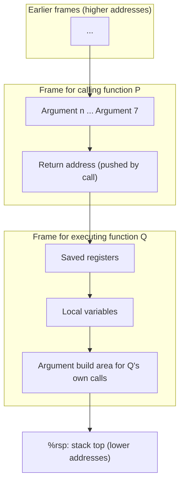
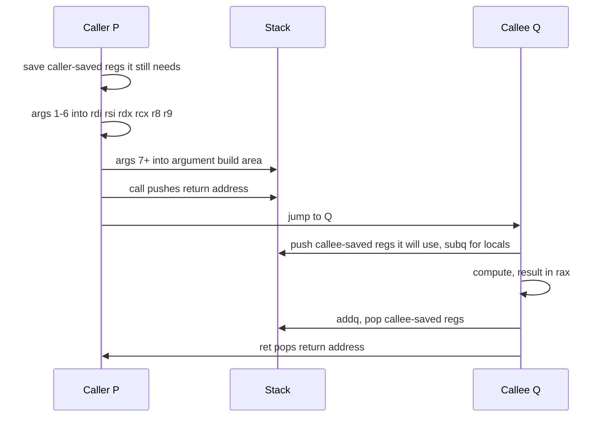

# Procedures and the run-time stack

> **Before this lesson:** You need registers, `mov`, `push` and `pop` from [x86-64 basics: registers, operands, mov](#/lesson/csapp/asm-basics), and jumps and conditions from [Arithmetic, condition codes and control flow](#/lesson/csapp/asm-control).

## In plain words

A **function** (also called a procedure) is a named piece of code that other code can use by "calling" it. When a call happens, the computer has to remember where to come back to, hand over the inputs, and give the function some private working space. All of that is done with a region of memory called the **stack**. Think of a stack of trays in a canteen: you add to the top and remove from the top. Each call places a new tray holding its notes on the pile; when the function finishes, its tray is removed and the one below, belonging to the caller, is on top again. That is how a function can call another, which calls another, and everything still unwinds in the right order.

Why this matters at work: when a program crashes, the report you receive, called a stack trace, is a listing of those trays. Debuggers, profilers and many security attacks are all about the stack. Knowing how calls work lets you read a trace with confidence and understand why very deep recursion fails.

## Why look closer

Procedures (functions, methods, subroutines, handlers) are the key abstraction in software: they package code that implements some functionality behind a named interface with arguments and an optional return value. Supporting them at the machine level requires three mechanisms whenever procedure P calls procedure Q and Q later returns:

1. **Passing control.** The PC must jump to Q's first instruction, and later back to the instruction in P right after the call.
2. **Passing data.** P must supply arguments to Q, and Q must return a value to P.
3. **Allocating and deallocating memory.** Q may need space for local variables when it starts and must free it before returning.

x86-64 implements these with a minimal set of instructions plus a set of **conventions**: agreements between caller and callee about register use. Overhead is kept low because most calls need only a few of these mechanisms.

## 1. The run-time stack

Procedure calls follow a last-in, first-out discipline: while Q runs, P and every procedure up the call chain are suspended, and Q's locals vanish when it returns. A **stack** is the natural data structure. When an x86-64 procedure needs more storage than registers offer, it allocates a **stack frame** by decrementing `%rsp`.



Key facts:

- The stack grows toward lower addresses; `%rsp` points at the top element.
- When P calls Q, the **return address** is pushed as part of P's frame (by convention, it belongs to the caller's frame).
- Q's frame holds saved registers, local variables, and an **argument build area** for arguments 7+ of procedures Q itself calls.
- Most frames are **fixed size**, allocated at the start of the procedure. Many functions need no frame at all: if all locals fit in registers and the function calls nobody (a **leaf procedure**), nothing is allocated.

## 2. Passing control: call and ret

| Instruction | Effect |
|---|---|
| `call Label` | Push the return address (address of the instruction after the call), then set PC to Label |
| `call *Operand` | Indirect call, target from register or memory |
| `ret` | Pop an address from the stack and set PC to it |

(objdump writes them `callq`/`retq`; the `q` emphasizes x86-64.) Example trace from the book's `multstore` → `mult2` call:

```
400563: e8 d8 ff ff ff     callq 400540 <mult2>   # in main/multstore
400568: 48 89 03           mov   %rax,(%rbx)      # return address = 0x400568
...
400540 <mult2>:
400540: 48 89 f8           mov   %rdi,%rax
400543: 48 0f af c6        imul  %rsi,%rax
400547: c3                 retq
```

Executing `callq` at `0x400563` with `%rsp = 0x7fffffffe840` pushes `0x400568` (so `%rsp = 0x7fffffffe838`) and jumps to `0x400540`. The `retq` pops `0x400568` into the PC and restores `%rsp = 0x7fffffffe840`. Note the call encodes target `0xffffffd8` = −40 relative to `0x400568`: PC-relative again.

## 3. Passing data: the register convention

On x86-64, up to **six** integral (integer and pointer) arguments are passed in registers, in a fixed order; the register name used depends on the argument's size:

| Argument | 1 | 2 | 3 | 4 | 5 | 6 |
|---|---|---|---|---|---|---|
| 64-bit | `%rdi` | `%rsi` | `%rdx` | `%rcx` | `%r8` | `%r9` |
| 32-bit | `%edi` | `%esi` | `%edx` | `%ecx` | `%r8d` | `%r9d` |
| 16-bit | `%di` | `%si` | `%dx` | `%cx` | `%r8w` | `%r9w` |
| 8-bit | `%dil` | `%sil` | `%dl` | `%cl` | `%r8b` | `%r9b` |

The return value goes in `%rax`. Arguments 7 and up are passed **on the stack**, with argument 7 at the top (lowest address), each rounded up to a multiple of 8 bytes. Floating-point arguments use `%xmm0`–`%xmm7` instead (and `%xmm0` for the return).

```c
void proc(long a1, long *a1p, int a2, int *a2p,
          short a3, short *a3p, char a4, char *a4p) {
    *a1p += a1;
    *a2p += a2;
    *a3p += a3;
    *a4p += a4;
}
```

<!-- walkthrough:c -->
**Reading this C line by line**

- `void proc(long a1, long *a1p, int a2, int *a2p, short a3, short *a3p, char a4, char *a4p)` defines a function with eight inputs that returns nothing (`void`). They come in pairs: a number of some size (`long` is 8 bytes, `int` 4, `short` 2, `char` 1) and a pointer, that is, the address of a variable of that same size.
- `*a1p += a1;` reads the value stored at address `a1p`, adds `a1`, and stores the sum back at that address. The star means "the thing this address points to"; `+=` means "add to".
- The next three lines do the same for the other three pairs.
- The function is chosen because it has more than six inputs. The first six travel in registers; the seventh and eighth must be placed on the stack by the caller, which is what the lesson examines next.

```
# a1 %rdi (8 bytes), a1p %rsi, a2 %edx (4), a2p %rcx, a3 %r8w (2), a3p %r9,
# a4 at 8(%rsp) (1 byte), a4p at 16(%rsp)
proc:
    movq    16(%rsp), %rax     # fetch a4p (above the return address at 0(%rsp))
    addq    %rdi, (%rsi)       # *a1p += a1
    addl    %edx, (%rcx)       # *a2p += a2
    addw    %r8w, (%r9)        # *a3p += a3
    movl    8(%rsp), %edx      # fetch a4
    addb    %dl, (%rax)        # *a4p += a4
    ret
```

Note the instruction suffixes follow the C types: `addq` for `long`, `addl` for `int`, `addw` for `short`, `addb` for `char`. Arguments 7 and 8 sit at `8(%rsp)` and `16(%rsp)`, immediately above the return address.

## 4. Local storage on the stack

Locals live in registers when possible, but must go to memory when:

- there are not enough registers;
- the code applies `&` to a local, so it needs an address;
- the local is an array or structure accessed by reference.

```c
long swap_add(long *xp, long *yp) {
    long x = *xp, y = *yp;
    *xp = y; *yp = x;
    return x + y;
}
long caller() {
    long arg1 = 534;
    long arg2 = 1057;
    long sum = swap_add(&arg1, &arg2);
    long diff = arg1 - arg2;
    return sum * diff;
}
```

```
caller:
    subq    $16, %rsp          # allocate 16 bytes for the frame
    movq    $534, (%rsp)       # arg1
    movq    $1057, 8(%rsp)     # arg2
    leaq    8(%rsp), %rsi      # &arg2 as 2nd argument
    movq    %rsp, %rdi         # &arg1 as 1st argument
    call    swap_add
    movq    (%rsp), %rdx       # reload arg1 (it changed!)
    subq    8(%rsp), %rdx      # diff = arg1 - arg2
    imulq   %rdx, %rax         # sum * diff
    addq    $16, %rsp          # deallocate the frame
    ret
```

Because `caller` takes the addresses of `arg1` and `arg2`, they must live in memory. The frame is allocated with `subq` and freed with `addq` before `ret`.

## 5. Register saving conventions

Registers are shared by all procedures, so we need rules to stop a callee from clobbering values the caller still needs:

- **Callee-saved**: `%rbx`, `%rbp`, `%r12`–`%r15`. If Q modifies one, it must save the original (typically `pushq` at entry) and restore it before returning (`popq`). P can rely on these surviving the call.
- **Caller-saved**: all other registers except `%rsp` (`%rax`, `%rcx`, `%rdx`, `%rsi`, `%rdi`, `%r8`–`%r11`). Any function may modify them freely; if P needs a value in one after a call, P must save it first.

```c
long P(long x, long y) {
    long u = Q(y);
    long v = Q(x);
    return u + v;
}
```

```
P:
    pushq   %rbp            # save callee-saved %rbp
    pushq   %rbx            # save callee-saved %rbx
    subq    $8, %rsp        # align stack frame to 16 bytes
    movq    %rdi, %rbp      # keep x in a callee-saved register
    movq    %rsi, %rdi      # move y to first argument
    call    Q               # u = Q(y)
    movq    %rax, %rbx      # keep u in callee-saved %rbx
    movq    %rbp, %rdi      # x as first argument
    call    Q               # v = Q(x)
    addq    %rbx, %rax      # u + v
    addq    $8, %rsp
    popq    %rbx            # restore in reverse order
    popq    %rbp
    ret
```

`x` must survive the first call and `u` must survive the second, so P parks them in callee-saved registers (after saving those registers' old values for *its* caller). Pops occur in reverse order of pushes. The `subq $8` keeps `%rsp` 16-byte aligned at the call, as the ABI requires.

## 6. Recursive procedures

Because each call gets its own frame and registers follow the conventions, recursion needs no special support: a recursive call is a call.

```c
long rfact(long n) {
    long result;
    if (n <= 1)
        result = 1;
    else
        result = n * rfact(n - 1);
    return result;
}
```

```
rfact:                      # n in %rdi
    pushq   %rbx            # save %rbx
    movq    %rdi, %rbx      # store n in callee-saved register
    movl    $1, %eax        # result = 1
    cmpq    $1, %rdi
    jle     .L35            # if n <= 1 goto done
    leaq    -1(%rdi), %rdi  # n - 1
    call    rfact           # rfact(n-1)
    imulq   %rbx, %rax      # result = n * rfact(n-1)
.L35:
    popq    %rbx            # restore %rbx
    ret
```

Each activation saves the caller's `%rbx`, stores its own `n` there, and restores the old value on the way out. The stack holds a chain of `[saved %rbx, return address]` pairs, one per pending call.

```python-run
# Simulate the stack for rfact(4): each frame saves the caller's %rbx and a return address.
stack, trace = [], []
def rfact(n, rbx_of_caller):
    stack.append(("ret addr", "saved rbx=" + str(rbx_of_caller)))
    trace.append(f"enter rfact({n}), depth={len(stack)}")
    rbx = n
    result = 1 if n <= 1 else rbx * rfact(n - 1, rbx)
    stack.pop()
    trace.append(f"leave rfact({n}) -> {result}")
    return result
print(rfact(4, "main's"))
print("\n".join(trace))
```

<!-- walkthrough:python-run -->
**Reading this Python line by line**

- `stack, trace = [], []` creates two empty lists: one models the machine's stack, the other records what happened.
- `def rfact(n, rbx_of_caller):` defines a function that computes the factorial of `n` (4 × 3 × 2 × 1 for 4) by calling itself.
- `stack.append(...)` adds an entry to the end of the list, modelling the return address and the saved register that a real call places on the stack.
- `result = 1 if n <= 1 else rbx * rfact(n - 1, rbx)` is the calculation: for 1 the answer is 1; otherwise it is `n` times the factorial of `n - 1`, which requires another call, and so another stack entry.
- `stack.pop()` removes the entry again when the call finishes.
- `print(rfact(4, "main's"))` shows 24. The recorded trace shows the depth growing to 4 and then shrinking, last in, first out.

> [!WARNING]
> Each recursive call consumes stack space (here 16 bytes; often much more). The default Linux main-thread stack is typically 8 MB, so very deep recursion causes a **stack overflow**, which shows up as a segmentation fault when the stack hits its guard region.

## 7. Variable-size frames and the frame pointer

When a function allocates a variable amount of stack (a variable-length array, or `alloca`), the compiler cannot use fixed offsets from `%rsp`. Then it uses `%rbp` as a **frame pointer** (base pointer): it saves the old `%rbp`, sets `%rbp = %rsp` at entry, refers to locals at fixed offsets from `%rbp`, and on exit executes `leave` (equivalent to `movq %rbp, %rsp; popq %rbp`). Fixed-size frames, the common case, don't need it, which frees `%rbp` as an ordinary callee-saved register. (Older IA32 code used `%rbp`/`%ebp` frame pointers in every function.)

## 8. Putting it together



> [!INTERVIEW]
> **"What is a stack frame and what lives in it?"** The return address (pushed by `call`), saved callee-saved registers, locals that cannot live in registers (address-taken variables, arrays, spills), and outgoing arguments beyond the sixth. **"Why is recursion slower than iteration / why can it crash?"** Each call pays for call/ret, register saves and a new frame, and unbounded depth exhausts the fixed-size stack. Mention tail-call optimization: when the recursive call is the last action, compilers at `-O2` can turn it into a jump, reusing the frame.

> [!INTERVIEW]
> **"Never return a pointer to a local variable."** The local lives in the callee's frame, which is deallocated on `ret` and overwritten by the next call. The pointer dangles.

## 9. Summary

- The stack provides LIFO storage for frames; `%rsp` marks the top; frames are allocated by `subq` and freed by `addq` (or push/pop).
- `call` pushes the return address and jumps; `ret` pops it.
- Integer arguments: `%rdi, %rsi, %rdx, %rcx, %r8, %r9`, then the stack. Return in `%rax`.
- Callee-saved: `%rbx, %rbp, %r12–%r15`. Everything else (but `%rsp`) is caller-saved.
- Locals go on the stack if their address is taken, if they are aggregates, or if registers run out.
- Recursion works for free because each activation has private state.

## Glossary

- **Procedure (function)**: a named block of code that can be called from elsewhere and returns when done.
- **Caller / callee**: the code that makes a call / the function being called.
- **Stack**: the region of memory holding the working data of functions that are in progress.
- **Stack frame**: the portion of the stack belonging to one call of one function.
- **Stack pointer (`%rsp`)**: the register that marks the top of the stack.
- **`call` / `ret`**: the instructions that start a function and return from it.
- **Return address**: the location of the instruction to continue with after a function finishes.
- **Calling convention**: the agreed rules for where arguments and results are placed.
- **Argument registers**: the six registers used, in order, for the first six arguments: `%rdi`, `%rsi`, `%rdx`, `%rcx`, `%r8`, `%r9`.
- **Caller-saved / callee-saved**: registers a called function may overwrite freely / registers it must restore before returning.
- **Local variable**: a variable that exists only while its function is running.
- **Recursion**: a function calling itself.

## Check yourself

```quiz
[
  {"q": "What does call do on x86-64?", "options": ["Jumps, then pushes the address of the call", "Pushes the address of the following instruction, then jumps", "Saves all registers", "Allocates a stack frame for locals"], "answer": 1,
   "explain": "call pushes the return address (the next instruction) and sets the PC to the target."},
  {"q": "Where is the 7th integer argument passed?", "options": ["%r10", "%rax", "On the stack, immediately above the return address when the callee starts", "%xmm0"], "answer": 2,
   "explain": "Only six integer arguments go in registers; the 7th is at 8(%rsp) on entry to the callee."},
  {"q": "Which register is callee-saved?", "options": ["%rax", "%rdi", "%rbx", "%r10"], "answer": 2,
   "explain": "Callee-saved: %rbx, %rbp, %r12-%r15."},
  {"q": "Why must a local variable whose address is taken be stored on the stack?", "options": ["Registers cannot hold longs", "A register has no memory address that a pointer could refer to", "The ABI forbids it", "It is not required"], "answer": 1,
   "explain": "The & operator needs a memory address; registers are not addressable."},
  {"q": "Procedure P needs a value in %rdi after calling Q. What must happen?", "options": ["Nothing, Q preserves %rdi", "P must save it (e.g., in a callee-saved register or on the stack) before the call", "Q must save it", "The OS saves it"], "answer": 1,
   "explain": "%rdi is caller-saved: Q may overwrite it, so P is responsible."},
  {"q": "In rfact, why does the function push %rbx at entry?", "options": ["To pass n to the recursive call", "Because it uses callee-saved %rbx to hold n across the recursive call, so it must preserve the caller's value", "To align the stack", "To store the return value"], "answer": 1,
   "explain": "Using a callee-saved register obliges the function to save and restore it."},
  {"q": "When does gcc use %rbp as a frame pointer on x86-64?", "options": ["Always", "Never", "When the frame has variable size, e.g. a variable-length array", "Only in leaf functions"], "answer": 2,
   "explain": "Fixed-size frames are addressed via %rsp; variable-size ones need a stable base in %rbp."}
]
```

> **Source:** CS:APP 3e, §3.7 (Procedures: the run-time stack, control transfer, data transfer, local storage on the stack and in registers, recursive procedures) and §3.10.5 (variable-size stack frames).
