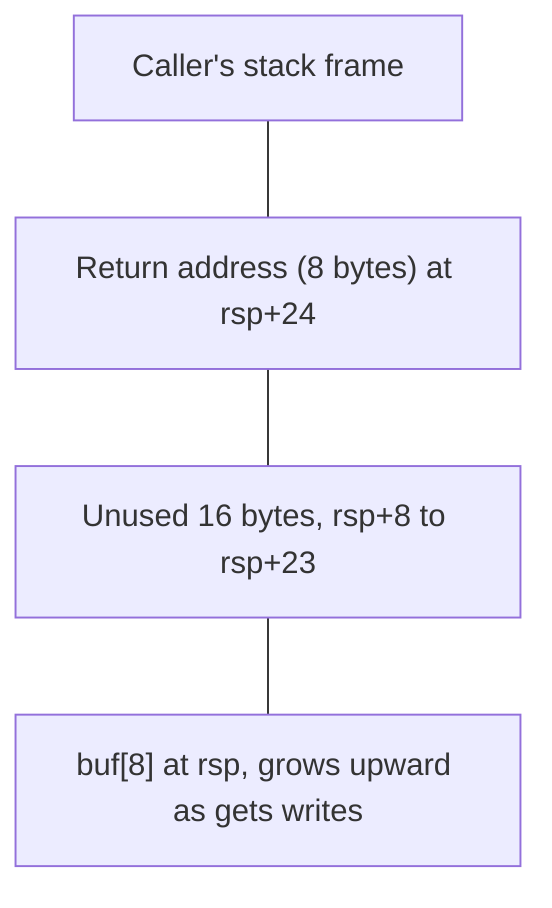

# Arrays, structs, alignment and buffer overflows

> **Before this lesson:** You need the stack, return addresses and stack frames from [Procedures and the run-time stack](#/lesson/csapp/asm-procedures), and memory operands of the form `D(base,index,scale)` from [x86-64 basics: registers, operands, mov](#/lesson/csapp/asm-basics).

## In plain words

Programs group data in two basic ways. An **array** is a row of items of the same kind, like a street of identical houses numbered 0, 1, 2 and so on. A **struct** is a bundle of different items kept together, like a form with fields for name, age and address. In memory both are nothing more than bytes placed side by side, and the machine finds an item by adding a distance to a starting address. Nothing in the hardware stops a program from writing past the end of an array into whatever lies next to it. That mistake is a **buffer overflow**: like writing a long name on a form and continuing over the boxes that follow.

Why this matters at work: buffer overflows have been one of the most serious kinds of security weakness for decades, and understanding them is basic professional knowledge. This lesson explains how the problem arises and the defences that compilers and operating systems use. It also explains why the same data can take more memory than you expect, because of padding between fields.

## Why look closer

C aggregates (arrays, structures and unions) turn into nothing more than address arithmetic at the machine level. This lesson shows how the compiler lays them out and accesses them, why it inserts padding, and then uses that knowledge to understand the most notorious class of security bugs: **buffer overflows**, plus the defences modern systems deploy against them. We close with a brief look at how floating-point code differs.

## 1. Arrays

For a declaration `T A[N];` with element size $L$ = `sizeof(T)`, the compiler allocates a contiguous region of $L \cdot N$ bytes at some starting address $x_A$. The identifier `A` acts as a pointer to the first element, and element $i$ lives at

$$\&A[i] = x_A + L \cdot i$$

| Declaration | Element size | Total size | Address of element i |
|---|---|---|---|
| `char A[12]` | 1 | 12 | $x_A + i$ |
| `char *B[8]` | 8 | 64 | $x_B + 8i$ |
| `int C[6]` | 4 | 24 | $x_C + 4i$ |
| `double *D[5]` | 8 | 40 | $x_D + 8i$ |

The scaled-index addressing mode exists precisely for this. With `E` (an `int` array) in `%rdx` and `i` in `%rcx`, `E[i]` is loaded by

```
movl (%rdx,%rcx,4), %eax
```

### Pointer arithmetic

C scales pointer arithmetic by the element size: if `p` is a `T *` with value $x_p$, then `p + i` has value $x_p + L\cdot i$. `A[i]` is *defined* as `*(A + i)`. Some equivalences with `E` an `int` array at `%rdx` and index `i` in `%rcx`:

| Expression | Type | Value | Assembly |
|---|---|---|---|
| `E` | `int *` | $x_E$ | `movq %rdx, %rax` |
| `E[0]` | `int` | $M[x_E]$ | `movl (%rdx), %eax` |
| `E[i]` | `int` | $M[x_E + 4i]$ | `movl (%rdx,%rcx,4), %eax` |
| `&E[2]` | `int *` | $x_E + 8$ | `leaq 8(%rdx), %rax` |
| `E + i - 1` | `int *` | $x_E + 4i - 4$ | `leaq -4(%rdx,%rcx,4), %rax` |
| `*(E + i - 3)` | `int` | $M[x_E + 4i - 12]$ | `movl -12(%rdx,%rcx,4), %eax` |
| `&E[i] - E` | `long` | $i$ | `movq %rcx, %rax` |

Note the last row: subtracting two pointers into the same array gives the difference **in elements**, not bytes.

### Nested (multidimensional) arrays

`int A[5][3];` is an array of 5 elements, each an array of 3 ints. C stores it in **row-major order**: all of row 0, then row 1, and so on. For `T D[R][C]`:

$$\&D[i][j] = x_D + L\,(C \cdot i + j)$$

So `A[i][j]` with `x_A` in `%rdi`, `i` in `%rsi`, `j` in `%rdx` compiles to:

```
leaq (%rsi,%rsi,2), %rax     # 3i
leaq (%rdi,%rax,4), %rax     # xA + 12i
movl (%rax,%rdx,4), %eax     # M[xA + 12i + 4j]
```

Row-major order is the root of the cache lesson in Module 6: iterating `j` in the inner loop walks memory sequentially; iterating `i` in the inner loop strides by a whole row.

### Fixed vs. variable-size arrays

When dimensions are compile-time constants, the compiler can strength-reduce index arithmetic in loops: instead of recomputing `A[i][j]` each iteration, it keeps a pointer and bumps it by a constant (4 bytes along a row, `4*C` bytes down a column). C99 also allows variable-length arrays such as `int A[n][n]` as function parameters; then the compiler must multiply by `n` at run time (`imulq`), though it can still optimize regular access patterns inside loops.

## 2. Structures

A `struct` groups objects of different types into one object, its fields referenced by name. The compiler records each field's **byte offset** and generates `base + offset` references.

```c
struct rec {
    int i;      // offset 0
    int j;      // offset 4
    int a[2];   // offset 8
    int *p;     // offset 16
};              // total size 24
```

<!-- walkthrough:c -->
**Reading this C line by line**

- `struct rec { ... };` defines a new type named `struct rec` that bundles several fields. Text after `//` is a comment.
- `int i;` is a 4-byte whole number placed at the very start, 0 bytes in.
- `int j;` follows directly, 4 bytes in.
- `int a[2];` is an array of two `int`s, 8 bytes in all, starting 8 bytes in.
- `int *p;` is a pointer (an address), which takes 8 bytes on a 64-bit machine. It starts 16 bytes in, giving a total size of 24 bytes.
- The compiler turns every use of a field into "start address plus that field's distance". For a pointer `r` to such a struct, `r->j` becomes "the 4 bytes at address `r + 4`".

With `r` in `%rdi`, the statement `r->j = r->i;` becomes

```
movl (%rdi), %eax      # get r->i
movl %eax, 4(%rdi)     # store in r->j
```

and `&(r->a[i])` with `i` in `%rsi` is `leaq 8(%rdi,%rsi,4), %rax`. The selection of fields is resolved entirely at compile time; the machine code contains only offsets.

## 3. Unions

A `union` lets one object be referenced through several types: all fields start at offset 0, and its size is that of the largest field. Uses: saving space when fields are mutually exclusive (e.g., a tree node that is either internal with two child pointers or a leaf with two doubles, often paired with a tag field), and reinterpreting bits:

```c
unsigned long double2bits(double d) {
    union { double d; unsigned long u; } temp;
    temp.d = d;
    return temp.u;      // the bit pattern of d, NOT (unsigned long) d
}
```

Unions combining types of different sizes expose byte ordering: two `unsigned` values stored into a union over a `double` land in different halves depending on endianness.

## 4. Data alignment

Many systems restrict the addresses at which primitive values may live: the address of a $K$-byte object must be a multiple of $K$. x86-64 hardware works with misaligned data, but alignment improves performance (an aligned 8-byte value never straddles two memory blocks), and Intel recommends it. The x86-64 ABI rule:

| K | Types |
|---|---|
| 1 | `char` |
| 2 | `short` |
| 4 | `int`, `float` |
| 8 | `long`, `double`, `char *` |

Two consequences for structures:

1. The compiler inserts **padding** between fields so every field is aligned.
2. It may pad the **end** so that, in an array of the struct, every element is aligned: the struct's size is a multiple of its largest field alignment.

```c
struct S1 { int i; char c; int j; };
// i at 0, c at 4, 3 bytes padding, j at 8 -> size 12, alignment 4

struct S2 { int i; int j; char c; };
// i 0, j 4, c 8, then 3 bytes of trailing padding -> size 12
// (needed so that S2 d[4] keeps every i and j aligned)
```

A worked example from the book's practice problems:

```c
struct {
    char   *a;   // 0
    short   b;   // 8
    double  c;   // 16  (6 bytes padding after b)
    char    d;   // 24
    float   e;   // 28  (3 bytes padding after d)
    char    f;   // 32
    long    g;   // 40  (7 bytes padding after f)
    int     h;   // 48
} rec;           // size 56 (4 bytes trailing padding), alignment 8
```

Reordering fields in **decreasing alignment** order (`a, c, g, e, h, b, d, f`) packs it into 8+8+8+4+4+2+1+1 = 36 bytes, rounded up to **40**. The coding problem `csapp-struct-layout` asks you to compute these layouts.

```python-run
SIZES = {"char": 1, "short": 2, "int": 4, "float": 4, "long": 8, "double": 8, "ptr": 8}
def layout(fields):
    off, maxa, offsets = 0, 1, []
    for t in fields:
        k = SIZES[t]
        off = (off + k - 1) // k * k      # align up
        offsets.append(off)
        off += k
        maxa = max(maxa, k)
    size = (off + maxa - 1) // maxa * maxa
    return offsets, size
print(layout(["ptr", "short", "double", "char", "float", "char", "long", "int"]))
print(layout(["ptr", "double", "long", "float", "int", "short", "char", "char"]))
```

<!-- walkthrough:python-run -->
**Reading this Python line by line**

- `SIZES = {...}` is a dictionary, a lookup table from a type name to its size in bytes.
- `def layout(fields):` takes a list of type names and works out where the compiler would place each one.
- `off` is the next free position, `maxa` the largest size seen so far, `offsets` the answers.
- `off = (off + k - 1) // k * k` rounds `off` up to the next multiple of the field's size `k`. `//` is division that discards the remainder. This rounding is the alignment rule, and the bytes skipped are padding.
- After the field is placed, `off += k` moves past it.
- `size = (off + maxa - 1) // maxa * maxa` rounds the total up to a multiple of the largest field, which is why a struct can end with unused bytes.

> [!TIP]
> Some SSE instructions require 16-byte alignment, which is why `malloc` returns 16-byte-aligned blocks on x86-64 and why the ABI requires `%rsp` to be a multiple of 16 at every `call`.

## 5. Understanding pointers

Key principles, all visible in the machine code:

- Every pointer has a type, but the type is not part of the machine code; it only tells the compiler how to scale arithmetic and which size to load. `void *` is a generic pointer.
- Every pointer has a value: an address. `NULL` (0) points nowhere.
- `&` creates pointers (often via `leaq`); `*` dereferences them (a memory reference).
- Arrays and pointers are closely related, but `sizeof(array)` is the whole array while `sizeof(pointer)` is 8.
- Casting a pointer changes its type, not its value: `(int *) p + 7` adds 28 bytes, while `(int *) (p + 7)` with `p` a `char *` adds 7.
- **Function pointers** hold the address of the first instruction of a function: `int (*fp)(int, int *) = fun;` Calling through them compiles to an indirect `call *%rax`.

## 6. Out-of-bounds references and buffer overflow

C does **no bounds checking**, and the stack holds both local data and control information (saved registers, return addresses) next to each other. An out-of-bounds write can therefore corrupt state the program depends on. The most common form is a **buffer overflow**: a character array on the stack receives a string longer than its allocated space.

The standard library's `gets` reads a line from standard input into a caller-supplied buffer, copying characters until it sees a newline, and then appends a null byte. Crucially, it has **no parameter for the buffer's size**, so it cannot know when to stop.

```c
void echo() {
    char buf[8];               /* way too small! */
    gets(buf);
    puts(buf);
}
```

Compiled, `echo` allocates 24 bytes (`subq $24, %rsp`) with `buf` at the top of that space; the return address sits immediately above, at `%rsp + 24`:

| Characters typed | Effect |
|---|---|
| 0–7 | Fits in `buf` (plus terminator) |
| 9–23 | Overwrites unused stack space: no visible harm |
| 24–31 | Overwrites the **return address** |
| 32+ | Also overwrites state saved in `echo`'s caller |



With a corrupted return address, `ret` jumps somewhere unexpected. The real danger: an attacker crafts input (an **exploit string**) containing executable code (*shellcode*) plus bytes that overwrite the return address with a pointer to that code. When the function returns, it executes the attacker's code. The **Morris worm** of November 1988 used exactly this in the `finger` daemon (via `gets`) to spread across the early Internet.

> [!WARNING]
> Never use `gets`, `strcpy`, `strcat` or `sprintf` with `%s` on untrusted input. Use the bounded versions: `fgets`, `strncpy`/`strlcpy`, `snprintf`, or `scanf("%7s", buf)` with an explicit width.

### Thwarting buffer overflow attacks

Modern Linux/gcc systems layer three defences:

**1. Stack randomization (ASLR).** To inject a pointer to its code, the attacker must know where the stack is. Historically stack addresses were identical across runs of the same program on the same OS (a *security monoculture*). Now the program allocates a random amount of space at the start, so stack addresses vary from run to run. In the book's experiment (10,000 runs), the address of a local variable ranged over about $2^{23}$ values in 32-bit mode and nearly $2^{32}$ in 64-bit mode. Address-space layout randomization (ASLR) extends this to code, libraries, heap and globals. Attackers counter with a **nop sled**: a long run of `nop` instructions before the shellcode, so a guess landing anywhere in the sled slides into the code. With a 256-byte sled, the 32-bit range of $2^{23}$ falls to about $2^{15} = 32{,}768$ attempts, and even the 64-bit case needs only about $2^{24}$: randomization raises the attacker's cost but is not sufficient alone.

**2. Stack corruption detection (canaries).** gcc's *stack protector* places a random **canary** value between local buffers and the rest of the frame, and checks it before returning:

```
echo:
    subq    $24, %rsp
    movq    %fs:40, %rax        # load canary from read-only, segmented memory
    movq    %rax, 8(%rsp)       # store it on the stack immediately above buf
    xorl    %eax, %eax          # clear the register
    movq    %rsp, %rdi
    call    gets
    movq    %rsp, %rdi
    call    puts
    movq    8(%rsp), %rax       # retrieve canary
    xorq    %fs:40, %rax        # compare with stored value
    je      .L9
    call    __stack_chk_fail    # canary changed: abort
.L9:
    addq    $24, %rsp
    ret
```

An overflow that reaches the return address must first overwrite the canary, which is detected. The cost is a few instructions per protected function, and gcc applies it only to functions with character buffers by default.

**3. Limiting executable code regions.** Mark memory pages as readable/writable but **not executable** unless they hold code. AMD's NX ("no-execute") bit, adopted by Intel as XD, lets hardware enforce this with no performance penalty. Then injected shellcode on the stack cannot run. (Some programs, like JIT compilers, legitimately generate code at run time and need special handling.)

> [!NOTE]
> Attackers responded to non-executable stacks with **return-oriented programming (ROP)**: chaining together short existing code sequences ending in `ret` (*gadgets*) from the program and its libraries. CS:APP's *attack lab* has students build both code-injection and ROP attacks. Defences such as ASLR make gadget addresses hard to find.

### Variable-size stack frames

Functions that allocate a variable amount of stack space (for example a local array `long p[n]`) use `%rbp` as a frame pointer: they push the old `%rbp`, set `%rbp = %rsp`, compute the space needed (rounded to 16-byte alignment) and subtract it from `%rsp`, then exit with `leave`.

## 7. Floating-point code in brief

Floating point on x86-64 uses the **AVX2** (and earlier SSE) media registers: 16 registers `%ymm0`–`%ymm15` (256 bits), whose low 128 bits are named `%xmm0`–`%xmm15`. Scalar code uses only the low 32 or 64 bits.

| Instruction | Effect |
|---|---|
| `vmovss` / `vmovsd` | Move single / double between memory and XMM |
| `vcvttsd2si`, `vcvttss2si` | Convert double/float to int, **truncating** |
| `vcvtsi2sd`, `vcvtsi2ss` | Convert int to double/float |
| `vaddsd`, `vsubsd`, `vmulsd`, `vdivsd` | Arithmetic on doubles (`ss` for singles) |
| `vucomisd` | Compare doubles; sets ZF, CF and **PF** (parity flag = unordered, i.e. a NaN) |

Calling conventions: up to 8 floating-point arguments in `%xmm0`–`%xmm7`, return value in `%xmm0`, and **all XMM registers are caller-saved**. Floating-point constants cannot be immediates; the compiler stores them in memory (e.g., a `.LC2: .long 0, 1077936128` pair encoding 40.0) and loads them.

> [!INTERVIEW]
> **"Explain a stack buffer overflow and how it is mitigated."** Locals and the return address share the stack; an unchecked copy past the buffer overwrites the return address so `ret` jumps to attacker-chosen code. Mitigations: bounds-checked APIs, stack canaries (`-fstack-protector`), non-executable stack (NX/DEP), ASLR, and at a higher level, memory-safe languages. Bonus: ROP defeats NX, which is why ASLR and control-flow integrity matter.

> [!INTERVIEW]
> **"Why is `sizeof(struct)` larger than the sum of its fields?"** Alignment padding: each field must start at a multiple of its size, and the total is rounded up to a multiple of the largest alignment so arrays of the struct stay aligned. Ordering fields from largest to smallest minimizes padding.

## 8. Summary

- `&A[i] = x_A + L·i`; nested arrays are row-major: `&D[i][j] = x_D + L(C·i + j)`.
- Struct fields are fixed offsets from the base; unions overlay all fields at offset 0.
- K-byte primitives are aligned to multiples of K; structs get internal and trailing padding.
- C lacks bounds checks; stack buffer overflows can overwrite return addresses. Defences: ASLR, canaries, NX, safe APIs.
- Floating-point code uses XMM registers; arguments in `%xmm0–7`; all caller-saved.

## Glossary

- **Array**: a sequence of items of one type stored one after another.
- **Index**: an item's position number in an array, starting from 0.
- **Pointer arithmetic**: adding a number to a pointer, which moves it by that many items, not bytes.
- **Struct**: a group of named fields, possibly of different types, stored together.
- **Offset**: the distance in bytes from the start of a struct or array to one of its parts.
- **Alignment**: the rule that a value of a given size must be placed at an address that is a multiple of that size.
- **Padding**: unused bytes the compiler inserts to satisfy alignment.
- **Union**: a type whose fields all share the same storage, so only one is meaningful at a time.
- **Buffer**: a block of memory set aside to hold data, often input.
- **Buffer overflow**: writing more data into a buffer than it can hold, so neighbouring memory is changed.
- **Stack canary**: a secret value placed on the stack that is checked before a function returns, to detect overwriting.
- **ASLR**: address-space layout randomisation: loading parts of a program at different addresses on each run.
- **Non-executable stack**: a protection that forbids running instructions located in the stack region.

## Check yourself

```quiz
[
  {"q": "For int A[5][3] at address xA, where is A[2][1]?", "options": ["xA + 7", "xA + 28", "xA + 12", "xA + 20"], "answer": 1,
   "explain": "Row-major: 4 * (3*2 + 1) = 28 bytes from the start."},
  {"q": "struct { char c; double d; char e; } has what size on x86-64?", "options": ["10", "16", "24", "17"], "answer": 2,
   "explain": "c at 0, d at 8 (aligned), e at 16, then padding to a multiple of 8: 24."},
  {"q": "If E is an int array, what is &E[i] - E?", "options": ["4i", "i", "xE + 4i", "Undefined"], "answer": 1,
   "explain": "Pointer subtraction yields the difference in elements."},
  {"q": "In the echo example (buf at %rsp, frame 24 bytes), how many input characters start to overwrite the return address?", "options": ["8", "16", "24", "32"], "answer": 2,
   "explain": "The return address sits at %rsp+24, so the 25th byte written (input of 24+ chars plus the null) reaches it."},
  {"q": "What does a stack canary protect against?", "options": ["Heap fragmentation", "Return-address corruption by contiguous buffer overflow, detected before ret", "Integer overflow", "Page faults"], "answer": 1,
   "explain": "A random value between the buffer and saved state is checked before returning; overwriting it aborts the program."},
  {"q": "Why does a nop sled help attackers against stack randomization?", "options": ["It disables ASLR", "Jumping anywhere within the sled slides into the shellcode, so a coarse address guess suffices", "It makes code executable", "It hides the canary"], "answer": 1,
   "explain": "The sled enlarges the target; the required number of guesses drops by the sled length."},
  {"q": "Which defence does return-oriented programming bypass?", "options": ["Non-executable stack", "Bounds checking", "Using fgets", "Type checking"], "answer": 0,
   "explain": "ROP reuses existing executable code (gadgets), so no injected code needs to execute."},
  {"q": "How are double arguments passed on x86-64 Linux?", "options": ["In %rdi, %rsi, ...", "In %xmm0-%xmm7", "Always on the stack", "In %rax"], "answer": 1,
   "explain": "Floating-point arguments use XMM registers; the return value is in %xmm0."}
]
```

> **Source:** CS:APP 3e, §3.8–3.11 (Array allocation and access; Heterogeneous data structures: structures, unions, data alignment; Combining control and data: pointers, out-of-bounds references and buffer overflow, thwarting attacks, variable-size frames; Floating-point code).
