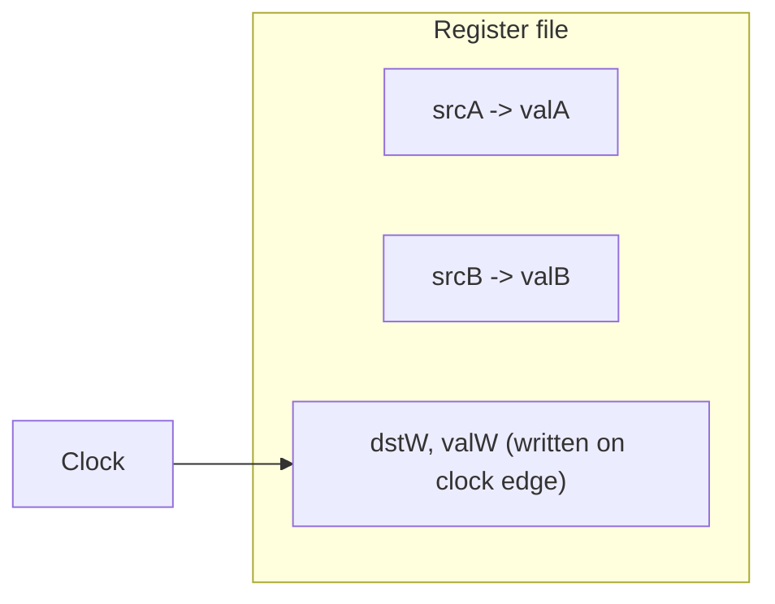

# The Y86-64 ISA and logic design

> **Before this lesson:** You need x86-64 assembly from [x86-64 basics: registers, operands, mov](#/lesson/csapp/asm-basics), [Arithmetic, condition codes and control flow](#/lesson/csapp/asm-control) and [Procedures and the run-time stack](#/lesson/csapp/asm-procedures), and the Boolean operations AND, OR and NOT from [Bits, bytes, words and bit-level operations](#/lesson/csapp/bits-bytes).

## In plain words

To understand how a processor is built, it helps to study a small one. An **instruction set** is the complete list of commands a processor understands, and real ones are large and full of historical clutter. This lesson introduces **Y86-64**, a teaching instruction set with about a dozen commands, modelled on the real x86-64. It is like learning to drive in a small car with few controls before moving to a lorry. The second half introduces the parts processors are made from: **logic gates**, tiny circuits that combine on/off signals, and **memory elements**, circuits that hold a value until a regular timing pulse, the clock, tells them to take a new one.

Why this matters at work: the idea of an instruction set as a contract between software and hardware explains why the same program runs on chips from different makers, and why programs must be rebuilt for a different processor family, for example when laptops moved from Intel chips to ARM chips. The logic-design vocabulary here is needed for the next two lessons, in which a full processor is assembled.

## Why look closer

Modern processors are among the most complex systems humans build: a chip the size of a fingernail holds billions of transistors and executes several instructions per clock cycle. Yet the core ideas are approachable. CS:APP teaches them with **Y86-64**, a simplified instruction set inspired by x86-64: fewer data types, instructions and addressing modes, and a simple byte encoding, but still complete enough to write real programs. This lesson defines the ISA and introduces the hardware building blocks and the HCL notation used to describe control logic. The next two lessons build a sequential processor (SEQ) and then a pipelined one (PIPE).

Why study processor design if you will never build one? It is intellectually satisfying; it explains how the whole system works; embedded and performance-critical work often requires understanding the hardware; and (the book adds) you might end up working on processor design after all.

## 1. Programmer-visible state

Every Y86-64 instruction can read and modify:

- **15 program registers**: `%rax, %rcx, %rdx, %rbx, %rsp, %rbp, %rsi, %rdi, %r8`–`%r14`. Each holds a 64-bit word. (`%r15` is omitted to simplify the encoding.) `%rsp` is the stack pointer for push, pop, call and return.
- **3 condition codes**: `ZF`, `SF`, `OF` (no carry flag).
- **PC**: address of the instruction being executed.
- **Memory**: a byte array addressed by virtual addresses (little endian).
- **Stat**: a status code describing overall execution state, normal or some exception.

## 2. Instructions

Y86-64 instructions and their encodings (1 to 10 bytes):

| Instruction | Byte 0 | Byte 1 | Bytes 2–9 |
|---|---|---|---|
| `halt` | `00` | | |
| `nop` | `10` | | |
| `rrmovq rA, rB` | `20` | rA rB | |
| `cmovXX rA, rB` | `2fn` | rA rB | |
| `irmovq V, rB` | `30` | F rB | V |
| `rmmovq rA, D(rB)` | `40` | rA rB | D |
| `mrmovq D(rB), rA` | `50` | rA rB | D |
| `OPq rA, rB` | `6fn` | rA rB | |
| `jXX Dest` | `7fn` | Dest (bytes 1–8) | |
| `call Dest` | `80` | Dest (bytes 1–8) | |
| `ret` | `90` | | |
| `pushq rA` | `A0` | rA F | |
| `popq rA` | `B0` | rA F | |

Highlights of the design:

- **`movq` is split into four** instructions that make the source and destination explicit: `irmovq` (immediate→register), `rrmovq` (register→register), `mrmovq` (memory→register), `rmmovq` (register→memory). Memory references use only base + displacement, no index or scale. As in x86-64, no memory-to-memory moves and no immediate-to-memory moves.
- **Four integer operations** (`OPq`): `addq` (fn 0), `subq` (1), `andq` (2), `xorq` (3). They operate on registers only and set ZF, SF, OF.
- **Seven jumps** (`jXX`): `jmp` (0), `jle` (1), `jl` (2), `je` (3), `jne` (4), `jge` (5), `jg` (6), with the same branch conditions as x86-64.
- **Six conditional moves** (`cmovXX`): `cmovle`, `cmovl`, `cmove`, `cmovne`, `cmovge`, `cmovg` (fn 1–6). Function code 0 is plain `rrmovq`.
- `call` pushes the return address and jumps; `ret` pops it.
- `pushq`/`popq` as in x86-64; `halt` stops execution (Stat becomes HLT).

Register identifiers (4 bits each):

| ID | Reg | ID | Reg | ID | Reg | ID | Reg |
|---|---|---|---|---|---|---|---|
| 0 | `%rax` | 4 | `%rsp` | 8 | `%r8` | C | `%r12` |
| 1 | `%rcx` | 5 | `%rbp` | 9 | `%r9` | D | `%r13` |
| 2 | `%rdx` | 6 | `%rsi` | A | `%r10` | E | `%r14` |
| 3 | `%rbx` | 7 | `%rdi` | B | `%r11` | F | No register |

### Encoding example

`rmmovq %rsp, 0x123456789abcd(%rdx)`: byte 0 is `40`; byte 1 is rA=`4` (`%rsp`), rB=`2` (`%rdx`) → `42`; the displacement `0x000123456789abcd` in little-endian order is `cd ab 89 67 45 23 01 00`. Full encoding: `40 42 cd ab 89 67 45 23 01 00` (10 bytes).

```python-run
REG = {r: i for i, r in enumerate("rax rcx rdx rbx rsp rbp rsi rdi r8 r9 r10 r11 r12 r13 r14".split())}
def le8(v): return [(v >> (8*i)) & 0xFF for i in range(8)]
def rmmovq(rA, D, rB): return [0x40, (REG[rA] << 4) | REG[rB]] + le8(D)
def irmovq(V, rB):    return [0x30, 0xF0 | REG[rB]] + le8(V & (2**64 - 1))
def opq(fn, rA, rB):  return [0x60 | fn, (REG[rA] << 4) | REG[rB]]
hexs = lambda bs: " ".join(f"{b:02x}" for b in bs)
print(hexs(rmmovq("rsp", 0x123456789abcd, "rdx")))
print(hexs(irmovq(-4, "rbx")))       # 30 f3 fc ff ff ff ff ff ff ff
print(hexs(opq(1, "rcx", "rax")))    # subq %rcx,%rax -> 61 10
```

<!-- walkthrough:python-run -->
**Reading this Python line by line**

- `REG = {...}` builds a lookup table from register names to their numbers, 0 for `rax` up to 14 for `r14`. `enumerate` pairs each name with its position in the list.
- `def le8(v)` returns the eight bytes of the number `v`, lowest byte first. `(v >> (8*i)) & 0xFF` shifts byte number `i` down to the bottom and keeps only it.
- `def rmmovq(rA, D, rB)` builds the ten bytes of that instruction: the code byte `0x40`, one byte holding both register numbers (`<< 4` puts the first in the upper half, `|` merges in the second), then the eight bytes of the displacement.
- `irmovq` and `opq` are built the same way; `0xF0 | REG[rB]` puts `F`, meaning "no register", in the upper half.
- `hexs` turns a list of bytes into readable text, and the `print` lines show the encodings, for example `61 10` for `subq %rcx, %rax`.

Every instruction's first byte uniquely determines its length and format, so a byte sequence decodes unambiguously from a known start, like x86-64 but much simpler. Compared to x86-64's variable-length 1–15-byte encodings with prefixes, Y86-64 is easy to decode, but it is still more compact than a fixed-length RISC encoding.

> [!NOTE]
> **RISC vs. CISC.** x86 is a *CISC* (complex instruction set computer): many instructions, some doing complex work, variable lengths, memory operands in arithmetic, condition codes. *RISC* designs (MIPS, ARM, RISC-V) favor few simple instructions, fixed 4-byte encodings, load/store architecture (arithmetic only on registers), and many registers with register-based argument passing. Y86-64 mixes both: CISC-style variable encoding and condition codes, RISC-style load/store arithmetic and simple addressing. Today the debate has faded: x86 processors translate CISC instructions into RISC-like micro-operations internally, and ARM has grown more complex.

## 3. Status codes and exceptions

| Value | Name | Meaning |
|---|---|---|
| 1 | `AOK` | Normal operation |
| 2 | `HLT` | `halt` instruction encountered |
| 3 | `ADR` | Invalid address (fetch or data access) |
| 4 | `INS` | Invalid instruction |

In Y86-64 any status other than AOK stops the processor. A full design would invoke an exception handler (Module 8).

## 4. A Y86-64 program

```c
long sum(long *start, long count) {
    long sum = 0;
    while (count) {
        sum += *start;
        start++;
        count--;
    }
    return sum;
}
```

<!-- walkthrough:c -->
**Reading this C line by line**

- `long sum(long *start, long count)` defines a function that returns a whole number. `start` is a pointer: the address of the first of several numbers stored in a row. `count` says how many there are.
- `long sum = 0;` creates the running total.
- `while (count) { ... }` repeats the lines inside the braces for as long as `count` is not zero. In C, zero counts as "false" and anything else as "true".
- `sum += *start;` adds the number stored at the address `start` to the total.
- `start++;` moves the pointer on to the next number. For a pointer to `long`, adding one advances the address by 8 bytes.
- `count--;` subtracts one from the number still to do. When it reaches zero the loop ends and `return sum;` hands back the total.

Y86-64 cannot add a constant to a register directly, nor use a memory operand in an addition, so constants must be loaded into registers first:

```
# start in %rdi, count in %rsi
sum:
    irmovq $8, %r8          # constant 8
    irmovq $1, %r9          # constant 1
    xorq   %rax, %rax       # sum = 0
    andq   %rsi, %rsi       # set CC from count
    jmp    test
loop:
    mrmovq (%rdi), %r10     # get *start
    addq   %r10, %rax       # add to sum
    addq   %r8, %rdi        # start++
    subq   %r9, %rsi        # count--, sets CC
test:
    jne    loop             # stop when count == 0
    ret
```

Note the idioms: `xorq` to zero, `andq %rsi, %rsi` as a "test" to set condition codes, and the jump-to-middle loop from Module 3. The coding problem `csapp-y86-interpreter` asks you to execute programs like this.

### Some subtleties

- `pushq %rsp` pushes the **old** value of `%rsp` (before the decrement), matching x86-64.
- `popq %rsp` sets `%rsp` to the value read from memory (not the incremented pointer), equivalent to `mrmovq (%rsp), %rsp`.

These corner cases matter because the ISA must define *exactly* what happens, and a hardware designer must make sure the implementation matches.

## 5. Logic design and HCL

Digital hardware needs three components: **combinational logic** to compute functions on bits, **memory elements** to store bits, and **clock signals** to regulate when memory elements update.

### Logic gates

Gates compute Boolean functions of their inputs. In the **Hardware Control Language (HCL)** we write them with C-like logical operators: AND `&&`, OR `||`, NOT `!`. (Gates operate on single bits, so the logical operators are the right analogy.) Gates are always active: when inputs change, outputs follow after a small delay.

### Combinational circuits

Networks of gates without cycles, where every output is a function of current inputs only, form **combinational circuits**. Examples in HCL:

```
bool eq = (a && b) || (!a && !b);     # bit equality
bool out = (s && a) || (!s && b);     # 1-bit multiplexor: a if s else b
```

Important difference from C: HCL expressions describe *hardware that continuously responds* to input changes. There is no partial evaluation: a C `&&` short-circuits, but a gate always computes.

### Word-level combinational circuits

Wider circuits operate on words. **Word equality** compares 64 bits in parallel and ANDs the results; in HCL it is written `bool Eq = (A == B);`. A **word multiplexor** selects one of several words based on control signals, written with a **case expression**:

```
word Out = [
    s : A;
    1 : B;
];
```

Cases are evaluated in order, and the first one whose selection expression is 1 wins; `1 :` acts as the default. A 4-way mux on two control bits:

```
word Out4 = [
    !s1 && !s0 : A;   # 00
    !s1        : B;   # 01
    !s0        : C;   # 10
    1          : D;   # 11
];
```

The **ALU** is a combinational circuit taking two data inputs and a control input selecting add, subtract, AND or XOR, producing the result and condition-code information. Note that the ALU computes `B - A` for subtraction, matching `subq rA, rB`.

**Set membership** comparisons are common in processor control logic, written `iexpr in { iexpr1, ..., iexprk }`:

```
bool s1 = code in { 2, 3 };
bool s0 = code in { 1, 3 };
```

### Memory and clocking

Combinational circuits store nothing. **Sequential circuits** add state elements:

- **Clocked registers** (hardware registers) store individual bits or words. The output holds the current state; when the **clock rises**, the register loads its input as the new state. Between edges, changes at the input have no effect. Registers act as barriers between combinational blocks.
- **Random access memories** store multiple words, addressed. The **register file** has two read ports (A and B, each with an address input `srcA`/`srcB` and data output `valA`/`valB`) and one write port (`dstW` and `valW`), allowing two reads and one write each cycle. Reads behave combinationally; writes happen on the clock edge. Register ID `0xF` means "no register": reads return nothing useful and writes are ignored.
- **Data memory** has an address input, a data input for writing and a data output for reading, plus a `write` control signal and an `error` output for invalid addresses. Reading is like combinational logic; writing is clocked.



> [!TIP]
> A hardware register (a clocked storage element inside the CPU) is *not* the same as a program register (`%rax` etc.). The program registers are stored in the register file; hardware registers include the PC and the condition-code register, plus pipeline registers later.

> [!INTERVIEW]
> **"What is the difference between combinational and sequential logic?"** Combinational outputs depend only on current inputs (gates, muxes, ALUs, decoders) and have no memory. Sequential logic has state updated on clock edges (registers, flip-flops, memories). A processor is combinational logic between clocked state elements; the clock period must exceed the longest combinational delay (the critical path).

## 6. Summary

- Y86-64: 15 registers, ZF/SF/OF, PC, Stat, little-endian memory.
- `movq` split into `irmovq/rrmovq/mrmovq/rmmovq`; four `OPq`s; seven jumps; six cmovs; call/ret/push/pop/halt/nop.
- First byte = icode:ifun; register byte = rA:rB with F for "none"; 8-byte constants little endian; instructions 1–10 bytes.
- Status: AOK, HLT, ADR, INS.
- HCL describes combinational logic with `&&`, `||`, `!`, case expressions and set membership; state lives in clocked registers, the register file and memories.

## Glossary

- **ISA (instruction set architecture)**: the definition of a processor's instructions, registers and their encoding, as seen by software.
- **Y86-64**: the small teaching instruction set used in this module.
- **Programmer-visible state**: everything a program can observe or change: registers, condition codes, program counter, memory, status.
- **Instruction encoding**: the exact bytes that represent each instruction.
- **Register specifier**: the 4-bit number naming a register inside an encoded instruction.
- **Status code**: a value saying whether the processor is running normally or has stopped for some reason.
- **Logic gate**: a basic circuit computing AND, OR or NOT of its input signals.
- **Combinational circuit**: a network of gates whose outputs depend only on the present inputs.
- **Multiplexor (MUX)**: a circuit that selects one of several inputs according to a control signal.
- **HCL**: the hardware control language used in this track to describe logic.
- **Clock**: a regular pulse that tells memory elements when to update.
- **Clocked register**: a memory element that takes a new value only when the clock ticks.
- **Register file**: the block of memory holding the program registers.

## Check yourself

```quiz
[
  {"q": "How many program registers does Y86-64 have?", "options": ["8", "15", "16", "32"], "answer": 1,
   "explain": "%r15 is omitted so that register ID 0xF can mean 'no register'."},
  {"q": "What is the encoding of addq %rax, %rbx?", "options": ["60 03", "60 30", "61 03", "20 03"], "answer": 0,
   "explain": "OPq has icode 6, addq ifun 0; register byte rA=0 (%rax), rB=3 (%rbx)."},
  {"q": "How many bytes is irmovq $1, %r9?", "options": ["2", "6", "10", "9"], "answer": 2,
   "explain": "1 byte icode:ifun, 1 register byte, 8-byte constant."},
  {"q": "Which Y86-64 instruction moves data from memory into a register?", "options": ["rmmovq", "mrmovq", "irmovq", "rrmovq"], "answer": 1,
   "explain": "m(emory) to r(egister): mrmovq D(rB), rA."},
  {"q": "Which status code means an invalid instruction was encountered?", "options": ["AOK", "HLT", "ADR", "INS"], "answer": 3,
   "explain": "INS (4) is an invalid instruction; ADR (3) is a bad address."},
  {"q": "In HCL, how is a case expression evaluated?", "options": ["All matching cases are ORed", "The first case whose selection expression is true supplies the value", "The last true case wins", "It is a loop"], "answer": 1,
   "explain": "Cases are ordered; the first true selector wins, so '1 :' acts as default."},
  {"q": "When does a clocked register change its output?", "options": ["Whenever its input changes", "On the rising clock edge, loading its input", "Only on reset", "When read"], "answer": 1,
   "explain": "Registers sample their input at the clock edge and hold it until the next edge."},
  {"q": "What value does pushq %rsp push in Y86-64 (and x86-64)?", "options": ["The decremented %rsp", "The original %rsp", "Zero", "Undefined"], "answer": 1,
   "explain": "The ISA specifies that the old stack pointer value is pushed."}
]
```

> **Source:** CS:APP 3e, §4.1–4.2 (The Y86-64 instruction set architecture; Logic design and the hardware control language HCL).
