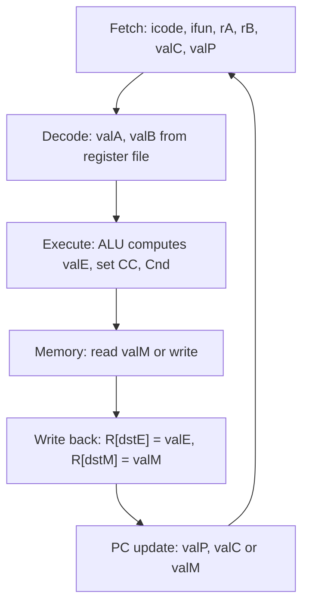
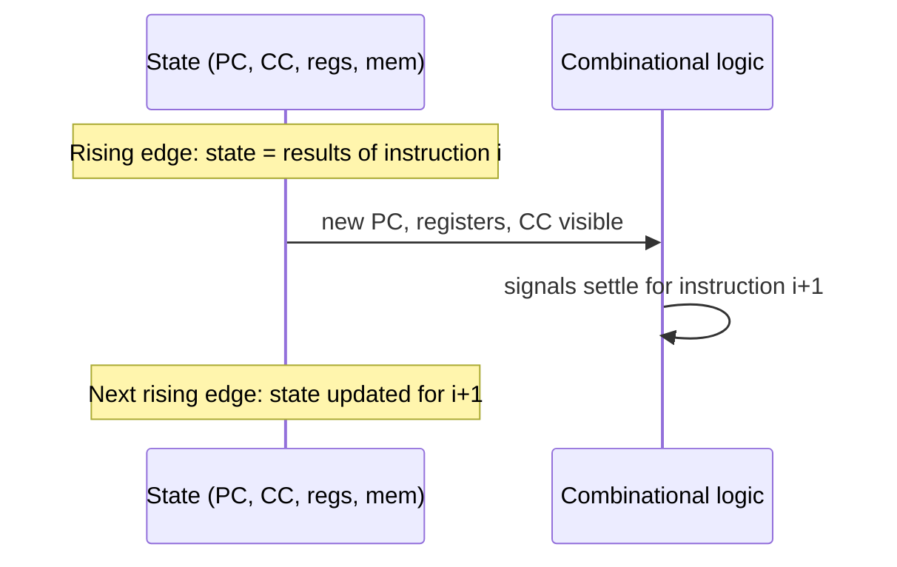

# SEQ: a sequential Y86-64 processor

With the Y86-64 ISA defined and the hardware building blocks in hand, we can build a processor. **SEQ** ("sequential") executes one complete instruction per clock cycle. It is far too slow to be practical (its clock period must cover the longest path through the whole datapath), but it is the stepping stone to the pipelined design, and its structure (organizing *every* instruction into the same sequence of stages) is the key idea that makes pipelining possible.

## 1. Organizing processing into stages

Executing an instruction involves several operations. SEQ organizes every instruction into the same six-stage sequence, even though individual instructions differ in what each stage does:

| Stage | What happens |
|---|---|
| **Fetch** | Read the instruction bytes from memory at the PC. Extract `icode` and `ifun` (the first byte), possibly the register specifiers `rA` and `rB`, and possibly an 8-byte constant `valC`. Compute `valP`, the address of the next instruction in sequence (PC + instruction length). |
| **Decode** | Read up to two operands from the register file: `valA` (usually from `rA`, sometimes `%rsp`) and `valB` (usually from `rB`, sometimes `%rsp`). |
| **Execute** | The ALU performs the operation specified by `ifun`, computes an effective memory address, or increments/decrements the stack pointer. The result is `valE`. Condition codes may be set. For jumps and cmov, compute the branch condition `Cnd`. |
| **Memory** | Write data to memory, or read data from memory into `valM`. |
| **Write back** | Write up to two results to the register file: `valE` to `dstE` and `valM` to `dstM`. |
| **PC update** | Set the PC to the address of the next instruction. |



The trick of fitting all instructions into this uniform framework keeps the hardware small: the same ALU, register file ports and memory serve every instruction; only the control signals choosing *which* values flow where differ.

## 2. Instruction-by-instruction computations

Below, $M_8[x]$ means the 8-byte word at address $x$, $M_1[x]$ one byte, and `R[r]` a register. Stages left blank do nothing for that instruction.

### OPq, rrmovq, irmovq

| Stage | `OPq rA, rB` | `rrmovq rA, rB` | `irmovq V, rB` |
|---|---|---|---|
| Fetch | icode:ifun ← M₁[PC]; rA:rB ← M₁[PC+1]; valP ← PC+2 | same, valP ← PC+2 | icode:ifun ← M₁[PC]; rA:rB ← M₁[PC+1]; valC ← M₈[PC+2]; valP ← PC+10 |
| Decode | valA ← R[rA]; valB ← R[rB] | valA ← R[rA] | |
| Execute | valE ← valB OP valA; set CC | valE ← 0 + valA | valE ← 0 + valC |
| Memory | | | |
| Write back | R[rB] ← valE | R[rB] ← valE | R[rB] ← valE |
| PC update | PC ← valP | PC ← valP | PC ← valP |

Note that `rrmovq` and `irmovq` route their value *through the ALU* (adding 0) so that every register result arrives as `valE`. Uniformity beats saving an adder.

**Trace:** suppose `subq %rdx, %rbx` sits at address `0x014` with `%rdx = 9` and `%rbx = 21`. Fetch reads `61 23`, so icode 6, ifun 1, rA = 2, rB = 3, valP = 0x016. Decode: valA = 9, valB = 21. Execute: valE = 21 − 9 = 12; ZF = 0, SF = 0, OF = 0. Write back: `%rbx` ← 12. PC ← 0x016.

### rmmovq, mrmovq

| Stage | `rmmovq rA, D(rB)` | `mrmovq D(rB), rA` |
|---|---|---|
| Fetch | icode:ifun; rA:rB; valC ← M₈[PC+2]; valP ← PC+10 | same |
| Decode | valA ← R[rA]; valB ← R[rB] | valB ← R[rB] |
| Execute | valE ← valB + valC | valE ← valB + valC |
| Memory | M₈[valE] ← valA | valM ← M₈[valE] |
| Write back | | R[rA] ← valM |
| PC update | PC ← valP | PC ← valP |

The ALU computes the effective address.

### pushq, popq

| Stage | `pushq rA` | `popq rA` |
|---|---|---|
| Fetch | icode:ifun; rA:rB; valP ← PC+2 | same |
| Decode | valA ← R[rA]; valB ← R[%rsp] | valA ← R[%rsp]; valB ← R[%rsp] |
| Execute | valE ← valB + (−8) | valE ← valB + 8 |
| Memory | M₈[valE] ← valA | valM ← M₈[valA] |
| Write back | R[%rsp] ← valE | R[%rsp] ← valE; R[rA] ← valM |
| PC update | PC ← valP | PC ← valP |

`popq` reads the stack pointer into *both* valA and valB: valA (unincremented) supplies the memory address, while the ALU increments valB. This is what makes `popq` read from the old top of the stack. When `rA` is `%rsp`, the write of valM happens *after* the write of valE in priority, giving the ISA-specified result that `popq %rsp` loads the value from memory.

### Control transfer: jXX, call, ret

| Stage | `jXX Dest` | `call Dest` | `ret` |
|---|---|---|---|
| Fetch | icode:ifun; valC ← M₈[PC+1]; valP ← PC+9 | icode:ifun; valC ← M₈[PC+1]; valP ← PC+9 | icode:ifun; valP ← PC+1 |
| Decode | | valB ← R[%rsp] | valA ← R[%rsp]; valB ← R[%rsp] |
| Execute | Cnd ← Cond(CC, ifun) | valE ← valB + (−8) | valE ← valB + 8 |
| Memory | | M₈[valE] ← valP | valM ← M₈[valA] |
| Write back | | R[%rsp] ← valE | R[%rsp] ← valE |
| PC update | PC ← Cnd ? valC : valP | PC ← valC | PC ← valM |

`call` is like `pushq` of valP plus a jump; `ret` is like `popq` into the PC. `cmovXX` is like `rrmovq` except that the write back to rB happens only when `Cnd` holds (implemented by setting the destination to `0xF`, "no register", when the condition fails).

```python-run
# A mini 'stage table' executor for three instructions, mirroring SEQ's signals.
R = {"rax": 0, "rcx": 0, "rdx": 9, "rbx": 21, "rsp": 0x100}
mem = {}
def seq_step(instr):
    op, args = instr[0], instr[1:]
    sig = {}
    if op == "subq":
        rA, rB = args
        sig.update(valA=R[rA], valB=R[rB]); sig["valE"] = sig["valB"] - sig["valA"]; R[rB] = sig["valE"]
    elif op == "pushq":
        (rA,) = args
        sig.update(valA=R[rA], valB=R["rsp"]); sig["valE"] = sig["valB"] - 8
        mem[sig["valE"]] = sig["valA"]; R["rsp"] = sig["valE"]
    elif op == "popq":
        (rA,) = args
        sig.update(valA=R["rsp"], valB=R["rsp"]); sig["valE"] = sig["valB"] + 8
        sig["valM"] = mem[sig["valA"]]; R["rsp"] = sig["valE"]; R[rA] = sig["valM"]
    print(f"{op:6} {args} -> {sig}")
for ins in [("subq", "rdx", "rbx"), ("pushq", "rbx"), ("popq", "rax")]:
    seq_step(ins)
print(R)
```

## 3. SEQ hardware structure

The hardware maps directly onto the stages:

- **Fetch**: the PC register addresses the **instruction memory**, which reads 10 bytes at once. The first byte splits into icode and ifun. A PC incrementer computes valP from the PC and whether the instruction has register and constant bytes.
- **Decode / write back**: the **register file** with read ports A and B and write ports E and M (SEQ's register file has two write ports so that `popq` can update both `%rsp` and rA).
- **Execute**: the **ALU**, plus the **CC** register and the branch-condition logic producing `Cnd`.
- **Memory**: the **data memory**.
- **PC update**: a mux choosing among valP, valC and valM.

Control logic, written in HCL, chooses the values for each signal. A few examples from the SEQ description:

```
# Does the instruction include a register specifier byte?
bool need_regids = icode in { IRRMOVQ, IOPQ, IPUSHQ, IPOPQ, IIRMOVQ, IRMMOVQ, IMRMOVQ };

# Does the instruction include a constant word?
bool need_valC = icode in { IIRMOVQ, IRMMOVQ, IMRMOVQ, IJXX, ICALL };

# Which register supplies valA?
word srcA = [
    icode in { IRRMOVQ, IRMMOVQ, IOPQ, IPUSHQ } : rA;
    icode in { IPOPQ, IRET } : RRSP;
    1 : RNONE;            # don't need a register
];

# Which register receives valE?
word dstE = [
    icode in { IRRMOVQ } && Cnd : rB;
    icode in { IIRMOVQ, IOPQ } : rB;
    icode in { IPUSHQ, IPOPQ, ICALL, IRET } : RRSP;
    1 : RNONE;
];

# New PC
word new_pc = [
    icode == ICALL : valC;
    icode == IJXX && Cnd : valC;
    icode == IRET : valM;
    1 : valP;
];
```

The status code is computed from `imem_error`, `instr_valid`, `dmem_error` and whether icode is `IHALT`.

## 4. Timing: how one cycle executes an instruction

SEQ contains only four clocked state elements: the **PC**, the **condition-code register**, the **register file** and the **data memory**. Everything else is combinational. Reading from the instruction memory, register file or data memory is treated as combinational too: outputs follow addresses.

So within one clock cycle, values ripple through the combinational logic: the PC selects instruction bytes, which select registers, which feed the ALU, and so on. At the end of the cycle the clock rises and all state elements update **simultaneously**: the new PC is loaded, the CC register is written (for `OPq`), register file writes and memory writes take effect.

This works because of a key design principle the book emphasizes: **the processor never needs to read back state updated by an instruction in order to complete that same instruction.** For example, `pushq` does not first decrement `%rsp` and then read the decremented value as the store address; it computes the decremented value as valE and uses valE both as the address and as the new `%rsp`. Similarly, no instruction both sets and reads the condition codes.



## 5. Why SEQ is slow

SEQ's clock period must accommodate the **entire** chain: instruction memory read, register read, ALU, data memory access, register write setup, and the PC mux, all in series. Each hardware unit sits idle during most of the cycle: the ALU finishes and then waits while memory is accessed. The remedy is **pipelining**: split the work into stages with registers in between, so each unit works on a different instruction at the same time. That is the next lesson.

> [!NOTE]
> The book also presents **SEQ+**, which moves PC computation to the *start* of the cycle (computing the PC from the previous instruction's saved signals). That rearrangement, called **circuit retiming**, changes the state representation without changing behavior, and it is the form PIPE builds on: the fetch stage selects the PC as its first action.

> [!INTERVIEW]
> **"Walk through what a CPU does to execute one instruction."** Fetch (read bytes at PC, decode opcode and operands, compute next sequential PC), decode (read source registers), execute (ALU operation, address computation, condition evaluation), memory (load/store), write back (update registers), PC update (sequential, branch target, or return address). Then note real CPUs overlap these stages across many instructions.

## 6. Summary

- Every Y86-64 instruction fits into fetch, decode, execute, memory, write back, PC update.
- Uniform signals (icode, ifun, rA, rB, valC, valP, valA, valB, valE, valM, Cnd) let one datapath handle all instructions; HCL control logic picks sources and destinations.
- `popq` uses unincremented valA as the address and incremented valE for `%rsp`; `call`/`ret` are push/pop with PC changes.
- All state updates happen together at the clock edge; no instruction reads back state it just wrote.
- SEQ works but its long cycle wastes hardware; pipelining fixes that.

## Check yourself

```quiz
[
  {"q": "In which stage does SEQ compute valP?", "options": ["Fetch", "Decode", "Execute", "PC update"], "answer": 0,
   "explain": "Fetch knows the instruction length from icode, so it computes valP = PC + length."},
  {"q": "For mrmovq D(rB), rA, what does the execute stage compute?", "options": ["valE = valA + valB", "valE = valB + valC (the effective address)", "valM", "Nothing"], "answer": 1,
   "explain": "The ALU adds the displacement to the base register to form the address."},
  {"q": "For popq rA, which value is used as the memory address?", "options": ["valE (incremented %rsp)", "valA (unincremented %rsp)", "valC", "valP"], "answer": 1,
   "explain": "popq reads from the current top of stack, valA, while valE = %rsp + 8 becomes the new stack pointer."},
  {"q": "What does ret set the PC to?", "options": ["valP", "valC", "valM, the return address read from the stack", "valE"], "answer": 2,
   "explain": "ret pops the return address from memory into the PC."},
  {"q": "Which of these is NOT a clocked state element in SEQ?", "options": ["PC", "Condition codes", "ALU", "Register file"], "answer": 2,
   "explain": "The ALU is combinational logic."},
  {"q": "Why does irmovq route its constant through the ALU (valE = 0 + valC)?", "options": ["Constants must be negated", "So that every register result arrives through the same valE path, simplifying hardware", "To set condition codes", "Because the register file cannot accept valC"], "answer": 1,
   "explain": "Uniformity: register writes from valE/valM only, rather than adding more inputs and muxes."},
  {"q": "What principle allows SEQ to update all state at a single clock edge?", "options": ["Instructions never need to read back state they themselves update", "Every instruction writes memory", "Registers are combinational", "The ALU is pipelined"], "answer": 0,
   "explain": "Because no instruction depends on its own writes, all updates can occur simultaneously at the end of the cycle."}
]
```

> **Source:** CS:APP 3e, §4.3 (Sequential Y86-64 implementations: organizing processing into stages, SEQ hardware structure, SEQ timing, SEQ stage implementations).
