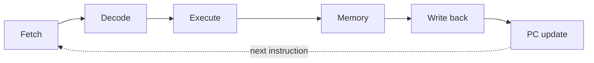
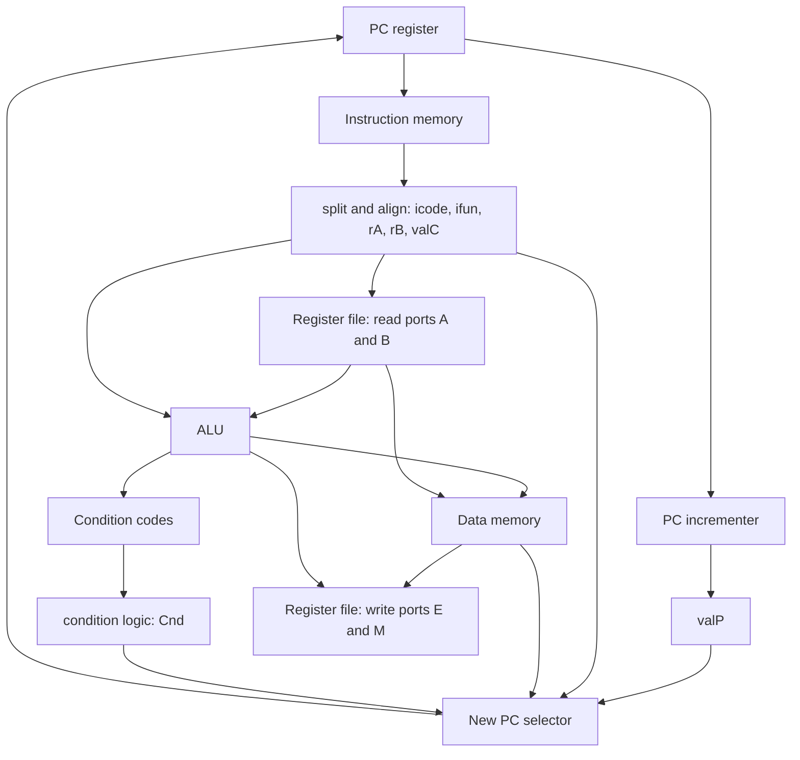
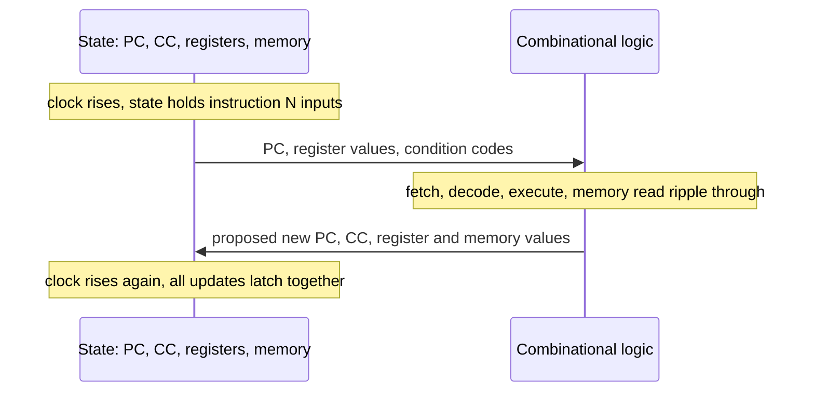

# SEQ: a sequential Y86-64 processor

> **Before this lesson:** You need the Y86-64 instruction set and the logic building blocks (gates, registers, clocks) from [The Y86-64 ISA and logic design](#/lesson/csapp/y86-isa), and the stack behaviour of `push`, `pop`, `call` and `ret` from [Procedures and the run-time stack](#/lesson/csapp/asm-procedures).

## In plain words

This lesson builds a complete, working processor on paper. A **processor** is the part of a computer that reads instructions and carries them out. The design here, called SEQ, is the easiest one to understand: it finishes one instruction completely before it starts the next, like a single cook who takes an order, prepares it from start to finish, serves it, and only then looks at the next order. Every order goes through the same six steps in the same sequence (read the order, fetch ingredients, cook, use the store room, plate up, pick the next order), even if some steps have nothing to do for a particular dish. Using one fixed routine for every instruction is what keeps the hardware small.

Why this matters at work: few people design processors, but anyone who tunes performance or reads about hardware needs the vocabulary introduced here (fetch, decode, execute, control signals, clock cycle). It is also the foundation for the next lesson on pipelining, the idea behind every modern chip, and "what happens when an instruction runs" is a classic interview question.

## Why look closer

So far the processor has been a black box that "executes instructions". This lesson opens the box. Using the building blocks from the previous lesson (combinational logic, registers, memories, a clock) we assemble a complete, working processor for the Y86-64 instruction set. The design is called **SEQ**, for sequential, because it does the simplest thing imaginable: it carries one instruction all the way from start to finish in a single clock cycle, and only then begins the next. No real chip works this way, because it is slow. But it is the essential stepping stone. Once you see how a dozen different instructions can be squeezed through one uniform sequence of steps, the pipelined design in the next lesson is the same hardware with registers inserted between the steps. Understanding SEQ also demystifies a great deal: what a "control signal" is, why hardware is fundamentally parallel, and how a few lines of logic description become a datapath.

## 1. The organising idea: every instruction takes the same six steps

Instructions differ enormously in what they do. An addition never touches memory; a store never writes a register; a return changes the program counter using a value from the stack. The trick that makes a simple processor possible is to force all of them through one **common sequence of stages**, each stage doing a fixed *kind* of work, and to let the details vary with the instruction. Sharing a framework means sharing hardware: one arithmetic unit, one data memory port, one register file serve every instruction.

| Stage | What it does |
|---|---|
| **Fetch** | Reads the instruction bytes from memory at the address in the PC. Splits the first byte into the instruction code and function code. Possibly extracts a register-specifier byte and an 8-byte constant. Computes the address of the following instruction. |
| **Decode** | Reads up to two operands from the register file. |
| **Execute** | The arithmetic/logic unit (ALU) performs an operation: the instruction's own arithmetic, an effective-address calculation, or a stack-pointer adjustment. Condition codes may be set, and for conditional instructions the condition is evaluated. |
| **Memory** | Writes a value to data memory, or reads one from it. |
| **Write back** | Writes up to two results to the register file. |
| **PC update** | Sets the PC to the address of the next instruction. |



The processor loops through these stages forever, stopping only when it meets a `halt` instruction, an invalid instruction code, or an invalid address.

### The names of the signals

The values passed between stages have conventional names, and the whole design is described in terms of them. It is worth learning them as vocabulary.

| Signal | Produced in | Meaning |
|---|---|---|
| `icode`, `ifun` | fetch | high and low 4 bits of the first instruction byte: which instruction, and which variant |
| `rA`, `rB` | fetch | the two 4-bit register identifiers (`0xF` means "no register") |
| `valC` | fetch | the 8-byte constant in the instruction: an immediate, a displacement, or a jump/call target |
| `valP` | fetch | the address of the next sequential instruction: PC plus this instruction's length |
| `valA`, `valB` | decode | values read from the register file |
| `valE` | execute | the ALU's output |
| `Cnd` | execute | one bit: is the condition for a jump or conditional move satisfied? |
| `valM` | memory | a value read from data memory |

## 2. Working out each instruction

For each instruction we answer one question per stage. Below, `R[x]` means register `x`, `M8[a]` means the eight bytes of memory starting at address `a`, and `M1[a]` a single byte.

### Arithmetic: `OPq rA, rB`

The instruction is two bytes long: the code byte and a register byte.

```
fetch       icode:ifun <- M1[PC]        rA:rB <- M1[PC+1]        valP <- PC + 2
decode      valA <- R[rA]               valB <- R[rB]
execute     valE <- valB OP valA        set condition codes
memory      (nothing)
write back  R[rB] <- valE
PC update   PC <- valP
```

Register-to-register move, `rrmovq`, uses the same path with the ALU computing `0 + valA`, so the value passes through. Immediate move, `irmovq`, is ten bytes long and computes `0 + valC`. Nothing new is needed for either: "copy" is implemented as "add zero".

### Memory access: `rmmovq rA, D(rB)` and `mrmovq D(rB), rA`

Both are ten bytes and both use the ALU to form the effective address by adding the displacement to the base register.

```
            rmmovq (store)              mrmovq (load)
fetch       ... valC <- M8[PC+2]   valP <- PC + 10      (both)
decode      valA <- R[rA]               
            valB <- R[rB]               valB <- R[rB]
execute     valE <- valB + valC         valE <- valB + valC
memory      M8[valE] <- valA            valM <- M8[valE]
write back  (nothing)                   R[rA] <- valM
PC update   PC <- valP                  PC <- valP
```

### The stack: `pushq rA` and `popq rA`

Both are two bytes. Here the ALU adjusts the stack pointer.

```
            pushq                       popq
decode      valA <- R[rA]               valA <- R[%rsp]
            valB <- R[%rsp]             valB <- R[%rsp]
execute     valE <- valB - 8            valE <- valB + 8
memory      M8[valE] <- valA            valM <- M8[valA]
write back  R[%rsp] <- valE             R[%rsp] <- valE ;  R[rA] <- valM
PC update   PC <- valP                  PC <- valP
```

Two details deserve a careful look, because they are favourite exam questions.

- **`pushq` writes to memory at the *decremented* address** (`valE`), while **`popq` reads from the *un-incremented* address** (`valA`, the old stack pointer). That is why `popq` reads `%rsp` twice in decode: one copy goes to the ALU to be incremented, and the other goes to the memory stage as the address.
- **`popq` performs two register writes in one cycle**: the new stack pointer and the popped value. The register file therefore needs two write ports. For the corner case `popq %rsp`, the convention is that the value from memory wins.

### Control transfer: `jXX`, `call` and `ret`

Jumps and calls are nine bytes (code byte plus an 8-byte destination); `ret` is a single byte.

```
            jXX Dest                    call Dest                   ret
fetch       valC <- M8[PC+1]            valC <- M8[PC+1]            
            valP <- PC + 9              valP <- PC + 9              valP <- PC + 1
decode                                  valB <- R[%rsp]             valA <- R[%rsp] ; valB <- R[%rsp]
execute     Cnd <- Cond(CC, ifun)       valE <- valB - 8            valE <- valB + 8
memory                                  M8[valE] <- valP            valM <- M8[valA]
write back                              R[%rsp] <- valE             R[%rsp] <- valE
PC update   PC <- Cnd ? valC : valP     PC <- valC                  PC <- valM
```

`call` is a push of the return address `valP` combined with a jump; `ret` is a pop whose result goes into the PC instead of a register. Notice that the three instructions take the new PC from three different places: the constant, or the incremented PC, or memory. The PC-update logic is a selector among those.

Conditional moves (`cmovXX`) follow the `rrmovq` path with one change: the register write happens only if `Cnd` is true. In hardware this is done by replacing the destination register identifier with `0xF`, "no register", when the condition fails.

### Tracing a real instruction

Suppose the bytes at address `0x02a` are `61 23`, with `%rdx` = 9 and `%rbx` = 21. The first byte splits into `icode` 6 (an arithmetic operation) and `ifun` 1 (subtract). The second gives `rA` = 2, which is `%rdx`, and `rB` = 3, which is `%rbx`. This is `subq %rdx, %rbx`.

- Fetch: `valP` = `0x02a` + 2 = `0x02c`.
- Decode: `valA` = 9, `valB` = 21.
- Execute: `valE` = 21 − 9 = 12. The result is non-zero, positive and did not overflow, so ZF = 0, SF = 0, OF = 0.
- Memory: nothing.
- Write back: `%rbx` becomes 12.
- PC update: PC becomes `0x02c`.

The simulator below implements the stage computations exactly as written above and runs a short program. Reading its source is the fastest way to make the tables concrete.

```python-run
RSP, NONE = 4, 0xF
NAMES = {0: "%rax", 1: "%rcx", 2: "%rdx", 3: "%rbx", 4: "%rsp"}

def run(program, steps=20):
    R = {i: 0 for i in range(15)}
    M, CC, PC = {}, {"ZF": 1, "SF": 0}, 0
    for _ in range(steps):
        # ---- fetch ----
        op, *args = program[PC]
        length = {"irmovq": 10, "rmmovq": 10, "mrmovq": 10, "OPq": 2, "pushq": 2, "popq": 2,
                  "jne": 9, "call": 9, "ret": 1, "halt": 1}[op]
        valP, valC, rA, rB = PC + length, None, NONE, NONE
        if op in ("irmovq",):            valC, rB = args
        elif op in ("rmmovq", "mrmovq"): rA, valC, rB = args
        elif op == "OPq":                fn, rA, rB = args
        elif op in ("pushq", "popq"):    rA, = args
        elif op in ("jne", "call"):      valC, = args
        if op == "halt":
            return R, M, PC
        # ---- decode ----
        srcA = RSP if op in ("popq", "ret") else rA
        srcB = RSP if op in ("pushq", "popq", "call", "ret") else rB
        valA = R[srcA] if srcA != NONE else 0
        valB = R[srcB] if srcB != NONE else 0
        # ---- execute ----
        if op == "OPq":
            valE = valB + valA if fn == "add" else valB - valA
            CC = {"ZF": int(valE == 0), "SF": int(valE < 0)}
        elif op == "irmovq":             valE = 0 + valC
        elif op in ("rmmovq", "mrmovq"): valE = valB + valC
        elif op in ("pushq", "call"):    valE = valB - 8
        elif op in ("popq", "ret"):      valE = valB + 8
        else:                            valE = None
        Cnd = (CC["ZF"] == 0) if op == "jne" else None
        # ---- memory ----
        valM = None
        if op in ("rmmovq", "pushq"):    M[valE] = valA
        elif op == "call":               M[valE] = valP
        elif op == "mrmovq":             valM = M[valE]
        elif op in ("popq", "ret"):      valM = M[valA]
        # ---- write back ----
        if op in ("OPq", "irmovq"):      R[rB] = valE
        if op in ("pushq", "popq", "call", "ret"): R[RSP] = valE
        if op in ("mrmovq", "popq"):     R[rA] = valM
        # ---- PC update ----
        newPC = valC if op == "call" or (op == "jne" and Cnd) else valM if op == "ret" else valP
        print(f"PC={PC:#05x} {op:7} valA={valA!s:5} valB={valB!s:5} valE={valE!s:5} valM={valM!s:5} -> PC={newPC:#05x}")
        PC = newPC

program = {                      # address -> instruction; a loop that sums 3 + 2 + 1 into %rax
    0x000: ("irmovq", 0x100, RSP),
    0x00a: ("irmovq", 3, 2),            # %rdx = 3   (counter)
    0x014: ("irmovq", 1, 1),            # %rcx = 1
    0x01e: ("call", 0x030),
    0x027: ("halt",),
    0x030: ("OPq", "add", 2, 0),        # %rax += %rdx
    0x032: ("OPq", "sub", 1, 2),        # %rdx -= %rcx, sets ZF
    0x034: ("jne", 0x030),
    0x03d: ("ret",),
}
R, M, PC = run(program)
print("halted at", hex(PC), "| %rax =", R[0], "| %rsp =", hex(R[RSP]), "| return address stored:", {hex(k): hex(v) for k, v in M.items()})
```

<!-- walkthrough:python-run -->
**Reading this Python line by line**

- `RSP, NONE = 4, 0xF` gives names to two register numbers: 4 is the stack pointer, and `0xF` means "no register".
- `def run(program, steps=20):` defines the simulator. `program` is a dictionary from an address to an instruction written as a tuple, such as `("irmovq", 3, 2)`.
- `R = {i: 0 for i in range(15)}` creates the fifteen registers, all zero. `M` is the data memory, `CC` the condition codes and `PC` the program counter.
- Inside the `for` loop each pass executes one instruction. `op, *args = program[PC]` fetches the instruction at the current address and separates its name from its operands. The `length` lookup gives its size in bytes, and `valP = PC + length` is the address of the next instruction in sequence.
- The six commented blocks then follow the stage tables exactly: decode reads `valA` and `valB` from `R`; execute computes `valE`; memory reads or writes `M`; write back updates `R`; PC update chooses the next address.
- Each pass prints one line of signal values. For the sample program the final line reports `%rax = 6`, the sum 3 + 2 + 1.

## 3. From stage tables to hardware

Every row of the tables corresponds to a physical piece of the processor.



- **Fetch** uses the PC register as an address into instruction memory. A "split" unit divides the first byte into `icode` and `ifun`; an "align" unit pulls out the register byte and the constant, whose position depends on whether a register byte is present. An incrementer adds 1, 2, 9 or 10 to the PC, depending on which optional parts the instruction has, to produce `valP`.
- **Decode and write back** share the **register file**, which has two read ports (A and B) and two write ports (E, for ALU results, and M, for values from memory). Four identifiers steer it: `srcA`, `srcB`, `dstE`, `dstM`.
- **Execute** contains the ALU, with input selectors choosing among `valA`, `valB`, `valC` and the constants +8 and −8; the condition-code register; and a small unit that combines the codes with `ifun` to produce `Cnd`.
- **Memory** has a data memory with selectors for its address (`valE` or `valA`) and its input data (`valA` or `valP`), plus read and write enables.
- **PC update** selects among `valP`, `valC` and `valM`.

The processor also produces a **status** code each cycle: normal operation, halt encountered, invalid address, or invalid instruction. Anything other than normal stops the machine.

### Control logic

The datapath blocks are generic. What makes them behave differently for each instruction is the **control logic**: small combinational circuits that look at `icode` (and sometimes `ifun` and `Cnd`) and set the selectors and enables. Each one is derived mechanically by reading down a column of the stage tables. In the hardware description language used with this design they look like this:

```
# Is there a register-specifier byte?
bool need_regids = icode in { IRRMOVQ, IOPQ, IPUSHQ, IPOPQ, IIRMOVQ, IRMMOVQ, IMRMOVQ };

# Is there an 8-byte constant?
bool need_valC = icode in { IIRMOVQ, IRMMOVQ, IMRMOVQ, IJXX, ICALL };

# Which register is read on port A?
word srcA = [
    icode in { IRRMOVQ, IRMMOVQ, IOPQ, IPUSHQ } : rA;
    icode in { IPOPQ, IRET }                    : RRSP;
    1                                           : RNONE;
];

# Which register receives the ALU result?
word dstE = [
    icode in { IRRMOVQ } && Cnd                 : rB;      # conditional move
    icode in { IIRMOVQ, IOPQ }                  : rB;
    icode in { IPUSHQ, IPOPQ, ICALL, IRET }     : RRSP;
    1                                           : RNONE;
];

# What does the ALU's first input get?
word aluA = [
    icode in { IRRMOVQ, IOPQ }                  : valA;
    icode in { IIRMOVQ, IRMMOVQ, IMRMOVQ }      : valC;
    icode in { ICALL, IPUSHQ }                  : -8;
    icode in { IRET, IPOPQ }                    : 8;
];

# Where does the next PC come from?
word new_pc = [
    icode == ICALL                              : valC;
    icode == IJXX && Cnd                        : valC;
    icode == IRET                               : valM;
    1                                           : valP;
];
```

Each bracketed expression is a list of cases tried in order, the last being a default. The whole control section of the processor is about a dozen such definitions.

```python-run
# Derive two control signals from the stage tables and tabulate them.
LEN_PARTS = {      # instruction: (has register byte, has constant)
    "halt": (0, 0), "nop": (0, 0), "rrmovq": (1, 0), "irmovq": (1, 1), "rmmovq": (1, 1), "mrmovq": (1, 1),
    "OPq": (1, 0), "jXX": (0, 1), "call": (0, 1), "ret": (0, 0), "pushq": (1, 0), "popq": (1, 0),
}
ALU_A = {"rrmovq": "valA", "OPq": "valA", "irmovq": "valC", "rmmovq": "valC", "mrmovq": "valC",
         "call": "-8", "pushq": "-8", "ret": "+8", "popq": "+8"}
print(f"{'instr':8}{'regids':>7}{'valC':>6}{'length':>8}   ALU input A")
for name, (regs, const) in LEN_PARTS.items():
    print(f"{name:8}{regs:>7}{const:>6}{1 + regs + 8 * const:>8}   {ALU_A.get(name, '-')}")
```

## 4. Timing: how one clock edge is enough

SEQ consists of combinational logic plus exactly four kinds of **clocked state**:

- the program counter,
- the condition-code register,
- the register file,
- the data memory.

Combinational logic and *reads* of the memories need no sequencing: outputs settle some time after their inputs. State changes only when the clock rises. So during one cycle, the following happens:

1. At the start of the cycle the PC holds the address of the current instruction.
2. Signals flow through the logic: the instruction is read and decoded, registers are read, the ALU computes, memory is read, and the *proposed* new values for the PC, the condition codes, a register or a memory location arrive at the inputs of the state elements.
3. At the next rising clock edge, all the state elements load their new values at once. That starts the next instruction.

How do we know an instruction never gets confused by its own updates, for example a `pushq` that both reads and writes `%rsp`? Because the design obeys a simple rule:

> **No reading back.** The processor never needs to read state that the *current* instruction has updated in order to finish executing that instruction.

Take `pushq`. One could imagine decrementing `%rsp` first and then using the updated register as the write address, which would require two steps in order. SEQ instead computes the decremented value as `valE` and uses *that signal* both as the memory address and as the value to write back to the register. Both writes can then happen simultaneously at the clock edge. Similarly, no instruction both sets the condition codes and reads them: arithmetic sets them, and jumps and conditional moves read the values left by an earlier instruction.

This is why the six "stages" of SEQ are stages in a logical sense only. They are not six ticks of a clock. They are one long chain of logic through which signals ripple within a single cycle.



## 5. Why SEQ is too slow

The clock period must be long enough for signals to travel through the *longest* path any instruction can take. For a `ret`, for instance, that path runs through instruction memory, the register file, the ALU, data memory and the new-PC selector, all within one cycle. A simple `nop` needs a tiny fraction of that time, but it gets the same long cycle. Most of the hardware is idle most of the time: while the ALU is working, the instruction memory has long finished.

```python-run
# Rough delays in picoseconds for each block an instruction may pass through.
delay = {"instr_mem": 200, "reg_read": 100, "alu": 150, "data_mem": 250, "reg_write": 100, "pc_logic": 40}
paths = {
    "OPq":    ["instr_mem", "reg_read", "alu", "reg_write", "pc_logic"],
    "mrmovq": ["instr_mem", "reg_read", "alu", "data_mem", "reg_write", "pc_logic"],
    "jXX":    ["instr_mem", "alu", "pc_logic"],
    "ret":    ["instr_mem", "reg_read", "alu", "data_mem", "reg_write", "pc_logic"],
}
cost = {name: sum(delay[b] for b in blocks) for name, blocks in paths.items()}
period = max(cost.values())
for name, ps in cost.items():
    print(f"{name:7} needs {ps:4} ps  (uses {100 * ps / period:3.0f}% of the cycle)")
print(f"clock period must be {period} ps -> {1e12 / period / 1e9:.2f} billion instructions per second at best")
```

Pipelining, in the next lesson, attacks exactly this waste. It cuts the long path into pieces separated by registers, so that the clock only has to accommodate one piece, and several instructions can occupy different pieces at once.

> [!INTERVIEW]
> **"What are the stages of executing an instruction?"** Fetch the instruction bytes and compute the fall-through address; decode by reading the source registers; execute in the ALU (arithmetic, address computation or stack-pointer adjustment) and set or test condition codes; access memory; write results back to registers; update the PC. Then show judgement: in a single-cycle design these are one long combinational path, so the clock must fit the slowest instruction; pipelining inserts registers between the stages to raise throughput.

> [!INTERVIEW]
> **"Why is hardware described as parallel while software is sequential?"** In a circuit, every gate computes continuously and all state elements update together on a clock edge; there is no notion of one line running before another. A hardware description is a set of simultaneous equations, not a program. Order in time exists only across clock edges. That is why the single-cycle design must avoid needing a value it is in the middle of updating.

## 6. Pitfalls

- **Imagining the stages as six clock ticks.** In SEQ everything happens in one cycle; the stage names describe the flow of signals.
- **Wrong address for `popq` and `ret`.** They read memory at the old stack pointer (`valA`); `pushq` and `call` write at the new one (`valE`).
- **Forgetting that `call` pushes `valP`,** the address of the following instruction, not the address of the call itself.
- **Wrong instruction lengths.** One byte for the code, plus one if there is a register byte, plus eight if there is a constant: 1, 2, 9 or 10.
- **Operand order for subtraction.** `subq rA, rB` computes `valB − valA`.
- **Thinking every instruction sets condition codes.** Only the arithmetic and logical operations do.
- **Reading HCL as sequential code.** Case lists describe a selector circuit, evaluated continuously, not statements executed in turn.

## Summary

- SEQ executes each Y86-64 instruction in one clock cycle, using a uniform sequence of fetch, decode, execute, memory, write back and PC update.
- Intermediate signals `icode`, `ifun`, `rA`, `rB`, `valC`, `valP`, `valA`, `valB`, `valE`, `valM` and `Cnd` carry information between stages; each instruction is specified by how it computes them.
- One ALU serves arithmetic, address calculation and stack adjustment; moves are implemented as additions with zero.
- Control logic is a small set of combinational functions of `icode`, `ifun` and `Cnd`, read directly off the stage tables.
- The only clocked state is the PC, condition codes, register file and data memory. Because no instruction needs to read back state it is updating, all updates can occur together on one clock edge.
- The cycle time is set by the slowest instruction's path through all the hardware, which motivates pipelining.

## Glossary

- **SEQ**: the sequential processor design in which each instruction completes within one clock cycle.
- **Stage**: one of the six steps every instruction passes through: fetch, decode, execute, memory, write back, PC update.
- **Program counter (PC)**: the register holding the address of the instruction being executed.
- **`icode` / `ifun`**: the two halves of an instruction's first byte: which instruction it is, and which variant.
- **`valC` / `valP`**: the constant contained in the instruction / the address of the next instruction in sequence.
- **`valA`, `valB`**: the two values read from the register file during decode.
- **`valE` / `valM`**: the result computed by the ALU / the value read from data memory.
- **ALU (arithmetic/logic unit)**: the circuit that adds, subtracts and performs logical operations.
- **Register file**: the block of hardware that holds the program registers and lets two be read and two be written per cycle.
- **Combinational logic**: circuitry whose outputs depend only on its current inputs, with no stored state.
- **Clock cycle**: the time between two ticks of the clock; stored state changes only at a tick.
- **Control logic**: the small circuits that inspect the instruction code and steer the datapath accordingly.
- **HCL**: the hardware control language used in this track to describe control logic as lists of cases.

```quiz
[
  {"q": "In SEQ, what is valP for an rmmovq instruction located at address 0x100?",
   "options": ["0x102", "0x109", "0x10a", "0x108"],
   "answer": 2, "explain": "rmmovq has a code byte, a register byte and an 8-byte displacement: 10 bytes. 0x100 + 10 = 0x10a."},
  {"q": "During popq, which value is used as the address for the memory read?",
   "options": ["valE, the incremented stack pointer", "valA, the stack pointer before incrementing", "valC", "valP"],
   "answer": 1, "explain": "The top of the stack is at the old stack pointer. The ALU computes the incremented value separately for writing back to %rsp."},
  {"q": "What does call write to memory in the memory stage?",
   "options": ["valC, the destination", "valP, the address of the instruction following the call", "valA", "The current PC"],
   "answer": 1, "explain": "The return address is the fall-through address computed in fetch. It is stored at the decremented stack pointer."},
  {"q": "How does SEQ implement irmovq using the ALU?",
   "options": ["It bypasses the ALU", "The ALU adds 0 and valC, and the result is written to rB", "The ALU subtracts valB from valC", "It uses the memory stage"],
   "answer": 1, "explain": "Treating a move as an addition with zero lets the same execute and write-back path serve moves and arithmetic."},
  {"q": "Which of these is NOT clocked state in SEQ?",
   "options": ["The program counter", "The condition-code register", "The ALU", "The data memory"],
   "answer": 2, "explain": "The ALU is combinational logic. State is held only in the PC, condition codes, register file and data memory."},
  {"q": "What principle allows all of an instruction's state updates to happen simultaneously at one clock edge?",
   "options": ["Instructions are executed twice", "The processor never needs to read back state updated by the current instruction in order to complete it", "The register file is written before memory", "Condition codes are ignored"],
   "answer": 1, "explain": "Since each instruction is computed entirely from state as it stood at the start of the cycle, the order of updates does not matter and they can be latched together."},
  {"q": "For a jXX instruction, how is the new PC chosen?",
   "options": ["Always valC", "valC if Cnd is true, otherwise valP", "valM", "valE"],
   "answer": 1, "explain": "The execute stage evaluates the condition from the condition codes and ifun. A taken jump goes to the target constant; otherwise execution falls through."},
  {"q": "Why must the SEQ clock period be long?",
   "options": ["Because registers are slow to write", "Because it must cover the longest combinational path of any instruction, through all stages", "Because the PC increments by large amounts", "Because each stage takes one full cycle"],
   "answer": 1, "explain": "Every instruction completes in one cycle, so the period is dictated by the slowest one, even though most instructions need much less time."}
]
```

> **Source:** CS:APP 3e, §4.3
