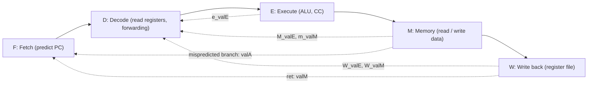
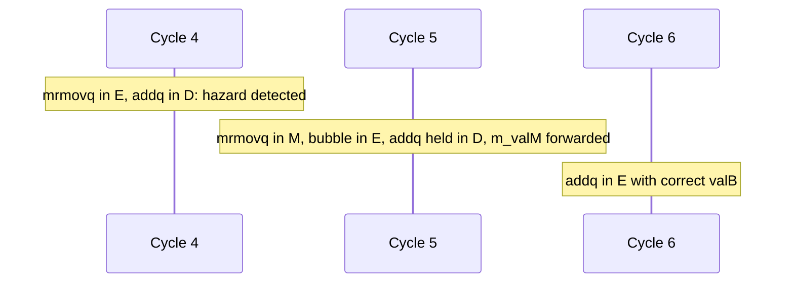

# Pipelining, hazards and forwarding

> **Before this lesson:** You need the six stages and the signal names of the one-instruction-at-a-time design from [SEQ: a sequential Y86-64 processor](#/lesson/csapp/seq), and the instruction set from [The Y86-64 ISA and logic design](#/lesson/csapp/y86-isa).

## In plain words

The processor of the previous lesson finishes one instruction completely before beginning the next. **Pipelining** speeds this up without making any single step faster. Think of a self-service car wash with three bays: soap, rinse, dry. If only one car is allowed in the building at a time, two bays always stand idle. If a new car enters the soap bay as soon as the previous one moves to rinse, three cars are being worked on at once and a clean car leaves three times as often. Processors do the same with instructions. The difficulty is that neighbouring instructions are not independent, as cars are: one may need a result the one in front has not finished producing. Those conflicts are called **hazards**.

Why this matters at work: every modern processor is pipelined, and the cost of a wrongly guessed branch, which you can measure in real programs, comes directly from this design. Understanding it explains why some code that looks equivalent runs faster, and it is standard material for hardware-related and performance-related interviews.

## Why look closer

SEQ executes one instruction per (very long) clock cycle. **Pipelining** divides the work into stages separated by registers so that several instructions are processed at once, each in a different stage, like cars in a car wash or trays in a cafeteria line. Throughput rises dramatically. But instructions are not independent: one may need a result that an earlier, still-in-flight instruction has not yet written, and the processor does not know which instruction follows a branch until the branch executes. Solving these **hazards** (with stalling, forwarding and branch prediction) is the heart of processor design.

## 1. General principles of pipelining

Consider a block of combinational logic taking 300 ps, followed by a register that needs 20 ps to load.

**Unpipelined:** each instruction takes 320 ps. Throughput $= 1/320\text{ ps} \approx 3.12$ GIPS (billion instructions per second). **Latency**, the time for one instruction start to finish, is 320 ps.

**Three-stage pipeline:** split the logic into three 100 ps blocks with a register after each. The clock can now tick every $100 + 20 = 120$ ps: throughput $\approx 8.33$ GIPS, an improvement of 2.67×. Latency *increases* to $3 \times 120 = 360$ ps because of the extra registers.

```python-run
def pipeline(stage_delays_ps, reg_ps=20):
    cycle = max(stage_delays_ps) + reg_ps
    return dict(cycle_ps=cycle, gips=round(1000 / cycle, 2), latency_ps=cycle * len(stage_delays_ps))

print("unpipelined   ", pipeline([300]))
print("3 equal stages", pipeline([100, 100, 100]))
print("nonuniform    ", pipeline([50, 150, 100]))     # limited by the slowest stage
print("6 stages      ", pipeline([50] * 6))
```

<!-- walkthrough:python-run -->
**Reading this Python line by line**

- `def pipeline(stage_delays_ps, reg_ps=20):` defines a function. Its first input is a list with the time each stage takes, in picoseconds (trillionths of a second). The second, with a default of 20, is the extra time each pipeline register adds.
- `cycle = max(stage_delays_ps) + reg_ps` is the clock period: the clock must be slow enough for the slowest stage plus one register.
- `return dict(...)` hands back three results with names: the cycle time; the throughput in billions of instructions per second, which is `1000 / cycle` when the cycle is in picoseconds; and the latency, the cycle time multiplied by the number of stages.
- The four `print` calls compare designs. One 300 ps stage gives a 320 ps cycle. Three equal stages give 120 ps, so throughput rises about 2.7 times. Unequal stages are held back by the slowest. Six stages go faster again, but the 20 ps register cost is now a large share of each cycle.

Two limitations appear immediately:

- **Nonuniform partitioning.** The clock is set by the *slowest* stage. Stages of 50, 150 and 100 ps force a 170 ps cycle (5.88 GIPS), and the faster stages sit idle part of each cycle. Dividing real hardware (an ALU, a memory) into equal pieces is hard.
- **Diminishing returns of deep pipelining.** Six 50 ps stages give a 70 ps cycle: 14.29 GIPS. We doubled the stages but gained only a factor of $14.29/8.33 = 1.71$, because the 20 ps register delay is now 28.6% of the cycle. Modern processors nonetheless use very deep pipelines (15 or more stages).

**Pipelines with feedback** are the real difficulty. Instructions depend on each other through **data dependencies** (one instruction's result is the next one's operand) and **control dependencies** (a jump determines which instruction comes next). A naive pipeline would change the system's behavior; the design must preserve the ISA's sequential semantics.

## 2. PIPE: the five-stage Y86-64 pipeline

Starting from SEQ+ (PC computation at the start of the cycle), we insert **pipeline registers** between stages:



| Register | Sits between | Holds |
|---|---|---|
| **F** | (before fetch) | predicted PC |
| **D** | fetch and decode | the newly fetched instruction: icode, ifun, rA, rB, valC, valP |
| **E** | decode and execute | decoded instruction and the register values read |
| **M** | execute and memory | ALU result, branch condition and target info |
| **W** | memory and write back | results to be written to the register file, and the return address for `ret` |

Naming convention: uppercase prefixes (`D_icode`, `M_valE`) denote values **stored in a pipeline register**; lowercase prefixes (`e_valE`, `m_valM`) denote signals **computed within a stage**.

Each instruction takes five cycles to pass through, but a new instruction starts every cycle. Since write back happens in the W stage, the destination register IDs (`dstE`, `dstM`) travel along with the instruction through E, M and W.

## 3. Next-PC prediction

To issue an instruction every cycle, fetch must know the next PC *immediately*, before the current instruction has executed.

- For most instructions the next PC is `valP`. For `call` and `jmp` (unconditional) it is `valC`. These are always correct.
- For a **conditional jump** the outcome is not known until the execute stage. PIPE **predicts**: it uses the **always taken** strategy, i.e. predicts PC = `valC`. The book cites studies showing always-taken succeeds about 60% of the time, versus about 40% for never-taken. (**Backward taken, forward not taken**, BTFNT, reaches about 65%, because loops close with backward branches.)
- For **`ret`** the target is on the stack and essentially unpredictable (for this simple design), so PIPE stops fetching new instructions until the `ret` reaches write back.

Modern processors use far more sophisticated branch predictors with history tables, plus a **return stack** that predicts return addresses by mimicking calls and returns; they achieve well over 90% accuracy.

## 4. Data hazards

Consider:

```
0x000: irmovq $10, %rdx
0x00a: irmovq $3,  %rax
0x014: addq %rdx, %rax
0x016: halt
```

The `addq` reads `%rdx` and `%rax` in its decode stage. But at that moment the first `irmovq` is in the memory stage and the second in execute; neither has reached write back. Reading the register file would return *stale* values. This is a **data hazard**. It can arise whenever an instruction's source register is the destination of an instruction 1, 2 or 3 positions ahead. (With three `nop`s in between there is no hazard: the register file is written at the clock edge at the end of W, in time for the next decode.)

### Solution 1: stalling

Hold the dependent instruction in decode and inject **bubbles** (dynamically generated `nop`s) into execute until the source instruction has passed write back. The instruction in fetch is held too, by keeping the PC and the D register fixed. Simple and correct, but slow: up to three wasted cycles for one of the most common code patterns.

### Solution 2: forwarding (bypassing)

The value is usually *already computed* somewhere in the pipeline; it has not been written yet. **Forwarding** passes it directly from a later stage back to decode. PIPE has five forwarding sources, each paired with the destination register ID it will be written to:

| Source signal | Destination ID | Meaning |
|---|---|---|
| `e_valE` | `e_dstE` | ALU output computed in execute |
| `m_valM` | `M_dstM` | value read from data memory |
| `M_valE` | `M_dstE` | ALU result held in the M register |
| `W_valM` | `W_dstM` | memory value pending in write back |
| `W_valE` | `W_dstE` | ALU result pending in write back |

Decode logic compares its source IDs (`d_srcA`, `d_srcB`) against these destination IDs and selects the matching value instead of the register file output. **Priority matters**: if several stages will write the same register, the **earliest pipeline stage** (execute, then memory, then write back) holds the *most recent* instruction and must win, to preserve sequential semantics.

With forwarding, the example runs with no stalls: `addq` in decode takes `%rdx` from `M_valE` and `%rax` from `e_valE`.

### Load/use hazards

Forwarding cannot handle one case, because memory reads happen late:

```
0x028: mrmovq 0(%rdx), %rax    # load %rax
0x032: addq %rbx, %rax         # use %rax immediately
```

When `addq` is in decode, the `mrmovq` is in execute; its value will not exist until the *end of the memory stage*, one cycle too late. The fix is to **stall one cycle** and *then* forward (`m_valM`). This is a **load interlock**. The pipeline holds `addq` in decode, injects one bubble into execute, and proceeds. Since only load/use needs a stall, throughput stays near one instruction per cycle.



## 5. Control hazards

### ret

`ret` needs its target from memory, read in the M stage and available in W. When a `ret` is in decode, execute or memory, the pipeline injects a bubble into decode each cycle (the fetch stage keeps refetching the instruction after `ret`, which is discarded). **Three bubbles** follow each `ret`; then fetch uses `W_valM` as the PC.

### Mispredicted branches

PIPE predicts taken and starts fetching at the target. The branch resolves in **execute**. By then two instructions from the target have been fetched (one in decode, one in fetch). If the branch should not have been taken, they must be **cancelled** (*instruction squashing*): the pipeline injects bubbles into decode and execute on the next cycle, replacing them, and fetches from the fall-through address `valP` (carried along as `M_valA`). Critically, the two wrong instructions have not changed any programmer-visible state yet, because state changes only in execute (condition codes) or later. Cost: **two cycles** per misprediction.

## 6. Exceptions

Exceptions (halt, invalid instruction, invalid address) can be detected in different stages: fetch may see a bad instruction address or invalid opcode, memory a bad data address. Three subtleties:

1. Several instructions may raise exceptions simultaneously. The one **furthest along** the pipeline (earliest in program order) has priority.
2. An instruction fetched down a mispredicted path may fault but will be cancelled; its exception must vanish with it.
3. Instructions *after* an excepting instruction must not update visible state.

PIPE's solution: carry a **status code** `stat` with each instruction through the pipeline registers. Nothing special happens until the instruction reaches **write back**, where the exception is finally recognized. Meanwhile, when an excepting instruction is in the memory or write-back stage, the control logic **disables updates** of the condition codes and data memory by later instructions. The result is the ISA's promise: all instructions before the excepting one complete, none after it have any effect.

## 7. Pipeline control logic

Four special cases, and what the control logic does to each pipeline register (*stall* = hold contents; *bubble* = replace with a nop):

| Condition | F | D | E | M | W |
|---|---|---|---|---|---|
| Processing `ret` | stall | bubble | normal | normal | normal |
| Load/use hazard | stall | stall | bubble | normal | normal |
| Mispredicted branch | normal | bubble | bubble | normal | normal |

(The fourth case is exceptions, handled by disabling state updates as described.) The detection conditions:

- **ret**: `IRET in { D_icode, E_icode, M_icode }`
- **Load/use**: `E_icode in { IMRMOVQ, IPOPQ } && E_dstM in { d_srcA, d_srcB }`
- **Mispredict**: `E_icode == IJXX && !e_Cnd`

**Combinations** need care. A `ret` located at a not-taken branch target that was mispredicted (combination A) is handled as a mispredict. A load/use hazard combined with a `ret` in decode (combination B, e.g. a `popq %rsp` or load to `%rsp` followed by `ret`) would naively demand both *stall* and *bubble* for register D; the correct action is to **stall** D. An early version of the book's design had exactly this bug, found only through systematic analysis: a lesson in why hardware is verified formally.

## 8. Performance analysis

The ideal pipeline has **CPI** (cycles per instruction) of 1.0. Each bubble wastes a slot. If a program executes $C_i$ instructions and $C_b$ bubbles:

$$\text{CPI} = \frac{C_i + C_b}{C_i} = 1.0 + \frac{C_b}{C_i} = 1.0 + lp + mp + rp$$

where $lp$, $mp$, $rp$ are the average bubbles per instruction from load/use hazards, mispredictions and returns. Using the book's frequencies:

| Cause | Instruction frequency | Condition frequency | Bubbles | Product |
|---|---|---|---|---|
| Load/use ($lp$) | 0.25 (loads) | 0.20 | 1 | 0.05 |
| Mispredict ($mp$) | 0.20 (cond. branches) | 0.40 (not taken) | 2 | 0.16 |
| Return ($rp$) | 0.02 | 1.00 | 3 | 0.06 |
| **Total** | | | | **0.27** |

So CPI ≈ **1.27**. Mispredicted branches dominate, which is why real processors invest so heavily in branch prediction (and why Module 5 teaches you to write branch-friendly code).

```python-run
def cpi(load=0.25, load_use=0.20, br=0.20, mispredict=0.40, ret=0.02):
    lp, mp, rp = load * load_use * 1, br * mispredict * 2, ret * 3
    return 1 + lp + mp + rp, (lp, mp, rp)
print(cpi())
print("with a 65% accurate predictor (BTFNT):", round(cpi(mispredict=0.35)[0], 3))
print("with a 95% accurate predictor        :", round(cpi(mispredict=0.05)[0], 3))
```

## 9. Beyond PIPE

Real processors add: **multicycle instructions** (multiply, divide, floating point, handled by separate functional units with their own pipelines); **cache and TLB interfaces** (a memory "stage" may miss and stall for many cycles, or page-fault as an exception); and **superscalar, out-of-order execution** with register renaming, where hundreds of instructions are in flight (Module 5).

> [!INTERVIEW]
> **"What are pipeline hazards and how are they resolved?"** *Data hazards*: an instruction needs a value not yet written back; solved by forwarding, plus a one-cycle stall for load-use. *Control hazards*: the next PC is unknown; solved by branch prediction with squashing of wrong-path instructions on a mispredict. *Structural hazards* (two instructions needing the same hardware) are avoided by design, e.g. separate instruction and data memories. Quote the costs: load-use 1 cycle, mispredict 2 cycles in a classic 5-stage pipeline, 15+ cycles in modern deep pipelines.

> [!INTERVIEW]
> **"Why does deeper pipelining not scale forever?"** Register overhead becomes a growing share of the cycle, stage work cannot be divided evenly, misprediction penalties grow with depth, and power rises with clock frequency.

## 10. Summary

- Pipelining raises throughput by overlapping instructions; latency rises slightly; the slowest stage plus register delay sets the clock.
- PIPE: F, D, E, M, W with pipeline registers; predicts PC (always-taken for jumps).
- Data hazards → forwarding from five sources with priority to the earliest stage; load/use → one stall cycle.
- Control hazards → 3 bubbles for `ret`, 2 cancelled instructions for a misprediction.
- Exceptions ride along as status codes and are recognized at write back.
- CPI = 1 + lp + mp + rp ≈ 1.27 with the book's workload numbers.

## Glossary

- **Pipelining**: dividing instruction execution into stages so several instructions are in progress at once.
- **Stage**: one step of the pipeline; here fetch, decode, execute, memory and write back.
- **Pipeline register**: a memory element between two stages that holds an instruction's partial results.
- **Throughput**: the number of instructions completed per unit of time.
- **Latency**: the time one instruction takes from start to finish.
- **Hazard**: a situation in which overlapping instructions would give a wrong result if nothing were done.
- **Data hazard**: an instruction needs a value that an earlier, unfinished instruction has yet to produce.
- **Control hazard**: the processor does not yet know which instruction comes next, as after a conditional jump.
- **Stalling**: holding an instruction back for a cycle or more until what it needs is ready.
- **Bubble**: an empty slot inserted into the pipeline; it does nothing.
- **Forwarding (bypassing)**: sending a result straight to a later instruction that needs it, without waiting for it to be stored.
- **Load/use hazard**: the case in which a value read from memory is needed by the very next instruction, which forwarding alone cannot fix.
- **Branch prediction**: guessing the outcome of a conditional jump so that work can continue.
- **Misprediction penalty**: the cycles wasted when that guess turns out wrong.

## Check yourself

```quiz
[
  {"q": "Combinational logic of 300 ps is split into three equal stages with 20 ps registers. What is the throughput?", "options": ["3.12 GIPS", "8.33 GIPS", "10 GIPS", "9.38 GIPS"], "answer": 1,
   "explain": "Cycle = 100 + 20 = 120 ps, so 1000/120 = 8.33 GIPS."},
  {"q": "What happens to latency when you pipeline?", "options": ["It decreases proportionally", "It increases slightly due to register delays", "It is unchanged", "It becomes zero"], "answer": 1,
   "explain": "Each instruction now passes through extra registers: 360 ps vs 320 ps in the example."},
  {"q": "Which hazard cannot be solved by forwarding alone in PIPE?", "options": ["addq followed by addq using its result", "Load/use: mrmovq followed immediately by an instruction using the loaded register", "irmovq followed by rrmovq", "Any hazard with three nops between"], "answer": 1,
   "explain": "The loaded value is not available until the end of the memory stage, so one stall cycle is needed before forwarding."},
  {"q": "How many cycles are lost on a mispredicted branch in PIPE?", "options": ["1", "2", "3", "5"], "answer": 1,
   "explain": "The branch resolves in execute; the two instructions fetched after it are squashed."},
  {"q": "How many bubbles follow a ret in PIPE?", "options": ["1", "2", "3", "0"], "answer": 2,
   "explain": "The return address is read in the memory stage and used from W, so fetch waits three cycles."},
  {"q": "If both the execute stage and the write-back stage hold instructions writing %rax, which value should decode forward?", "options": ["The write-back value, because it is older", "The execute value, because it comes from the most recent instruction", "The register file value", "Either"], "answer": 1,
   "explain": "Sequential semantics require the latest earlier instruction's result, which is in the earliest pipeline stage."},
  {"q": "With the book's numbers, which penalty contributes most to CPI above 1.0?", "options": ["Load/use (0.05)", "Mispredicted branches (0.16)", "Returns (0.06)", "Exceptions"], "answer": 1,
   "explain": "0.20 * 0.40 * 2 = 0.16 of the 0.27 total."},
  {"q": "Where does PIPE finally act on an exception?", "options": ["In fetch", "As soon as it is detected", "When the instruction reaches write back", "Never"], "answer": 2,
   "explain": "The status travels with the instruction so that only exceptions of instructions that really execute, in program order, take effect."}
]
```

> **Source:** CS:APP 3e, §4.4–4.5 (General principles of pipelining; Pipelined Y86-64 implementations: SEQ+, PIPE, hazards, forwarding, exception handling, pipeline control logic, performance analysis).
