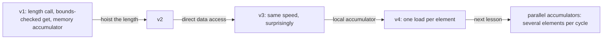

# CPE and optimization blockers

> **Before this lesson:** You should be able to read simple C with pointers and loops, and to recognise a load from and a store to memory in assembly, as taught in [x86-64 basics: registers, operands, mov](#/lesson/csapp/asm-basics) and [Arithmetic, condition codes and control flow](#/lesson/csapp/asm-control).

## In plain words

A **compiler** is the program that turns the code you write into instructions for the processor, and an **optimising** compiler also tries to make those instructions run fast. It is a very careful assistant. Imagine asking a helper to tidy your desk. A cautious helper will not throw away any paper unless certain it is rubbish, because the cost of being wrong is too high. A compiler behaves the same way: it will only rearrange your code when it can prove the result is identical in every possible situation. Some ordinary coding habits make that proof impossible, and the compiler then leaves slow code exactly as written. Those habits are called **optimization blockers**.

Why this matters at work: knowing the blockers lets you remove them with small, safe edits and get large speedups with no change to the algorithm. The lesson also covers a well-known trap in which a harmless-looking loop becomes thousands of times slower as its input grows; spotting that pattern in a code review is a valued skill, and it is a favourite interview example.

## Why look closer

"Compile with `-O2` and let the compiler deal with it" is good advice most of the time. Modern compilers perform remarkable transformations. They are also bound by one absolute rule: the optimised program must behave exactly like the original for **every possible input and every possible caller**, including ones the programmer never had in mind. When a compiler cannot prove a transformation is safe, it does not perform it, however obvious the improvement may look to a human reader. The situations in which it has to hold back are called **optimization blockers**, and they are surprisingly common in ordinary, innocent-looking code.

This lesson is about seeing your code the way the compiler has to. It introduces a precise way of measuring loop performance, identifies the two great blockers (memory aliasing and function calls), and then works a single example through three transformations that take a loop from sluggish to tight. A famous accidental-quadratic bug shows up along the way. The following lesson continues from where this one stops, using the processor's ability to run instructions in parallel.

## 1. The division of labour

Writing fast programs involves three kinds of activity:

1. **Choose suitable algorithms and data structures.** Nothing below this level can rescue a poor choice here.
2. **Write source code that the compiler can turn into efficient machine code.** This requires knowing what compilers can and cannot do.
3. **For heavy computations, divide the work so parts can run in parallel.**

This lesson concerns the second. Its goal is not clever tricks. It is to remove obstacles, so that the compiler can do its job, and to do by hand the few things the compiler is not allowed to do.

There is tension with readability. The usual advice applies: write clear code first, find out by measurement where the time goes, and reshape only the parts that matter.

## 2. Why compilers are cautious

Compilers apply only **safe** optimisations: ones that cannot change program behaviour in any situation permitted by the language. Two features of C make safety hard to establish.

### Blocker one: memory aliasing

Look at two functions that appear to do the same thing:

```c
void bump_twice(long *total, long *step) {
    *total += *step;
    *total += *step;
}

void bump_double(long *total, long *step) {
    *total += 2 * *step;
}
```

The second is cheaper: three memory references (read `*step`, read `*total`, write `*total`) against six. Why does the compiler not rewrite the first into the second?

Because they are not equivalent. Consider a call in which both arguments are the *same address*, with the value 5 stored there:

- `bump_twice`: the first statement makes the value 10. The second reads `*step`, which is now 10, and makes it 20.
- `bump_double`: computes 5 + 2 × 5 = 15.

Two pointers that may refer to the same location are said to be **aliased**. The compiler compiling `bump_twice` usually cannot see every call site, so it must assume aliasing is possible and produce code that is right in that case. That means re-reading `*step` after the store to `*total`, because the store *might* have changed it.

The same caution applies far more widely than function parameters:

```c
x = 100;  y = 300;
*q = y;          /* store 300 through q */
*p = x;          /* store 100 through p */
long t = *q;     /* 300?  or 100, if p and q point to the same place */
```

Every time a value is written through a pointer, the compiler must ask whether that write could have altered anything else it is holding in a register. If it cannot rule that out, the register copy is no longer trustworthy and must be reloaded.

```python-run
def bump_twice(mem, total, step):
    mem[total] += mem[step]
    mem[total] += mem[step]

def bump_double(mem, total, step):
    mem[total] += 2 * mem[step]

for label, total, step in (("separate locations", 0, 1), ("ALIASED: same location", 0, 0)):
    a, b = [5, 5], [5, 5]
    bump_twice(a, total, step)
    bump_double(b, total, step)
    print(f"{label:24} bump_twice -> {a[total]:3}   bump_double -> {b[total]:3}   same? {a[total] == b[total]}")
```

### Blocker two: function calls

```c
long measure(void);

long twice_called(void)  { return measure() + measure(); }
long once_called(void)   { return 2 * measure(); }
```

Calling once is clearly cheaper. But suppose `measure` is

```c
long ticks = 0;
long measure(void) { return ticks++; }
```

The function has a **side effect**: it changes global state, and its result depends on how many times it has been called. Starting from zero, `twice_called` returns 0 + 1 = 1, while `once_called` returns 0. A compiler that cannot see inside `measure`, perhaps because it is defined in another file, must assume the worst and keep every call exactly as written. It also cannot move a call out of a loop, reorder two calls, or assume that global variables are unchanged across a call.

Compilers do have a way of looking inside: **inlining**, which replaces a call with the body of the called function and then optimises the combined code. Inlining is applied to small functions whose definitions are visible, at higher optimisation levels. It cannot help with functions in separately compiled files (unless link-time optimisation is used), with calls through function pointers, or with large functions.

The moral of both blockers is the same. The compiler is not being obtuse; it lacks information that you have. **When you know that pointers do not alias, or that a function always returns the same value, restructure the code so that the improvement is explicit.**

## 3. Measuring: cycles per element

To judge improvements we need a measure that does not depend on the size of the input or the speed of the clock. For code that loops over the elements of an array, the standard one is **cycles per element**, or **CPE**.

Run the function for a range of lengths *n* and record the time in processor clock cycles. For loop-based code the result is very nearly a straight line:

$$T(n) \approx T_0 + \text{CPE} \cdot n$$

The intercept $T_0$ is the fixed cost of calling the function and setting up; the slope is the CPE. For large *n* the slope is all that matters. Expressing time in cycles, not nanoseconds, describes how many steps the program takes independently of the clock rate: a 4 GHz processor executes four billion of those cycles each second.

A low intercept does not make a function fast. Suppose one version costs $250 + 9n$ cycles and another $400 + 3n$. The first wins for tiny arrays, they tie at *n* = 25, and beyond that the second pulls steadily ahead.

```python-run
def fit_line(points):
    """Least-squares fit of cycles = intercept + slope * n."""
    k = len(points)
    sx = sum(n for n, _ in points); sy = sum(c for _, c in points)
    sxx = sum(n * n for n, _ in points); sxy = sum(n * c for n, c in points)
    slope = (k * sxy - sx * sy) / (k * sxx - sx * sx)
    return (sy - slope * sx) / k, slope

measured = [(50, 702), (100, 1148), (200, 2051), (400, 3853), (800, 7449)]      # (n, cycles)
intercept, cpe = fit_line(measured)
print(f"fitted: cycles = {intercept:.0f} + {cpe:.2f} * n   ->   CPE = {cpe:.2f}")

a = lambda n: 250 + 9 * n
b = lambda n: 400 + 3 * n
for n in (10, 25, 100, 10_000):
    print(f"n = {n:6}: version A {a(n):7} cycles, version B {b(n):7} cycles -> {'A' if a(n) < b(n) else 'B' if b(n) < a(n) else 'tie'}")
```

## 4. A running example

To make the transformations concrete, take a small abstract data type: a bounds-checked array of numbers.

```c
typedef struct {
    long    len;
    double *data;
} series_t;

long series_length(const series_t *s) { return s->len; }

/* Copy element i into *out. Returns 0 if i is out of range, 1 on success. */
int series_get(const series_t *s, long i, double *out) {
    if (i < 0 || i >= s->len) return 0;
    *out = s->data[i];
    return 1;
}
```

The task is to combine all the elements into one value, here their product, and store it through a pointer supplied by the caller:

```c
/* Version 1: the obvious way */
void product_v1(const series_t *s, double *result) {
    *result = 1.0;
    for (long i = 0; i < series_length(s); i++) {
        double x;
        series_get(s, i, &x);
        *result = *result * x;
    }
}
```

This is clean, modular, safe code. It is also slow. Compiled without optimisation it costs around 20 cycles per element; turning on basic optimisation roughly halves that, without any work on our part. The rest of the lesson gets it down by another factor of two or more.

| Version | What changed | Approximate CPE |
|---|---|---|
| v1, unoptimised compile | nothing | 20 |
| v1, `-O1` | compiler's own clean-up | 10 |
| v2 | length computed once | 9 |
| v3 | direct element access | 9 |
| v4 | accumulate in a local variable | 5 |

The exact figures depend on the machine and the operation; treat them as illustrative. The pattern is what matters, and it has a surprise in it, at v3.

## 5. Transformation one: move work out of the loop

Version 1 calls `series_length` in the loop test, so it is called on every iteration. The length never changes while the loop runs. Computing it once beforehand is an example of **code motion**: find a computation that is performed repeatedly but always gives the same result, and move it to where it is performed once.

```c
/* Version 2 */
void product_v2(const series_t *s, double *result) {
    long n = series_length(s);
    *result = 1.0;
    for (long i = 0; i < n; i++) {
        double x;
        series_get(s, i, &x);
        *result = *result * x;
    }
}
```

Why did the compiler not do this itself? Blocker two. To hoist the call it would have to prove that `series_length` has no side effects and that nothing in the loop body changes the length. With the function defined elsewhere, it cannot.

Here the saving is modest, since `series_length` is trivial. In other cases the same oversight is catastrophic.

### The accidental quadratic

```c
/* Convert a string to upper case in place: looks linear, is quadratic */
void shout_slow(char *s) {
    for (size_t i = 0; i < strlen(s); i++)
        if (s[i] >= 'a' && s[i] <= 'z')
            s[i] -= 'a' - 'A';
}
```

`strlen` has no stored length to consult. It finds the end of a C string by walking it from the start until it reaches the terminating zero, so it takes time proportional to the length. The loop calls it once per character. For a string of *n* characters that is about *n* scans of *n* characters: **quadratic** time, hidden inside a loop that looks linear.

```c
void shout_fast(char *s) {
    size_t n = strlen(s);                     /* once */
    for (size_t i = 0; i < n; i++)
        if (s[i] >= 'a' && s[i] <= 'z')
            s[i] -= 'a' - 'A';
}
```

The compiler cannot do this for you either, and now for both reasons at once. The loop body writes into the string, so, as far as the compiler can tell, the length might change (it would, if a zero byte were stored). And `strlen` is a function call.

On a short test string the two versions are indistinguishable. On a megabyte of text, the slow one takes minutes and the fast one milliseconds. This exact bug has shipped in real, widely used software, and it is the standard example of why asymptotic behaviour matters even in "simple" code.

<div class="widget" data-widget="bigo"></div>

```python-run
def strlen_steps(n):                 # C's strlen walks all n characters
    return n

def slow_steps(n):                   # one strlen per loop test (n + 1 tests), plus the loop body
    return (n + 1) * strlen_steps(n) + n

def fast_steps(n):                   # one strlen, then the loop
    return strlen_steps(n) + n

print(f"{'length':>10} {'slow':>18} {'fast':>12} {'ratio':>10}")
for n in (10, 1_000, 100_000, 1_000_000):
    print(f"{n:>10,} {slow_steps(n):>18,} {fast_steps(n):>12,} {slow_steps(n) // fast_steps(n):>9,}x")
print("\nat 1 ns per step, a million characters:", round(slow_steps(10**6) / 1e9 / 60, 1), "minutes versus",
      round(fast_steps(10**6) / 1e6, 1), "milliseconds")
```

## 6. Transformation two: fewer function calls

Version 2 still calls `series_get` for each element, and each call performs a bounds check that can never fail, because the loop already keeps `i` in range. We can ask the abstraction for direct access to its storage:

```c
double *series_start(const series_t *s) { return s->data; }

/* Version 3 */
void product_v3(const series_t *s, double *result) {
    long n = series_length(s);
    const double *d = series_start(s);
    *result = 1.0;
    for (long i = 0; i < n; i++)
        *result = *result * d[i];
}
```

The honest objection is that this breaks modularity: the function now knows that a series is stored as a contiguous array, and would have to change if that representation did. That is a real cost, to be paid only where measurement shows the code is critical, and softened by keeping the interface (`series_start`) explicit.

Now the surprise. The measured CPE **barely changes**. We removed a call and two comparisons per iteration and gained almost nothing. Why? The bounds checks were perfectly predictable branches, which a modern processor executes at close to no cost. And something else in the loop was, and still is, the real limit on its speed. Finding that something is the point of the next transformation, and the episode carries its own lesson: intuition about where time goes is unreliable. Measure.

## 7. Transformation three: keep the running value in a register

Look at what the loop body in version 3 does to memory. In assembly, with `%rbx` holding `result` and `%rdx` stepping through the data, it is essentially:

```asm
.Lloop:
    vmovsd  (%rbx), %xmm0             # read *result from memory
    vmulsd  (%rdx), %xmm0, %xmm0      # multiply by d[i]
    vmovsd  %xmm0, (%rbx)             # write *result back to memory
    addq    $8, %rdx
    cmpq    %rax, %rdx
    jne     .Lloop
```

On every iteration the running product is loaded from memory, updated, and stored back, only to be loaded again at the top of the next iteration. The value written is exactly the value that will be read. That round trip is pure waste, and it also lengthens the chain of dependent operations from one iteration to the next: each multiplication must wait for the previous store and reload.

The fix is to accumulate in a local variable, which the compiler can keep in a register, and write to memory once at the end:

```c
/* Version 4 */
void product_v4(const series_t *s, double *result) {
    long n = series_length(s);
    const double *d = series_start(s);
    double acc = 1.0;
    for (long i = 0; i < n; i++)
        acc = acc * d[i];
    *result = acc;
}
```

```asm
.Lloop:
    vmulsd  (%rdx), %xmm0, %xmm0      # acc *= d[i]; acc lives in %xmm0
    addq    $8, %rdx
    cmpq    %rax, %rdx
    jne     .Lloop
```

Memory operations per iteration drop from two reads and a write to a single read, and the CPE roughly halves.

Once more: why could the compiler not do this by itself? **Blocker one, aliasing.** Suppose a caller passes, as `result`, the address of one of the series' own elements, say the last one. Trace a series holding [2, 3, 5]:

| Step | v3 (writes through `result` each time) | v4 (local accumulator) |
|---|---|---|
| start | data = [2, 3, **1**] | acc = 1, data = [2, 3, 5] |
| i = 0 | data = [2, 3, **2**] | acc = 2 |
| i = 1 | data = [2, 3, **6**] | acc = 6 |
| i = 2 | data = [2, 3, **36**] (6 × 6) | acc = 30 |
| end | result is 36 | result is 30 |

The two versions give different answers. Version 3's behaviour with an aliased result is strange, and nobody would call the function that way on purpose. But the compiler has no way of knowing that. It must preserve what the code as written does in all cases, so it cannot convert v3 into v4. You, knowing the intended use, can.

```python-run
def product_v3(data, result_index):            # result lives INSIDE the array: aliased
    data[result_index] = 1
    for i in range(len(data)):
        data[result_index] = data[result_index] * data[i]
    return data[result_index]

def product_v4(data, result_index):
    acc = 1
    for i in range(len(data)):
        acc = acc * data[i]
    data[result_index] = acc
    return acc

print("aliased result, v3:", product_v3([2, 3, 5], 2))
print("aliased result, v4:", product_v4([2, 3, 5], 2))

# The memory traffic each version generates for n elements:
n = 1000
print(f"\nv3: {2 * n} loads + {n} stores      v4: {n} loads + 1 store")
```

C provides a way to make the promise explicit. Declaring a pointer parameter with the `restrict` qualifier tells the compiler that, for the lifetime of that pointer, the object it points to is accessed only through it. With that assurance the compiler may keep values in registers across stores through other pointers. Breaking the promise is undefined behaviour, so use it only when it is true.



## 8. Where things stand

Version 4 performs, per element, one load, one arithmetic operation and a little loop overhead. Its CPE is now essentially equal to the **latency** of the combining operation: about 5 cycles for a double multiplication, 3 for an integer multiplication or floating-point addition, 1 for an integer addition. The reason is that each iteration's result feeds the next, so the operations are forced to happen one after another.

That might look like the end of the road. It is not: the processor could be performing several of those operations at once, if only the code did not chain them together. Breaking that chain is the subject of the next lesson.

A checklist distilled from this one:

- Hoist every computation whose result does not change out of the loop, especially function calls, and most especially ones whose cost grows with the data.
- Be suspicious of any function call in a loop condition.
- Remove per-element calls from hot loops when the abstraction allows it, and verify by measuring that it actually helped.
- Accumulate results in local variables; write to memory through pointers once, after the loop.
- Remember the two questions the compiler must ask: *could these pointers refer to the same thing?* and *could this call change something or return something different next time?* Where you know the answer and it cannot, make the code say so.

> [!INTERVIEW]
> **"What is wrong with `for (i = 0; i < strlen(s); i++)`?"** `strlen` walks the entire string on each call, and the loop condition is evaluated on every iteration, so a loop that looks linear performs a quadratic number of steps. The compiler generally cannot hoist the call, since the body may modify the string and it cannot assume the function's result is unchanged. Compute the length once before the loop, or loop until the terminating zero is reached.

> [!INTERVIEW]
> **"What is pointer aliasing and why does it hinder optimisation?"** Two pointers alias when they may refer to the same memory. If the compiler cannot prove they do not, then after any store through one pointer it must assume values read through the other may have changed, and reload them. That prevents keeping values in registers, merging repeated reads, and reordering operations. Programmers avoid the cost by copying values into local variables, or by declaring pointers `restrict` when they are known to be distinct.

## 9. Pitfalls

- **Assuming the optimiser will hoist calls and cache values.** It will not when aliasing or side effects are possible, which is most of the time across file boundaries.
- **Optimising by intuition.** Removing the bounds check felt valuable and changed nothing. Profile and measure.
- **Giving up clarity everywhere.** Apply these transformations to hot loops identified by measurement, not to the whole program.
- **Changing behaviour while optimising.** Hand-applied transformations such as the local accumulator alter results when arguments alias. Be sure that case is excluded, and document it.
- **Comparing versions on small inputs.** Fixed overhead dominates and hides the slope.
- **Forgetting the algorithm.** A factor of four from loop tuning is nothing beside the difference between linear and quadratic.
- **Using `restrict` as a wish.** It is a promise; if it is false the program is wrong.

## Summary

- Compilers optimise only when they can prove that behaviour is unchanged for all inputs. Possible **aliasing** between pointers and unknown **side effects** of function calls are the main things that stop them.
- **CPE**, the slope of running time in cycles against the number of elements, measures the efficiency of a loop independently of input size and clock rate.
- **Code motion** moves repeated, unchanging computations out of loops. Leaving a linear-time call such as `strlen` in a loop condition turns a linear algorithm into a quadratic one.
- Removing calls from the inner loop may or may not help; predictable checks are cheap, so measure.
- Accumulating in a local variable eliminates a load and a store per iteration. The compiler cannot make this change because of potential aliasing.
- After these steps the loop runs at the latency of its operation per element; getting below that requires exploiting instruction-level parallelism.

## Glossary

- **Optimising compiler**: a compiler that rewrites code to run faster while keeping its behaviour identical.
- **Optimization blocker**: a feature of the code that prevents the compiler from proving a rewrite is safe.
- **Aliasing**: two pointers referring to the same memory location.
- **Side effect**: any change a function makes beyond returning a value, such as modifying a global variable.
- **Inlining**: replacing a function call with a copy of the function's body.
- **Clock cycle**: one tick of the processor's clock; a 4 GHz processor has four billion per second.
- **CPE (cycles per element)**: the number of clock cycles a loop needs for each additional element it processes.
- **Code motion**: moving a computation whose result never changes out of a loop so it happens once.
- **Quadratic time**: running time that grows with the square of the input size.
- **Accumulator**: a variable that collects a running result, such as a sum or product.
- **`restrict`**: a C keyword by which the programmer promises that a pointer is the only route to its data.
- **Latency**: the number of cycles an operation takes from start to result.

```quiz
[
  {"q": "A function does *a += *b; *a += *b;. Why can the compiler not replace this with *a += 2 * *b; ?",
   "options": ["Multiplication is slower than addition", "If a and b point to the same location the two versions give different results", "The compiler does not know the type of the pointers", "It would overflow"],
   "answer": 1, "explain": "With both pointers at a location holding v, the original yields 4v while the replacement yields 3v. The compiler must preserve the aliased behaviour."},
  {"q": "One implementation takes 300 + 8n cycles and another 500 + 4n. For which values of n is the second faster?",
   "options": ["Never", "n greater than 50", "n less than 50", "Always"],
   "answer": 1, "explain": "They are equal when 300 + 8n = 500 + 4n, that is n = 50. Beyond that the lower slope (CPE of 4) wins."},
  {"q": "What does CPE measure?",
   "options": ["Total cycles for one call", "The slope of running time in clock cycles as a function of the number of elements processed", "Cache misses per element", "Compile time per function"],
   "answer": 1, "explain": "It is the incremental cost of each additional element, excluding fixed overhead, and is independent of the clock frequency."},
  {"q": "What is the time complexity of a loop written as for (i = 0; i < strlen(s); i++) with a constant-time body?",
   "options": ["Linear in the string length", "Quadratic in the string length", "Logarithmic", "Constant"],
   "answer": 1, "explain": "strlen scans the whole string on each evaluation of the loop test, and the test runs once per character."},
  {"q": "Why can a compiler usually not move a function call out of a loop?",
   "options": ["Calls are never expensive", "It cannot prove the function has no side effects and returns the same value each time", "The C standard forbids it in all cases", "Loops cannot contain hoisted variables"],
   "answer": 1, "explain": "Without seeing the function body, the compiler must assume it might modify state or depend on changing state, so each call must stay in place."},
  {"q": "Replacing a bounds-checked accessor call with direct array access in the example loop gave almost no speedup. What is the best explanation?",
   "options": ["The compiler removed the direct access", "The checks were highly predictable branches and another dependency in the loop was the real bottleneck", "Function calls are free", "Bounds checks are performed by hardware"],
   "answer": 1, "explain": "Well-predicted branches cost very little, and the loop's speed was limited by the load-update-store chain through the result pointer."},
  {"q": "Why does accumulating in a local variable speed up the loop compared with updating *result every iteration?",
   "options": ["Local variables use faster arithmetic", "The value can stay in a register, eliminating a load and a store of the accumulator on every iteration", "It reduces the number of multiplications", "It removes the loop branch"],
   "answer": 1, "explain": "Updating through the pointer forces the value through memory each time. A local needs only one final store."},
  {"q": "Why does the compiler not perform that local-accumulator transformation automatically?",
   "options": ["It would require more registers than exist", "result might alias an element of the array, in which case the two versions compute different answers", "Floating-point values cannot be held in registers", "It is too complex to implement"],
   "answer": 1, "explain": "If the destination overlaps the data being read, each intermediate store changes later reads. The compiler must preserve that behaviour unless told aliasing cannot occur."}
]
```

> **Source:** CS:APP 3e, §5.1–5.6
