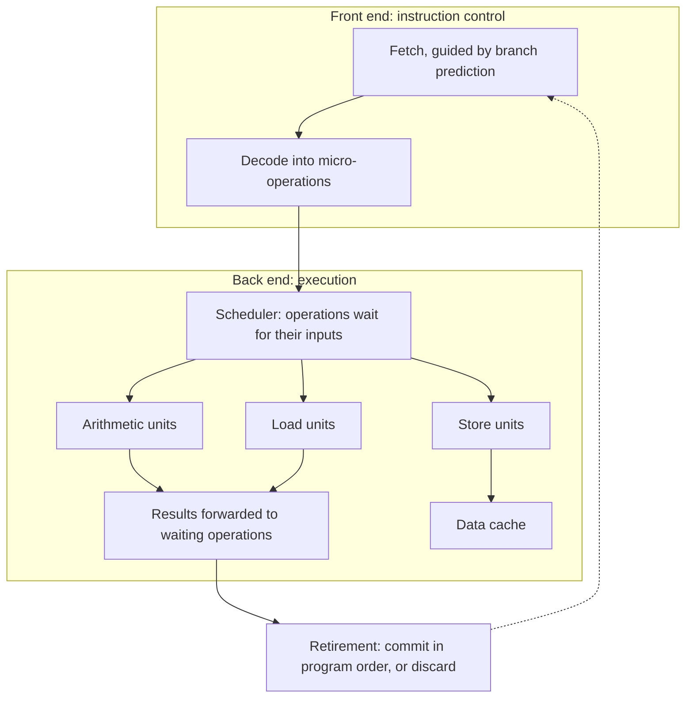
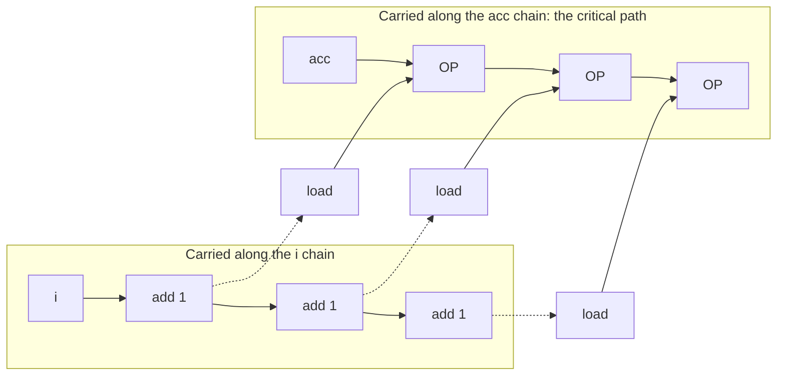
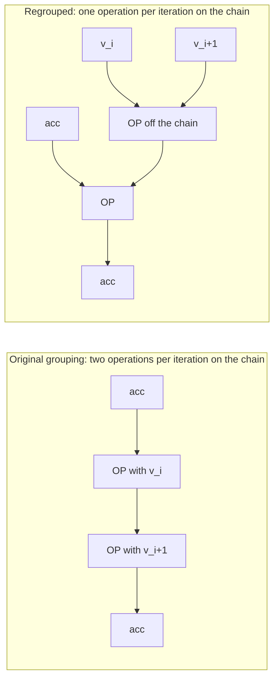

# Instruction-level parallelism and unrolling

> **Before this lesson:** This lesson picks up the loop that was cleaned up in [CPE and optimization blockers](#/lesson/csapp/opt-blockers); you need cycles per element (CPE) and the local-accumulator idea from there. The meaning of branch prediction is introduced in [Arithmetic, condition codes and control flow](#/lesson/csapp/asm-control).

## In plain words

A modern processor does not do one thing at a time. Inside, it resembles a kitchen with several cooks who can each start a task as soon as its ingredients are ready. If your recipe says "chop the onions, and separately boil the water", two cooks do both at once. If it says "boil the water, then cook the pasta in that water, then drain it", each step must wait for the one before, and extra cooks do not help. Program loops are often written, without anyone intending it, as one long chain in which every step waits for the previous result. **Instruction-level parallelism** means the processor overlapping steps that do not depend on each other. This lesson shows how to rewrite a loop so that it becomes several independent chains.

Why this matters at work: these rewrites can make numeric code several times faster on the same hardware, and they explain puzzles such as "why is this loop faster on sorted data?". Understanding dependency chains is also what lets you read a profiler's output and tell whether a loop is limited by arithmetic, by memory, or by branches.

## Why look closer

The previous lesson removed the obvious waste from a loop: function calls that could be hoisted, memory traffic that could be replaced by a register. After that clean-up the loop looks as tight as it can be: one load, one arithmetic operation, one counter update per element. And yet it can still be made several times faster, without changing the algorithm, without threads, and without touching the number of operations performed. The remaining gains come from a fact that source code completely hides: a modern processor does not execute instructions one after another. It works on dozens at once, and how fast your loop runs depends on whether its operations *can* overlap or are chained together so that each must wait for the one before. This lesson explains that machinery far enough to predict performance, and then uses the prediction to drive three transformations: loop unrolling, multiple accumulators and reassociation.

Throughout, performance is measured in **cycles per element** (CPE): how many clock cycles the loop needs for each additional array element. Lower is better.

## 1. What the processor is really doing

The simple model, one instruction completing before the next begins, describes what a program *computes*. It does not describe how the hardware gets there. A current high-performance core is **superscalar** (it can carry out several operations in every clock cycle) and **out of order** (the sequence in which it actually performs them need not match the program's).

The design has two halves.



**The front end** reads instructions from memory and turns them into simple primitive steps, often called micro-operations. An x86 instruction such as "add the value at this address to a register" becomes two of them: a load and an add. The front end runs far ahead of execution, which raises a problem: at a conditional branch it does not yet know which way the program will go. It guesses, using **branch prediction**, and keeps fetching along the guessed path. Performing work on a guessed path before the guess is confirmed is **speculative execution**.

**The back end** receives the stream of primitive operations and hands each to a **functional unit** capable of performing it as soon as its input values are available, regardless of the order in which they arrived. Typical cores have several units for integer arithmetic, a couple each for loading and storing, and a few for floating point.

Two mechanisms keep this free-for-all correct:

- **Retirement.** Every instruction is tracked until all its operations have completed *and* every branch before it is known to have been predicted correctly. Only then are its results made permanent, in original program order. If a prediction turns out wrong, everything fetched after the branch is thrown away with no visible effect, and fetching restarts at the correct target. That clean-up is the **misprediction penalty**, around 15 to 20 cycles on current machines.
- **Register renaming.** When an operation that will write a register is decoded, the processor gives the pending result a tag. Later operations that need that register are told to wait for the tag, and receive the value directly from the unit that computes it, without it ever passing through the named register. Renaming removes false conflicts between unrelated uses of the same register name, and it is why values in registers impose only the *true* dependencies of the computation.

The practical consequence: **the processor will overlap any operations that do not depend on one another's results.** The programmer's job is to stop making them depend on each other unnecessarily.

## 2. The cost of an operation: latency and throughput

Each kind of operation has three characteristics.

- **Latency**: the number of cycles from when the operation starts to when its result is available.
- **Issue time**: the minimum number of cycles between starting two operations of the same kind on one unit. Most units are **pipelined**, so they can start a new operation every cycle even if each takes several cycles to finish; their issue time is 1. Division is the usual exception, with an issue time as long as its latency.
- **Capacity**: how many units can perform the operation.

From these come two limits on any loop that applies one operation per element:

- The **latency bound** applies when each operation needs the result of the previous one. Then they cannot overlap, and the loop needs at least *latency* cycles per element.
- The **throughput bound** is the absolute floor, reached when the operations are independent: *issue time ÷ capacity* cycles per operation. Other resources can also cap throughput. Each element must be loaded, so the number of load units limits every loop.

The numbers below are representative of recent Intel cores; the demo computes both bounds for four common operations.

```python-run
# operation: (latency, issue time, number of units that can do it)
units = {
    "integer add":      (1, 1, 4),
    "integer multiply": (3, 1, 1),
    "double add":       (3, 1, 1),
    "double multiply":  (5, 1, 2),
}
LOAD_UNITS = 2                      # each element must also be loaded from memory
print(f"{'operation':18}{'latency bound':>15}{'throughput bound':>18}{'best possible gain':>20}")
for name, (latency, issue, capacity) in units.items():
    throughput = max(issue / capacity, 1 / LOAD_UNITS)
    print(f"{name:18}{latency:>12.2f}   {throughput:>15.2f}   {latency / throughput:>17.1f}x")
print("\ndivision: latency 3 to 30+ cycles and NOT pipelined, so both bounds are equally bad")
```

<!-- walkthrough:python-run -->
**Reading this Python line by line**

- `units = {...}` is a lookup table. For each operation it stores three numbers: latency in cycles, issue time, and how many hardware units can perform it.
- `LOAD_UNITS = 2` records that two units can read from memory.
- The first `print` writes the column headings; `:18` and `:>15` set column widths.
- In the loop, `for name, (latency, issue, capacity) in units.items():` takes each operation and unpacks its three numbers.
- `throughput = max(issue / capacity, 1 / LOAD_UNITS)` is the best achievable cycles per element: limited either by the units for that operation or by the load units, whichever is worse.
- The last column, `latency / throughput`, is how much faster the loop could run if its operations did not have to wait for one another: 10 times for double multiplication.

Read the last column as the prize on offer. A loop multiplying doubles that sits at its latency bound of 5 cycles per element could, in principle, run ten times faster.

## 3. Why the tidy loop is stuck at the latency bound

Here is the cleaned-up loop from last lesson, reduced to its essence. `OP` is `+` or `*`.

```c
double fold(const double *v, long n) {
    double acc = IDENT;                 /* 0 for +, 1 for * */
    for (long i = 0; i < n; i++)
        acc = acc OP v[i];
    return acc;
}
```

<!-- walkthrough:c -->
**Reading this C line by line**

- `double fold(const double *v, long n)` defines a function returning a `double` (a number with a fractional part). `v` is the address of the first element of an array, `const` promises the function will not change the array, and `n` is the number of elements.
- `double acc = IDENT;` creates the running result. `IDENT` stands for the starting value that leaves the operation unchanged: 0 when adding, 1 when multiplying.
- `for (long i = 0; i < n; i++)` repeats the next line with `i` going from 0 to `n − 1`.
- `acc = acc OP v[i];` combines the running result with element `i`. `OP` stands for either `+` or `*`. Notice that each round needs the `acc` produced by the round before; that dependence is what the lesson is about.
- `return acc;` hands back the final result.

Each iteration performs four primitive operations: load `v[i]`, combine it with `acc`, increment `i`, compare and branch. To see which of them limits speed, draw a **data-flow graph**: a diagram showing which operations consume the results of which others. Then look only at values that are carried *from one iteration to the next*. There are two:

- `i`: updated by the increment, one cycle per iteration.
- `acc`: updated by the combining operation, whose latency is 1, 3 or 5 cycles depending on the type.

The loads and the comparisons hang off the side: they feed the chain but nothing feeds back into them, so the processor can do them early, several iterations ahead.



The chain of combining operations is the **critical path**: a sequence in which each operation must wait for its predecessor. With *n* elements it is *n* operations long, so the loop takes about *n* × latency cycles, and CPE equals the latency of the operation. The multiplier unit could start a new product every cycle, but the program never gives it an independent one to start. Four-fifths of its capacity sits idle.

For integer addition the latency is already 1, so the latency bound happens to be close to what can be achieved. The interesting cases are those with latency above 1.

```python-run
def simulate(n, latency, chains):
    """Finish time when n operations are dealt round-robin onto `chains` independent accumulators.
    An operation may start when the previous one on ITS OWN chain is done; one new start per cycle per unit."""
    ready = [0] * chains
    for k in range(n):
        c = k % chains
        ready[c] += latency
    return max(ready) + (latency if chains > 1 else 0)      # plus a final combine

n = 1200
for chains in (1, 2, 3, 5, 10):
    cycles = simulate(n, latency=5, chains=chains)
    print(f"{chains:2} chain(s): about {cycles / n:4.2f} cycles per element for double multiply")
print("(a real machine stops improving at its throughput bound, 0.5 here)")
```

## 4. Loop unrolling

**Unrolling** processes several elements in each trip around the loop. A 2-way unrolled version:

```c
double fold_u2(const double *v, long n) {
    double acc = IDENT;
    long i;
    for (i = 0; i + 1 < n; i += 2)
        acc = (acc OP v[i]) OP v[i + 1];
    for (; i < n; i++)                  /* leftover element when n is odd */
        acc = acc OP v[i];
    return acc;
}
```

Call this pattern *k × 1*: unrolled by *k*, with one accumulator. Note the clean-up loop for the leftovers, and the adjusted bound in the main loop so that it never reads past the end.

Unrolling halves the number of increments, comparisons and branches. For integer addition that helps, since loop overhead was a visible part of the cost. For the slower operations it changes nothing. Look at the data flow: there are still *n* combining operations strung along a single chain through `acc`. The critical path is exactly as long as before.

Unrolling alone is therefore of limited value. Its importance is that it sets up the next two transformations. Optimising compilers will unroll loops for you at higher optimisation levels.

## 5. Multiple accumulators

For an operation that is associative and commutative, the result can be computed in pieces and the pieces combined at the end. Split the elements into those at even positions and those at odd positions and give each group its own accumulator:

```c
double fold_u2a2(const double *v, long n) {
    double even = IDENT, odd = IDENT;
    long i;
    for (i = 0; i + 1 < n; i += 2) {
        even = even OP v[i];
        odd  = odd  OP v[i + 1];
    }
    for (; i < n; i++)
        even = even OP v[i];
    return even OP odd;
}
```

This is *2 × 2*: unrolled by two, with two accumulators. Now the data-flow graph has **two critical paths**, each with only *n*/2 operations, and nothing connects them until the very end. The processor runs them side by side. CPE for the slow operations drops by half.

Nothing limits the idea to two. With *k* accumulators there are *k* chains of length *n*/*k*. The improvement continues until the functional units are saturated, that is, until the loop reaches the throughput bound. The rule of thumb: for an operation with latency *L* performed by *C* units, you need about *k ≥ L × C* accumulators to keep every unit busy. For double multiplication with latency 5 on 2 units, that is 10.

```python-run
cases = {"integer multiply": (3, 1), "double add": (3, 1), "double multiply": (5, 2)}
for name, (latency, capacity) in cases.items():
    need = latency * capacity
    print(f"{name:17}: latency {latency} x {capacity} unit(s) -> about {need} accumulators to reach the throughput bound")

# Predicted CPE as accumulators are added, for double multiply (latency 5, floor 0.5).
print("\naccumulators :", "  ".join(f"{k:5}" for k in (1, 2, 4, 5, 10, 20)))
print("predicted CPE:", "  ".join(f"{max(5 / k, 0.5):5.2f}" for k in (1, 2, 4, 5, 10, 20)))
```

### Is the transformation legal?

For two's-complement integers, yes, always: addition and multiplication are associative and commutative even when they overflow, so the answer is bit-for-bit the same. A compiler is allowed to do this for you.

For floating point, **no**: addition and multiplication are not associative, because of rounding and overflow. Regrouping can change the result, occasionally by a lot, for instance when some elements are enormous and others tiny. Compilers therefore will not perform this transformation on floating-point code unless told that it is acceptable (with flags along the lines of "fast math"). Usually the difference is immaterial and the faster version is fine, but the decision belongs to the programmer who knows the data.

```python-run
import random
random.seed(3)
values = [random.uniform(0.5, 1.5) for _ in range(10_001)]

one = 0.0
for x in values:
    one += x

acc = [0.0, 0.0, 0.0, 0.0]
i = 0
while i + 3 < len(values):
    acc[0] += values[i]; acc[1] += values[i + 1]; acc[2] += values[i + 2]; acc[3] += values[i + 3]
    i += 4
for x in values[i:]:                      # clean-up loop for the leftover elements
    acc[0] += x
four = (acc[0] + acc[1]) + (acc[2] + acc[3])

print("one accumulator  :", repr(one))
print("four accumulators:", repr(four))
print("difference       :", abs(one - four), "(tiny, but not necessarily zero)")

nasty = [1e308, 1e308, -1e308, -1e308]
print("pathological data, left to right:", (((nasty[0] + nasty[1]) + nasty[2]) + nasty[3]))
print("pathological data, even/odd     :", (nasty[0] + nasty[2]) + (nasty[1] + nasty[3]))
```

## 6. Reassociation

There is a subtler way to break the chain that keeps a single accumulator. Compare two ways of writing the body of the 2-way unrolled loop:

```c
acc = (acc OP v[i]) OP v[i + 1];     /* original grouping */
acc = acc OP (v[i] OP v[i + 1]);     /* regrouped */
```

They differ only in the placement of parentheses, and the difference in speed can be nearly a factor of two. In the first form, both operations lie on the chain through `acc`: the inner one needs the old `acc`, and the outer one needs the inner result. In the second, the bracketed operation combines two freshly loaded elements and does not involve `acc` at all. The processor can compute it ahead of time, for many iterations in advance. Only one operation per iteration remains on the critical path, for two elements consumed. The path has *n*/2 operations instead of *n*.

This pattern is sometimes written *k × 1a*. It carries the same warning as multiple accumulators regarding floating point, since it changes the order of evaluation.



Taken further, the idea of doing several independent operations at once leads to **SIMD** vector instructions, in which a single instruction operates on four or eight elements held in a wide register. Compilers can often vectorise simple loops automatically. Vectorisation multiplies the throughput again and is the reason tuned numerical libraries are so hard to beat.

## 7. What stops the improvement

**Running out of registers.** The benefit of multiple accumulators depends on every accumulator living in a register. x86-64 has 16 integer registers and 16 floating-point ones. Ask for more accumulators than there are registers to hold them and the compiler must keep some in memory on the stack, a situation called **spilling**. Each update then involves a load and a store, and performance gets *worse*, not better.

**Branch mispredictions.** Speculation is free when the guess is right and costs 15 to 20 cycles when it is wrong. Loop-closing branches are almost perfectly predictable: taken every time but the last. Branches that depend on the data, such as a test of whether one element exceeds another in unsorted input, may be mispredicted half the time and can dominate the running time.

The remedy is to write code the compiler can turn into **conditional moves**: instructions that compute both alternatives and select one, with no jump and so nothing to predict. In practice that means preferring a "functional" style, in which a conditional expression chooses a value, over an "imperative" style, in which a conditional statement decides whether to perform an update.

```c
/* hard to predict on random data */          /* compiles to conditional moves */
if (a[i] > b[i]) {                            long lo = a[i] < b[i] ? a[i] : b[i];
    long t = a[i]; a[i] = b[i]; b[i] = t;     long hi = a[i] < b[i] ? b[i] : a[i];
}                                             a[i] = lo;  b[i] = hi;
```

Do not worry about predictable branches, and do not contort code to avoid every `if`. Reserve the effort for unpredictable branches inside hot loops.

```python-run
# Expected cost per branch as a function of how often it is mispredicted.
penalty, normal = 19, 1
for rate in (0.0, 0.01, 0.05, 0.25, 0.50):
    print(f"mispredicted {rate:4.0%} of the time -> {normal + rate * penalty:5.2f} cycles per branch on average")
print("a conditional move costs about 1 to 2 cycles regardless of the data")
```

## 8. Memory as a critical path

Loads and stores take part in dependency chains too.

**Loads.** A load from the first-level cache has a latency of about 4 cycles. In array code the address of each load comes from the index, not from a previous load, so loads are independent and overlap freely. In linked-list traversal the opposite holds:

```c
long length(const node_t *p) {
    long len = 0;
    while (p) { len++; p = p->next; }
    return len;
}
```

The address of each node comes from the load of the previous node's `next` field. The loads form a chain, and the loop cannot run faster than one load latency per element, no matter how clever the processor is. This is a deep reason why pointer-chasing data structures are slower than arrays, quite apart from cache misses.

**Stores.** A store by itself does not create a loop-carried dependency: it writes to memory and nothing waits for it. Trouble arises when a later load reads the location that an earlier store wrote, a **write/read dependency**:

```c
for (long i = 1; i < n; i++)
    a[i] = a[i - 1] + 1;            /* each iteration reads what the previous one wrote */
```

The processor copes by keeping pending stores in a **store buffer** and letting a matching load take its value directly from there (store-to-load forwarding). It works, but the value now travels through store, forward and load on every iteration, lengthening the critical path to perhaps 6 or 7 cycles from 1. The cure is the one from the previous lesson: carry the value in a local variable so that the chain runs through a register.

## 9. A method for real programs

1. **Choose good algorithms and data structures first.** No amount of unrolling rescues a quadratic algorithm from a linearithmic one.
2. **Write code the compiler can optimise.** Remove unnecessary function calls from loops, keep running values in local variables, avoid needless memory references.
3. **Then exploit the hardware.** Unroll, use several accumulators or reassociate to break dependency chains; write unpredictable choices so they can become conditional moves; keep data access sequential.

And measure throughout. Use a **profiler** to learn where the time is spent before changing anything. Programs routinely spend most of their time in a small portion of the code, and intuition about which portion is unreliable. Amdahl's law applies: speeding up a routine that accounts for a tenth of the run time cannot improve the whole by more than about eleven percent. Finally, keep the fast version honest: test it against the simple one, including lengths that are not multiples of the unrolling factor.

> [!INTERVIEW]
> **"Why would summing an array with four accumulators be faster than with one?"** With one accumulator every addition needs the previous sum, so the additions form a single dependency chain and the loop is limited by the latency of the adder. With four accumulators there are four independent chains, and an out-of-order superscalar core overlaps them, approaching the throughput limit of its units. For integers the result is identical. For floating point the regrouping can change rounding, which is why compilers do it only when explicitly permitted.

> [!INTERVIEW]
> **"Why is processing a sorted array sometimes faster than an unsorted one?"** If the loop contains a data-dependent branch, sorted data makes it follow a long run one way and then a long run the other, which the branch predictor learns almost perfectly. Random data makes it mispredict about half the time at roughly 15 to 20 cycles each. Rewriting the choice as a conditional expression that compiles to a conditional move removes the dependence on predictability.

## 10. Pitfalls

- **Unrolling without separating accumulators** and expecting a gain on slow operations.
- **Forgetting the leftovers.** Without a clean-up loop, lengths that are not a multiple of the unrolling factor read out of bounds or skip elements.
- **Regrouping floating-point arithmetic without thinking.** Results may differ.
- **Too many accumulators.** Past the register count, spilling makes things slower.
- **Optimising before measuring,** or optimising code that is not on the hot path.
- **Mistaking operation count for cost.** What matters is the length of the dependency chain.
- **Assuming transformations carry across machines.** Latencies and unit counts differ between processor generations; measure on the target.
- **Sacrificing clarity for a gain that the compiler already delivers** at `-O2` or `-O3`.

## Summary

- Modern cores are superscalar and out of order: they decode instructions into primitive operations and execute them as soon as their inputs are ready, speculating past branches and committing results in program order.
- An operation's latency limits loops in which each result feeds the next; issue time and unit count give the throughput bound that independent operations can reach.
- A data-flow graph exposes the critical path: the chain of loop-carried dependencies that determines cycles per element.
- Unrolling alone trims loop overhead. Multiple accumulators split one long chain into several short parallel ones; reassociation moves operations off the chain. Both can bring a loop from the latency bound toward the throughput bound, and both alter floating-point evaluation order.
- Gains are capped by register availability, by mispredicted data-dependent branches (use conditional moves), and by dependencies through memory, as in pointer chasing and store-then-load patterns.
- Work from algorithms, to compiler-friendly code, to hardware-aware code, guided by profiling.

## Glossary

- **Instruction-level parallelism**: the processor's ability to work on several instructions at the same time.
- **Superscalar**: able to complete more than one instruction per clock cycle.
- **Out-of-order execution**: running instructions as soon as their inputs are ready, not in program order.
- **Speculative execution**: starting work along a predicted path before it is known to be the right one.
- **Functional unit**: a piece of the processor that performs one kind of operation, such as multiplication or loading.
- **Latency**: cycles from the start of an operation to its result.
- **Throughput bound**: the best cycles-per-element possible when operations are independent, set by how many units exist.
- **Data-flow graph**: a diagram showing which operations need the results of which others.
- **Critical path**: the longest chain of operations that must happen one after another.
- **Loop unrolling**: handling several elements in each trip around a loop.
- **Multiple accumulators**: keeping several partial results so their updates do not depend on each other.
- **Reassociation**: regrouping an expression with parentheses to shorten the dependency chain.
- **Register spilling**: what happens when there are more live values than registers, forcing some into memory.

```quiz
[
  {"q": "A loop computes acc = acc * v[i] on doubles, where multiplication has latency 5 and the machine has 2 multiplier units with issue time 1. What limits its speed as written?",
   "options": ["The throughput bound of 0.5 cycles per element", "The latency bound of 5 cycles per element, because each product needs the previous one", "The number of load units", "Branch misprediction"],
   "answer": 1, "explain": "Every multiplication depends on the result of the one before, so they form a single chain and cannot overlap. The loop needs about 5 cycles per element."},
  {"q": "The same loop is unrolled by 2 but keeps one accumulator: acc = (acc * v[i]) * v[i+1]. What happens to its cycles per element?",
   "options": ["It halves", "It stays essentially the same", "It doubles", "It reaches the throughput bound"],
   "answer": 1, "explain": "There are still n multiplications in sequence along one dependency chain. Unrolling only reduces loop overhead, which is negligible here."},
  {"q": "With two accumulators (2 x 2), what is the new approximate cycles per element for that loop?",
   "options": ["5", "2.5", "1", "0.5"],
   "answer": 1, "explain": "Two independent chains of n/2 multiplications run in parallel, so total time is about (n/2) times 5 cycles: 2.5 per element."},
  {"q": "Why does rewriting acc = (acc OP x) OP y as acc = acc OP (x OP y) speed up the loop?",
   "options": ["It removes one operation", "The bracketed operation no longer depends on acc, so only one operation per iteration remains on the critical path", "It avoids loading y", "It lets the compiler use a wider register"],
   "answer": 1, "explain": "The combination of the two elements can be computed ahead of time, off the chain, halving the number of dependent operations per pair of elements."},
  {"q": "Why will a compiler not introduce multiple accumulators for floating-point addition by default?",
   "options": ["Floating-point registers are scarce", "Floating-point addition is not associative, so regrouping may change the result", "It makes the code larger", "Floating-point addition has latency 1"],
   "answer": 1, "explain": "Rounding makes the result depend on evaluation order. Compilers preserve the written order unless given permission to relax it."},
  {"q": "What is the purpose of register renaming?",
   "options": ["To give registers friendlier names in the debugger", "To let results flow directly between operations and remove false dependencies caused by reuse of register names", "To increase the number of architectural registers visible to the compiler", "To predict branches"],
   "answer": 1, "explain": "Pending results are tagged and forwarded to the operations that need them, so only true data dependencies constrain the order of execution."},
  {"q": "Why can a linked-list traversal not exceed roughly one element per load latency, even on an out-of-order processor?",
   "options": ["Lists are stored on disk", "Each node's address is obtained by loading the previous node, so the loads form a dependency chain", "The branch is unpredictable", "Lists use too many registers"],
   "answer": 1, "explain": "The address for each load is the result of the previous load, so they cannot be overlapped, unlike array accesses whose addresses come from an index."},
  {"q": "A hot loop contains an if statement whose outcome is random with respect to the data. What is the most effective remedy?",
   "options": ["Unroll the loop", "Express the choice as a conditional expression so the compiler can use a conditional move", "Add more accumulators", "Mark the variables volatile"],
   "answer": 1, "explain": "A conditional move computes both values and selects one without a jump, so there is no prediction to get wrong and no misprediction penalty."}
]
```

> **Source:** CS:APP 3e, §5.7–5.14
