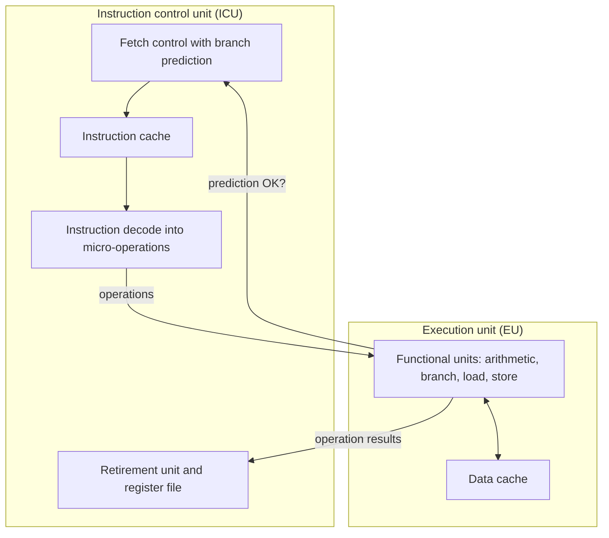
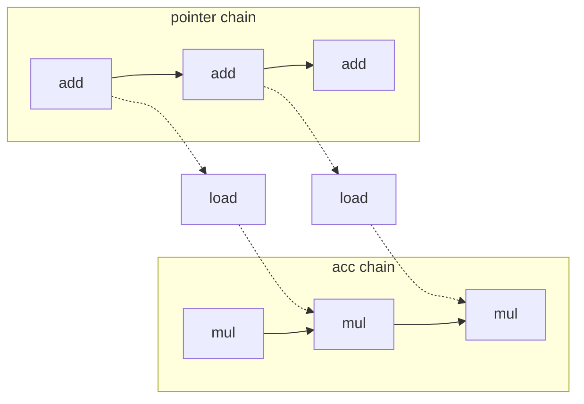

# Instruction-level parallelism and unrolling

The previous lesson brought the combining loop down to CPEs of 1.27, 3.01, 3.01 and 5.01. Those numbers match the *latencies* of the Haswell core's integer add (1), integer multiply (3), floating-point add (3) and floating-point multiply (5). That is no coincidence. To go further, we need a model of how a modern processor actually executes instructions, far from the one-at-a-time picture the ISA presents. Armed with that model, we will use loop unrolling, multiple accumulators and reassociation to approach the machine's true limit.

## 1. How a modern processor works

A modern core is **superscalar** (it performs multiple operations per clock cycle) and **out of order** (the order of execution need not match the order in the machine-level program). It has two main parts:



- The **ICU** fetches instructions well ahead of execution, using **branch prediction** to guess the path, and **decodes** them into primitive **micro-operations** (µops). An instruction like `addq %rax, 8(%rdx)` becomes separate µops for load, add and store.
- With **speculative execution**, the processor begins executing predicted-path operations before knowing whether the prediction was right. Results are held, not committed. If the prediction was wrong, the processor discards the speculative results and restarts fetching at the correct target: an expensive **misprediction penalty**.
- The **EU** dispatches µops to **functional units**. The book's Haswell reference machine has eight: several can do integer arithmetic, two can do loads, one handles store address and one store data, etc. Specifically, four units can do integer addition, one integer multiplication, one floating-point addition, two floating-point multiplication, and two can load.
- The **retirement unit** tracks ongoing work and ensures the sequential semantics of the machine program. Decoded instructions wait in a queue; once an instruction's operations have completed *and* all branches leading to it are confirmed correct, it is **retired** and its register updates become real. If a preceding branch was mispredicted, the instruction is **flushed**. Nothing is permanently changed until retirement.
- **Register renaming** lets values pass directly from the operation that produces them to the ones that consume them, without waiting to be written to the register file: a generalization of the forwarding you saw in PIPE. Each register update gets a unique *tag*.

### Functional unit performance

| Operation | Integer latency | Issue | Capacity | FP latency | Issue | Capacity |
|---|---|---|---|---|---|---|
| Addition | 1 | 1 | 4 | 3 | 1 | 1 |
| Multiplication | 3 | 1 | 1 | 5 | 1 | 2 |
| Division | 3–30 | 3–30 | 1 | 3–15 | 3–15 | 1 |

- **Latency**: cycles to complete the operation.
- **Issue time**: minimum cycles between two independent operations of that type. An issue time of 1 with latency 3 means the unit is **pipelined**: a new multiply can start every cycle.
- **Capacity**: number of units able to perform the operation.

The maximum throughput for an operation is capacity / issue time operations per cycle. Division is not pipelined (issue = latency), and its time depends on the data.

These give two fundamental bounds on CPE:

| Bound | int + | int * | FP + | FP * |
|---|---|---|---|---|
| **Latency bound** | 1.00 | 3.00 | 3.00 | 5.00 |
| **Throughput bound** | 0.50 | 1.00 | 1.00 | 0.50 |

The **latency bound** applies when operations must be performed in strict sequence, each waiting for the previous result. The **throughput bound** is the raw capacity of the functional units: e.g., two FP multipliers each starting one operation per cycle give 0.5 cycles per multiply; and since only two load units exist, no code that reads one element per operation can beat 0.50.

## 2. Data-flow graphs and the critical path

Consider combine4's loop for double multiplication: `vmulsd (%rdx), %xmm0, %xmm0; addq $8, %rdx; cmpq %rax, %rdx; jne`. Decoded into µops: `load`, `mul`, `add`, `cmp`, `jne`. Classify registers: `%rax` is read-only; `%rdx` (pointer) and `%xmm0` (acc) are **loop registers**, both read and written each iteration, so their values chain from one iteration to the next.

Draw only the dependencies between loop registers across iterations and two chains appear:



- The `mul` chain: each multiply needs the previous `acc`. Latency 5 per link.
- The `add` chain: each pointer increment needs the previous pointer. Latency 1 per link.

The loads hang off the pointer chain and feed the multiplies, but they are not part of a cycle: the processor can run the fast `add`/`load` chain far ahead. The **critical path** is the longest chain of loop-carried dependencies: here the multiplies, 5 cycles per iteration. Hence CPE ≈ 5.0. For integer addition both chains have latency 1, giving a bound of 1.00 (the measured 1.27 shows other factors, such as limits on issuing operations, also intervene).

**The key insight:** performance is limited not by the *number* of operations in the loop, but by the **sequential dependency** between iterations.

The problem `csapp-critical-path` asks you to simulate exactly this scheduling model.

```python-run
# Minimal scheduling model: unlimited units, each op starts when its inputs are ready.
def simulate(ops, n):
    ready = {}                                 # register -> time its latest value is ready
    finish = 0
    for _ in range(n):
        for dst, lat, srcs in ops:
            t = max([ready.get(s, 0) for s in srcs], default=0) + lat
            ready[dst] = t
            finish = max(finish, t)
    return finish
combine4 = [("t", 4, ["p"]), ("acc", 5, ["acc", "t"]), ("p", 1, ["p"])]   # load, mul, add
two_acc  = [("t0", 4, ["p"]), ("acc0", 5, ["acc0", "t0"]),
            ("t1", 4, ["p"]), ("acc1", 5, ["acc1", "t1"]), ("p", 1, ["p"])]
n = 1000
print("combine4 CPE ~", simulate(combine4, n) / n)
print("2x2      CPE ~", simulate(two_acc, n // 2) / n)
```

## 3. Loop unrolling

**Loop unrolling** processes $k$ elements per iteration, reducing the number of iterations and thus the loop overhead (index updates, compares, branches). "2 × 1" unrolling:

```c
void combine5(vec_ptr v, data_t *dest) {
    long i;
    long length = vec_length(v);
    long limit = length - 1;
    data_t *data = get_vec_start(v);
    data_t acc = IDENT;
    for (i = 0; i < limit; i += 2)                 /* combine 2 elements at a time */
        acc = (acc OP data[i]) OP data[i+1];
    for (; i < length; i++)                        /* finish any remaining elements */
        acc = acc OP data[i];
    *dest = acc;
}
```

Two details: the main loop bound is `length - 1` (in general $n - k + 1$) so it never runs past the end, and a second loop handles leftovers.

Result: integer add improves from 1.27 to 1.01 (overhead reduced relative to the work), but the others stay at 3.01, 3.01, 5.01. Why? Each iteration now has two `OP`s *in sequence* on `acc`: the critical path still has $n$ operations. Unrolling alone does not shorten the dependency chain.

## 4. Multiple accumulators

For an associative and commutative operation, split the work into independent streams, each with its own accumulator, and combine at the end. "2 × 2" unrolling:

```c
void combine6(vec_ptr v, data_t *dest) {
    long i;
    long length = vec_length(v);
    long limit = length - 1;
    data_t *data = get_vec_start(v);
    data_t acc0 = IDENT;
    data_t acc1 = IDENT;
    for (i = 0; i < limit; i += 2) {
        acc0 = acc0 OP data[i];        /* even-indexed elements */
        acc1 = acc1 OP data[i+1];      /* odd-indexed elements  */
    }
    for (; i < length; i++)
        acc0 = acc0 OP data[i];
    *dest = acc0 OP acc1;
}
```

Now there are **two critical paths**, each with $n/2$ operations, which the out-of-order core executes in parallel on its pipelined multiplier. CPE drops to 0.81 / 1.51 / 1.51 / 2.51: we have **broken the latency bound**.

Generalizing to $k \times k$: performance keeps improving until the throughput bound. To keep an operation with latency $L$ and capacity $C$ fully busy we need $k \ge C \cdot L$ accumulators: e.g., FP multiply with $L = 5$, $C = 2$ needs $k \ge 10$. With 10 × 10 unrolling the book reaches 0.55 / 1.00 / 1.01 / 0.52, essentially the throughput bounds.

**Is it legal?** For integers, yes: two's-complement arithmetic is associative and commutative even with overflow, so `combine6` always matches `combine5` (and compilers can do this themselves). For floating point, **no**: rounding and overflow make FP arithmetic non-associative. If the even elements were huge and the odd ones tiny, the product could overflow in one grouping but not the other. In most real applications such patterns do not occur and the 2× gain is worth it, but the programmer, not the compiler, must make that call (or enable flags like `-ffast-math`).

## 5. Reassociation

A subtler way to break the chain: change how the combine is parenthesized. Compare

```c
acc = (acc OP data[i]) OP data[i+1];     /* combine5 */
acc = acc OP (data[i] OP data[i+1]);     /* combine7: "2 x 1a" */
```

In the second form, `data[i] OP data[i+1]` does **not depend on `acc`**: it can be computed ahead of time, off the critical path. Only one operation per iteration (per two elements) remains on the `acc` chain, so the critical path has $n/2$ operations. Measured: 1.01 / 1.51 / 1.51 / 2.51, the same as two accumulators. A tiny change of parentheses doubles the speed. Again, for floating point it changes rounding, so compilers will not do it by default.

## 6. Summary of results

| Function | Method | int + | int * | FP + | FP * |
|---|---|---|---|---|---|
| combine1 | Abstract `-O1` | 10.12 | 10.12 | 10.17 | 11.14 |
| combine4 | Accumulate in temp | 1.27 | 3.01 | 3.01 | 5.01 |
| combine5 | 2 × 1 unrolling | 1.01 | 3.01 | 3.01 | 5.01 |
| combine6 | 2 × 2 unrolling | 0.81 | 1.51 | 1.51 | 2.51 |
| combine7 | 2 × 1a (reassociate) | 1.01 | 1.51 | 1.51 | 2.51 |
| | 10 × 10 unrolling | 0.55 | 1.00 | 1.01 | 0.52 |
| Latency bound | | 1.00 | 3.00 | 3.00 | 5.00 |
| Throughput bound | | 0.50 | 1.00 | 1.00 | 0.50 |

A 10–20× improvement over the original `-O1` code. Using AVX vector (SIMD) instructions, which process 4 doubles or 8 floats per operation, the book reports a further factor of about 4–8.

## 7. Limiting factors

**Register spilling.** If the degree of parallelism exceeds the available registers, accumulators spill to the stack and each update again needs a load and store. On x86-64 (16 integer, 16 YMM registers) 10 × 10 fits; 20 × 20 does not, and gets *slower*.

**Branch prediction and misprediction penalties.** A misprediction on Haswell costs about **19 cycles**. Guidelines:

- *Don't worry about predictable branches.* Loop-closing branches and bounds checks are predicted almost perfectly; speculative execution makes them nearly free.
- *Write code suitable for conditional moves.* For data-dependent, unpredictable conditions, use a "functional" style (compute both values, then select) rather than an "imperative" style (conditionally update), so the compiler can emit `cmov`:

```c
/* Rearrange two arrays so a[i] <= b[i]. Imperative: ~13.5 CPE on random data */
if (a[i] > b[i]) { long t = a[i]; a[i] = b[i]; b[i] = t; }

/* Functional: ~4.0 CPE regardless of data */
long min = a[i] < b[i] ? a[i] : b[i];
long max = a[i] < b[i] ? b[i] : a[i];
a[i] = min; b[i] = max;
```

## 8. Memory performance

**Load performance.** Loads have a latency of 4 cycles from the L1 cache. A linked-list traversal `ls = ls->next` has CPE 4.00: each load's *address* depends on the previous load's result, so the load latency is the critical path. (This is why pointer chasing is slow even when everything is cached.)

**Store performance.** Stores themselves do not create dependencies between iterations, since a store only writes. A loop clearing an array runs at CPE 1.0. But **store-to-load interactions** matter: a pending store sits in the **store buffer**, and each load must check it for a matching address and, on a match, take the data from there (*store-to-load forwarding*). The book's example `write_read(src, dst, n)` repeatedly does `*dst = val; val = *src + 1;`. When `src != dst`, CPE is 1.3. When `src == dst`, each load depends on the preceding store: a **write/read dependency** through memory, giving CPE 7.3.

## 9. Life in the real world

A practical recipe:

1. **High-level design.** Choose appropriate algorithms and data structures. Avoid asymptotically poor ones.
2. **Basic coding principles.** Eliminate excessive function calls; move computations out of loops; eliminate unnecessary memory references by using temporaries.
3. **Low-level optimizations.** Unroll loops; increase ILP with multiple accumulators and reassociation; rewrite conditionals in functional style to enable conditional moves.

And **profile** first. With `gprof` (compile with `-pg`), the book profiles an n-gram word-frequency program on Shakespeare's works. The initial version takes 3.5 minutes, dominated by an insertion sort. Replacing it with quicksort, then fixing a hash table with too few buckets, a poor hash function, and a `lower1`-style quadratic `strlen`, brings it to about 0.2 seconds: Amdahl's law in action, where each fix exposes the next bottleneck.

> [!INTERVIEW]
> **"Why is summing an array with four accumulators faster than with one?"** With one accumulator every add waits for the previous one: a serial dependency chain bounded by the operation's latency. Independent accumulators create independent chains the out-of-order core runs in parallel, approaching the throughput bound (units × 1/issue time). Caveat: FP reassociation changes results, so compilers need `-ffast-math`/explicit code. Related: **why is processing a sorted array faster?** The data-dependent branch becomes predictable, eliminating ~15–20 cycle mispredictions.

> [!INTERVIEW]
> **"Why are linked lists slower to traverse than arrays?"** Besides worse cache locality, each node's address depends on loading the previous node (a load-to-load dependency), so the hardware cannot overlap or prefetch the accesses.

## Check yourself

```quiz
[
  {"q": "What does the latency bound describe?", "options": ["The minimum CPE when operations must be performed in strict sequence", "The maximum number of operations per cycle", "The cache miss penalty", "The time to decode an instruction"], "answer": 0,
   "explain": "When each operation depends on the previous result, CPE cannot be below the operation's latency."},
  {"q": "The reference machine has two FP multipliers, latency 5, issue time 1. What is the throughput bound CPE for FP multiply?", "options": ["5.0", "2.5", "1.0", "0.5"], "answer": 3,
   "explain": "Two units each start one multiply per cycle: 2 per cycle, 0.5 cycles per element."},
  {"q": "Why does 2 x 1 unrolling not improve FP multiply beyond 5.01?", "options": ["The loop overhead dominates", "Both multiplies per iteration are still chained through the single accumulator", "The cache is too small", "Branches are mispredicted"], "answer": 1,
   "explain": "The critical path still contains n sequential multiplications."},
  {"q": "How many accumulators are needed to saturate an operation with latency L and capacity C?", "options": ["L", "C", "At least C * L", "L / C"], "answer": 2,
   "explain": "Each unit can have L operations in flight; C units need C*L independent chains."},
  {"q": "Why won't a compiler automatically use multiple accumulators for a double sum?", "options": ["It lacks registers", "Floating-point addition is not associative, so results could change", "It would be slower", "The ABI forbids it"], "answer": 1,
   "explain": "Reordering FP operations changes rounding/overflow behavior, so it is not a safe transformation by default."},
  {"q": "acc = acc OP (data[i] OP data[i+1]) is faster than (acc OP data[i]) OP data[i+1] because...", "options": ["It uses fewer operations", "The inner operation does not depend on acc, so only one operation per iteration is on the critical path", "It avoids loads", "It enables cmov"], "answer": 1,
   "explain": "Reassociation halves the length of the loop-carried dependency chain."},
  {"q": "What is the CPE of traversing a linked list (ls = ls->next) with all nodes in L1?", "options": ["1.0", "0.5", "About 4.0, the load latency", "19"], "answer": 2,
   "explain": "Each load address depends on the previous load, so the 4-cycle load latency is the critical path."},
  {"q": "Which branches are worth eliminating with conditional moves?", "options": ["Loop-closing branches", "Highly predictable error checks", "Unpredictable, data-dependent branches", "All branches"], "answer": 2,
   "explain": "Predictable branches are nearly free; unpredictable ones incur ~19-cycle penalties."}
]
```

> **Source:** CS:APP 3e, §5.7–5.14 (Understanding modern processors; Loop unrolling; Enhancing parallelism; Summary of results; Some limiting factors; Understanding memory performance; Life in the real world; Identifying and eliminating performance bottlenecks).
