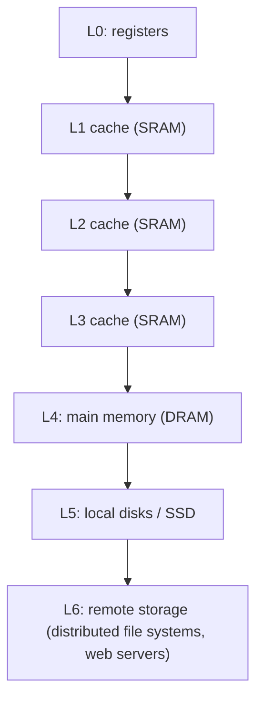

# Storage technologies and locality

Until now we have modeled memory as a linear byte array that the CPU can access in constant time. That is a convenient fiction. A real **memory system** is a hierarchy of storage devices with wildly different capacities, costs and access times: registers and small caches near the CPU, DRAM main memory, and large slow disks or SSDs beneath. A program whose data sits in a CPU register can use it in 0 cycles; in a cache, 4 to 75 cycles; in main memory, hundreds of cycles; on disk, tens of **millions** of cycles. Programs that understand this (that have good **locality**) run dramatically faster. This lesson covers the technologies and the principle of locality; the next two cover caches and cache-friendly code.

## 1. Random access memory

**Static RAM (SRAM)** stores each bit in a *bistable* cell built from six transistors. Like a pendulum that is stable only when tipped fully left or right, the cell holds its value indefinitely as long as power is applied, and recovers from electrical noise.

**Dynamic RAM (DRAM)** stores each bit as charge on a tiny capacitor (about 30 femtofarads) with a single access transistor. Cells are extremely dense, but the capacitor leaks: a cell loses its charge within about 10 to 100 milliseconds, so the memory system must periodically **refresh** every bit by reading and rewriting it. DRAM is also sensitive to disturbances such as light and noise.

| | Transistors per bit | Relative access time | Persistent? | Sensitive? | Relative cost | Applications |
|---|---|---|---|---|---|---|
| SRAM | 6 | 1× | Yes | No | 1,000× | Cache memory |
| DRAM | 1 | 10× | No | Yes | 1× | Main memory, frame buffers |

DRAM chips are organized as two-dimensional arrays of **supercells**; the address is sent in two steps (row via RAS, column via CAS) to halve the number of address pins. Chips are packaged into **memory modules** (DIMMs). Generations of DRAM (FPM, EDO, SDRAM, DDR, DDR2, DDR3 ...) improved bandwidth with the same basic cell.

Both SRAM and DRAM are **volatile**: they lose their contents when power is removed.

### Nonvolatile memory

Nonvolatile memories retain data without power. For historical reasons they are collectively called **ROMs** even though many can be written: PROM (programmable once), EPROM (erasable with ultraviolet light), EEPROM (electrically erasable), and **flash memory**, based on EEPROM, which is everywhere: phones, cameras, and **solid state disks**. Programs stored in ROM are called **firmware**; a PC's BIOS is an example.

### Accessing main memory

Data flows between CPU and DRAM over **buses** in **bus transactions**. A read (`movq A, %rax`): the CPU places address A on the system bus, the I/O bridge passes it to the memory bus, main memory fetches the word and returns it. A write (`movq %rax, A`) sends the address, then the data.

## 2. Disk storage

Disks hold enormous amounts of data, on the order of hundreds to thousands of gigabytes, but reading from disk takes **milliseconds**: about a hundred thousand times longer than from DRAM and a million times longer than from SRAM.

### Geometry

A disk consists of **platters**, each with two **surfaces** coated with magnetic material, spinning on a **spindle** at a fixed rate, typically 5,400 to 15,000 RPM. Each surface holds concentric **tracks**; each track is divided into **sectors** holding an equal number of data bits (typically 512 bytes), separated by **gaps** containing formatting bits. A **cylinder** is the set of tracks on all surfaces equidistant from the spindle.

**Capacity:**

$$\text{Capacity} = \frac{\text{bytes}}{\text{sector}} \times \frac{\text{avg sectors}}{\text{track}} \times \frac{\text{tracks}}{\text{surface}} \times \frac{\text{surfaces}}{\text{platter}} \times \frac{\text{platters}}{\text{disk}}$$

Example: 5 platters, 512 bytes/sector, 20,000 tracks/surface, 300 sectors/track on average: $512 \times 300 \times 20{,}000 \times 2 \times 5 = 30{,}720{,}000{,}000$ bytes = 30.72 GB. (Disk makers use GB = $10^9$ bytes; for RAM, the prefixes mean powers of two.)

Modern disks use **multiple zone recording**: outer zones have more sectors per track than inner ones, since outer tracks are longer.

### Operation and access time

A **read/write head** at the end of an **actuator arm** flies on a thin cushion of air about 0.1 micron above the surface. To access a sector the disk must:

1. **Seek**: move the arm to the right track. $T_{seek}$ depends on distance; average **3 to 9 ms**, maximum up to 20 ms.
2. **Wait for rotation**: until the first bit of the sector passes under the head. Worst case is one full rotation, $T_{max\,rot} = \frac{1}{RPM} \times \frac{60\text{ s}}{1\text{ min}}$; the average is half of that.
3. **Transfer**: read the sector as it passes: $T_{avg\,transfer} = \frac{1}{RPM} \times \frac{1}{\text{avg sectors/track}} \times \frac{60\text{ s}}{1\text{ min}}$.

**Worked example.** 7,200 RPM, $T_{avg\,seek} = 9$ ms, 400 sectors/track.

- $T_{avg\,rot} = \tfrac12 \times (60/7200) \times 1000 \approx 4$ ms
- $T_{avg\,transfer} = (60/7200) \times (1/400) \times 1000 \approx 0.02$ ms
- $T_{access} \approx 9 + 4 + 0.02 = 13.02$ ms

Lessons: access time is dominated by **seek and rotation**; getting the *first* byte is expensive but the rest of the sector is nearly free. And with SRAM at about 4 ns and DRAM at about 60 ns to read a 64-bit word, the disk is about **40,000× slower than SRAM and 2,500× slower than DRAM**.

```python-run
def disk_access_ms(rpm, seek_ms, sectors_per_track):
    rot = 0.5 * 60 / rpm * 1000
    xfer = 60 / rpm / sectors_per_track * 1000
    return seek_ms + rot + xfer, rot, xfer
print(disk_access_ms(7200, 9, 400))
print(disk_access_ms(15000, 8, 500))     # another configuration
cap = 512 * 300 * 20000 * 2 * 5
print(cap / 1e9, "GB")
```

### Logical blocks

Modern disks hide this geometry and present a sequence of **logical blocks** numbered 0, 1, ..., B−1 (one block = one sector's worth of bytes). A **disk controller** (firmware in the drive) translates logical block numbers to (surface, track, sector) triples. Reading a file's blocks **sequentially** when they are laid out contiguously is far faster than reading them at **random** positions, since only the first block pays a seek.

### Connecting I/O devices

Devices attach to the CPU and memory via an **I/O bus** (such as PCIe), slower than the system and memory buses but accommodating many kinds of device: USB controllers, graphics adapters, host bus adapters (SATA/SCSI) for disks, network adapters.

To read a sector, the CPU writes a command, logical block number and destination memory address to the controller's port (**memory-mapped I/O**), and then goes on to do other work, since a 3 GHz processor could execute some 16 million instructions during a disk read. The controller reads the sector and copies it directly into main memory without CPU involvement (**direct memory access, DMA**), then signals completion with an **interrupt** (Module 8).

## 3. Solid state disks

An SSD packages flash chips with a **flash translation layer** that plays the role of a disk controller. Flash is organized as $B$ **blocks**, each of $P$ **pages**: typically pages are 512 bytes to 4 KB, and a block has 32 to 128 pages (16 KB to 512 KB).

The asymmetry to remember:

- Data is **read and written in pages**.
- A page can be written **only after its entire block has been erased** (all bits set to 1). Erasing takes about 1 ms.
- A block **wears out** after roughly 100,000 repeated writes.

So **random writes are slow**: to modify one page in a block with existing data, all other pages with useful data must first be copied to a freshly erased block. Reads are fast. The book's example SSD: sequential read 550 MB/s vs. sequential write 470 MB/s; random read 365 MB/s vs. random write 303 MB/s. Wear-leveling logic in the translation layer spreads erasures evenly across blocks, so SSDs last years in practice.

SSDs vs. rotating disks: no moving parts, hence much faster random access, less power, more rugged; but they wear out and cost more per byte (about 30× in the book's 2015 data, a gap that has kept shrinking).

## 4. Storage technology trends

From the book's tables (1985–2015): SRAM cost per MB fell about 116×, and access time improved about 115×. DRAM cost fell about 44,000× but access time only improved 10×. Disk cost fell about 3,000,000× but seek time improved only 25×. Meanwhile CPU cycle time improved about 500× until around 2003, when the **power wall** ended frequency scaling and manufacturers turned to multi-core. The crucial fact: **the gap between CPU speed and DRAM/disk speed has widened**. Caches, and locality, are what bridge it.

## 5. Locality

Well-written programs tend to reference data items that are near other recently referenced items, or that were recently referenced themselves. This **principle of locality** has two forms:

- **Temporal locality**: a memory location referenced once is likely to be referenced again multiple times in the near future.
- **Spatial locality**: if a memory location is referenced, nearby locations are likely to be referenced in the near future.

Locality is exploited at every level: hardware caches hold recently used blocks; operating systems use main memory as a cache for recently used disk blocks and virtual pages; browsers cache recently fetched documents. **Programs with good locality run faster than programs with poor locality.**

### Locality of data references

```c
int sumvec(int v[N]) {
    int i, sum = 0;
    for (i = 0; i < N; i++)
        sum += v[i];
    return sum;
}
```

`sum` is referenced on every iteration: good temporal locality (it is a scalar, so no spatial locality to speak of). The elements of `v` are read in sequence, one after another: good spatial locality, poor temporal locality (each is touched once). Visiting each element of a vector sequentially is a **stride-1 reference pattern** (sequential reference pattern); visiting every $k$-th element is stride-$k$. In general, **as the stride increases, spatial locality decreases**.

Stride matters most for multidimensional arrays:

```c
int sumarrayrows(int a[M][N]) {          /* good: stride 1 */
    int i, j, sum = 0;
    for (i = 0; i < M; i++)
        for (j = 0; j < N; j++)
            sum += a[i][j];
    return sum;
}

int sumarraycols(int a[M][N]) {          /* bad: stride N */
    int i, j, sum = 0;
    for (j = 0; j < N; j++)
        for (i = 0; i < M; i++)
            sum += a[i][j];
    return sum;
}
```

C stores arrays in **row-major** order. `sumarrayrows` visits memory in storage order (addresses 0, 4, 8, ...). `sumarraycols` scans column by column, jumping $N$ elements each time: stride $N$. A seemingly trivial interchange of loops changes performance by a large factor.

```python-run
import numpy as np, time
a = np.arange(2000 * 2000, dtype=np.int64).reshape(2000, 2000)   # row-major (C order)
def by_rows(a):
    s = 0
    for i in range(a.shape[0]): s += a[i, :].sum()     # contiguous slices
    return s
def by_cols(a):
    s = 0
    for j in range(a.shape[1]): s += a[:, j].sum()     # stride-N slices
    return s
for f in (by_rows, by_cols):
    t = time.perf_counter(); f(a); print(f.__name__, round((time.perf_counter() - t) * 1e3, 1), "ms")
```

(Even from Python, the column-wise traversal is typically noticeably slower: each `a[:, j]` strides through memory, touching a different cache block per element.)

### Locality of instruction fetches

Instructions are data for the CPU's fetch stage. Loops have good temporal locality (the body is executed repeatedly) and good spatial locality (instructions are executed in sequence). The smaller the loop body and the greater the iteration count, the better.

### Rules of thumb

- Programs that repeatedly reference the same variables enjoy good temporal locality.
- For stride-$k$ patterns, the smaller the stride the better the spatial locality; stride-1 is best. Hopping around memory with large strides is bad.
- Loops have good temporal and spatial locality for instruction fetches.

## 6. The memory hierarchy

These properties (faster storage costs more and holds less; the CPU–memory gap is widening; programs exhibit locality) suggest organizing storage as a **hierarchy**:



The central idea: **each level $k$ serves as a cache for the larger, slower level $k+1$.** Storage at level $k+1$ is partitioned into **blocks**; at any time level $k$ holds copies of a subset of them.

- **Cache hit**: the needed block is at level $k$. Fast.
- **Cache miss**: it is not. The cache **fetches** it from level $k+1$, possibly **evicting** a **victim block** chosen by the **replacement policy** (random, least recently used, ...).

**Kinds of misses**

- **Cold (compulsory) miss**: the cache is empty (cold); unavoidable while it warms up.
- **Conflict miss**: the cache is large enough, but the **placement policy** maps several needed blocks to the same slot, so they keep evicting each other. E.g., with placement "block $i$ goes to slot $i \bmod 4$", alternately referencing blocks 0 and 8 misses every time.
- **Capacity miss**: the set of blocks the program is actively using (its **working set**) is simply larger than the cache.

| Type | What is cached | Where cached | Latency (cycles) | Managed by |
|---|---|---|---|---|
| CPU registers | 4- or 8-byte words | On-chip registers | 0 | Compiler |
| TLB | Address translations | On-chip TLB | 0 | Hardware MMU |
| L1 cache | 64-byte blocks | On-chip L1 | 4 | Hardware |
| L2 cache | 64-byte blocks | On-chip L2 | 10 | Hardware |
| L3 cache | 64-byte blocks | On-chip L3 | 50 | Hardware |
| Virtual memory | 4-KB pages | Main memory | 200 | Hardware + OS |
| Buffer cache | Parts of files | Main memory | 200 | OS |
| Disk cache | Disk sectors | Disk controller | 100,000 | Controller firmware |
| Network cache | Parts of files | Local disk | 10,000,000 | NFS client |
| Browser cache | Web pages | Local disk | 10,000,000 | Web browser |
| Web cache | Web pages | Remote server disks | 1,000,000,000 | Web proxy server |

> [!INTERVIEW]
> **"Latency numbers every programmer should know"** (orders of magnitude): L1 hit ~1 ns (4 cycles), L2 ~3–4 ns, L3 ~10–20 ns, main memory ~100 ns, SSD random read ~100 µs, disk seek ~10 ms, cross-continent network round trip ~100 ms. Each step down the hierarchy is roughly 10–1000× slower, which is why "a cache miss is the new disk seek".

> [!INTERVIEW]
> **"Why is iterating a 2D array row-by-row faster than column-by-column in C?"** Row-major layout makes row traversal stride-1: each 64-byte cache line fetched serves 16 `int`s (one miss per 16 accesses) and hardware prefetchers detect the pattern. Column traversal touches a different line on every access once a row exceeds the line size, and for large arrays misses every time.

## 7. Summary

- SRAM: fast, 6T, expensive, caches. DRAM: dense, 1T + capacitor, needs refresh, main memory. Both volatile; flash is nonvolatile.
- Disk access time = seek + rotational latency + transfer ≈ 10 ms, dominated by the first two; sequential access is cheap.
- SSDs: read/write pages, erase blocks, random writes slow, wear leveling.
- Locality: temporal (reuse) and spatial (nearby). Stride-1 is best.
- The memory hierarchy makes each level a cache for the next; misses are cold, conflict or capacity.

## Check yourself

```quiz
[
  {"q": "Which memory technology needs periodic refresh?", "options": ["SRAM", "DRAM", "Flash", "ROM"], "answer": 1,
   "explain": "DRAM stores bits as charge on leaky capacitors and must be refreshed every tens of milliseconds."},
  {"q": "A disk spins at 7,200 RPM. What is its average rotational latency?", "options": ["About 8.3 ms", "About 4 ms", "About 0.02 ms", "About 9 ms"], "answer": 1,
   "explain": "One rotation takes 60/7200 s = 8.33 ms; the average wait is half, about 4 ms."},
  {"q": "What dominates the time to read one sector from a rotating disk?", "options": ["Transfer time", "Seek time and rotational latency", "Bus transaction time", "DMA"], "answer": 1,
   "explain": "Transfer of one sector takes ~0.02 ms versus several ms each for seek and rotation."},
  {"q": "Why are random writes slow on SSDs?", "options": ["Seek time", "A page can only be written after its whole block is erased, so live pages must be copied elsewhere first", "Flash is volatile", "Pages are 1 MB"], "answer": 1,
   "explain": "Erase-before-write at block granularity makes in-place page updates expensive."},
  {"q": "In sumvec, the variable sum has good ___ locality and the array v good ___ locality.", "options": ["spatial; temporal", "temporal; spatial", "temporal; temporal", "spatial; spatial"], "answer": 1,
   "explain": "sum is reused every iteration (temporal); v's elements are accessed sequentially (spatial)."},
  {"q": "Blocks 0 and 8 both map to slot 0 of a 4-slot cache and are referenced alternately. The resulting misses are:", "options": ["Cold misses", "Capacity misses", "Conflict misses", "Not misses"], "answer": 2,
   "explain": "The cache has room, but the placement policy forces both blocks into the same slot."},
  {"q": "What is the stride of the reference pattern in sumarraycols over int a[M][N]?", "options": ["1", "M", "N", "M*N"], "answer": 2,
   "explain": "Consecutive accesses a[i][j], a[i+1][j] are N elements apart in row-major storage."},
  {"q": "In the memory hierarchy, main memory acts as a cache for:", "options": ["The L1 cache", "Registers", "Disk (virtual memory pages and file data)", "The TLB"], "answer": 2,
   "explain": "Each level caches the larger, slower level below it; DRAM caches disk blocks."}
]
```

> **Source:** CS:APP 3e, §6.1–6.3 (Storage technologies: RAM, disks, SSDs, trends; Locality; The memory hierarchy).
