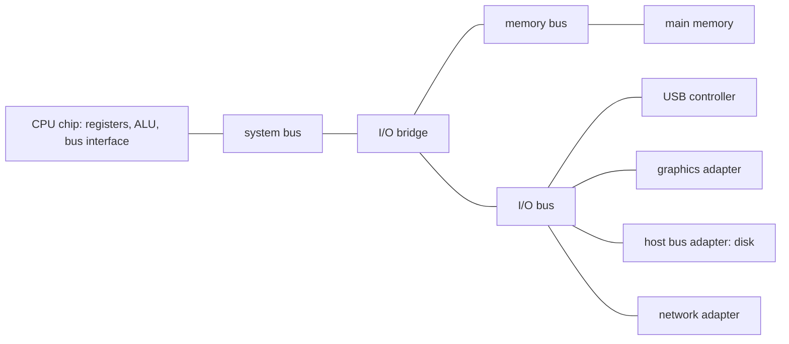
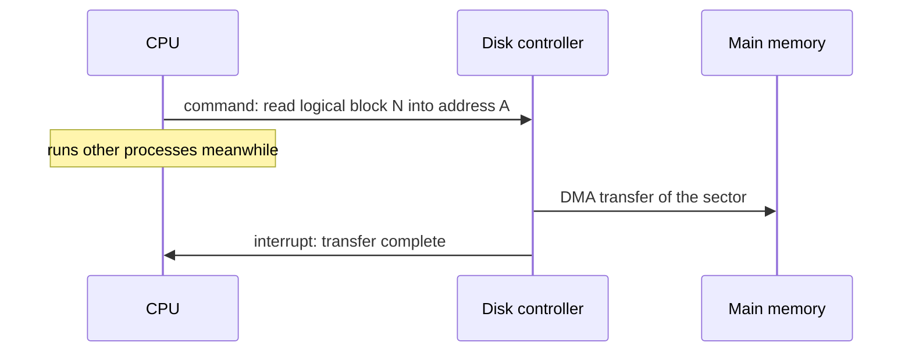
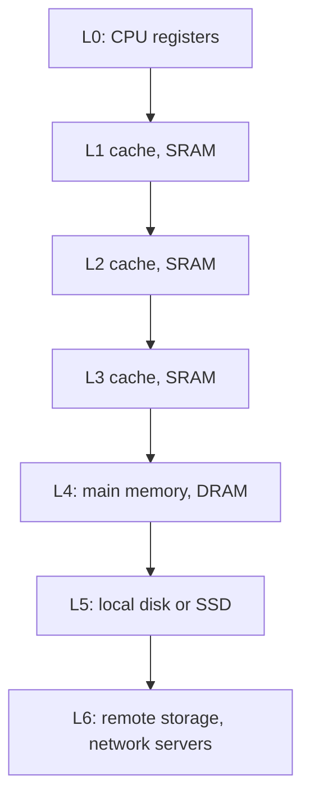

# Storage technologies and locality

> **Before this lesson:** Read [Caches, the OS, and the big themes](#/lesson/csapp/tour-os) for the overall picture of processor, memory and disk. You should know what a byte and an address are from [Bits, bytes, words and bit-level operations](#/lesson/csapp/bits-bytes).

## In plain words

A computer keeps data in several kinds of storage, and they differ enormously in speed and price. Compare the places you keep things at home. Your pockets hold very little, but you reach them instantly. A desk drawer holds more and takes a few seconds. The attic holds a great deal and takes minutes. Nobody keeps everything in their pockets, and nobody keeps their keys in the attic. Computers have the same range, from tiny, very fast storage inside the processor to huge, slow disks. Programs can run fast on such a mix because of a habit called **locality**: at any moment a program tends to reuse a small set of data, and data that sits next to what it used a moment ago, so the things it needs are usually in the fast places.

Why this matters at work: database design, file layout, and the speed of everyday loops all depend on these facts. Knowing that a disk read is roughly a hundred thousand times slower than a memory read, and that visiting data in storage order is far cheaper than hopping around, changes how you design software and is expected knowledge in systems interviews.

## Why look closer

In the simple model of a computer, memory is a long array of bytes and the processor can reach any one of them in the same, constant time. That model is good enough for learning to program and useless for understanding performance. Real machines contain several kinds of storage whose speeds differ by a factor of ten million from fastest to slowest, and whose prices per byte differ nearly as much. A program that happens to keep its data in the fast places runs dramatically faster than one that does not, even if the two execute exactly the same number of instructions. This lesson surveys the technologies (what they are, why they cost what they cost, why they are as fast or slow as they are) and then introduces **locality**, the property of programs that lets a system built from mostly slow, cheap storage behave almost like one built entirely from fast, expensive storage.

## 1. Random access memory

### SRAM and DRAM

Random access memory comes in two varieties.

**Static RAM** stores each bit in a *bistable* cell made of six transistors. The circuit has two stable states and will stay in either one indefinitely as long as power is supplied. Picture a pendulum that can rest leaning fully left or fully right; if something nudges it, it falls back to the side it was on. That makes SRAM fast and resistant to electrical noise.

**Dynamic RAM** stores each bit as charge on a tiny capacitor, guarded by a single transistor. With one transistor per bit, DRAM can be packed very densely. But the capacitor is minute and leaks: a cell loses its charge within tens of milliseconds. The memory system must therefore **refresh** every cell periodically by reading it and writing it back. Cells are also sensitive to disturbance.

| | Transistors per bit | Relative access time | Needs refresh? | Relative cost | Used for |
|---|---|---|---|---|---|
| SRAM | 6 | 1× | no | roughly 1,000× | cache memories |
| DRAM | 1 | about 10× | yes | 1× | main memory |

Both are **volatile**: they forget everything when power is removed.

### How DRAM is organised

The cells of a DRAM chip are laid out as a two-dimensional grid of rows and columns, not a straight line. To read a cell, the memory controller sends the row number, then the column number, over the *same* set of address pins. The chip copies the whole selected row into an internal buffer and then picks out the requested column. Sharing the pins halves the number needed, at the cost of sending the address in two steps. Chips are packaged into **memory modules** that plug into the motherboard; the controller selects the module holding the requested address and assembles the bytes it returns into a word.

Successive generations (SDRAM, then DDR, DDR2 up through DDR5) are all built on the same cell, with improvements in how fast data can be clocked out.

### Memory that survives power-off

**Nonvolatile** memories keep their contents without power. For historical reasons they are collectively called ROMs even though most can be written. The line runs from programmable ROM (written once), through erasable and electrically erasable versions, to **flash memory**, which is the basis of solid state drives, phone storage and USB sticks. Programs stored in ROM, such as a PC's boot firmware, are called **firmware**.

### How the CPU reaches memory

Data moves between processor and memory over **buses**: shared sets of wires that carry address, data and control signals. Each transfer is a sequence of steps called a **bus transaction**.



A load such as `movq A, %rax` goes like this: the CPU places address A on the bus; main memory sees it, fetches the word, and puts it on the bus; the CPU reads the word from the bus and copies it into the register. A store runs the same steps in the opposite direction.

## 2. Rotating disks

A hard disk drive holds enormous amounts of data cheaply and is millions of times slower than RAM. To see why, look at how it is built.

### Geometry

- A disk contains one or more **platters**, each with two **surfaces** coated in magnetic material, all rotating together on a **spindle** at a fixed rate, commonly 5,400 to 15,000 revolutions per minute.
- Each surface is divided into concentric rings called **tracks**.
- Each track is divided into **sectors**, each holding a fixed number of data bits, traditionally 512 bytes. Sectors are separated by **gaps** that hold formatting information.
- The set of tracks at the same distance from the spindle on all surfaces is a **cylinder**.

### Capacity

Capacity is the product of the geometry:

$$\text{capacity} = \frac{\text{bytes}}{\text{sector}} \times \frac{\text{avg. sectors}}{\text{track}} \times \frac{\text{tracks}}{\text{surface}} \times \frac{\text{surfaces}}{\text{platter}} \times \text{platters}$$

Outer tracks are longer than inner ones, so modern disks group cylinders into **recording zones** and put more sectors on the tracks of outer zones; hence "average sectors per track".

A warning about units: for RAM, the prefixes K, M, G mean powers of two ($2^{10}$, $2^{20}$, $2^{30}$). Disk manufacturers use powers of ten. A "500 GB" disk holds $5 \times 10^{11}$ bytes, about 466 GiB.

### How a read happens

Data is read and written by a **head** at the end of an **actuator arm**. There is one head per surface, and all the arms move together, so every head is always over the same cylinder. The head flies on a thin cushion of air a fraction of a micrometre above the surface. Reading a sector takes three steps, each with its own delay:

1. **Seek.** The arm moves the head to the target track. Seek time depends on how far it must travel; typical averages are 3 to 9 ms.
2. **Rotational latency.** The drive waits for the first bit of the target sector to rotate under the head. In the worst case that is a full revolution; on average, half of one:

$$T_{\text{avg rotation}} = \frac{1}{2} \times \frac{60}{\text{RPM}} \ \text{seconds}$$

3. **Transfer.** The sector passes under the head: one revolution divided by the number of sectors on the track.

**Worked example.** A drive spins at 10,000 RPM, has an average seek time of 4 ms, and averages 800 sectors per track.

- One revolution takes $60 / 10{,}000$ s = 6 ms.
- Average rotational latency = 3 ms.
- Transfer time for one sector = 6 ms / 800 = 0.0075 ms.
- Total ≈ 4 + 3 + 0.0075 ≈ **7 ms**.

```python-run
def disk_access_ms(rpm, avg_seek_ms, sectors_per_track):
    rev = 60_000 / rpm                       # one revolution, in ms
    rotation = rev / 2
    transfer = rev / sectors_per_track
    return avg_seek_ms, rotation, transfer, avg_seek_ms + rotation + transfer

seek, rot, xfer, total = disk_access_ms(10_000, 4, 800)
print(f"seek {seek} ms + rotation {rot} ms + transfer {xfer:.4f} ms = {total:.4f} ms")
print(f"the mechanical positioning is {100 * (seek + rot) / total:.1f}% of the total")

dram_ns, sram_ns = 60, 4                     # rough access times for a 512-byte block
print(f"disk is about {total * 1e6 / dram_ns:,.0f}x slower than DRAM and {total * 1e6 / sram_ns:,.0f}x slower than SRAM")

capacity = 512 * 1000 * 50_000 * 2 * 4       # bytes/sector * sectors/track * tracks/surface * surfaces * platters
print(f"4 platters, 50,000 tracks, 1,000 sectors/track: {capacity / 1e9:.1f} GB = {capacity / 2**30:.1f} GiB")
```

Three conclusions are worth remembering:

- Access time is dominated by seek and rotation. The time to reach the *first* byte is long; the remaining bytes of the sector are nearly free.
- Seek time and rotational latency are of similar size, so doubling the seek time is a decent quick estimate of the total.
- A disk access takes milliseconds while a memory access takes tens of nanoseconds: a gap of roughly five orders of magnitude.

The practical upshot is that reading sectors that sit next to each other (sequential access) is vastly faster than hopping around (random access), because no repositioning is needed between them. Databases and file systems are designed around that fact.

### Logical blocks

The operating system does not deal in cylinders and heads. The drive's built-in controller presents the disk as a simple sequence of **logical blocks** numbered 0, 1, 2, and so on, and translates each number into a physical surface, track and sector. Before a disk can be used it is formatted, which fills in the gaps, identifies defective cylinders, and sets aside spare ones. That is one reason the formatted capacity is below the raw capacity.

### Devices on the I/O bus

Disks, graphics cards, network adapters, keyboards and the rest attach to an **I/O bus** (such as PCI Express), which is slower than the system and memory buses but accommodates a wide variety of devices.

When a program reads from disk, the sequence is:

1. The CPU issues a command to the disk controller by writing to an address associated with the device, a technique called **memory-mapped I/O**. The command names the logical block and the memory address where the data should go.
2. The controller reads the sector and copies its contents straight into main memory, with no involvement of the CPU. A device transferring data on its own like this is doing **direct memory access** (DMA).
3. When the transfer is complete, the controller notifies the CPU with an **interrupt**.

While all this goes on, the CPU is free to do other work, which matters: a 3 GHz processor could execute some twenty million instructions during a single 7 ms disk access.



## 3. Solid state disks

An SSD is built on flash memory and plugs into the same slots, presenting the same logical-block interface. Inside there is no moving machinery: one or more flash chips and a controller called the **flash translation layer**, which plays the part of a disk controller.

Flash has peculiar rules that shape SSD behaviour:

- Data is organised into **blocks**, each consisting of a number of **pages** (pages of a few kilobytes, with tens to hundreds of pages per block).
- Data is read and written a page at a time.
- A page can be written only after the *entire block* containing it has been **erased**. Erasing is slow, on the order of a millisecond.
- A block wears out after a limited number of erase cycles, historically around 100,000.

Consequences:

- **Reads are fast**, tens of microseconds, whether sequential or random, since there is nothing to move.
- **Random writes are slower than reads.** Modifying a page in a block that holds other live data requires those other pages to be copied to a freshly erased block first.
- The translation layer performs **wear levelling**, spreading erasures evenly across all blocks so that none wears out early. With it, a drive typically outlives the machine it is in.

Compared with rotating disks, SSDs are much faster for random access, use less power and are more rugged. They cost more per byte, though the gap keeps narrowing.

```python-run
# Rough, order-of-magnitude device characteristics for one random access.
devices = [
    ("CPU register",          0.3e-9),
    ("L1 cache (SRAM)",       1e-9),
    ("main memory (DRAM)",    80e-9),
    ("SSD random read",       50e-6),
    ("hard disk random read", 7e-3),
]
base = devices[0][1]
for name, t in devices:
    print(f"{name:24} {t * 1e9:14,.1f} ns   {t / base:14,.0f}x a register access")
print("\nIf a register access took 1 second, a disk access would take about",
      round(devices[-1][1] / base / 86400), "days.")
```

## 4. Trends, and the widening gap

Decades of data show a consistent pattern:

- It has been easier to make storage **denser and cheaper** than to make it **faster**. The cost per byte of DRAM and of disk has fallen by factors of many thousands to millions, while their access times improved by perhaps one order of magnitude.
- Processor cycle times improved far faster than memory or disk access times, at least until the early 2000s, when power limits pushed designers toward multiple cores instead of faster clocks.

The result is a **gap** between how fast processors can consume data and how fast storage can deliver it, a gap that widened for decades. Bridging it is the purpose of the caches in the next lesson, and what makes that possible is a property not of hardware but of programs.

## 5. Locality

Well-written programs tend to refer to data that is near other recently referenced data, or that was itself recently referenced. This tendency is the **principle of locality**, and it comes in two forms:

- **Temporal locality**: a memory location that has been referenced once is likely to be referenced again in the near future.
- **Spatial locality**: once a location has been referenced, nearby locations are likely to be referenced soon.

Every layer of a modern system is engineered to exploit this. Hardware caches keep recently used blocks of memory. The operating system uses main memory as a cache for recently used disk blocks. Browsers cache recently fetched pages. Programs with good locality run faster on all of them.

### Reading locality from source code

Consider summing a vector:

```c
long sum_vec(const int v[], int n) {
    long sum = 0;
    for (int i = 0; i < n; i++)
        sum += v[i];
    return sum;
}
```

- `sum` and `i` are referenced on every iteration: excellent temporal locality. (Being scalars, they have no spatial locality to speak of, and the compiler will keep them in registers anyway.)
- The elements of `v` are read one after another in the order they are stored. Each is visited once, so there is no temporal locality, but the spatial locality is excellent.

A function that visits each element of a vector in order is said to have a **stride-1 reference pattern**, also called a sequential reference pattern. Visiting every *k*-th element is a stride-*k* pattern. Spatial locality gets worse as the stride grows.

Stride matters most in multidimensional arrays. C stores them in **row-major order**: all of row 0, then all of row 1, and so on. Compare two ways of summing a matrix:

```c
/* row by row */                          /* column by column */
for (i = 0; i < R; i++)                   for (j = 0; j < C; j++)
    for (j = 0; j < C; j++)                   for (i = 0; i < R; i++)
        sum += m[i][j];                           sum += m[i][j];
```

The left version walks memory with stride 1. The right version jumps ahead by a whole row, `C` elements, between consecutive accesses: stride `C`. Both perform identical arithmetic. On large arrays the second can be several times slower.

```python-run
R, C = 3, 4
def address(i, j, base=0, size=4):           # row-major layout of int m[R][C]
    return base + (i * C + j) * size

row_order = [address(i, j) for i in range(R) for j in range(C)]
col_order = [address(i, j) for j in range(C) for i in range(R)]
print("row-by-row addresses      :", row_order)
print("column-by-column addresses:", col_order)

def strides(addresses):
    return sorted({abs(b - a) for a, b in zip(addresses, addresses[1:])})
print("row-order step sizes      :", strides(row_order), "bytes")
print("column-order step sizes   :", strides(col_order), "bytes")

# How many distinct 16-byte blocks does each order enter? (a rough stand-in for cache misses)
def block_changes(addresses, block=16):
    return sum(1 for a, b in zip(addresses, addresses[1:]) if a // block != b // block) + 1
print("block transitions, row order:", block_changes(row_order), "| column order:", block_changes(col_order))
```

### Locality of instruction fetches

Instructions are stored in memory and must be fetched too, so the same idea applies to code. The body of a loop is executed in sequential memory order, giving good spatial locality, and executed again on every iteration, giving good temporal locality. The smaller the loop body and the more times it runs, the better.

Simple rules for judging locality at a glance:

- Repeated references to the same variables are good (temporal).
- For stride-*k* patterns, the smaller the stride the better (spatial). Stride 1 is ideal.
- Hopping around memory, as pointer-chasing through a scattered linked list does, is poor.
- Loops are good for instruction locality.

> [!INTERVIEW]
> **"Why is iterating a 2-D array by rows faster than by columns in C?"** C lays the array out row by row, so a row-order traversal touches consecutive addresses. Each cache block fetched serves several subsequent accesses and the hardware prefetcher can see the pattern coming. A column-order traversal strides by a whole row, so on a large array nearly every access lands in a different cache block and misses. Same instruction count, very different memory behaviour. In Fortran, MATLAB or Julia, which use column-major layout, the conclusion is reversed.

## 6. The memory hierarchy

Put the two halves of this lesson together. Storage technology offers a trade: fast devices are small and expensive per byte, big cheap ones are slow. Locality says programs mostly reuse a small amount of data at any moment. The natural design is a **hierarchy**.



Moving down, devices become slower, larger and cheaper per byte. The organising idea is that **each level serves as a cache for the level below it**: level *k* holds a subset of the blocks stored at level *k*+1.

The vocabulary of caching, which the next lesson uses constantly:

- When a program needs an object at level *k*+1, it first looks at level *k*. Finding it there is a **cache hit**: fast.
- Not finding it is a **cache miss**. The block is fetched from level *k*+1 and stored at level *k*. If level *k* is full, an existing block must be **evicted**; which one is chosen is the **replacement policy**.
- Misses come in three flavours. A **cold miss** (or compulsory miss) occurs because the cache starts out empty. A **conflict miss** occurs when the cache has room, but its placement rules force several needed blocks into the same slot, so they keep evicting each other. A **capacity miss** occurs when the set of blocks in active use, the **working set**, is larger than the cache.

Why does it work so well? Temporal locality means a block that has been brought in once will probably be used again, so the cost of the miss is spread over many hits. Spatial locality means that fetching a whole block rather than one byte brings along neighbours that are likely to be wanted soon. The net effect approaches the ideal: a memory with the cost per byte of the bottom of the hierarchy and nearly the speed of the top.

```python-run
# Effective access time for a two-level system, as a function of how often the fast level hits.
fast_ns, slow_ns = 1, 100
for hit_rate in (0.50, 0.90, 0.97, 0.99, 0.999):
    avg = hit_rate * fast_ns + (1 - hit_rate) * (fast_ns + slow_ns)
    print(f"hit rate {hit_rate:6.1%} -> average access {avg:6.2f} ns")
print("Going from 97% to 99% hits makes memory", round((0.03 * 101 + 0.97) / (0.01 * 101 + 0.99), 2), "times faster.")
```

The last line shows why small differences in hit rate matter so much: with a large miss penalty, 99% is about twice as good as 97%, not two percent better.

> [!INTERVIEW]
> **"Explain the memory hierarchy and why it works."** Storage ranges from registers and SRAM caches (sub-nanosecond to a few nanoseconds, kilobytes to megabytes) through DRAM (tens of nanoseconds, gigabytes) to SSDs (tens of microseconds) and disks (milliseconds, terabytes). Each level caches the one below. It works because of locality: programs reuse the same data and touch neighbouring data, so a small fast store can satisfy the great majority of accesses. Mention the three kinds of miss and you have covered what interviewers look for.

## 7. Pitfalls

- **Treating memory access as constant-time.** The same load can cost 1 ns or 100 ns depending on where the data currently is.
- **Mixing up binary and decimal prefixes** when computing capacities.
- **Forgetting the factor of one half** in average rotational latency, or forgetting to convert RPM to time per revolution.
- **Assuming SSDs make access patterns irrelevant.** Random writes remain expensive, and everything above the SSD (page cache, CPU caches) still rewards locality.
- **Confusing the two kinds of locality.** Reusing one variable is temporal; scanning an array is spatial.
- **Choosing data structures only by big-O.** A linked list and an array are both linear to traverse, but the array is far friendlier to the hierarchy.

## Summary

- SRAM is fast, bistable and expensive, and is used for caches; DRAM is dense, cheap, needs refresh, and is used for main memory. Both are volatile. Flash is nonvolatile.
- Disk access time is the sum of seek time, rotational latency (half a revolution on average) and transfer time, and is dominated by the first two: milliseconds, about five orders of magnitude slower than DRAM.
- Devices transfer data by DMA and signal completion with interrupts, leaving the CPU free meanwhile.
- SSDs have fast random reads, but pages must be erased by the block before rewriting and blocks wear out, so controllers remap and level wear.
- Storage has become denser and cheaper much faster than it has become quicker, opening a gap between processor and memory speeds.
- Programs exhibit temporal and spatial locality. Stride-1 access and tight loops are ideal.
- The memory hierarchy exploits locality by making each level a cache for the slower one beneath it; misses are cold, conflict or capacity.

## Glossary

- **RAM (random access memory)**: memory in which any location can be reached directly; contents are lost without power.
- **SRAM / DRAM**: static RAM, fast and costly, used for caches / dynamic RAM, slower and cheap, used for main memory.
- **Volatile / nonvolatile**: losing / keeping stored data when the power is switched off.
- **Flash memory**: nonvolatile memory used in solid state drives and phones.
- **Bus**: a shared set of wires carrying addresses, data and control signals between components.
- **Seek time**: time for a disk's arm to move its head to the right track.
- **Rotational latency**: time waiting for the wanted part of the disk to spin under the head.
- **Logical block**: a numbered unit of storage that a drive presents to the operating system.
- **DMA (direct memory access)**: a device copying data to or from memory without the processor handling each byte.
- **Interrupt**: a signal from a device telling the processor that something needs attention.
- **SSD (solid state drive)**: a storage device built from flash memory with no moving parts.
- **Temporal / spatial locality**: reusing the same data soon / using data stored near recently used data.
- **Stride**: the distance, in elements, between consecutive accesses to an array.
- **Memory hierarchy**: the arrangement of storage in levels where each faster level caches the slower one below.

```quiz
[
  {"q": "Why does DRAM need to be refreshed while SRAM does not?",
   "options": ["DRAM is nonvolatile", "A DRAM cell stores a bit as charge on a leaky capacitor, whereas an SRAM cell is a bistable circuit", "SRAM uses fewer transistors", "DRAM is located farther from the CPU"],
   "answer": 1, "explain": "The capacitor in a DRAM cell loses its charge within milliseconds and must be rewritten periodically. The six-transistor SRAM cell holds its state as long as power is applied."},
  {"q": "A disk rotates at 6,000 RPM. What is its average rotational latency?",
   "options": ["10 ms", "5 ms", "2.5 ms", "1 ms"],
   "answer": 1, "explain": "One revolution takes 60/6000 s = 10 ms. On average the desired sector is half a revolution away: 5 ms."},
  {"q": "A disk has an average seek of 5 ms, spins at 12,000 RPM, and has 500 sectors per track. Approximately how long does it take to read one sector?",
   "options": ["About 5 ms", "About 7.5 ms", "About 10 ms", "About 0.01 ms"],
   "answer": 1, "explain": "A revolution takes 5 ms, so average rotational latency is 2.5 ms; the transfer is 5/500 = 0.01 ms. The total is 5 + 2.5 + 0.01, about 7.5 ms."},
  {"q": "What must happen before a page of flash memory can be rewritten?",
   "options": ["Nothing; pages are overwritten in place", "The whole block containing the page must be erased", "The drive must be powered down", "The page must be read twice"],
   "answer": 1, "explain": "Flash pages can only be programmed after their enclosing block has been erased, which is why live pages are first copied elsewhere and why random writes are slow."},
  {"q": "A loop adds up the elements of an array in index order into a variable total. Which statement is correct?",
   "options": ["total shows spatial locality and the array shows temporal locality", "total shows temporal locality and the array shows spatial locality", "Neither shows locality", "Both show only temporal locality"],
   "answer": 1, "explain": "The accumulator is referenced repeatedly, which is temporal locality. The array elements are each touched once but in adjacent order, which is spatial locality."},
  {"q": "In C, for a large int a[N][N], which loop nest has the better spatial locality?",
   "options": ["Outer loop over columns, inner loop over rows", "Outer loop over rows, inner loop over columns", "They are identical", "It depends on the compiler only"],
   "answer": 1, "explain": "C uses row-major layout. Varying the column index in the inner loop walks memory with stride 1; the other order strides by N elements."},
  {"q": "A cache has free space, yet two blocks that the program alternates between keep evicting one another. What kind of miss is this?",
   "options": ["Cold miss", "Capacity miss", "Conflict miss", "Compulsory miss"],
   "answer": 2, "explain": "Conflict misses arise from placement restrictions that map several active blocks to the same location even though the cache is not full."},
  {"q": "How does a disk controller deliver data to memory and tell the CPU that it has finished?",
   "options": ["The CPU polls the disk byte by byte", "It transfers the data by DMA and then raises an interrupt", "It writes into the CPU registers directly", "It waits for the next context switch"],
   "answer": 1, "explain": "With direct memory access the device copies data to memory without CPU involvement, then signals completion with an interrupt."}
]
```

> **Source:** CS:APP 3e, §6.1–6.3
