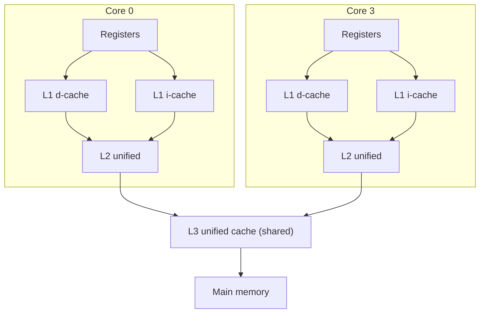

# Cache memories

Early computers had a three-level hierarchy: registers, main memory, disk. As the gap between CPU and memory speed grew, designers inserted a small SRAM **cache memory** (L1) between the register file and main memory, then a larger L2, then an L3. This lesson explains precisely how a cache is organized, how it decides whether an address is a hit, what happens on a miss, and how the design parameters trade off. By the end you should be able to simulate a cache by hand, which is exactly what the two coding problems for this module ask you to automate.

## 1. Generic cache organization

Consider a machine with $m$-bit addresses, so $M = 2^m$ unique addresses. A cache is organized as an array of $S = 2^s$ **cache sets**. Each set contains $E$ **cache lines**. Each line consists of:

- a data **block** of $B = 2^b$ bytes,
- a **valid bit** saying whether the line holds meaningful information,
- $t = m - (b + s)$ **tag bits**, a subset of the address bits that uniquely identifies which block is stored in the line.

A cache is characterized by the tuple $(S, E, B, m)$. Its capacity is $C = S \times E \times B$ bytes of data (tag and valid bits are not counted).

The cache finds a word by **partitioning its address** into three fields:

```
 m-1                                  0
+-----------+-------------+------------+
|  tag (t)  | set index(s)| offset (b) |
+-----------+-------------+------------+
```

1. **Set selection**: the $s$ set-index bits, as an unsigned integer, select the set.
2. **Line matching**: a line in that set whose valid bit is set and whose tag equals the address's $t$ tag bits is a **hit**.
3. **Word extraction**: the $b$ block-offset bits give the position of the word within the block.

| Parameter | Meaning |
|---|---|
| $S = 2^s$ | Number of sets |
| $E$ | Lines per set (associativity) |
| $B = 2^b$ | Block size in bytes |
| $m$ | Address bits |
| $t = m - (s+b)$ | Tag bits |
| $C = B \times E \times S$ | Capacity in bytes, excluding overhead |

```python-run
def split(addr, s, b, m=64):
    off = addr & ((1 << b) - 1)
    idx = (addr >> b) & ((1 << s) - 1)
    tag = addr >> (s + b)
    return tag, idx, off
# Core i7 L1 d-cache: 32 KB, 8-way, 64-byte blocks -> S = 32768/(8*64) = 64 sets, s=6, b=6
for a in (0x7ffe4c3a1238, 0x7ffe4c3a1240, 0x601040):
    t, i, o = split(a, 6, 6)
    print(f"addr {a:#x}: tag={t:#x} set={i} offset={o}")
```

## 2. Direct-mapped caches (E = 1)

With exactly one line per set, a cache is **direct-mapped**. Lookup is simple: select the set, compare one tag, check the valid bit.

On a **miss**, the cache fetches the block from the next level and stores it in the line selected by the set index; whatever was there is **evicted** (no choice of victim with $E=1$).

### Worked example

Take $(S, E, B, m) = (4, 1, 2, 4)$: four sets, one line per set, two bytes per block, 4-bit addresses. So $b = 1$, $s = 2$, $t = 1$. Each access reads one byte. Trace the reads of addresses 0, 1, 13, 8, 0:

| Step | Address (binary) | Tag | Set | Offset | Result | Cache after |
|---|---|---|---|---|---|---|
| 1 | 0 = `0 00 0` | 0 | 0 | 0 | **miss** (cold) | set 0: tag 0, block M[0–1] |
| 2 | 1 = `0 00 1` | 0 | 0 | 1 | **hit** | unchanged |
| 3 | 13 = `1 10 1` | 1 | 2 | 1 | **miss** | set 2: tag 1, block M[12–13] |
| 4 | 8 = `1 00 0` | 1 | 0 | 0 | **miss** | set 0: tag 1, block M[8–9] (evicts block 0) |
| 5 | 0 = `0 00 0` | 0 | 0 | 0 | **miss** (conflict) | set 0: tag 0, block M[0–1] |

Step 5 is a **conflict miss**: the cache has plenty of room (sets 1 and 3 are empty), yet blocks 0 and 8 map to the same set and keep evicting each other. Notice also that tag + index together identify the block: the concatenation is the *block number*.

<div class="widget" data-widget="cache"></div>

Reproduce the trace in the simulator above, then switch to 2 lines per set and watch the conflict miss disappear.

### Conflict misses and thrashing

Conflict misses are common in real programs with direct-mapped caches, and can be baffling:

```c
float dotprod(float x[8], float y[8]) {
    float sum = 0.0;
    for (int i = 0; i < 8; i++)
        sum += x[i] * y[i];
    return sum;
}
```

Good spatial locality, so we expect few misses. But suppose a block holds 16 bytes (4 floats), the cache has 2 sets (32 bytes total), `x` starts at address 0 and `y` immediately after at address 32. Then `x[i]` and `y[i]` **always map to the same set**. The reference to `x[0]` loads `x[0..3]`; the reference to `y[0]` evicts it to load `y[0..3]`; `x[1]` misses and evicts `y`; and so on. Every single reference misses. The cache is **thrashing**: repeatedly loading and evicting the same sets of blocks.

A fix: pad `x` to `float x[12]`, so `y` starts at address 48 and `x[i]` and `y[i]` map to different sets. In general, thrashing can occur whenever a program accesses arrays whose sizes are powers of two with a direct-mapped cache, and it can cost factors of 2 to 3 in speed.

> [!NOTE]
> **Why index with the middle bits rather than the high bits?** If the high-order bits were the set index, contiguous memory blocks would map to the *same* set, so a sequential scan of an array could use only one set's worth of the cache at a time. Middle-bit indexing spreads adjacent blocks across different sets.

## 3. Set associative caches (1 < E < C/B)

An **E-way set associative** cache holds $E$ lines per set. Set selection is the same. Line matching must compare the tag against **all** $E$ lines of the set in parallel: the set acts like a small **associative memory**, an array of (key, value) pairs where the key is tag + valid and the value is the block.

On a miss, if the set has an empty line, use it. Otherwise choose a **victim** according to a **replacement policy**:

- **Random**.
- **LFU** (least frequently used): evict the line referenced fewest times over some window.
- **LRU** (least recently used): evict the line whose last access is furthest in the past.

All of these require extra time and hardware, but further down the hierarchy (where a miss is more costly) better policies are worth the effort.

Repeating the earlier trace (0, 1, 13, 8, 0) with a 2-way cache of the same capacity ($S = 2$, $E = 2$, $B = 2$; now $s = 1$, $t = 2$): addresses 0 and 8 both map to set 0, but with two lines both blocks fit. Step 5 becomes a **hit**: 3 misses instead of 4.

```python-run
from collections import OrderedDict
def simulate(trace, s, E, b):
    sets = [OrderedDict() for _ in range(1 << s)]      # per set: tag -> None, in LRU order
    hits = misses = evictions = 0
    for addr in trace:
        tag, idx = addr >> (s + b), (addr >> b) & ((1 << s) - 1)
        line = sets[idx]
        if tag in line:
            hits += 1; line.move_to_end(tag)
        else:
            misses += 1
            if len(line) == E:
                line.popitem(last=False); evictions += 1
            line[tag] = None
    return hits, misses, evictions
trace = [0, 1, 13, 8, 0]
print("direct-mapped  (S=4,E=1,B=2):", simulate(trace, 2, 1, 1))
print("2-way          (S=2,E=2,B=2):", simulate(trace, 1, 2, 1))
print("fully assoc.   (S=1,E=4,B=2):", simulate(trace, 0, 4, 1))
```

## 4. Fully associative caches (E = C/B)

A **fully associative** cache is a single set containing all the lines ($S = 1$, $s = 0$): the address is split only into tag and offset. Any block can go anywhere, so there are no conflict misses, but the cache must search every tag in parallel. Building large, fast fully associative caches is difficult and expensive, so they are used only for small caches, notably the **translation lookaside buffers (TLBs)** in virtual memory systems (Module 9), which cache page table entries.

## 5. Issues with writes

Reads are simple. Writes raise two questions.

**Write hit** (the block is already cached). After updating the cached copy, when should the next lower level be updated?

- **Write-through**: immediately write the block to the next level. Simple, but causes bus traffic on every write.
- **Write-back**: defer the update until the block is evicted. Requires a **dirty bit** per line indicating the block has been modified. Reduces bus traffic by exploiting locality, at the cost of complexity.

**Write miss** (the block is not cached).

- **Write-allocate**: load the block into the cache, then update it. Bets on spatial locality of writes; every miss costs a block transfer.
- **No-write-allocate**: bypass the cache and write directly to the next level.

Typical pairings: write-through with no-write-allocate, and **write-back with write-allocate**. As a programmer, the book advises assuming write-back, write-allocate caches: it is the trend as logic density increases, and it makes writes symmetric with reads, so the same locality advice applies to both.

## 6. Anatomy of a real cache hierarchy

Caches can hold instructions as well as data: an **i-cache** holds only instructions (and is typically read-only), a **d-cache** only data, and a **unified cache** both. Separate i- and d-caches let the processor fetch an instruction and a data word in the same cycle and avoid instruction/data conflict misses.

The book's Intel Core i7 (Haswell):

| Cache | Access time (cycles) | Size $C$ | Assoc. $E$ | Block $B$ | Sets $S$ |
|---|---|---|---|---|---|
| L1 i-cache (per core) | 4 | 32 KB | 8 | 64 B | 64 |
| L1 d-cache (per core) | 4 | 32 KB | 8 | 64 B | 64 |
| L2 unified (per core) | 10 | 256 KB | 8 | 64 B | 512 |
| L3 unified (shared by all cores) | 40–75 | 8 MB | 16 | 64 B | 8,192 |



Check the arithmetic: L1 has $32768 / (8 \times 64) = 64$ sets, so $s = 6$ and $b = 6$.

## 7. Performance impact of cache parameters

Metrics:

- **Miss rate**: misses / references. **Hit rate** = 1 − miss rate.
- **Hit time**: time to deliver a word in the cache to the CPU, including set selection, line identification and word selection: several clock cycles for L1.
- **Miss penalty**: additional time required because of a miss. For L1 misses served from L2: on the order of 10 cycles; from L3: 50 cycles; from main memory: 200 cycles.

**Hits and misses differ so much that a 99% hit rate can be twice as good as 97%.** With a hit time of 1 cycle and a miss penalty of 100 cycles: at 97% hits, average access time is $1 + 0.03 \times 100 = 4$ cycles; at 99%, $1 + 0.01 \times 100 = 2$ cycles. This is why engineers talk about *miss* rates.

```python-run
def amat(hit_time, miss_rate, penalty): return hit_time + miss_rate * penalty
for mr in (0.03, 0.01, 0.001):
    print(f"miss rate {mr:5.1%}: average access time = {amat(1, mr, 100):.2f} cycles")
```

Qualitative trade-offs:

| Parameter | Larger means... | But... |
|---|---|---|
| Cache size | Higher hit rate | Slower hit time (hence L1 < L2 < L3) |
| Block size | Better use of spatial locality | Fewer lines for the same capacity (hurts temporal locality); larger miss penalty (longer transfer). Modern systems compromise at 64 bytes |
| Associativity | Fewer conflict misses | More tag bits and hardware per line, slower hit time, more complex victim selection; higher miss penalty. L1 tends toward lower associativity, lower levels higher |
| Write strategy | Write-back = fewer transfers | More complex; caches lower in the hierarchy are more likely to use write-back |

> [!INTERVIEW]
> **"Given a 32 KB, 8-way cache with 64-byte lines, how many index and offset bits?"** Lines = 32768/64 = 512; sets = 512/8 = 64 → 6 index bits; 6 offset bits; the remaining address bits are the tag. Expect follow-ups: what is a conflict miss, why associativity helps, and why L1 is small (hit time must fit in a few cycles, and its index bits should fit inside the page offset so the lookup can start in parallel with TLB translation).

> [!INTERVIEW]
> **"Design an LRU cache"** (LeetCode 146) is the software analogue of one cache set: a hash map for O(1) lookup plus a doubly linked list (or `OrderedDict`) for recency order. Hardware approximates LRU with a few age bits per set.

> [!WARNING]
> Do not confuse *block*, *line* and *set*. A **block** is a fixed-size packet of data that moves between levels. A **line** is a container in the cache holding a block plus valid and tag bits. A **set** is a collection of one or more lines.

## 8. Summary

- A cache is $(S, E, B, m)$; an address splits into tag / set index / block offset with $s = \log_2 S$, $b = \log_2 B$, $t = m - s - b$.
- Direct-mapped ($E = 1$): fast, simple, prone to conflict misses and thrashing.
- Set associative: compare $E$ tags per set; needs a replacement policy such as LRU.
- Fully associative: one set; used for small caches like TLBs.
- Writes: write-through vs. write-back (dirty bit); write-allocate vs. no-write-allocate.
- Average access time = hit time + miss rate × miss penalty; small changes in miss rate matter a lot.

## Check yourself

```quiz
[
  {"q": "A cache has S = 64 sets, E = 8 lines per set and B = 64-byte blocks. What is its capacity?", "options": ["4 KB", "32 KB", "64 KB", "512 KB"], "answer": 1,
   "explain": "C = S * E * B = 64 * 8 * 64 = 32,768 bytes."},
  {"q": "With 32-bit addresses, S = 1024 sets and B = 16-byte blocks, how many tag bits are there?", "options": ["18", "22", "14", "10"], "answer": 0,
   "explain": "s = 10, b = 4, so t = 32 - 14 = 18."},
  {"q": "In the (S,E,B,m) = (4,1,2,4) cache, address 13 (binary 1101) maps to which set with which tag?", "options": ["Set 2, tag 1", "Set 1, tag 3", "Set 3, tag 0", "Set 0, tag 1"], "answer": 0,
   "explain": "Offset = lowest bit (1), set = next two bits (10 = 2), tag = top bit (1)."},
  {"q": "What is thrashing in a direct-mapped cache?", "options": ["The cache is too small for the working set", "Blocks that map to the same set repeatedly evict each other", "The dirty bits overflow", "The first access to each block misses"], "answer": 1,
   "explain": "Alternating references to conflicting blocks cause a miss on every access even though the cache has free space elsewhere."},
  {"q": "Why does a write-back cache need a dirty bit?", "options": ["To mark invalid lines", "To know whether an evicted block was modified and must be written to the next level", "To implement LRU", "To detect conflict misses"], "answer": 1,
   "explain": "Only modified blocks need to be written back on eviction."},
  {"q": "Hit time 1 cycle, miss penalty 100 cycles. How does going from a 97% to a 99% hit rate change the average access time?", "options": ["4 cycles to 2 cycles", "3 to 1", "1.03 to 1.01", "No change"], "answer": 0,
   "explain": "1 + 0.03*100 = 4 versus 1 + 0.01*100 = 2: half the time."},
  {"q": "Which type of cache is typically fully associative?", "options": ["L1 d-cache", "L3 cache", "TLB", "Disk buffer cache"], "answer": 2,
   "explain": "Fully associative lookup is only practical for small caches such as TLBs."},
  {"q": "Increasing the block size while keeping the capacity fixed...", "options": ["Always reduces the miss rate", "Improves spatial locality use but reduces the number of lines and raises the miss penalty", "Removes conflict misses", "Has no effect"], "answer": 1,
   "explain": "Bigger blocks exploit spatial locality but leave fewer lines for temporally-local data and take longer to transfer."}
]
```

> **Source:** CS:APP 3e, §6.4 (Cache memories: generic organization, direct-mapped, set associative and fully associative caches, issues with writes, anatomy of a real cache hierarchy, performance impact of cache parameters).
