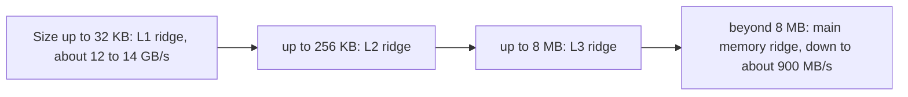

# Cache-friendly code and the memory mountain

Knowing how caches work is only useful if it changes how you write code. This lesson turns the mechanics of the previous one into practice: how to estimate miss rates by reading loops, how to rearrange loops for locality, and how to *see* a machine's entire cache hierarchy in a single picture, the **memory mountain**. We finish with the classic demonstration that six mathematically equivalent matrix multiplication loops can differ in speed by a factor of almost 40.

## 1. What "cache friendly" means

Good locality means, quantitatively, a low miss rate. Two basic rules:

1. **Make the common case go fast.** Programs spend most of their time in a few core functions, and those functions spend most of their time in a few loops. Focus on the **inner loops** of the core functions and ignore the rest.
2. **Minimize the number of cache misses in each inner loop.** All else being equal (number of loads and stores), loops with better miss rates run faster.

### Analyzing a simple loop

```c
int sumvec(int v[N]) {
    int i, sum = 0;
    for (i = 0; i < N; i++)
        sum += v[i];
    return sum;
}
```

Is it cache friendly? The local variables `i` and `sum` have excellent temporal locality, and an optimizing compiler will keep them in registers, the top of the hierarchy. Now the array. Suppose `v` is block aligned, words are 4 bytes, cache blocks are 4 words, and the cache starts cold:

| `v[i]` | 0 | 1 | 2 | 3 | 4 | 5 | 6 | 7 |
|---|---|---|---|---|---|---|---|---|
| Access (order) | 1 **miss** | 2 hit | 3 hit | 4 hit | 5 **miss** | 6 hit | 7 hit | 8 hit |

The reference to `v[0]` misses and loads the block containing `v[0]`–`v[3]`; the next three references hit. Three out of four references hit: a miss rate of $\frac{1}{4}$, the best possible with a cold cache. In general, with block size $B$ bytes and element size $L$, a stride-1 scan over a large array misses on a fraction $L/B$ of references; with stride $k$ elements, about $\min(1, kL/B)$.

Two lessons:

- **Repeated references to local variables are good** (the compiler caches them in registers: temporal locality).
- **Stride-1 reference patterns are good** (caches at all levels store data as contiguous blocks: spatial locality).

### Two-dimensional arrays

```c
int sumarrayrows(int a[M][N]) {
    int i, j, sum = 0;
    for (i = 0; i < M; i++)
        for (j = 0; j < N; j++)
            sum += a[i][j];
    return sum;
}
```

Row-major storage plus row-wise traversal gives stride 1: with 4-word blocks, a miss rate of 1/4. Swap the loops (`sumarraycols`) and we scan column-wise. If the array is larger than the cache, **every access misses**: miss rate 1. The book notes that higher miss rates can have a significant impact on running time; on its desktop machine `sumarrayrows` runs 25 times faster than `sumarraycols` for large arrays.

```python-run
def miss_rate(M, N, order, block_words=4, cache_blocks=8):
    """Tiny direct-mapped cache model: one word per int, cache of `cache_blocks` blocks."""
    cache = [None] * cache_blocks
    misses = total = 0
    idx = ((i, j) for i in range(M) for j in range(N)) if order == "rows" else \
          ((i, j) for j in range(N) for i in range(M))
    for i, j in idx:
        block = (i * N + j) // block_words
        slot = block % cache_blocks
        total += 1
        if cache[slot] != block:
            misses += 1; cache[slot] = block
    return misses / total
print("rows:", miss_rate(64, 64, "rows"))
print("cols:", miss_rate(64, 64, "cols"))
```

### Worked example: structs of arrays

A practice problem in the book considers

```c
struct algae_position { int x; int y; };
struct algae_position grid[16][16];
```

with a direct-mapped 1,024-byte cache and 16-byte blocks, and three loops that sum the fields. The grid is $16 \times 16 \times 8 = 2{,}048$ bytes, twice the cache. Summing all `x` in one pass (row-wise) and then all `y` in a second pass: each block holds two structs (four ints); in each pass, half of the references miss, so 256 misses out of 512 reads: 50%. Summing `x` and `y` of each element together in a single row-wise pass: each block's first access misses and the next three hit: 25%. Lesson: **touch all the data you need from a block while it is in the cache**, which is the idea behind both loop fusion and the array-of-structs vs. struct-of-arrays decision.

## 2. The memory mountain

The rate at which a program reads data, its **read throughput** (read bandwidth, in MB/s), depends on its locality. The book measures it with a small kernel:

```c
long data[MAXELEMS];          /* the global array we traverse */

/* Iterate over the first "elems" elements of data with stride "stride" */
int test(int elems, int stride);

/* Run test(elems, stride) and return read throughput in MB/s */
double run(int size, int stride, double Mhz);
```

The `test` function scans the first `elems` 8-byte elements with a given stride (using 4 × 4 unrolling so that the loop itself is not the bottleneck). It is called once to warm the cache and then timed. Two parameters control locality:

- **`size`** of the working set: smaller means better **temporal locality** (the data fits in a faster cache and is re-touched there).
- **`stride`**: smaller means better **spatial locality**.

Sweeping `size` from 16 KB to 128 MB and `stride` from 1 to 12 elements produces a two-dimensional function of throughput versus (size, stride): the **memory mountain**. Every computer has its own characteristic mountain. For the book's Core i7 Haswell (2.1 GHz; 32 KB L1 d-cache, 256 KB L2, 8 MB L3; 64-byte blocks):



Reading the geography:

- **Ridges of temporal locality.** Perpendicular to the size axis are four ridges, where the working set fits in L1, L2, L3 and main memory respectively. There is more than an order of magnitude between the L1 peak (over **14 GB/s**) and the lowest point of the main-memory ridge (**900 MB/s**).
- **Slopes of spatial locality.** On the L2, L3 and memory ridges, throughput falls as stride grows. Even when the working set fits in no cache, the best point of the memory ridge is 8× higher than the worst: spatial locality rescues programs with poor temporal locality.
- **The prefetching ridge.** For stride 1, throughput stays a nearly flat **12 GB/s** even when the working set exceeds L1 and L2. The hardware **prefetcher** recognizes sequential stride-1 patterns and fetches blocks before they are requested. One more reason to favor sequential access.

**Slice at stride 8.** Holding the stride fixed and varying size shows the caches' capacities: up to 32 KB reads are served from L1 at the peak rate; between 32 KB and 256 KB from L2; up to 8 MB from L3; beyond that from main memory. The dips at the leftmost edge of some regions (e.g., just before a cache's full size) arise because other data and code share the caches.

**Slice at size 4 MB.** Holding the working set fixed (inside L3, beyond L2) and varying the stride shows the block size: throughput decreases steadily as stride goes from 1 to 8 words, since the fraction of reads that miss in L2 rises, and then flattens. Once the stride reaches 8 words (64 bytes), **every** read misses in L2 and must be served from L3, so larger strides are no worse. That knee reveals the 64-byte block.

> [!TIP]
> The takeaway for programmers: exploit **temporal locality** so that heavily used words come from L1, and **spatial locality** so that as many words as possible come from a single L1 line.

## 3. Rearranging loops: matrix multiplication

Multiplying two $n \times n$ matrices, $C = AB$, takes a triply nested loop. All six permutations of the loops `i`, `j`, `k` compute the same result with the same $O(n^3)$ operations:

```c
/* ijk */
for (i = 0; i < n; i++)
    for (j = 0; j < n; j++) {
        sum = 0.0;
        for (k = 0; k < n; k++)
            sum += A[i][k] * B[k][j];
        C[i][j] += sum;
    }

/* jki */
for (j = 0; j < n; j++)
    for (k = 0; k < n; k++) {
        r = B[k][j];
        for (i = 0; i < n; i++)
            C[i][j] += A[i][k] * r;
    }

/* kij */
for (k = 0; k < n; k++)
    for (i = 0; i < n; i++) {
        r = A[i][k];
        for (j = 0; j < n; j++)
            C[i][j] += r * B[k][j];
    }
```

Assume `double` elements (8 bytes), 32-byte blocks (4 doubles per block), $n$ so large that a single row does not fit in L1, and locals in registers. Analyze only the **inner loop**:

| Class (inner-loop arrays) | Versions | Loads | Stores | A misses | B misses | C misses | Total misses/iter |
|---|---|---|---|---|---|---|---|
| AB | ijk, jik | 2 | 0 | 0.25 | 1.00 | 0.00 | **1.25** |
| AC | jki, kji | 2 | 1 | 1.00 | 0.00 | 1.00 | **2.00** |
| BC | kij, ikj | 2 | 1 | 0.00 | 0.25 | 0.25 | **0.50** |

- **ijk / jik** scan a row of A (stride 1: 0.25 misses) and a column of B (stride $n$: 1.00).
- **jki / kji** scan columns of both A and C: a miss on each. Worst.
- **kij / ikj** scan rows of both B and C with stride 1: best, despite doing one more memory operation (a store) than class AB.

Measured on the Core i7: for large $n$ the fastest version runs **almost 40 times faster** than the slowest, though each performs the same floating-point operations. Pairs in the same class perform almost identically. **Miss rate predicts performance better than the total number of memory accesses.** And for the fastest pair (kij, ikj) the cycles per iteration stay constant even when the arrays far exceed the caches, because the prefetcher keeps up with their stride-1 patterns.

```python-run
import time, numpy as np
def matmul(order, A, B, n):
    C = [[0.0] * n for _ in range(n)]
    if order == "ijk":
        for i in range(n):
            for j in range(n):
                s = 0.0
                for k in range(n): s += A[i][k] * B[k][j]
                C[i][j] = s
    elif order == "kij":
        for k in range(n):
            for i in range(n):
                r, Ci, Bk = A[i][k], C[i], B[k]
                for j in range(n): Ci[j] += r * Bk[j]
    return C
n = 60
A = [[float(i + j) for j in range(n)] for i in range(n)]
B = [[float(i - j) for j in range(n)] for i in range(n)]
ref = (np.array(A) @ np.array(B))
for order in ("ijk", "kij"):
    t = time.perf_counter(); C = matmul(order, A, B, n)
    print(order, f"{(time.perf_counter() - t) * 1e3:7.1f} ms  correct={np.allclose(C, ref)}")
```

(Python's interpreter overhead hides most cache effects; the point here is that the loop orders are interchangeable. In C, with large $n$, the gap is dramatic.)

### Blocking

A further technique, **blocking** (or tiling), improves *temporal* locality: organize the computation into chunks ("blocks", here application-level sub-matrices, not cache blocks) small enough to fit in the L1 cache, do all the work on one chunk, then move to the next. For matrix multiply, each small sub-matrix product then runs entirely out of the cache, so the same elements are reused many times per miss. It makes code harder to read, so it belongs in compilers and heavily used libraries (BLAS). The book notes that on the Core i7, blocking does not help matrix multiply, thanks to the prefetcher, but it yields big gains on systems without such prefetching.

## 4. Exploiting locality in your programs

The book's summary recommendations:

- **Focus your attention on the inner loops**, where the bulk of the computations and memory accesses occur.
- **Maximize spatial locality** by reading data objects sequentially, with stride 1, in the order they are stored in memory.
- **Maximize temporal locality** by using a data object as often as possible once it has been read from memory.

Practical corollaries:

- Prefer **arrays/vectors over linked structures** for hot data: contiguous, prefetchable, no pointer chasing.
- Keep hot fields together and cold fields elsewhere; consider struct-of-arrays when loops touch only one field.
- Iterate multidimensional arrays in storage order (row-major in C, column-major in Fortran, MATLAB, and R).
- Avoid power-of-two strides and array sizes that alias in the cache.

> [!INTERVIEW]
> **Cache lines and false sharing.** Caches work on whole lines (64 bytes). If two threads on different cores write *different* variables that happen to share a line, each write invalidates the other core's copy and the line "ping-pongs" between caches: **false sharing**. It can slow a multithreaded loop by an order of magnitude with no logical data sharing at all. Fix: pad or align per-thread data to cache-line boundaries (`alignas(64)`), or accumulate in thread-local variables and combine at the end.

> [!INTERVIEW]
> **"Why might an O(n) scan of an array beat an O(log n) pointer-based tree lookup for small n?"** Constants are set by the memory hierarchy: the array scan is sequential (prefetched, ~0.1 miss per element), while each tree level is a likely cache miss plus an unpredictable branch. This is why B-trees (wide, contiguous nodes) beat binary trees on real hardware and on disk.

## 5. Summary

- Cache-friendly code keeps inner-loop miss rates low: locals in registers, stride-1 scans.
- Stride-1 over a large array misses once per block: miss rate = element size / block size.
- The memory mountain plots read throughput over working-set size (temporal locality) and stride (spatial locality): ridges for L1, L2, L3, memory; a slope with stride; a flat stride-1 ridge thanks to prefetching.
- Loop order changes miss rates: for matrix multiply, kij/ikj (0.5 misses/iteration) beat ijk/jik (1.25) and jki/kji (2.0), with up to ~40× difference in speed.

## Check yourself

```quiz
[
  {"q": "An int array (4-byte elements) is scanned with stride 1 through a cold cache with 16-byte blocks. What is the miss rate?", "options": ["1", "1/2", "1/4", "1/16"], "answer": 2,
   "explain": "Each 16-byte block holds 4 ints: one miss followed by three hits."},
  {"q": "With 64-byte blocks and 8-byte elements, at what stride (in elements) does every access to a large array miss?", "options": ["2", "4", "8", "16"], "answer": 2,
   "explain": "A stride of 8 elements = 64 bytes moves to a new block on every access."},
  {"q": "In the memory mountain, what do the ridges perpendicular to the size axis correspond to?", "options": ["Different strides", "Working sets that fit in L1, L2, L3 and main memory", "Branch prediction accuracy", "TLB sizes"], "answer": 1,
   "explain": "As the working set outgrows each cache level, throughput drops to the next ridge."},
  {"q": "Why does stride-1 throughput stay high even for working sets larger than L2?", "options": ["The L1 cache grows dynamically", "Hardware prefetching detects sequential access and loads blocks ahead of time", "Stride 1 never misses", "The OS caches the array"], "answer": 1,
   "explain": "The prefetcher recognizes the sequential pattern and fetches upcoming lines before they are needed."},
  {"q": "Which matrix-multiply loop orders have the fewest inner-loop misses per iteration?", "options": ["ijk and jik", "jki and kji", "kij and ikj", "All equal"], "answer": 2,
   "explain": "kij/ikj scan rows of B and C with stride 1: 0.25 + 0.25 = 0.5 misses per iteration."},
  {"q": "The BC versions (kij, ikj) do more memory operations per iteration than AB (ijk, jik) yet run faster. What does this show?", "options": ["Stores are free", "Miss rate predicts performance better than the count of memory accesses", "Loads are slower than stores", "The measurements are wrong"], "answer": 1,
   "explain": "A miss costs far more than an extra L1 hit, so 0.5 misses beats 1.25 misses despite the extra store."},
  {"q": "What kind of locality does blocking (tiling) primarily improve?", "options": ["Spatial locality", "Temporal locality", "Instruction locality", "None"], "answer": 1,
   "explain": "Blocking reuses a cache-sized chunk of data many times before moving on."},
  {"q": "Two threads update adjacent counters in the same 64-byte line and the program scales poorly. This is called:", "options": ["Thrashing", "False sharing", "A capacity miss", "A race condition"], "answer": 1,
   "explain": "The line bounces between the cores' caches even though the threads touch different variables."}
]
```

> **Source:** CS:APP 3e, §6.5–6.7 (Writing cache-friendly code; Putting it together: the memory mountain, rearranging loops to increase spatial locality, exploiting locality in your programs).
