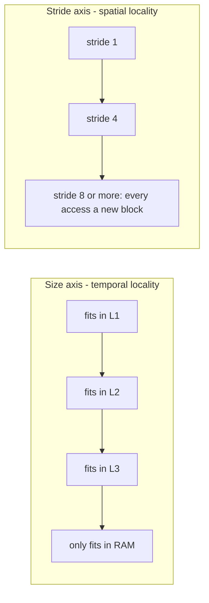

# Cache-friendly code and the memory mountain

> **Before this lesson:** You need the cache vocabulary (block, set, hit, miss, miss rate) from [Cache memories](#/lesson/csapp/caches) and the idea of locality and stride from [Storage technologies and locality](#/lesson/csapp/storage-locality). The examples use C arrays and nested loops.

## In plain words

A **cache** is a small, very fast memory inside the processor that keeps copies of recently used data so the processor does not have to wait for the much slower main memory. When the data a program wants is already there, that is a **hit**; when it is not, that is a **miss**, and the program waits. Think of shopping with a list. If the list follows the layout of the shop, you walk each aisle once. If the list is in random order, you cross the shop again and again and take ten times as long to buy the same things. The order in which a program visits its data has the same effect on how often the cache can help.

Why this matters at work: rearranging loops so that data is visited in the order it is stored often gives a larger speedup than any compiler setting, with no change to what the program computes. It is among the most practical performance skills, used in data processing, graphics, scientific code and games, and "why is this loop order faster?" is a very common interview question.

## Why look closer

Two functions add up the same four million numbers. They execute the same number of additions, the same number of loads, the same number of branches. One finishes in a few milliseconds; the other takes ten times as long. Nothing in the source code's operation count explains the difference, and no amount of staring at big-O notation will find it. The difference is entirely in the *order* in which the functions touch memory, and therefore in how often the processor's caches can answer a request without going to main memory. The previous lesson explained how a cache works. This one is about using that knowledge: how to measure cache behaviour, how to predict it from source code, and a small set of rewriting techniques (pick the right loop order, keep data dense, process in blocks) that routinely deliver speedups no compiler flag can.

## 1. Measuring what the cache is doing

Four numbers describe cache performance:

- **Miss rate**: the fraction of memory references that miss. Hit rate is one minus this.
- **Hit time**: how long it takes to deliver a word that is in the cache, including selecting the set and comparing tags. For a first-level cache this is a few clock cycles.
- **Miss penalty**: the extra time a miss costs. A miss at the first level that is satisfied by the second costs around ten cycles; one that falls through to main memory costs on the order of two hundred.
- The combination is the **average access time**: hit time plus miss rate times miss penalty.

Because the penalty is so large compared with the hit time, performance is extremely sensitive to the miss rate. That is why, when discussing caches, people talk about miss rates of 1% versus 3% and not hit rates of 99% versus 97%: the first comparison makes the factor of three visible.

```python-run
def average_cycles(miss_rate, hit_time=4, penalty=200):
    return hit_time + miss_rate * penalty

for rate in (0.00, 0.01, 0.03, 0.10, 0.25, 1.00):
    print(f"miss rate {rate:5.0%} -> {average_cycles(rate):6.1f} cycles per access")
print("3% vs 1% misses:", round(average_cycles(0.03) / average_cycles(0.01), 2), "times slower")
```

### The design trade-offs behind those numbers

Every cache parameter is a compromise, which is why real machines have several levels with different characteristics.

| Make this bigger | Benefit | Cost |
|---|---|---|
| Total size | fewer misses | harder to make fast, so a longer hit time; this is why the first level is the smallest |
| Block size | exploits spatial locality better | for a fixed total size there are fewer blocks, which hurts temporal locality; bigger blocks also take longer to transfer |
| Associativity | fewer conflict misses | more tag comparisons, more hardware, a longer hit time and a more complex replacement decision |

Levels close to the processor favour a short hit time and therefore modest size and associativity. Levels further away, where a miss is very expensive, favour a low miss rate.

## 2. What "cache-friendly" means

Two principles cover most of what a programmer can do.

1. **Make the common case fast.** Programs spend most of their time in a few inner loops. Concentrate on those and ignore the rest.
2. **Minimise the misses in each inner loop.** All else being equal, the loop with the lower miss rate runs faster.

In practice the second principle turns into two habits:

- **Repeated references to local variables are good.** The compiler can keep them in registers, so they cost no memory access at all. That is temporal locality.
- **Stride-1 reference patterns are good.** Caches at every level store data as contiguous blocks, so walking memory one element after another gets several hits for each miss. That is spatial locality.

### Counting misses by hand

Take a function that sums an array of `long`, eight bytes each, on a machine whose cache blocks hold 64 bytes. Assume the array starts at a block boundary and the cache is initially empty.

The first access, to element 0, misses and brings in the block containing elements 0 through 7. The next seven accesses hit. Element 8 misses, and so on. One access in eight misses: a miss rate of 12.5%, and that is the best possible for a cold cache with this block size. In general, with a stride of *k* elements of *w* bytes each and blocks of *B* bytes, the miss rate is about $\min(1,\ k \cdot w / B)$.

Now the two-dimensional case from the opening:

```c
#define N 2048
long grid[N][N];

long by_rows(void) {                     long by_cols(void) {
    long s = 0;                              long s = 0;
    for (int i = 0; i < N; i++)              for (int j = 0; j < N; j++)
        for (int j = 0; j < N; j++)              for (int i = 0; i < N; i++)
            s += grid[i][j];                         s += grid[i][j];
    return s;                                return s;
}                                        }
```

C stores `grid` row after row. `by_rows` therefore visits memory with stride 1 and misses once per eight elements. `by_cols` moves down a column, so consecutive accesses are a whole row, 16 KB, apart. If the array is larger than the cache, every access lands in a block that is no longer cached: a miss rate of 100%, eight times worse.

```python-run
from collections import OrderedDict

class Cache:
    """Set-associative cache with LRU replacement; counts misses only."""
    def __init__(self, sets, ways, block):
        self.sets, self.ways, self.block = sets, ways, block
        self.data = [OrderedDict() for _ in range(sets)]
        self.accesses = self.misses = 0
    def touch(self, addr):
        self.accesses += 1
        blk = addr // self.block
        s = self.data[blk % self.sets]
        if blk in s:
            s.move_to_end(blk)
        else:
            self.misses += 1
            if len(s) == self.ways:
                s.popitem(last=False)
            s[blk] = True
    @property
    def rate(self): return self.misses / self.accesses

N, W = 128, 8                                      # a 128 x 128 grid of 8-byte longs = 128 KB
def run(order):
    c = Cache(sets=64, ways=8, block=64)           # a 32 KB cache
    for a in range(N):
        for b in range(N):
            i, j = (a, b) if order == "rows" else (b, a)
            c.touch((i * N + j) * W)
    return c.rate

print(f"row order   : miss rate {run('rows'):.1%}")
print(f"column order: miss rate {run('cols'):.1%}")
```

Experiment with the simulator: shrink `N` to 32 so that the whole grid fits in the cache, and watch the column-order penalty vanish. Locality only matters once the data outgrows the cache.

You can explore the same effect interactively. Enter an address trace with a stride larger than the block size and compare it with a stride-1 trace:

<div class="widget" data-widget="cache"></div>

## 3. The memory mountain

How fast can a program read memory? There is no single answer. The rate depends on how much data it is working with and how it steps through it. A neat experiment makes the whole landscape visible.

Write a tiny kernel that reads the elements of an array of a given total **size** with a given **stride**, and time it. Report the result as **read throughput** in megabytes per second. Repeat for many sizes, from a few kilobytes to hundreds of megabytes, and many strides, from 1 element to a dozen or more. Before each timed run, do one untimed pass to warm the cache. Plotting throughput against the two parameters gives a surface known as the **memory mountain**. Every machine has its own, and it is a fingerprint of that machine's memory system.



Reading the surface:

- **Ridges of temporal locality.** Hold the stride fixed and vary the size. Throughput is not smooth; it forms plateaus. While the working set fits in the first-level cache the rate is highest. Once it spills into the second level the rate drops to a lower plateau, then again for the third level, and finally to the lowest plateau when the data fits only in main memory. The edges of the plateaus fall at the cache sizes, so the experiment *measures* your caches without consulting any documentation.
- **Slopes of spatial locality.** Hold the size fixed at something larger than a given cache and vary the stride. Throughput falls steadily as the stride grows, because fewer accesses share a block. Once the stride reaches the block size, every access misses, and the curve flattens: it cannot get worse.
- **A surprisingly flat ridge at stride 1.** For sequential access, throughput stays high even for arrays far larger than any cache. The credit goes to **hardware prefetching**: the processor recognises a sequential pattern and fetches upcoming blocks before the program asks for them. This is a strong extra reason to prefer stride-1 code.

The peaks and the valleys of the mountain can differ by more than an order of magnitude. The same machine, the same instruction, ten times the speed.

```python-run
# A model mountain: throughput estimated from a three-level cache simulation.
from collections import OrderedDict
class Cache:                                   # same LRU set-associative model as above
    def __init__(self, sets, ways, block):
        self.sets, self.ways, self.block, self.misses = sets, ways, block, 0
        self.data = [OrderedDict() for _ in range(sets)]
    def touch(self, addr):
        blk = addr // self.block
        s = self.data[blk % self.sets]
        if blk in s:
            s.move_to_end(blk)
            return
        self.misses += 1
        if len(s) == self.ways:
            s.popitem(last=False)
        s[blk] = True

def throughput(size_kb, stride_elems):
    l1, l2, l3 = Cache(16, 4, 64), Cache(64, 8, 64), Cache(512, 8, 64)      # scaled-down 4 KB, 32 KB, 256 KB
    n = size_kb * 1024 // 8
    cost = 0.0
    for sweep in range(2):                     # sweep 0 warms the caches, sweep 1 is measured
        cost = 0.0
        for idx in range(0, n, stride_elems):
            addr = idx * 8
            m1, m2, m3 = l1.misses, l2.misses, l3.misses
            l1.touch(addr); t = 1.0
            if l1.misses > m1:
                l2.touch(addr); t = 4.0
                if l2.misses > m2:
                    l3.touch(addr); t = 12.0
                    if l3.misses > m3:
                        t = 60.0
            cost += t
    reads = len(range(0, n, stride_elems))
    return reads / cost * 100                  # arbitrary units: higher is faster

strides = (1, 2, 4, 8, 16)
print("size \\ stride" + "".join(f"{s:>8}" for s in strides))
for size in (2, 16, 128, 1024):
    print(f"{size:>6} KB    " + "".join(f"{throughput(size, s):8.0f}" for s in strides))
```

Each row of the output is a slope (larger stride, lower throughput, flat once the stride passes one block) and each column is a staircase of ridges. The model has no prefetcher, so its stride-1 column falls off more than a real machine's would.

## 4. Rearranging loops: matrix multiplication

Multiplying two $n \times n$ matrices is the classic demonstration. The textbook code is three nested loops around one statement, `c[i][j] += a[i][k] * b[k][j]`. The loops can be nested in any of six orders, and all six compute the same result with the same $n^3$ multiplications and additions. Their memory behaviour is not the same.

Analyse the **innermost loop**, because that is where the time goes. Assume `double` elements (8 bytes), 64-byte blocks so that a block holds eight elements, and matrices too big for a whole one to fit in the cache.

The six orders fall into three pairs, according to which variable is innermost.

**Innermost `k`** (orders `ijk` and `jik`). The inner loop computes a dot product of row `i` of A with column `k` of B, accumulating into a scalar that lives in a register:

```c
for (i = 0; i < n; i++)
    for (j = 0; j < n; j++) {
        double sum = 0.0;
        for (k = 0; k < n; k++)
            sum += a[i][k] * b[k][j];
        c[i][j] = sum;
    }
```

A is scanned along a row: stride 1, one miss per eight iterations. B is scanned down a column: stride *n*, a miss on every iteration. Total: about **1.125 misses per iteration**.

**Innermost `j`** (orders `kij` and `ikj`). Hoist `a[i][k]` into a register; the inner loop then scans row `k` of B and row `i` of C, both with stride 1:

```c
for (k = 0; k < n; k++)
    for (i = 0; i < n; i++) {
        double r = a[i][k];
        for (j = 0; j < n; j++)
            c[i][j] += r * b[k][j];
    }
```

Each array misses once per eight iterations. Total: **0.25 misses per iteration**.

**Innermost `i`** (orders `jki` and `kji`). The inner loop walks down a column of A and a column of C. Both miss on every iteration. Total: **2 misses per iteration**.

| Inner loop | Orders | Loads per iteration | Stores per iteration | A misses | B misses | C misses | Total |
|---|---|---|---|---|---|---|---|
| over `k` | ijk, jik | 2 | 0 | 0.125 | 1 | 0 | 1.125 |
| over `j` | kij, ikj | 2 | 1 | 0 | 0.125 | 0.125 | 0.25 |
| over `i` | jki, kji | 2 | 1 | 1 | 0 | 1 | 2 |

Two observations. First, the middle row does *more* memory work per iteration (it has a store, the others in the first pair do not) and yet is by far the fastest for large matrices: **miss rate beats operation count**. Second, the choice costs nothing but swapping two `for` lines. On real machines the gap between the best and worst pair reaches a large factor once the matrices outgrow the caches.

The simulation below runs the three inner-loop patterns against a small cache and counts misses per iteration.

```python-run
from collections import OrderedDict
class Cache:                                   # same LRU set-associative model as above
    def __init__(self, sets, ways, block):
        self.sets, self.ways, self.block, self.misses = sets, ways, block, 0
        self.data = [OrderedDict() for _ in range(sets)]
    def touch(self, addr):
        blk = addr // self.block
        s = self.data[blk % self.sets]
        if blk in s:
            s.move_to_end(blk)
            return
        self.misses += 1
        if len(s) == self.ways:
            s.popitem(last=False)
        s[blk] = True

def matmul_misses(order, n=48):
    c = Cache(sets=16, ways=4, block=64)            # a 4 KB cache: far smaller than the 18 KB matrices
    A, B, C = 0, 1 << 20, 2 << 20                   # base addresses far apart
    at = lambda base, r, col: base + (r * n + col) * 8
    loops = {"i": range(n), "j": range(n), "k": range(n)}
    o1, o2, o3 = order
    count = 0
    for x in loops[o1]:
        for y in loops[o2]:
            for z in loops[o3]:
                v = {o1: x, o2: y, o3: z}
                i, j, k = v["i"], v["j"], v["k"]
                if o3 != "k": c.touch(at(C, i, j))          # c[i][j] is in a register when k is innermost
                if o3 != "j": c.touch(at(A, i, k))          # a[i][k] is in a register when j is innermost
                if o3 != "i": c.touch(at(B, k, j))          # b[k][j] is in a register when i is innermost
                count += 1
    return c.misses / count

for order in ("ijk", "jik", "kij", "ikj", "jki", "kji"):
    print(f"{order}: {matmul_misses(order):.3f} misses per inner iteration")
```

The measured values land close to the hand analysis: roughly 1.1 and 2 for the outer pairs. The row-wise pair does even better than the estimate, about 0.13, because at this small size a single row of B stays cached while it is reused for every row of C; with rows too long to stay cached it would be 0.25.

> [!INTERVIEW]
> **"Two loop nests do the same arithmetic. Why might one be several times faster?"** Because their access patterns differ. Walk through it concretely: identify the innermost loop, list which arrays it reads and writes, determine the stride of each access given row-major layout, and estimate misses per iteration as element size times stride divided by block size, capped at one. The nest whose inner loop touches memory sequentially has the lower miss rate and wins, even if it performs more loads or stores.

## 5. Blocking: improving temporal locality

Loop reordering fixes *spatial* locality. It cannot fix a different problem: in matrix multiplication each element of B is needed *n* times, but between two uses of the same element the program touches so much other data that it has been evicted. The remedy for that is **blocking**, also called tiling.

The idea is to organise the computation into chunks small enough to fit in the cache. Do everything there is to do on one chunk while it is cached, then move on to the next. (The word "block" here means an application-level tile of the matrix, not a cache block.)

```c
for (ii = 0; ii < n; ii += T)
    for (jj = 0; jj < n; jj += T)
        for (kk = 0; kk < n; kk += T)
            /* multiply one T x T tile of A by one T x T tile of B into a tile of C */
            for (i = ii; i < ii + T; i++)
                for (j = jj; j < jj + T; j++)
                    for (k = kk; k < kk + T; k++)
                        c[i][j] += a[i][k] * b[k][j];
```

Choose the tile size `T` so that three tiles fit comfortably in the cache: $3T^2 \cdot 8$ bytes should be less than the cache size. A rough count shows the benefit. With 8 elements per cache block:

- Unblocked, in the `ijk` order, each of the $n^2$ inner loops incurs about $n/8 + n = 9n/8$ misses, for a total near $\tfrac{9}{8}n^3$.
- Blocked, each tile-by-tile multiplication touches about $2T^2$ elements, hence $T^2/4$ misses. There are $(n/T)^3$ of them, so the total is about $\tfrac{1}{4T}n^3$.

With `T` = 32, that is a reduction from $1.125\,n^3$ to about $0.008\,n^3$: over a hundred times fewer misses, in this idealised count.

```python-run
from collections import OrderedDict
class Cache:                                   # same LRU set-associative model as above
    def __init__(self, sets, ways, block):
        self.sets, self.ways, self.block, self.misses = sets, ways, block, 0
        self.data = [OrderedDict() for _ in range(sets)]
    def touch(self, addr):
        blk = addr // self.block
        s = self.data[blk % self.sets]
        if blk in s:
            s.move_to_end(blk)
            return
        self.misses += 1
        if len(s) == self.ways:
            s.popitem(last=False)
        s[blk] = True

def blocked_misses(n, T):
    c = Cache(sets=16, ways=4, block=64)                    # 4 KB: room for 512 doubles
    A, B, Cm = 0, (1 << 22) + 320, (2 << 22) + 704
    at = lambda base, r, col: base + (r * n + col) * 8
    for ii in range(0, n, T):
        for jj in range(0, n, T):
            for kk in range(0, n, T):
                for i in range(ii, ii + T):
                    for j in range(jj, jj + T):
                        c.touch(at(Cm, i, j))
                        for k in range(kk, kk + T):
                            c.touch(at(A, i, k)); c.touch(at(B, k, j))
    return c.misses

n = 60                                                      # each matrix is 28 KB, seven times the cache
plain = blocked_misses(n, n)                                # T = n means no blocking
for T in (60, 20, 12, 6):
    m = blocked_misses(n, T)
    print(f"tile {T:3}: {m:8,} misses  ({plain / m:5.1f}x fewer than unblocked)")
```

In the simulation the best tile is the one where three tiles only barely fit in the cache (here 12, since $3 \cdot 12^2 = 432$ doubles against room for 512). Larger tiles overflow it; smaller ones reload the same data more often than necessary.

Blocking makes code harder to read and maintain, so it belongs in libraries and in compilers, not in everyday application code. That is in fact where you find it: tuned linear algebra libraries block for every level of the cache hierarchy, which is one reason calling such a library is far faster than writing the three loops yourself.

## 6. Beyond loops: data layout

Access patterns are determined by data structures as much as by loops.

- **Contiguous beats linked.** Traversing an array is stride-1. Traversing a linked list or a pointer-based tree jumps to an unpredictable address at each step, which defeats both the cache and the prefetcher.
- **Keep hot fields together.** If a loop reads only two fields of a large struct, most of each cache block it loads is wasted. Splitting the frequently used fields into their own array (a "structure of arrays" layout) packs more useful data into each block.
- **Smaller is faster.** Using a 4-byte index where an 8-byte pointer is not needed doubles the number of elements per block.
- **Avoid sharing a cache block between threads that write.** Two cores updating different variables that happen to sit in the same block force the block to bounce between their caches, an effect called false sharing.

```python-run
# Elements per 64-byte cache block for a few layouts of a "particle" with position, velocity and a rarely-used name.
layouts = {
    "array of structs (x,y,z,vx,vy,vz as doubles + 80-byte name)": 6 * 8 + 80,
    "hot/cold split, hot part only (6 doubles)": 6 * 8,
    "hot part with floats instead of doubles": 6 * 4,
    "structure of arrays, loop reads only x (double)": 8,
}
for name, bytes_per_item in layouts.items():
    print(f"{64 / bytes_per_item:5.2f} items per cache block  <- {name}")
```

> [!INTERVIEW]
> **"How would you make this numeric code faster without changing the algorithm?"** First measure, to find the hot loop. Then check its memory behaviour: is the innermost loop stride-1 over each array, given the language's layout? If not, interchange loops. Are scalars accumulated in local variables so they stay in registers? If the working set exceeds the cache and elements are reused across outer iterations, block the loops. Finally look at the data layout: contiguous arrays over pointer-linked nodes, hot fields packed together. Mentioning that sequential access also benefits from hardware prefetching rounds the answer off.

## 7. Pitfalls

- **Optimising cold code.** Cache tuning a function that accounts for 1% of run time is wasted effort. Profile first.
- **Testing on small inputs.** Everything fits in the first-level cache and every loop order looks the same. Use realistic sizes.
- **Carrying loop-order advice across languages.** Row-major (C, C++, NumPy by default) and column-major (Fortran, MATLAB, Julia) layouts call for opposite orders.
- **Power-of-two dimensions.** Arrays whose sizes are exact powers of two can map many needed blocks to the same cache sets and cause conflict misses. A little padding can help.
- **Assuming operation count predicts speed.** A loop with fewer loads but a worse access pattern is slower.
- **Picking a tile size by guesswork.** Too large and tiles do not fit; too small and loop overhead dominates. Measure.
- **Blocking everything.** It costs readability. Reach for a tuned library before hand-tiling.

## Summary

- Cache performance is characterised by miss rate, hit time and miss penalty. Because the penalty dwarfs the hit time, small changes in miss rate have large effects.
- Cache-friendly code concentrates on inner loops, keeps scalars in local variables, and reads memory with stride 1.
- For a stride-*k* scan of *w*-byte elements with *B*-byte blocks, expect a miss rate near $k w / B$, capped at 1.
- The memory mountain plots read throughput against data size and stride: ridges at each cache size show temporal locality, slopes show spatial locality, and prefetching keeps sequential access fast.
- The six orderings of matrix multiplication form three classes by inner-loop access pattern; the row-wise class has several times fewer misses than the others despite doing a store per iteration.
- Blocking restructures a computation into cache-sized tiles to improve temporal locality. Compact, contiguous data layouts help everything.

## Glossary

- **Cache hit / miss**: the wanted data is / is not present in the cache.
- **Miss rate**: the fraction of memory accesses that miss.
- **Hit time**: the time to deliver data that is in the cache.
- **Miss penalty**: the extra time needed when data must be fetched from a slower level.
- **Cache block**: the fixed-size chunk, often 64 bytes, in which a cache stores data.
- **Row-major order**: storing a two-dimensional array one whole row after another, as C does.
- **Stride**: the distance between consecutive accesses; stride 1 means visiting neighbours in order.
- **Memory mountain**: a plot of read speed against data size and stride that reveals a machine's cache behaviour.
- **Throughput**: the amount of data processed per unit of time, here megabytes per second.
- **Prefetching**: the processor fetching data it expects to need soon, before the program asks.
- **Working set**: the data a program is actively using during some period.
- **Blocking (tiling)**: restructuring a computation to work on cache-sized pieces of data one at a time.
- **False sharing**: a slowdown when two processors write to different variables that share one cache block.

```quiz
[
  {"q": "A loop reads every element of an array of 4-byte ints in order. Cache blocks are 64 bytes and the array is much larger than the cache. What is the approximate miss rate?",
   "options": ["100%", "25%", "12.5%", "6.25%"],
   "answer": 3, "explain": "Each 64-byte block holds 16 ints. One access misses and loads the block; the next 15 hit. 1/16 = 6.25%."},
  {"q": "The same loop is changed to read every 16th int. What is the miss rate now?",
   "options": ["6.25%", "25%", "50%", "100%"],
   "answer": 3, "explain": "A stride of 16 ints is 64 bytes, a full block, so every access falls in a different block and misses."},
  {"q": "Why is the miss rate a more informative figure than the hit rate?",
   "options": ["It is easier to measure", "Because the miss penalty is so much larger than the hit time, average access time is roughly proportional to the miss rate", "Hit rate cannot exceed 50%", "Caches do not record hits"],
   "answer": 1, "explain": "Going from 1% to 3% misses can nearly triple the time lost to misses, while the corresponding hit rates of 99% and 97% look almost identical."},
  {"q": "On the memory mountain, what produces the series of plateaus as the data size increases at a fixed stride?",
   "options": ["The stride changing", "The working set successively exceeding the L1, L2 and L3 cache sizes", "The operating system swapping", "Branch mispredictions"],
   "answer": 1, "explain": "While the data fits in a given cache, throughput stays on that cache's ridge. Each time the size passes a cache capacity, it drops to the next level."},
  {"q": "In matrix multiplication with the j loop innermost (kij or ikj order), which arrays does the inner loop traverse, and how?",
   "options": ["A by column and B by column", "B by row and C by row, both with stride 1", "A by row and B by column", "C by column only"],
   "answer": 1, "explain": "With a[i][k] held in a register, the inner loop steps j across row k of B and row i of C, which are sequential in row-major layout."},
  {"q": "The kij ordering performs a store in its inner loop while ijk does not, yet kij is faster on large matrices. Why?",
   "options": ["Stores are free", "Its inner loop has far fewer cache misses per iteration, which outweighs the extra memory operation", "It performs fewer multiplications", "The compiler removes the store"],
   "answer": 1, "explain": "About 0.25 misses per iteration against about 1.1. The cost of misses dominates the cost of the additional store."},
  {"q": "What does blocking (tiling) primarily improve?",
   "options": ["Spatial locality of a single scan", "Temporal locality, by reusing a cache-sized chunk of data many times before moving on", "Branch prediction", "The number of arithmetic operations"],
   "answer": 1, "explain": "Blocking keeps a small working set in the cache while all the work involving it is completed, so data is reused before it is evicted."},
  {"q": "Why does a sequential (stride-1) scan remain fast even for arrays far larger than the caches?",
   "options": ["The array is compressed", "Each miss brings in a block that serves several accesses, and hardware prefetchers fetch upcoming blocks in advance", "The TLB stores the data", "Large arrays are kept in registers"],
   "answer": 1, "explain": "Spatial locality amortises each miss over a whole block, and the processor detects the sequential pattern and prefetches ahead."}
]
```

> **Source:** CS:APP 3e, §6.4.7, §6.5–6.6
