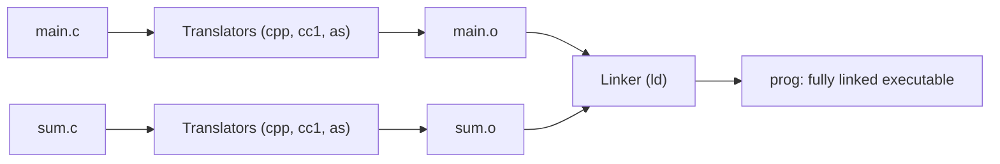

# Static linking: symbols and relocation

**Linking** is the process of collecting and combining pieces of code and data into a single file that can be loaded into memory and executed. It can happen at **compile time** (source is translated to machine code), at **load time** (the program is loaded into memory by the loader), or even at **run time** (by application programs). On modern systems it is performed automatically by programs called **linkers**.

Linkers make **separate compilation** possible: instead of one monolithic source file, an application is decomposed into modules that can be modified and compiled independently. Change one module, recompile just that one, and relink.

Why should a programmer understand linking?

- It helps you **build large programs**, where you will meet missing modules, missing libraries and incompatible library versions.
- It helps you **avoid dangerous programming errors**: the decisions linkers make when resolving symbols can silently affect correctness (e.g., duplicate global variables).
- It helps you understand **how language scoping rules are implemented** (what `static` really means).
- It helps you understand other systems concepts: **loading**, virtual memory, paging, memory mapping.
- It lets you exploit **shared libraries** and powerful techniques such as library interpositioning.

## 1. Compiler drivers

Consider a program of two files:

```c
/* main.c */
int sum(int *a, int n);

int array[2] = {1, 2};

int main() {
    int val = sum(array, 2);
    return val;
}
```

```c
/* sum.c */
int sum(int *a, int n) {
    int i, s = 0;
    for (i = 0; i < n; i++)
        s += a[i];
    return s;
}
```

`gcc -Og -o prog main.c sum.c` invokes the **compiler driver**, which runs, for each source file, the preprocessor (`cpp`: `main.c` → `main.i`), the compiler (`cc1`: → `main.s`) and the assembler (`as`: → `main.o`, a **relocatable object file**), then the linker (`ld`) to combine `main.o`, `sum.o` and the necessary system object files into the **executable object file** `prog`. To run it, the shell calls the **loader**, which copies the code and data of `prog` into memory and transfers control to its beginning.



## 2. What a static linker does

A static linker such as `ld` takes relocatable object files as input and generates a fully linked executable. Input files consist of **sections**: contiguous sequences of bytes holding instructions, initialized global data, uninitialized variables, and so on. The linker performs two main tasks:

1. **Symbol resolution.** Object files *define* and *reference* **symbols**: functions, global variables, static variables. The linker associates each symbol reference with exactly one symbol definition.
2. **Relocation.** Compilers and assemblers generate code and data sections that start at address 0. The linker **relocates** these sections by associating a memory location with each symbol definition and then modifying all references to those symbols so that they point to that location, blindly following instructions generated by the assembler called **relocation entries**.

A basic fact to keep in mind: object files are merely collections of blocks of bytes. The linker concatenates blocks, decides on run-time locations for them, and modifies various locations within the blocks. It has **minimal understanding** of the target machine; the compiler and assembler have already done most of the work.

## 3. Object files

Three forms:

- **Relocatable object file** (`.o`): binary code and data in a form that can be combined with other relocatable files at compile time.
- **Executable object file**: can be copied directly into memory and executed.
- **Shared object file** (`.so`): a special relocatable file that can be loaded into memory and linked **dynamically**, at load time or run time.

Formats vary by system: Windows uses **PE** (Portable Executable), macOS uses **Mach-O**, and modern x86-64 Linux and Unix systems use **ELF** (Executable and Linkable Format).

### ELF relocatable object files

| Section | Contents |
|---|---|
| ELF header | Word size, byte ordering, file type (relocatable/executable/shared), machine type, offset of the section header table |
| `.text` | Machine code of the compiled program |
| `.rodata` | Read-only data: format strings for `printf`, jump tables for `switch` |
| `.data` | **Initialized** global and static C variables |
| `.bss` | **Uninitialized** global and static variables, and those initialized to zero. Occupies **no actual space** in the file: just a placeholder. ("Better Save Space!") |
| `.symtab` | **Symbol table**: functions and global variables defined and referenced. No entries for local (stack) variables |
| `.rel.text` | Locations in `.text` that must be modified when the linker combines this file with others (calls to external functions, references to globals) |
| `.rel.data` | Relocation information for global variables whose initial value is the address of a global or externally defined function |
| `.debug` | Debugging symbol table (present with `-g`) |
| `.line` | Mapping between line numbers in source and instructions in `.text` (with `-g`) |
| `.strtab` | String table for names in `.symtab`, `.debug` and section headers |
| Section header table | Describes the location and size of every section |

Local nonstatic variables are **not** in any of these sections: they live on the stack (or in registers) at run time.

## 4. Symbols and symbol tables

Each relocatable module $m$ has a symbol table with three kinds of symbols:

- **Global symbols** *defined* by $m$ and usable by other modules: nonstatic C functions and global variables.
- **Externals**: global symbols *referenced* by $m$ but defined by some other module.
- **Local symbols** defined and referenced exclusively by $m$: **`static`** C functions and `static` global variables. Visible anywhere within $m$, invisible outside it.

Do not confuse local linker symbols with local program variables: the symbol table has **no entries for nonstatic local variables**, which the stack manages at run time. But a local variable declared `static` inside a function is *not* on the stack: the compiler allocates space for it in `.data` or `.bss` and creates a local linker symbol with a unique name. If two functions each define `static int x`, the assembler might emit `x.1` and `x.2`.

> [!TIP]
> **Hide names with `static`.** C's `static` attribute plays the role of `private` in Java and C++: any global variable or function declared `static` is private to its module. It is good practice to protect variables and functions with `static` wherever possible.

An ELF symbol table entry contains the name (offset in the string table), the value (offset within its section for relocatable files; an absolute run-time address for executables), the size, the type (data/function), the binding (local/global), and the **section** the symbol is assigned to. Three **pseudosections** have no entries in the section header table:

- **ABS**: symbols that should not be relocated.
- **UNDEF**: undefined symbols, referenced here but defined elsewhere.
- **COMMON**: uninitialized data objects not yet allocated.

The distinction between COMMON and `.bss` is subtle: GCC assigns **uninitialized global variables** to COMMON, and **uninitialized static variables, plus global or static variables initialized to zero**, to `.bss`. The reason lies in how symbol resolution works, coming next.

`readelf -s main.o` shows, for our example: `main` (GLOBAL FUNC, section 1 = `.text`, size 24), `array` (GLOBAL OBJECT, section 3 = `.data`, size 8), and `sum` (GLOBAL NOTYPE, UND).

## 5. Symbol resolution

For local symbols, resolution is simple: one definition per module, guaranteed by the compiler. For global symbols it is trickier. When the compiler meets a symbol not defined in the current module, it **assumes it is defined elsewhere**, generates a symbol table entry, and leaves it to the linker. If the linker cannot find a definition in any input, it prints an error and terminates:

```
/tmp/ccSz5uti.o: In function `main':
/tmp/ccSz5uti.o(.text+0x7): undefined reference to `foo'
```

> [!NOTE]
> C++ and Java allow overloaded functions with the same name but different parameter lists. The compiler encodes each unique name-and-parameter combination into a unique linker name, a process called **mangling**. For example `Foo::bar(int, long)` becomes `bar__3Fooil`-style names; the linker sees only the mangled strings.

### Duplicate symbol names: strong and weak

What if several modules define the same global name? At compile time, the compiler exports each global symbol as either **strong** or **weak**:

- **Strong**: functions and **initialized** global variables.
- **Weak**: **uninitialized** global variables.

Linux linkers then apply three rules:

1. **Multiple strong symbols with the same name are not allowed.**
2. Given a strong symbol and multiple weak symbols with the same name, **choose the strong symbol**.
3. Given multiple weak symbols with the same name, **choose any** of the weak symbols.

Consequences:

```c
/* foo1.c */                 /* bar1.c */
int main() { return 0; }     int main() { return 0; }   // Rule 1: link error, main multiply defined

/* foo2.c */                 /* bar2.c */
int x = 15213;               int x = 15213;             // Rule 1: link error

/* foo3.c */                 /* bar3.c */
void f(void);                int x;                      // weak
int x = 15213;               void f() { x = 15212; }    // Rule 2: both refer to foo3's x
int main() { f(); printf("x = %d\n", x); }              // prints x = 15212. Surprise!
```

Rules 2 and 3 produce insidious bugs, especially when the duplicate definitions have **different types**:

```c
/* foo5.c */
int y = 15212;
int x = 15213;
int main() {
    f();
    printf("x = 0x%x y = 0x%x\n", x, y);
}

/* bar5.c */
double x;                 // weak; the linker picks foo5's 4-byte int x
void f() { x = -0.0; }    // writes 8 bytes: clobbers x AND the adjacent y
```

On x86-64 this prints `x = 0x0 y = 0x80000000`: assigning an 8-byte `double` to the location of the 4-byte `x` overwrote `y` as well. The linker only emits a warning about alignment. Such bugs manifest far from their cause and after the program has been running for a while.

This explains COMMON: when the compiler sees a weak global like `int x;`, it does not know whether another module also defines `x` or which will be chosen, so it defers the decision to the linker by assigning the symbol to COMMON. A zero-initialized `x` is strong, hence `.bss`; a static one is local, hence `.bss`.

> [!WARNING]
> **Rules for globals:** avoid them if you can. Otherwise use `static` if you can; initialize every global you define; use `extern` to declare references to globals defined elsewhere. Compile with `-fno-common` (the default in modern GCC ≥ 10) so that multiply-defined globals produce an error, or `-Werror`.

## 6. Linking with static libraries

Related object modules can be packaged into a single file called a **static library**, an **archive** (`.a` file on Linux), which is a concatenation of relocatable object files with a header describing each member. When linking, **the linker copies only the object modules that are referenced by the program**, reducing executable size on disk and in memory, while the programmer names only a few library files.

Compare the alternatives the book lists: having the compiler recognize standard functions (Pascal's approach; complicates the compiler), putting all of libc in one relocatable module (every executable would carry all ~5 MB), or one file per function (programmer must link each explicitly). Archives get the best of each. `libc.a` contains about 1,500 object modules (`printf.o`, `scanf.o`, ...); `libm.a` holds the math functions.

Creating and using a library:

```
linux> gcc -c addvec.c multvec.c
linux> ar rcs libvector.a addvec.o multvec.o
linux> gcc -c main2.c
linux> gcc -static -o prog2c main2.o ./libvector.a      # or: -L. -lvector
```

If `main2.o` references only `addvec`, the linker copies `addvec.o` into the executable but not `multvec.o`. It also pulls `printf.o` and its dependencies from `libc.a`.

### How linkers use static libraries to resolve references

The linker scans the relocatable files and archives **left to right in the order they appear on the command line**, maintaining three sets:

- $E$: relocatable object files that will be merged to form the executable,
- $U$: unresolved symbols (referenced but not yet defined),
- $D$: symbols defined by previous input files.

For each input file $f$:

- If $f$ is an **object file**, add it to $E$ and update $U$ and $D$ with its definitions and references.
- If $f$ is an **archive**, try to match the unresolved symbols in $U$ against the symbols defined by the archive's members. If member $m$ defines a symbol in $U$, add $m$ to $E$ and update $U$ and $D$. Repeat over the members until a fixed point where $U$ and $D$ no longer change. Members not in $E$ are **discarded**.
- At the end, if $U$ is nonempty, the linker prints an error. Otherwise it merges and relocates the files in $E$.

The catch: **the ordering of libraries and object files on the command line is significant.** If the library defining a symbol appears *before* the object file that references it, the reference will not be resolved:

```
linux> gcc -static ./libvector.a main2.c
/tmp/cc9XH6Rp.o: In function `main':
/tmp/cc9XH6Rp.o(.text+0x18): undefined reference to `addvec'
```

When `libvector.a` is processed, $U$ is empty, so no member is added. The rule of thumb: **put libraries at the end of the command line.** If libraries depend on each other, order them so that each symbol reference precedes its definition: if `foo.c` calls functions in `libx.a` and `libz.a`, both of which call `liby.a`, use `gcc foo.c libx.a libz.a liby.a`. Mutually dependent libraries may need to be repeated: `gcc foo.c libx.a liby.a libx.a`.

```python-run
def link(inputs):
    """inputs: list of ('obj', defs, refs) or ('lib', [(defs, refs), ...])"""
    E, U, D = [], set(), set()
    def add(name, defs, refs):
        E.append(name); D.update(defs); U.difference_update(defs); U.update(set(refs) - D)
    for kind, name, payload in inputs:
        if kind == "obj":
            add(name, *payload)
        else:
            changed = True
            while changed:
                changed = False
                for mname, defs, refs in payload:
                    if mname not in E and U & set(defs):
                        add(mname, defs, refs); changed = True
    return E, sorted(U)
libvector = ("lib", "libvector.a", [("addvec.o", ["addvec"], []), ("multvec.o", ["multvec"], [])])
main2 = ("obj", "main2.o", (["main"], ["addvec"]))
print("main2.o libvector.a ->", link([main2, libvector]))
print("libvector.a main2.o ->", link([libvector, main2]))
```

## 7. Relocation

Once every reference is bound to exactly one definition, the linker knows the exact sizes of the code and data sections, and relocates in two steps:

1. **Relocating sections and symbol definitions.** Merge all sections of the same type into a new aggregate section (all `.data` sections become the executable's `.data`), assign run-time addresses to the aggregate sections, to each input section, and to each symbol. Now every instruction and global variable has a unique run-time address.
2. **Relocating symbol references within sections.** Modify every symbol reference in the code and data so that it points to the correct run-time address, guided by **relocation entries**.

### Relocation entries

When the assembler meets a reference to an object whose ultimate location is unknown, it generates a relocation entry telling the linker how to patch the reference. Code entries go in `.rel.text`, data entries in `.rel.data`. Each has:

```c
typedef struct {
    long offset;      /* offset of the reference to relocate, within its section */
    long type:32,     /* relocation type */
         symbol:32;   /* symbol table index */
    long addend;      /* constant part of the relocation expression */
} Elf64_Rela;
```

ELF defines 32 relocation types; the two most basic are:

- **`R_X86_64_PC32`**: relocate a reference that uses a 32-bit **PC-relative** address (e.g., a `call` target).
- **`R_X86_64_32`**: relocate a reference that uses a 32-bit **absolute** address.

These two support the x86-64 **small code model**, which assumes the total size of code and data in the executable is under 2 GB so that 32-bit PC-relative addresses suffice (the GCC default).

### Worked example

Disassembling `main.o`:

```
0000000000000000 <main>:
   0: 48 83 ec 08          sub    $0x8,%rsp
   4: be 02 00 00 00       mov    $0x2,%esi
   9: bf 00 00 00 00       mov    $0x0,%edi        # %edi = &array
                    a: R_X86_64_32 array           # relocation entry
   e: e8 00 00 00 00       callq  13 <main+0x13>   # sum()
                    f: R_X86_64_PC32 sum-0x4       # relocation entry
  13: 48 83 c4 08          add    $0x8,%rsp
  17: c3                   retq
```

**PC-relative reference** (`call sum`). The entry is `r.offset = 0xf`, `r.symbol = sum`, `r.type = R_X86_64_PC32`, `r.addend = -4`. Suppose the linker has decided `ADDR(.text) = 0x4004d0` for `main` and `ADDR(sum) = 0x4004e8`. Then:

$$\text{refaddr} = \text{ADDR(s)} + \text{r.offset} = \text{0x4004d0} + \text{0xf} = \text{0x4004df}$$
$$*\text{refptr} = \text{ADDR(r.symbol)} + \text{r.addend} - \text{refaddr} = \text{0x4004e8} + (-4) - \text{0x4004df} = \text{0x5}$$

So the call becomes `4004de: e8 05 00 00 00 callq 4004e8 <sum>`. At run time the CPU pushes the return address `0x4004e3` and computes PC ← PC + 0x5 = `0x4004e3 + 0x5 = 0x4004e8`. The addend −4 compensates for the fact that the PC already points 4 bytes past the start of the 32-bit field when the displacement is applied.

**Absolute reference** (`mov $array, %edi`). The entry: `r.offset = 0xa`, `r.symbol = array`, `r.type = R_X86_64_32`, `r.addend = 0`. With `ADDR(array) = 0x601018`, the linker writes `*refptr = ADDR(r.symbol) + r.addend = 0x601018`, giving `bf 18 10 60 00 mov $0x601018,%edi`.

```python-run
def reloc_pc32(addr_section, r_offset, addr_symbol, addend):
    refaddr = addr_section + r_offset
    return (addr_symbol + addend - refaddr) & 0xFFFFFFFF
def reloc_abs32(addr_symbol, addend):
    return (addr_symbol + addend) & 0xFFFFFFFF
print(hex(reloc_pc32(0x4004d0, 0xf, 0x4004e8, -4)))    # 0x5
print(hex(reloc_abs32(0x601018, 0)))                    # 0x601018
```

> [!INTERVIEW]
> **"What is the difference between a declaration and a definition, and what causes 'undefined reference' vs. 'multiple definition' errors?"** A declaration tells the compiler a name's type; a definition allocates storage or provides code. *Undefined reference* = the linker found references but no definition (forgot to link a file/library, wrong library order, C++ name mangling without `extern "C"`). *Multiple definition* = two strong symbols with one name (e.g., defining a variable in a header included by two `.c` files; the fix is `extern` in the header and one definition in a `.c`).

> [!INTERVIEW]
> **"Where do these variables live?"** `int g = 1;` → `.data`. `int g;` → COMMON/`.bss`. `static int s;` → `.bss`. `const char *msg = "hi";` → the string in `.rodata`, the pointer in `.data`. A local `int x;` → stack or register, no symbol. A local `static int c = 0;` → `.bss` with a local symbol.

## 8. Summary

- Linkers combine relocatable object files by **symbol resolution** and **relocation**.
- ELF relocatable files carry `.text`, `.rodata`, `.data`, `.bss`, `.symtab`, relocation sections and more.
- Symbols are global, external or local (`static`). Stack locals have no symbols.
- Strong vs. weak: no two strong; strong beats weak; any of several weak. Type-mismatched duplicates corrupt memory silently.
- Static libraries are archives; the linker pulls only referenced members, scanning left to right, so **libraries go last**.
- Relocation patches references using entries (offset, symbol, type, addend): PC-relative `S + A - P`, absolute `S + A`.

## Check yourself

```quiz
[
  {"q": "Which ELF section holds an uninitialized static variable?", "options": [".data", ".bss", ".rodata", "COMMON"], "answer": 1,
   "explain": "Uninitialized statics (and zero-initialized globals/statics) go to .bss; uninitialized non-static globals go to COMMON."},
  {"q": "Module A has 'int x = 5;' and module B has 'int x;'. What happens at link time?", "options": ["Link error: duplicate symbol", "Both refer to A's x (strong beats weak)", "Each module gets its own x", "The linker picks B's"], "answer": 1,
   "explain": "Rule 2: a strong symbol overrides weak symbols of the same name."},
  {"q": "Two modules each define 'int x = 1;'. Result?", "options": ["The first on the command line wins", "Link error: multiple strong symbols", "They are merged", "Undefined behavior at run time"], "answer": 1,
   "explain": "Rule 1 forbids multiple strong definitions."},
  {"q": "Does a non-static local variable of a function appear in .symtab?", "options": ["Yes, as a local symbol", "Yes, as a global symbol", "No, it is managed on the stack at run time", "Only with -O2"], "answer": 2,
   "explain": "The linker symbol table has no entries for automatic local variables."},
  {"q": "gcc -static libfoo.a main.o fails with an undefined reference to a function in libfoo.a. Why?", "options": ["Static libraries cannot be linked", "The archive was scanned when the unresolved set was empty, so no member was extracted", "main.o is corrupt", "The function is weak"], "answer": 1,
   "explain": "Archives are searched only for symbols currently unresolved; libraries must come after the objects that use them."},
  {"q": "For an R_X86_64_PC32 relocation with ADDR(symbol)=0x4004e8, addend=-4 and refaddr=0x4004df, what value is stored?", "options": ["0x4004e8", "0x5", "0x9", "0xd"], "answer": 1,
   "explain": "0x4004e8 - 4 - 0x4004df = 0x5."},
  {"q": "What does the static keyword do to a global function in C?", "options": ["Stores it in .bss", "Makes its symbol local to the module so other files cannot reference it", "Makes it faster", "Puts it in a shared library"], "answer": 1,
   "explain": "static gives internal linkage: a local linker symbol, invisible to other modules."},
  {"q": "Why does .bss occupy no space in the object file?", "options": ["It is compressed", "Its contents are all zero, so only its size needs recording; memory is allocated at run time", "It is stored in .data", "It is discarded by the linker"], "answer": 1,
   "explain": "Uninitialized data needs no bytes on disk; the loader provides zero-filled memory."}
]
```

> **Source:** CS:APP 3e, §7.1–7.7 (Compiler drivers; Static linking; Object files; Relocatable object files; Symbols and symbol tables; Symbol resolution, static libraries; Relocation).
