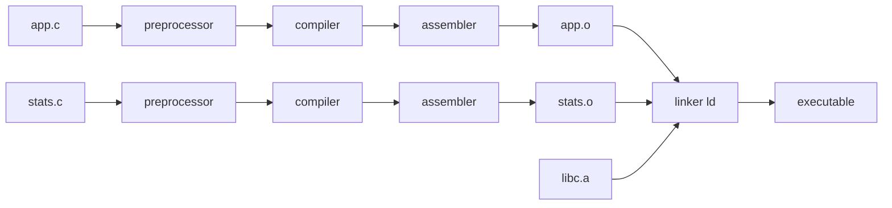

# Static linking: symbols and relocation

> **Before this lesson:** You should know the stages that turn source code into a program from [From source text to a running program](#/lesson/csapp/tour-hello), and be able to read a `call` instruction and an address in hexadecimal from [x86-64 basics: registers, operands, mov](#/lesson/csapp/asm-basics).

## In plain words

Large programs are written as many separate files. Each file is translated on its own into a piece called an **object file**, and a tool called the **linker** joins the pieces into one runnable program. Imagine several authors writing chapters of one book separately. One chapter says "see the chapter on sailing" without knowing which page that will be. An editor then gathers the chapters, decides the final page numbers, and goes back through every "see..." note to fill in the real page. The linker is that editor. The named things being referred to (functions and shared variables) are called **symbols**, matching each reference to its definition is **symbol resolution**, and filling in the final addresses is **relocation**.

Why this matters at work: "undefined reference" and "multiple definition" errors come from the linker and stop builds every day. Once you understand what it does, those messages become quick to fix. The lesson also explains a silent bug in which two files disagree about a shared variable and overwrite each other's data.

## Why look closer

Sooner or later every C or C++ programmer meets one of these messages: `undefined reference to 'parse_config'`, or `multiple definition of 'buffer'`. Neither comes from the compiler. Both come from the **linker**, a tool most people use daily and understand vaguely. That vagueness is expensive. It makes build errors look like magic, it hides a class of silent bugs in which two source files disagree about a global variable and corrupt each other's memory without any warning, and it makes the order of libraries on a command line seem like superstition. This lesson explains what a linker does, concretely enough that you can predict its behaviour: how it decides which definition a name refers to, how it lays out the final program, and how it patches machine code with addresses that the compiler could not know.

## 1. Why programs are built in pieces

**Linking** is the process of collecting and combining pieces of code and data into a single file that can be loaded into memory and run. It can happen at compile time, at load time, or even while the program is running. This lesson covers the first, **static linking**; the next covers the others.

The point of having a linker at all is **separate compilation**. A large program is not one enormous source file. It is many modules, each compiled independently. Change one, and only that one has to be recompiled before relinking. Libraries of commonly used functions can be compiled once and reused by everybody.

When you run a compiler driver such as `gcc`, it quietly runs a pipeline for each source file and then links the results:



To build the executable, the linker has two jobs:

1. **Symbol resolution.** Object files define and refer to *symbols*: functions, global variables, static variables. The linker must associate each reference with exactly one definition.
2. **Relocation.** Compilers and assemblers produce code and data that start at address 0. The linker assigns each definition a real memory location and then modifies every reference so that it points there.

Keep one fact in mind: the linker knows almost nothing about your program's meaning. Object files are blocks of bytes, some containing code, some data, and some containing instructions *for the linker itself*. The compiler and assembler have already done most of the thinking.

## 2. Object files

Object files come in three kinds:

| Kind | Produced by | Purpose |
|---|---|---|
| **Relocatable** (`.o`) | compiler and assembler | to be combined with other relocatable files at link time |
| **Executable** | linker | can be copied into memory and run directly |
| **Shared** (`.so`) | compiler and linker | a special relocatable file that can be loaded and linked at load time or run time |

On Linux all three use the **ELF** format. A relocatable ELF file begins with a header describing the file (word size, byte order, machine type, where the section header table is) and is then divided into sections:

| Section | Contents |
|---|---|
| `.text` | machine code of the compiled program |
| `.rodata` | read-only data: string literals, `switch` jump tables |
| `.data` | global and static variables with a non-zero initial value |
| `.bss` | global and static variables that are uninitialised or initialised to zero; takes no space in the file |
| `.symtab` | a table of the functions and global variables defined and referenced |
| `.rel.text` | locations in `.text` that must be patched when the linker combines this file with others |
| `.rel.data` | the same for `.data`, for example a global pointer initialised with the address of another global |
| `.debug`, `.line` | debugging information, present only when compiled with `-g` |
| `.strtab` | the text of symbol and section names |

The `.bss` section deserves a second look. A declaration such as `static double samples[1000000];` needs eight megabytes at run time, but every byte is zero. Storing eight megabytes of zeros on disk would be wasteful, so the file records only "this much zeroed space is required". One mnemonic for the name is "Better Save Space".

Local variables that are not `static` appear in none of these sections. They live on the stack or in registers at run time and are of no interest to the linker.

## 3. Symbols and symbol tables

From the point of view of one module, call it *m*, there are three kinds of linker symbol:

- **Global symbols defined by *m***: its non-static functions and non-static global variables, which other modules can refer to.
- **Global symbols referenced by *m* but defined elsewhere**, called **externals**.
- **Local symbols**: functions and global variables declared `static`. They are visible everywhere inside *m* and invisible outside it.

Do not confuse local *linker symbols* with local *program variables*. A non-static local variable is managed on the stack and has no symbol table entry at all. A `static` local variable, by contrast, is not on the stack: the compiler gives it space in `.data` or `.bss` and creates a local linker symbol with a unique name, so two functions in one file may each have a `static int calls;` without interfering.

> [!TIP]
> In C, `static` at file scope is the tool for information hiding, playing the role of `private` in other languages. Declare every function and global `static` unless another file truly needs it. You get a cleaner namespace and fewer linker surprises.

Each `.symtab` entry records the symbol's name, its **value** (for a relocatable file, its offset from the start of the section where it is defined), its size, its type (function or data), its binding (local or global), and the **section** it belongs to. Three special pseudo-sections exist for symbols that are not in any ordinary one:

- `ABS`: the symbol should not be relocated;
- `UNDEF`: the symbol is referenced here but defined somewhere else;
- `COMMON`: uninitialised data objects that have not yet been allocated.

Take this pair of files:

```c
/* stats.c */
int samples[3] = {4, 8, 15};
static int calls;

int total(void) {
    static int cache = -1;
    calls++;
    if (cache < 0) cache = samples[0] + samples[1] + samples[2];
    return cache;
}

/* app.c */
extern int samples[];
int total(void);
int main(void) { return total() + samples[0]; }
```

```python-run
# What the symbol tables of the two object files contain (as a tool like readelf would report).
stats_o = [
    ("samples", "OBJECT", "GLOBAL", ".data"),
    ("calls",   "OBJECT", "LOCAL",  ".bss"),
    ("cache.0", "OBJECT", "LOCAL",  ".data"),     # static local: renamed, stored in .data (non-zero initialiser)
    ("total",   "FUNC",   "GLOBAL", ".text"),
]
app_o = [
    ("main",    "FUNC",   "GLOBAL", ".text"),
    ("total",   "NOTYPE", "GLOBAL", "UNDEF"),
    ("samples", "NOTYPE", "GLOBAL", "UNDEF"),
]
for name, table in (("stats.o", stats_o), ("app.o", app_o)):
    print(name)
    for sym, kind, bind, sect in table:
        print(f"   {sym:9} {kind:7} {bind:7} {sect}")
undefined = {s for s, _, _, sect in app_o if sect == "UNDEF"}
defined = {s for s, _, bind, sect in stats_o if bind == "GLOBAL" and sect != "UNDEF"}
print("app.o's undefined symbols all satisfied by stats.o:", undefined <= defined)
```

## 4. Symbol resolution

For references to local symbols, resolution is trivial: the compiler permits only one definition per module. Global symbols are the hard case. When the compiler sees a name that is not defined in the current file, it assumes that it is defined in some other module, makes a symbol table entry, and leaves it to the linker. If the linker cannot find a definition in any input, it prints the familiar error and stops.

C++ and Java allow overloading, so several functions can share a source-level name. Their compilers encode the parameter types into each linker symbol, a process called **name mangling**, which is why C++ link errors mention names such as `_ZN5Stack4pushEi`.

### Duplicate names: strong and weak

What if the same global name is defined in more than one module? At compile time, each global symbol is exported to the assembler as either **strong** or **weak**:

- **Strong**: functions and *initialised* global variables.
- **Weak**: *uninitialised* global variables.

The linker then applies three rules:

1. Multiple strong symbols with the same name are an error.
2. Given one strong symbol and several weak ones with the same name, choose the strong one.
3. Given several weak symbols with the same name, choose any one of them.

Rule 1 gives a clear error. Rules 2 and 3 give *no diagnostic by default*, and that is where the danger lies. Consider:

```c
/* a.c */                          /* b.c */
int level = 7;                     double level;            /* weak, and a different type! */
int limit = 9;                     void reset(void) { level = 0.0; }
```

The linker picks the strong `int level` from `a.c`, which is four bytes. But `b.c` was compiled believing `level` is an eight-byte `double`. When `reset` runs, it writes eight bytes at the address of `level`, wiping out whatever lies in the next four, quite possibly `limit`. No error, no warning, and a failure that shows up far from its cause.

```python-run
import struct
# .data of a.o: level (4 bytes) followed immediately by limit (4 bytes)
memory = bytearray(struct.pack("<ii", 7, 9))
print("before reset():  level =", struct.unpack_from("<i", memory, 0)[0],
      " limit =", struct.unpack_from("<i", memory, 4)[0])

struct.pack_into("<d", memory, 0, 0.0)        # b.c stores a double at &level: 8 bytes
print("after  reset():  level =", struct.unpack_from("<i", memory, 0)[0],
      " limit =", struct.unpack_from("<i", memory, 4)[0], "  <- limit was silently destroyed")

struct.pack_into("<ii", memory, 0, 7, 9)
struct.pack_into("<d", memory, 0, -1.5)       # a non-zero store shows the damage more vividly
print("storing -1.5:    level =", struct.unpack_from("<i", memory, 0)[0],
      " limit =", struct.unpack_from("<i", memory, 4)[0])
```

Defences:

- avoid global variables where you can;
- make them `static` if they are used in only one file;
- initialise any true global, so that a duplicate becomes a rule 1 error;
- declare shared globals in exactly one header with `extern`, and define them in exactly one source file;
- compile with `-fno-common`, which makes a multiply-defined global an error. Recent GCC versions do this by default.

This also explains the `COMMON` pseudo-section. When the compiler meets an uninitialised global, it cannot tell whether another module will define the same name, so it defers the decision to the linker by marking the symbol `COMMON`. Uninitialised *static* variables cannot clash with anything, so they go straight into `.bss`.

> [!INTERVIEW]
> **"Two files both declare `int x;` at file scope with no initialiser, and the program links without complaint. What happened?"** Under the traditional rules both are weak symbols, so the linker silently merges them into one variable shared by both files. If the declarations have different types, the files disagree about the variable's size, and writes from one can corrupt neighbouring data. The fix is `static` for file-private variables, or one definition plus `extern` declarations in a header, and building with `-fno-common`.

## 5. Static libraries

Related object modules can be packaged into a single file called a **static library**, or archive, with the suffix `.a`. An archive is a collection of concatenated relocatable object files with a header describing each member. It is created with the `ar` tool.

Why not put all of the standard functions into one big object file? Because every program would then carry every function. Why not one object file per function? Because programmers would have to name dozens of files on every link. The archive gives the best of both: you name one library, and **the linker copies only the members that your program actually references**. The standard C library `libc.a` contains well over a thousand modules; a program calling `printf` receives only `printf.o` and whatever that module in turn requires.

### How libraries are scanned, and why order matters

The linker processes the files on its command line **strictly from left to right**, maintaining three sets:

- **E**: the relocatable object files that will be merged into the executable;
- **U**: unresolved symbols, referred to but not yet defined;
- **D**: symbols defined by the files already seen.

All three start empty. For each input file *f*:

- If *f* is an **object file**, add it to E, and update U and D with its definitions and references.
- If *f* is an **archive**, try to match the symbols currently in U against the symbols defined by the archive's members. If member *m* defines one, add *m* to E and update U and D. Repeat over the members until U and D stop changing. Any member not in E by then is **discarded**, and the linker moves on.

At the end, if U is not empty, the linker reports the unresolved symbols and stops. Otherwise it merges and relocates the files in E.

The consequence is one of the most common link errors there is. Suppose `main.o` calls a function in `libshape.a`:

```
gcc main.o ./libshape.a      # works
gcc ./libshape.a main.o      # undefined reference
```

In the second command, when the archive is scanned, U is still empty, so no member is pulled in. Then `main.o` adds its reference to U, and there is nothing left to satisfy it.

The rules of thumb that follow:

- Put libraries at the **end** of the command line.
- If library X uses symbols from library Y, X must come **before** Y.
- If two libraries depend on each other, a library may be repeated: `gcc app.o libx.a liby.a libx.a`.

```python-run
def link(files):
    E, U, D = [], set(), set()
    for name, content in files:
        if isinstance(content, dict) and "members" in content:        # an archive
            changed = True
            while changed:
                changed = False
                for mname, m in content["members"].items():
                    if mname not in E and U & m["defines"]:
                        E.append(mname)
                        D |= m["defines"]; U |= m["refs"]; U -= D
                        changed = True
        else:                                                          # an object file
            E.append(name)
            D |= content["defines"]; U |= content["refs"]; U -= D
    return E, sorted(U)

main_o = {"defines": {"main"}, "refs": {"area"}}
libshape = {"members": {
    "area.o":   {"defines": {"area"},   "refs": {"square"}},
    "square.o": {"defines": {"square"}, "refs": set()},
    "unused.o": {"defines": {"volume"}, "refs": set()},
}}
for order in ([("main.o", main_o), ("libshape.a", libshape)],
              [("libshape.a", libshape), ("main.o", main_o)]):
    E, U = link(order)
    print(" ".join(n for n, _ in order).ljust(22), "-> linked:", E, "| unresolved:", U or "none")
```

Notice in the successful case that `unused.o` is not included, and that `square.o` was pulled in on a second pass over the archive because `area.o` needed it.

## 6. Relocation

Once every reference has been matched to one definition, the linker knows the exact sizes of all the code and data sections in its input, and can assign addresses. Relocation has two steps.

**Step 1: relocate sections and symbol definitions.** The linker merges all sections of the same type into one: all the `.text` sections of the inputs become the executable's single `.text`, and likewise for `.data`. It then assigns run-time addresses to the merged sections, to each input section inside them, and to every symbol. After this step, every function and global variable has a unique address.

**Step 2: relocate references.** The linker modifies each symbol reference in the code and data so that it points to the correct address. For this it relies on **relocation entries**.

When the assembler meets a reference to something whose final location it does not know, it emits a placeholder and a relocation entry telling the linker how to fix it up later. Entries for code go in `.rel.text` and for data in `.rel.data`. Each entry holds:

- `offset`: where in the section the reference to be patched lies;
- `symbol`: which symbol it should point to;
- `type`: how to compute the new bytes;
- `addend`: a signed constant used by some types to bias the result.

ELF defines dozens of types. Two basic ones are enough to understand the idea:

| Type | Meaning | Value stored |
|---|---|---|
| `R_X86_64_PC32` | 32-bit **PC-relative** address | `ADDR(symbol) + addend - address of the reference` |
| `R_X86_64_32` | 32-bit **absolute** address | `ADDR(symbol) + addend` |

### Worked example: a PC-relative call

Suppose `main` contains a call to `total`. In `app.o`, disassembled, the call looks like this:

```
  1a:   e8 00 00 00 00      call  1f <main+0x1f>
                    1b: R_X86_64_PC32   total-0x4
```

The opcode `e8` is at offset `0x1a` within the section. The four bytes after it, at offset `0x1b`, are a placeholder. The entry says: patch four bytes at offset `0x1b` with the PC-relative address of `total`, using an addend of -4.

Now suppose the linker has decided that this `.text` section starts at address `0x401000` and that `total` lives at `0x401060`. Then:

- address of the reference = `0x401000 + 0x1b` = `0x40101b`;
- patched value = `0x401060 + (-4) - 0x40101b` = `0x41`.

The instruction becomes `e8 41 00 00 00`. Check it from the CPU's side. When the call executes, the program counter already holds the address of the *next* instruction, `0x40101f`. The processor adds the displacement: `0x40101f + 0x41` = `0x401060`. That is exactly `total`.

Why -4? A PC-relative displacement is measured from the end of the instruction, but the relocation is computed from the address of the four-byte field itself, which starts four bytes earlier. The addend makes up the difference.

### Worked example: an absolute reference

Suppose an instruction loads the address of `samples`, and the entry says `R_X86_64_32 samples` with addend 0 at offset `0x0a`. If the linker placed `samples` at `0x404028`, it writes the bytes `28 40 40 00` (little-endian) into the instruction.

```python-run
def relocate_pc32(section_addr, offset, symbol_addr, addend):
    ref_addr = section_addr + offset
    return (symbol_addr + addend - ref_addr) & 0xFFFFFFFF

def relocate_abs32(symbol_addr, addend):
    return (symbol_addr + addend) & 0xFFFFFFFF

text = 0x401000
disp = relocate_pc32(text, 0x1b, 0x401060, -4)
next_pc = text + 0x1b + 4
print(f"patched displacement: {disp:#x}  -> bytes e8 {disp.to_bytes(4, 'little').hex(' ')}")
print(f"CPU computes target : {next_pc:#x} + {disp:#x} = {(next_pc + disp) & 0xFFFFFFFF:#x}")

value = relocate_abs32(0x404028, 0)
print(f"absolute reference  : bytes {value.to_bytes(4, 'little').hex(' ')}")

back = relocate_pc32(text, 0x51, 0x401010, -4)      # a call to a function at a LOWER address
print(f"backward call       : displacement {back:#x} = {back - (1 << 32)} as a signed number")
```

> [!INTERVIEW]
> **"What does a linker do?"** Two things. It resolves symbols, pairing every reference with one definition, using the strong/weak rules for duplicates and scanning archives left to right for members that satisfy outstanding references. Then it relocates: merges like sections, assigns final addresses, and patches each reference as directed by the relocation entries, computing either a PC-relative displacement or an absolute address. Mentioning why library order matters and what `undefined reference` means in terms of the unresolved set shows practical experience.

## 7. Pitfalls

- **Libraries before the objects that use them.** The archive is scanned once, at its position in the command line.
- **Uninitialised globals with the same name in two files.** Merged silently unless `-fno-common` is in effect.
- **Mismatched declarations across files.** The linker does not check types. A function declared with the wrong signature in the caller links cleanly and misbehaves at run time. Shared headers are the cure.
- **Thinking `static` locals are on the stack.** They live in `.data` or `.bss` and keep their value between calls.
- **Thinking `.bss` variables enlarge the file.**
- **Calling C from C++ without `extern "C"`.** The C++ compiler mangles the name, and the linker cannot find the plain C symbol.
- **Defining variables in headers.** Every file that includes the header gets a strong definition, and the link fails with duplicates.

## Summary

- Linking combines separately compiled object files into an executable. Static linkers perform symbol resolution and then relocation.
- Relocatable ELF files hold `.text`, `.rodata`, `.data`, `.bss`, a symbol table, and relocation entries.
- Symbols are global, external, or local (`static`). Non-static local variables are not linker symbols.
- Duplicate globals are resolved by strength: two strong definitions are an error, a strong beats a weak, and among weak ones any may be chosen, which can silently corrupt data when types differ.
- Static libraries are archives from which the linker extracts only the members needed, in a single left-to-right scan; order on the command line matters.
- Relocation merges sections, assigns addresses, and patches references using entries such as `R_X86_64_PC32` and `R_X86_64_32`.

## Glossary

- **Linker**: the tool that combines object files and libraries into an executable program.
- **Object file**: the output of compiling one source file: machine code and data plus information for the linker.
- **ELF**: Executable and Linkable Format, the file layout Linux uses for object files and programs.
- **Section**: a named part of an object file, such as `.text` for code or `.data` for initialised variables.
- **`.bss`**: the section for variables that start as zero; it takes no space in the file.
- **Symbol**: a name for a function or variable that the linker tracks.
- **Symbol table**: the list of symbols an object file defines and refers to.
- **Symbol resolution**: matching every reference to a symbol with exactly one definition.
- **Strong / weak symbol**: a function or initialised global / an uninitialised global, used to decide between duplicate names.
- **Static library (archive)**: a file bundling many object files, from which the linker copies only those needed.
- **Relocation**: assigning final addresses and patching references to use them.
- **Relocation entry**: a note left by the assembler telling the linker which bytes to patch and how.
- **PC-relative address**: an address stored as a distance from the current instruction instead of an absolute number.

```quiz
[
  {"q": "In which section of a relocatable object file is the variable 'static int hits;' (declared at file scope, no initialiser) placed?",
   "options": [".data", ".bss", ".rodata", "COMMON"],
   "answer": 1, "explain": "Uninitialised static variables cannot be merged with definitions in other modules, so they go directly to .bss. Only uninitialised non-static globals are marked COMMON."},
  {"q": "Which of these does NOT have an entry in the object file's symbol table?",
   "options": ["A non-static function", "A static global variable", "A non-static local variable inside a function", "A static local variable inside a function"],
   "answer": 2, "explain": "Ordinary local variables live on the stack or in registers and are invisible to the linker. Static locals get a uniquely named local symbol."},
  {"q": "File one contains 'int n = 5;' and file two contains 'int n = 6;' at file scope. What does the linker do?",
   "options": ["Picks the first one", "Picks the last one", "Reports a multiple-definition error", "Merges them into an array"],
   "answer": 2, "explain": "Both are initialised globals and therefore strong. Two strong symbols with the same name violate the first rule."},
  {"q": "File one has 'int v = 1; int w = 2;' and file two has 'double v;' and assigns to it. The program links. What is the risk?",
   "options": ["None", "The assignment writes 8 bytes at the address of a 4-byte variable and may overwrite w", "The linker converts the double to an int", "The program will not start"],
   "answer": 1, "explain": "The strong 4-byte definition is chosen, but file two's code was compiled for an 8-byte object, so its store spills into the adjacent variable."},
  {"q": "Why does 'gcc libm_util.a main.o' fail with an undefined reference when 'gcc main.o libm_util.a' succeeds?",
   "options": ["Archives must be listed alphabetically", "When the archive is scanned first there are no unresolved symbols yet, so no members are extracted", "The archive is corrupted", "main.o must be compiled with -static"],
   "answer": 1, "explain": "The linker scans left to right and takes from an archive only members that define currently unresolved symbols. Later references are too late."},
  {"q": "A call instruction's 4-byte displacement field is at address 0x40101b, the target function is at 0x401060 and the addend is -4. What value does the linker store?",
   "options": ["0x45", "0x41", "0x401060", "0x3d"],
   "answer": 1, "explain": "The PC-relative formula is symbol + addend - reference address: 0x401060 - 4 - 0x40101b = 0x41."},
  {"q": "What is the purpose of a relocation entry?",
   "options": ["To record a symbol's type for the debugger", "To tell the linker where a reference must be patched and how to compute the value", "To reserve space in .bss", "To list the libraries the program needs"],
   "answer": 1, "explain": "The assembler cannot know final addresses, so it leaves a placeholder and an entry giving the offset, the symbol, the relocation type and an addend."},
  {"q": "When a program is linked against a static library containing 1,500 object modules and uses functions from 3 of them, how many modules are copied into the executable?",
   "options": ["All 1,500", "Only those 3, plus any that they in turn reference", "None; they are loaded at run time", "Exactly 3, never more"],
   "answer": 1, "explain": "The linker extracts only archive members that resolve outstanding references, including references introduced by members it has newly added."}
]
```

> **Source:** CS:APP 3e, §7.1–7.7
