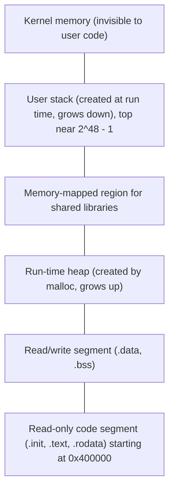
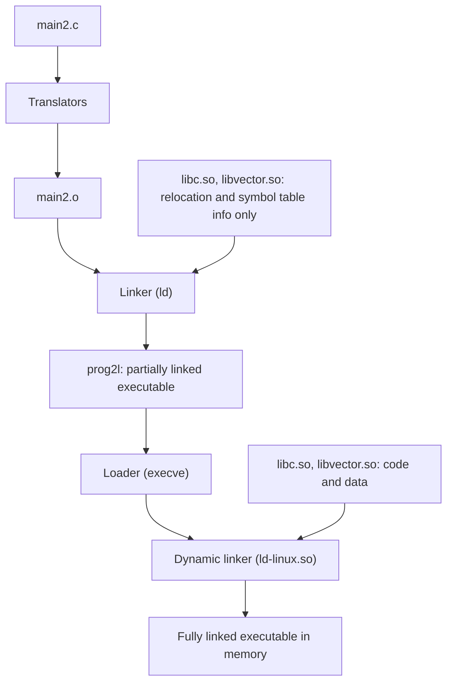
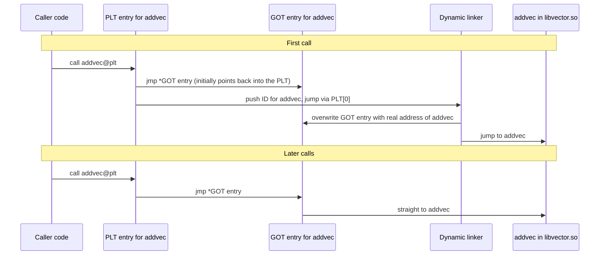

# Executables, loading and dynamic linking

The previous lesson followed relocatable object files through symbol resolution and relocation. This one picks up at the output: what an **executable object file** looks like, how the **loader** turns it into a running process, and how **shared libraries** push part of the linking job to load time or even run time. We end with **position-independent code** (the GOT and PLT) and **library interpositioning**, a technique for intercepting calls to arbitrary library functions.

## 1. Executable object files

An ELF executable resembles a relocatable file, but is organized for loading:

| Part | Role |
|---|---|
| ELF header | Overall format; includes the program's **entry point**, the address of the first instruction to run |
| **Segment header table** (program header table) | Maps contiguous file sections to run-time memory segments |
| `.init` | Defines a small function `_init` called by the program's initialization code |
| `.text`, `.rodata` | Code and read-only data (as before, but relocated to final addresses) |
| `.data`, `.bss` | Initialized data; uninitialized data |
| `.symtab`, `.debug`, `.line`, `.strtab` | Symbol and debugging info: **not loaded** into memory |
| Section header table | Describes object file sections |

There are no `.rel` sections: the file is **fully linked** (relocated).

The program header table, as shown by `objdump`, describes two loadable segments for the book's `prog`:

```
Read-only code segment
 LOAD off    0x0000000000000000 vaddr 0x0000000000400000 paddr 0x0000000000400000 align 2**21
      filesz 0x000000000000069c memsz 0x000000000000069c flags r-x
Read/write data segment
 LOAD off    0x0000000000000df8 vaddr 0x0000000000600df8 paddr 0x0000000000600df8 align 2**21
      filesz 0x0000000000000228 memsz 0x0000000000000230 flags rw-
```

- The **code segment** has read/execute permissions, starts at address `0x400000`, occupies `0x69c` bytes in memory, and is initialized from the first `0x69c` bytes of the file (ELF header, program header table, `.init`, `.text`, `.rodata`).
- The **data segment** has read/write permissions, starts at `0x600df8`, and occupies `0x230` bytes of memory, initialized with the `0x228` bytes of `.data` starting at file offset `0xdf8`. The remaining **8 bytes** correspond to `.bss`, initialized to zero at run time. That is the `.bss` trick in action: `memsz > filesz`.

For any segment, the linker must choose a starting address `vaddr` such that

$$\text{vaddr} \bmod \text{align} = \text{off} \bmod \text{align}$$

where `off` is the offset of the segment's first section in the file. This alignment requirement is an optimization that lets segments be transferred efficiently to memory by the virtual memory system (pages of the file map directly onto pages of memory, Module 9).

## 2. Loading executable object files

Typing `./prog` makes the shell run the **loader**, operating system code invoked through the `execve` function. The loader copies the code and data of the executable from disk into memory (conceptually; see below) and then runs the program by jumping to its first instruction, the **entry point**.

Every Linux x86-64 program has a run-time memory image like this:



- The code segment starts at `0x400000`, followed by the data segment.
- The **heap** follows the data segment and grows upward via `malloc`.
- A region for **shared modules** sits beyond the heap.
- The **user stack** starts below the largest legal user address ($2^{48} - 1$) and grows down.
- The region above, starting at $2^{48}$, is reserved for the **kernel**.

(Because of ASLR, the stack, shared library and heap locations vary from run to run; relative positions are the same.)

When the loader runs, it creates this image, guided by the program header table, and jumps to the entry point, which is always the address of the **`_start`** function, defined in the system object file `crt1.o`. `_start` calls the **system startup function `__libc_start_main`** (in `libc.so`), which initializes the execution environment, calls the user-level **`main`** function, handles its return value, and if necessary returns control to the kernel.

> [!NOTE]
> **How loaders really work.** Each program runs in a process with its own virtual address space. When the shell runs a program, the parent shell process **forks** a child that is a duplicate of the parent. The child invokes the loader via **`execve`**. The loader deletes the child's existing virtual memory segments and creates a new set of code, data, heap and stack segments. The new stack and heap are zero-initialized. The new code and data segments are initialized by **mapping pages** of the virtual address space to page-sized chunks of the executable file. Finally the loader jumps to `_start`. Aside from some header information, **no data is actually copied from disk to memory during loading**; copying is deferred until the CPU references a mapped virtual page, at which point the OS transfers the page from disk using its paging mechanism.

## 3. Dynamic linking with shared libraries

Static libraries have drawbacks:

- They must be maintained and updated periodically; to use a new version, programmers must explicitly **relink**.
- Nearly every C program uses standard I/O functions like `printf`. With static linking, their code is **duplicated** in the text segment of every running process and every executable on disk: a waste of scarce memory and storage.

**Shared libraries** address these. A shared library is an object module that, at either run time or load time, can be loaded at an arbitrary memory address and linked with a program in memory. The process is called **dynamic linking**, performed by a **dynamic linker**. Shared libraries are also called **shared objects** (`.so` on Linux; DLLs on Windows).

They are "shared" in two ways:

1. In any file system there is exactly **one `.so` file** for a library; its code and data are shared by all executables that reference it, rather than being copied into each.
2. A single copy of the library's **`.text` section in memory** can be shared by different running processes (through memory mapping, Module 9).

```
linux> gcc -shared -fpic -o libvector.so addvec.c multvec.c
linux> gcc -o prog2l main2.c ./libvector.so
```

`-fpic` tells the compiler to generate **position-independent code**; `-shared` tells the linker to create a shared object.



The key idea: do **some of the linking statically** when the executable is created, then **complete it dynamically** when the program is loaded. At static link time, none of the code or data sections of `libvector.so` are copied into `prog2l`; the linker copies only some relocation and symbol table information that will allow references to be resolved at load time.

When the loader loads `prog2l`, it notices an **`.interp`** section containing the path name of the dynamic linker (itself a shared object, e.g. `ld-linux.so`). Instead of passing control to the application, the loader loads and runs the dynamic linker, which finishes the job:

1. Relocating the text and data of `libc.so` into some memory segment.
2. Relocating the text and data of `libvector.so` into another memory segment.
3. Relocating any references in `prog2l` to symbols defined by `libc.so` and `libvector.so`.

Then it passes control to the application. From then on, the locations of the shared libraries are fixed for the life of the process.

## 4. Loading and linking shared libraries from applications

An application can also ask the dynamic linker to load and link arbitrary shared libraries **while it is running**. Uses: distributing software updates as new shared libraries; building high-performance web servers that load content-generating functions on demand and keep them cached, rather than `fork`ing a CGI child per request.

```c
#include <dlfcn.h>
void *dlopen(const char *filename, int flag);   /* returns a handle, or NULL on error */
void *dlsym(void *handle, char *symbol);        /* returns the symbol's address, or NULL */
int   dlclose(void *handle);                    /* unloads if no other users */
const char *dlerror(void);                      /* message for the most recent error */
```

`flag` is `RTLD_NOW` (resolve external references immediately) or `RTLD_LAZY` (defer until code from the library executes), optionally or-ed with `RTLD_GLOBAL`.

```c
void *handle = dlopen("./libvector.so", RTLD_LAZY);
void (*addvec)(int *, int *, int *, int) = dlsym(handle, "addvec");
addvec(x, y, z, 2);
dlclose(handle);
```

Compile with `gcc -rdynamic -o prog2r dll.c -ldl`. This is also how Java's JNI calls native C/C++ code, and how plugin systems work.

## 5. Position-independent code (PIC)

How can many processes share one copy of a library's code when each may load it at a different address? One approach would assign each library a dedicated chunk of the address space in advance; this wastes address space, fragments it, and is a management nightmare. Instead, modern systems compile shared modules so they can be loaded **anywhere** without the linker modifying the code: **position-independent code**. Shared libraries must always be compiled with `-fpic`.

References to symbols *within* the same module need nothing special: they can use PC-relative addressing, fixed by the static linker. References to **external** functions and global variables defined in other shared modules need help.

### PIC data references: the GOT

The crucial observation: no matter where an object module is loaded, **the data segment is always the same distance from the code segment**. So the distance between any instruction and any variable in the data segment is a run-time constant.

The compiler creates a table at the beginning of the data segment, the **global offset table (GOT)**, with an 8-byte entry for each global data object (procedure or global variable) referenced by the module, plus a relocation record for each entry. At load time, the dynamic linker relocates each GOT entry so that it contains the object's **absolute address**. Code references globals **indirectly through the GOT**:

```
addvec:
    mov  0x2008b9(%rip), %rax    # %rax = *GOT[3] = &addcnt   (PC-relative load of the GOT entry)
    addl $0x1, (%rax)            # addcnt++
```

The code itself contains only a fixed PC-relative offset to the GOT entry, so it is identical in every process and can be shared; the GOT, in the (private, writable) data segment, differs per process.

### PIC function calls: the PLT and lazy binding

A program may call a function defined by a shared library, whose run-time address is unknown at compile time. The dynamic linker could patch every call at load time, but that would require modifying the (shared, read-only) code and doing lots of work for functions never called: a typical program uses only a handful of the hundreds or thousands of functions exported by `libc.so`. So GNU systems use **lazy binding**: defer the binding of each procedure address until the **first time the procedure is called**.

Two data structures cooperate:

- **Procedure linkage table (PLT)**: an array of 16-byte **code** entries in the code segment. `PLT[0]` is a special entry that jumps into the dynamic linker. Each shared function called by the executable has its own PLT entry.
- **Global offset table (GOT)**: 8-byte address entries in the data segment. `GOT[0]` and `GOT[1]` contain information the dynamic linker uses; `GOT[2]` is the entry point of the dynamic linker. Each remaining entry corresponds to a called function and **initially points to the second instruction of its PLT entry**.



First invocation: (1) the program calls into the function's PLT entry; (2) its first instruction jumps indirectly through the GOT entry, which simply points back to the next instruction in the PLT entry; (3) that code pushes an ID for the function and jumps to `PLT[0]`; (4) `PLT[0]` pushes an argument from `GOT[1]` and jumps to the dynamic linker through `GOT[2]`. The dynamic linker uses the two stack entries to determine the function's run-time location, **overwrites the GOT entry** with it, and passes control to the function.

Subsequent invocations: the PLT entry's indirect jump through the (now patched) GOT entry goes **directly** to the function. Cost: one extra indirect jump per call.

## 6. Library interpositioning

Linux linkers support **library interpositioning**: intercepting calls to shared library functions and executing your own code instead. With it you can trace calls to a function, count them, validate and trace its inputs and outputs, or replace it with a different implementation.

The basic idea: given a **target function**, create a **wrapper function** with an identical prototype, and trick the system into calling the wrapper instead. The wrapper typically does its own logic, calls the target, and passes the return value back. Three moments at which this can be done:

**Compile time**, using the C preprocessor. A local `malloc.h` defines `#define malloc(size) mymalloc(size)` and `#define free(ptr) myfree(ptr)`; compiling with `-I.` makes the preprocessor find the local header first. Requires access to the program's **source files**.

```
linux> gcc -DCOMPILETIME -c mymalloc.c
linux> gcc -I. -o intc int.c mymalloc.o
```

**Link time**, using the static linker's `--wrap f` flag: it resolves references to symbol `f` as `__wrap_f`, and references to `__real_f` as `f`. Requires access to the **relocatable object files**.

```c
void *__real_malloc(size_t size);
void *__wrap_malloc(size_t size) {
    void *ptr = __real_malloc(size);    /* call libc malloc */
    printf("malloc(%d) = %p\n", (int)size, ptr);
    return ptr;
}
```

```
linux> gcc -Wl,--wrap,malloc -Wl,--wrap,free -o intl int.o mymalloc.o
```

**Run time**, using the dynamic linker's **`LD_PRELOAD`** environment variable: when set to a list of shared library path names, the dynamic linker searches those libraries **first**, before any others, when resolving undefined references. The wrapper uses `dlsym(RTLD_NEXT, "malloc")` to find the *next* definition (the real one in libc). Requires access only to the **executable**.

```
linux> gcc -DRUNTIME -shared -fpic -o mymalloc.so mymalloc.c -ldl
linux> LD_PRELOAD="./mymalloc.so" ./intr
```

With `LD_PRELOAD` you can interpose on any dynamically linked program, including ones you did not write: `LD_PRELOAD="./mymalloc.so" /usr/bin/uptime`. Memory debuggers, profilers and sandboxes are built this way. (One trap: `printf` itself may call `malloc`, causing infinite recursion in a naive wrapper.)

## 7. Tools for manipulating object files

| Tool | Purpose |
|---|---|
| `ar` | Create static libraries; insert, delete, list and extract members |
| `strings` | List all printable strings contained in an object file |
| `strip` | Delete symbol table information from an object file |
| `nm` | List the symbols defined in the symbol table |
| `size` | List the names and sizes of the sections |
| `readelf` | Display the complete structure of an object file, including the ELF header |
| `objdump` | The mother of all binary tools: display all the information, and notably disassemble `.text` |
| `ldd` | List the shared libraries that an executable needs at run time |

> [!INTERVIEW]
> **"Static vs. dynamic linking: trade-offs?"** *Static*: self-contained binary, no dependency on installed library versions, slightly faster calls and startup, but larger files, no memory sharing, and security fixes require relinking. *Dynamic*: smaller executables, library code shared across processes in memory, fixes delivered by replacing one `.so`; costs are load-time relocation, an indirect jump per call through the PLT/GOT, and "dependency hell" when versions mismatch.

> [!INTERVIEW]
> **"What happens between `execve` and `main`?"** The kernel maps the executable's segments and, seeing `.interp`, maps and starts the dynamic linker; it maps the needed `.so` files, performs relocations (GOT data entries eagerly, function entries lazily), then jumps to `_start` → `__libc_start_main` → `main`. Pages are faulted in on demand.

## 8. Summary

- Executables have a program header table mapping file contents to a read-only code segment and a read/write data segment; `.bss` is the gap between `filesz` and `memsz`.
- The loader (via `execve`) maps the segments and jumps to `_start`, which calls `__libc_start_main` and then `main`. Loading is lazy: pages are brought in by page faults.
- Shared libraries are linked at load time by the dynamic linker (or at run time via `dlopen`/`dlsym`), saving disk and memory.
- PIC lets library code be shared at any address: data via the GOT; functions via PLT + GOT with lazy binding.
- Interpositioning can happen at compile time (macros), link time (`--wrap`), or run time (`LD_PRELOAD`).

## Check yourself

```quiz
[
  {"q": "In the program header table a data segment has filesz 0x228 and memsz 0x230. What do the extra 8 bytes represent?", "options": ["Alignment padding", ".bss data that is zero-initialized at run time", "The GOT", "A relocation table"], "answer": 1,
   "explain": ".bss takes no space in the file; the loader allocates zeroed memory for it."},
  {"q": "What is the entry point of every C program on Linux?", "options": ["main", "_start", "__libc_start_main", "_init"], "answer": 1,
   "explain": "The loader jumps to _start (from crt1.o), which calls __libc_start_main, which calls main."},
  {"q": "How much of the executable does the loader copy into memory at load time?", "options": ["All of it", "Only .text", "Essentially nothing: pages are mapped and loaded on demand by page faults", "Only .data"], "answer": 2,
   "explain": "Loading maps the file into the address space; copying is deferred until pages are referenced."},
  {"q": "In what two senses is a shared library shared?", "options": ["Between threads and cores", "One .so file on disk for all executables, and one in-memory copy of its text for all processes", "Between kernel and user", "Between static and dynamic linkers"], "answer": 1,
   "explain": "No copies in each executable, and the code pages are mapped into every process that uses the library."},
  {"q": "Why can PIC code reference a global variable via a fixed PC-relative offset to the GOT?", "options": ["The GOT is at address 0", "The distance between the code segment and the data segment is constant wherever the module is loaded", "The kernel patches the code", "Variables are copied into the code"], "answer": 1,
   "explain": "The GOT lives in the data segment at a fixed distance from the code; only GOT contents differ per process."},
  {"q": "What does lazy binding defer?", "options": ["Loading the executable", "Resolving a shared function's address until its first call", "Initializing .bss", "Running constructors"], "answer": 1,
   "explain": "The first call goes through the PLT to the dynamic linker, which patches the GOT entry; later calls jump directly."},
  {"q": "Which interpositioning mechanism works on a binary you cannot recompile or relink?", "options": ["#define macros", "--wrap", "LD_PRELOAD", "-static"], "answer": 2,
   "explain": "LD_PRELOAD makes the dynamic linker search your library first at run time; only the executable is needed."},
  {"q": "Which tool lists the shared libraries an executable needs at run time?", "options": ["nm", "strip", "ldd", "ar"], "answer": 2,
   "explain": "ldd prints the shared library dependencies."}
]
```

> **Source:** CS:APP 3e, §7.8–7.14 (Executable object files; Loading executable object files; Dynamic linking with shared libraries; Loading and linking shared libraries from applications; Position-independent code; Library interpositioning; Tools for manipulating object files).
