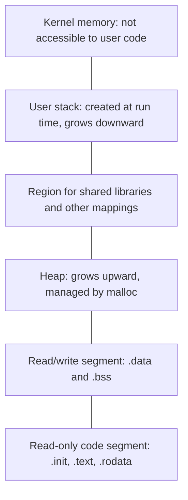
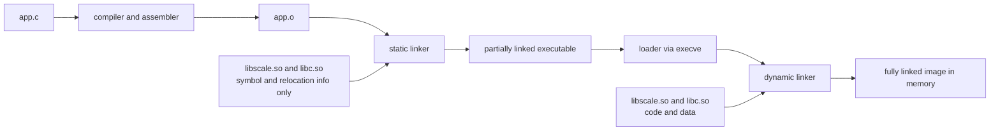
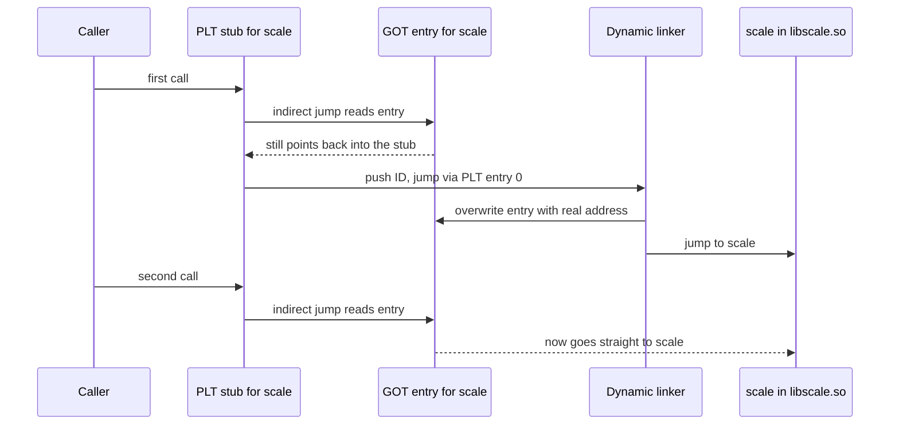

# Executables, loading and dynamic linking

> **Before this lesson:** This lesson follows [Static linking: symbols and relocation](#/lesson/csapp/static-linking); you need symbols, sections and relocation from there. A first acquaintance with processes and virtual addresses from [Caches, the OS, and the big themes](#/lesson/csapp/tour-os) is also assumed.

## In plain words

Many programs use the same common code, for example the routines that print text. Putting a full copy inside every program wastes space and makes updates painful. A **shared library** is a single copy of such code, stored once on the machine and connected to each program at the moment the program starts. Think of a town library: households do not each buy every reference book, they share one copy and look things up when needed. Starting a program therefore has two parts. **Loading** means placing the program into memory so it can run. **Dynamic linking** means connecting it, at that moment, to the shared libraries it needs.

Why this matters at work: this is why one security update to a library protects every program that uses it, and it is also the cause of the familiar start-up failure "cannot open shared object file". The same mechanism powers plug-ins, language extension modules, and debugging tools that slip their own code in front of a library function.

## Why look closer

The previous lesson ended with the static linker having merged a pile of object files into one executable. That is only half the journey of a program. This lesson follows the other half. What exactly is inside that executable file, and how does the kernel turn it into a running process? Why is a "hello world" binary on your machine about 16 KB when the C library it depends on is two megabytes? How can a security fix to that library protect every installed program without a single one being rebuilt? How does a call to `printf` find its target when the library's address is not chosen until the program starts, and is deliberately different on every run? And how do tools such as memory debuggers slip their own version of `malloc` underneath an unmodified program? The answers are shared libraries, position-independent code, two small tables called the GOT and the PLT, and a technique called interposition.

## 1. Inside an executable file

An executable on Linux uses the same container format, ELF, as the relocatable object files that went into it, but it is organised for a different reader. Object files are organised for the *linker*; an executable is organised for the *loader*. Everything has already been relocated to its final run-time address, so the relocation sections are gone, and the file gains a table that says how to map itself into memory.

| Part | What it holds |
|---|---|
| ELF header | overall format, target machine, and the **entry point**: the address of the first instruction to execute |
| Program header table | one record per **segment**, telling the loader which bytes of the file to map where, and with what permissions |
| `.init` | a small routine run by the start-up code for initialisation |
| `.text`, `.rodata` | machine code and read-only constants |
| `.data` | initialised global and static variables |
| `.bss` | uninitialised globals; occupies no bytes in the file, only a size |
| `.symtab`, `.debug`, `.line`, `.strtab` | symbol and debugging information, never loaded into memory |
| Section header table | descriptions of the sections |

A **segment** is a contiguous chunk of the file that will become a contiguous region of memory. A typical executable has two loadable ones:

- a **code segment** with read and execute permission, containing the ELF header, the program header table, `.init`, `.text` and `.rodata`;
- a **data segment** with read and write permission, containing `.data` and `.bss`.

Each program header record gives the segment's offset in the file, its virtual address, its size in the file, its size in memory, its permissions and an alignment. Two things about those fields explain a lot:

- **Memory size can exceed file size.** For the data segment, the difference is exactly `.bss`: space that the loader must provide, filled with zeros, although nothing is stored for it on disk.
- **Address and file offset agree modulo the alignment.** The linker chooses addresses so that `vaddr mod align == offset mod align`. This lets the kernel map the file directly into memory page by page, with no copying or shifting.

```python-run
# Two program-header records as the loader sees them (made-up but realistic numbers).
segments = [
    dict(name="code", perms="r-x", off=0x000000, vaddr=0x400000, filesz=0x0A40, memsz=0x0A40, align=0x200000),
    dict(name="data", perms="rw-", off=0x000E10, vaddr=0x600E10, filesz=0x0228, memsz=0x0260, align=0x200000),
]
for s in segments:
    ok = s["vaddr"] % s["align"] == s["off"] % s["align"]
    bss = s["memsz"] - s["filesz"]
    print(f"{s['name']} [{s['perms']}] file bytes {s['off']:#x}..{s['off'] + s['filesz']:#x} "
          f"-> memory {s['vaddr']:#x}..{s['vaddr'] + s['memsz']:#x}")
    print(f"     alignment rule holds: {ok}; zero-filled bytes beyond the file contents (.bss): {bss}")
```

## 2. Loading: from file to running process

When you run `./prog`, the shell forks a child, and the child calls `execve`. That invokes the kernel's **loader**, which replaces the process's memory image with one built from the file and then jumps to the entry point. The process of bringing the program into memory and starting it is called **loading**.

The resulting memory image has a standard shape on x86-64 Linux:



Code sits at low addresses, followed by data, then the heap growing upward. The stack starts near the top of the user address space and grows downward, and the region between is where shared libraries are mapped. For security, modern systems randomise the positions of the stack, heap and library region on every run (address-space layout randomisation), keeping their relative order.

The entry point is not `main`. It is a small routine conventionally named `_start`, supplied by a system object file linked into every C program. `_start` calls the C library's start-up function, which initialises the runtime, calls your `main` with the argument and environment vectors, and passes `main`'s return value to `exit` when it comes back, returning control to the kernel.

One detail is easy to miss. "Loading" copies almost nothing. The loader sets up mappings from the process's virtual pages to the corresponding places in the file. Actual bytes are read from disk only when a page is first touched, through the page-fault mechanism. A 300 MB binary of which a run uses 5 MB costs 5 MB.

## 3. Why static libraries are not enough

Static libraries solve the problem of packaging related functions, but they have two lasting costs.

- **Duplication.** Nearly every C program uses the standard I/O functions. With static linking, a copy of that code is embedded in the text of every executable on disk and, worse, in the memory of every running process. On a machine running hundreds of processes that is a serious waste.
- **Maintenance.** When a bug is fixed in a library, every program that uses it must be found and explicitly relinked against the new version.

**Shared libraries** remove both. A shared library, also called a shared object and carrying the suffix `.so` on Linux (a DLL on Windows), is an object module that can be loaded at an arbitrary memory address and linked with a program *at load time or at run time*. The work is done by a program called the **dynamic linker**, and the process is **dynamic linking**.

"Shared" has two meanings here:

1. On any file system there is exactly **one `.so` file** per library. Its code and data are not copied into the executables that use it.
2. A **single copy of its `.text`** in physical memory can be shared by every running process that uses it, because the same read-only pages are mapped into each.

## 4. How a dynamically linked program is put together

Building is done in two stages, split between build time and load time.

```c
/* scale.c */                         /* app.c */
int factor = 3;                       #include <stdio.h>
int scale(int x) { return x * factor; }   int scale(int);
                                      int main(void) { printf("%d\n", scale(14)); return 0; }
```

```
gcc -shared -fpic -o libscale.so scale.c
gcc -o app app.c ./libscale.so
```

`-fpic` asks for position-independent code and `-shared` asks the linker to produce a shared object. In the second command the static linker does only *part* of its job. It copies **none** of the library's code or data into `app`. It copies only some relocation and symbol-table information that will allow references to `scale` and `factor` to be resolved later. The output is a *partially linked* executable.

At load time:

1. The loader maps the executable and notices that it contains an `.interp` section naming a dynamic linker (itself a shared object, for example `ld-linux-x86-64.so.2`).
2. Instead of jumping to the application, the loader maps and runs that dynamic linker.
3. The dynamic linker maps the text and data of the C library and of `libscale.so` into free regions of the address space.
4. It relocates every reference in the application to symbols defined in those libraries.
5. It passes control to the application. From then on the libraries' locations are fixed for the life of the process.



### Linking at run time, on request

An application can also ask the dynamic linker to load a library while it is already running, without that library having been mentioned at build time:

```c
#include <dlfcn.h>
void *dlopen(const char *filename, int flag);     /* load; returns a handle or NULL */
void *dlsym(void *handle, char *symbol);          /* address of a symbol, or NULL */
int   dlclose(void *handle);                      /* unload if no one else uses it */
const char *dlerror(void);                        /* text of the most recent error */
```

The flag is `RTLD_NOW` to resolve all the library's undefined symbols immediately, or `RTLD_LAZY` to postpone each until it is first used. Programs that call these functions are linked with `-ldl` and, if the loaded library needs to refer back to symbols in the main program, `-rdynamic`.

This is the mechanism behind plug-ins, behind web servers that load handler modules on demand, behind software that updates a component without restarting, and behind the native extension modules of languages such as Python and Java (whose JNI loads compiled C code this way).

Python's `ctypes` module is a thin layer over exactly these calls. The demo loads the C library at run time, looks up a function by name, and calls it; it explains itself if that is not possible in your environment.

```python-run
import ctypes, ctypes.util

def demo():
    path = ctypes.util.find_library("c") or ctypes.util.find_library("msvcrt")
    lib = ctypes.CDLL(path)                       # dlopen
    fn = lib.abs                                  # dlsym("abs")
    fn.argtypes, fn.restype = [ctypes.c_int], ctypes.c_int
    return path, fn(-2026)                        # an indirect call through the looked-up address

try:
    path, value = demo()
    print("loaded", path, "at run time; abs(-2026) =", value)
except Exception as exc:
    print("run-time loading is not available in this sandbox:", type(exc).__name__)
    print("on Linux this prints something like: loaded libc.so.6 at run time; abs(-2026) = 2026")
```

## 5. Position-independent code

For many processes to share one physical copy of a library's code, that code must work no matter where it is mapped, since different processes will have it at different addresses. Patching absolute addresses into the code at load time would make each process's copy different and defeat sharing. Code that can be loaded anywhere without modification by the linker is **position-independent code** (PIC). Shared libraries must always be compiled this way.

References *within* a module need nothing special: x86-64 can address code and data relative to the program counter, and distances inside one module are fixed when it is built. The challenge is references to symbols defined in *other* modules, whose addresses are unknown until load time. The solutions rest on one fact:

> Wherever a module is loaded, its data segment is always the same distance from its code segment. So the distance between any instruction and any location in the module's own data is a constant known at link time.

### Data references: the global offset table

The compiler places a table called the **global offset table** (GOT) at the start of the module's data segment. It has one 8-byte entry for each global data object (or function) that the module refers to. For each entry the compiler emits a relocation record; at load time the dynamic linker fills the entry with the object's absolute address.

Code reaches a global *indirectly*: it loads the pointer from the GOT entry, found at a fixed PC-relative distance, and then dereferences it.

```asm
    movq  factor@GOTPCREL(%rip), %rax    # rax = address of factor, fetched from the GOT
    movl  (%rax), %eax                   # eax = value of factor
```

The code contains no absolute addresses, so it is identical in every process and can be shared. The GOT lives in the *data* segment, of which each process has its own private copy, so each process can hold its own addresses there.

### Function calls: lazy binding through the PLT

Function calls could use the same trick, but a typical program calls only a small fraction of the hundreds or thousands of functions a library such as libc exports. Resolving all of them at start-up would slow every program launch for little benefit. So the toolchain uses **lazy binding**: the address of a function is not resolved until the first time it is actually called.

Two tables cooperate.

- The **procedure linkage table** (PLT) is part of the *code* segment. It is an array of small 16-byte stubs. Entry 0 is a special stub that jumps into the dynamic linker. Each function the module calls gets its own entry after that.
- The **GOT**, in the data segment, holds one entry per called function, plus a few reserved entries at the front that the dynamic linker uses: information identifying the module, and the dynamic linker's entry address.

Initially, each function's GOT entry points *back into its own PLT stub*, at the instruction after the stub's first jump. Follow a first call to `scale`:

1. The program calls the PLT stub for `scale` instead of `scale` itself.
2. The stub's first instruction jumps indirectly through the GOT entry for `scale`. That entry still points to the next instruction of the same stub, so control continues there.
3. The stub pushes an ID number for `scale` and jumps to PLT entry 0.
4. PLT entry 0 pushes an argument identifying the module and jumps into the dynamic linker.
5. The dynamic linker uses the two values on the stack to work out which function is wanted, finds its real address, **overwrites the GOT entry** with it, and transfers control to `scale`.

On every later call:

1. The program calls the same PLT stub.
2. The stub's indirect jump through the GOT now lands directly in `scale`.

The first call costs a symbol lookup; all others cost one extra indirect jump.



```python-run
# A working model of lazy binding. Addresses are plain strings.
library = {"scale": "0x7f10_2a40", "puts": "0x7f55_0e50"}       # where the functions really live
got = {name: f"plt_stub[{name}]+6" for name in library}         # initial state: back into the stub
lookups = 0

def call(name):
    global lookups
    target = got[name]
    if target.startswith("plt_stub"):          # not bound yet: take the slow path
        lookups += 1
        got[name] = library[name]              # the dynamic linker patches the GOT
        return f"call {name}: slow path, resolved and patched GOT -> {got[name]}"
    return f"call {name}: fast path via GOT -> {target}"

for name in ("scale", "scale", "scale", "puts"):
    print(call(name))
print("symbol lookups performed:", lookups, "| functions never called cost nothing")
```

> [!NOTE]
> Because the GOT is writable and holds code addresses, it is an attractive target for memory-corruption attacks. Hardened builds therefore ask the dynamic linker to resolve everything at start-up and then mark the GOT read-only ("full RELRO"), trading a slightly slower launch for safety. Executables themselves are usually built position-independent as well (PIE), so that address-space randomisation covers the main program too.

## 6. Library interposition

Because symbol resolution is a well-defined process, you can get in the middle of it. **Interposition** means intercepting calls to a library function and running your own code instead, usually a wrapper that does something extra and then calls the real function. It is how profilers count calls, how leak detectors track every allocation, how sandboxes filter file access, and how test suites inject failures.

The basic recipe: given a target function, write a wrapper with the *identical prototype*, and by some means trick the system into calling the wrapper. Three moments are available.

| When | How | What you need |
|---|---|---|
| **Compile time** | the C preprocessor: a private header defines `malloc(n)` as a macro expanding to `my_malloc(n)`, and `-I.` makes the compiler find that header first | the program's source code |
| **Link time** | the static linker's `--wrap` option: `-Wl,--wrap,malloc` makes references to `malloc` resolve to `__wrap_malloc`, and references to `__real_malloc` resolve to the genuine `malloc` | the relocatable object files |
| **Run time** | the dynamic linker's `LD_PRELOAD` environment variable: libraries listed there are searched **before all others** when resolving symbols | only the executable |

Run-time interposition is the most powerful, since it needs neither source nor object files and works on any dynamically linked program. The wrapper library defines its own `malloc`; to reach the original it calls `dlsym(RTLD_NEXT, "malloc")`, which means "find the next definition of this name in the search order after me".

```c
/* trace.c: build with  gcc -shared -fpic -o trace.so trace.c -ldl */
#define _GNU_SOURCE
#include <dlfcn.h>
#include <unistd.h>
void *malloc(size_t n) {
    static void *(*real)(size_t);
    if (!real) real = dlsym(RTLD_NEXT, "malloc");
    void *p = real(n);
    write(2, "malloc called\n", 14);      /* not printf: it might call malloc and recurse */
    return p;
}
```

Running `LD_PRELOAD=./trace.so ls` would then log every allocation `ls` makes. The comment in the code flags the classic trap: a wrapper around `malloc` must not call anything that itself allocates, or it recurses without end.

Python can illustrate the idea, though not the mechanism, by rebinding a name to a wrapper:

```python-run
import math
calls = []
real_sqrt = math.sqrt                       # keep a handle on the original, like dlsym(RTLD_NEXT)

def traced_sqrt(x):                         # same signature as the target
    calls.append(x)
    return real_sqrt(x)

math.sqrt = traced_sqrt                     # every later lookup of math.sqrt finds the wrapper
try:
    print("hypotenuse:", math.sqrt(3 ** 2 + 4 ** 2))
    print("another   :", math.sqrt(2))
finally:
    math.sqrt = real_sqrt                   # un-interpose
print("intercepted arguments:", calls)
```

> [!WARNING]
> `LD_PRELOAD` is a legitimate debugging and instrumentation facility, and for that reason the dynamic linker ignores it for programs that run with elevated privileges. Treat any unexpected preload setting on a production system as a sign that something needs investigating.

## 7. Tools for looking inside

| Tool | Use |
|---|---|
| `readelf` | display any part of an ELF file: headers, segments, sections, symbols |
| `objdump` | disassemble `.text`, show relocations and section contents |
| `nm` | list the symbols defined and referenced by an object file |
| `ldd` | list the shared libraries an executable needs at run time |
| `size` | report the sizes of the sections |
| `strings` | print the printable strings contained in a file |
| `strip` | remove symbol-table information to shrink a file |
| `ar` | create static libraries and inspect or extract their members |

When a program fails at launch with "cannot open shared object file", `ldd` is the first thing to run.

> [!INTERVIEW]
> **"Static versus dynamic linking: what are the trade-offs?"** Static linking copies library code into each executable: self-contained deployment, no start-up resolution cost, no dependency on what is installed, but larger files, duplicated memory, and a rebuild to pick up library fixes. Dynamic linking keeps one copy on disk and shares code pages among processes, and libraries can be updated independently, but adds a little start-up and call overhead and introduces version-compatibility problems. Containers and languages such as Go lean static; operating-system distributions lean dynamic.

> [!INTERVIEW]
> **"How does a call into a shared library find its target?"** Through the PLT and GOT. The call goes to a PLT stub, which jumps through a GOT entry. On the first call that entry leads into the dynamic linker, which looks up the symbol, writes the real address into the GOT, and jumps to it. Afterwards the stub's jump goes directly to the function. This lazy binding keeps code position-independent and shareable while paying for resolution only on functions that are actually used.

## 8. Pitfalls

- **Expecting the library to be inside the executable.** A dynamically linked program fails at start-up if the `.so` is missing or not on the search path (`LD_LIBRARY_PATH`, the run path recorded in the binary, and the system cache).
- **Forgetting `-fpic` when building a shared library.**
- **Assuming addresses are stable between runs.** With randomisation, the stack, heap, libraries, and position-independent executables move every time.
- **Version mismatches.** A program built against one version of a library may crash with another if the interface changed.
- **Global symbol clashes.** A function in your program with the same name as a library function silently takes precedence, which is interposition by accident.
- **Wrappers that recurse.** An interposed `malloc` that calls an allocating function loops forever.
- **Assuming `.bss` takes disk space,** or that a large binary means a large memory footprint.

## Summary

- An executable is an ELF file arranged for loading: a program header table describes segments to be mapped, typically read-only code and read/write data, and the header gives the entry point.
- The loader maps those segments, creates a stack, and jumps to `_start`, which sets up the C runtime and calls `main`. Pages are read from disk lazily.
- Shared libraries exist once on disk and their code pages are shared in memory. The static linker records only symbol and relocation information; the dynamic linker completes the job at load time, or on demand through `dlopen` and `dlsym`.
- Position-independent code refers to external data through the GOT and calls external functions through PLT stubs that bind lazily on first use.
- Interposition replaces a library function with a wrapper at compile time (macros), link time (`--wrap`), or run time (`LD_PRELOAD` with `RTLD_NEXT`).

## Glossary

- **Executable**: a file in a form the operating system can load and run.
- **Segment**: a chunk of an executable that is placed into memory as one region with one set of permissions.
- **Program header table**: the part of an executable that tells the loader where each segment goes.
- **Entry point**: the address of the first instruction run when a program starts.
- **Loader**: the operating system code that places a program in memory and starts it.
- **Shared library (`.so`)**: a library kept as one file and linked to programs when they start or while they run.
- **Dynamic linker**: the program that connects an executable to its shared libraries at load time.
- **Position-independent code (PIC)**: code that works unchanged at whatever address it is placed.
- **GOT (global offset table)**: a table of addresses, filled in at run time, through which code reaches outside symbols.
- **PLT (procedure linkage table)**: a set of short code stubs through which calls to library functions are routed.
- **Lazy binding**: postponing the lookup of a function's address until the first time it is called.
- **Interposition**: arranging for your own function to be called in place of a library function.
- **ASLR**: address-space layout randomisation: placing parts of a program at different addresses on each run, for security.

```quiz
[
  {"q": "In an executable's data segment, the size in memory is 0x260 bytes but the size in the file is 0x228. What accounts for the extra 0x38 bytes?",
   "options": ["Alignment padding only", "The .bss section, which occupies memory but no file space", "Debug symbols", "The procedure linkage table"],
   "answer": 1, "explain": "Uninitialised data needs no stored bytes. The loader allocates it and fills it with zeros, so the in-memory size exceeds the on-disk size."},
  {"q": "Where does execution of a C program begin after loading?",
   "options": ["At main", "At the entry point _start, which sets up the runtime and then calls main", "At the first function in .text alphabetically", "In the dynamic linker's exit routine"],
   "answer": 1, "explain": "The ELF header's entry point is the start-up routine. It calls the C library initialisation, then main, then exit with main's return value. For dynamically linked programs the dynamic linker runs first."},
  {"q": "When a program is linked against a shared library at build time, what does the static linker copy into the executable?",
   "options": ["The library's code and data", "Only the library's code", "Relocation and symbol-table information, but no code or data", "Nothing at all"],
   "answer": 2, "explain": "The executable is only partially linked. The actual code and data stay in the .so file and are mapped at load time by the dynamic linker."},
  {"q": "Why must shared library code be position-independent?",
   "options": ["So it runs faster", "So one unmodified copy of the code can be mapped at different addresses in different processes", "Because the heap is randomised", "Because it has no data segment"],
   "answer": 1, "explain": "If load-time patches were written into the code, each process would need its own copy. PIC keeps the code identical everywhere so its pages can be shared."},
  {"q": "During the first call to a library function through the PLT, what does the dynamic linker do?",
   "options": ["Copies the function into the executable", "Resolves the function's address, stores it in the GOT entry, and jumps to the function", "Rewrites the call instruction in .text", "Reloads the whole library"],
   "answer": 1, "explain": "Lazy binding patches the GOT entry on first use. Subsequent calls jump through the updated entry straight to the function."},
  {"q": "Which fact makes GOT-based addressing possible?",
   "options": ["Libraries are always loaded at the same address", "The distance between a module's code and its own data segment is fixed regardless of load address", "The stack is executable", "All functions are the same size"],
   "answer": 1, "explain": "Since the GOT sits at a constant offset from any instruction in the module, code can find it with PC-relative addressing wherever the module is mapped."},
  {"q": "You have only a compiled, dynamically linked executable and want to log its calls to malloc. Which interposition method works?",
   "options": ["Compile-time macros", "Link-time --wrap", "Run-time LD_PRELOAD", "None"],
   "answer": 2, "explain": "Compile-time interposition needs source and link-time needs object files. LD_PRELOAD makes the dynamic linker search your wrapper library first."},
  {"q": "Which tool lists the shared libraries an executable requires at run time?",
   "options": ["strip", "ar", "ldd", "size"],
   "answer": 2, "explain": "ldd prints each needed shared object and where the dynamic linker would find it."}
]
```

> **Source:** CS:APP 3e, §7.8–7.13
